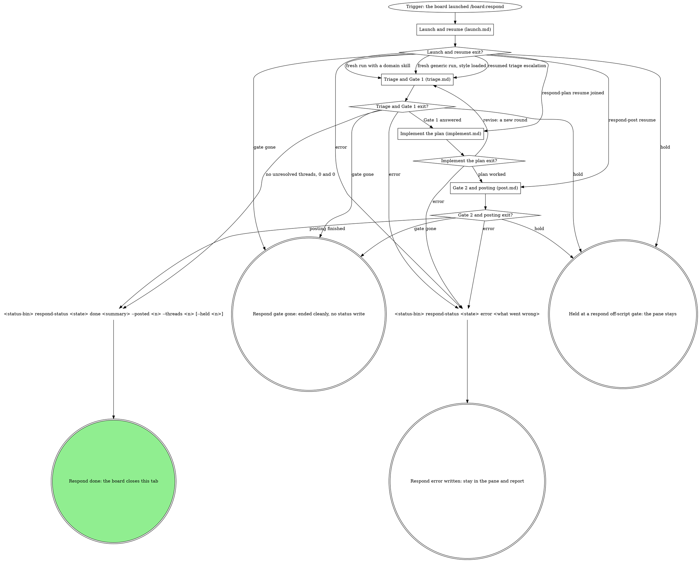
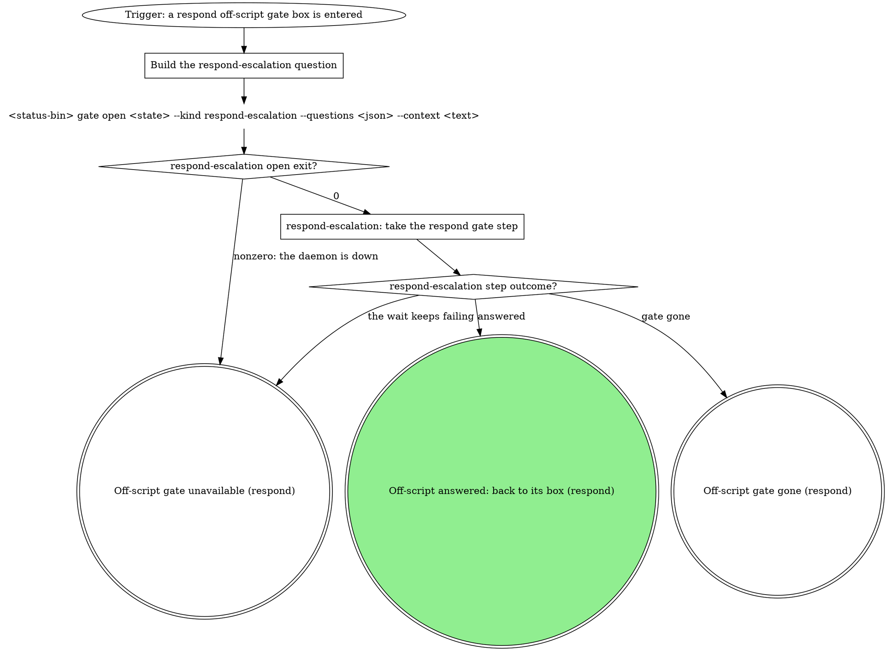

<!-- expanded by rt skills expand from the sources below; edits here are drift (edit the source dir and re-run) -->

Pointers here are `@keys`. Resolve them once per run: if you already hold a `skills_resolve` map that covers `skills:board:respond`, use it; otherwise call `skills_resolve {id: "skills:board:respond"}` and use the path it returns for each key, in anything you hand a subagent or a tool too. If it fails, stop and say so; never look for the file another way.

<!-- part: step source=respond/SKILL.md path=respond/SKILL.md lines=19-634 -->
# mr-board respond runner

The mr-board spawned this pane to process the review feedback on ONE of your own
MRs and report status back to the board through its status CLI. A human
decides only at a gate. This wrapper carries **no** domain knowledge; the
board injects it:

| flag | meaning |
|------|---------|
| `<mrUrl>` (positional) | your merge request whose feedback to process |
| `--state <handle>` | opaque board handle for this MR's response. Pass it verbatim to `--status-bin` and the `gate` verbs; never read, stat, or write it. It looks like a `.json` path but no such file exists: board state lives in the board's database, and the path is only a key. Its absence on disk says nothing about whether the board is tracking this pass. |
| `--status-bin <path>` | absolute path to the board's status-writer CLI |
| `--report <path>` | where the fill saves the adjudication table and drafted/finalized replies; a resumed pane posts from it |
| `--skill <name>` | the domain skill that owns the actual work (optional) |
| `--skill-path <path>` | absolute path to that skill's SKILL.md, when the board already resolved it (optional; see "Resolving the domain skill") |
| `--resumed-gate <gateId>` | this invocation is a parked-gate resume, not a fresh run (optional; see "Resumed entry" in `launch.md`) |
| `--resumed-gate-kind <kind>` | the `kind` of the gate `--resumed-gate` names (`respond-plan`, `respond-post` or `respond-escalation`). Present exactly when `--resumed-gate` is, and the only way to learn it: `--state` is an opaque handle and `gate wait` returns only the answer. |
| `--round <n>` | the round to delegate at, carried over from an earlier pane on this MR (recorded by the `--round` flag on `<status-bin> respond-status <state> drafting --round <n>`; see "Recover the round from --round (absent: 1)" in `launch.md`). Present on a parked-gate resume when a prior pane got as far as recording one, or on a fresh run when the board found a prior recorded round for this MR (a new run responding to a further round of review); absent means round 1, either because this is the MR's first round or because no earlier pane recorded a round. On a fresh run that also carries `--person`, `<n>` is the board's count of responses to that person on this MR, and this pane's `drafting --round` still counts on from it, one per `revise`. |
| `--person <username>` | the one person whose feedback this run answers: the resolvable threads they started and their Overview comments. Absent means every unresolved human thread (a pane launched by an older board). |

Write status **only** by running the injected `--status-bin`:

```
<status-bin> respond-status <state> <status> [message]
<status-bin> respond-status <state> done <message> --posted <n> --threads <n> [--held <n>]
```

The board tracks five in-flight statuses; emit each as you cross the milestone:

| Status | When to emit |
|--------|--------------|
| `triaging` | Immediately, before fetching threads. |
| `implementing` | Only after Gate 1's `code-changes` question comes back `approve`, before touching code. Skip when no threads need code changes. |
| `drafting` | When presenting the verdict table + drafted replies (before Gate 1), and again right before Gate 2 opens, on every path: after implementing, and after drafting a reply override with nothing implemented. |
| `done` | After the run finishes, zero threads included, as this pane's last tool call (see "The done write is the last call"). REQUIRED: `--posted <n> --threads <n>`, plus `--held <n>` whenever a gate decision kept any reply from posting (see "Counts and the badge"). |
| `error` | Anything unrecoverable (bad MR, delegated skill failed). |

## Flow

The graph is the map: start at the trigger and take only the edges it
draws. Each stage box has its own section below the graph, which names the
stage file that holds the stage's graph and its step sections.



What the graph cannot show:

- **Thread ids.** On the generic path a thread's id is the discussion's
  `id` in the `mr_threads` result: the same string the gate option values
  carry (`reply:<threadId>`), the report rows key on, and
  `mr_reply_thread` and `mr_resolve_thread` take as `discussionId`.
- **Budgets.** Each `Fixed the <tool> call once already?` counter counts
  for the whole run, per thread for `mr_reply_thread` and
  `mr_resolve_thread`. A guard STOP's re-entry passes the same counter as
  a refusal or tool error. None resets after an off-script iterate: a
  refusal after an iterate goes straight back to that origin's off-script
  gate, and its `Off-script rounds = 2 (...)?` counter (per thread for the
  two posting origins) bounds the loop. The round rides in the gate's
  option values, so the budget holds across a park. A resumed pane counts
  every counter from zero, except that a resumed escalation seeds its
  origin's rounds counter at the value's round, and a resumed iterate
  seeds its origin's fix-once counter as spent (the named thread's, for
  the two posting origins), as a live iterate leaves it: a refusal after
  the retry goes straight back to the off-script gate. A resumed iterate
  at round 2 never retries: it takes its origin's
  `Off-script rounds = 2 (...)?` yes exit, as the live pane would: the
  held path at `git_push`, the thread left down at the two posting
  origins, `mr_threads` with no branch at `mr_view`, `error` at the two
  `mr_threads` reads.
  `Revise rounds = 3?` counts the `revise` answers this pane acted on; a
  resumed pane counts from zero.
  `Fix attempts = 3 (this thread)?` counts attempts per fix thread.
  `Resumed wait failures = 3 (respond)?` counts failing resumed waits;
  closed, not found and `no gate open` are terminal, never counted.
- **Exit messages.** `done` carries a short summary and the counts ("Counts
  and the badge"). `error` names what went wrong specifically: the bad MR,
  the refused tool with its error, the failed domain skill,
  `revise budget spent after 3 rounds; drafts kept in --report`, the
  resumed wait's third failure, or a resumed escalation whose `--report`
  lacks the answer it needs (naming the file). Gate gone writes no
  status: say so in the pane and stop, since whatever superseded the gate
  already owns this MR's board state.

- **The done write is the last call.** The board closes this pane's tab
  the moment `respond-status <state> done` lands, which ends this session
  mid-batch. So the done write is a call of its own, sent only after every
  other write of the run has returned: the domain skill's own close (under
  a run, its `run_stage` done and `run_status` done), the `--report`
  writes, and every forge write (the domain skill's, or the generic path's
  `git_push`, `mr_reply_thread` and `mr_resolve_thread`). A write sent in
  the same batch as the done write is lost, and its run reads stale in the
  console.

### Launch and resume (launch.md)

The first acts of every launch: the status the entry implies, the domain
skill resolution, the writing style on the generic path, and on a parked-gate
resume the recorded answer read with `gate wait` before anything else, the
Posted already read, the join to `--report`, and for a `respond-escalation`
the route back to the stage its origin names.
Read `launch.md` now and follow its graph; its sections are there.

### Triage and Gate 1 (triage.md)

Adjudicate every unresolved human thread (only the `--person`'s threads and
Overview comments when the launch names one), through the domain skill or on
the generic path, write the verdict table and drafts to `--report`, and open Gate 1
(`respond-plan`) from a fitted open file, the domain skill's or one fitted
here with `gate_open` (a source `gate_open` keeps refusing opens plain,
through `<status-bin> gate open <state> --kind respond-plan`), then wait for
its answer.
Read `triage.md` now and follow its graph; its sections are there.

### Implement the plan (implement.md)

Record the Gate 1 answer, draft the reply overrides, and act on
`code-changes`: implement the fixes on `approve`, hand the plan over on
`skip`, or re-adjudicate at the next round on `revise`.
Read `implement.md` now and follow its graph; its sections are there.

### Gate 2 and posting (post.md)

When there are threads to offer, open Gate 2 (`respond-post`) from a
fitted open file, the domain skill's or one fitted here (or plain, through
`<status-bin> gate open <state> --kind respond-post`), push the fixes with
`git_push` after the two checks, then post and resolve as the answer picks,
the reply-only threads included.
Read `post.md` now and follow its graph; its sections are there.

## Gate step (gate-step.md)

Gate 1, Gate 2 and every off-script gate take the shared gate step after
their open. Its graph and sections are in `gate-step.md`; each gate box says
when to read it.

The gate step's pane forms follow the gate protocol included at the end of
this skill: its "Present the in-pane gate form" step and its "Answers are
option values" and "Doorbell" sections, for the rendering and conflict
mechanics. Where it records the pane's answer with the `gate_answer` tool,
a board gate records it with `<status-bin> gate answer <state> --answers
<json> --by pane` instead.

## Off-script step

Every `respond off-script gate: ...` box takes this step. It is a board
gate of kind `respond-escalation`, opened through the status-bin on this
MR's respond state, and it runs through "Gate step" (`gate-step.md`) like
Gate 1 and Gate 2. The step writes no status: the current one stands while
it waits. Opening it moves the state's gate id to the escalation, and
`gate wait` can then no longer return an earlier gate's answer: that is
why Gate 1's answer sits in the report rows (and in a `gate-1-answer:`
line on a resume) and Gate 2's picks are recorded before anything posts.
The box that entered reads the outcome:

- **Answered:** its outcome diamond reads `answers.action`'s value, which
  starts with `take:`, `iterate:`, `hold:` or `hand back:`. A hold answer
  ends the turn with the pane open and no terminal status.
- **Unanswered:** the turn ends at `End the turn: holding at gate
  <gateId> (respond)` with no terminal status. The board parks the pane
  after its grace window and resumes it on the answer, and `Route the
  resumed escalation by its origin (respond)` (in `launch.md`) picks up
  where this pane stopped.
- **Gone** (closed, not found, or `no gate open`): end cleanly, say so in
  the pane, and write no status.
- **Unavailable** (the open exits nonzero, or the wait fails three times):
  the box's `gate unavailable` edge, which does what hand back does.



### Build the respond-escalation question

Exactly one question: id `action`, `multi: false`, its `label` the box's
situation line, and the four options the box's table gives, in order take,
iterate, hold, hand back. Each option is an object:

```json
{"value": "iterate: you fixed the cause, read the threads again (mr_threads refused, round 1)", "label": "Fixed it, read again", "description": "You fixed what refused the read and I read the threads again."}
```

`value` is spelled in full, starts with its verb, names the proposed move,
and ends `(<refused tool or origin>, round <k>)`, where `k` is this
origin's current off-script round: 1 at its first gate, 2 at the gate
after one iterate. A resumed pane reads the origin and the round back
from the value, so both are spelled exactly as the box's table gives
them. `label` is 2 to 6 words; `description` is one sentence saying what
happens on that answer. Four options stay inside the native form's
per-question cap.

At round 2 the iterate cannot retry: `Off-script rounds = 2 (...)?`
answers yes, and in every respond table that exit does what the hand
back row does (the held path at `git_push`, the thread left down at
`mr_reply_thread` and `mr_resolve_thread`, no source branch at
`mr_view`, `error` at the `mr_threads` reads). Keep the iterate's
`value` exactly as the table spells it, so a resumed pane still routes
it as an iterate at round 2, and give it the label `No retry: ` plus the
hand back row's label (its first letter lowercased) and the description
`Retries are spent, so ` plus the hand back row's description:

```json
{"value": "iterate: you fixed the cause, check the target and push again with git_push (git_push refused, round 2)", "label": "No retry: hold the fixed replies", "description": "Retries are spent, so I hold the fixed threads unposted and post every other reply."}
```

`--context` quotes both errors verbatim (the first refusal and the one
after the fix) with the call that was refused. Never send an empty
context. The gate stores it whole at any size, like Gate 1's and Gate
2's, so never pre-trim it yourself. A nonzero open exit is not itself
an off-script origin: it is `Off-script gate unavailable (respond)`.

### respond-escalation: take the respond gate step

Read `gate-step.md` and take "Gate step" with the open's `gateId` and
`presentation`. Its outcome comes back here: answered (`answers.action`
and `by`, from the pane form's `gate answer`, its CAS-loss line, or the
wait), gate gone (end cleanly with no status write), or the wait keeps
failing (`gate unavailable`, never a native form). Nothing moves before
the answer.

## Operator note

The launch prompt may end with a paragraph beginning `Operator note (from the
human who launched this pane):`. That is direct instruction from the human,
typed at launch time: not a flag and not part of the MR. Honor it while
processing the feedback (e.g. "push back on the naming comment", "only handle
thread 2") and pass it along to the domain skill as context. It never overrides
the status contract or either gate. A note that asks for a move the graph
marks STOP takes the off-script edge instead.

## Resolving the domain skill

The domain skill that owns the actual work comes from the first source that
answers; the order is fixed and the flow's first diamonds draw it:

1. **Explicit `--skill <name>` wins.** When the board passed it, use it and do
   not run the resolver. When the board also passed `--skill-path <path>`,
   read the SKILL.md at that absolute path directly and treat it exactly as
   the domain skill named by `--skill`.
2. **Otherwise resolve the `respond` slot** with the vendored resolver,
   `"@respond/scripts/resolve-args.sh"`. On exit 0, read the
   SKILL.md at `resolved.respond.path` and treat that skill exactly as if it
   had been passed via `--skill`.
3. **Otherwise degrade loudly.** On a nonzero exit, print the resolver's JSON
   `errors` verbatim in the pane. Never guess or substitute a binding; the
   script is the only enforcement point. The generic path follows.

## Gate 1 and Gate 2 shapes

**Fitted open files.** A domain skill may hand back a fitted open file for
either gate: `gate-ctx.sh fit` output whose `.questions` already have the
shape below, each thread's structured context on its question (and, for
Gate 1, the planned fix on its `fix` option). That file IS the gate: open
it with `open-gate.sh` and the gate's kind, never re-ordered, trimmed or
hand-edited. Two cases refit it from the source beside it instead
("Gate context"): triage dropped a row from it, or `--person` is set and
the source's gate `reviewer` is someone else. The script prints the same JSON line as `gate
open` and exits with its status. The gate stores every context whole; the
file's `pane` key is the prose the pane form shows, already fitted to the
pane budget (see "Fitted files" in `gate-step.md`), and a file whose `pane`
reads `contextDropped: true` left some question context out of the pane
form. The file goes in untouched. A
Gate 2 file ends with a pane-only `next` navigation question this wrapper
does not ask; the script drops it.

**Gate context.** A gate this wrapper builds or refits itself carries the
structured context the board draws its respond face from (the person,
the round, the chips, a card per thread). Make one scratch directory,
`<dir>`, inside this session's scratchpad (the Claude Code temp root, the
only place `gate_open` reads `sourcePath` and writes `outPath`), never
`mktemp -d`, and spell its path out literally. Write the gate's source
there as `<dir>/respond-plan.source.json` (Gate 1) or
`<dir>/respond-post.source.json` (Gate 2): `{"context": <gate context>,
"questions": [...]}`, the questions exactly as drawn below, each thread
question's `context` its structured object. Fit it with `gate_open {kind:
<the gate's kind>, sourcePath: <the source>, handBack: true, outPath:
<dir>/<the gate's kind>.open.json}`, then open `outPath` with
`open-gate.sh` like any fitted file. Only `gate_open` fits: never shorten
a reply or hand-edit the open to make it fit. The hand-back's
`formContext` and `formChunks` are its pane form's prose.

| Field | Filled from |
|---|---|
| gate `reviewer` | the `--person`; without one, the author with the most rows, ties to the first to appear |
| gate `round` | this run's round, the `<n>` of its `drafting --round <n>` |
| plan@1 `threads` | `total`: the thread-question count; `blocking`: how many carry severity `blocking` |
| plan@1 `adjudication` | `<count> <verdict>` per verdict (fix, reply, skip) in first-appearance order, comma-joined |
| post@1 `replies` | the offered-thread count |
| post@1 `fixes` | one `{"sha": <short sha>}` per commit that fixed an offered thread; the key omitted when there is none |
| thread@1 `author` | the username on the thread's first note |
| thread@1 `severity` | the reviewer's own words, never the verdict: an explicit softener (nit, optional, non-blocking, minor, suggestion) is `non-blocking`; a question that asks for no change is `question`; no ask at all is `none`; any other change request is `blocking` |
| thread@1 `claim` | `summary`: the reviewer's ask in one or two sentences, their wording where it fits; `points`: their supporting specifics, one per string, the key omitted when there are none |
| thread@1 `verdict` | `call`: `valid` for fix; for reply, `pushback` when it disagrees, `needs-clarification` when it asks the reviewer something, `valid-low-value` when it agrees and changes nothing; `no-ask` for skip. `note`: the one-line reason |
| thread@1 `reply` | fix: `{"kind": "direction", "text": <the fix direction>}`; reply: `{"kind": "verbatim", "text": <the drafted reply>}`; skip: `{"kind": "none"}` |
| reply@1 | `thread` the thread id, `file` its `<file>:<line>`, or exactly `Overview comment` for an Overview comment's row, `verb` `fix` with `sha` its commit's short sha for a fixed thread, `reply` with no `sha` for an override, `text` the exact finalized reply |

Gate 1's source:

```json
{"context": {"gate-ctx": "plan@1", "reviewer": "<username>", "round": 2,
             "threads": {"total": 2, "blocking": 1}, "adjudication": "1 fix, 1 reply"},
 "questions": [
   {"id": "thread-1", "label": "<file>:<line>", "multi": false,
    "context": {"gate-ctx": "thread@1", "author": "<username>", "severity": "blocking",
                "claim": {"summary": "<the ask>"},
                "verdict": {"call": "valid", "note": "<the reason>"},
                "reply": {"kind": "direction", "text": "<the fix direction>"}},
    "options": ["... the reply/fix/skip triple drawn below"]},
   {"id": "code-changes", "...": "as drawn below, no context"}
 ]}
```

Gate 2's source has `{"gate-ctx": "post@1", "reviewer": "<username>",
"round": 2, "replies": 2, "fixes": [{"sha": "<short sha>"}]}` as its
context, and each offered thread's question context is `{"gate-ctx":
"reply@1", "thread": "<threadId>", "file": "<file>:<line>", "verb": "fix",
"sha": "<short sha>", "text": "<the finalized reply>"}`, an Overview
comment's question included: its `file` is exactly `Overview comment`,
the one `file` that lets a reply@1 question offer `post:<threadId>`
alone, and its options stay that one.

A refit starts from the fitted file's source (beside it, `.open.json`
swapped for `.source.json`): copy it to `<dir>`, delete every dropped
row's question and renumber the thread questions `thread-<n>` in order,
set `threads.total` and `threads.blocking` to the kept questions, delete
`adjudication` when a row dropped (its tally counted that row), set the
gate `round` to this run's round (the `<n>` of its `drafting --round
<n>`, as a self-built gate has), and set the gate `reviewer` to the
`--person`; change nothing else. With no source
beside the file, build the source from the kept rows instead.

A `gate_open` refusal lists one problem per line. Fix each line it names
in the source and fit again, once. A refusal line about an Overview
comment's options (such as `options: exactly post:<t> and resolve:<t>`
from an rt that predates post-alone Overview replies) is never fixed by
adding `resolve:`, since GitLab cannot resolve that comment: it goes
straight to the plain open. A second refusal also falls back to the
plain open: the questions as drawn below, each `context` the thread's
material as prose, the shared frame as `--context`, through `<status-bin>
gate open`.

**Gate 1 (`respond-plan`).** ONE single-select question per unresolved
thread, in verdict-table order, plus one `code-changes` question. A thread
question's id is `thread-<n>` by 1-based position, its label that thread's
`<file>:<line>` (`Overview comment` for an Overview comment's row), and its three options carry the verb plus the thread id
VERBATIM in the value (the ids shown are placeholders; substitute the real
ones):

```json
[
  {"id": "thread-1", "label": "<file>:<line>", "multi": false,
   "context": "<this thread's thread@1 object (Gate context); on the plain open, its reviewer comment quoted verbatim, then the drafted reply or fix summary>",
   "options": [{"value": "reply:<threadId>", "label": "Reply only", "description": "Post the drafted reply and change no code."},
               {"value": "fix:<threadId>", "label": "Fix the code", "description": "Implement the proposed fix, then offer its reply at Gate 2."},
               {"value": "skip:<threadId>", "label": "Skip this thread", "description": "Post nothing and change nothing for this thread."}]},
  {"id": "thread-2", "label": "<file>:<line>", "multi": false,
   "context": "<thread 2's own context>",
   "options": ["... the next thread's reply/fix/skip triple, its own id and context verbatim; one such question per thread"]},
  {"id": "code-changes", "label": "Approve the proposed code changes?", "multi": false,
   "options": [{"value": "approve", "label": "Approve the changes", "description": "Implement every thread answered fix this round."},
               {"value": "revise", "label": "Revise the proposal", "description": "Implement nothing and re-adjudicate at the next round."},
               {"value": "skip", "label": "Skip code changes", "description": "Implement nothing this round while the replies still go ahead."}]}
]
```

One question per thread keeps every question at three options, under the
native form's per-question cap, so `gate open` stamps `form` for any thread
count; never fold several threads into one multi-select. It also makes
reply, fix and skip mutually exclusive per thread by construction, so no
contradictory selection can arrive.

The thread id lives in the option VALUE, never in the question id: every
consumer of the answer (this wrapper, a `--resumed-gate` pane, the board
card, the console card) reads every `answers` key other than
`code-changes`, unwraps a `{value, note, text}` object to its `value`,
splits at the first `:`, and joins the thread id to the report row. The
`thread-<n>` id is a container; nothing keys on it.

`skip` is the no-code-changes sentinel: surfaces hide the code-changes
question until a `fix:` value is selected and submit `skip` for it while
hidden, so it must always be present in the options.

**Gate 2 (`respond-post`).** ONE multi-select question per offered thread,
in verdict-table order (a reply-only or `skip:` thread gets none). Its id
is `thread-<n>` by 1-based position among these threads, its label the
thread's `<file>:<line>`, and its two options `post:<threadId>` and
`resolve:<threadId>`, thread id VERBATIM. An Overview comment's row
(`resolvable: false` in `mr_threads`) is labelled `Overview comment` and
gets `post:<threadId>` alone: GitLab cannot resolve it.

```json
[
  {"id": "thread-1", "label": "<file>:<line>", "multi": true,
   "context": "<this thread's reply@1 object (Gate context); on the plain open, its file:line, then the reply text that will post>",
   "options": [{"value": "post:<threadId>", "label": "Post this reply", "recommended": true, "description": "Post this reply to the thread."},
               {"value": "resolve:<threadId>", "label": "Resolve the thread", "recommended": true, "description": "Resolve the thread after its reply."}]},
  {"id": "thread-2", "label": "<file>:<line>", "multi": true,
   "context": "<thread 2's own context>",
   "options": [{"value": "post:<threadId>", "label": "Post this reply", "recommended": true, "description": "Post this reply to the thread."},
               {"value": "resolve:<threadId>", "label": "Resolve the thread", "description": "Resolve the thread after its reply."}]}
]
```

`post` is recommended on every offered thread; `resolve` only on a thread
whose reply finalizes a fix, so a reply override stays open for the
reviewer unless the human ticks it. Post and resolve are independent:
both, either one, or neither.

**Labels.** Option labels cap at 200 UTF-8 bytes (these sit far under it).
Keep a question label to the thread's path and line, or `Overview
comment`; when a path is long,
middle-truncate the path portion (keep the filename and line). Never alter
a value string.

**Byte budget.** Each thread's material rides its own question's `context`,
so every surface shows the quote and draft WITH the question it belongs
to. The gate context (plan@1 or post@1; on the plain open, `--context`)
carries only what is shared across threads. It and every question
`context` are stored whole, with no size limit. Only the pane form's
prose has a budget (8192 UTF-8 bytes): `gate_open` fits it into the open
file's `pane` key, not you, and the `pane` then reads `contextDropped:
true` when it left a whole context out. Never pre-trim or drop a context
yourself.

**Legacy Gate 2 shape.** A Gate 2 opened before this shape (a `replies`
multi, or its `replies-1`, `replies-2`, ... chunks, of bare thread ids plus
`disposition`) still reads as it did: post the union of the selected
replies, and resolve them only on `resolve-addressed`.

## Reading answers

`gate wait`'s answered form is `{"answers": {...}, "by": "...",
"answeredAt": ...}`, keyed by that gate's own question ids: for Gate 1,
one `thread-<n>` id per unresolved thread plus `code-changes`; for Gate 2,
one `thread-<n>` id per offered thread, each an array of `post:<threadId>`
and/or `resolve:<threadId>`.

- **Thread answers.** Iterate every key other than `code-changes`, unwrap a
  `{value, note, text}` object to its `value`, and split each value at the
  first `:` into the verb and the thread id. The thread id is in the
  value; the `thread-<n>` key is never a join key.
- **`text` versus `note`.** A Gate 1 `reply:` answer's or a Gate 2
  answer's `text`, when present, is the reply to post for that thread; the
  note never is. The pane form never sends `text`.
- **Note form.** Nuance rides a `{value, note}` object, e.g.
  `{"code-changes": {"value": "approve", "note": "approve but hold off on
  thread 3"}}`. A Gate 2 thread's explicit empty array (`{"thread-2": []}`)
  is valid too, recording the decision to neither post its reply nor
  resolve it.
- **Strict membership.** Every answer value must match one of its
  question's option values exactly (the included gate protocol's "Answers
  are option values"): never an index or a paraphrase.
- **`by`.** The deciding surface. Pass it on with `{plan}` and `{post}`, so
  the domain skill's decision record names who decided.

## Reply overrides

A `reply:` answer that carries `text` posts that text, note or not: the
human wrote the exact words. A `reply:` answer with no `text` is a **reply
override** when its Gate 1 card did not show its reply word for word, or
when the answer carries a `note` (in the pane form a note is the only place
a typed replacement can go).

A card did not show its reply when:

- the verdict table recommended `fix` or `skip` (the card showed a fix
  direction or nothing);
- its question context never reached the pane form: the open file's
  `pane` reads `contextDropped: true` (then count every question's
  context as dropped);
- on a resume, `--report` carries the line `gate-1-context: dropped`
  (count every question's context as dropped).

This holds whoever answered, the pane included. An override's reply is
drafted after Gate 1, with its note when it has one, written into its row,
and the row set to `gate-1: override` (the domain skill does this on its
path). Gate 2 offers it.

## Counts and the badge

`<status-bin> respond-status <state> done "<one-line summary>" --posted <n>
--threads <n> [--held <n>]` reports what actually happened to the replies:

- `--threads` is the number of unresolved human threads the run set out to
  answer, i.e. the rows in the verdict table.
- `--posted` is how many of those actually received a posted reply: every
  thread that got a reply, i.e. each reply-only thread whose reply went up
  plus each Gate 2 thread (fixed or override) whose answer carries `post:`,
  a thread the Posted already read found up included. Resolving counts
  toward neither number.
- `--held` is how many of those deliberately got NO posted reply because a
  gate decided so: a `skip:` thread, a `fix:` thread held out under
  `code-changes: skip`, a Gate 2 thread (fixed or override) answered without
  `post:`, or a `gate-1: reply` thread an older Gate 2's answer kept down (a
  retired `replies` list that leaves it out, or an answer that names it
  without `post:`). Count a thread here only when a gate answer settled it
  without a reply going up; a thread the run simply never got to is neither
  posted nor held.
- A thread held by a failed push (`respond-post-held:`), a fix thread
  recorded unfixed, and a thread handed back at a reply refusal are
  neither posted nor held.
- A resolve refusal changes no count: a thread whose reply posted still
  counts as posted, since `--posted` counts replies. Name the unresolved
  thread in the `done` message.

The board derives the badge from these counts, so a wrong count is a wrong
badge:

| Counts | Badge |
|---|---|
| `3/3` | "replies posted" |
| `2/3` | "2 of 3 posted", and nags with a resume offer |
| `2/3 + 1 held` | "replies posted, 1 held", and finishes clean |
| `0/3` | "replies drafted, not posted" |

Omitting `--held` for a gate-held reply leaves the board offering a
pointless resume forever on a thread the human already settled. Keep the
message short, e.g. `"3 threads: 2 fixed, 1 pushback"` or `"2 threads: 1
fixed, 1 reply held per gate"`.

## Rules

- The board owns `queued`; this pane owns every status between it and the
  terminal write.
- `--state` is a handle, not a file: pass it verbatim, never read or write
  it yourself. Status goes only through `--status-bin`, and drafted and
  finalized replies only to `--report`.
- Both gates are non-negotiable. Never implement a fix or post a reply
  without the human's answer at the relevant gate (Gate 1's `reply:` for a
  reply-only thread, Gate 2 for a fixed thread or a reply override), even
  to hurry the badge to `done`. `done` follows the human's gate answers,
  not your own call: `--posted` counts what actually went up, never what
  you drafted, and `--held` counts only what a gate answer kept down.

## Gate protocol

The daemon-generic gate mechanics every passage above refers to. The board's
own projections (`<status-bin> gate ...`) sit in `board:gate-cli-recipes`;
everything else is here.

Below, `gate_ask` is what this wrapper's `<status-bin> gate open` already
did; `gate_answer` is `<status-bin> gate answer <state> --answers <json>
--by pane`; `rt gate wait` is the wait recipe in `board:gate-cli-recipes`.
This wrapper's own "Off-script step" replaces the protocol's "Off-script
gate" section.

<!-- part: block:gate-protocol source=mattstack:gate-protocol version=0.32.28 path=attachments/gate-protocol/index.block.md lines=9-126 -->
The daemon's gate registry is the single arbiter; under a run the gate
tools record the decision.

If a site's questions or a rule in the including verb ask for a move this
graph marks STOP, open the Off-script gate (below) instead.

```dot
digraph gate_protocol {
    rankdir=TB;

    trigger_site_reaches [label="Trigger: a site reaches its gate" shape=ellipse];
    build_questions [label="Build the gate's questions and context" shape=box];
    trigger_site_opened [label="Trigger: a site opened its gate with gate_open" shape=ellipse];
    gate_ask [label="gate_ask {questions, kind: <scope>, context?, subject?, runDb?, stage?}" shape=plaintext];
    gate_ask_result [label="gate_ask result?" shape=diamond];
    ask_under_run [label="Under a run (gate_ask fix)?" shape=diamond];
    run_budget_fix [label="run_budget {key: gate-fix:<scope>, limit: 2, stage}" shape=plaintext];
    fixed_ask_once [label="Fixed this gate_ask call once already?" shape=diamond];
    fix_refusal [label="Fix what the gate_ask refusal names" shape=box];
    daemon_down_unattended [label="Daemon down: is the gated pane unattended?" shape=diamond];
    fail_stage_at_gate [label="Under a run: fail the stage at the gate?" shape=diamond];
    run_stage_fail [label="run_stage {action: fail, stage, reason: <the gate_ask refusal, verbatim>}" shape=plaintext];
    present_form_no_registry [label="Present the gate form with no registry" shape=box];
    no_registry_under_run [label="Under a run (no-registry answer)?" shape=diamond];
    gate_record [label="gate_record {runDb, stage, scope, shape: answers, answers, decidedBy: pane}" shape=plaintext];
    pane_action [label="paneAction?" shape=diamond];
    boards_to_open [label="A boards@1 context in an attended session, with a board not yet opened?" shape=diamond];
    open_board [label="open <board path>" shape=plaintext];
    present_pane_form [label="Present the in-pane gate form" shape=box];
    form_result [label="Gate form result?" shape=diamond];
    map_answer [label="Map the gate answer to exact option values" shape=box];
    gate_answer [label="gate_answer {id, answers, runDb?, stage?}" shape=plaintext];
    gate_answer_result [label="gate_answer result?" shape=diamond];
    remap_under_run [label="Under a run (answer remap)?" shape=diamond];
    run_budget_remap [label="run_budget {key: gate-remap:<scope>, limit: 2, stage}" shape=plaintext];
    resubmitted_once [label="Resubmitted this gate_answer once already?" shape=diamond];
    say_surface [label="Say which surface won" shape=box];
    hold_under_run [label="Holding an open gate: under a run?" shape=diamond];
    run_field_set [label="run_field_set {key: waiting-gate, value: <id>, stage}" shape=plaintext];
    rt_gate_wait [label="rt gate wait <id> as a background Bash task" shape=plaintext];
    end_turn_holding [label="End the turn: holding at gate <id>" shape=box];
    trigger_wait_finished [label="Trigger: the gate wait finished" shape=ellipse];
    trigger_human_words [label="Trigger: the human answers in words" shape=ellipse];
    trigger_doorbell [label="Trigger: a doorbell push arrives" shape=ellipse];
    gate_reconcile [label="gate_reconcile {id, runDb?, stage?}" shape=plaintext];
    reconcile_status [label="gate_reconcile status?" shape=diamond];
    write_in_to_act [label="A write-in to act on (actOnWriteIn)?" shape=diamond];
    act_write_in [label="Act on a write-in" shape=box];
    stop_no_invented_answer [label="STOP: never invent an answer or re-ask a closed gate" shape=octagon style=filled fillcolor=red fontcolor=white];
    stage_failed [label="Gate stage failed" shape=doublecircle];
    verb_ends [label="Verb ends quoting the refusal" shape=doublecircle];
    held_no_run [label="No run: held at the open gate" shape=doublecircle];
    late_signal [label="Late gate signal discarded" shape=doublecircle];
    path_ended [label="Path ended per the verb's policy" shape=doublecircle];
    write_in_new_gate [label="Write-in acted on: a new gate opens" shape=doublecircle];
    act_on_answer [label="Act on the gate answer at the site" shape=doublecircle style=filled fillcolor=lightgreen];

    trigger_site_reaches -> build_questions;
    build_questions -> gate_ask;
    gate_ask -> gate_ask_result;
    gate_ask_result -> pane_action [label="ok"];
    gate_ask_result -> daemon_down_unattended [label="refused: daemon unreachable"];
    gate_ask_result -> ask_under_run [label="refused: other"];
    ask_under_run -> run_budget_fix [label="yes"];
    ask_under_run -> fixed_ask_once [label="no"];
    run_budget_fix -> fixed_ask_once;
    fixed_ask_once -> fix_refusal [label="no"];
    fixed_ask_once -> fail_stage_at_gate [label="yes"];
    fix_refusal -> gate_ask;
    daemon_down_unattended -> present_form_no_registry [label="no"];
    daemon_down_unattended -> fail_stage_at_gate [label="yes"];
    fail_stage_at_gate -> run_stage_fail [label="yes"];
    fail_stage_at_gate -> verb_ends [label="no"];
    run_stage_fail -> stage_failed;
    present_form_no_registry -> no_registry_under_run;
    no_registry_under_run -> gate_record [label="yes"];
    no_registry_under_run -> write_in_to_act [label="no"];
    gate_record -> write_in_to_act;
    trigger_site_opened -> pane_action;
    pane_action -> boards_to_open [label="form"];
    boards_to_open -> open_board [label="yes: the next board"];
    boards_to_open -> present_pane_form [label="no, or every board opened"];
    open_board -> boards_to_open;
    pane_action -> rt_gate_wait [label="wait"];
    present_pane_form -> form_result;
    form_result -> map_answer [label="answered"];
    form_result -> trigger_doorbell [label="dismissed" style=dashed];
    form_result -> hold_under_run [label="cancelled"];
    map_answer -> gate_answer;
    gate_answer -> gate_answer_result;
    gate_answer_result -> write_in_to_act [label="this answer won"];
    gate_answer_result -> say_surface [label="conflict: true"];
    gate_answer_result -> remap_under_run [label="refused: not an option"];
    gate_answer_result -> stop_no_invented_answer [label="refused: closed or not found"];
    remap_under_run -> run_budget_remap [label="yes"];
    remap_under_run -> resubmitted_once [label="no"];
    run_budget_remap -> resubmitted_once;
    resubmitted_once -> map_answer [label="no"];
    resubmitted_once -> hold_under_run [label="yes"];
    say_surface -> write_in_to_act;
    hold_under_run -> run_field_set [label="yes"];
    hold_under_run -> held_no_run [label="no"];
    run_field_set -> rt_gate_wait;
    rt_gate_wait -> end_turn_holding;
    end_turn_holding -> trigger_wait_finished [style=dashed];
    trigger_wait_finished -> gate_reconcile;
    gate_reconcile -> reconcile_status;
    trigger_human_words -> gate_reconcile;
    trigger_doorbell -> gate_reconcile;
    reconcile_status -> late_signal [label="late: reconciled, stale, or acted on"];
    reconcile_status -> say_surface [label="answered"];
    reconcile_status -> stop_no_invented_answer [label="closed or not found"];
    reconcile_status -> map_answer [label="open, words"];
    reconcile_status -> end_turn_holding [label="open, no words"];
    reconcile_status -> daemon_down_unattended [label="refused: daemon unreachable"];
    stop_no_invented_answer -> path_ended;
    write_in_to_act -> act_write_in [label="yes"];
    write_in_to_act -> act_on_answer [label="no"];
    act_write_in -> write_in_new_gate;
}
```



<!-- part: block:gate-protocol/build-questions source=mattstack:gate-protocol version=0.32.28 path=attachments/gate-protocol/build-questions.block.md lines=5-33 -->
### Build the gate's questions and context

Open before anything that depends on the answer. A question is `{"id",
"label", "multi", "options"}`, plus `"writeIn": true` where the site marks
`(write-in)`; `kind` is the gate's scope. Pass `subject` only for a subject
not your own.

- **Context** is a VERBATIM QUOTE of the material under decision (the
  brief's task, the plan section, the failing output), never a fresh
  summary, and never sent empty. Lay it out as Markdown that reads the same
  unrendered: a framing line, then label lines (`Important:`) with one `-`
  bullet per item. Never trim it; the daemon drops what overflows. A
  question's own `context` sets up that question alone; an option's
  `description` is its one-line why.
- **Options** are `{value, label}` objects when values are not
  human-readable; a recommended pick's `label` ends ` (Recommended)`, its
  `value` bare. In a site table headed `Options (recommended first)`, mark
  the option the table writes; a row with none, such as the stage-end
  `next`, marks none.
- **`next` values** are exactly `proceed`, `iterate`, `go-back`, `hold`,
  and `abandon`, `done`, `handback` or `goon` where the site's table offers
  them; the tools read `proceed` and `iterate`.
- **Write-ins** go only on a decision question whose free text you can act
  on, never on `next` or a review-post, respond, doctor or pane-attention
  question.
- **At most 4 options per question**, or the whole gate goes to the wait.
  Navigation (Iterate here, Go back, Hold, Abandon) is its own `next`
  question; a longer list splits into `<id>-1`, `<id>-2`, ... read as one
  union.

<!-- part: block:gate-protocol/trigger-site-opened source=mattstack:gate-protocol version=0.32.28 path=attachments/gate-protocol/trigger-site-opened.block.md lines=6-10 -->
### Trigger: a site opened its gate with gate_open

A site opening a structured gate calls `gate_open` itself and enters here.
Its result carries what `gate_ask`'s does (see gate_ask result?), and under
a run it has already written `gate` and, on `wait`, armed `waiting-gate`.

<!-- part: block:gate-protocol/gate-ask-result source=mattstack:gate-protocol version=0.32.28 path=attachments/gate-protocol/gate-ask-result.block.md lines=5-11 -->
### gate_ask result?

**ok:** keep `id`, `paneAction`, `formContext` and `formChunks`;
`labelsTruncated` lists labels the tool shortened, so never shorten one
yourself. **`runErrors`:** the gate is open but a run write failed: quote it
in one line and carry on at `paneAction?`, never re-asking the gate or
writing that field yourself.

<!-- part: block:gate-protocol/fix-refusal source=mattstack:gate-protocol version=0.32.28 path=attachments/gate-protocol/fix-refusal.block.md lines=5-12 -->
### Fix what the gate_ask refusal names

Fix exactly what it names (a blank context, several running runs, a bad
`runDb`) and ask again, once. Under a run each counter diamond reads
`run_budget`'s `exhausted` and a `run_budget` error counts as exhausted;
with no run, count in context. A second refusal fails the stage or ends the
verb, quoting it verbatim; never off-script, which opens through `gate_ask`
too.

<!-- part: block:gate-protocol/present-form-no-registry source=mattstack:gate-protocol version=0.32.28 path=attachments/gate-protocol/present-form-no-registry.block.md lines=6-9 -->
### Present the gate form with no registry

Form-only, with no other gate call: the answer is the decision (no CAS),
`decidedBy` `pane`, and under a run `gate_record` records it.

<!-- part: block:gate-protocol/boards-to-open source=mattstack:gate-protocol version=0.32.28 path=attachments/gate-protocol/boards-to-open.block.md lines=5-11 -->
### A boards@1 context in an attended session, with a board not yet opened?

A terminal form cannot show an image, so in an attended session (see
Attendance) a gate whose context is `boards@1` opens each board on Bash
before its form: `open '<path>'`, once per entry, the path as the entry
gives it. Unattended, the human answers in the console, which shows every
board as a thumbnail, so nothing opens on this machine's screen.

<!-- part: block:gate-protocol/present-pane-form source=mattstack:gate-protocol version=0.32.28 path=attachments/gate-protocol/present-pane-form.block.md lines=5-13 -->
### Present the in-pane gate form

The `paneAction: form` branch (older sites say the
`presentation: "form"` branch). Show `formContext`, when present, in the
pane before the first chunk, then ask `formChunks` in order, one
AskUserQuestion call per chunk, rendering each chunk as given; answer once,
after the last. Dismissed: another surface answered, and the doorbell is
your next input. Cancelled: the gate stays open; never re-present it
yourself.

<!-- part: block:gate-protocol/map-answer source=mattstack:gate-protocol version=0.32.28 path=attachments/gate-protocol/map-answer.block.md lines=5-13 -->
### Map the gate answer to exact option values

`answers` is one object keyed by question id, values per Answers are option
values (below); a question with no options takes the human's text, and
words at a held gate map the same way. On a `writeIn` question, "Other"
text with nothing ticked is `{"writeIn": "<text>"}`, never the nearest
option; beside ticks on a multi it is `{"value": [<ticks>], "note":
"<text>"}`. A refused value is remapped once, counted as in Fix what the
gate_ask refusal names, then left open for another surface.

<!-- part: block:gate-protocol/say-surface source=mattstack:gate-protocol version=0.32.28 path=attachments/gate-protocol/say-surface.block.md lines=5-8 -->
### Say which surface won

Say in one line which answer won and from where (`decidedBy`), drop the
pane's own answer or words, and go on with the result's `answers`.

<!-- part: block:gate-protocol/end-turn-holding source=mattstack:gate-protocol version=0.32.28 path=attachments/gate-protocol/end-turn-holding.block.md lines=5-9 -->
### End the turn: holding at gate <id>

Never launch a second wait for this gate. End the turn in one line,
`holding at gate <id>`. Under a run a turn ends only with `waiting-gate`
set.

<!-- part: block:gate-protocol/reconcile-status source=mattstack:gate-protocol version=0.32.28 path=attachments/gate-protocol/reconcile-status.block.md lines=5-14 -->
### gate_reconcile status?

It re-reads the gate (up to 2 seconds), records the answer under a run and
clears `waiting-gate`; never a timed `rt gate wait` or a hand record. Late
means `alreadyReconciled`, a `skipped` naming a stale gate, or, with no run,
a gate this pane already acted on. Otherwise `answered` is the decision, and
words in hand lose to it. `open` with words: map them and let
`gate_answer`'s CAS decide; with none, end the turn again (the wait and
marker stand). A daemon-unreachable refusal takes the daemon-down branch,
quoting it.

<!-- part: block:gate-protocol/write-in-to-act source=mattstack:gate-protocol version=0.32.28 path=attachments/gate-protocol/write-in-to-act.block.md lines=6-12 -->
### A write-in to act on (actOnWriteIn)?

Read `actOnWriteIn` off the tool result: it is the deliberate-pick rule. A
write-in is acted on only when `next` is absent, Proceed or Iterate here;
any other `next` (Hold, Go back, Abandon) was picked on purpose, and the
site takes it with the write-in as its note. With no tool result, apply the
rule yourself.

<!-- part: block:gate-protocol/act-write-in source=mattstack:gate-protocol version=0.32.28 path=attachments/gate-protocol/act-write-in.block.md lines=5-11 -->
### Act on a write-in

Handle the gate like Iterate here: skip the site's own branch (a Proceed
beside it is the form's preselection), do what the write-in asks, reading
the whole answer set, then open a NEW gate at the same site so the human
sees the result first. One too unclear to act on goes straight to that new
gate, which asks about it.

<!-- part: block:gate-protocol/attendance source=mattstack:gate-protocol version=0.32.28 path=attachments/gate-protocol/attendance.block.md lines=5-9 -->
### Attendance

Attendance comes from the invocation context, never from asking: under a
run, `spawnedBy` set means unattended; with no run, the launch instruction
says (a pane a surface launched is unattended).

<!-- part: block:gate-protocol/runs-integration source=mattstack:gate-protocol version=0.32.28 path=attachments/gate-protocol/runs-integration.block.md lines=5-22 -->
### Runs integration

A site that says "run gate-protocol's Runs integration with kind `<k>` and
these questions" enters at the trigger and walks every branch. Under a run
every gate tool call passes `runDb` and the site's `stage`: the tools
bracket the gate, arm `waiting-gate` on a wait, record the answers map
(`decidedBy` the CAS winner) and clear the marker. Without them the stop
hook bounces the turn. With no run, omit both; nothing here calls a `run_*`
tool.

- **Every site is on the tools.** No host brackets a gate with
  `run_field_set {key: gate}` or records its answer with a `run_decision`
  gate@1 line: the tools record the answers map (a write-in as `{"writeIn": "<their
  words>"}` in that question's slot), and `Selection:` lines only name its
  keys. The board's wrappers run under no run, so they pass neither.
- **Review shapes.** `gate_answer` and `gate_reconcile` record nothing on a
  review gate (`respond-plan`, `respond-post`, `review-post`, scope `post`)
  unless passed `record: true`; the site records with `gate_record`.

<!-- part: block:gate-protocol/off-script-gate source=mattstack:gate-protocol version=0.32.28 path=attachments/gate-protocol/off-script-gate.block.md lines=5-19 -->
### Off-script gate

A host STOP opens it through the graph: scope `off-script:<site>:<n>` (`n`
from 1 within the site's attempt), `context` quoting the refusal or the
line asking for the move.

| Question | Options |
|---|---|
| `action` | **Take the proposed move** (its value spells the whole move) / **Hand back** |
| `next` | **Proceed** (Recommended) / **Iterate here** / **Hold** |

Take: make exactly that move once, then continue from the node it led to.
Hand back: follow the site's own hand-back edge where its graph draws one;
otherwise, under a run, `run_stage {action: fail}` with the why as reason;
with no run, end the verb quoting it.

<!-- part: block:gate-protocol/structured-context-gate-ctx-1 source=mattstack:gate-protocol version=0.32.28 path=attachments/gate-protocol/structured-context-gate-ctx-1.block.md lines=6-13 -->
### Structured context (gate-ctx@1)

A site that opens a structured gate builds its source per
`@respond/parts/include-gate-protocol/structured-context.txt` and opens it with
`gate_open {kind: <scope>, source: {context: <the object>, questions}, runDb?, stage?}`:
the context is the object itself, never a string of it. A gate that asks the human about evidence boards (`evidence-attach`,
`evidence-boards`, `evidence-redaction`) carries them as a `boards@1`
context, so the console shows each board itself rather than its path.

<!-- part: block:gate-protocol/answers-are-option-values source=mattstack:gate-protocol version=0.32.28 path=attachments/gate-protocol/answers-are-option-values.block.md lines=5-12 -->
### Answers are option values

An answer to a question with options is one of its option VALUES verbatim
(an array on a multi), never an index, label or paraphrase. Nuance rides
`{"value": ..., "note": "..."}`; an edited replacement for offered text
rides `text`, which the in-pane form never sends. The verb's act step
decides what either changes. A `writeIn: true` question may instead take
`{"writeIn": "<their words>"}` alone.

<!-- part: block:gate-protocol/closed-gates-hold-iterate source=mattstack:gate-protocol version=0.32.28 path=attachments/gate-protocol/closed-gates-hold-iterate.block.md lines=6-9 -->
### Closed gates, Hold / Iterate

`closed` ends that path per the verb's policy. The verb handles Hold and
Iterate in the pane once the answer is recorded; a re-ask opens a NEW gate.

<!-- part: block:gate-protocol/doorbell source=mattstack:gate-protocol version=0.32.28 path=attachments/gate-protocol/doorbell.block.md lines=5-8 -->
### Doorbell

Verify-only: it never carries the answer, only "re-read the registry",
which is `gate_reconcile`.

<!-- part: block:gate-protocol/red-flags source=mattstack:gate-protocol version=0.32.28 path=attachments/gate-protocol/red-flags.block.md lines=5-9 -->
### Red flags

| Thought | Reality |
|---|---|
| "The doorbell says what they picked" | Call `gate_reconcile`. |
