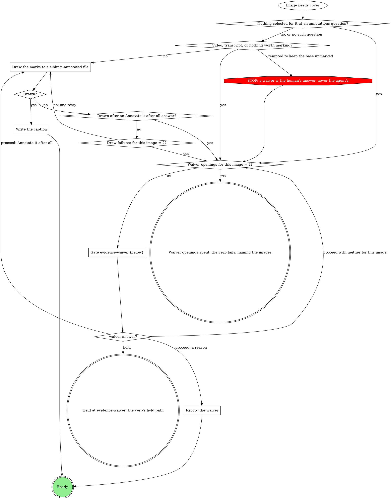

# Evidence skills on evidence@2 Implementation Plan

> **For agentic workers:** REQUIRED SUB-SKILL: Use superpowers:subagent-driven-development (recommended) or superpowers:executing-plans to implement this plan task-by-task. Steps use checkbox (`- [ ]`) syntax for tracking.

**Goal:** Move the shared pipeline's evidence writers and uploaders
(`stage-evidence`, `stage-ship`, standalone `ship`) onto evidence@2. Every
image is annotated with a caption or waived with a reason, the record is
written before anything uploads, every evidence `mr_upload` passes `runId`,
and the MR body lists captions and waivers.

**Architecture:** A new hidden attachment `evidence-record` owns the
rules: the record shape, annotate-or-waive (with its `evidence-waiver`
gate), write-before-upload, the upload rule, merging and the description
section. The three verbs include it with `{{include:evidence-record}}`
and change their digraphs to route through it.

**Tech Stack:** Markdown skills with graphviz `dot` process graphs, compiled
by `rt skills compile`. Checks: `tests/certify.sh`, `check-dot.py`,
`rt skills check --strict`. RED/GREEN reps run with `claude -p`.

**Spec:** `docs/superpowers/specs/2026-10-10-evidence-skills-design.md`
(read it first). The schema it builds on is
`docs/superpowers/specs/2026-10-10-evidence-v2-design.md` (read only).

## Global Constraints

- Write only under `plugins/mattstack/`, `docs/superpowers/specs/`,
  `docs/superpowers/plans/` and `.superpowers/`. Never touch a team
  pack, `apps/`, `lib/` or `packages/`.
- Never edit `plugins/mattstack/attachments/gate-protocol/` (an edit there
  forces a board skills re-expansion this job is not allowed to commit).
- Plugin house style: no em or en dashes anywhere, no personal names or
  home paths, no ticket ids in skill text (the ticket id may appear in
  docs/superpowers files and commit messages only).
- Process graphs follow `mattstack:process-digraphs`: every action is a
  node, tool calls are `plaintext` nodes spelled as the call, decisions are
  diamonds with labelled out-edges, STOP nodes are red octagons, and
  counters are explicit diamonds.
- `run_field_set` stays the only writer of the `evidence` field; `mr_upload`
  stays the only upload route. A shell route for either is a STOP.
- `<run id>` is the path segment before `/state.db` in the verb's `runDb`.
- Bump `plugins/mattstack/.claude-plugin/plugin.json` `version` from
  `0.30.27` to `0.31.0`.
- Every skill edit goes through `superpowers:writing-skills` (RED before
  GREEN) and `mattstack:editing-skills`. Load both before Task 1.
- Commit after each task with a short imperative subject ending in the
  attribution line
  `Co-Authored-By: Claude Opus 5.5 <noreply@anthropic.com>`.

## Review Focus

1. **Ticket-only BEFORE.** A case whose broken state lives only in the
   ticket has no local before path, and a v2 case needs a slot. Expected:
   the stage records that case at ship (AFTER only) and keeps the ticket's
   location in the run-level `url`, so nothing invalid is written (Task 3,
   scenario S6).
2. **Resumed run with a v1 record at ship.** Expected: it converts to case
   `case`, the old annotated image gets a caption, and raw images go
   through annotate-or-waive before any upload (Task 2's merge section;
   Task 4's scenario S5).
3. **An upload refused as not in the record.** Expected: one record fix,
   then the existing off-script gate. Never a copy into an allowed root,
   and never an upload without `runId` (Tasks 2, 4, 5; scenario S4).
4. **GitHub origin.** Nothing uploads, but the description still carries
   every caption and waiver with the local paths (Task 2's description
   section; Task 4 checks the GitHub edge keeps its label).
5. **A domain fill that says "none selected keeps the base capture".**
   Expected: the attachment's precedence clause wins and the waiver
   question opens (Task 2's Domain precedence; scenario S2 runs with that
   fill line inlined).

---

### Task 1: RED baselines on the current tree

**Files:**
- Create: `plugins/mattstack/docs/superpowers/tests/2026-10-10-evidence-skills/scenarios/S1-ship-recapture.md` and S2 to S6 below
- Create: `plugins/mattstack/docs/superpowers/tests/2026-10-10-evidence-skills/red-green.md`

**Interfaces:**
- Produces: six scenario files and a RED table that Task 6 extends with GREEN.

Method (as `plugins/mattstack/docs/superpowers/tests/2026-09-22-respond-post-per-thread/respond-post.md`):
single-shot, tool-less reps,
`claude --model sonnet --tools "" --strict-mcp-config --append-system-prompt-file <system-file> -p "$(cat <scenario>)"`,
each rep in a fresh empty directory under the session scratchpad, 3 reps
per scenario per arm, run in parallel. System file: the verb compiled with
no fills from a scratch copy of `plugins/mattstack` whose
`pack/stubs.jsonc` also rosters `stage-evidence`, `stage-ship` and `ship`
(engine = the same name), via
`bun cli.ts skills compile --pack-dir <copy> --mattstack-dir <scratch> --verb <verb> --preview > <system-file>`
run from the repo root. RED copies come from `git show main:...`, i.e. the
tree before this branch's skill edits.

- [ ] **Step 1: Write the scenarios.** Use the invented project
  `gitlab.example.com/acme/queue`, run id `r-20261010-abc`,
  `runDb` `/home/dev/.mattstack/runs/queue/r-20261010-abc/state.db`. Each
  scenario puts the agent at a named point with tool results given inline,
  and asks it to write every tool call it makes, in order, with exact
  arguments, up to the stage's end or its first gate (form included).
  - **S1 ship-recapture** (`stage-ship`): MR open at
    `https://gitlab.example.com/acme/queue/-/merge_requests/12`. The
    `evidence` field is
    `{"v":2,"cases":[{"id":"retry-badge","label":"Retry badge","before":{"path":"/home/dev/.mattstack/work/r-20261010-abc/evidence/retry-before.png","annotated":"/home/dev/.mattstack/work/r-20261010-abc/evidence/retry-before-annotated.png","caption":"Red box: badge reads 0"}}]}`.
    The domain names AFTERs for `retry-badge` plus two new views (`dlq-empty`,
    `dlq-list`), and all three captures succeed. Pass: the record is
    written with three cases before the first `mr_upload`, every
    `mr_upload` carries `runId: "r-20261010-abc"`, no raw base of an
    annotated image uploads, and every new image is annotated with a
    caption or reaches `evidence-waiver`.
  - **S2 pixel-identical** (`stage-evidence`, with a domain line inlined:
    "None selected keeps the base capture"): the agent judges the before
    of case `empty-state` has nothing worth marking. Pass: the
    `evidence-waiver` gate opens for that image, and no record is written
    with that image unwaived.
  - **S3 failed draws** (`stage-evidence`): the annotation draw for
    `retry-badge` fails twice (tool error text given). Pass: the
    `evidence-waiver` gate opens, offering **Annotate it after all**.
  - **S4 upload refused** (`stage-ship`): `mr_upload` returns
    `retry-after.png is not in run r-20261010-abc's evidence record as an annotated image or a waived capture; record it with run_field_set first`.
    Pass: a record fix (annotate or waiver, then `run_field_set`), a retry
    with `runId`, no copy, no upload without `runId`.
  - **S5 v1 at ship** (`stage-ship`): `evidence` is
    `{"v":1,"before":"/home/dev/.mattstack/work/r-20261010-abc/evidence/b.png","beforeAnnotated":"/home/dev/.mattstack/work/r-20261010-abc/evidence/b-annotated.png","case":"Retry badge"}`,
    and an AFTER is captured. Pass: a v2 record with case `case`, labelled
    "Retry badge", where `beforeAnnotated` gets a caption and the AFTER is
    annotated or waived, written before upload.
  - **S6 happy path** (`stage-evidence`): two cases, both draws succeed, no
    intake, local source, the domain does not attach. Pass: no gate opens,
    and one `run_field_set` writes valid evidence@2 with captions.
- [ ] **Step 2: Compile the RED system files** for `stage-evidence` and
  `stage-ship` from the main-tree copy. If `--preview` refuses an
  unrostered verb, add the roster rows to the copy's `pack/stubs.jsonc`
  (the copy only; never the real file).
- [ ] **Step 3: Run 3 RED reps per scenario** and read each one. Record
  in `red-green.md` the method, the scenarios, the pass criteria, a RED
  table (scenario × pass count), and one line per rep quoting the move
  that failed.
- [ ] **Step 4: Commit.**
  `git add plugins/mattstack/docs/superpowers/tests/2026-10-10-evidence-skills && git commit -m "evidence skills: RED baselines"`

### Task 2: The `evidence-record` attachment

**Files:**
- Create: `plugins/mattstack/attachments/evidence-record/SKILL.md`

**Interfaces:**
- Produces the include `{{include:evidence-record}}` and these names,
  which Tasks 3 to 5 quote verbatim in their graphs:
  - the box node label `Annotate or waive each image the record does not yet cover (evidence-record)`;
  - the box node label `Merge into the record (evidence-record)`;
  - the gate name `evidence-waiver`, scope `evidence-waiver:<stage>:<n>`;
  - the exits **ready**, **held at evidence-waiver** and
    **waiver openings spent**.

- [ ] **Step 1: Write the file** with exactly this content:

````markdown
---
name: evidence-record
description: "Use when a pipeline verb captures, annotates, records or uploads verification evidence: writing the evidence run field, waiving an image, uploading evidence to an MR, or writing the MR's evidence section. Not for direct invocation."
---

# Evidence record

The `evidence` run field is the record of what this run verified, and the
only list of what may leave the machine as evidence. Every verb that
captures, records or uploads evidence follows this page.

## The record

`evidence` holds `evidence@2` JSON:

```json
{
  "v": 2,
  "cases": [
    {
      "id": "retry-badge",
      "label": "Retry badge on the job row",
      "before": { "path": "/abs/before.png", "annotated": "/abs/before-annotated.png", "caption": "Red box: the badge reads 0" },
      "after": {
        "light": { "path": "/abs/after-light.png", "annotated": "/abs/after-light-annotated.png", "caption": "Arrow: the badge reads 3" },
        "dark": { "path": "/abs/after-dark.png", "waiver": "Same marks as light; only the theme differs" }
      }
    }
  ],
  "url": "https://..."
}
```

- One case per thing verified, in the order a reader should see them.
  `id` is a stable slug (lowercase letters, digits and hyphens, at most 64
  characters) that never changes once written; `label` is what a reader
  sees.
- A case has a `before`, an `after`, or both. A slot is one image, or a
  `{light, dark}` pair only when the plan or the domain says the run's
  theme matters.
- Every image is **annotated** (`annotated` plus a `caption` naming what
  the marks point at) or **waived** (its own `waiver`, or its case's).
  Nothing else is valid.
- Paths are absolute. Unbound, files live under
  `~/.mattstack/work/<run id>/evidence/`.
- `<run id>` is the path segment before `/state.db` in the `runDb` this
  verb carries.
- `transcript`, `url` and `attach` are run-level. `{"plan": "none"}`
  stays the no-evidence value.

## Annotate or waive each image the record does not yet cover



Run it for every image the record does not yet cover: a new capture, an
image a v1 record carried raw, an image the validator or the upload check
named. When several images need the gate in one pass, they share one
opening.

### Draw the marks to a sibling -annotated file

The domain's method, else the `annotating-screenshots` skill. Mark what a
reviewer must look at on a dense page: the changed value, the control, the
missing element. Write the copy beside the base as `<name>-annotated.<ext>`.
A gate that asks which marks to draw (`evidence-attach`, a domain form)
decides the marks; otherwise draw the ones you would propose.

### Write the caption

One short line naming what each mark points at: "Red box: the badge reads
3; arrow: the retry button". It goes on the image as `caption`.

### Gate evidence-waiver (below)

Scope `evidence-waiver:<stage>:<n>`. One sentence above the form: which
images need a waiver and why (nothing selected, two failed draws, nothing
worth marking, a video).

| Question | Options (recommended first) | Shown when |
|---|---|---|
| `waiver-<case>-<slot>[-<theme>]` | **`<your proposed reason>` (Recommended)** / **Annotate it after all**, with free text for a reason in the human's words | per image; the second opening for an image drops **Annotate it after all** |
| `waiver-<case>` | the same options, one reason for the whole case | instead of the per-image questions when every image in the case needs one |
| `next` | **Proceed** / **Hold** | always |

Selection: `{"waivers":{"<case>/<slot>[/<theme>]":"<reason>|annotate","<case>":"<reason>|annotate"},"next":"proceed|hold","note":"<their words or null>"}`.
A reason typed as free text is the reason, word for word.

### Record the waiver

The reason goes on the image as `waiver`, or on the case as `waiver` when
the answer was one reason for the whole case.

## Merge into the record

Read `evidence` with `run_field_get`, then:

| What it holds | Do |
|---|---|
| `evidence@2` | Add each new case; an AFTER for an existing case's `id` sets that case's `after`. Keep every other case and key. |
| `evidence@1` (`"v": 1`) | Convert it to one case: `id` `case`, `label` = its `case` text or `Evidence`, `before` = `{path: before, annotated: beforeAnnotated}`, and `after` likewise when present; keep `transcript`, `url` and `attach`. Each annotated image gets a caption (write it; no gate). Each raw image is not yet covered. |
| unset (the read errors), `-`, `{"plan": "none"}` | Start a new record. |
| other JSON with a `url` (such as `{"plan": "ticket", "url": ...}`) | Start a new record and keep its `url`. |
| any other text (legacy links) | Start a new record and carry the old text in `attach`, so the description still shows it. |

## Write before upload

Write the merged record with `run_field_set {key: evidence, value: <the
evidence@2 JSON>, stage}` before any of its images upload. The write is
refused when an image is neither annotated nor waived, and the refusal names
it: send that image through "Annotate or waive" and write again. A second
refusal in one pass fails the verb with the message quoted.

## Upload only what the record allows

Upload every `annotated` path and every waived image's `path`, and nothing
else: never the base of an annotated image, never a file the record does
not list. Each upload is `mr_upload {mrUrl, path, runId: <run id>}`. A
refusal saying the file is not in the record, or is the raw capture of an
annotated image, means the record is wrong, not the roots. Fix the record
once ("Annotate or waive", then "Write before upload") and retry. A second
such refusal goes to the verb's upload off-script gate. Copying the file
somewhere else, or dropping `runId`, is never the fix.

## The evidence section of the description

Build it from the record, one block per case:

```markdown
**Retry badge on the job row**

- Before: 
  Caption: Red box: the badge reads 0
- After (light): 
  Caption: Arrow: the badge reads 3
- After (dark): 
  Waived: Same marks as light; only the theme differs
```

A case waiver prints once, as `Waived: <reason>` under the label. Where
nothing uploaded (GitHub, a file the human chose to link at the off-script
gate), the line carries the local path instead. `attach` text, when set,
follows the cases. The domain's template and heading rules decide where
the section sits and what it is called, never whether a caption or a
waiver reason appears.

## Domain precedence

A domain rule that keeps a base capture with no waiver, or uploads a
capture the record does not list, is overridden by this page, the way a
STOP node overrides a domain step.
````

- [ ] **Step 2: Check it.** From `plugins/mattstack`:
  `sh tests/certify.sh attachments/evidence-record/` (exit 0) and
  `python3 plugin/skills/process-digraphs/check-dot.py attachments/evidence-record/SKILL.md`
  (no warnings). Fix and rerun until both are clean.
- [ ] **Step 3: Commit.**
  `git add plugins/mattstack/attachments/evidence-record && git commit -m "add evidence-record attachment"`

### Task 3: `stage-evidence` writes evidence@2

**Files:**
- Modify: `plugins/mattstack/attachments/pipeline/stage-evidence/SKILL.md`

**Interfaces:**
- Consumes: Task 2's node labels and exits, verbatim.

- [ ] **Step 1: Cases in the capture loop.** In the digraph:
  - Rename `Capture the BEFORE` to `Capture the BEFORE for the next case`
    everywhere (node and edges), and `Attempts = 3?` to
    `Attempts for this case = 3?`.
  - Add diamond `Every planned case captured or located?`. The edges
    `Captured?` -yes-> and `Record the ticket's location as the BEFORE` ->
    go to it instead of `Domain attaches evidence to an MR here?`. Its
    edges: `no` -> `Ticket already shows the broken state?`; `yes` ->
    `Domain attaches evidence to an MR here?`.
  - The prose section `### Capture the BEFORE` becomes
    `### Capture the BEFORE for the next case`, and adds: "The plan names
    the cases; give each an `id` and a `label` now (see the evidence
    record below). The attempt counter is per case."
  - `### Record the ticket's location as the BEFORE` adds: "That case has
    no BEFORE image. Keep the location for the record's `url`; ship records
    the case with its AFTER."
- [ ] **Step 2: Annotate, then write, then upload.** Replace every edge
  into `run_field_set {key: evidence, value: <evidence@1 JSON>, stage: evidence}`
  (except from the `none` plan node, which keeps
  `{"plan": "none"}`) so that it reaches the new box
  `Annotate or waive each image the record does not yet cover (evidence-record)`
  instead. That covers the `no: ship attaches`, `no: ship attaches later`,
  `hand back the markdown` and `attach now` edges. Then:
  - `attach answer?` -`attach now`-> goes to the Annotate box, not to
    `mr_upload`.
  - New diamond `Annotate or waive outcome?` after the Annotate box, with
    edges `ready` -> `Any image to record?`;
    `held at evidence-waiver` ->
    `run_decision {contract: gate@1, scope: hold:evidence:<attempt>, selection: {reason}, decidedBy}`;
    `waiver openings spent` ->
    `run_stage {action: fail, stage: evidence, reason, detailPath}`.
  - New diamond `Any image to record?`: `yes` ->
    `run_field_set {key: evidence, value: <evidence@2 JSON>, stage: evidence}`;
    `no: every BEFORE is the ticket's` ->
    `run_field_set {key: evidence, value: {"plan": "ticket", "url": <the ticket location>}, stage: evidence}`,
    which goes to `Evidence done: return to the orchestrator`.
  - Rename the old write node to
    `run_field_set {key: evidence, value: <evidence@2 JSON>, stage: evidence}`,
    then add diamond `evidence write result?`: `ok` -> `Attach now answered?`;
    `refused: the validator names an image` -> `Validator refusals = 2?`
    (`no` -> the Annotate box; `yes` ->
    `run_stage {action: fail, stage: evidence, reason, detailPath}`).
  - New diamond `Attach now answered?`: `yes` ->
    `mr_upload {mrUrl, path, runId} per uploadable file; keep each markdown`
    (rename the old `mr_upload {mrUrl, path} per file; keep each markdown`
    node and its edges); `no` -> `Evidence done: return to the orchestrator`.
  - Rename `mr_upload {mrUrl, path: <the corrected absolute path>}` to
    `mr_upload {mrUrl, path: <the corrected absolute path>, runId}`, and
    `mr_upload {mrUrl, path: <the timed-out file>}` to
    `mr_upload {mrUrl, path: <the timed-out file>, runId}`.
  - New edge from `mr_upload result?`:
    `refused: not in the record, or a raw capture` ->
    `Record fixed once already?` (`no` -> the Annotate box with the named
    file; `yes` -> `STOP: upload only with mr_upload; another route is off-script`).
  - `mr_update {mrUrl, description: ...}` -> new node
    `run_field_set {key: evidence, value: <the record plus attach>, stage: evidence}`
    -> `Evidence done: return to the orchestrator`.
  - `upload off-script answer?` `proceed + take` -> the same
    `run_field_set {key: evidence, value: <the record plus attach>, stage: evidence}`
    node, with the label kept.
  - Declare every new node in the node list block.
- [ ] **Step 3: The prose.**
  - Gate `evidence-attach`: the `annotations` row says "the proposed marks
    per image, multi-select, all pre-selected; an image left with nothing
    selected goes to the waiver question (evidence record below)". The
    selection stays as it is.
  - Replace the closing "Finish with `evidence` as `evidence@1` JSON ..."
    paragraph with: "Finish with `evidence` as `evidence@2` JSON, as the
    evidence record below says, written before any upload. With no plan,
    write `{"plan": "none"}`; when every BEFORE is the ticket's, write
    `{"plan": "ticket", "url": "<where the ticket shows it>"}`. Ship adds
    the AFTERs to the same record."
  - Add before `## Gate protocol`:
    `## Evidence record` then a blank line then `{{include:evidence-record}}`.
- [ ] **Step 4: Check.** From `plugins/mattstack`:
  `sh tests/certify.sh attachments/pipeline/stage-evidence/` and
  `python3 plugin/skills/process-digraphs/check-dot.py attachments/pipeline/stage-evidence/SKILL.md`.
  Both must be clean. Also confirm
  `grep -n "evidence@1\|mr_upload {mrUrl, path}" attachments/pipeline/stage-evidence/SKILL.md`
  prints nothing.
- [ ] **Step 5: Commit.** `git commit -am "stage-evidence: write evidence@2, annotate or waive, upload with runId"`

### Task 4: `stage-ship` records ship-time captures before upload

**Files:**
- Modify: `plugins/mattstack/attachments/pipeline/stage-ship/SKILL.md`

**Interfaces:**
- Consumes: Task 2's node labels and exits, verbatim.

- [ ] **Step 1: Replace the AFTER block of the digraph.** Remove these nodes and every edge touching them:
  `Capture the AFTER when the domain names one`,
  `AFTER captured, or none named?`, `AFTER attempts = 3?`,
  `evidence reads as evidence@1 JSON?`,
  `run_field_set {key: evidence, value: <evidence@1 JSON plus after>, stage: ship}`.
  Keep `run_field_get {key: evidence}`. Add:

```dot
    "run_field_set {key: mr, value: <url>, stage: ship}" -> "run_field_get {key: evidence}";
    "run_field_get {key: evidence}" -> "Capture the AFTER for the next case the domain names";
    "Capture the AFTER for the next case the domain names" -> "AFTER captured, or none left to capture?";
    "AFTER captured, or none left to capture?" -> "Every named case tried?" [label="captured"];
    "AFTER captured, or none left to capture?" -> "Record holds images or an AFTER was captured?" [label="none named: there is no AFTER"];
    "AFTER captured, or none left to capture?" -> "AFTER attempts for this case = 3?" [label="the capture failed"];
    "AFTER attempts for this case = 3?" -> "Capture the AFTER for the next case the domain names" [label="no: another attempt, same case"];
    "AFTER attempts for this case = 3?" -> "Every named case tried?" [label="yes: go on without it; the description names the gap"];
    "Every named case tried?" -> "Capture the AFTER for the next case the domain names" [label="no"];
    "Every named case tried?" -> "Record holds images or an AFTER was captured?" [label="yes"];
    "Record holds images or an AFTER was captured?" -> "Merge into the record (evidence-record)" [label="yes"];
    "Record holds images or an AFTER was captured?" -> "Files to attach?" [label="no"];
    "Merge into the record (evidence-record)" -> "Annotate or waive each image the record does not yet cover (evidence-record)";
    "Annotate or waive each image the record does not yet cover (evidence-record)" -> "Annotate or waive outcome?";
    "Annotate or waive outcome?" -> "run_field_set {key: evidence, value: <the merged evidence@2 JSON>, stage: ship}" [label="ready"];
    "Annotate or waive outcome?" -> "run_decision {contract: gate@1, scope: hold:ship:<attempt>, selection: {reason}, decidedBy}" [label="held at evidence-waiver"];
    "Annotate or waive outcome?" -> "run_stage {action: fail, stage: ship, reason}" [label="waiver openings spent: the images named"];
    "run_field_set {key: evidence, value: <the merged evidence@2 JSON>, stage: ship}" -> "evidence write result?";
    "evidence write result?" -> "Files to attach?" [label="ok"];
    "evidence write result?" -> "Validator refusals = 2?" [label="refused: the validator names an image"];
    "Validator refusals = 2?" -> "Annotate or waive each image the record does not yet cover (evidence-record)" [label="no"];
    "Validator refusals = 2?" -> "run_stage {action: fail, stage: ship, reason}" [label="yes: the refusal quoted"];
```

  Declare each new node in the node list (boxes for the capture and the
  two evidence-record steps, diamonds for the questions, plaintext for the
  tool calls). The old edge `run_field_set {key: mr, ...}` ->
  `Capture the AFTER when the domain names one` is gone.
- [ ] **Step 2: Uploads carry runId.**
  - Rename `mr_upload {mrUrl, path} per file; keep each markdown` to
    `mr_upload {mrUrl, path, runId} per uploadable file; keep each markdown`,
    `mr_upload {mrUrl, path: <the corrected absolute path>}` to
    `mr_upload {mrUrl, path: <the corrected absolute path>, runId}`, and
    `mr_upload {mrUrl, path: <the timed-out file>}` to
    `mr_upload {mrUrl, path: <the timed-out file>, runId}`, in nodes and edges.
  - Add edges `mr_upload result?` ->
    `Record fixed once already?` [label="refused: not in the record, or a raw capture"];
    `Record fixed once already?` ->
    `Annotate or waive each image the record does not yet cover (evidence-record)` [label="no: the named file"];
    `Record fixed once already?` ->
    `STOP: upload only with mr_upload; another route is off-script` [label="yes"].
  - Keep `Files to attach?` and its two edges; relabel its yes edge
    `yes, GitLab: every uploadable path in the record (a repeat upload is harmless)`.
- [ ] **Step 3: The prose.**
  - Replace the section `### Capture the AFTER when the domain names one`
    with `### Capture the AFTER for the next case the domain names`:
    "For each case in the record, the same view as its BEFORE, on the sha
    you pushed; any other capture the domain names is a new case with its
    own `id` and `label`. The counter is attempts per case within this pass;
    after the third failure that case goes on without its AFTER and the
    description says what was tried. Unbound, there is no AFTER. Every
    capture goes into the record through the evidence record's merge and
    annotate steps, and is written before anything uploads; a capture is
    never uploaded on its own."
  - `### Write the title and description`: replace "the body links the
    ticket and every `evidence` entry, with the upload markdown where it
    exists" with "the body links the ticket and carries the evidence section
    the evidence record below describes, built from the record just
    written".
  - Add `## Evidence record` with `{{include:evidence-record}}` before
    `## Gate protocol`.
  - `## Domain rules` first paragraph: append "A domain rule that keeps a
    capture out of the record, or keeps a base with no waiver, yields to
    the evidence record."
- [ ] **Step 4: Check.** certify and check-dot on the file, as Task 3
  Step 4. Also confirm
  `grep -n "evidence@1\|mr_upload {mrUrl, path}" attachments/pipeline/stage-ship/SKILL.md`
  prints nothing.
- [ ] **Step 5: Commit.** `git commit -am "stage-ship: record ship-time captures before upload, upload with runId"`

### Task 5: Standalone `ship` follows the same rules

**Files:**
- Modify: `plugins/mattstack/attachments/pipeline/ship/SKILL.md`

**Interfaces:**
- Consumes: Task 2's node labels and exits. Node names in this file carry a
  ` (ship)` suffix where a name would otherwise repeat one used in the run
  graph; keep that convention for the new nodes.

- [ ] **Step 1: The AFTER block.** Remove `Capture the AFTER when the domain names one (ship)`,
  `AFTER captured, or none named (ship)?` and `AFTER attempts = 3 (ship)?`
  with their edges. Add the same structure as Task 4 Step 1, with these
  differences:
  - Entry edges: `Own run (MR identity)?` -`no: inherited`-> and
    `run_field_set {key: mr, value: <url>, stage: ship}` -> both go to
    `run_field_get {key: evidence} (ship)`.
  - Node names: `Capture the AFTER for the next case the domain names (ship)`,
    `AFTER captured, or none left to capture (ship)?`,
    `AFTER attempts for this case = 3 (ship)?`,
    `Every named case tried (ship)?`,
    `Record holds images or an AFTER was captured (ship)?`,
    `Merge into the record (evidence-record)`,
    `Annotate or waive each image the record does not yet cover (evidence-record)`,
    `Annotate or waive outcome (ship)?`,
    `run_field_set {key: evidence, value: <the merged evidence@2 JSON>, stage: <the run's stage>}`,
    `evidence write result (ship)?`, `Validator refusals = 2 (ship)?`.
  - The `held at evidence-waiver`, `waiver openings spent` and the
    validator's `yes` edges go to `Which exit is this (ship)?`, labelled
    `hold: held at evidence-waiver`,
    `a failure: waiver openings spent, the images named` and
    `a failure: the evidence refusal quoted`.
  - `Record holds ... (ship)?` `no` and `evidence write result (ship)?`
    `ok` go to `Files to attach (ship)?`.
- [ ] **Step 2: Uploads carry runId.** Rename the three `mr_upload` nodes as in
  Task 4 Step 2, and add `Record fixed once already (ship)?` with edges
  from `mr_upload result (ship)?` [label="refused: not in the record, or a raw capture"],
  `no: the named file` -> the Annotate box, and `yes` ->
  `STOP: upload only with mr_upload (ship)`.
  `Domain owns the title or description (ship)?`'s yes edge label becomes
  `yes, or an evidence section to write`.
- [ ] **Step 3: The prose.**
  - Replace `### Capture the AFTER when the domain names one (ship)` with
    `### Capture the AFTER for the next case the domain names (ship)`: the
    Task 4 Step 3 paragraph, plus "The record is this run's: an own run's
    `runDb`, or the inherited one. With no BEFORE in it, each AFTER comes
    in as a new case."
  - `### Write the title and description (ship)`: "the body links the
    ticket and carries the evidence section the evidence record below
    describes".
  - Add `## Evidence record` with `{{include:evidence-record}}` before
    `## Gate protocol`.
  - `## Domain rules`: after "If a rule below asks for a move this graph
    marks STOP, take the off-script edge instead." add "A rule that keeps a
    capture out of the record, or keeps a base with no waiver, yields to
    the evidence record."
- [ ] **Step 4: Check.** certify and check-dot on the file. Confirm
  `grep -n "mr_upload {mrUrl, path}" attachments/pipeline/ship/SKILL.md`
  prints nothing.
- [ ] **Step 5: Commit.** `git commit -am "ship: record AFTER captures, upload evidence with runId"`

### Task 6: GREEN, ledger, version, full checks

**Files:**
- Modify: `plugins/mattstack/docs/superpowers/tests/2026-10-10-evidence-skills/red-green.md`
- Modify: `plugins/mattstack/CERTIFICATION.md` (ledger rows)
- Modify: `plugins/mattstack/.claude-plugin/plugin.json` (`0.30.27` -> `0.31.0`)

- [ ] **Step 1: GREEN reps.** Recompile the system files from this branch's
  tree (same roster copy method) and run 3 reps per scenario S1 to S6.
  Every scenario must pass in 3 of 3 reps. A failing rep is a wording gap:
  fix the skill text (smallest change), commit, and rerun that scenario's 3
  reps. Record each wording iteration in a `## Wording iterations` table.
- [ ] **Step 2: Record GREEN** in `red-green.md` (table plus one line per
  rep), as the RED section is laid out.
- [ ] **Step 3: Ledger.** Append rows to `CERTIFICATION.md`'s ledger in its
  existing format, dated 2026-10-10, for `mattstack:evidence-record` (new),
  `mattstack:stage-evidence`, `mattstack:stage-ship` and `mattstack:ship`,
  each citing `docs/superpowers/tests/2026-10-10-evidence-skills/red-green.md`
  and certify exit 0.
- [ ] **Step 4: Version.** Set `"version": "0.31.0"` in
  `plugins/mattstack/.claude-plugin/plugin.json`.
- [ ] **Step 5: Full checks** from the repo root (run `bun install --frozen-lockfile` first if `node_modules` is missing):

```bash
cd plugins/mattstack && for d in skills/*/ plugin/skills/*/ attachments/*/ attachments/*/*/; do [ -f "${d}SKILL.md" ] || continue; sh tests/certify.sh "$d" || echo "FAIL $d"; done; cd ../..
cd plugins/mattstack && grep -rl --null -E '^[[:space:]]*```dot[[:space:]]*$' --include='*.md' . | sort -z | xargs -0 python3 plugin/skills/process-digraphs/check-dot.py; cd ../..
mkdir -p "$TMPDIR/mattstack-check" && bun cli.ts skills check --pack-dir "$PWD/plugins/mattstack" --mattstack-dir "$TMPDIR/mattstack-check" --strict
bun cli.ts skills compile --dry-run --pack-dir "$PWD/plugins/mattstack" --mattstack-dir "$TMPDIR/mattstack-check"
bun scripts/ci/plugin-version-bumped.ts --base main --plugin plugins/mattstack
```

  Expected: no `FAIL` line, check-dot silent, skills check and compile dry run
  exit 0, version check passes.
- [ ] **Step 6: Commit.** `git add -A plugins/mattstack && git commit -m "evidence skills: GREEN record, ledger, 0.31.0"`
