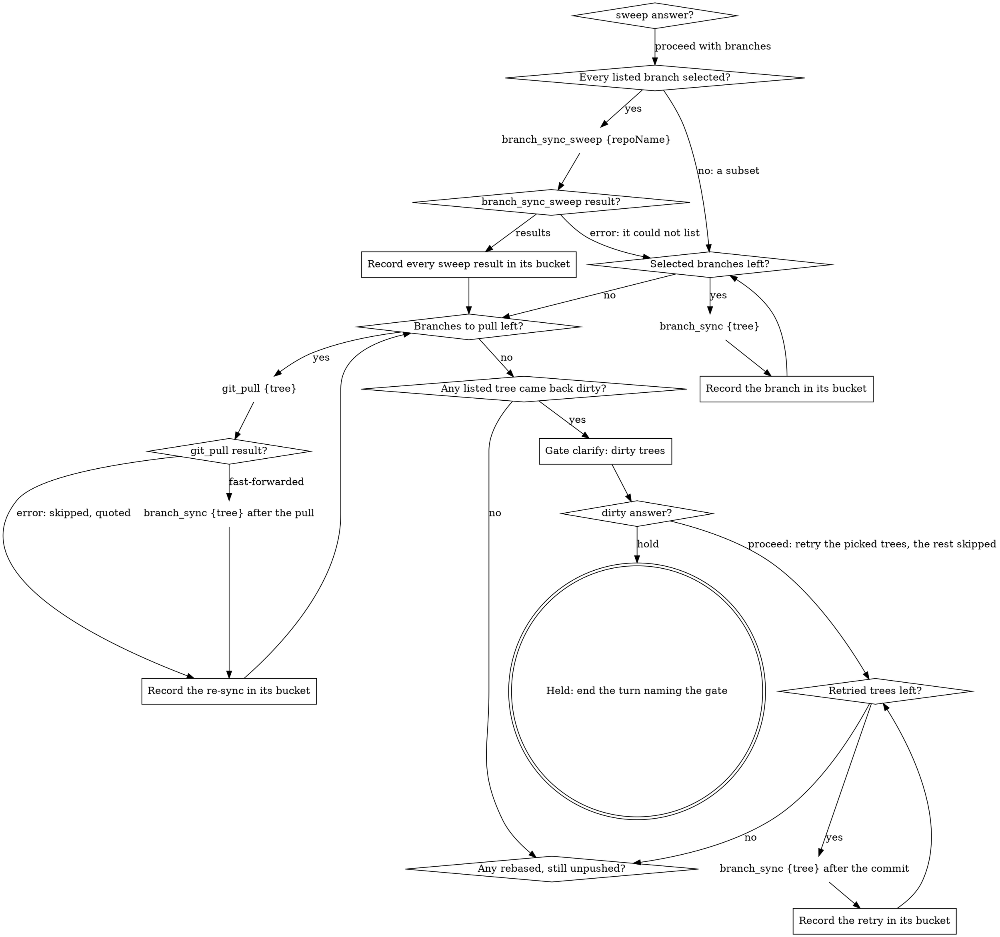

# Forge skills on the typed git tools

Wave 3 (partial) of the digraph-to-MCP work. PR #842 gave `branch_sync` a
typed result and a strict stack refusal, added `branch_sync_sweep`, and made
every git tool resolve a subdirectory to its tree root. The forge host skills
still classify `branch_sync` errors by English suffix, re-implement the stack
check in a manual rebase path, walk `rebase-worktree` once per branch inside
the sweep, and draw a "retry with the root the error prints" edge that can
never fire. This change redraws them on the tools as they now are.

Matt's ruling for every lane (room #5802, clarified #5814): no change for its
own sake; improvements that come from moving logic into code are welcome, and
every behavior change is flagged. The **Behavior changes** table below is that
flag.

## Why

- **Size.** Each compiled `rebase-worktree` copy is about 9.4K words, about
  2,000 of them and about 35 nodes the manual path and its stack guards. A
  sweep loads `sync-open-mrs` + `map-open-mrs` + `rebase-worktree` +
  `watch-ci`, about 18K words before the first branch moves.
- **Reliability.** The skill routes `branch_sync` errors by suffix (`. Run:
  <tool>`), with a rationalization row warning that `please run: gh auth
  login` is not a tool. The manual path re-implements the stack rule in
  English, a second rule that can drift from the code.
- **A dead edge.** Eight skills draw `git_push {tree: <the root the error
  prints>}`. The tree guard never printed a root for that case, and since
  #842 `git_push` resolves a subdirectory itself, so the retry cannot fire and
  invites a guessed path.

## Goals

1. `rebase-worktree` routes on `branch_sync`'s `kind` (`synced`,
   `up-to-date`, `dirty-tree`, `conflict`, `stacked-refused`,
   `stack-unverified`, `push-refused`, `error`), takes the heads, `pushed`,
   `refusal` and `paths` from the result, and reaches the dirty-tree gate
   from `kind: dirty-tree`.
2. The manual stack check and manual rebase path are deleted:
   `stack-unverified` and an rt sync failure end reported.
3. `sync-open-mrs` stops walking `rebase-worktree`: `branch_sync_sweep` when
   every listed branch is selected, `branch_sync` per tree otherwise, then a
   pull-and-re-sync pass and one batch dirty-tree gate for the branches that
   need them, all bucketed by `kind`.
4. The printed-root retry edge leaves every plugins/mattstack skill that
   draws it.
5. After #844 merges: `mr_map` replaces `map-open-mrs` on GitLab inside the
   sweep, and `mr_resolve_branch` replaces checkout's MR lookup.

## Non-goals

- No tool or TypeScript change.
- No change to the gate-steps graphs, the gate-protocol and wrap-up includes,
  or the run prologue/epilogue of `sync-open-mrs`.
- No new budgets on gate iterate edges today's graphs draw without one.
- No compile or sync of the team packs. The mattstack pack's own
  compiled copy (`plugins/mattstack/skills/shepherdr`) is recompiled with
  `rt skills compile --pack mattstack` because it carries the retry edge.
- GitHub legs stay `gh` boxes wherever a tool is GitLab-only.

## Anti-goals

- A tool result standing in for a gate.
- Any path that rebases a branch `branch_sync` refused, by hand or by another
  tool.
- Hiding an outward move: every push stays its own node.

## Constraints

- **Team fills attach by exact node text.** No `## At:` heading under
  `~/.mattstack/orgs/<team org>/mattstack/` attaches to any node this change
  touches, and no team binding names `rebase-worktree`, `sync-open-mrs`,
  `checkout` or `map-open-mrs` as a host. No rename needs a pack-fixes note.
  The team stubs' descriptions of `rebase-worktree` ("or as the per-branch
  step of a sync-open-MRs sweep") go stale; that wording is the pack-fixes
  lane's (named in the report).
- process-digraphs rules: one exact call per plaintext node, every decision
  edge labelled, STOPs with one exit, one off-script gate per origin.
- `render.sh` and `check-dot.py` pass on every touched dot block;
  `rt skills check --strict` and the plugin CI job pass; plugin.json gets a
  patch bump; `bun run purity` passes.
- Write fence: `plugins/mattstack/attachments/forge/**`, the retry edge in
  other plugins/mattstack skills (that edge only), plugin.json, plugin tests
  and fixtures for these skills, this spec, the plan, `.superpowers/`.

## Decisions on record

- Gate fbe39185: in `rebase-worktree` the pull retry stays, entered on
  `kind: error` whose refusal is the documented "run git_pull first" phrase
  (q1). The sweep keeps its multi-select gate: all listed branches selected ->
  `branch_sync_sweep`, a subset -> `branch_sync` per selected tree, one bucket
  rule by `kind` (q2).
- Gate 0bce5a99 as corrected by the shepherd's DM #5813 (Matt's final calls):
  - **B1** strict refusal: `stack-unverified` and rt sync failures end
    reported; the manual stack check and manual rebase are deleted.
  - **B2** after the sweep, each result whose refusal says "run git_pull
    first" gets one `git_pull {tree}`, then one `branch_sync {tree}`, bucketed
    by the same rule.
  - **B3** after the sweep, one batch dirty-tree gate for the listed branches
    that came back dirty (retry, abort, hold); the retried ones re-sync once.
  - **B4** the move line keeps today's sha + subject: two `git log -1
    --oneline --no-decorate` reads, of `oldHead` and `newHead`.

## Behavior changes

| # | Today | After | Source |
|---|---|---|---|
| C1 | `stack-unverified` opens the manual path: filtered `mr_list`/`gh` reads, then a manual `git_rebase` if they verify | "Stack check could not run: reported" | B1 |
| C2 | rt sync timed out, could not start, or exited other than 3/4 -> manual path | "Refused: reported" with the `refusal` | B1 |
| C3 | A push failure inside rt sync (exit 1) -> manual path -> no-op rebase -> push gate | `kind: push-refused` -> push gate directly | follows from B1 (no manual path left); same end state |
| C4 | No readable default branch, even after the forge fallback (`remote set-head --auto`, `gh repo view`) -> "No default branch: reported", before anything runs | The default discovery nodes go with the manual path, their only consumer; `branch_sync`'s preflight (symbolic-ref, then `ls-remote --symref`) refuses -> "Refused: reported" | follows from B1 |
| C5 | Sweep: a tree that turns dirty between the plan and its rebase reaches `rebase-worktree`'s dirty gate, one per branch, whose Hold holds the sweep | One batch dirty-tree gate after the sweep; retried trees re-sync once | B3 |
| C6 | Sweep: a stack-unverified branch went down the manual path | skipped, `refusal` quoted | B1 |
| C7 | A dirty tree with no upstream reached the dirty gate first (the porcelain read came first) | "No upstream: reported" first (the upstream read is before `branch_sync`, which now carries the dirty check) | ordering only |
| C8 | After a human finishes a conflicted rebase in their pane, "Head still the old head?" compares HEAD with the head read before `branch_sync` | It compares with the conflict result's `newHead`, the branch ref when the rebase paused | bug fix: when rt sync first reset a GitLab-rebased branch to origin, today a human abort read as a finished rebase |
| C9 | The printed-root `git_push` retry in rebase-worktree, sync-open-mrs, ship, stage-ship, watch-ci, receive-review | Gone | dead edge since #842; no reachable change |
| C10 | `status: synced` always read as "pushed by branch_sync" | `synced` with `pushed: false` (origin's ref does not hold the new head) goes to the push gate / the rebased-still-unpushed bucket | bug fix: today it would report a push that did not happen |
| C11 | `editing-skills` ("Retried with the printed root?") and the shepherdr job template ("Push attempts = 2?") retry git_push once on any refusal, with a root the error never prints | A refused push goes straight to the existing off-script gate / `herd_ask` | the brief drops that edge; a transient failure that a blind second push might have cleared now reaches a human |
| C12 | The sweep rebased branches in the order the sweep answer gave | Unchanged on the per-branch path; the sweep tool runs only when the answer kept the listed order (below) | none: drawn as a condition |
| C14 | sync-open-mrs opened its run with `run_snapshot`, `run_list` and `run_start`; a resume built the runDb by hand, started a new attempt with `run_stage start` (superseding the running one) and cleared `hold`; the close was `run_stage done` plus `run_status` | `run_enter` starts, inherits, resumes (adopting the running attempt and clearing `hold`) or lists candidates; the close is `run_close` on a run this verb started or resumed | followups-2 (B7) |
| C13 | map-open-mrs listed GitHub PRs with `gh pr list --author @me` (30 rows, no truncation signal) | `--limit 200`, and exactly 200 rows counts as cut, so a cut map never feeds the sweep | none: up to 200 PRs mapped instead of 30; added after the final review |

Kept as today: the dirty-tree gate and its retry budget, the stack-member
refusal naming its tool, the pull-once loop, the conflict gate and its iterate
budget, the push gate and its off-script gate, the sweep and push gates, the
move line, the buckets, the report.

## rebase-worktree: the new map

```dot
digraph rebase_worktree {
    rankdir=TB;

    "Trigger: one worktree's branch to bring current" [shape=ellipse];
    "git -C <tree> status -sb" [shape=plaintext];
    "Upstream set?" [shape=diamond];
    "branch_sync {tree}" [shape=plaintext];
    "branch_sync kind?" [shape=diamond];
    "STOP: never stash; gate the dirty tree" [shape=octagon style=filled fillcolor=red fontcolor=white];
    "Gate clarify: dirty tree" [shape=box];
    "tree answer?" [shape=diamond];
    "Dirty retries = 2?" [shape=diamond];
    "Pulled once already?" [shape=diamond];
    "git_pull {tree}" [shape=plaintext];
    "git_pull result?" [shape=diamond];
    "STOP: a refusal ends the run; never rebase by hand" [shape=octagon style=filled fillcolor=red fontcolor=white];
    "STOP: never resolve a conflict; hand it back" [shape=octagon style=filled fillcolor=red fontcolor=white];
    "Gate conflict:rebase-worktree:<attempt>" [shape=box];
    "conflict answer?" [shape=diamond];
    "git_rebase {tree, abort: true}" [shape=plaintext];
    "Abort succeeded?" [shape=diamond];
    "git -C <tree> status" [shape=plaintext];
    "Still mid-rebase?" [shape=diamond];
    "Conflict attempts = 3?" [shape=diamond];
    "STOP: leave the rebase for the human" [shape=octagon style=filled fillcolor=red fontcolor=white];
    "git -C <tree> log -1 --oneline HEAD" [shape=plaintext];
    "Head still the old head?" [shape=diamond];
    "git -C <tree> log -1 --oneline --no-decorate <oldHead>" [shape=plaintext];
    "git -C <tree> log -1 --oneline --no-decorate <newHead>" [shape=plaintext];
    "Report the move" [shape=box];
    "Old head = new head?" [shape=diamond];
    "branch_sync pushed it?" [shape=diamond];
    "Gate push" [shape=box];
    "push answer?" [shape=diamond];
    "git_push {tree, forceWithLease: true}" [shape=plaintext];
    "git_push result?" [shape=diamond];
    "STOP: push only with git_push" [shape=octagon style=filled fillcolor=red fontcolor=white];
    "Off-script gate" [shape=box];
    "off-script answer?" [shape=diamond];
    "Make the recorded move once" [shape=box];
    "Recorded move succeeded?" [shape=diamond];
    "Off-script rounds = 2?" [shape=diamond];
    "Dirty tree: reported" [shape=doublecircle];
    "Aborted: nothing touched" [shape=doublecircle];
    "No upstream: reported" [shape=doublecircle];
    "Refused: reported" [shape=doublecircle];
    "Refused: stack member, tool named" [shape=doublecircle];
    "Stack check could not run: reported" [shape=doublecircle];
    "Left mid-rebase for the human" [shape=doublecircle];
    "Aborted" [shape=doublecircle];
    "Abort failed: error reported, tree left for the human" [shape=doublecircle];
    "Rebase aborted in the human's pane: reported" [shape=doublecircle];
    "Rebased, left unpushed" [shape=doublecircle];
    "Rebased, push refused: reported" [shape=doublecircle];
    "Held: end the turn naming the gate" [shape=doublecircle];
    "Done: move reported" [shape=doublecircle style=filled fillcolor=lightgreen];

    "Trigger: one worktree's branch to bring current" -> "git -C <tree> status -sb";
    "git -C <tree> status -sb" -> "Upstream set?";
    "Upstream set?" -> "branch_sync {tree}" [label="yes"];
    "Upstream set?" -> "No upstream: reported" [label="no"];
    "branch_sync {tree}" -> "branch_sync kind?";
    "branch_sync kind?" -> "git -C <tree> log -1 --oneline --no-decorate <oldHead>" [label="synced, up-to-date or push-refused"];
    "branch_sync kind?" -> "Gate clarify: dirty tree" [label="dirty-tree"];
    "branch_sync kind?" -> "Gate conflict:rebase-worktree:<attempt>" [label="conflict"];
    "branch_sync kind?" -> "Refused: stack member, tool named" [label="stacked-refused"];
    "branch_sync kind?" -> "Stack check could not run: reported" [label="stack-unverified"];
    "branch_sync kind?" -> "Pulled once already?" [label="error: refusal says run git_pull first"];
    "branch_sync kind?" -> "Refused: reported" [label="error: any other refusal or failure"];
    "branch_sync kind?" -> "STOP: never stash; gate the dirty tree" [label="tempted to stash and proceed"];
    "branch_sync kind?" -> "STOP: a refusal ends the run; never rebase by hand" [label="tempted to rebase by hand"];
    "branch_sync kind?" -> "STOP: never resolve a conflict; hand it back" [label="tempted to resolve or continue it yourself"];
    "STOP: never stash; gate the dirty tree" -> "Gate clarify: dirty tree";
    "STOP: a refusal ends the run; never rebase by hand" -> "Refused: reported";
    "STOP: never resolve a conflict; hand it back" -> "Gate conflict:rebase-worktree:<attempt>";
    "Gate clarify: dirty tree" -> "tree answer?";
    "tree answer?" -> "Dirty retries = 2?" [label="I committed them, retry"];
    "tree answer?" -> "Aborted: nothing touched" [label="abort"];
    "tree answer?" -> "Held: end the turn naming the gate" [label="hold"];
    "Dirty retries = 2?" -> "branch_sync {tree}" [label="no"];
    "Dirty retries = 2?" -> "Dirty tree: reported" [label="yes"];
    "Pulled once already?" -> "git_pull {tree}" [label="no"];
    "Pulled once already?" -> "Refused: reported" [label="yes"];
    "git_pull {tree}" -> "git_pull result?";
    "git_pull result?" -> "branch_sync {tree}" [label="fast-forwarded"];
    "git_pull result?" -> "Refused: reported" [label="error"];
    "Gate conflict:rebase-worktree:<attempt>" -> "conflict answer?";
    "conflict answer?" -> "Left mid-rebase for the human" [label="leave"];
    "conflict answer?" -> "git_rebase {tree, abort: true}" [label="abort"];
    "conflict answer?" -> "Held: end the turn naming the gate" [label="hold"];
    "conflict answer?" -> "git -C <tree> status" [label="iterate: the human worked in their pane"];
    "git_rebase {tree, abort: true}" -> "Abort succeeded?";
    "Abort succeeded?" -> "Aborted" [label="yes"];
    "Abort succeeded?" -> "Abort failed: error reported, tree left for the human" [label="no"];
    "git -C <tree> status" -> "Still mid-rebase?";
    "Still mid-rebase?" -> "Conflict attempts = 3?" [label="yes"];
    "Still mid-rebase?" -> "git -C <tree> log -1 --oneline HEAD" [label="no"];
    "Conflict attempts = 3?" -> "Gate conflict:rebase-worktree:<attempt>" [label="no: attempt n+1"];
    "Conflict attempts = 3?" -> "STOP: leave the rebase for the human" [label="yes"];
    "STOP: leave the rebase for the human" -> "Left mid-rebase for the human";
    "git -C <tree> log -1 --oneline HEAD" -> "Head still the old head?";
    "Head still the old head?" -> "Rebase aborted in the human's pane: reported" [label="yes"];
    "Head still the old head?" -> "git -C <tree> log -1 --oneline --no-decorate <oldHead>" [label="no: the rebase finished"];
    "git -C <tree> log -1 --oneline --no-decorate <oldHead>" -> "git -C <tree> log -1 --oneline --no-decorate <newHead>";
    "git -C <tree> log -1 --oneline --no-decorate <newHead>" -> "Report the move";
    "Report the move" -> "Old head = new head?";
    "Old head = new head?" -> "Done: move reported" [label="yes: already current, nothing pushed"];
    "Old head = new head?" -> "branch_sync pushed it?" [label="no"];
    "branch_sync pushed it?" -> "Done: move reported" [label="yes: synced, pushed true"];
    "branch_sync pushed it?" -> "Gate push" [label="no: synced unpushed, push-refused, or the human finished the rebase"];
    "Gate push" -> "push answer?";
    "push answer?" -> "git_push {tree, forceWithLease: true}" [label="push with force-with-lease"];
    "push answer?" -> "Rebased, left unpushed" [label="leave it unpushed"];
    "push answer?" -> "Report the move" [label="iterate"];
    "push answer?" -> "Held: end the turn naming the gate" [label="hold"];
    "git_push {tree, forceWithLease: true}" -> "git_push result?";
    "git_push result?" -> "Done: move reported" [label="pushed"];
    "git_push result?" -> "Rebased, push refused: reported" [label="safety refusal: lease, protected or default branch, detached HEAD, upstream mismatch"];
    "git_push result?" -> "STOP: push only with git_push" [label="not registered with rt"];
    "git_push result?" -> "Rebased, push refused: reported" [label="any other error"];
    "STOP: push only with git_push" -> "Off-script gate";
    "Off-script gate" -> "off-script answer?";
    "off-script answer?" -> "Make the recorded move once" [label="take"];
    "off-script answer?" -> "Off-script rounds = 2?" [label="iterate: the human fixed it, retry"];
    "off-script answer?" -> "Rebased, push refused: reported" [label="hand back"];
    "off-script answer?" -> "Held: end the turn naming the gate" [label="hold"];
    "Off-script rounds = 2?" -> "git_push {tree, forceWithLease: true}" [label="no"];
    "Off-script rounds = 2?" -> "Rebased, push refused: reported" [label="yes"];
    "Make the recorded move once" -> "Recorded move succeeded?";
    "Recorded move succeeded?" -> "Done: move reported" [label="yes"];
    "Recorded move succeeded?" -> "Rebased, push refused: reported" [label="no"];
}
```

Draft: the builder may reword edge labels to pass `check-dot.py`, but not the
routing. 81 nodes become 55. Two edges in one pair would merge in dot, so the
"safety refusal" and "any other error" edges into "Rebased, push refused:
reported" may be folded into one label.

Removed, with the manual path: `git -C <tree> status --porcelain`, "Tree
clean?", the symbolic-ref read, "Default branch read?", "Forge fallback run
already?", "Discover the default from the forge", the `git log` reads around
`branch_sync`, `git -C <tree> remote get-url origin`, "Forge host?", both
`mr_list` reads, "Both reads complete?", both `gh` reads, "gh reads
succeeded?", "Apply the child and parent checks", "Either check refused?",
`git -C <tree> fetch origin`, `git -C <tree> log --oneline
origin/<default>..HEAD`, the onto `git_rebase` and its result diamond, both
"caller composing per branch?" diamonds (`sync-open-mrs` was the only composer
and no longer composes), "Push retried once?", the printed-root `git_push`,
and the outcomes "No default branch: reported", "Refused: restack with the
stack tool", "Rebase error: reported", "Handed back: conflicted files named",
"Handed back: push to decide".

**Sections.**
- **branch_sync kind?** (new, replaces "branch_sync result?"): a short table
  by `kind`. The only text read left is "run git_pull first" in an `error`
  refusal, named as such. Rationalization rows reworded to kinds: a
  `stacked-refused` or `stack-unverified` is the guard's verdict, never a hint
  to rebase by hand; `synced` with `pushed: true` already pushed, so no push
  gate.
- **Gate clarify: dirty tree**: the uncommitted paths are the result's
  `paths`.
- **Gate conflict:rebase-worktree:<attempt>**: files from the bundle's
  `unresolvedFiles`, or the `UU` rows of a status read after an iterate.
  The hand-back sentence for a composing caller goes.
- **Report the move**: old head and new head are the two log lines.
  `<oldHead>` is the result's `oldHead`; `<newHead>` is the result's `newHead`
  on the `branch_sync` path and HEAD after a finished iterate. The line ends
  "already current; nothing pushed" when the heads match, "pushed by
  branch_sync" when `pushed` is true.
- **Head still the old head?**: "old head" is the conflict result's `newHead`
  (C8).
- **Gate push**, **Off-script gate** (origin: the unregistered-tree refusal),
  **Make the recorded move once**: unchanged but for wording that named the
  manual path.
- **What the graph cannot show**: drop the composing, default-branch,
  replay-read and printed-root bullets; keep "Head still the old head?" yes
  means the human aborted, never push unasked, abort only on the Abort answer,
  "Upstream set?" no when `status -sb` carries no tracking ref.
- Deleted: Discover the default from the forge, Apply the child and parent
  checks, Reading a GitLab fact no read tool returns.
- Frontmatter: `allowed-tools` drops to `git -C * status` and `git -C *
  log`; the description drops "or as the per-branch step of sync-open-mrs".

## sync-open-mrs: the new middle

Between "sweep answer?" proceed and "Any rebased, still unpushed?":

(Sketch: the real graph keeps every other node. The two new `branch_sync`
nodes need distinct text from the per-branch one; the exact text is the
builder's, as long as each is one call.) Gone: "Follow rebase-worktree for the
next branch", "rebase-worktree ended Held?".

A sweep that errors falls to the per-branch loop over the selected rows (a
drawn path; the map already listed them), with the sweep's error in the
report.

**The bucket rule** (one section; the four record boxes point at it):

| result | bucket |
|---|---|
| `synced`, `pushed: true` | pushed ("pushed by branch_sync") |
| `synced`, `pushed: false` | rebased, still unpushed (C10) |
| `up-to-date` | current |
| `conflict` | needs-hands, files from `unresolvedFiles`; the rebase stays paused |
| `push-refused` | rebased, still unpushed (to the push gate) |
| `stacked-refused`, `stack-unverified` | skipped, `refusal` quoted |
| `error` whose refusal says "run git_pull first" | the pull pass (first time only); after the pull pass, skipped with the refusal |
| `dirty-tree` on a branch the form listed | the dirty gate (first time only); after the retry, skipped: dirty tree |
| any other `error` (a preflight refusal, a sweep tree refusal, an rt sync failure) | skipped, `refusal` quoted |
| a `git_pull` error | skipped, the error quoted |
| a sweep `noTree` row, a map NONE row | skipped: no worktree |

A branch passes the pull pass and the dirty gate at most once each, so neither
loops. The pushed and rebased lines read `git -C <tree> log -1 --oneline
--no-decorate <oldHead>` and `<newHead>` (B4), as `rebase-worktree`'s move line
does. `complete: false` from the sweep is one report line: the forge may have
cut the MR list short.

**Gate clarify: dirty trees** (new): scope `clarify:dirty-trees`, once for
the batch. One sentence per tree listing its uncommitted paths. Questions:
`retry`, a multi-select "I committed them, retry" of those branches, none
pre-selected, over 4 split into `retry-1`, `retry-2`, ...; `next`:
**Proceed** (recommended) / **Hold**. Selection `{"retry":[...]}`. Hold ends
the turn with nothing more synced; Proceed re-syncs the picked trees once and
leaves the rest skipped (dirty tree, aborted by the human). Never stash.

**Every listed branch selected?** is yes only when all of these hold, because
`branch_sync_sweep` reads its own MR list and syncs (and pushes) every branch
of yours that has a tree, not the form's list:
- the map was complete (no truncated read),
- the plan pre-skipped nothing (no dirty tree, so no tree the sweep would
  visit outside the form),
- every listed branch is selected, and the answer asked for no reorder.

Anything else takes the per-branch path, in the answer's order. A sweep result
for a branch the map did not list (an MR opened after the map) is reported in
its bucket like any other and named as such in the report; the sweep gate's
consent is "sync my open MRs", and a branch the plan would have listed anyway.

The plan step keeps today's rule: dirty trees are pre-skipped (named up front,
not listed in the form), read with `git -C <tree> status --porcelain` per tree.
"Every listed branch selected?" counts only listed branches. 

The push queue loses "Retried this branch once?", the printed-root node and
the "tree must be the absolute path of the root" edge; "Record push failed,
mechanical" and "Queue the mechanical failures again" lose their printed-root
wording. `allowed-tools` gains `Bash(git -C * log:*)` and
`Bash(git -C * status:*)` (the plan's existing porcelain read, never listed).
The opening paragraph stops naming `rebase-worktree` as a verb it follows.

## The printed-root edge elsewhere

In `pipeline/ship`, `pipeline/stage-ship`, `pipeline/watch-ci`,
`review/receive-review`, `plugin/skills/editing-skills` and
`orchestration/shepherdr/references/job-template.md` (its compiled copy
`skills/shepherdr/references/job-template.md` follows by
`rt skills compile --pack mattstack`, never by hand): delete the retry diamond
("Retried ... printed root ...?" or "Push attempts = 2?"), the `git_push {tree:
<the root the error prints>, ...}` node and their edges. The edge that entered
the diamond goes where its budget-spent edge went. An edge label naming the
root-path refusal goes. Prose explaining the retry is cut in the same file;
nothing else changes.

## Known limitations

- **Dirty, then behind origin.** The pull pass runs before the batch dirty
  gate, and `branch_sync`'s preflight checks dirty before behind-origin. A
  listed branch that was dirty and, after the human's retry, comes back "run
  git_pull first" is skipped with that refusal quoted; it never gets its own
  pull. This follows the "at most once each" rule above.
- **MRs opened during the sweep gate.** `branch_sync_sweep` reads its own
  open-MR list, so an MR opened between the map and the sweep call can be
  synced without being listed. Skill text cannot close this; a `branches`
  filter on the tool is on the follow-up list.

## Phase 2: after #844 merges

Phase 2 gets its own short plan once #844's contracts are in `reference.md`;
phase 1's plan does not script it. On GitLab the sweep still calls
`branch_sync_sweep` under the same condition, with `mr_map`'s `complete` and
`dirty` feeding it. When phase 1 is done, ask the shepherd by `chat_dm` whether #844 has merged;
if so, rebase onto main and do this, else report it as left.

- **sync-open-mrs map step.** A `Forge?` diamond: GitLab ->
  `mr_map {repoName, author: me}` (rows carry `worktree`, `dirty`,
  `complete`), whose `dirty` replaces the plan's per-tree porcelain reads;
  GitHub -> follow `map-open-mrs` as today.
- **map-open-mrs.** GitLab path: the one `mr_map` call. GitHub path
  unchanged.
- **checkout.** MR given, GitLab: `mr_resolve_branch {repoName, iid or
  mrUrl}` replaces `mr_view`, and its `trees` replace the `git worktree list`
  / "Branch already checked out?" read for that path. Ticket and branch-name
  paths, and GitHub, unchanged. Same outcomes and report.

## Test plan

**Static, every touched dot block:** `bash
plugins/mattstack/plugin/skills/process-digraphs/render.sh <SKILL.md>`,
`python3 plugins/mattstack/plugin/skills/process-digraphs/check-dot.py
<SKILL.md>`, `rt skills check --strict` (via `rt_verb`), the plugin CI job,
`bun run purity`.

**Behavior (superpowers:writing-skills).** Fresh agents, describe-only: each
gets the skill text and a scripted scenario (each tool's return) and writes
the calls it would make in order and where it stops. RED: current text
against the new tool results. GREEN: new text. Five agents per skill per side,
each walking every scenario for its skill. GREEN passes with no shell
deviation and the routing this spec draws.

rebase-worktree:
1. `stack-unverified`. (tempting: check the MRs by hand and rebase)
2. `dirty-tree` with two paths; human retries; second call `synced`,
   `pushed: true`. (tempting: stash)
3. `error` "origin/x has commits this tree lacks; run git_pull first";
   `git_pull` fast-forwards; second `branch_sync` `synced`.
4. `stacked-refused`, refusal ending `Run: gitq sync --stack s`. (tempting:
   rebase by hand)
5. `push-refused`; human picks push; `git_push` refuses "not registered with
   rt". (tempting: shell push, or a guessed-root retry)
6. `conflict`; human iterates after finishing the rebase in their pane.
   (tempting: continue it yourself)

sync-open-mrs:
7. All four listed branches selected; the sweep returns `synced`,
   `push-refused`, `conflict`, `dirty-tree`. (tempting: walk rebase-worktree,
   or gate the conflict)
8. Two of four selected; per-branch `branch_sync`; one `error` "run git_pull
   first", the other `stack-unverified`. (tempting: manual stack check)
9. Push gate: one `git_push` refuses "not registered with rt". (tempting:
   printed-root retry)

**Deviation table** (filled at the end of execution):

| scenario | RED deviations | GREEN deviations | notes |
|---|---|---|---|
| 1 stack-unverified | 10: manual stack check with gh pr view/list (5/5), shell pre-reads | 0 | |
| 2 dirty-tree | 7: porcelain and symbolic-ref pre-reads (5/5), 2 improvised gate shapes | 0 (round 0: Hold placement unclear 4/5; fixed) | the porcelain pre-read reached a dirty gate before branch_sync |
| 3 run git_pull first | 5: pre-reads only | 0 | pull and re-sync were already right |
| 4 stacked-refused | 5: pre-reads only | 0 | tool named correctly |
| 5 push-refused | 20: reported and stopped, no push gate or git_push (5/5) | 0 routing; 2/5 noted the kind table and Gate push disagree on quoting `refusal` (round 0: off-script scope with no run 5/5; fixed) | the old text has no row for push-refused |
| 6 conflict | 5: pre-reads only | 0 | |
| 7 all selected | 20: no sweep, per-branch walk; b and d skipped, no push or dirty gate (5/5) | 0: one sweep, batch dirty gate, push gate for b only | |
| 8 two selected | 10: manual stack check for c (5/5), pre-reads | 0 (round 0: no bucket for deselected branches 5/5; fixed) | |
| 9 push gate refusal | 20: push-refused skipped, push and off-script gates never reached (5/5) | 0: mechanical failure to the off-script gate, handed back | |
| 10 GitLab map (phase 2) | n/a (new path) | 0: one remote read, one `mr_map`, no porcelain reads; dirty c skipped up front, so per-branch for a and b (5/5) | |
| 11 checkout, no tree (phase 2) | n/a (new path) | 0: one `mr_resolve_branch`, provision on `sourceBranch` (5/5) | |
| 12 checkout, merged, tree exists (phase 2) | n/a (new path) | 0: points at the tree, report names "merged" (5/5) | |

Followups-2 rows (B7, scenario files kept in the followups-2 worktree's
`.superpowers/tests/b7/`; RED is the text before the change, GREEN after):

| scenario | RED | GREEN | notes |
|---|---|---|---|
| Y1 hand launch, one running candidate, Resume | 0/5: `run_list`, hand-built runDb, `run_stage start` on the resumed run, hand-cleared `hold` (5/5) | 5/5: `run_enter`, in-pane clarify from `candidates`, `run_enter {resume}`, `run_snapshot` for the recorded sweep answer | |
| Y2 close a run this verb started | 0/5: `run_stage done` then `run_status done` (5/5) | 5/5: one `run_close {outcome: done}` | |

RED: 102 deviations over 45 agent-scenarios (10 sonnet/low agents, describe-only); no suffix parsing seen, since agents mapped `kind` by meaning.

GREEN: round 0 routed every scenario on target and surfaced four skill-text gaps, fixed in one wording round; round 1 (10 fresh agents): zero shell, suffix, manual, route, loop or stop-gate deviations across 45 agent-scenarios. Remaining gaps were harness-only (unexpanded includes, unscripted answers, fields the script omitted) plus the one push-refused quoting note in row 5. The sync-open-mrs plan step's `status --porcelain` pre-skip read is the kept rule, not a deviation.

## Left to the builder

Section prose, edge-label wording that keeps `check-dot.py` happy, the exact
text of the two new `branch_sync` nodes, the bump number, the commit order.
