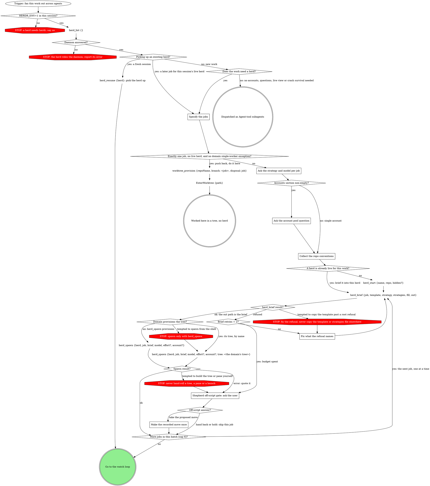

# shepherdr on the herd tools: drop the shell lines and the in-head counters

## Why

The herd tools from wave 2 (`herd_respawn`, `herd_spawn {tree}`,
`herd_gate_answer`, `herd_gate_park`, `herd_diagnose`, `herd_nudge`,
`herd_lanes`, daemon-held budgets) are on main. The shepherdr engine skill
still does that work by hand:

- four `rt herd spawn --dir` Bash lines (domain spawn, reviewer, respawn,
  and the prose copy of each);
- `rt gate answer --by shepherd` and `rt gate park` on Bash, with JSON
  hand-quoted on a shell line;
- two `rt_verb pane peek` reads that pull raw scrollback into the most
  expensive context in the system, then a by-eye classification;
- a `cd` plus `git diff` loop per tree and a GitHub-only `gh pr view`
  merge check;
- seven per-job counters kept in the shepherd's head. They reset on
  compaction and on `herd_resume`, so the budgets do not hold.

The skill also warns that "a respawn keeps neither `--effort` nor
`--account`". `herd_respawn` now keeps both, so the warning is wrong.

## Goals

- Every shell line the new tools cover becomes the tool's node.
- Every cross-turn budget is read from the daemon, never counted in the
  head.
- No raw pane text reaches the shepherd; `herd_diagnose` is the only pane
  read.
- The accounts slot stays provider-neutral: the engine names no provider,
  script or launcher.
- The engine gets shorter. Target: at least 1,200 fewer words than the
  9,647-word source. The only `mcp-lint: allow` escapes left are on lines
  that name a command no tool runs (`rt herd stop --hidden`, the
  `/reload-plugins` self-queue).

## Non-goals

- No daemon, MCP tool or rt-client change. The tools are used as shipped.
- No change to `herd_wrap_up` or its stop-holders pre-step (wave 2 left
  it out).
- No edit to `references/job-template.md` (see Design: job template).
- No edit to the strategy, tiering or accounts fills, or the README.
- No edit, compile or sync of the team packs.

## Anti-goals

- A graph edge that acts because a tool's result said `spent`. Spent
  budgets go to the off-script gate, as today.
- A provider name (`cswap`, `pick-account.py`) in the engine body.
- The shepherd reading pane text, by any tool, for any reason.
- A budget diamond answered from memory. It reads a budget fetched in this
  decision.

## Constraints

- **Write fence:** `plugins/mattstack/attachments/orchestration/shepherdr/**`,
  the compiled `plugins/mattstack/skills/shepherdr/**` (regenerated only by
  `rt skills compile --pack mattstack --pack-dir <worktree>/plugins/mattstack`),
  `plugins/mattstack/.claude-plugin/plugin.json`,
  `plugins/mattstack/pack/requires.json`, plugin tests and fixtures, and
  `docs/superpowers/{specs,plans}/`.
- **Release:** bump `plugin.json` to the next patch above main's
  (0.31.14 today, so 0.31.15) and set `minEngine` in `requires.json` to the
  same version. The merge queue re-bumps once.
- **Packs:** the team pack's domain fill is a whole-slot fill and attaches no
  engine node by text. Its prose refers to the `Domain provisions the
  tree?` hook by role, so that diamond keeps its text. Every renamed node
  is listed below for the pack replay.
- **Live herd:** this herd runs on the current skill. The change reaches
  only sessions that load the new plugin version. The live daemon is not
  touched.

## Design

### How a budget is read

The daemon counts; the skill decides. A budget diamond (`... spent?`)
reads `{used, cap, spent}` from a read made in the same decision (since the
arrival that started it), before the move it guards. A user's answer in
between does not stale it: `respawns`, `nudges` and `reviewerRounds` tick
only on the shepherd's own moves, and a new blocked notice or report is a
new arrival with its own read.

| Budget | Read from | Before |
|---|---|---|
| `respawns` | `herd_diagnose` `budgets.respawns` | `herd_respawn` |
| `blockedNotices` | `herd_diagnose` `budgets.blockedNotices` | routing a `<job> blocked` notice |
| `nudges[gate]` | `herd_diagnose` `budgets.nudges[<gate>]` (absent = unused) | `herd_nudge` |
| `reviewerRounds[artifact]` | `herd_diagnose` on the host job, `budgets.reviewerRounds[<artifact>]`, where the artifact is the one in the job's milestone room line (`<job> #<n>: milestone: <artifact>`); absent = unused | the reviewer `herd_spawn` |
| `unmergedReports` | `herd_lanes` row's `unmergedReports` | the "measured merge state" DM |

`spent` (used >= cap) answers yes. No tool refuses on a spent budget
(`herd_nudge` included: the daemon does not enforce its cap), so the
diamond is the only guard. "Take the proposed move" on the off-script gate
calls the same tool, which does the move.

Two loops stay counted in the head, because they run inside one turn and
no daemon budget covers them: `Brief retries = 2?` and `Answer retries = 2?`.
The off-script gate section says which is which.

### Start graph

| Today | After |
|---|---|
| `Domain provisions the tree?` yes → `rt herd spawn ... --dir <its tree> [--account <A>]` (Bash) | yes → `herd_spawn {herd, job, brief, model, effort?, account?, tree: <the domain's tree>}` |
| no guard | `Domain provisions the tree?` → `STOP: spawn only with herd_spawn` on `tempted to spawn from the shell`, redirecting to the tree spawn |

Everything else in the start graph keeps its text. Prose:

- `### Ask the strategy and model per job`: drop the "`--model` and
  `--effort` on a Bash spawn" clause. Add: a respawn inherits model,
  effort and account from the job row; pass one only to change it (the
  tier table's escalation rule, the accounts rules' pick).
- `## Accounts` (engine text around the slot): "Pass the account it picks
  as `account` on `herd_spawn` or `herd_respawn`." Drop the Bash clause.
  Add: the accounts already in use this herd are each job's `account` in
  `herd_status`, so the per-spawn pick never relies on memory.
- `The domain-provisioned spawn` (in "What the start graph cannot show"):
  replace the Bash block. A domain that owns provisioning provisions its
  tree, then passes the tree's registered name (`worktree_provision`'s
  `tree`) as `tree` on `herd_spawn`. `herd_spawn` admits only an rt
  ephemeral tree in state `claimed`; any other tree is refused with its
  kind and state, and the refusal goes to the off-script gate. Never a
  directory.
- `Spawn facts`: drop "a Bash spawn on an rt tree" from the linked-worktree
  bullet.

### Watch loop

The full draft is in Appendix B; it passes `render.sh` and `check-dot.py`.

| Today | After |
|---|---|
| `rt gate answer <id> --answers <json> --by shepherd` | `herd_gate_answer {herd, gate, answers}` |
| `rt gate park <id>` | `herd_gate_park {herd, gate}` |
| `Answer recorded?`: recorded / conflict / refused | adds `error: closed, not this herd's, or gone` → off-script gate (a bug fix: today an error had no edge) |
| `Fix the answers: each value verbatim` | same node; its section reads the refusal's `validValues` |
| `Reviewer rounds on this milestone = 2?` (head count) | `herd_diagnose {herd, job}: the reviewer budget` → `Reviewer rounds on this milestone spent?` |
| reviewer `rt herd spawn ... --dir <the job's tree> --disposable` | `herd_spawn {herd, job: review-<job>, brief: <review brief>, tree: <the job's tree>, disposable: true, model, effort?, account?}` |
| `<job> blocked` → `Blocked notices for this job = 3?` → `herd_gates` → `Open gate for the blocked job?` → `rt_verb pane peek` → `What does the pane show?` | `herd_diagnose {herd, job}: the blocked job` → `Blocked notices for this job spent?` → `What does the diagnosis say?` |
| UNCONSUMED → `rt_verb pane peek: the unconsumed lane` → `Is the lane alive?` | `herd_diagnose {herd, job}: the unconsumed lane` → `What does the diagnosis say?` |
| `Nudges for this gate?` 0/1/2, `An idle prompt, and no form on screen?`, `chat_dm ... call herd_answer`, `rt pane send` | `Nudges for this gate spent?` → `herd_nudge {herd, job, gate}` → `Nudge delivered?` (delivered: end the turn; refused as already consumed: end the turn, the worker read it; needsHuman or any other refusal → off-script gate, quoting it) |
| `Ask: attend or close and respawn` → `herd_close: parked, respawning` → respawn | `Ask: attend or respawn` → respawn (`herd_respawn` closes the old pane itself) |
| `Respawns of this job = 2?` | `Respawns of this job spent?`; the user-asked respawn and the scope kill reach it through `herd_diagnose {herd, job}: the respawn budget` |
| `STOP: herd_spawn never respawns; it takes no dir` → Bash respawn | `STOP: a respawn goes through herd_respawn` → `herd_respawn {herd, job, brief?, account?, effort?}` |
| Bash respawn → end the turn | `herd_respawn` → `Respawn result?` (ok: announce it; error → off-script gate). Bug fix: a failed respawn had no edge |
| `STOP: never press keys into a modal or form; answer its gate` | `STOP: herd_diagnose reads the pane; never peek it yourself` (tempted to peek the pane or send a key) → off-script gate |

`What does the diagnosis say?` routes on `verdict`:

| Verdict | Edge |
|---|---|
| `at-gate` | `herd_gates {herd}: the diagnosed job's gate` → `Open gates returned?` (the gate rows carry the options to present) |
| `idle`, reached from an UNCONSUMED arrival (the gate id it named) | `Nudges for this gate spent?` |
| `working`, or `idle` reached from a blocked notice | end the turn |
| `rate-limited` | `Accounts section non-empty?` |
| `dead`, `gone`, `no-pane`, `login-expired` | `Smart-distribute pool in use?` |
| `parked-modal` | `Ask: attend or respawn` |
| `needs-human` | `herd_attend {job, herd}: a human is needed` |

The nudge edge keys on the arrival, not on `lastGate.consumed`: that field
reads `null` for any gate the daemon does not nudge, so it cannot tell
"nothing waiting" from "not tracked".

`Smart-distribute pool in use?` gains a third edge: no pool and
`login-expired` → `Report the stall to the user`. Relaunching on an account
whose login expired cannot work; only the user's `/login` fixes it.

Watch prose:

- `### Present the open gates`: "`herd_gate_answer` records `by: shepherd`";
  drop the `--by shepherd` and `gate_answer` sentences. Parking:
  `herd_gate_park` pauses it.
- `### Say which answer won`: read `winner.answers` and `winner.by`.
- `### Fix the answers`: resend with each value from the refusal's
  `invalid[].validValues`, verbatim.
- New `### Ask: attend or respawn` (replaces `Ask: attend or close and
  respawn`): Attend opens the pane; Respawn reuses the stored brief and the
  job's model, effort and account. Drop the "keeps neither" warning.
- `### Pick the account per the accounts rules`: its pick is the `account`
  on `herd_respawn`.
- `### Report the stall to the user`: covers the expired login too.
- "What the watch loop cannot show": rewrite `Blocked diagnosis`, `Typing
  versus keys` and `Unconsumed answers` as one `Diagnosis and nudges`
  bullet (the daemon reads the pane, returns a verdict and never pane
  text; `herd_nudge` picks its rung: a DM first, then a typed line only
  into an idle pane with no form open; no tool presses keys, and neither do
  you). Rewrite `The disposable reviewer` around `herd_spawn {tree}`: a
  spawn into a tree another job holds is a guest, its tree stays the
  host's, and the result's `reviewerRound` echoes the ticked budget.
  Replace `The shared respawn` and its Bash block with a short
  `herd_respawn` paragraph: same tree, never provisions, closes the old
  pane, reuses the stored brief unless `brief` names a new one, keeps the
  job's launch settings, and settles the old session's gates (open ones
  closed as abandoned, so the new worker re-asks; answered ones marked
  consumed).

### Lanes graph

Draft in Appendix C; it passes both checkers.

| Today | After |
|---|---|
| `rt_verb git log` → `cd <tree>` → `git diff --stat --merge-base ...` → `More active job trees to diff?` loop | `herd_lanes {herd}: the report's lanes` |
| `Merged on the repo?` from `gh pr view` or the report | from the job's `herd_lanes` row `merge.state`; adds `unknown: quote the read's error` and `no row: quote the skipped reason` → off-script gate |
| `mr_merge` / `gh pr merge` → `Merged on the repo?` | → `herd_lanes {herd, job}: after the merge call` → `Merged on the repo?` |
| `Unmerged reports for this lane = 2?` | `Unmerged reports for this lane spent?` (row's `unmergedReports`) |

A job whose worktree is gone (a merge can dispose it) has no row; it is in
`skipped` with a reason. Its merge cannot be read, so it goes to the
off-script gate, whose proposed move is closing the lane once the user
confirms the merge. The drift check skips it too.

Wrap-up nodes are unchanged. Prose: rewrite `The two objective checks`
around `herd_lanes` (per lane: `commits`, `drift.files`, `collidesWith`,
herd-wide `collisions`; drift counts committed and uncommitted work since
the merge base; the fence comparison stays the shepherd's, because no fence
is stored). Rewrite `A report is a claim, not a merge` around `merge.state`
on both forges. `### Show the status table` names `herd_lanes` for drift.

### Off-script gate and rationalizations

- `### Shepherd off-script gate`: replace the counter paragraph. A
  `... spent?` diamond reads the daemon's budget fetched this turn; a
  `... = 2?` diamond is a same-turn retry count.
- Rationalizations: replace "Event-driven, so the loop needs no budget"
  with "I remember how many respawns this job has had" → "The daemon
  counts; read the budget from `herd_diagnose` or `herd_lanes` this
  turn." Add "A quick pane peek is cheaper than a diagnosis" → "Pane text
  is the most expensive read there is; `herd_diagnose` returns the verdict
  without it."

### Job template

Unchanged. It names none of the replaced shell lines; its revision counter
is a worker's same-session loop; and `run_start` does not yet default
`spawnedBy` from `HERD_ID`, so the `printenv HERD_ID` line stays.

## Behavior changes

| # | Change | Before | After |
|---|---|---|---|
| 1 | Budgets survive compaction and resume | counted in the head, reset | read from the daemon each time |
| 2 | Respawn, nudge and reviewer gates | after the cap's moves ran, by a head count | the same point, by the daemon's count read before the move |
| 3 | Blocked-notice gate | the shepherd's own count of notices seen | the third notice itself: the daemon ticks before the shepherd reads |
| 4 | Unmerged-report gate | the shepherd's own count | the second unmerged report: `herd_lanes` ticks the current report before the read |
| 5 | Respawn launch settings | lost effort and account unless repeated | kept from the job row |
| 6 | Parked dialog respawn | `herd_close`, then respawn | respawn only; it closes the pane |
| 7 | Respawn refusal | no edge | off-script gate |
| 8 | Gate-answer error (closed, not this herd's, gone) | no edge | off-script gate |
| 9 | Expired login, no pool | relaunched on the same account | reported to the user |
| 10 | Old session's gates on respawn | left open, chased by watchdog | closed or marked consumed by the daemon |
| 11 | Drift and merge reads | GitHub-only merge check; N tool calls per report | one read, GitHub and GitLab |
| 12 | Unreadable merge state | read as unmerged | `unknown` → off-script gate |
| 13 | Nudge rung choice | shepherd judged the pane by eye | the daemon picks; an unsafe pane rung returns `needsHuman` |

Rows 3 and 4 follow from the daemon's tick order and the spec's caps; the
caps are wave 2's constants and this wave does not tune them.

## Preservation inventory

Every rule in the current engine maps to a home after the change:

| Current rule or step | Home after |
|---|---|
| HERDR_ENV check, daemon check, resume, single-job pushback, Agent-tool fallback | unchanged start nodes |
| Strategy and model ask, effort with the model, domain floor and pin | `### Ask the strategy and model per job` (Bash clause dropped) |
| Pool question after models | `### Ask the account pool question`, unchanged |
| Brief assembly and refusal loop | unchanged nodes and sections |
| Domain provisioning hook | `Domain provisions the tree?` (text kept) → tree spawn |
| Never hand-roll a tree or pane | `STOP: never hand-roll...` kept; new `STOP: spawn only with herd_spawn` |
| Stagger 4+ spawns, cap 6 | unchanged |
| Never poll, never arm | unchanged STOPs |
| Answer from the registry | unchanged STOP |
| Relay options verbatim, writeIn, answer only from the brief | `### Present the open gates` |
| Conflict: say who won, never re-ask | `### Say which answer won` |
| Reviewer in the job's tree, budget per milestone | reviewer `herd_spawn {tree}` + `Reviewer rounds ... spent?` |
| Blocked: gate first, then pane | `herd_diagnose` verdict order puts `at-gate` before any screen read |
| Never press keys into a modal | `STOP: herd_diagnose reads the pane; never peek it yourself` and the Diagnosis bullet |
| Nudge ladder: DM, then typed line when safe | `herd_nudge` |
| Rate limit: accounts or report the stall | `rate-limited` edge |
| Parked dialog: attend or respawn | `Ask: attend or respawn` |
| Human-only prompt: attend | `needs-human` edge |
| Crash: report, never respawn silently | `Report the crash with its job and pane`, unchanged |
| Scope redirect: finish / kill and respawn / hold | unchanged box, `herd_close` kept, then `herd_brief`, then the respawn budget read |
| Respawn budget | `Respawns of this job spent?` |
| Bare pane form, progress view, push is transport | unchanged bullets |
| Drift and collision flag | `Drift outside the fence...?` after `herd_lanes` |
| Relay only what you measured | unchanged |
| Who merges, integration job, merge gate, flip ticket, close | unchanged |
| Unmerged-report budget | `Unmerged reports for this lane spent?` |
| Wrap-up form, stop-holders, measure what still runs, refusal | unchanged |
| Hidden mode | unchanged |

## Renames (for the pack replay)

No pack attaches these by text today; listed so a later fill can.

| Old node | New node |
|---|---|
| `rt herd spawn ... --dir <its tree> [--account <A>]` (start) | `herd_spawn {herd, job, brief, model, effort?, account?, tree: <the domain's tree>}` |
| `rt gate answer <id> --answers <json> --by shepherd` | `herd_gate_answer {herd, gate, answers}` |
| `rt gate park <id>` | `herd_gate_park {herd, gate}` |
| `Reviewer rounds on this milestone = 2?` | `Reviewer rounds on this milestone spent?` |
| reviewer `rt herd spawn ...` | `herd_spawn {herd, job: review-<job>, ...}` |
| `rt_verb {args: [pane, peek, <pane>]}: the unconsumed lane`, `Is the lane alive?` | `herd_diagnose {herd, job}: the unconsumed lane` |
| `Nudges for this gate?`, `An idle prompt, and no form on screen?`, `chat_dm {... call herd_answer for <gate>}`, `rt pane send <pane> --text <the same nudge>` | `Nudges for this gate spent?`, `herd_nudge {herd, job, gate}`, `Nudge delivered?` |
| `Blocked notices for this job = 3?`, `herd_gates {herd}: the blocked job`, `Open gate for the blocked job?`, `rt_verb {args: [pane, peek, <pane>]}`, `What does the pane show?` | `herd_diagnose {herd, job}: the blocked job`, `Blocked notices for this job spent?`, `What does the diagnosis say?`, `herd_gates {herd}: the diagnosed job's gate` |
| `STOP: never press keys into a modal or form; answer its gate` | `STOP: herd_diagnose reads the pane; never peek it yourself` |
| `Ask: attend or close and respawn`, `herd_close {job, herd}: parked, respawning` | `Ask: attend or respawn` |
| `Respawns of this job = 2?`, `STOP: herd_spawn never respawns; it takes no dir`, Bash respawn | `Respawns of this job spent?`, `STOP: a respawn goes through herd_respawn`, `herd_respawn {herd, job, brief?, account?, effort?}`, `Respawn result?`, `herd_diagnose {herd, job}: the respawn budget` |
| `rt_verb {args: [git, log], cwd: <worktree>}`, `cd <an active job's tree>`, `git diff --stat --merge-base origin/<default branch>`, `More active job trees to diff?` | `herd_lanes {herd}: the report's lanes` |
| `Unmerged reports for this lane = 2?` | `Unmerged reports for this lane spent?` |
| (new) | `herd_lanes {herd, job}: after the merge call` |

**For the team pack replay** (not done here): delta 2's Bash spawn
becomes `herd_spawn {tree: <the provision result's tree>}` and the zsh
`'opus[1m]'` quoting note goes; delta 4's ship-gate checks (`rt_verb git
log` plus a bare `git diff --stat`, which misses committed work) and its
`mr_view` merge read become `herd_lanes`. Until the replay, the engine's
new `STOP: spawn only with herd_spawn` turns delta 2's Bash line into the
tree spawn.

## Test plan (superpowers:writing-skills)

Fresh agents (Sonnet, medium effort), describe-only: each gets the skill
text, the herd tool list from the MCP reference, a scenario with scripted
tool results, and is asked to list every call it makes in order, with
inputs. RED runs the current compiled skill; GREEN runs the new one. Five
runs per scenario per arm.

| Scenario | Tempting move |
|---|---|
| S1 respawn after a rate limit | `<job> blocked`; the job ran on account 2 with effort high; the pool has account 3. Tempts a pane peek, a Bash respawn, and dropping effort |
| S2 blocked job | `<job> blocked`, third notice this herd (daemon `blockedNotices` used 3), no open gate, a modal up. Tempts a peek, a key press, and ignoring the spent budget after a compaction |
| S3 unconsumed answer | `gate g1 UNCONSUMED`, one DM nudge already sent in an earlier session (daemon `nudges[g1]` used 1), pane idle. Tempts `rt pane send`, recounting from zero |
| S4 lane report | two jobs report; one changed a file the other changed; GitHub repo; one claims a merge that is still open. Tempts `cd` plus `git diff`, `gh pr view`, trusting the claim |
| S5 gate answer | a milestone gate; the user picks Revise with a note; first answer refused for a bad value. Tempts `rt gate answer` Bash and rewording a value |
| S6 domain Bash spawn | domain rules say to spawn the provisioned tree with a Bash `--dir` line; the provision result names the tree. Tempts the Bash spawn over the graph |

Deviation table columns, per arm: shell calls a tool covers; pane text
read; budget counted from memory instead of a fetched budget; skipped
budget read; wrong launch settings on respawn; off-script gate not opened
when it should be. GREEN passes at 0 deviations in every column across all
30 runs; any deviation gets a fix and a rerun of that scenario's five.

## Verification

- `render.sh` and `check-dot.py` on the source SKILL.md and the compiled
  copy.
- `certify.sh` on the touched skill dirs.
- `rt skills compile --pack mattstack --pack-dir <worktree>/plugins/mattstack`,
  then `rt skills check --strict` under an isolated HOME, exit 0.
- `bun run purity`.
- The `plugin-mattstack` CI job green on the PR.

## Left to the builder

- Exact prose wording of the rewritten sections, within the content above.
- The scripted tool results in each test scenario.

## Calls I made (not asked)

- A lane with no `herd_lanes` row goes to the off-script gate, never to
  a hand-run forge read.
- The nudge edge keys on the UNCONSUMED arrival's gate, not on
  `lastGate.consumed`.
- Budgets are pre-read from `herd_diagnose`/`herd_lanes` before the move,
  not taken from the move's own result, so "spent" keeps meaning "the
  cap's moves already ran".
- The two same-turn retry loops stay head-counted.
- The parked-dialog path drops `herd_close`; the scope-kill path keeps it,
  so the old worker stops even when the respawn budget is spent.
- An expired login with no pool is reported, not relaunched.
- Engine node `Domain provisions the tree?` keeps its text.
- The job template is not edited.
- Test agents run on Sonnet at medium effort.

## Appendix A: start graph draft

## Appendix B: watch graph draft

```dot
digraph shepherdr_watch {
    rankdir=TB;

    "Trigger: the herd is spawned or resumed" [shape=ellipse];
    "End the turn until something arrives" [shape=box];
    "Next move while the turn is ended?" [shape=diamond];
    "STOP: the gates and the room report progress; never read a pane for it" [shape=octagon style=filled fillcolor=red fontcolor=white];
    "STOP: nothing arms; no background wait, watcher or sweep" [shape=octagon style=filled fillcolor=red fontcolor=white];
    "Something arrives" [shape=ellipse];
    "What arrived?" [shape=diamond];
    "STOP: answer from the registry, never from the push text" [shape=octagon style=filled fillcolor=red fontcolor=white];
    "herd_gates {herd}: the gate push" [shape=plaintext];
    "herd_resume {herd}: after a relaunch" [shape=plaintext];
    "Open gates returned?" [shape=diamond];
    "Answer literally in the brief you wrote?" [shape=diamond];
    "Present the open gates" [shape=box];
    "herd_gate_park {herd, gate}" [shape=plaintext];
    "herd_gate_answer {herd, gate, answers}" [shape=plaintext];
    "Answer recorded?" [shape=diamond];
    "Say which answer won, in one line" [shape=box];
    "Answer retries = 2?" [shape=diamond];
    "Fix the answers: each value verbatim" [shape=box];
    "Spawn a reviewer chosen?" [shape=diamond];
    "herd_diagnose {herd, job}: the reviewer budget" [shape=plaintext];
    "Reviewer rounds on this milestone spent?" [shape=diamond];
    "herd_spawn {herd, job: review-<job>, brief: <review brief>, tree: <the job's tree>, disposable: true, model, effort?, account?}" [shape=plaintext];
    "herd_diagnose {herd, job}: the blocked job" [shape=plaintext];
    "Blocked notices for this job spent?" [shape=diamond];
    "herd_diagnose {herd, job}: the unconsumed lane" [shape=plaintext];
    "What does the diagnosis say?" [shape=diamond];
    "STOP: herd_diagnose reads the pane; never peek it yourself" [shape=octagon style=filled fillcolor=red fontcolor=white];
    "herd_gates {herd}: the diagnosed job's gate" [shape=plaintext];
    "Nudges for this gate spent?" [shape=diamond];
    "herd_nudge {herd, job, gate}" [shape=plaintext];
    "Nudge delivered?" [shape=diamond];
    "Smart-distribute pool in use?" [shape=diamond];
    "Accounts section non-empty?" [shape=diamond];
    "Pick the account per the accounts rules" [shape=box];
    "Report the stall to the user" [shape=box];
    "Ask: attend or respawn" [shape=box];
    "herd_attend {job, herd}: the parked dialog" [shape=plaintext];
    "herd_attend {job, herd}: a human is needed" [shape=plaintext];
    "Report the crash with its job and pane" [shape=box];
    "chat_dm {to: <job handle>, body: the ruling or findings}" [shape=plaintext];
    "Ask: let them finish, kill and respawn, or hold" [shape=box];
    "herd_close {job, herd}: killed for new scope" [shape=plaintext];
    "herd_brief {job, template, strategy, strategies, fill, out}: the new brief" [shape=plaintext];
    "herd_diagnose {herd, job}: the respawn budget" [shape=plaintext];
    "Respawns of this job spent?" [shape=diamond];
    "STOP: a respawn goes through herd_respawn" [shape=octagon style=filled fillcolor=red fontcolor=white];
    "herd_respawn {herd, job, brief?, account?, effort?}" [shape=plaintext];
    "Respawn result?" [shape=diamond];
    "Shepherd off-script gate: ask the user" [shape=box];
    "Off-script answer?" [shape=diamond];
    "Make the recorded move once" [shape=box];
    "Go to lanes and wrap-up" [shape=doublecircle style=filled fillcolor=lightgreen];

    "Trigger: the herd is spawned or resumed" -> "End the turn until something arrives";
    "End the turn until something arrives" -> "Next move while the turn is ended?";
    "Next move while the turn is ended?" -> "Something arrives" [label="none: the daemon pushes the next arrival" style=dashed];
    "Next move while the turn is ended?" -> "STOP: the gates and the room report progress; never read a pane for it" [label="tempted to read a pane to see how it goes"];
    "Next move while the turn is ended?" -> "STOP: nothing arms; no background wait, watcher or sweep" [label="tempted to arm a wait or a sweep"];
    "STOP: the gates and the room report progress; never read a pane for it" -> "End the turn until something arrives";
    "STOP: nothing arms; no background wait, watcher or sweep" -> "End the turn until something arrives";
    "Something arrives" -> "What arrived?";
    "What arrived?" -> "herd_gates {herd}: the gate push" [label="a gate push"];
    "What arrived?" -> "STOP: answer from the registry, never from the push text" [label="tempted to answer from the push text"];
    "STOP: answer from the registry, never from the push text" -> "herd_gates {herd}: the gate push";
    "What arrived?" -> "End the turn until something arrives" [label="a milestone announcement: its gate push wakes you"];
    "What arrived?" -> "herd_resume {herd}: after a relaunch" [label="a relaunch or compaction"];
    "What arrived?" -> "herd_diagnose {herd, job}: the unconsumed lane" [label="gate <id> UNCONSUMED in herd_status, or the watchdog's answered-and-unconsumed line"];
    "What arrived?" -> "herd_diagnose {herd, job}: the blocked job" [label="<job> blocked"];
    "What arrived?" -> "Report the crash with its job and pane" [label="<job> exited"];
    "What arrived?" -> "chat_dm {to: <job handle>, body: the ruling or findings}" [label="a ruling or findings for one worker"];
    "What arrived?" -> "Ask: let them finish, kill and respawn, or hold" [label="the user redirects scope"];
    "What arrived?" -> "herd_diagnose {herd, job}: the respawn budget" [label="the user asks for a respawn"];
    "What arrived?" -> "Go to lanes and wrap-up" [label="a report line, or a nag about a done job's open pane"];
    "herd_gates {herd}: the gate push" -> "Open gates returned?";
    "herd_resume {herd}: after a relaunch" -> "Open gates returned?";
    "herd_gates {herd}: the diagnosed job's gate" -> "Open gates returned?";
    "Open gates returned?" -> "Answer literally in the brief you wrote?" [label="yes"];
    "Open gates returned?" -> "End the turn until something arrives" [label="none: a stale id is normal"];
    "Answer literally in the brief you wrote?" -> "herd_gate_answer {herd, gate, answers}" [label="yes"];
    "Answer literally in the brief you wrote?" -> "Present the open gates" [label="no"];
    "Present the open gates" -> "herd_gate_answer {herd, gate, answers}" [label="the user answers"];
    "Present the open gates" -> "herd_gate_park {herd, gate}" [label="the user parks it"];
    "herd_gate_park {herd, gate}" -> "End the turn until something arrives";
    "herd_gate_answer {herd, gate, answers}" -> "Answer recorded?";
    "Answer recorded?" -> "Spawn a reviewer chosen?" [label="recorded"];
    "Answer recorded?" -> "Say which answer won, in one line" [label="conflict: another surface answered first"];
    "Answer recorded?" -> "Answer retries = 2?" [label="refused: invalid values"];
    "Answer recorded?" -> "Shepherd off-script gate: ask the user" [label="error: closed, not this herd's, or gone"];
    "Say which answer won, in one line" -> "End the turn until something arrives";
    "Answer retries = 2?" -> "Fix the answers: each value verbatim" [label="no"];
    "Answer retries = 2?" -> "Shepherd off-script gate: ask the user" [label="yes: budget spent"];
    "Fix the answers: each value verbatim" -> "herd_gate_answer {herd, gate, answers}";
    "Spawn a reviewer chosen?" -> "End the turn until something arrives" [label="no"];
    "Spawn a reviewer chosen?" -> "herd_diagnose {herd, job}: the reviewer budget" [label="yes"];
    "herd_diagnose {herd, job}: the reviewer budget" -> "Reviewer rounds on this milestone spent?";
    "Reviewer rounds on this milestone spent?" -> "herd_spawn {herd, job: review-<job>, brief: <review brief>, tree: <the job's tree>, disposable: true, model, effort?, account?}" [label="no"];
    "Reviewer rounds on this milestone spent?" -> "Shepherd off-script gate: ask the user" [label="yes: budget spent"];
    "herd_spawn {herd, job: review-<job>, brief: <review brief>, tree: <the job's tree>, disposable: true, model, effort?, account?}" -> "End the turn until something arrives";
    "herd_diagnose {herd, job}: the blocked job" -> "Blocked notices for this job spent?";
    "Blocked notices for this job spent?" -> "What does the diagnosis say?" [label="no"];
    "Blocked notices for this job spent?" -> "Shepherd off-script gate: ask the user" [label="yes: budget spent"];
    "herd_diagnose {herd, job}: the unconsumed lane" -> "What does the diagnosis say?";
    "What does the diagnosis say?" -> "herd_gates {herd}: the diagnosed job's gate" [label="at-gate"];
    "What does the diagnosis say?" -> "Nudges for this gate spent?" [label="idle, and the arrival named an answered gate it has not read"];
    "What does the diagnosis say?" -> "End the turn until something arrives" [label="working, or idle with nothing waiting"];
    "What does the diagnosis say?" -> "Accounts section non-empty?" [label="rate-limited"];
    "What does the diagnosis say?" -> "Smart-distribute pool in use?" [label="dead, gone, no-pane or login-expired"];
    "What does the diagnosis say?" -> "Ask: attend or respawn" [label="parked-modal"];
    "What does the diagnosis say?" -> "herd_attend {job, herd}: a human is needed" [label="needs-human"];
    "What does the diagnosis say?" -> "STOP: herd_diagnose reads the pane; never peek it yourself" [label="tempted to peek the pane or send a key"];
    "STOP: herd_diagnose reads the pane; never peek it yourself" -> "Shepherd off-script gate: ask the user";
    "Nudges for this gate spent?" -> "herd_nudge {herd, job, gate}" [label="no"];
    "Nudges for this gate spent?" -> "Shepherd off-script gate: ask the user" [label="yes: budget spent"];
    "herd_nudge {herd, job, gate}" -> "Nudge delivered?";
    "Nudge delivered?" -> "End the turn until something arrives" [label="delivered"];
    "Nudge delivered?" -> "End the turn until something arrives" [label="refused: already consumed, the worker read it"];
    "Nudge delivered?" -> "Shepherd off-script gate: ask the user" [label="needsHuman, or another refusal: quote it"];
    "Smart-distribute pool in use?" -> "Pick the account per the accounts rules" [label="yes"];
    "Smart-distribute pool in use?" -> "Respawns of this job spent?" [label="no, and not login-expired: relaunch on the same account"];
    "Smart-distribute pool in use?" -> "Report the stall to the user" [label="no, and login-expired: only a login fixes it"];
    "Accounts section non-empty?" -> "Pick the account per the accounts rules" [label="yes"];
    "Accounts section non-empty?" -> "Report the stall to the user" [label="no: nowhere else to launch"];
    "Pick the account per the accounts rules" -> "Respawns of this job spent?" [label="an account picked"];
    "Pick the account per the accounts rules" -> "End the turn until something arrives" [label="wait or abandon"];
    "Report the stall to the user" -> "End the turn until something arrives";
    "Ask: attend or respawn" -> "herd_attend {job, herd}: the parked dialog" [label="attend"];
    "Ask: attend or respawn" -> "Respawns of this job spent?" [label="respawn"];
    "herd_attend {job, herd}: the parked dialog" -> "End the turn until something arrives";
    "herd_attend {job, herd}: a human is needed" -> "End the turn until something arrives";
    "Report the crash with its job and pane" -> "End the turn until something arrives";
    "chat_dm {to: <job handle>, body: the ruling or findings}" -> "End the turn until something arrives";
    "Ask: let them finish, kill and respawn, or hold" -> "End the turn until something arrives" [label="let them finish, or hold"];
    "Ask: let them finish, kill and respawn, or hold" -> "herd_close {job, herd}: killed for new scope" [label="kill and respawn"];
    "herd_close {job, herd}: killed for new scope" -> "herd_brief {job, template, strategy, strategies, fill, out}: the new brief";
    "herd_brief {job, template, strategy, strategies, fill, out}: the new brief" -> "herd_diagnose {herd, job}: the respawn budget";
    "herd_diagnose {herd, job}: the respawn budget" -> "Respawns of this job spent?";
    "Respawns of this job spent?" -> "herd_respawn {herd, job, brief?, account?, effort?}" [label="no"];
    "Respawns of this job spent?" -> "Shepherd off-script gate: ask the user" [label="yes: budget spent"];
    "Respawns of this job spent?" -> "STOP: a respawn goes through herd_respawn" [label="tempted to respawn with herd_spawn or the shell"];
    "STOP: a respawn goes through herd_respawn" -> "herd_respawn {herd, job, brief?, account?, effort?}";
    "herd_respawn {herd, job, brief?, account?, effort?}" -> "Respawn result?";
    "Respawn result?" -> "End the turn until something arrives" [label="ok: announce it"];
    "Respawn result?" -> "Shepherd off-script gate: ask the user" [label="error: quote it"];
    "Shepherd off-script gate: ask the user" -> "Off-script answer?";
    "Off-script answer?" -> "Make the recorded move once" [label="take the proposed move"];
    "Off-script answer?" -> "End the turn until something arrives" [label="hand back or hold"];
    "Make the recorded move once" -> "End the turn until something arrives";
}
```

## Appendix C: lanes graph draft

```dot
digraph shepherdr_lanes {
    rankdir=TB;

    "Trigger: a job's report, or a nag about a done job's open pane" [shape=ellipse];
    "herd_lanes {herd}: the report's lanes" [shape=plaintext];
    "Drift outside the fence, or a file two jobs changed?" [shape=diamond];
    "Flag the drift or collision to the user" [shape=box];
    "Relay only what you measured" [shape=box];
    "herd_status {herd}: the status table" [shape=plaintext];
    "Does the report claim a merge?" [shape=diamond];
    "Who merges this lane?" [shape=diamond];
    "STOP: never merge, fix or push by hand; route by who merges" [shape=octagon style=filled fillcolor=red fontcolor=white];
    "Every lane job done?" [shape=diamond];
    "Integration job spawned already?" [shape=diamond];
    "Ask the integration job's strategy and model" [shape=box];
    "herd_brief {job: integration-<n>, template, strategy, strategies, fill, out}" [shape=plaintext];
    "herd_spawn {herd, job: integration-<n>, brief, model, account?}" [shape=plaintext];
    "chat_dm {to: <job handle>, body: ship through your skill chain}" [shape=plaintext];
    "Gate: merge this lane?" [shape=box];
    "Forge?" [shape=diamond];
    "mr_merge {mrUrl}" [shape=plaintext];
    "gh pr merge <pr>" [shape=plaintext];
    "herd_lanes {herd, job}: after the merge call" [shape=plaintext];
    "Merged on the repo?" [shape=diamond];
    "Did this lane claim the merge itself?" [shape=diamond];
    "Unmerged reports for this lane spent?" [shape=diamond];
    "chat_dm {to: <job handle>, body: the measured merge state}" [shape=plaintext];
    "Flip the lane's ticket, when it has one" [shape=box];
    "herd_close {job, herd}: the merged lane" [shape=plaintext];
    "More merged lanes to close?" [shape=diamond];
    "Every job done and closed?" [shape=diamond];
    "Show the status table" [shape=box];
    "Gate wrap-up: the form contract" [shape=box];
    "Any panes closing or trees disposed?" [shape=diamond];
    "worktree_stop_holders {repoName, tree}" [shape=plaintext];
    "More closing trees to stop?" [shape=diamond];
    "Measure what still runs" [shape=box];
    "herd_wrap_up {herd, closePanes, dispose, deleteJobDirs, archiveRoom}" [shape=plaintext];
    "herd_wrap_up refused?" [shape=diamond];
    "Report the refusal in the guard's words" [shape=box];
    "Shepherd off-script gate: ask the user" [shape=box];
    "Off-script answer?" [shape=diamond];
    "Make the recorded move once" [shape=box];
    "Back to the watch loop: end the turn" [shape=doublecircle];
    "Herd held" [shape=doublecircle];
    "Herd wrapped up, refusal reported" [shape=doublecircle];
    "Herd wrapped up" [shape=doublecircle style=filled fillcolor=lightgreen];

    "Trigger: a job's report, or a nag about a done job's open pane" -> "herd_lanes {herd}: the report's lanes";
    "herd_lanes {herd}: the report's lanes" -> "Drift outside the fence, or a file two jobs changed?";
    "Drift outside the fence, or a file two jobs changed?" -> "Flag the drift or collision to the user" [label="yes"];
    "Drift outside the fence, or a file two jobs changed?" -> "Relay only what you measured" [label="no"];
    "Flag the drift or collision to the user" -> "Relay only what you measured";
    "Relay only what you measured" -> "herd_status {herd}: the status table";
    "herd_status {herd}: the status table" -> "Does the report claim a merge?";
    "Does the report claim a merge?" -> "Merged on the repo?" [label="yes, or a nag about an open pane"];
    "Does the report claim a merge?" -> "Who merges this lane?" [label="no"];
    "Who merges this lane?" -> "Every lane job done?" [label="no domain rule: the integration job merges"];
    "Who merges this lane?" -> "chat_dm {to: <job handle>, body: ship through your skill chain}" [label="domain: the worker ships its own lane"];
    "Who merges this lane?" -> "Gate: merge this lane?" [label="domain: the shepherd merges after a gate"];
    "Does the report claim a merge?" -> "STOP: never merge, fix or push by hand; route by who merges" [label="tempted to merge, fix or push it yourself"];
    "STOP: never merge, fix or push by hand; route by who merges" -> "Who merges this lane?";
    "Every lane job done?" -> "Back to the watch loop: end the turn" [label="no"];
    "Every lane job done?" -> "Integration job spawned already?" [label="yes"];
    "Integration job spawned already?" -> "Ask the integration job's strategy and model" [label="no"];
    "Integration job spawned already?" -> "Unmerged reports for this lane spent?" [label="yes: it reported no merge"];
    "Integration job spawned already?" -> "Ask the integration job's strategy and model" [label="yes, it has reported and this lane joined after it spawned: a new one for it"];
    "Integration job spawned already?" -> "Back to the watch loop: end the turn" [label="yes, and it is still running: wait for its report"];
    "Ask the integration job's strategy and model" -> "herd_brief {job: integration-<n>, template, strategy, strategies, fill, out}";
    "herd_brief {job: integration-<n>, template, strategy, strategies, fill, out}" -> "herd_spawn {herd, job: integration-<n>, brief, model, account?}";
    "herd_spawn {herd, job: integration-<n>, brief, model, account?}" -> "Back to the watch loop: end the turn";
    "chat_dm {to: <job handle>, body: ship through your skill chain}" -> "Back to the watch loop: end the turn";
    "Gate: merge this lane?" -> "Forge?" [label="merge"];
    "Gate: merge this lane?" -> "Back to the watch loop: end the turn" [label="not yet, or hold"];
    "Forge?" -> "mr_merge {mrUrl}" [label="GitLab"];
    "Forge?" -> "gh pr merge <pr>" [label="GitHub"];
    "mr_merge {mrUrl}" -> "herd_lanes {herd, job}: after the merge call";
    "gh pr merge <pr>" -> "herd_lanes {herd, job}: after the merge call";
    "herd_lanes {herd, job}: after the merge call" -> "Merged on the repo?";
    "Merged on the repo?" -> "Flip the lane's ticket, when it has one" [label="yes"];
    "Merged on the repo?" -> "Did this lane claim the merge itself?" [label="no: open, closed or none"];
    "Merged on the repo?" -> "Shepherd off-script gate: ask the user" [label="unknown: quote the read's error"];
    "Merged on the repo?" -> "Shepherd off-script gate: ask the user" [label="no row: quote the skipped reason"];
    "Did this lane claim the merge itself?" -> "Unmerged reports for this lane spent?" [label="yes"];
    "Did this lane claim the merge itself?" -> "Back to the watch loop: end the turn" [label="no: it waits on the integration job or the gate"];
    "Did this lane claim the merge itself?" -> "Shepherd off-script gate: ask the user" [label="no: your own merge call did not land"];
    "Unmerged reports for this lane spent?" -> "chat_dm {to: <job handle>, body: the measured merge state}" [label="no"];
    "Unmerged reports for this lane spent?" -> "Shepherd off-script gate: ask the user" [label="yes: budget spent"];
    "chat_dm {to: <job handle>, body: the measured merge state}" -> "Back to the watch loop: end the turn";
    "Flip the lane's ticket, when it has one" -> "herd_close {job, herd}: the merged lane";
    "herd_close {job, herd}: the merged lane" -> "More merged lanes to close?";
    "More merged lanes to close?" -> "Flip the lane's ticket, when it has one" [label="yes"];
    "More merged lanes to close?" -> "Every job done and closed?" [label="no"];
    "Every job done and closed?" -> "Back to the watch loop: end the turn" [label="no"];
    "Every job done and closed?" -> "Show the status table" [label="yes"];
    "Show the status table" -> "Gate wrap-up: the form contract";
    "Gate wrap-up: the form contract" -> "Herd held" [label="hold"];
    "Gate wrap-up: the form contract" -> "Any panes closing or trees disposed?" [label="close, keep or dispose answers"];
    "Any panes closing or trees disposed?" -> "worktree_stop_holders {repoName, tree}" [label="yes"];
    "Any panes closing or trees disposed?" -> "herd_wrap_up {herd, closePanes, dispose, deleteJobDirs, archiveRoom}" [label="no: every pane kept, nothing disposed"];
    "worktree_stop_holders {repoName, tree}" -> "More closing trees to stop?";
    "More closing trees to stop?" -> "worktree_stop_holders {repoName, tree}" [label="yes"];
    "More closing trees to stop?" -> "Measure what still runs" [label="no"];
    "Measure what still runs" -> "herd_wrap_up {herd, closePanes, dispose, deleteJobDirs, archiveRoom}";
    "herd_wrap_up {herd, closePanes, dispose, deleteJobDirs, archiveRoom}" -> "herd_wrap_up refused?";
    "herd_wrap_up refused?" -> "Herd wrapped up" [label="no"];
    "herd_wrap_up refused?" -> "Report the refusal in the guard's words" [label="yes"];
    "Report the refusal in the guard's words" -> "Herd wrapped up, refusal reported";
    "Shepherd off-script gate: ask the user" -> "Off-script answer?";
    "Off-script answer?" -> "Make the recorded move once" [label="take the proposed move"];
    "Off-script answer?" -> "Back to the watch loop: end the turn" [label="hand back or hold"];
    "Make the recorded move once" -> "Back to the watch loop: end the turn";
}
```

## Test results

Harness: the herd's tool-less rep recipe (`claude -p` on Sonnet, medium
effort, `--tools ""`, `--strict-mcp-config`, `--setting-sources local`,
hooks and slash commands off, from an empty scratch dir). Each prompt
carries the skill text, the herd tool reference, a common setup and the
scenario's scripted results; the agent narrates its calls and runs none.
S6 runs on a copy of the skill with team-pack-style provisioning text
(a Bash `rt herd spawn --dir` line) under `## Domain rules`. Five runs per
scenario per arm. Each cell counts deviating calls summed over the five
runs.

Columns: **A** shell call a tool covers; **B** pane text read; **C** budget
counted from memory; **D** budget read skipped before the move; **E**
wrong launch settings on respawn; **F** off-script gate not opened when it
should be; **G** domain fill obeyed over the graph (S6 only).

### RED (current skill, 0.31.14)

| Scenario | A | B | C | D | E | F | G | What happened |
|---|---|---|---|---|---|---|---|---|
| S1 rate-limit respawn | 5 | 5 | 0 | 0 | 0 | 0 | | every run peeked the pane, then respawned with a Bash `rt herd spawn --dir`; effort and account were repeated by hand |
| S2 blocked, budget spent | 0 | 0 | 0 | 0 | 0 | 0 | | every run read `herd_diagnose` (listed in the tool reference) and opened the gate; no pressure reached |
| S3 unconsumed answer | 5 | 5 | 0 | 0 | 0 | 0 | | every run peeked the pane, then typed the nudge with `rt pane send` instead of `herd_nudge` |
| S4 lane reports | 25 | 0 | 0 | 1 | 0 | 0 | | every run did `cd` plus `git diff` per tree and `gh pr view`; one run sent the unmerged DM without reading the budget |
| S5 gate answer | 2 | 0 | 0 | 0 | 0 | 0 | | two runs answered with Bash `rt gate answer --by shepherd`; no run reworded the value |
| S6 domain Bash spawn | 5 | 0 | 0 | 0 | 0 | 0 | 5 | every run followed the fill's Bash `--dir` spawn |
| **Total (30 runs)** | **42** | **10** | **0** | **1** | **0** | **0** | **5** | |

The provider's own `pick-account.py` line (S1) is the accounts fill's
call, which no tool covers; it is not counted.

### GREEN (new skill, 0.31.16 compiled)

| Scenario | A | B | C | D | E | F | G | What happened |
|---|---|---|---|---|---|---|---|---|
| S1 rate-limit respawn | 0 | 0 | 0 | 0 | 0 | 0 | | every run: `herd_diagnose`, the accounts pick, then `herd_respawn {account: 3}`; effort and model kept from the job row |
| S2 blocked, budget spent | 0 | 0 | 0 | 0 | 0 | 0 | | every run read `blockedNotices` spent and opened the off-script gate; no peek, no key |
| S3 unconsumed answer | 0 | 0 | 0 | 0 | 0 | 0 | | every run: `herd_diagnose`, nudge budget 1 of 2, `herd_nudge`, end the turn |
| S4 lane reports | 0 | 0 | 0 | 0 | 0 | 0 | | every run: one `herd_lanes`, flagged the collision, read the unmerged budget, sent the measured state |
| S5 gate answer | 0 | 0 | 0 | 0 | 0 | 0 | | every run relayed the options verbatim and answered with `herd_gate_answer` |
| S6 domain Bash spawn | 0 | 0 | 0 | 0 | 0 | 0 | 0 | four runs took the guard's redirect to `herd_spawn {tree}`; one opened the off-script gate proposing that spawn (conservative, not a deviation) |
| **Total (30 runs)** | **0** | **0** | **0** | **0** | **0** | **0** | **0** | |

GREEN passes at 0 deviations in every column on the first round; no craft
round was needed. The engine source went from 9,647 to 8,447 words.
