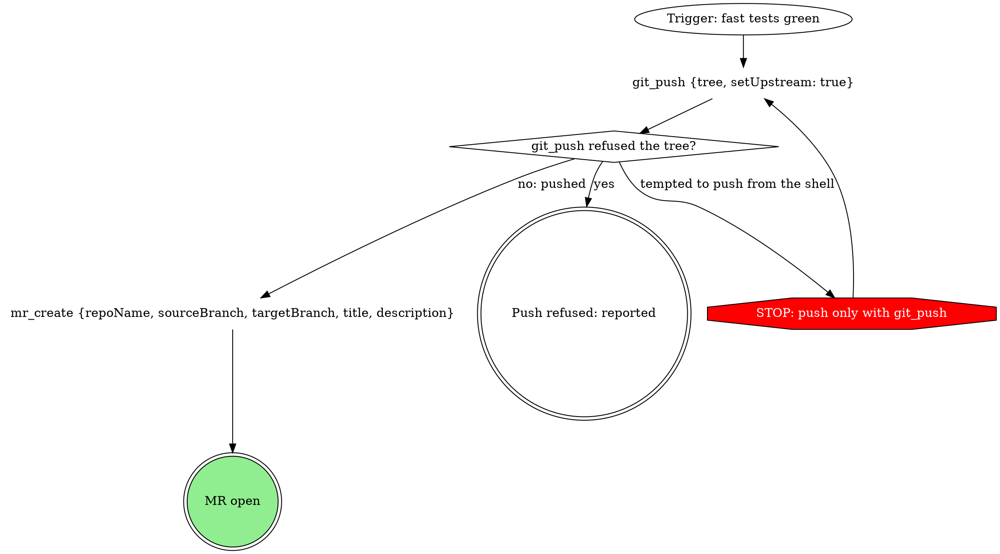

# Short ids for digraph nodes

Exploration of a change to the mattstack:process-digraphs convention: let a
node carry a short id, with its sentence in `label=`, so edges stop repeating
the full node text. Measured on the compiled skills, prototyped on two, and
behavior-tested before any broad conversion.

## Why

Today's rule: "the node's text is its identity: write the sentence as the
quoted node id, never an opaque id with a separate `label`". Every edge
therefore spells out both endpoints in full. A diamond with four exits and
three entries writes its question seven times; a `plaintext` call such as
`mr_create {repoName, sourceBranch, targetBranch, title, description}` is
written once per edge that touches it.

After the digraph-to-MCP work, that repetition is the largest remaining word
cost in the skills. In the five compiled skills measured below, graphs are
45% of the words (18,480 of 41,036), and 43% of the graph words are node text
repeated in edges.

## What the rule protects

Two things, and neither depends on the id being the sentence:

1. **The agent always knows its exact step.** It can name the node it is on
   and read the exact call or question there. Sections (`### <node text>`),
   fills (`## At: <node text>`) and prose ("pass `Off-script rounds = 2?`")
   find a step by its sentence.
2. **The graph reads as prose.** A reader can follow the process in the
   source without rendering it.

The ban was carried over from superpowers' graphviz style guide when the
standard was written (#32, 0.25.0). Its RED/GREEN compared prose against
graphs; it never compared sentence ids against short ids.

## Measured

Method (scripts in
`plugins/mattstack/docs/superpowers/tests/2026-10-17-digraph-ids/`):

- `build-system-files.sh <ref> <out>` compiles `ship`, `watch-ci`,
  `receive-review` and `stage-provision` with no fills (isolated HOME, scratch
  copy of the plugin), plus `gate-protocol`'s body alone.
- `convert.py --scheme <s>` rewrites every dot block: each chosen node is
  declared once as `slug [label="<sentence>" ...]` and edges name the slug.
  Slugs are generated (readable words from the text, `_2` on a clash), so the
  counts are what a hand-written slug of one `wc` word gives.
- `convert.py --verify` proves the rewrite is lossless: for every file and
  scheme, `dot -Tjson` yields the same node texts, shapes, styles and edges
  (30 of 30 pass).
- Words are `wc -w`. Tokens are measured, not estimated: `count-tokens.sh`
  loads each file as the appended system prompt of one tool-less
  `claude -p "Reply with OK."` (Sonnet) and subtracts an empty-file baseline.

Schemes: **all** (every node), **over:3** (any node over three words),
**calls+boxes** (`plaintext` and `box` only), **plaintext** (tool calls and
commands only).

### Words (compiled, as loaded)

| Skill | Today | all | over:3 | calls+boxes | plaintext |
|---|---|---|---|---|---|
| ship | 9,896 | 7,744 (-21.7%) | 8,034 (-18.8%) | 8,757 (-11.5%) | 9,176 (-7.3%) |
| watch-ci | 8,757 | 6,723 (-23.2%) | 6,927 (-20.9%) | 7,765 (-11.3%) | 8,105 (-7.4%) |
| receive-review | 15,263 | 12,796 (-16.2%) | 12,983 (-14.9%) | 13,920 (-8.8%) | 14,624 (-4.2%) |
| stage-provision | 4,660 | 3,751 (-19.5%) | 3,819 (-18.0%) | 4,150 (-10.9%) | 4,276 (-8.2%) |
| gate-protocol | 2,460 | 2,004 (-18.5%) | 2,024 (-17.7%) | 2,276 (-7.5%) | 2,364 (-3.9%) |
| **Total** | **41,036** | **-8,018 (-19.5%)** | **-7,249 (-17.7%)** | **-4,168 (-10.2%)** | **-2,491 (-6.1%)** |

### Tokens (compiled, as loaded)

| Skill | Today | all | over:3 | calls+boxes | plaintext |
|---|---|---|---|---|---|
| ship | 30,360 | -4,024 (-13.3%) | -3,716 (-12.2%) | -2,978 (-9.8%) | -2,539 (-8.4%) |
| watch-ci | 28,980 | -4,983 (-17.2%) | -4,407 (-15.2%) | -3,038 (-10.5%) | -2,586 (-8.9%) |
| receive-review | 41,298 | -4,494 (-10.9%) | -4,307 (-10.4%) | -3,318 (-8.0%) | -2,548 (-6.2%) |
| stage-provision | 13,263 | -1,663 (-12.5%) | -1,631 (-12.3%) | -1,323 (-10.0%) | -1,223 (-9.2%) |
| gate-protocol | 6,786 | -636 (-9.4%) | -636 (-9.4%) | -396 (-5.8%) | -338 (-5.0%) |
| **Total** | **120,687** | **-15,800 (-13.1%)** | **-14,697 (-12.2%)** | **-11,053 (-9.2%)** | **-9,234 (-7.7%)** |

### Where the saving comes from (all five, scheme all)

| Shape | Nodes | Words saved | Share |
|---|---|---|---|
| diamond | 230 | 2,878 | 36% |
| plaintext | 192 | 2,491 | 31% |
| box | 123 | 1,677 | 21% |
| octagon | 23 | 442 | 6% |
| doublecircle | 82 | 352 | 4% |
| ellipse | 35 | 178 | 2% |

Plaintext calls are only a third of the word saving but most of the token
saving (9,234 of 15,800): call syntax tokenizes densely. Decisions are the
largest word saving: short questions, but each is touched by every exit and
every entry. Shortening only the calls leaves well over half the saving
behind.

Prototype source files, before hand-picked slugs: `watch-ci/SKILL.md` 5,794
to 4,216 words (-27.2%), `stage-provision/SKILL.md` 1,869 to 1,416 (-24.2%).

## Options

| Option | Saving (words, tokens) | For | Against |
|---|---|---|---|
| **A. Every node gets a short id** | 19.5%, 13.1% | One form in every graph; simplest rule and check; every step gets a stable key (see below) | Short questions (`"Forge?"`) no longer show in edges |
| B. Short id over three words | 17.7%, 12.2% | Short questions and outcomes stay visible in edges | Two forms in one graph; authors judge the word count; 1-2 points less |
| C. Plaintext calls only | 6.1%, 7.7% | Smallest change | Leaves most of the saving; decisions are the biggest cost |
| D. Calls and boxes | 10.2%, 9.2% | Decisions and STOPs stay sentences | Half the saving; still two forms |

## Recommendation: option A

Every node is declared once with a short id and its text; edges use ids
only.

### The rule

- **A node's text is its `label`**, phrased exactly as today (the shape table
  is unchanged). Sections, fills and prose name a node by its text:
  `### <exact node text>` and `## At: <node text>` keep matching the
  sentence, so no section heading and no team-pack fill changes.
- **The id is a handle**: lowercase words joined by underscores that name the
  step (`push_refused`, not `n4` or `decision_2`). No digits.
- **A `plaintext` id starts with its tool or command**, so an edge shows which
  call comes next: the label's first word, lowercased into the id's form
  (`git_push`, `gh_pr_create`, `enter_worktree` for `EnterWorktree`,
  `rt_verb_skills_check` for an `rt_verb` call), skipping a leading
  `NAME=value` environment assignment (`claude_...` for
  `CLAUDE_CONFIG_DIR=<dir> claude ...`). **A STOP's id starts with `stop_`**,
  so an edge into a STOP shows it.
- **Declare every node once, in the order the process meets it.** The
  declarations read as the ordered list of steps; the edges are the map.
- **A graph labels every node or none.** A graph with no `label` on any node
  is today's form and passes unchanged; once one node has a label, every node
  needs one (`done [shape=doublecircle]` fails there), so a converted graph
  cannot drift back half-converted. The form is told apart by labels, never
  by guessing from an id's spelling, so an old graph whose node is one
  lowercase word (`"done"`) is still today's form.

Why A over B: the saving difference is small, but A gives every step a stable,
machine-friendly key. The skill's "Not yet standard" note (recording the
current node with `run_field_set {key: node}`, so consoles show
"ship > git_push" and a re-orientation hook resumes at the right node) needs
exactly that key; under B, short nodes would have none. One form per graph is
also easier to write and check than a word-count threshold.

### check-dot.py

| Today | Proposed |
|---|---|
| Fails any node whose `label` differs from its id (the opaque-id ban) | Removed. A node with a `label` must have a short id (`^[a-z]+(_[a-z]+)*$`), else fail "a short id is lowercase words joined by underscores, no digits" |
| Every text rule (`?` on decisions, `STOP:` on octagons, one line per plaintext, two calls in one node, the off-script exit) reads the id | Each reads the node's text: its label, or its id when it has none |
| Identical text merges two nodes, caught as a step with two unlabelled exits | New: two nodes with the same text fail ("give each step distinct text"); an id declared with a label twice fails (dot keeps the last label and merges the steps silently) |
| (none) | New: a graph where some nodes have a label and some do not fails; a `plaintext` short id not starting with its call's first word (normalized as above) fails; an octagon short id not starting with `stop_` fails |
| Messages print the id | Messages print the text, and the id in brackets when they differ |

`render.sh`, `certify.sh` (runs both scripts, no node logic of its own) and
`test-check-dot.sh`'s existing cases are otherwise unaffected; the opaque-id
case flips to the new id-form failure, and new cases cover each new rule.

### Blast radius

| Consumer | Depends on node ids? | Change |
|---|---|---|
| `check-dot.py`, `test-check-dot.sh` | Yes: the ban and every text rule read the id | As above |
| `render.sh`, `certify.sh`, the `checks.yml` dot sweep, `compile-native.e2e` | No: they run the two scripts | None |
| mcp lint (`lib/skills/mcp-lint.ts`) | No: it lints every fenced line by shell-form regex | None; a long shell-form label appears once instead of per edge |
| Skills compiler (`compile.ts`, `expand.ts`) | No: fills splice at `{{slot:}}`/`{{include:}}` placeholders | None |
| Field-contract scan (`field-contract.ts`) | Line regex for `run_field_get {key: x}` | None while labels stay on one line (plaintext already must) |
| `### <node text>` sections | By the agent, by the sentence | None: the sentence is the label |
| Team-pack fills, `## At: <node text>` (2 packs, 14 files, about 18 headings) | By the agent, by the sentence; no code resolves them | None |
| process-digraphs `SKILL.md` | Node vocabulary, example, recipe check list, publish checklist line 5 | Rewritten for the new form |
| extending-a-pack, creating-a-pack | "keys its sections to that step's node text" | None: still true |
| Historical plans citing exact node texts | Docs only | None |

## What this branch delivers

The exploration, not the migration: the rule and checker change in
`process-digraphs` (written to land as migration step 1, so not throwaway),
`convert.py --slugs`, the two converted prototype skills, the RED/GREEN record
and this spec with its Results. Nothing merges from the branch, and no other
skill converts until Matt approves the direction. The prototype tests option
A; if Matt picks B at this milestone, the per-graph rule becomes a
word-count threshold and the slug maps keep short nodes as sentences.

## Prototype and behavior test

Prototype on `attachments/pipeline/watch-ci` (plaintext-heavy, 13 scored
scenarios) and `attachments/pipeline/stage-provision` (small, different
author's shape, 2 scored scenarios). Conversion is scripted: `convert.py`
writes the auto slugs, a slug map is hand-edited to the rule (no `_2`, tool
prefixes, `stop_`), and `convert.py --slugs <map>` applies it;
`convert.py --verify` and `check-dot.py` (new rules) prove the graphs
unchanged and valid. `gate-protocol`, `run-identity` and `wrap-up-form` stay
sentence ids, so the compiled prototype mixes converted and unconverted
graphs, as a migration would.

RED/GREEN with the approved tool-less recipe (`claude --model sonnet --tools
"" --strict-mcp-config --setting-sources local --settings
'{"disableAllHooks":true}' --disable-slash-commands --no-session-persistence
-p`), from a fresh empty directory per rep, 5 reps per scenario:

- **RED** is today's compiled text (sentence ids); **GREEN** is the
  prototype's compiled text (short ids). Same scenarios, same prompt, same
  scoring; only the id form differs.
- **watch-ci**, by the ship-ci lane's method: the prompt is `SKILL.md` as
  written, then the World, Conventions, Shared shapes and watch-ci sections
  of `2026-10-16-ship-ci-skills/scenarios.md` (T1 to T10, T3b, W1, S6), then
  its prompt line. Scored with its key (`expected.md`) on its columns: shell
  calls a tool covers, hand-held lease calls, counters in context,
  re-derived values, skipped steps, runaway loops, refusals that missed their
  gate or the stand-down, a release on a stand-down.
- **stage-provision**, by the pipeline lane's method: the compiled stage as
  the appended system prompt (so the converted stage graph sits beside the
  unconverted gate-protocol graph), S5 and S5b as the prompt, scored on that
  lane's pass criteria.
- One extra column on both sides: whether the rep names where it stops by the
  node's text or id (the "knows its exact step" check). Recorded, not a pass
  criterion.
- Reps are scored blind: transcripts are renamed to random ids before
  scoring, and the side is joined back after.
- **Pass:** GREEN's deviations are no higher than RED's, per skill and per
  scenario. A miss changes the rule or the slugs and reruns that skill's
  reps, at most 2 rounds, then the table comes to Matt with the miss.

## Migration plan (after Matt approves the direction)

1. **Rule and checker** land first, backward compatible: sentence-id graphs
   still pass, so nothing else has to move in the same PR. Plugin version
   bump.
2. **Convert by saving**, one PR per cluster, each run through
   `convert.py` + a hand-edited slug map + `--verify` + `check-dot.py`:
   review (receive-review, review, self-review), ship and CI (ship,
   stage-ship, stage-watch-ci, plus the prototype), the other pipeline stages
   and work, forge, evidence-record, shepherdr's job template (herd briefs).
   The graph is proven identical by `--verify`, so a cluster needs no new
   RED/GREEN unless its slugs needed judgment beyond the rule; a one-scenario
   smoke per cluster is enough.
3. **gate-protocol** last of the shared includes: an edit there needs
   `bun run skills:expand:board` and a committed `apps/board/skills` in the
   same PR.
4. **Team packs**: nothing required. Fills attach by sentence, which stays.
   Graphs a pack owns may convert in the pack repo whenever it is next
   touched; the per-graph rule accepts either form.
5. **Optional, later**: once every plugin graph is converted, the plugin's
   CI could require short ids (a `--short-ids` flag on `check-dot.py`), while
   packs stay free to use either.

## Goals

- Cut the repeated node text from every graph without changing any graph's
  steps, edges or text (`--verify` proves it per file).
- Keep every step findable by its sentence: sections, fills, prose.
- Behavior no worse than today on the same scenarios.

## Non-goals

- Shortening node text itself, or moving call arguments out of the label.
- Changing team packs, the compiler, the mcp lint or certify.
- Recording the current node in the run db (it stays "not yet standard";
  short ids only make it cheaper later).

## Anti-goals

- Opaque ids (`n1`, `step_2`): an id that names nothing loses the step.
- A graph an agent cannot follow from the source alone.
- Any change that makes a team fill stop attaching.

## Decisions for Matt

1. Option A (every node) over B (over three words). The recommendation
   above; B keeps short questions in edges for 1-2 points less saving.
2. Whether the plugin should eventually require short ids (migration step 5),
   or keep both forms allowed indefinitely.

## My calls (a builder could settle these)

- The measurement scripts live beside the other RED/GREEN records, in
  `plugins/mattstack/docs/superpowers/tests/2026-10-17-digraph-ids/`.
- Each prototype's RED/GREEN reuses its own lane's method unchanged (raw
  `SKILL.md` for watch-ci, compiled text for stage-provision), so the earlier
  lanes' GREEN results are a third reference point.
- No plugin version bump on this branch: nothing merges from it.
- The id regex forbids digits outright, so `step_2` and `n1` fail without a
  separate "opaque" heuristic.

## Results

**Verdict.** Both sides scored 0 deviations, so short ids cost nothing on
these scenarios; the test cannot show they help. As loaded, tokens fall 15.1%
(watch-ci) and 7.1% (stage-provision), and every check is green. I recommend
requiring short ids in the plugin once every graph is converted.

### Behavior

**watch-ci** (13 scenarios, 5 reps per side; source:
`plugins/mattstack/docs/superpowers/tests/2026-10-17-digraph-ids/red-green.md`)

| Scenario | RED deviations | GREEN deviations | RED stop named | GREEN stop named |
|---|---|---|---|---|
| T4 | 0 | 0 | 3/5 | 5/5 |
| T5 | 0 | 0 | 3/5 | 5/5 |
| The other 11 scenarios | 0 | 0 | 55/55 | 55/55 |
| **Total** | **0** | **0** | **61/65** | **65/65** |

RED's four stop-named misses are wording ("the STOP edge", a bare "Stop."),
or naming the gate instead of the stop (one T4 rep named only the off-script
gate), at the two push-time stops. Every rep on both sides stopped at the right node.

**stage-provision** (5 reps per scenario per side; source: the same file)

| Scenario | RED pass | GREEN pass | RED deviations | GREEN deviations | RED stop named | GREEN stop named |
|---|---|---|---|---|---|---|
| S5 occupied ticket branch | 5/5 | 5/5 | 0 | 0 | 5/5 | 5/5 |
| S5b precheck on an older daemon | 5/5 | 5/5 | 0 | 0 | 5/5 | 5/5 |

**Authoring** (5 reps per scenario per side; source:
`plugins/mattstack/docs/superpowers/tests/2026-10-17-digraph-ids/authoring/authoring-red-green.md`)

| Scenario | RED short-id rate | GREEN short-id rate | RED block words | GREEN block words |
|---|---|---|---|---|
| A1 draw from prose | 0/5 | 5/5 | 168 to 179 | 113 to 115 (final skill) |
| A2 extend a short-id graph | 5/5 | 5/5 | 170 to 172 | 170 to 172 |
| A3 other tools | 0/5 | 5/5 | 240 to 271 | 149 to 167 |

A2 is a regression guard, not evidence: both sides copy the form they are
handed. A3 is the real test: every GREEN rep wrote ids the skill never shows
(`gh_pr_view`, `enter_worktree`, `claude_plugin_update`, `stop_cache_edit`).
Every block on both sides passed `check-dot.py`, with no mixed graph and no
digit id.

**What this shows.** Both sides scored 0 deviations, so short ids cost
nothing on these scenarios. With RED already at 0, the test cannot show
that they help.

### Size

**Source `SKILL.md` words** (`wc -w`, base `1043f9eb8` vs HEAD)

| Skill | Base | HEAD | Change |
|---|---|---|---|
| watch-ci | 5,794 | 4,216 | -1,578 (-27.2%) |
| stage-provision | 1,869 | 1,416 | -453 (-24.2%) |

**Compiled, as loaded** (Task 7's build dirs `t7/red` and `t7/green`; words
are `wc -w`, tokens are `count-tokens.sh <dir> <out> none`)

| Skill | RED words | GREEN words | Change | RED tokens | GREEN tokens | Change |
|---|---|---|---|---|---|---|
| watch-ci | 8,757 | 7,179 | -1,578 (-18.0%) | 28,980 | 24,608 | -4,372 (-15.1%) |
| stage-provision | 4,660 | 4,207 | -453 (-9.7%) | 13,263 | 12,317 | -946 (-7.1%) |

RED's token counts match the Measured table exactly. The other three files
(ship, receive-review, gate-protocol) are byte-identical on both sides and
count the same tokens (30,360, 41,298, 6,786).

**Against the scheme-all estimate.** The Measured tables estimate watch-ci at
-23.2% words and -17.2% tokens, and stage-provision at -19.5% and -12.5%. The
gap is the included gate-protocol graph, which the prototype leaves as
sentences and scheme all converts. Converting RED with the hand slug maps
(auto slugs for the rest) gives the same words as auto slugs alone (6,723
and 3,751), so hand slugs cost no words. GREEN sits 456 words above that in
both files, which is exactly gate-protocol's own scheme-all saving (2,460 to
2,004). In tokens, hand slugs cost a little more than auto slugs: watch-ci
23,951 vs 23,822 (+129), stage-provision 11,660 vs 11,510 (+150), from the
tool-prefixed and `stop_` ids. GREEN sits 657 tokens above the hand-slug
file in both, the unconverted gate-protocol graph. (This run's auto-slug
token counts are 175 and 90 lower than the Measured table's, most likely
because `8ec9bbe65` changed the auto ids, for example `run_enter_2` became
`run_enter_flags`; words did not change.) Scratch outputs: `scratchpad/t8/tokens-red.md`,
`tokens-green.md`, `tokens-decomp.md`.

### Checks

Run from the repo root at `fafb888af`, `bun cli.ts` under an isolated HOME
and a scratch `--mattstack-dir`.

| Command | Result |
|---|---|
| check-dot sweep (the `checks.yml` step, every plugin `.md` with a dot block, 28 files) | exit 0: "39 graph(s) checked, ok, 0 warning(s)" |
| `bash plugins/mattstack/plugin/skills/process-digraphs/test-check-dot.sh` | exit 0: 53 cases ok, "all cases pass" |
| `sh tests/certify.sh` on process-digraphs, watch-ci, stage-provision | exit 0 on each: stage-decl ok, digraphs ok |
| `bun cli.ts skills check --pack-dir ... --strict` | exit 0: every compiled skill current, mcp lint clean; 7 advisory pack-script hits (one new on this branch, a `gh pr view` case in `test-check-dot.sh`) |
| `bun cli.ts skills compile --dry-run --pack-dir ...` | exit 0: five skills "would write" into the empty scratch dir |
| `bun run purity` | exit 0: repo-purity ok, 1 test pass |

`skills check --strict` did not fail on the version. The plugin CI job's
version-bump guard would fail a PR from this branch, which has no bump by
design.

### Limits

- 5 reps per side per scenario.
- Ceiling effect: RED already scored 0 deviations everywhere, so GREEN could
  only tie.
- Blinding was partial: GREEN reps wrote slug words as prose ("shell push",
  "hand-rolled worktree"), which RED never did.
- watch-ci fed the raw `SKILL.md`, so its includes were unexpanded on both
  sides.
- Stop named is judgement scoring, not a pass criterion.
- The reps were scored by the same agent that ran them. A task reviewer
  independently re-scored a sample (4 watch-ci reps across 5 scenarios, 4
  stage-provision transcripts) and agreed on every deviation cell.

### Rulings made during the run

- The 1-to-4-word slug cap counts the words after a required prefix (the
  call prefix or `stop_`), so `run_budget_claim_off_script` passes. The
  cost of a required prefix: five watch-ci slugs run to 5 words counting it
  (`run_budget_watch_off_script`, `run_budget_claim_off_script`,
  `run_budget_retry_off_script`, `gh_pr_view_head_sha`,
  `run_field_set_branch_mr`).
- Authoring added scenario A3, because A1 could not separate learning the
  rule from copying the example.
- `check-dot.py` leaves two edge cases as is: a sentence node with a
  redundant label equal to its id fails the short-id regex, and a
  `node [label=...]` default reads as labelling every node. No skill writes
  either.

### Recommendation on Decision 2

For Matt to decide. I recommend requiring short ids in the plugin once every
plugin graph is converted (migration step 5, a `--short-ids` flag in the
plugin's CI), while team packs keep both forms legal.

- **Why:** the prototype found no behavior cost on the scored reps. Fresh
  agents write the form from the rule alone, including tools the example
  never shows (A3). With one form across the plugin, authors stop copying
  whichever neighbor they happened to open.
- **Cost:** the remaining conversions, which are scripted and proven per
  file by `--verify`, plus the flag.
