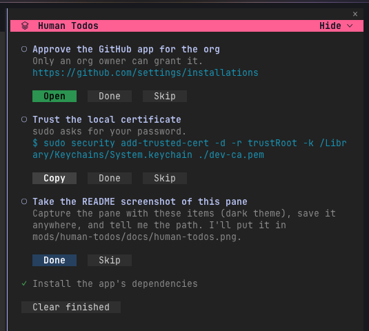

# Human Todos

A pane of steps only you can do. Claude adds a step, you tick it, run it or skip it, and Claude hears back without you typing "done".



## Install

Using mattstack? `human-todos` comes with the mattstack plugin. Nothing else to do.

On its own:

```
/plugin marketplace add m4ttstack/mattstack-marketplace
/plugin install human-todos@mattstack
```

It is built and tested on Claude Code 2.1.322, and does not need the mattstack app, rt or herdr.

The buttons need the fullscreen renderer (`"tui": "fullscreen"` in settings, or `/tui fullscreen` at the start of a session). In the inline renderer the pane draws inside the transcript and its buttons cannot be clicked.

## What Claude can add

Claude adds steps with the `add` tool, reads them with `list` and removes one it no longer needs with `withdraw`. Each step has a kind, and the kind sets the buttons.

| Kind | For | Buttons |
|---|---|---|
| `task` | Something you do by hand | Done, Skip |
| `run` | A command you can run from the pane | Run, Copy, Done, Skip |
| `terminal` | A command that needs your own terminal (sudo, a login) | Copy, Done, Skip |
| `link` | A web page to open | Open, Done, Skip |
| `image` | Screenshots or other images to look at | Open, Done, Skip |

An `image` step lists its file names. Open shows every image in your default image app in one go.

Claude hears about Done, Skip, a finished run (its exit code and the last 30 lines of output) and Stop. Copy, Open, Show, Open log, Run and Cancel send nothing.

Run always asks first: press Run, then Confirm. Confirm shows the script and the folder it runs in. If a script ignores Stop, the pane offers Force stop, which ends it and everything it started.

## Commands

- `/todos` opens the pane again after you close it. While it is hidden, the band above the prompt says how many steps wait, with a Show button (Open in VS Code and on mobile).
- `/todos-runner auto|herdr|local` picks where Run executes. `auto`, the default, uses herdr when it is installed and the plugin otherwise; `herdr` uses only herdr and says so when it cannot; `local` always runs scripts in Claude Code.

## Keyboard

In the terminal and the desktop app, focus the pane (click it), then:

- ↑ and ↓, or Tab and Shift+Tab, move between steps, with Clear finished last.
- ← and → move between a step's buttons.
- Enter presses the selected button.
- Esc goes back to the prompt.

The first key only shows where the selection is; the next one moves or presses. Using the mouse hides the selection until you press a key again.

## Where Run executes

With [herdr](https://github.com/herdrdev/herdr) installed, Run opens a tab for the script on a herdr server you do not have on screen, so nothing appears in your own herdr. That is mattstack's background server, `mattstack-bg`, when it is running; otherwise the plugin's own `human-todos` server, which it starts when it needs it and never stops. The pane shows the run's last lines, and Show opens everything it has printed so far in your text editor. To watch a run live, attach to its server: `herdr session attach human-todos` (or `mattstack-bg`). On that server every session shares one workspace, named Human Todos, and each tab is named after the session's repo, then the step: `mattstack #3 Deploy`.

Without herdr, or when its server will not start, the plugin runs the script itself and shows the last 15 lines, with an Open log button for the full output. herdr is optional.

Open, Open log, Show and the log folder (`~/Library/Caches/human-todos`, unless `XDG_CACHE_HOME` is set) are macOS only: they use `open` and the Library cache folder.

The list belongs to the session and is kept for 30 days.
