# Browser evidence

Fast Browser captures pages and composes boards; this page owns that
evidence inside a run, and the pack's browser target says how to reach its
app. A board is one cropped, labelled image: this verb writes the words, the
driver measures and draws. Each board is kept as a bundle that any later
session re-renders without a browser.

A case enters this page only when the domain's fill picks a browser
screenshot for it. Evidence that is not a browser screenshot (script output,
backend data) stays the domain's own method.

## The browser target

The four blocks come from the `## Browser target` section in this verb's
domain rules, or from the file those rules point at for it. A missing block
takes its default:

| Block | Feeds | Default when the block is missing |
|---|---|---|
| Reach the view | Get ready, the brief's `page:` | the URL the plan or intake gives; the developer signs in |
| What proves a change | `show`, `point at`, intake | the plan's words for the case |
| Captions | the claim and every label's wording | plain words |
| Personal data | `hide` | every personal detail on screen that is not being verified |

The pack's block wins over this page only on facts about its app, never on a
STOP below.

## Draw the boards

```dot
digraph browser_evidence {
    rankdir=TB;

    "Boards to draw" [shape=ellipse];
    "Get ready already ran this stage pass?" [shape=diamond];
    "Get ready" [shape=box];
    "fast-browser doctor" [shape=plaintext];
    "Doctor green?" [shape=diamond];
    "Doctor runs = 2?" [shape=diamond];
    "Fix what the doctor reports" [shape=box];
    "fast-browser compose --help" [shape=plaintext];
    "Compose usage shown?" [shape=diamond];
    "Write one brief per board" [shape=box];
    "Agent {subagent_type: fast-browser:browser-driver, model: sonnet, effort: medium, prompt: <the briefs>}" [shape=plaintext];
    "Driver result?" [shape=diamond];
    "STOP: the driver captures and composes; never drive the browser, draw or place marks yourself" [shape=octagon style=filled fillcolor=red fontcolor=white];
    "Sign-in asks this stage pass = 2?" [shape=diamond];
    "STOP: never type or ask for a credential; only a saved login" [shape=octagon style=filled fillcolor=red fontcolor=white];
    "Ask the developer to sign in" [shape=box];
    "Sign-in answer?" [shape=diamond];
    "Read the board yourself" [shape=box];
    "Reads right?" [shape=diamond];
    "Re-renders for this board = 2?" [shape=diamond];
    "Crops returned?" [shape=diamond];
    "STOP: confirming is the human's answer, never the agent's" [shape=octagon style=filled fillcolor=red fontcolor=white];
    "Gate evidence-redaction (below)" [shape=box];
    "Redaction answer?" [shape=diamond];
    "fast-browser compose --confirm ~/.fast-browser/screenshots/<stem>.spec.json" [shape=plaintext];
    "Confirm result?" [shape=diamond];
    "Redaction rounds for this board = 2?" [shape=diamond];
    "Keep the bundle" [shape=box];
    "mkdir -p <evidence folder>" [shape=plaintext];
    "cp ~/.fast-browser/screenshots/<stem>.* <evidence folder>/" [shape=plaintext];
    "Record the board" [shape=box];
    "Not drawn" [shape=doublecircle];
    "Held at evidence-redaction" [shape=doublecircle];
    "Board recorded" [shape=doublecircle style=filled fillcolor=lightgreen];

    "Boards to draw" -> "Get ready already ran this stage pass?";
    "Get ready already ran this stage pass?" -> "Get ready" [label="no"];
    "Get ready already ran this stage pass?" -> "Write one brief per board" [label="yes: the doctor was green and compose showed its usage"];
    "Get ready already ran this stage pass?" -> "Not drawn" [label="yes: it ended red or without compose; every board of this hand-off, that output quoted"];
    "Get ready" -> "fast-browser doctor";
    "fast-browser doctor" -> "Doctor green?";
    "Doctor green?" -> "fast-browser compose --help" [label="yes"];
    "Doctor green?" -> "Doctor runs = 2?" [label="no"];
    "Doctor runs = 2?" -> "Fix what the doctor reports" [label="no"];
    "Doctor runs = 2?" -> "Not drawn" [label="yes: every board this pass, the output quoted"];
    "Fix what the doctor reports" -> "fast-browser doctor";
    "fast-browser compose --help" -> "Compose usage shown?";
    "Compose usage shown?" -> "Write one brief per board" [label="yes"];
    "Compose usage shown?" -> "Not drawn" [label="no: an older fast-browser first on PATH; every board this pass, the output quoted"];
    "Write one brief per board" -> "Agent {subagent_type: fast-browser:browser-driver, model: sonnet, effort: medium, prompt: <the briefs>}";
    "Agent {subagent_type: fast-browser:browser-driver, model: sonnet, effort: medium, prompt: <the briefs>}" -> "Driver result?";
    "Driver result?" -> "Read the board yourself" [label="a board"];
    "Driver result?" -> "Sign-in asks this stage pass = 2?" [label="failed: needs-login"];
    "Driver result?" -> "Not drawn" [label="failed for another reason, or no driver to spawn"];
    "Driver result?" -> "STOP: the driver captures and composes; never drive the browser, draw or place marks yourself" [label="tempted to capture, mark up or compose it yourself"];
    "Driver result?" -> "STOP: never type or ask for a credential; only a saved login" [label="tempted to sign in by hand"];
    "STOP: the driver captures and composes; never drive the browser, draw or place marks yourself" -> "Agent {subagent_type: fast-browser:browser-driver, model: sonnet, effort: medium, prompt: <the briefs>}";
    "STOP: never type or ask for a credential; only a saved login" -> "Sign-in asks this stage pass = 2?";
    "Sign-in asks this stage pass = 2?" -> "Ask the developer to sign in" [label="no"];
    "Sign-in asks this stage pass = 2?" -> "Not drawn" [label="yes: the reason quoted"];
    "Ask the developer to sign in" -> "Sign-in answer?";
    "Sign-in answer?" -> "Agent {subagent_type: fast-browser:browser-driver, model: sonnet, effort: medium, prompt: <the briefs>}" [label="Logged in, retry"];
    "Sign-in answer?" -> "Not drawn" [label="Leave it uncaptured"];
    "Read the board yourself" -> "Reads right?";
    "Reads right?" -> "Crops returned?" [label="yes"];
    "Reads right?" -> "Re-renders for this board = 2?" [label="no"];
    "Re-renders for this board = 2?" -> "Agent {subagent_type: fast-browser:browser-driver, model: sonnet, effort: medium, prompt: <the briefs>}" [label="no: the brief and what reads wrong"];
    "Re-renders for this board = 2?" -> "Not drawn" [label="yes"];
    "Crops returned?" -> "Gate evidence-redaction (below)" [label="yes: <stem>.redactions.json lists a crop"];
    "Crops returned?" -> "Keep the bundle" [label="no: no record, or a record with no crop"];
    "Crops returned?" -> "STOP: confirming is the human's answer, never the agent's" [label="tempted to run --confirm without a yes"];
    "STOP: confirming is the human's answer, never the agent's" -> "Gate evidence-redaction (below)";
    "Gate evidence-redaction (below)" -> "Redaction answer?";
    "Redaction answer?" -> "fast-browser compose --confirm ~/.fast-browser/screenshots/<stem>.spec.json" [label="proceed: confirm"];
    "Redaction answer?" -> "Redaction rounds for this board = 2?" [label="proceed: widen it"];
    "Redaction answer?" -> "Held at evidence-redaction" [label="hold"];
    "fast-browser compose --confirm ~/.fast-browser/screenshots/<stem>.spec.json" -> "Confirm result?";
    "Confirm result?" -> "Keep the bundle" [label="ok"];
    "Confirm result?" -> "Redaction rounds for this board = 2?" [label="refused, the first time for this board: re-render with the refusal quoted"];
    "Confirm result?" -> "Not drawn" [label="refused a second time for this board: confirm refused twice, the output quoted"];
    "Redaction rounds for this board = 2?" -> "Agent {subagent_type: fast-browser:browser-driver, model: sonnet, effort: medium, prompt: <the briefs>}" [label="no: the brief, and their words or the refusal"];
    "Redaction rounds for this board = 2?" -> "Not drawn" [label="yes: redaction rounds spent"];
    "Keep the bundle" -> "mkdir -p <evidence folder>";
    "mkdir -p <evidence folder>" -> "cp ~/.fast-browser/screenshots/<stem>.* <evidence folder>/";
    "cp ~/.fast-browser/screenshots/<stem>.* <evidence folder>/" -> "Record the board";
    "Record the board" -> "Board recorded";
}
```



Each hand-off from the verb is one pass and one spawn for the boards it
hands over (a verb that walks cases one at a time spawns once per case);
each returned board then walks the rest of the graph on its own. Get ready
runs once per stage pass, before the first spawn.

`Not drawn` returns to whichever box called this flow, with the reason; it
is never a board drawn by hand. No retry can fix these reasons: the
developer left it uncaptured, the doctor stayed red, no compose on PATH,
the sign-in asks were spent, no driver to spawn, redaction rounds spent, or
confirm refused twice. A failed brief (the driver's other failures) or
spent re-renders may draw on a retry. `Held at evidence-redaction` is the
verb's hold path.

## Get ready

Once per stage pass, before the first spawn:

- Start what Reach the view says must run (its servers), for this worktree
  only.
- Build each case's URL from Reach the view.
- Never reconstruct a before by reverting code on a running server.
- Run `fast-browser doctor` on Bash. Red: fix what the doctor reports (the
  `Fix what the doctor reports` box: follow the fix it prints) and run it
  again, at most two runs in all; still red, every board this pass is
  not drawn, with the doctor's output quoted.
- Then run `fast-browser compose --help` on Bash. When it does not print
  compose's usage (an older `fast-browser` earlier on PATH says "expected a
  command"), every board this pass is not drawn, with that output quoted
  and the advice to update Fast Browser.

## The brief

The `Write one brief per board` box writes one entry per board, in plain
words, with exactly these fields:

```
case: <evidence@2 case id>
stem: <run id>-<case id>-<before|after>[-<theme>]
claim: one sentence, what this board proves (the board's title and every image's caption)
show: the region, named in words ("the job row's header")
point at: one line per label: <TAG> | <title> | <description>
hide: what Personal data names, plus every other personal detail on screen that is not being verified; never "nothing"
state: FOUND | AFTER | BEFORE → AFTER | FLOW
page: the URL, the sign-in Reach the view names, and the steps to the state (a live page), or
import: <absolute path of a saved image> from <its link> (a ticket before, or any image that is not a browser capture)
before: <evidence folder>/<the before board's stem>.spec.json (BEFORE → AFTER only)
```

- `stem`: the theme (`light` or `dark`) only for an image in a
  `{light, dark}` slot, so the two themes never share a stem.
- `state`: a before alone is `FOUND`; an after alone is `AFTER`; a pair
  built from the case's before bundle is `BEFORE → AFTER`; several screens
  are `FLOW`.
- `point at`: the labels the operator kept at an annotations question, or
  the ones you propose from What proves a change when no such question ran.
  On a `FLOW` board, one line per step.
- A ticket that embeds the before as an image: save the image and brief it
  as `import:` with the ticket link. Its board is the case's before.

## Labels

The pipeline's rule, stricter than the composing skill: every label carries
a tag and a description, and the description asserts the outcome in one
line. On `single` and `pair` boards a label is a mark (every mark except
`redact`); on a `steps` board a label is a step, and a mark inside a step
may carry no text. The brief says what each label carries; the driver's
composing skill decides where it goes.

- **After**: what was added that was not there before, or which bug is
  fixed that did not work before, and whether verification is complete.
  Tags `NEW`, `CHANGED`, `REMOVED`, `OK`; `PENDING` when verification is
  not complete, and the description names what is left. Examples:
  - `NEW | Retries | Added: the badge counts every retry, which it did not before. Verified.`
  - `OK | Totals row | Fixed: the export total now matches the rows; it was off by one before. Verified.`
  - `PENDING | Dark theme | Added in light theme; dark theme not verified yet.`
- **Before**: what is broken or missing, and that it was reproduced. Tags
  `ISSUE` for a bug, `PENDING` for something not built yet. Examples:
  - `ISSUE | Retries | Bug reproduced: the badge reads 0 after a retry.`
  - `PENDING | Export button | Not there before the change: no export on this page.`

A label never just repeats the board's title. The Captions block's wording
applies to the claim and to every label.

## Delegate to the driver

One `Agent` call per hand-off from the verb, for the boards it hands over: `subagent_type:
"fast-browser:browser-driver"`, `model: "sonnet"`, `effort: "medium"`,
`description: "Capture and compose evidence boards"`, and as `prompt`
this text followed by the briefs:

> Follow the fast-browser:composing-evidence skill to turn each brief below into one board. For a brief with page:, open it and sign in only with a saved login for that origin (fast-browser:fast-browsing); if signing in needs a person, stop that brief and return it failed with reason needs-login; never type or ask for a credential. Follow the page's steps to the state, then capture. Name files by the brief's stem in ~/.fast-browser/screenshots/: captures <stem>.c1, <stem>.c2, and so on, numbering only the captures you take for this brief and starting at <stem>.c1 (captures copied in for before: keep their own names, so a pair's after capture is <stem>.c1), the spec <stem>.spec.json, the board <stem>.png. Use the brief's claim as the board's title, word for word. Give every label the tag and description its point at line gives, word for word, wherever the composing skill puts them for this layout. For a brief with import:, import that file as <stem>.c1 with its link as the origin. For a brief with before:, copy every capture that spec names, with its PNG, from the before's folder into ~/.fast-browser/screenshots/ unchanged and use them as the BEFORE panel; never recapture the before. Hide what hide: names. Read every board you render. Never run fast-browser compose --confirm. Close every tab you opened. Return one JSON line per brief: {"case", "board", "spec", "captures", "crops", "warnings"}, where crops is the list of redaction crop paths compose printed, or [] when it printed none, or {"case", "failed": true, "reason"}.

A re-render is the same call with that board's brief and what read wrong,
or the human's words from the redaction gate. When the `Agent` tool or that
agent type is missing, every board is not drawn, never drawn by hand.

## Ask the developer to sign in

A clarify question through gate-protocol, site `clarify:browser-login:<n>`.
The question says the saved login could not sign in, and offers exactly two
options, each with one sentence and no free text and no Hold:

- **Logged in, retry**: the developer has signed in for this origin;
  spawn the driver again for these briefs.
- **Leave it uncaptured**: the board is not drawn.

At most two asks per stage pass. Leave it, or a third need, is not drawn
with the reason quoted.

## Read the board yourself

Read each returned PNG with the image-reading tool. It reads right when:

- the crop shows what `show` names;
- each label sits on what its `point at` line names and shows its tag and
  description;
- nothing `hide` names, and no other personal detail, is readable;
- the title is the brief's `claim`, word for word.

`Crops returned?` reads the record compose wrote,
`~/.fast-browser/screenshots/<stem>.redactions.json`, never the driver's
`crops` list: yes when that record lists one or more crops, no when there
is no record or its `redactions` is empty. An empty record (compose may
warn that a redact mark lies outside the board) means that mark hides
nothing that shows: the board has no crop to confirm, so it takes the
no-crops path and its bundle, record included, is kept as is. The upload
accepts an empty record whose board hash matches.

A wrong view (a blank page, the change missing from the page) is a Reach
the view problem: apply that block's fixes, then re-render. At most two
re-renders per board.

## Gate evidence-redaction

This is the `Gate evidence-redaction (below)` box. Scope
`evidence-redaction:<stage>:<n>`, where `<n>` counts this gate's
openings in this stage pass from 1. One sentence above the form names each
board's crop paths (absolute) and asks the human to open each crop and
check that no hidden letter or digit is readable.

| Question | Options (recommended first) | Shown when |
|---|---|---|
| `redaction-<case>` | **Confirmed: nothing hidden is readable (Recommended)** / **Widen it**, with free text naming the crop and what shows | per board with crops |
| `next` | **Proceed** / **Hold** | always |

Selection: `{"redactions":{"<case>":"confirm|<their words>"},"next":"proceed|hold","note":"<their words or null>"}`.

- Confirm runs `fast-browser compose --confirm` on Bash on the spec that
  rendered the board, and only then is the bundle copied. In a run that is
  `~/.fast-browser/screenshots/<stem>.spec.json`; in a revision it is the
  evidence-folder spec (Revise a board, step 3).
- `Confirm result?`: a confirm that exits clean is ok. The first refusal
  for a board re-renders it through the driver with the refusal quoted,
  counted against `Redaction rounds for this board = 2?`; a second refusal
  for the same board is not drawn, with the output quoted.
- Widen re-renders, and the new render opens this gate again.
- Every render of a gated board that a verb records or uploads, during a
  run or in a revision, passes this gate before its bundle is copied or
  uploaded.
- `mr_upload` refuses a gated board whose record is missing, unconfirmed or
  stale, and refuses an imported original. A redaction-record refusal means
  this gate was skipped: the verb's `Repair the board's redaction record
  (browser-evidence)` box walks Revise a board steps 2 to 4, which pass
  this gate, then retries that file's upload. Never around the gate. An
  imported original is the record's mistake: upload its board.

## Keep the bundle

The evidence folder is the one the record's images live in: the domain's,
else `~/.mattstack/work/<run id>/evidence/`. Create it first with
`mkdir -p <evidence folder>`, then one command per board:
`cp ~/.fast-browser/screenshots/<stem>.* <evidence folder>/`. It copies the
board, its spec, its captures and, for a gated board, its crops and record,
flat under one stem. Paths inside a bundle are bare file names, so the copy
still renders. A pair's spec names the before bundle's captures, already in
that folder.

## Record the board

Through evidence-record:

- The board is `annotated` on every image it shows, and `claim` is each of
  those images' `caption`. A pair board covers both the before and the
  after image of its case.
- Each image's `path` is its own capture from the bundle: `<stem>.c1.png`
  for a single board, each panel's own capture for a pair, the last step's
  capture for a steps board recorded on one image, the imported `c1.png`
  for an import.
- An import's link goes on the record as run-level `url`.
- The domain's own preview, if any, is never a record path.

## Revise a board

A change that needs a recapture (a new crop, new targets) goes back
through `Draw the boards` with the edited brief: the driver renders it as
in Delegate to the driver, then `Keep the bundle` copies it, never the
step-4 copy. Never a browser tool yourself. Every other change needs no
browser:

1. Read `<evidence folder>/<stem>.spec.json`; edit the wording, tags, marks
   or redactions asked for. Keep the Labels rule.
2. `fast-browser compose <evidence folder>/<stem>.spec.json` (the board
   lands in `~/.fast-browser/screenshots/`). Read it as in Read the board
   yourself.
3. Gated (`~/.fast-browser/screenshots/<stem>.redactions.json` lists a
   crop): Gate evidence-redaction, then
   `fast-browser compose --confirm <evidence folder>/<stem>.spec.json`. A
   Hold there holds the revision with nothing uploaded; a refused confirm
   ends the revision, the output quoted.
4. `find <evidence folder> -maxdepth 1 \( -name '<stem>.redact-*.png' -o -name '<stem>.redactions.json' \) -delete`
   (a bare `rm` of a glob that matches nothing stops the whole command in
   zsh), then copy the board:
   `cp ~/.fast-browser/screenshots/<stem>.png <evidence folder>/`. Whenever
   compose wrote a record, including an empty one (`redactions: []`), copy it
   back too:
   `cp ~/.fast-browser/screenshots/<stem>.redactions.json <evidence folder>/`.
   The upload refuses an import board with a redact mark but no record, so
   an empty record stays beside the board. Only when that record lists a
   crop, copy the crops as a separate command (an unmatched glob stops the
   whole command in zsh):
   `cp ~/.fast-browser/screenshots/<stem>.redact-*.png <evidence folder>/`.
   Never copy the spec back from the screenshots folder.
5. `mr_upload {mrUrl, path: <evidence folder>/<stem>.png, runId}`.
6. If the claim changed, set it as `caption` on every image the board shows
   with `run_field_set`.
7. Rebuild the MR's evidence section from the record: `mr_view`, then
   `mr_update`, keeping every other entry's upload markdown from the body
   `mr_view` read back.
8. Append `{ "asked": "<their words>", "changed": "<what you changed>" }`
   to the spec's top-level `revisions` list (create it if absent).

A board with no spec beside it cannot be revised this way: say so and offer
a new capture.
