# Draw the boards

```mermaid
flowchart TB
%% name: browser_evidence
    boards_to_draw([Boards to draw])
    get_ready_ran{Get ready already ran this stage pass?}
    get_ready[Get ready]
    fast_browser_doctor[/fast-browser doctor/]
    doctor_green{Doctor green?}
    run_budget_doctor[/"run_budget {runDb, key: evidence:doctor-reds, limit: 2, stage}"/]
    doctor_reds_spent{doctor-reds spent?}
    fix_doctor[Fix what the doctor reports]
    fast_browser_compose_help[/fast-browser compose --help/]
    compose_usage{Compose usage shown?}
    write_briefs[Write one brief per board]
    agent_driver[/"Agent {subagent_type: fast-browser:browser-driver, model: sonnet, effort: medium, prompt: <the briefs>}"/]
    driver_result{Driver result?}
    stop_draw_yourself[STOP: the driver captures and composes; never drive the browser, draw or place marks yourself]:::stop
    run_budget_sign_in[/"run_budget {runDb, key: evidence:sign-in-asks, limit: 3, stage}"/]
    sign_in_asks_spent{sign-in-asks spent?}
    stop_credential[STOP: never type or ask for a credential; only a saved login]:::stop
    ask_sign_in[Ask the developer to sign in]
    sign_in_answer{Sign-in answer?}
    read_board[Read the board yourself]
    reads_right{Reads right?}
    run_budget_rerender[/"run_budget {runDb, key: evidence:rerenders:<stem>, limit: 3, stage}"/]
    rerenders_spent{rerenders spent?}
    redaction_record{Redaction record?}
    stop_self_confirm[STOP: confirming is the human's answer, never the agent's, except a mock-data board's empty record]:::stop
    fast_browser_confirm_mock[/"fast-browser compose --confirm ~/.fast-browser/screenshots/<stem>.spec.json (mock-data board)"/]
    mock_confirm_result{Mock-data confirm result?}
    run_field_set_mock[/"run_field_set {runDb, key: evidence-cleared:<stem>, value: <boardSha256 of the confirmed record> <the hide line>, stage}"/]
    run_field_set_approved[/"run_field_set {runDb, key: evidence-cleared:<stem>, value: <boardSha256 of the confirmed record> approved at <the last opening that showed it>, stage}"/]
    explicit_confirm{Answered confirm for this opening itself?}
    hand_off_at_gate{Every board of this hand-off at the redaction gate or done?}
    wait_for_hand_off[Wait for this hand-off's other boards]
    run_budget_redaction_gate[/"run_budget {runDb, key: evidence:redaction-openings:<first entry of this opening>:<first crop of this opening, or board>, limit: 4, stage}"/]
    redaction_openings_spent{redaction-openings spent?}
    gate_evidence_redaction["Gate evidence-redaction (below)"]
    redaction_answer{Redaction answer?}
    boards_named{Their words name the boards?}
    ask_which_board[Ask which board]
    which_answer{Which-board answer?}
    named_boards[Split the opening: named boards re-render, the rest confirm]
    crops_left{Crops left for this board?}
    fast_browser_confirm[/fast-browser compose --confirm ~/.fast-browser/screenshots/<stem>.spec.json/]
    confirm_result{Confirm result?}
    run_budget_confirm[/"run_budget {runDb, key: evidence:confirm-refusals:<stem>, limit: 2, stage}"/]
    confirm_refusals_spent{confirm-refusals spent?}
    run_budget_redaction[/"run_budget {runDb, key: evidence:redaction-rounds:<stem>, limit: 3, stage}"/]
    redaction_rounds_spent{redaction-rounds spent?}
    board_ready(((Board ready))):::done
    not_drawn(((Not drawn)))
    held_redaction(((Held at evidence-redaction)))
    boards_to_draw --> get_ready_ran
    get_ready_ran -->|no| get_ready
    get_ready_ran -->|yes: the doctor was green and compose showed its usage| write_briefs
    get_ready_ran -->|yes: it ended red or without compose; every board of this hand-off, that output quoted| not_drawn
    get_ready --> fast_browser_doctor
    fast_browser_doctor --> doctor_green
    doctor_green -->|yes| fast_browser_compose_help
    doctor_green -->|no| run_budget_doctor
    run_budget_doctor --> doctor_reds_spent
    doctor_reds_spent -->|no| fix_doctor
    doctor_reds_spent -->|yes: every board this pass, the output quoted| not_drawn
    fix_doctor --> fast_browser_doctor
    fast_browser_compose_help --> compose_usage
    compose_usage -->|yes| write_briefs
    compose_usage -->|no: an older fast-browser first on PATH; every board this pass, the output quoted| not_drawn
    write_briefs --> agent_driver
    agent_driver --> driver_result
    driver_result -->|a board| read_board
    driver_result -->|failed: needs-login| run_budget_sign_in
    driver_result -->|failed for another reason, or no driver to spawn| not_drawn
    driver_result -->|tempted to capture, mark up or compose it yourself| stop_draw_yourself
    driver_result -->|tempted to sign in by hand| stop_credential
    stop_draw_yourself --> agent_driver
    stop_credential --> run_budget_sign_in
    run_budget_sign_in --> sign_in_asks_spent
    sign_in_asks_spent -->|no| ask_sign_in
    sign_in_asks_spent -->|yes: the reason quoted| not_drawn
    ask_sign_in --> sign_in_answer
    sign_in_answer -->|Logged in, retry| agent_driver
    sign_in_answer -->|Leave it uncaptured| not_drawn
    read_board --> reads_right
    reads_right -->|yes| redaction_record
    reads_right -->|no| run_budget_rerender
    run_budget_rerender --> rerenders_spent
    rerenders_spent -->|no: the brief and what reads wrong| agent_driver
    rerenders_spent -->|yes| not_drawn
    redaction_record -->|crops: <stem>.redactions.json lists a crop| hand_off_at_gate
    redaction_record -->|empty, on a mock-data board: a page: brief, no import| fast_browser_confirm_mock
    redaction_record -->|empty, on any other board| hand_off_at_gate
    redaction_record -->|none: no <stem>.redactions.json| board_ready
    redaction_record -->|tempted to run --confirm without a yes on any other board| stop_self_confirm
    stop_self_confirm --> hand_off_at_gate
    fast_browser_confirm_mock --> mock_confirm_result
    mock_confirm_result -->|ok: the record reads confirmed| run_field_set_mock
    mock_confirm_result -->|refused, or still not confirmed: the human looks| hand_off_at_gate
    run_field_set_mock --> board_ready
    hand_off_at_gate -->|yes: every waiting board, one opening| run_budget_redaction_gate
    hand_off_at_gate -->|no| wait_for_hand_off
    wait_for_hand_off --> hand_off_at_gate
    run_budget_redaction_gate --> redaction_openings_spent
    redaction_openings_spent -->|no| gate_evidence_redaction
    redaction_openings_spent -->|yes: redaction openings spent, every board of this opening| not_drawn
    gate_evidence_redaction --> redaction_answer
    redaction_answer -->|proceed: confirmed, every board of this opening| crops_left
    redaction_answer -->|proceed: something needs hiding| boards_named
    redaction_answer -->|hold| held_redaction
    boards_named -->|yes| named_boards
    boards_named -->|no| ask_which_board
    ask_which_board --> which_answer
    which_answer -->|boards picked| named_boards
    which_answer -->|none picked: every board of this opening confirmed| crops_left
    which_answer -->|hold| held_redaction
    named_boards -->|each board they name, with their words| run_budget_redaction
    named_boards -->|each other board of this opening| crops_left
    crops_left -->|yes: the next 11 crops| run_budget_redaction_gate
    crops_left -->|no: every opening of this board confirmed| fast_browser_confirm
    fast_browser_confirm --> confirm_result
    confirm_result -->|ok: the record reads confirmed| explicit_confirm
    explicit_confirm -->|yes: redaction is confirm| run_field_set_approved
    explicit_confirm -->|no: confirmed by inference, no field| board_ready
    run_field_set_approved --> board_ready
    confirm_result -->|clean exit, but an empty record still not confirmed: the output quoted, update Fast Browser| not_drawn
    confirm_result -->|refused| run_budget_confirm
    run_budget_confirm --> confirm_refusals_spent
    confirm_refusals_spent -->|no: re-render with the refusal quoted| run_budget_redaction
    confirm_refusals_spent -->|yes: confirm refused twice, the output quoted| not_drawn
    run_budget_redaction --> redaction_rounds_spent
    redaction_rounds_spent -->|no: the brief, and their words or the refusal| agent_driver
    redaction_rounds_spent -->|yes: redaction rounds spent| not_drawn
```

Each hand-off from the verb is one pass and one spawn for the boards it
hands over (a verb hands over all of a pass's browser cases at once, and
spawns again only for a retried case; a re-render inside this graph stays
in its hand-off, so the boards waiting at the gate wait for it);
each returned board then walks the rest of the graph on its own, except
at the redaction gate, which waits for the hand-off's boards and asks about
them together. Get ready runs once per stage pass, before the first spawn.

`Board ready` returns the board to the box that called this flow, which
records it (Record the board, below); a review keeps no evidence record and
records nothing. `Not drawn` returns with the reason;
it is never a board drawn by hand. No retry can fix these reasons: the
developer left it uncaptured, the doctor stayed red, no compose on PATH,
the sign-in asks were spent, no driver to spawn, redaction rounds or
openings spent, confirm refused twice, or a confirm that left an empty
record unconfirmed. A failed brief (the driver's
other failures) or spent re-renders may draw on a retry. `Held at
evidence-redaction` is the verb's hold path.
