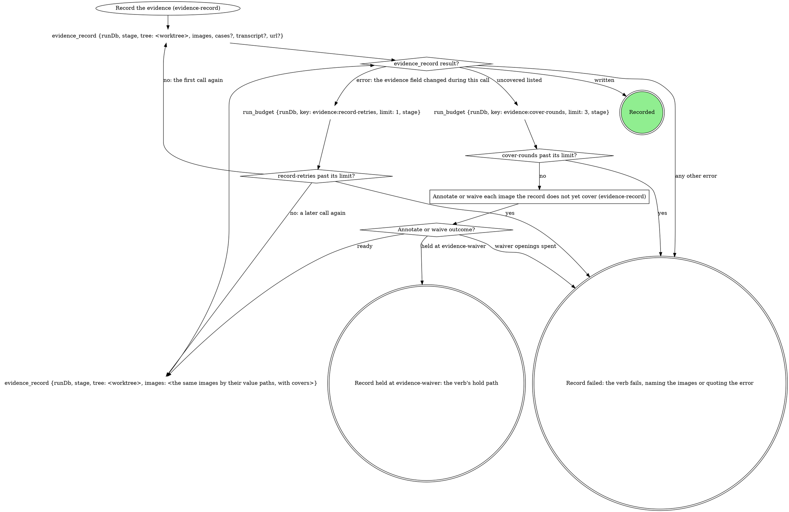
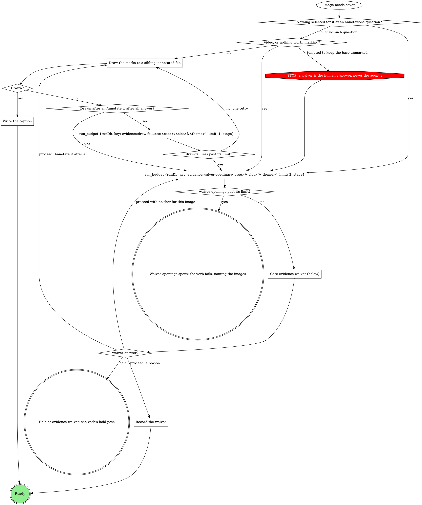
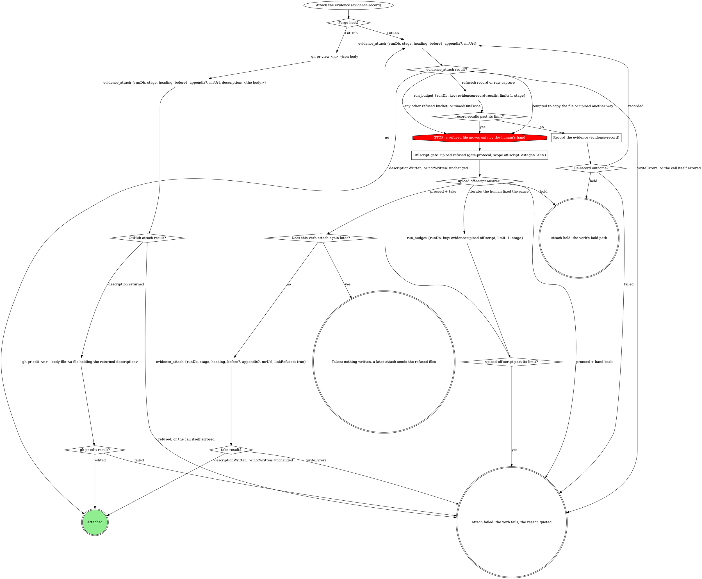

# Evidence record

The `evidence` run field is what this run verified and the only list of
what may leave the machine. `evidence_record` writes it and
`evidence_attach` uploads from it and writes the MR's evidence section.
Never write `evidence` with `run_field_set`, upload evidence with
`mr_upload`, or edit the evidence section by hand.

## The record

- One case per thing verified, in reading order; `id` is a stable slug
  (`^[a-z0-9][a-z0-9-]{0,63}$`), `label` is what a reader sees.
- A case has a before, an after, or both. A slot is one image, or a
  `{light, dark}` pair only when the plan or the domain says the theme
  matters (`theme` on each image).
- Every image is annotated (a board plus a caption naming what the marks
  point at) or waived (its own reason, or its case's). A case waiver covers
  only the images the case holds when it is written.
- `transcript` (a text file, never uploaded, never waived) and `url` (where
  the ticket shows the broken state) are run-level. A run with no image is
  recorded the same way: the tool picks the encoding.
- Captures stay where the capture wrote them. `evidence_record` copies
  each into `~/.mattstack/work/<run id>/evidence/`: draw marks and name
  files by the paths in its returned `value`, never the source.
- A file in the run folder is never rewritten: a recapture lands in a
  content folder beside the old one, and the record moves when it is
  written.

## Record the evidence

The first call names each capture by the `path` the capture wrote, with
`case`, `slot` (and `theme`), plus `label` for a new case; a recapture is
a new `path` for that slot. `tree` is always the run's worktree root. A
capture outside the allowed sources fails the verb, quoted.

Every later call, a re-record from `Attach the evidence` included, names
the same images by the paths the last returned `value` holds, each with
its cover (`annotated` plus `caption`, or `waiver`); a case waiver rides
in `cases`. Each `past its limit?` diamond
reads `run_budget`'s `spent` over `limit`.

## Annotate or waive each image the record does not yet cover

Run it for each image `evidence_record` lists in `uncovered` (`{case,
slot, theme?, path, why}`). When several images need the gate in one
pass, they share one opening.

### Draw the marks to a sibling -annotated file

The domain's method, else the `annotating-screenshots` skill. Mark what a
reviewer must look at: the changed value, the control, the
missing element. Write the board beside the run-folder copy (the image's
path in the returned `value`) as `<name>-annotated.<ext>`. A gate that asks
which marks to draw (`evidence-attach`, a domain form) decides the marks;
otherwise draw the ones you would propose.

### Write the caption

One short line naming what each mark points at: "Red box: the badge reads
3; arrow: the retry button". It rides on the image as `caption`.

### Gate evidence-waiver (below)

Scope `evidence-waiver:<stage>:<n>`, where `<n>` is the count of
`evidence-waiver` gates this stage pass has opened, starting at 1. One
sentence above the form: which
images need a waiver and why (nothing selected, two failed draws, nothing
worth marking, a video).

| Question | Options (recommended first) | Shown when |
|---|---|---|
| `waiver-<case>-<slot>[-<theme>]` | **`<your proposed reason>` (Recommended)** / **Annotate it after all**, with free text for a reason in the human's words | per image; the second opening for an image drops **Annotate it after all** |
| `waiver-<case>` | the same options, one reason for the whole case | instead of the per-image questions when every image in the case needs one |
| `next` | **Proceed** / **Hold** | always |

Selection: `{"waivers":{"<case>/<slot>[/<theme>]":"<reason>|annotate","<case>":"<reason>|annotate"},"next":"proceed|hold","note":"<their words or null>"}`.
A reason typed as free text is the reason, word for word.

### Record the waiver

The reason rides on the image as `waiver`, or on the case in `cases` when
the answer was one reason for the whole case.

## Attach the evidence

Entered only after the verb's attach gate proceeds.

`heading`, `before` and `appendix` come from the domain. Unbound,
`heading` is the evidence heading of the repo's MR template when it has
one, else `## Evidence`: always the full line, `##` included. On GitHub
nothing uploads: pass the PR body as `description`, write the returned
`description` to a file and edit the PR from it; `<n>` is the PR number
in `mrUrl`.

### Record the evidence (evidence-record)

Box 1 is `## Record the evidence`. A `record` or `raw-capture` refusal
means the guard read a record box 1 did not write. Run box 1 once more
with the images the verb last recorded, by their `value` paths, each with
its cover; the next such refusal goes to the gate.

### Off-script gate: upload refused (gate-protocol, scope off-script:<stage>:<n>)

Scope `off-script:<stage>:<n>`, sharing `n` with the verb's other
off-script gates, with `context` quoting each refusal and its path. Take
leaves the refused files for a later attach, or links them where this
verb is the last. Iterate means the human moved the file, widened
`rt.mcp.uploadRoots` or recaptured. Hold ends the turn with nothing
linked. Hand back fails the verb with the refusal quoted. Copying a file
under an allowed root is only ever the human's move.

### Does this verb attach again later?

Yes only when a later stage of this run attaches again (stage-evidence:
ship attaches and sends the refused files again). No for ship and
stage-ship, so Take links their local paths.

## Merge into the record

For a verb that still draws this node: run `Record the evidence` here. It
merges, covers and writes, so skip the verb's own annotate-or-waive pass
and evidence write that follow.

## Write before upload

`Record the evidence` wrote the record. Never write `evidence` with
`run_field_set`.

## Upload only what the record allows

Where the verb's own upload loop starts, run `Attach the evidence`
instead: it uploads, renders and writes the section, so skip the verb's
`mr_upload` loop.

## The evidence section of the description

`Attach the evidence` wrote it. Where the verb later writes the title and
description, write them around that section, taken byte for byte from the
description as it now stands on the MR (or the `section` the attach
returned). Never write a second evidence block.

## Domain precedence

A domain rule that keeps a base capture with no waiver, uploads outside
`evidence_attach`, or writes the record outside `evidence_record` is
overridden by this page.
