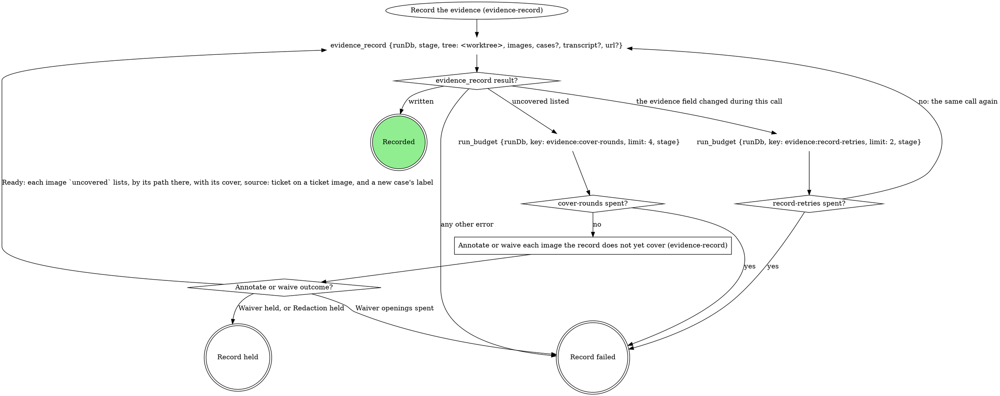
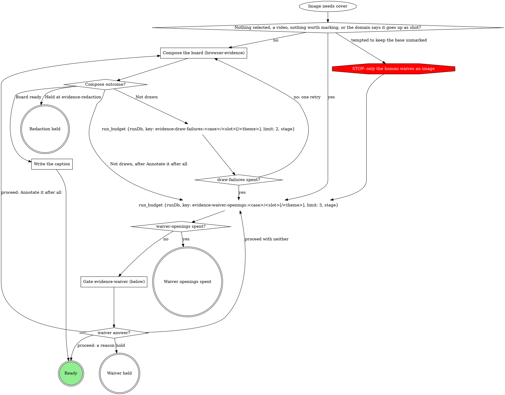
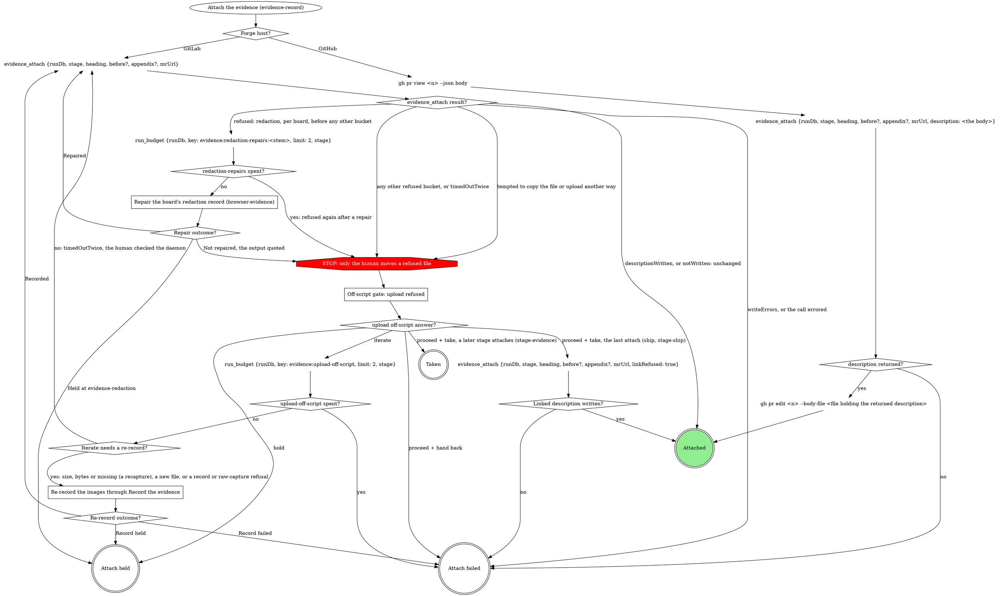

# Evidence record

The `evidence` run field is what this run verified and the only list of
what may leave the machine. `evidence_record` writes it; `evidence_attach`
uploads from it and writes the MR's evidence section. Never write
`evidence` with `run_field_set`, upload evidence with `mr_upload`, or edit
the evidence section by hand. A `<slug> spent?` diamond is yes when the
`run_budget` before it returns `exhausted: true` (`spent >= limit`: the count that
reaches `limit` takes yes).

## The record

- One case per thing verified, in reading order: `id` a stable slug
  (`^[a-z0-9][a-z0-9-]{0,63}$`), `label` what a reader sees. A case has a
  before, an after, or both: one image each, or a `{light, dark}` pair
  (`theme` on each) when the plan or the domain says the theme matters.
- Every image is annotated (a composed board plus a caption, the claim the
  board proves) or waived (its own reason, or its case's, which covers only
  the images the case holds when written). One board may be the
  `annotated` of several images: a pair board covers its case's before and
  after, except a before whose board is an import board, which keeps it.
- `transcript` (a text file, never uploaded or waived) and `url` (where
  the ticket shows the broken state) are run-level; a run with no image
  is recorded the same way.
- Captures stay where they were written. `evidence_record` copies each,
  with its board's whole bundle, into `~/.mattstack/work/<run id>/evidence/`:
  brief, compose and name files by the paths in its returned `value`,
  never the source.
- A file in the run folder is never rewritten: a recapture lands in a
  content folder beside it.

## Record the evidence

The first call names each capture by the `path` it was written to, with
`case` and `slot` (and `theme`), and `source: "ticket"` on a saved ticket
image. Every later call names the same images by the paths in the last
returned `value`, each with:

- its cover: `annotated` (the board's path) plus `caption`, or `waiver`
  (a case waiver rides in `cases`);
- `source: "ticket"` again on every image whose entry in that `value`
  carries `"source": "ticket"`.

The call that first writes a new case carries its `label`, on the image or
in `cases`, so every call until the record is written carries each new
case's `label`. `tree` is the run's worktree root. Record held is the
verb's hold path; Record failed fails the verb, naming the images or
quoting the error.

## Annotate or waive each image the record does not yet cover

For each image `evidence_record` lists in `uncovered` (`{case, slot,
theme?, path, why}`); images that need the gate in one pass share one
opening. Waiver held and Redaction held are the verb's hold path; Waiver
openings spent fails the verb, naming the images.

### Compose the board (browser-evidence)

Every board comes from browser-evidence's `Draw the boards`: an image
taken by another method (a script capture, a screenshot the user
provides) is an `import:` brief of its `value` path. A gate that asked
which marks to draw (`evidence-attach`, a domain form) decides the brief's
`point at` lines; else browser-evidence's Labels rule proposes them. The
board is `<stem>.png` in `~/.fast-browser/screenshots/`, never a
`-annotated` copy, and it goes on the image as `annotated`. An image the
domain says goes up as shot takes the yes edge to the waiver question,
with the domain's reason as the recommended reason. A ticket image never
does: it is likely a production screenshot with personal data on it, so
it always gets an `import:` board that hides what Personal data names.

`Not drawn` is a draw failure, whatever its reason; `Held at
evidence-redaction` is Redaction held.

### Write the caption

The brief's `claim` is the `caption` of every image the board shows; no
other caption is written.

### Gate evidence-waiver (below)

Scope `evidence-waiver:<stage>:<n>`, `<n>` counting this stage pass's
waiver gates from 1. One sentence above the form: which images need a
waiver and why; a ticket image is named as one. A reason rides on the
image as `waiver`, or on the case in `cases`; free text is the reason, word
for word. A ticket image (`source: "ticket"`) can never be waived (the
record refuses it), so its question offers no reason.

| Question | Options (recommended first) | Shown when |
|---|---|---|
| `waiver-<case>-<slot>[-<theme>]` | **`<your proposed reason>` (Recommended)** / **Annotate it after all**, with free text for a reason in the human's words | per image; the second opening for an image drops **Annotate it after all** |
| `waiver-<case>-<slot>[-<theme>]` for a ticket image | **Annotate it after all (Recommended)** only, no free text, on every opening | per ticket image |
| `waiver-<case>` | the same options, one reason for the whole case | instead of the per-image questions when every image in the case needs one and none is a ticket image |
| `next` | **Proceed** / **Hold** | always |

Selection: `{"waivers":{"<case>/<slot>[/<theme>]":"<reason>|annotate","<case>":"<reason>|annotate"},"next":"proceed|hold","note":"<their words or null>"}`.

## Attach the evidence

Entered only after the verb's attach gate proceeds. The domain supplies `heading`, `before` and
`appendix`; unbound, `heading` is the repo MR template's evidence
heading, else `## Evidence`, always the full line with its `##`. On
GitHub nothing uploads; `<n>` is the PR number in `mrUrl`. Attach held is
the verb's hold path; Attach failed fails it, quoting the reason (a failed
`gh pr edit` too); Taken writes nothing, and a later attach sends the
refused files.

### Off-script gate: upload refused

Scope `off-script:<stage>:<n>`, `n` shared with the verb's other
off-script gates; `context` quotes each refusal and its path. Only the
human moves or copies a file.

### Repair the board's redaction record (browser-evidence)

A `redaction` refusal names a board whose redaction record is missing,
unconfirmed, stale or malformed, or whose crop changed: its redaction gate
was skipped, or the board changed after it. Walk browser-evidence's Revise
a board steps 1 to 6 on that board with no wording change (step 3's
`revisions` entry: `asked` is the refusal quoted, `changed` is
"re-rendered and re-confirmed"): they re-render
it, pass Gate evidence-redaction, confirm after a yes and record the new
bundle. Recorded is Repaired; a Hold at the gate, or Record held, is
Held at evidence-redaction, with nothing uploaded; no spec beside the
board, a compose error, a refused confirm, spent redaction rounds, or
Record failed is Not repaired. When the result also refuses files in
other buckets, repair the redaction boards first and attach again; the
other buckets reach the off-script gate on that next result. An `import` refusal (an imported original is in the record as
uploadable) goes to the off-script gate with every other bucket.

### Re-record the images through Record the evidence

Run `Record the evidence` with the new file at its new path, or the last recorded images
by their `value` paths with covers.

## Domain precedence

A domain rule that keeps a base capture with no waiver, uploads outside
`evidence_attach`, writes the record outside `evidence_record`, or draws,
annotates or places marks itself is overridden by this page:
browser-evidence composes every board.
