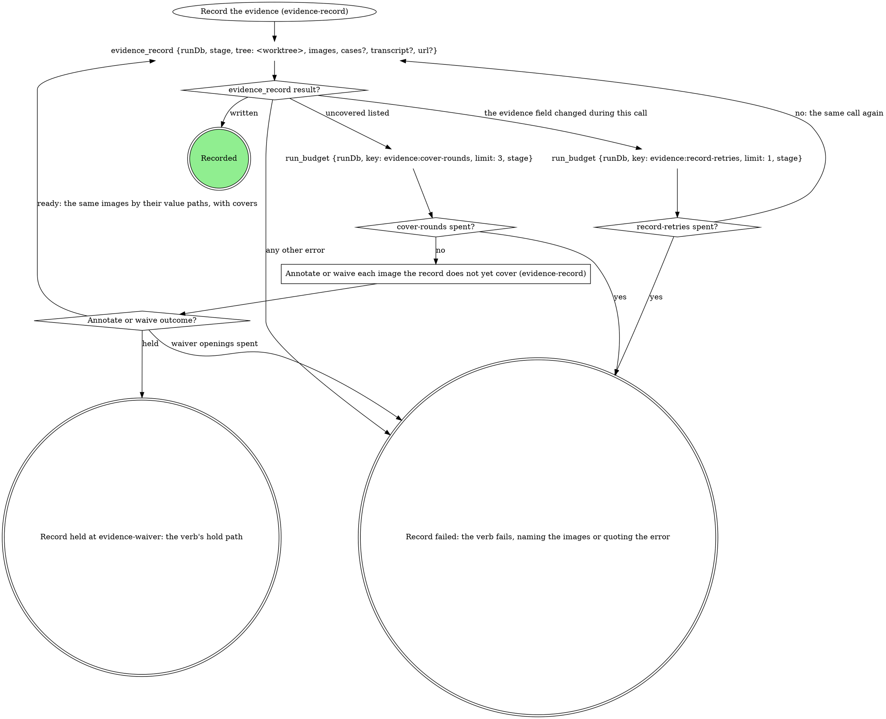
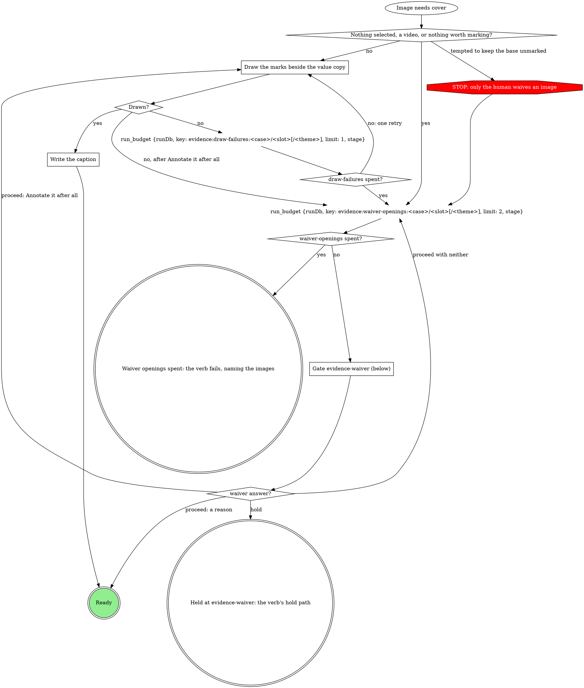
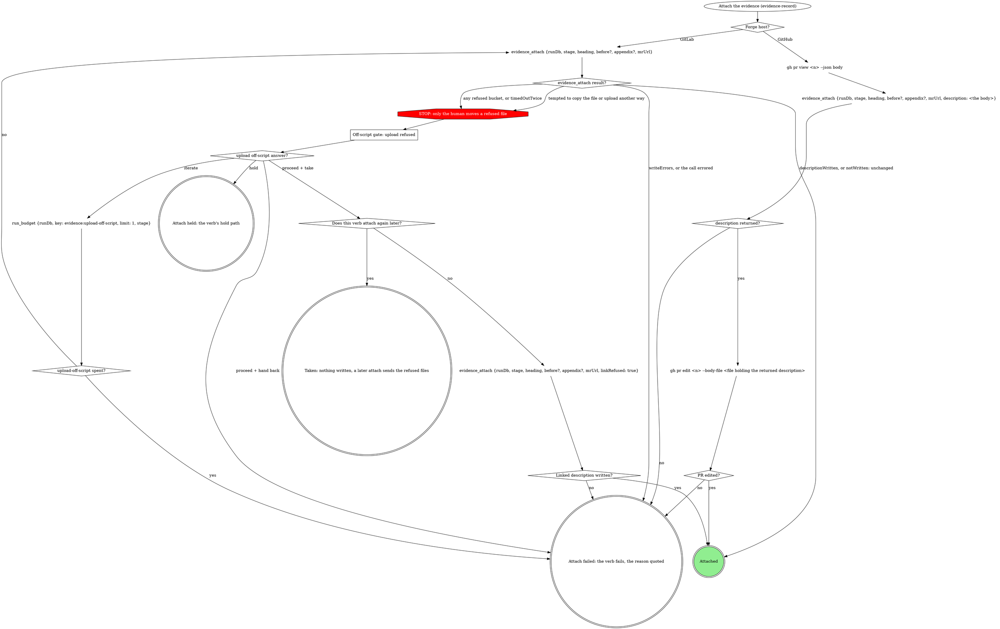

# Evidence record

The `evidence` run field is what this run verified and the only list of
what may leave the machine. `evidence_record` writes it; `evidence_attach`
uploads from it and writes the MR's evidence section. Never write
`evidence` with `run_field_set`, upload evidence with `mr_upload`, or edit
the evidence section by hand. A `<slug> spent?` diamond is yes when the
`run_budget` before it returns `spent` over `limit`.

## The record

- One case per thing verified, in reading order: `id` a stable slug
  (`^[a-z0-9][a-z0-9-]{0,63}$`), `label` what a reader sees. A case has a
  before, an after, or both: one image each, or a `{light, dark}` pair
  (`theme` on each) when the plan or the domain says the theme matters.
- Every image is annotated (a board plus a caption naming the marks) or
  waived (its own reason, or its case's, which covers only the images the
  case holds when written).
- `transcript` (a text file, never uploaded or waived) and `url` (where
  the ticket shows the broken state) are run-level; a run with no image
  is recorded the same way.
- Captures stay where they were written. `evidence_record` copies each
  into `~/.mattstack/work/<run id>/evidence/`: draw on and name files by
  the paths in its returned `value`, never the source.
- A file in the run folder is never rewritten: a recapture lands in a
  content folder beside it.

## Record the evidence

The first call names each capture by the `path` it was written to, with
`case`, `slot` (and `theme`), plus `label` for a new case; a recapture is
a new `path`. Every later call names the same images by the paths in the
last returned `value`, each with its cover (`annotated` plus `caption`,
or `waiver`; a case waiver rides in `cases`). `tree` is the run's
worktree root.

## Annotate or waive each image the record does not yet cover

For each image `evidence_record` lists in `uncovered` (`{case, slot,
theme?, path, why}`); images that need the gate in one pass share one
opening.

### Draw the marks beside the value copy

The domain's method, else the `annotating-screenshots` skill. Mark what a
reviewer must see (the changed value, the control, the missing element)
in `<name>-annotated.<ext>` beside the image's `value` path. A gate that
asked which marks to draw decides them; else draw the ones you propose.

### Write the caption

One line naming what each mark points at ("Red box: the badge reads 3"),
on the image as `caption`.

### Gate evidence-waiver (below)

Scope `evidence-waiver:<stage>:<n>`, `<n>` counting this stage pass's
waiver gates from 1. One sentence above the form: which images need a
waiver and why. A reason rides on the image as `waiver`, or on the case
in `cases`; free text is the reason, word for word.

| Question | Options (recommended first) | Shown when |
|---|---|---|
| `waiver-<case>-<slot>[-<theme>]` | **`<your proposed reason>` (Recommended)** / **Annotate it after all**, with free text for a reason in the human's words | per image; the second opening for an image drops **Annotate it after all** |
| `waiver-<case>` | the same options, one reason for the whole case | instead of the per-image questions when every image in the case needs one |
| `next` | **Proceed** / **Hold** | always |

Selection: `{"waivers":{"<case>/<slot>[/<theme>]":"<reason>|annotate","<case>":"<reason>|annotate"},"next":"proceed|hold","note":"<their words or null>"}`.

## Attach the evidence

Entered only after the verb's attach gate proceeds. `heading`, `before`
and `appendix` come from the domain. Unbound, `heading` is the repo MR
template's evidence heading, else `## Evidence`: always the full line,
`##` included. On GitHub nothing uploads; `<n>` is the PR number in
`mrUrl`.

### Off-script gate: upload refused

Scope `off-script:<stage>:<n>`, `n` shared with the verb's other
off-script gates; `context` quotes each refusal and its path. Iterate
means the human moved the file, widened `rt.mcp.uploadRoots` or
recaptured; only the human copies a file under an allowed root.

### Does this verb attach again later?

Yes when a later stage of this run attaches again (stage-evidence: ship
sends the refused files). No for ship and stage-ship, so Take lists them
as attached separately.

## Merge into the record

For a verb that still draws this node: run `Record the evidence` here,
and skip the verb's own annotate-or-waive pass and evidence write.

## Write before upload

`Record the evidence` wrote the record; never write `evidence` with
`run_field_set`.

## Upload only what the record allows

Run `Attach the evidence` at the verb's `Files to attach` decision,
whatever it answers (GitHub and no files included), and skip the verb's
`mr_upload` loop.

## The evidence section of the description

`Attach the evidence` wrote it: write the title and description around
it byte for byte as it stands on the MR (or the `section` the attach
returned), never a second evidence block.

## Domain precedence

A domain rule that keeps a base capture with no waiver, uploads outside
`evidence_attach`, or writes the record outside `evidence_record` is
overridden by this page.
