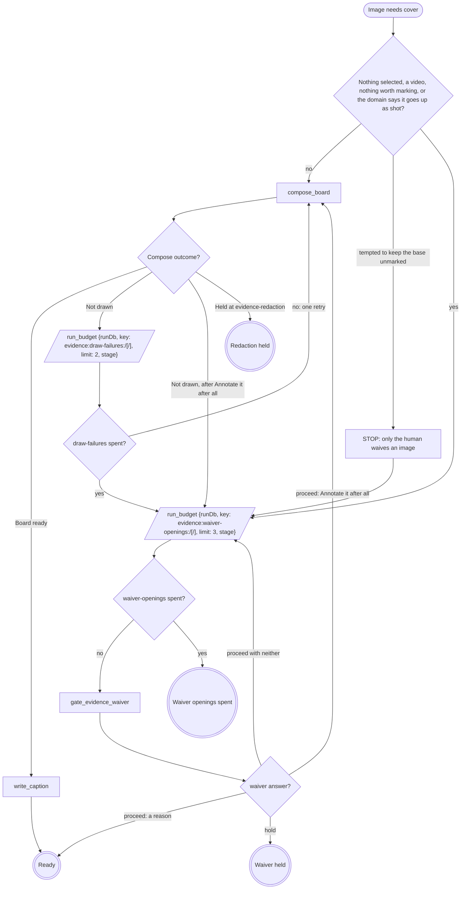

# Annotate or waive each image the record does not yet cover

For each image `evidence_record` lists in `uncovered` (`{case, slot,
theme?, path, why}`); images that need the gate in one pass share one
opening. Waiver held and Redaction held are the verb's hold path; Waiver
openings spent fails the verb, naming the images.

