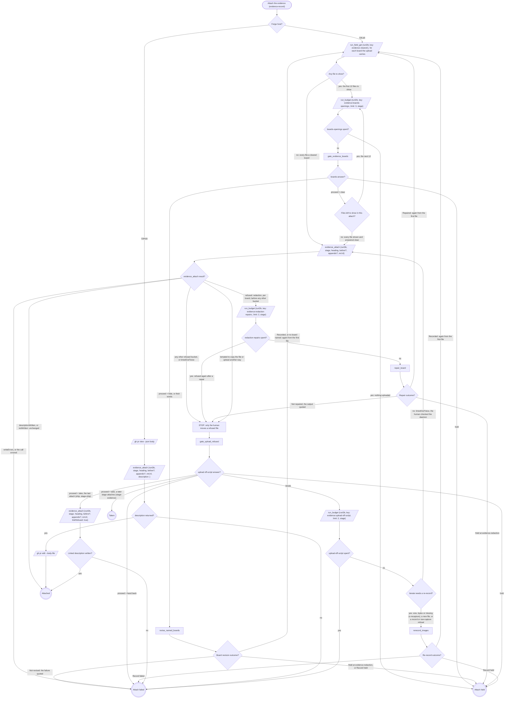

# Attach the evidence

Entered only after the verb's attach gate proceeds. On GitLab, nothing
uploads until the human has looked at every file the upload carries
but a cleared board (Gate evidence-boards). The domain supplies `heading`, `before` and
`appendix`; unbound, `heading` is the repo MR template's evidence
heading, else `## Evidence`, always the full line with its `##`. On
GitHub nothing uploads; `<n>` is the PR number in `mrUrl`. Attach held is
the verb's hold path; Attach failed fails it, quoting the reason (a failed
`gh pr edit` too); Taken writes nothing, and a later attach sends the
refused files.

