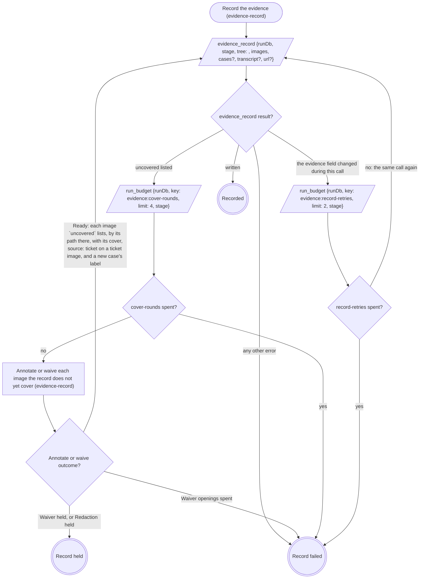

# Record the evidence

The first call names each capture by the `path` it was written to, with
`case` and `slot` (and `theme`), and `source: "ticket"` on a saved ticket
image. Every later call names the same images by the paths in the last
returned `value`, each with:

- its cover: `annotated` (the board's path) plus `caption`, or `waiver`
  (a case waiver rides in `cases`);
- `source: "ticket"` again on every image whose entry in that `value`
  carries `"source": "ticket"`.

The call that first writes a new case carries its `label`, on the image or
in `cases`, so every call until the record is written carries each new
case's `label`. `tree` is the run's worktree root. Record held is the
verb's hold path; Record failed fails the verb, naming the images or
quoting the error.
