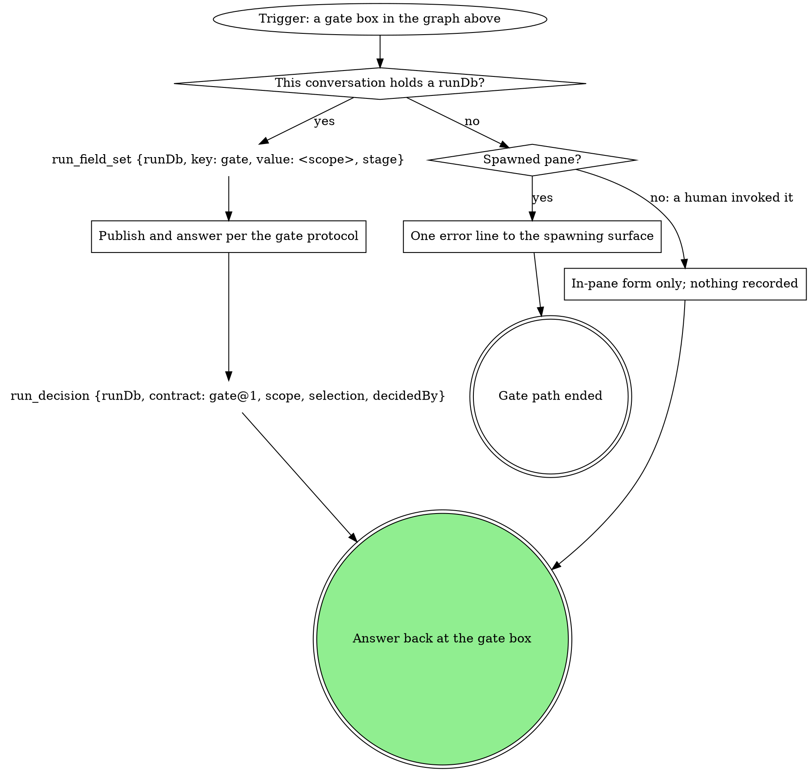

# rebase-worktree

Bring one worktree's branch current with the default branch through the
`branch_sync` tool. This never guesses: it refuses on a dirty tree, refuses
a stack member, and hands conflicts back to a human.

```dot
digraph rebase_worktree {
    rankdir=TB;

    "Trigger: one worktree's branch to bring current" [shape=ellipse];
    "git -C <tree> status -sb" [shape=plaintext];
    "Upstream set?" [shape=diamond];
    "branch_sync {tree}" [shape=plaintext];
    "branch_sync kind?" [shape=diamond];
    "STOP: never stash; gate the dirty tree" [shape=octagon style=filled fillcolor=red fontcolor=white];
    "Gate clarify: dirty tree" [shape=box];
    "tree answer?" [shape=diamond];
    "Dirty retries = 2?" [shape=diamond];
    "Pulled once already?" [shape=diamond];
    "git_pull {tree}" [shape=plaintext];
    "git_pull result?" [shape=diamond];
    "STOP: a refusal ends the run; never rebase by hand" [shape=octagon style=filled fillcolor=red fontcolor=white];
    "STOP: never resolve a conflict; hand it back" [shape=octagon style=filled fillcolor=red fontcolor=white];
    "Gate conflict:rebase-worktree:<attempt>" [shape=box];
    "conflict answer?" [shape=diamond];
    "git_rebase {tree, abort: true}" [shape=plaintext];
    "Abort succeeded?" [shape=diamond];
    "git -C <tree> status" [shape=plaintext];
    "Still mid-rebase?" [shape=diamond];
    "Conflict attempts = 3?" [shape=diamond];
    "STOP: leave the rebase for the human" [shape=octagon style=filled fillcolor=red fontcolor=white];
    "git -C <tree> log -1 --oneline HEAD" [shape=plaintext];
    "Head still the old head?" [shape=diamond];
    "git -C <tree> log -1 --oneline --no-decorate <oldHead>" [shape=plaintext];
    "git -C <tree> log -1 --oneline --no-decorate <newHead>" [shape=plaintext];
    "Report the move" [shape=box];
    "Old head = new head?" [shape=diamond];
    "branch_sync pushed it?" [shape=diamond];
    "Gate push" [shape=box];
    "push answer?" [shape=diamond];
    "git_push {tree, forceWithLease: true}" [shape=plaintext];
    "git_push result?" [shape=diamond];
    "STOP: push only with git_push" [shape=octagon style=filled fillcolor=red fontcolor=white];
    "Off-script gate" [shape=box];
    "off-script answer?" [shape=diamond];
    "Make the recorded move once" [shape=box];
    "Recorded move succeeded?" [shape=diamond];
    "Off-script rounds = 2?" [shape=diamond];
    "Dirty tree: reported" [shape=doublecircle];
    "Aborted: nothing touched" [shape=doublecircle];
    "No upstream: reported" [shape=doublecircle];
    "Refused: reported" [shape=doublecircle];
    "Refused: stack member, tool named" [shape=doublecircle];
    "Stack check could not run: reported" [shape=doublecircle];
    "Left mid-rebase for the human" [shape=doublecircle];
    "Aborted" [shape=doublecircle];
    "Abort failed: error reported, tree left for the human" [shape=doublecircle];
    "Rebase aborted in the human's pane: reported" [shape=doublecircle];
    "Rebased, left unpushed" [shape=doublecircle];
    "Rebased, push refused: reported" [shape=doublecircle];
    "Held: end the turn naming the gate" [shape=doublecircle];
    "Done: move reported" [shape=doublecircle style=filled fillcolor=lightgreen];

    "Trigger: one worktree's branch to bring current" -> "git -C <tree> status -sb";
    "git -C <tree> status -sb" -> "Upstream set?";
    "Upstream set?" -> "branch_sync {tree}" [label="yes"];
    "Upstream set?" -> "No upstream: reported" [label="no"];
    "branch_sync {tree}" -> "branch_sync kind?";
    "branch_sync kind?" -> "git -C <tree> log -1 --oneline --no-decorate <oldHead>" [label="synced, up-to-date or push-refused"];
    "branch_sync kind?" -> "Gate clarify: dirty tree" [label="dirty-tree"];
    "branch_sync kind?" -> "Gate conflict:rebase-worktree:<attempt>" [label="conflict"];
    "branch_sync kind?" -> "Refused: stack member, tool named" [label="stacked-refused"];
    "branch_sync kind?" -> "Stack check could not run: reported" [label="stack-unverified"];
    "branch_sync kind?" -> "Pulled once already?" [label="error: refusal says run git_pull first"];
    "branch_sync kind?" -> "Refused: reported" [label="error: any other refusal or failure"];
    "branch_sync kind?" -> "STOP: never stash; gate the dirty tree" [label="tempted to stash and proceed"];
    "branch_sync kind?" -> "STOP: a refusal ends the run; never rebase by hand" [label="tempted to rebase by hand"];
    "branch_sync kind?" -> "STOP: never resolve a conflict; hand it back" [label="tempted to resolve or continue it yourself"];
    "STOP: never stash; gate the dirty tree" -> "Gate clarify: dirty tree";
    "STOP: a refusal ends the run; never rebase by hand" -> "Refused: reported";
    "STOP: never resolve a conflict; hand it back" -> "Gate conflict:rebase-worktree:<attempt>";
    "Gate clarify: dirty tree" -> "tree answer?";
    "tree answer?" -> "Dirty retries = 2?" [label="I committed them, retry"];
    "tree answer?" -> "Aborted: nothing touched" [label="abort"];
    "tree answer?" -> "Held: end the turn naming the gate" [label="hold"];
    "Dirty retries = 2?" -> "branch_sync {tree}" [label="no"];
    "Dirty retries = 2?" -> "Dirty tree: reported" [label="yes"];
    "Pulled once already?" -> "git_pull {tree}" [label="no"];
    "Pulled once already?" -> "Refused: reported" [label="yes"];
    "git_pull {tree}" -> "git_pull result?";
    "git_pull result?" -> "branch_sync {tree}" [label="fast-forwarded"];
    "git_pull result?" -> "Refused: reported" [label="error"];
    "Gate conflict:rebase-worktree:<attempt>" -> "conflict answer?";
    "conflict answer?" -> "Left mid-rebase for the human" [label="leave"];
    "conflict answer?" -> "git_rebase {tree, abort: true}" [label="abort"];
    "conflict answer?" -> "Held: end the turn naming the gate" [label="hold"];
    "conflict answer?" -> "git -C <tree> status" [label="iterate: the human worked in their pane"];
    "git_rebase {tree, abort: true}" -> "Abort succeeded?";
    "Abort succeeded?" -> "Aborted" [label="yes"];
    "Abort succeeded?" -> "Abort failed: error reported, tree left for the human" [label="no"];
    "git -C <tree> status" -> "Still mid-rebase?";
    "Still mid-rebase?" -> "Conflict attempts = 3?" [label="yes"];
    "Still mid-rebase?" -> "git -C <tree> log -1 --oneline HEAD" [label="no"];
    "Conflict attempts = 3?" -> "Gate conflict:rebase-worktree:<attempt>" [label="no: attempt n+1"];
    "Conflict attempts = 3?" -> "STOP: leave the rebase for the human" [label="yes"];
    "STOP: leave the rebase for the human" -> "Left mid-rebase for the human";
    "git -C <tree> log -1 --oneline HEAD" -> "Head still the old head?";
    "Head still the old head?" -> "Rebase aborted in the human's pane: reported" [label="yes"];
    "Head still the old head?" -> "git -C <tree> log -1 --oneline --no-decorate <oldHead>" [label="no: the rebase finished"];
    "git -C <tree> log -1 --oneline --no-decorate <oldHead>" -> "git -C <tree> log -1 --oneline --no-decorate <newHead>";
    "git -C <tree> log -1 --oneline --no-decorate <newHead>" -> "Report the move";
    "Report the move" -> "Old head = new head?";
    "Old head = new head?" -> "Done: move reported" [label="yes: already current, nothing pushed"];
    "Old head = new head?" -> "branch_sync pushed it?" [label="no"];
    "branch_sync pushed it?" -> "Done: move reported" [label="yes: synced, pushed true"];
    "branch_sync pushed it?" -> "Gate push" [label="no: synced unpushed, push-refused, or the human finished the rebase"];
    "Gate push" -> "push answer?";
    "push answer?" -> "git_push {tree, forceWithLease: true}" [label="push with force-with-lease"];
    "push answer?" -> "Rebased, left unpushed" [label="leave it unpushed"];
    "push answer?" -> "Report the move" [label="iterate"];
    "push answer?" -> "Held: end the turn naming the gate" [label="hold"];
    "git_push {tree, forceWithLease: true}" -> "git_push result?";
    "git_push result?" -> "Done: move reported" [label="pushed"];
    "git_push result?" -> "Rebased, push refused: reported" [label="safety refusal: lease, protected or default branch, detached HEAD, upstream mismatch"];
    "git_push result?" -> "STOP: push only with git_push" [label="not registered with rt"];
    "git_push result?" -> "Rebased, push refused: reported" [label="any other error"];
    "STOP: push only with git_push" -> "Off-script gate";
    "Off-script gate" -> "off-script answer?";
    "off-script answer?" -> "Make the recorded move once" [label="take"];
    "off-script answer?" -> "Off-script rounds = 2?" [label="iterate: the human fixed it, retry"];
    "off-script answer?" -> "Rebased, push refused: reported" [label="hand back"];
    "off-script answer?" -> "Held: end the turn naming the gate" [label="hold"];
    "Off-script rounds = 2?" -> "git_push {tree, forceWithLease: true}" [label="no"];
    "Off-script rounds = 2?" -> "Rebased, push refused: reported" [label="yes"];
    "Make the recorded move once" -> "Recorded move succeeded?";
    "Recorded move succeeded?" -> "Done: move reported" [label="yes"];
    "Recorded move succeeded?" -> "Rebased, push refused: reported" [label="no"];
}
```

`<tree>` is the worktree's absolute path. Each graph box has a section below. Every gate box runs the gate steps graph under **Gates**.

### branch_sync kind?

`branch_sync` does the fetch, the stack check, the rebase and the push in
one call, and returns `{kind, branch, oldHead, newHead, pushed, refusal?,
paths?}`. `kind` decides, and nothing else does:

| kind | next |
|---|---|
| `synced` | The branch moved. `pushed: true`: origin has it, so no push gate. `pushed: false`: origin's ref lacks the new head, so **Gate push** follows. |
| `up-to-date` | Nothing moved or was pushed. **Report the move** says "already current; nothing pushed". |
| `push-refused` | The rebase landed locally; the push failed. **Report the move** quotes `refusal`; **Gate push** follows. |
| `dirty-tree` | Nothing ran. **Gate clarify: dirty tree** with the result's `paths`. |
| `conflict` | The rebase is paused in the worktree. **Gate conflict:rebase-worktree:<attempt>** with the bundle's `unresolvedFiles`. Keep the result's `newHead` for **Head still the old head?**. |
| `stacked-refused` | **Refused: stack member, tool named**: quote `refusal` and name the tool it names. The restack belongs to that tool. |
| `stack-unverified` | **Stack check could not run: reported**: quote `refusal`, which says why. |
| `error` | Read `refusal`. When it says "run git_pull first" (the branch is only behind origin), go to **Pulled once already?**: one `git_pull {tree}`, then one more `branch_sync`. That phrase is the one text match in this skill. Any other refusal or failure: **Refused: reported** with `refusal`. |

| Thought | Reality |
|---|---|
| "The stack refusal came back, but the MR targets the default branch, so I'll rebase by hand" | `stacked-refused` is the guard's verdict, not a hint. The run ends reported; the restack is the named tool's. |
| "The stack check could not run, so I'll check the MRs myself and rebase" | `stack-unverified` ends the run. An unverified branch is never rebased, by hand or by another tool. |
| "`synced`, so now the push gate" | With `pushed: true` the push already happened; a push form would be a false choice. Report it as pushed. |
| "`synced` means pushed" | Read `pushed`. With `pushed: false` the new head is local only, and the push gate decides. |

### Gate clarify: dirty tree

Scope `clarify`. One sentence listing the uncommitted paths (the result's
`paths`; when absent, quote `refusal`), then two questions, each its own question:

- `tree`: **I committed them, retry** / **Abort**
- `next`: **Proceed** / **Hold**

Selection `{"tree":"retry|abort"}`. Read `next` first: **Hold** ends the
turn with nothing moved. Never stash and
proceed: moving someone's uncommitted work is not this skill's call. The
table under **Gate push** binds this form too.

{{include:spawned-no-run-guard}}

### Gate conflict:rebase-worktree:<attempt>

Scope `conflict:rebase-worktree:<attempt>`. One sentence listing the
conflicted files: the bundle's `unresolvedFiles`, or after an iterate the
unmerged (`both modified` and similar) entries of the
`git -C <tree> status` read.

`<attempt>` counts from 1. The questions, each its own question (never
fold one list into another: a question over 4 options sends the whole gate
to the wait queue):

- `conflict`: **Leave the rebase in progress for me** (recommended) /
  **Abort the rebase**
- `next`: **Proceed** (recommended) / **Iterate here** / **Hold**

Selection `{"next":"leave|abort|iterate|hold","note":"<their words or null>"}`.
The recorded `next` folds both questions into one value: **Hold** records
`hold` and ends the turn with nothing aborted; **Iterate here** records
`iterate` and re-reads the tree, ignoring `conflict`; **Proceed** records
the `conflict` choice itself (`leave` or `abort`). Never resolve the
conflict yourself, stage the files, or continue or skip the rebase.

{{include:spawned-no-run-guard}}

### Report the move

One line: old head -> new head, each as the sha and subject from its
`git -C <tree> log -1 --oneline --no-decorate` read. `<oldHead>` is the
result's `oldHead`. `<newHead>` is the result's `newHead` on the
`branch_sync` path, and HEAD after an iterate where the human finished the
rebase. The line ends "already current; nothing pushed" when the heads
match, "pushed by branch_sync" when `pushed` is true, and otherwise "not
pushed", followed on `push-refused` by the quoted `refusal`.

### Gate push

Scope `push`. The sentence is the line from **Report the move**; nothing
else before the form. The questions, each its own question (never fold one list
into another: a question over 4 options sends the whole gate to the wait
queue):

- `push`: **Push with force-with-lease now** / **Leave it unpushed**
  (recommended when the branch has an open MR others may have pulled)
- `next`: **Proceed** / **Iterate here** / **Hold**

Selection `{"push":true|false,"next":"proceed|iterate|hold","note":"<their words or null>"}`.
Read `next` first: **Hold** ends the turn with nothing pushed; **Iterate
here** goes back to **Report the move** and ignores `push`; only
**Proceed** applies `push`.
Any `git_push` error other than "not registered with rt" is reported with
its text; the rebase stands unpushed.

{{include:spawned-no-run-guard}}

**These thoughts mean you are skipping the gate -- STOP:**

| Thought | Reality |
|---------|---------|
| "Push with force-with-lease now is the natural next action, so I'll mark it Recommended" | Only **Leave it unpushed** carries a recommended label, and only conditionally (an open MR others may have pulled). Keep that qualifier on that option; never move it to the push option. |
| "Restating the finding and explaining each option makes the ask clearer" | A gate's form is one sentence of context, then the bare option labels the gate text names, nothing more -- no restated heading, no per-option description, no conditional aside on when Hold applies. |

### Off-script gate

Its origin is the `git_push` refusal "not registered with rt". Scope
`off-script:<run.current_stage>:<n>`, `n` counting from 1 per
rebase-worktree invocation; with no run, the site is `rebase-worktree`
(scope `off-script:rebase-worktree:<n>`). The
context sentence quotes the `git_push` refusal. The questions, each its
own question:

- `action`: **Take the proposed move** (the value spells the move in full)
  / **Hand back**
- `next`: **Proceed** (recommended) / **Iterate here** / **Hold**

Selection `{"move":"<the move>","why":"<the refusal>","action":"take|handback","next":"proceed|iterate|hold","note":"<their words or null>"}`.
Read `next` first: **Hold** ends the turn with no move made; **Iterate
here** means the human fixed the cause and wants the push retried, and it
ignores `action`; only **Proceed** applies `action` (take or hand back).
The proposed move is one plain-git force-with-lease push of the
branch; retrying the refused tool is **Iterate here**, never **Take**.

### Make the recorded move once

Exactly the move the selection recorded, once. Its result decides the next
node; a failure is reported, never a second off-script gate.

## What the graph cannot show

- Never push unasked.
- Aborting the rebase happens only on the **Abort the rebase** answer.
- "Upstream set?" is no when the `status -sb` branch line carries no `...origin/<branch>` tracking ref.

### Head still the old head?

The old head here is the conflict result's `newHead`: the branch ref when
the rebase paused, which differs from `oldHead` when rt sync first reset a
GitLab-rebased branch to origin. HEAD still equal to it means the human
aborted in their pane, never "already current".

## Gates

Every gate box runs this graph.

### Publish and answer per the gate protocol

If a rule below asks for a move this graph marks STOP, take the off-script edge instead.

{{include:gate-protocol}}

### One error line to the spawning surface

The guard text in the gate's own section (for the off-script gate, the
one under **Gate push**) says what the line is and where it goes; the gate
path ends there.

### In-pane form only; nothing recorded

A human invocation with no run gets the same form in the pane, and no
`run_*` call is made.

## Wrap-up form contract

{{include:wrap-up-form}}
