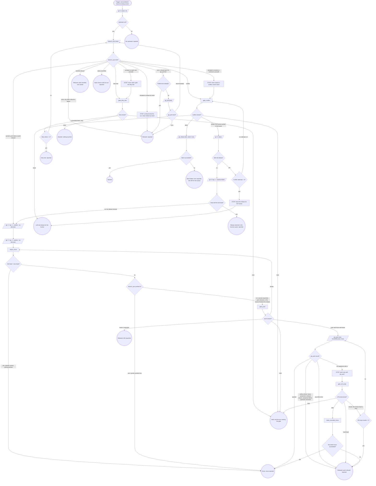

# rebase-worktree

Bring one worktree's branch current with the default branch through the
`branch_sync` tool. This never guesses: it refuses on a dirty tree, refuses
a stack member, and hands conflicts back to a human.

`<tree>` is the worktree's absolute path. Each graph box has a section below. Every gate box runs the gate steps graph under **Gates**.

