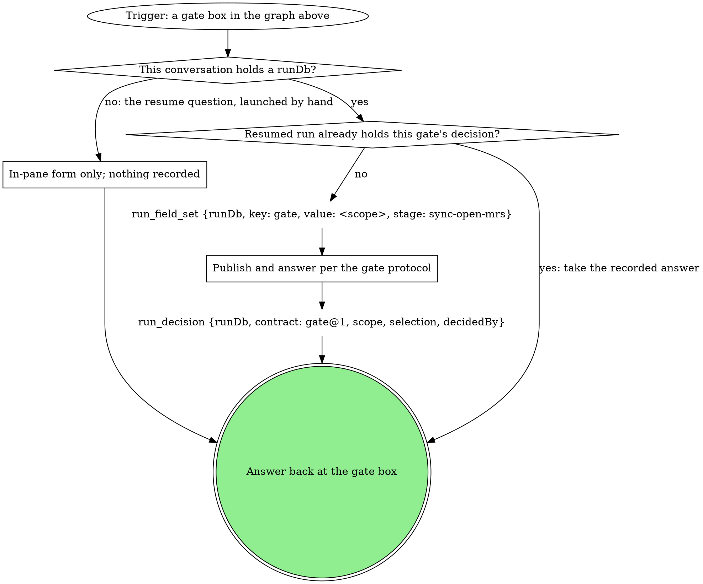

# sync-open-mrs

Bring every open MR or PR current with the default branch in one sweep:
rebase each, then offer to push and watch CI. The sweep covers the open
MRs the map returns: `mr_map` on GitLab, `map-open-mrs` on GitHub. This
verb owns the sequencing, the batch gates and the report. Discovery and CI
watching belong to the verbs it follows; rebasing belongs to
`branch_sync_sweep` and `branch_sync`. Gates stay human decisions: never
stash a tree, never resolve a conflict.

```dot
digraph sync_open_mrs {
    rankdir=TB;

    "Trigger: every open MR should come current" [shape=ellipse];
    "Caller handed a runDb?" [shape=diamond];
    "run_snapshot {runDb}" [shape=plaintext];
    "run.status = running?" [shape=diamond];
    "Inherit the run" [shape=box];
    "Spawned by a surface?" [shape=diamond];
    "run_list {repo}" [shape=plaintext];
    "Running sync-open-mrs runs?" [shape=diamond];
    "Gate clarify: resume or start fresh" [shape=box];
    "clarify answer?" [shape=diamond];
    "run_stage {runDb: <resumed>, action: start, stage: sync-open-mrs}" [shape=plaintext];
    "run_field_set {runDb: <resumed>, key: hold, value: -, stage: sync-open-mrs}" [shape=plaintext];
    "run_snapshot {runDb: <resumed>}" [shape=plaintext];
    "Keep the recorded answers" [shape=box];
    "run_start {flags, skillDir, spawnedBy?}" [shape=plaintext];
    "run_start ok with a runDb?" [shape=diamond];
    "run_stage {action: start, stage: sync-open-mrs}" [shape=plaintext];
    "git -C <checkout> remote get-url origin" [shape=plaintext];
    "Forge?" [shape=diamond];
    "mr_map {repoName, author: me}" [shape=plaintext];
    "mr_map result?" [shape=diamond];
    "STOP: GitLab MR reads go through mr_map" [shape=octagon style=filled fillcolor=red fontcolor=white];
    "Follow map-open-mrs for the table" [shape=box];
    "Plan the sweep" [shape=box];
    "Gate sweep" [shape=box];
    "sweep answer?" [shape=diamond];
    "Say nothing was selected" [shape=box];
    "Every listed branch selected?" [shape=diamond];
    "branch_sync_sweep {repoName}" [shape=plaintext];
    "branch_sync_sweep result?" [shape=diamond];
    "Record every sweep result in its bucket" [shape=box];
    "Selected branches left?" [shape=diamond];
    "branch_sync {tree}" [shape=plaintext];
    "Record the branch in its bucket" [shape=box];
    "Branches to pull left?" [shape=diamond];
    "git_pull {tree}" [shape=plaintext];
    "git_pull result?" [shape=diamond];
    "branch_sync {tree: <pulled tree>}" [shape=plaintext];
    "Record the re-sync in its bucket" [shape=box];
    "Any listed tree came back dirty?" [shape=diamond];
    "Gate clarify: dirty trees" [shape=box];
    "dirty answer?" [shape=diamond];
    "Retried trees left?" [shape=diamond];
    "branch_sync {tree: <retried tree>}" [shape=plaintext];
    "Record the retry in its bucket" [shape=box];
    "Any rebased, still unpushed?" [shape=diamond];
    "Summarize the rebase pass" [shape=box];
    "Gate push" [shape=box];
    "push answer?" [shape=diamond];
    "Selected pushes left?" [shape=diamond];
    "git_push {tree, forceWithLease: true}" [shape=plaintext];
    "git_push result?" [shape=diamond];
    "Record pushed" [shape=box];
    "Record push failed, reason quoted" [shape=box];
    "Record push failed, mechanical" [shape=box];
    "Any mechanical push failure?" [shape=diamond];
    "STOP: push only with git_push" [shape=octagon style=filled fillcolor=red fontcolor=white];
    "Off-script gate" [shape=box];
    "off-script answer?" [shape=diamond];
    "Off-script rounds = 2?" [shape=diamond];
    "Queue the mechanical failures again" [shape=box];
    "Make the recorded move once per listed branch" [shape=box];
    "Watch CI asked?" [shape=diamond];
    "Follow watch-ci per pushed branch" [shape=box];
    "Report every branch in one bucket" [shape=box];
    "Started this run here?" [shape=diamond];
    "run_stage {action: done, stage: sync-open-mrs}" [shape=plaintext];
    "Sweep abandoned?" [shape=diamond];
    "run_status {status: done}" [shape=plaintext];
    "run_status {status: abandoned}" [shape=plaintext];
    "Inherited sweep abandoned?" [shape=diamond];
    "rt too old: told the user to update" [shape=doublecircle];
    "Held: end the turn naming the gate" [shape=doublecircle];
    "Sweep abandoned" [shape=doublecircle];
    "Sweep reported" [shape=doublecircle style=filled fillcolor=lightgreen];

    "Trigger: every open MR should come current" -> "Caller handed a runDb?";
    "Caller handed a runDb?" -> "run_snapshot {runDb}" [label="yes"];
    "Caller handed a runDb?" -> "Spawned by a surface?" [label="no"];
    "run_snapshot {runDb}" -> "run.status = running?";
    "run.status = running?" -> "Inherit the run" [label="yes"];
    "run.status = running?" -> "Spawned by a surface?" [label="no"];
    "Inherit the run" -> "git -C <checkout> remote get-url origin";
    "Spawned by a surface?" -> "run_start {flags, skillDir, spawnedBy?}" [label="yes: start fresh"];
    "Spawned by a surface?" -> "run_list {repo}" [label="no: launched by hand"];
    "run_list {repo}" -> "Running sync-open-mrs runs?";
    "Running sync-open-mrs runs?" -> "Gate clarify: resume or start fresh" [label="yes"];
    "Running sync-open-mrs runs?" -> "run_start {flags, skillDir, spawnedBy?}" [label="no"];
    "Gate clarify: resume or start fresh" -> "clarify answer?";
    "clarify answer?" -> "run_stage {runDb: <resumed>, action: start, stage: sync-open-mrs}" [label="resume a candidate"];
    "clarify answer?" -> "run_start {flags, skillDir, spawnedBy?}" [label="start fresh"];
    "clarify answer?" -> "Held: end the turn naming the gate" [label="hold"];
    "run_stage {runDb: <resumed>, action: start, stage: sync-open-mrs}" -> "run_field_set {runDb: <resumed>, key: hold, value: -, stage: sync-open-mrs}";
    "run_field_set {runDb: <resumed>, key: hold, value: -, stage: sync-open-mrs}" -> "run_snapshot {runDb: <resumed>}";
    "run_snapshot {runDb: <resumed>}" -> "Keep the recorded answers";
    "Keep the recorded answers" -> "git -C <checkout> remote get-url origin";
    "run_start {flags, skillDir, spawnedBy?}" -> "run_start ok with a runDb?";
    "run_start ok with a runDb?" -> "run_stage {action: start, stage: sync-open-mrs}" [label="yes"];
    "run_start ok with a runDb?" -> "rt too old: told the user to update" [label="no"];
    "run_stage {action: start, stage: sync-open-mrs}" -> "git -C <checkout> remote get-url origin";
    "git -C <checkout> remote get-url origin" -> "Forge?";
    "Forge?" -> "mr_map {repoName, author: me}" [label="GitLab"];
    "Forge?" -> "Follow map-open-mrs for the table" [label="GitHub"];
    "Forge?" -> "STOP: GitLab MR reads go through mr_map" [label="tempted to use the GitLab CLI"];
    "STOP: GitLab MR reads go through mr_map" -> "mr_map {repoName, author: me}";
    "mr_map {repoName, author: me}" -> "mr_map result?";
    "mr_map result?" -> "Plan the sweep" [label="rows"];
    "mr_map result?" -> "Report every branch in one bucket" [label="GitLab error: quoted"];
    "Follow map-open-mrs for the table" -> "Plan the sweep";
    "Plan the sweep" -> "Gate sweep";
    "Gate sweep" -> "sweep answer?";
    "sweep answer?" -> "Every listed branch selected?" [label="proceed with branches"];
    "sweep answer?" -> "Say nothing was selected" [label="proceed with none selected"];
    "sweep answer?" -> "Plan the sweep" [label="iterate"];
    "sweep answer?" -> "Held: end the turn naming the gate" [label="hold"];
    "Say nothing was selected" -> "Started this run here?";
    "Every listed branch selected?" -> "branch_sync_sweep {repoName}" [label="yes: all four conditions hold"];
    "Every listed branch selected?" -> "Selected branches left?" [label="no: per branch, in the answer's order"];
    "branch_sync_sweep {repoName}" -> "branch_sync_sweep result?";
    "branch_sync_sweep result?" -> "Record every sweep result in its bucket" [label="results"];
    "branch_sync_sweep result?" -> "Selected branches left?" [label="error: per branch over the selected rows"];
    "Record every sweep result in its bucket" -> "Branches to pull left?";
    "Selected branches left?" -> "branch_sync {tree}" [label="yes"];
    "Selected branches left?" -> "Branches to pull left?" [label="no"];
    "branch_sync {tree}" -> "Record the branch in its bucket";
    "Record the branch in its bucket" -> "Selected branches left?";
    "Branches to pull left?" -> "git_pull {tree}" [label="yes"];
    "Branches to pull left?" -> "Any listed tree came back dirty?" [label="no"];
    "git_pull {tree}" -> "git_pull result?";
    "git_pull result?" -> "branch_sync {tree: <pulled tree>}" [label="fast-forwarded"];
    "git_pull result?" -> "Record the re-sync in its bucket" [label="error: skipped, quoted"];
    "branch_sync {tree: <pulled tree>}" -> "Record the re-sync in its bucket";
    "Record the re-sync in its bucket" -> "Branches to pull left?";
    "Any listed tree came back dirty?" -> "Gate clarify: dirty trees" [label="yes"];
    "Any listed tree came back dirty?" -> "Any rebased, still unpushed?" [label="no"];
    "Gate clarify: dirty trees" -> "dirty answer?";
    "dirty answer?" -> "Retried trees left?" [label="proceed: retry the picked trees, the rest skipped"];
    "dirty answer?" -> "Held: end the turn naming the gate" [label="hold"];
    "Retried trees left?" -> "branch_sync {tree: <retried tree>}" [label="yes"];
    "Retried trees left?" -> "Any rebased, still unpushed?" [label="no"];
    "branch_sync {tree: <retried tree>}" -> "Record the retry in its bucket";
    "Record the retry in its bucket" -> "Retried trees left?";
    "Any rebased, still unpushed?" -> "Summarize the rebase pass" [label="yes"];
    "Any rebased, still unpushed?" -> "Report every branch in one bucket" [label="no"];
    "Summarize the rebase pass" -> "Gate push";
    "Gate push" -> "push answer?";
    "push answer?" -> "Selected pushes left?" [label="proceed"];
    "push answer?" -> "Summarize the rebase pass" [label="iterate"];
    "push answer?" -> "Held: end the turn naming the gate" [label="hold"];
    "Selected pushes left?" -> "git_push {tree, forceWithLease: true}" [label="yes"];
    "Selected pushes left?" -> "Any mechanical push failure?" [label="no"];
    "git_push {tree, forceWithLease: true}" -> "git_push result?";
    "git_push result?" -> "Record pushed" [label="pushed"];
    "git_push result?" -> "Record push failed, reason quoted" [label="safety refusal: lease, protected or default branch, detached HEAD, upstream mismatch"];
    "git_push result?" -> "Record push failed, mechanical" [label="not registered with rt"];
    "git_push result?" -> "Record push failed, reason quoted" [label="any other error"];
    "Record pushed" -> "Selected pushes left?";
    "Record push failed, reason quoted" -> "Selected pushes left?";
    "Record push failed, mechanical" -> "Selected pushes left?";
    "Any mechanical push failure?" -> "STOP: push only with git_push" [label="yes"];
    "Any mechanical push failure?" -> "Watch CI asked?" [label="no"];
    "STOP: push only with git_push" -> "Off-script gate";
    "Off-script gate" -> "off-script answer?";
    "off-script answer?" -> "Make the recorded move once per listed branch" [label="take"];
    "off-script answer?" -> "Off-script rounds = 2?" [label="iterate: the human fixed it, retry"];
    "off-script answer?" -> "Watch CI asked?" [label="hand back: they stay push failed"];
    "off-script answer?" -> "Held: end the turn naming the gate" [label="hold"];
    "Off-script rounds = 2?" -> "Queue the mechanical failures again" [label="no"];
    "Off-script rounds = 2?" -> "Watch CI asked?" [label="yes: they stay push failed"];
    "Queue the mechanical failures again" -> "Selected pushes left?";
    "Make the recorded move once per listed branch" -> "Watch CI asked?";
    "Watch CI asked?" -> "Follow watch-ci per pushed branch" [label="yes"];
    "Watch CI asked?" -> "Report every branch in one bucket" [label="no"];
    "Follow watch-ci per pushed branch" -> "Report every branch in one bucket";
    "Report every branch in one bucket" -> "Started this run here?";
    "Started this run here?" -> "run_stage {action: done, stage: sync-open-mrs}" [label="yes"];
    "Started this run here?" -> "Inherited sweep abandoned?" [label="no: close nothing"];
    "run_stage {action: done, stage: sync-open-mrs}" -> "Sweep abandoned?";
    "Sweep abandoned?" -> "run_status {status: done}" [label="no"];
    "Sweep abandoned?" -> "run_status {status: abandoned}" [label="yes"];
    "run_status {status: done}" -> "Sweep reported";
    "run_status {status: abandoned}" -> "Sweep abandoned";
    "Inherited sweep abandoned?" -> "Sweep reported" [label="no"];
    "Inherited sweep abandoned?" -> "Sweep abandoned" [label="yes"];
}
```

### Inherit the run

The caller handed a `runDb` and the `run_snapshot` tool with that `runDb`
shows `run.status` = `running`: you were invoked from inside that run and
inherit it. `run.current_stage` is your stage, and you close nothing at the
end.

### Gate clarify: resume or start fresh

The candidates are the `run_list` rows (`repo` = the `--repo` value in the
flag text under **Starting the run**) whose `status` is `running` and
`work_type` is `sync-open-mrs`; never read the run dbs by hand.

Scope `clarify`. One sentence naming each candidate's `spawned_by`,
`started_at`, and `current_stage`, then one **Resume** option per candidate
(recommended for a run this session started earlier; a run another live
pane owns is not yours) / **Start fresh**; **Hold**.

Resume: the candidate's `runDb` is `~/.mattstack/runs/<repo>/<id>/state.db`
built from the row's `repo` and `id`, with `~` expanded to the home
directory. Keep it for every `run_*` call; the `run_stage` start that
follows is a new attempt, which re-records this session.

### Keep the recorded answers

The decisions the resumed `run_snapshot` shows are answers already given.
Each gate step that finds its scope's decision there takes it instead of
asking again, but only a proceed decision for that gate counts: one whose
`next` is iterate or hold is not an answer, and a gate reached again after
an iterate edge always asks afresh (a re-ask after Hold or Iterate opens a
new gate). **Resumed run already holds this gate's decision?** reads this
rule.

### mr_map result?

**rows**: the call returned `{rows, complete}` with `repoName` = the
checkout's absolute path; each row is a map row (`ref`, `title`, `author`,
`sourceBranch`, and `worktree`, where null is a NONE row), and its `dirty`
and the result's `complete` feed the plan. **GitLab error**: there is no
map, so nothing is planned, rebased or pushed; the report's one line is
the error, quoted, and the sweep ends abandoned.

### Follow map-open-mrs for the table

The GitHub path. Follow the pack's compiled `map-open-mrs` verb
(`../map-open-mrs/SKILL.md`, relative to this file, when the pack compiles
both on the same side; a different surface changes the path) and get its
table: MR ref, title, author, source branch, worktree path or NONE.

### Plan the sweep

One sentence: how many branches rebase, how many are skipped up front and
why. Skipped up front: NONE rows, with nothing local to rebase, and trees
`branch_sync` would refuse as dirty. On GitLab a row's `dirty` decides:
`true` is a dirty tree, and `null` with a tree means the read failed, so
the tree is not known clean and is skipped too, saying so. On GitHub,
a tree whose `git -C <tree> status --porcelain` is not empty is the dirty
one. When the map was cut short, the same sentence says so: on GitLab,
`complete: false` means it was cut at 200 open MRs; on GitHub, exactly 200
rows from `gh pr list` means it was cut at 200 open PRs. Every row of the map is the signed-in user's own MR, so every branch
starts pre-selected; deselecting skips it.

**These thoughts mean you are skipping the gate -- STOP:**

| Thought | Reality |
|---------|---------|
| "I'll list the dirty tree too and let the rebase step refuse it" | The sweep form lists only branches the sweep will rebase; a tree the rebase would refuse is a skipped row, named up front with its reason. |

### Gate sweep

Scope `sweep`, once for the whole batch, never per branch. The questions,
each its own question (never fold one list into another: a question over 4
options sends the whole gate to the wait queue):

- `branches`: a multi-select of the branches to rebase, in order,
  pre-selected by the rule under **Plan the sweep** (deselecting skips
  one); over 4 branches it splits into `branches-1`, `branches-2`, ... of
  up to 4 options each, in order, whose answers read as one union
- `next`: **Proceed** (recommended) / **Iterate here** (their text
  reorders or excludes) / **Hold**

Selection `{"branches":[...]}`. Nothing is touched before the answer.
Read `next` first: **Hold** ends the turn with nothing rebased; **Iterate
here** goes back to **Plan the sweep** and ignores `branches`; only
**Proceed** applies the selection.
**Proceed** with an empty `branches` union is "proceed with none selected".

### Say nothing was selected

One sentence: no branch was selected, so nothing is rebased or pushed. The
sweep ends abandoned; a run this verb started closes as `abandoned`.

### Every listed branch selected?

`branch_sync_sweep` reads its own MR list and syncs (and pushes) every
branch of yours that has a tree, not the form's list. So the answer is yes
only when all four hold:

- the map was complete (`mr_map`'s `complete` is true on GitLab; fewer
  than 200 rows from `gh pr list` on GitHub),
- the plan skipped no tree up front (no `dirty: true`, no `dirty: null`
  with a worktree on GitLab, no non-empty porcelain read on GitHub), so
  the sweep visits no tree outside the form; a NONE row does not count,
- every listed branch is selected,
- the answer asked for no reorder.

Anything else is no: the per-branch path, one `branch_sync {tree}` per
selected branch in the answer's order.

On GitHub, `<checkout>` and the `repoName` passed to `branch_sync_sweep`
are the current checkout's absolute path.

### branch_sync_sweep result?

**results**: the call returned `{repoName, results, noTree, complete}`.
**error**: the call itself failed (it could not list). On error, take the
per-branch loop over the selected rows (the map already listed them) and
put the sweep's error in the report.

### Record every sweep result in its bucket

Each entry of `results` goes into its bucket by the table under **Record
the branch in its bucket**; each `noTree` row is skipped: no worktree.
`complete: false` is one report line: the forge may have cut the MR list
short. A result for a branch the map did not list (an MR opened after the
map) lands in its bucket like any other and the report names it as one the
map did not list.

### Record the branch in its bucket

The `branch_sync` result's `kind` decides the bucket. No branch's outcome
blocks the rest of the sweep:

| result | bucket |
|---|---|
| `synced`, `pushed: true` | pushed ("pushed by branch_sync") |
| `synced`, `pushed: false` | rebased, still unpushed (origin does not hold the new head) |
| `up-to-date` | current |
| `conflict` | needs-hands, files from `unresolvedFiles`; the rebase stays paused |
| `push-refused` | rebased, still unpushed (to the push gate) |
| `stacked-refused`, `stack-unverified` | skipped, `refusal` quoted |
| `error` whose refusal says "run git_pull first" | the pull pass (first time only); after the pull pass, skipped with the refusal |
| `dirty-tree` on a branch the form listed | the dirty gate (first time only); after the retry, skipped: dirty tree |
| any other `error` (a preflight refusal, a sweep tree refusal, an rt sync failure) | skipped, `refusal` quoted |
| a `git_pull` error | skipped, the error quoted |
| a sweep `noTree` row, a map NONE row | skipped: no worktree |
| a branch deselected at the sweep gate | skipped at the gate, reported, never synced |

A sweep `dirty-tree` result for a branch the map did not list is reported
and skipped: dirty tree, never gated.

A branch passes the pull pass and the dirty gate at most once each, so
neither loops. The pushed and rebased lines carry the move as sha +
subject: read `git -C <tree> log -1 --oneline --no-decorate <oldHead>` and
the same for `<newHead>`.

### Record the re-sync in its bucket

The pull pass's `branch_sync` result, or the `git_pull` error, goes into
its bucket by the table under **Record the branch in its bucket**. A
second "run git_pull first" refusal is skipped with the refusal.

### Gate clarify: dirty trees

Scope `clarify:dirty-trees`, once for the batch of listed branches that
came back `dirty-tree`. One sentence per tree listing its uncommitted
`paths`. The questions, each its own question:

- `retry`: a multi-select "I committed them, retry" of those branches,
  none pre-selected; over 4 branches it splits into `retry-1`, `retry-2`,
  ... of up to 4 options each, whose answers read as one union
- `next`: **Proceed** (recommended) / **Hold**

Selection `{"retry":[...]}`. Read `next` first: **Hold** ends the turn
with nothing more synced; **Proceed** re-syncs the picked trees once and
leaves the rest skipped (dirty tree, aborted by the human). Never stash.

### Record the retry in its bucket

The retried tree's `branch_sync` result goes into its bucket by the table
under **Record the branch in its bucket**. A second `dirty-tree` is
skipped: dirty tree. A retry that returns "run git_pull first" is skipped
with the refusal quoted: the pull pass has already run.

### Summarize the rebase pass

One sentence: which branches rebased clean (the old and new sha + subject
each, "pushed by branch_sync" where that happened), which are rebased but
still unpushed, and which were already current.

### Gate push

Scope `push`, once for the batch of still-unpushed branches; never push one
of those unasked, never one by one as each rebase completes. The
questions, each its own question (never fold one list into another: a
question over 4 options sends the whole gate to the wait queue):

- `branches`: a multi-select of the clean, still-unpushed branches to
  push with force-with-lease, all pre-selected; over 4 branches it
  splits into `branches-1`, `branches-2`, ... of up to 4 options each,
  in order, whose answers read as one union
- `watch_ci`: **Watch CI after pushing** (yes / no)
- `next`: **Proceed** (recommended) / **Iterate here** / **Hold**

Selection `{"branches":[...],"watch_ci":true|false}`. Read `next` first:
**Hold** ends the turn with nothing pushed; **Iterate here** goes back to
**Summarize the rebase pass** and ignores `branches` and `watch_ci`; only
**Proceed** applies the selection. Each selected branch then goes to
`git_push` with `tree` = its worktree path.

### Record pushed

The branch lands in the pushed bucket.

### Record push failed, reason quoted

The branch lands in push failed with the `git_push` error quoted as the
reason, and the rest carry on. A safety refusal (lease, protected or
default branch, detached HEAD, upstream mismatch) is a verdict on that
branch: never gated, never retried; so is any other `git_push` error.

### Record push failed, mechanical

The branch lands in push failed with the "not registered with rt" refusal
quoted, marked mechanical. The rest carry on; the mechanical ones go to the
batch off-script gate once the queue is empty.

### Off-script gate

Scope `off-script:<run.current_stage>:<n>`, `n` counting from 1 per
off-script round in this sweep. One gate for the whole batch: the context
sentence quotes each mechanical refusal with its branch. The questions,
each its own question:

- `action`: **Take the proposed move** (the value spells the move in full,
  one move per branch) / **Hand back**
- `next`: **Proceed** (recommended) / **Iterate here** / **Hold**

Selection `{"move":"<one move per listed branch>","why":"<each refusal>","action":"take|handback","next":"proceed|iterate|hold","note":"<their words or null>"}`.
Read `next` first: **Hold** ends the turn with no move made; **Iterate
here** means the human fixed the cause and wants those pushes retried, and
it ignores `action`; only **Proceed** applies `action`, where **Hand back**
leaves them push failed. The proposed move is the same plain-git
force-with-lease push, once per listed branch; retrying the refused tool is
**Iterate here**, never **Take**.

### Queue the mechanical failures again

Every branch recorded push failed, mechanical goes back into the push
queue for this round. Branches already pushed or failed for a safety reason
stay where they are.

### Make the recorded move once per listed branch

Exactly the move the selection recorded, once for each listed branch. Each
branch's result moves it to pushed or leaves it push failed with the new
error quoted; a failure is reported, never a second off-script gate.

### Follow watch-ci per pushed branch

Follow the pack's compiled `watch-ci` verb (a public verb; invoke it by its
pack-qualified skill name) per pushed branch. It inherits this run and its
`runDb`, hands back its verdict, and closes nothing.

### Report every branch in one bucket

One table, every branch from the map landing in exactly one
bucket: rebased, still unpushed (old and new sha + subject), pushed,
current (nothing to push), conflicted (needs-hands, with its files), push
failed (with reason), or skipped (with reason: dirty tree, a `refusal`, a
`git_pull` error, no worktree). Below it: a branch the sweep synced that
the map did not list, the sweep's error when the sweep fell to the
per-branch path, and the `complete: false` line when the sweep returned it.
When `mr_map` failed there is no table: the report is that one line, the
GitLab error quoted.

### Starting the run

The `run_start` node: `flags` is the compiled flag text below, verbatim;
`skillDir` is this skill's own directory; add `spawnedBy` when a board or
another surface launched this pane.

{{run-start.flags:sync-open-mrs}}

The result must carry `ok: true` and a `runDb`. Anything else means this rt
predates the run tools: tell the user to update rt. Keep `runDb` and pass
it to every `run_*` call; nothing is exported.

## Gates

Every gate box above runs this graph.

### In-pane form only; nothing recorded

Only the resume question runs with no run: a human launched this pane and
no run exists yet. It gets the form in the pane, and no `run_*` call is
made.

### Publish and answer per the gate protocol

If a rule below asks for a move this graph marks STOP, take the off-script edge instead.

{{include:gate-protocol}}

## Wrap-up form contract

{{include:wrap-up-form}}
