# sync-open-mrs

Bring every open MR or PR current with the default branch in one sweep:
rebase each, then offer to push and watch CI. The sweep covers the open
MRs the map returns: `mr_map` on GitLab, `map-open-mrs` on GitHub. This
verb owns the sequencing, the batch gates and the report. Discovery and CI
watching belong to the verbs it follows; rebasing belongs to
`branch_sync_sweep` and `branch_sync`. Gates stay human decisions: never
stash a tree, never resolve a conflict. `<checkout>`, and the `repoName`
the map and sweep calls take, are the current checkout's absolute path.

```mermaid
flowchart TB
%% name: sync_open_mrs
    trigger_open_mrs_current([Trigger: every open MR should come current])
    run_enter[/"run_enter {flags, skillDir, stage: sync-open-mrs, runDb?, spawnedBy?}"/]
    run_enter_mode{sync-open-mrs run_enter mode?}
    inherit_run
    gate_resume_choice
    clarify_answer{clarify answer?}
    run_enter_resume[/"run_enter {flags, skillDir, stage: sync-open-mrs, resume: <picked runId>}"/]
    run_enter_fresh[/"run_enter {flags, skillDir, stage: sync-open-mrs, fresh: true, spawnedBy?}"/]
    why_refused{Why was run_enter refused?}
    refused_reported(((run_enter refused: reported)))
    run_snapshot[/"run_snapshot {runDb: <resumed>}"/]
    keep_recorded_answers
    git_remote_url[/git -C <checkout> remote get-url origin/]
    forge_host{Forge?}
    mr_map[/"mr_map {repoName, author: me}"/]
    mr_map_result{mr_map result?}
    stop_gitlab_mr_read[STOP: GitLab MR reads go through mr_map]:::stop
    follow_map_open_mrs
    plan_sweep
    gate_sweep
    sweep_answer{sweep answer?}
    say_nothing_selected
    all_selected{Every listed branch selected?}
    branch_sync_sweep[/"branch_sync_sweep {repoName}"/]
    branch_sync_sweep_result{branch_sync_sweep result?}
    record_sweep_result
    selected_branches_left{Selected branches left?}
    branch_sync[/"branch_sync {tree}"/]
    record_branch_bucket
    branches_pull_left{Branches to pull left?}
    git_pull[/"git_pull {tree}"/]
    git_pull_result{git_pull result?}
    branch_sync_pulled[/"branch_sync {tree: <pulled tree>}"/]
    record_resync
    tree_came_dirty{Any listed tree came back dirty?}
    gate_dirty_trees
    dirty_answer{dirty answer?}
    retried_trees_left{Retried trees left?}
    branch_sync_retried[/"branch_sync {tree: <retried tree>}"/]
    record_retry_bucket
    rebased_still_unpushed{Any rebased, still unpushed?}
    summarize_rebase_pass
    gate_push
    push_answer{push answer?}
    selected_pushes_left{Selected pushes left?}
    git_push_force_lease[/"git_push {tree, forceWithLease: true}"/]
    git_push_result{git_push result?}
    record_pushed
    record_push_failed_quoted
    record_push_failed_mechanical
    mechanical_push_failure{Any mechanical push failure?}
    stop_shell_push[STOP: push only with git_push]:::stop
    gate_off_script
    off_script_answer{off-script answer?}
    off_script_rounds_spent{Off-script rounds = 2?}
    queue_mechanical_failures
    make_recorded_move
    watch_ci_asked{Watch CI asked?}
    follow_watch_ci
    report_branch_buckets
    run_started_here{Started or resumed this run here?}
    sweep_abandoned{Sweep abandoned?}
    run_close_done[/"run_close {runDb, workType: sync-open-mrs, stage: sync-open-mrs, outcome: done}"/]
    run_close_abandoned[/"run_close {runDb, workType: sync-open-mrs, stage: sync-open-mrs, outcome: abandoned, reason}"/]
    inherited_sweep_abandoned{Inherited sweep abandoned?}
    rt_too_old(((rt too old: told the user to update)))
    held_end_turn(((Held: end the turn naming the gate)))
    abandoned(((Sweep abandoned)))
    sweep_reported(((Sweep reported))):::done
    trigger_open_mrs_current --> run_enter
    run_enter --> run_enter_mode
    run_enter_resume --> run_enter_mode
    run_enter_fresh --> run_enter_mode
    run_enter_mode -->|started| git_remote_url
    run_enter_mode -->|inherited| inherit_run
    run_enter_mode -->|resumed| run_snapshot
    run_enter_mode -->|candidates| gate_resume_choice
    run_enter_mode -->|refused, or the tool is missing| why_refused
    why_refused -->|a resume of a run that is gone or no longer running: say so, start fresh| run_enter_fresh
    why_refused -->|no run_enter tool| rt_too_old
    why_refused -->|anything else: quote it| refused_reported
    inherit_run --> git_remote_url
    gate_resume_choice --> clarify_answer
    clarify_answer -->|resume a candidate| run_enter_resume
    clarify_answer -->|start fresh| run_enter_fresh
    clarify_answer -->|hold| held_end_turn
    run_snapshot --> keep_recorded_answers
    keep_recorded_answers --> git_remote_url
    git_remote_url --> forge_host
    forge_host -->|GitLab| mr_map
    forge_host -->|GitHub| follow_map_open_mrs
    forge_host -->|tempted to use the GitLab CLI| stop_gitlab_mr_read
    stop_gitlab_mr_read --> mr_map
    mr_map --> mr_map_result
    mr_map_result -->|rows| plan_sweep
    mr_map_result -->|GitLab error: quoted| report_branch_buckets
    follow_map_open_mrs --> plan_sweep
    plan_sweep --> gate_sweep
    gate_sweep --> sweep_answer
    sweep_answer -->|proceed with branches| all_selected
    sweep_answer -->|proceed with none selected| say_nothing_selected
    sweep_answer -->|iterate| plan_sweep
    sweep_answer -->|hold| held_end_turn
    say_nothing_selected --> run_started_here
    all_selected -->|yes: all four conditions hold| branch_sync_sweep
    all_selected -->|no: per branch, in the answer's order| selected_branches_left
    branch_sync_sweep --> branch_sync_sweep_result
    branch_sync_sweep_result -->|results| record_sweep_result
    branch_sync_sweep_result -->|error: per branch over the selected rows| selected_branches_left
    record_sweep_result --> branches_pull_left
    selected_branches_left -->|yes| branch_sync
    selected_branches_left -->|no| branches_pull_left
    branch_sync --> record_branch_bucket
    record_branch_bucket --> selected_branches_left
    branches_pull_left -->|yes| git_pull
    branches_pull_left -->|no| tree_came_dirty
    git_pull --> git_pull_result
    git_pull_result -->|fast-forwarded| branch_sync_pulled
    git_pull_result -->|error: skipped, quoted| record_resync
    branch_sync_pulled --> record_resync
    record_resync --> branches_pull_left
    tree_came_dirty -->|yes| gate_dirty_trees
    tree_came_dirty -->|no| rebased_still_unpushed
    gate_dirty_trees --> dirty_answer
    dirty_answer -->|proceed: retry the picked trees, the rest skipped| retried_trees_left
    dirty_answer -->|hold| held_end_turn
    retried_trees_left -->|yes| branch_sync_retried
    retried_trees_left -->|no| rebased_still_unpushed
    branch_sync_retried --> record_retry_bucket
    record_retry_bucket --> retried_trees_left
    rebased_still_unpushed -->|yes| summarize_rebase_pass
    rebased_still_unpushed -->|no| report_branch_buckets
    summarize_rebase_pass --> gate_push
    gate_push --> push_answer
    push_answer -->|proceed| selected_pushes_left
    push_answer -->|iterate| summarize_rebase_pass
    push_answer -->|hold| held_end_turn
    selected_pushes_left -->|yes| git_push_force_lease
    selected_pushes_left -->|no| mechanical_push_failure
    git_push_force_lease --> git_push_result
    git_push_result -->|pushed| record_pushed
    git_push_result -->|safety refusal: lease, protected or default branch, detached HEAD, upstream mismatch| record_push_failed_quoted
    git_push_result -->|not registered with rt| record_push_failed_mechanical
    git_push_result -->|any other error| record_push_failed_quoted
    record_pushed --> selected_pushes_left
    record_push_failed_quoted --> selected_pushes_left
    record_push_failed_mechanical --> selected_pushes_left
    mechanical_push_failure -->|yes| stop_shell_push
    mechanical_push_failure -->|no| watch_ci_asked
    stop_shell_push --> gate_off_script
    gate_off_script --> off_script_answer
    off_script_answer -->|take| make_recorded_move
    off_script_answer -->|iterate: the human fixed it, retry| off_script_rounds_spent
    off_script_answer -->|hand back: they stay push failed| watch_ci_asked
    off_script_answer -->|hold| held_end_turn
    off_script_rounds_spent -->|no| queue_mechanical_failures
    off_script_rounds_spent -->|yes: they stay push failed| watch_ci_asked
    queue_mechanical_failures --> selected_pushes_left
    make_recorded_move --> watch_ci_asked
    watch_ci_asked -->|yes| follow_watch_ci
    watch_ci_asked -->|no| report_branch_buckets
    follow_watch_ci --> report_branch_buckets
    report_branch_buckets --> run_started_here
    run_started_here -->|yes| sweep_abandoned
    run_started_here -->|no: inherited, close nothing| inherited_sweep_abandoned
    sweep_abandoned -->|no| run_close_done
    sweep_abandoned -->|yes| run_close_abandoned
    run_close_done --> sweep_reported
    run_close_abandoned --> abandoned
    inherited_sweep_abandoned -->|no| sweep_reported
    inherited_sweep_abandoned -->|yes| abandoned
```

