# Gate protocol

The daemon's gate registry is the single arbiter; under a run the gate
tools record the decision.

If a site's questions or a rule in the including verb ask for a move this
graph marks STOP, open the Off-script gate (below) instead.

```dot
digraph gate_protocol {
    "Trigger: a site reaches its gate" [shape=ellipse];
    "Trigger: a site opened its gate with gate_open" [shape=ellipse];
    "Build the gate's questions and context" [shape=box];
    "gate_ask {questions, kind: <scope>, context?, subject?, runDb?, stage?}" [shape=plaintext];
    "gate_ask result?" [shape=diamond];
    "Under a run (gate_ask fix)?" [shape=diamond];
    "run_budget {key: gate-fix:<scope>, limit: 2, stage}" [shape=plaintext];
    "Fixed this gate_ask call once already?" [shape=diamond];
    "Fix what the gate_ask refusal names" [shape=box];
    "Daemon down: is the gated pane unattended?" [shape=diamond];
    "Under a run: fail the stage at the gate?" [shape=diamond];
    "run_stage {action: fail, stage, reason: <the gate_ask refusal, verbatim>}" [shape=plaintext];
    "Present the gate form with no registry" [shape=box];
    "Under a run (no-registry answer)?" [shape=diamond];
    "gate_record {runDb, stage, scope, shape: answers, answers, decidedBy: pane}" [shape=plaintext];
    "paneAction?" [shape=diamond];
    "Present the in-pane gate form" [shape=box];
    "Gate form result?" [shape=diamond];
    "Map the gate answer to exact option values" [shape=box];
    "gate_answer {id, answers, runDb?, stage?}" [shape=plaintext];
    "gate_answer result?" [shape=diamond];
    "Under a run (answer remap)?" [shape=diamond];
    "run_budget {key: gate-remap:<scope>, limit: 2, stage}" [shape=plaintext];
    "Resubmitted this gate_answer once already?" [shape=diamond];
    "Say which surface won" [shape=box];
    "Holding an open gate: under a run?" [shape=diamond];
    "run_field_set {key: waiting-gate, value: <id>, stage}" [shape=plaintext];
    "rt gate wait <id> as a background Bash task" [shape=plaintext];
    "End the turn: holding at gate <id>" [shape=box];
    "Trigger: the gate wait finished" [shape=ellipse];
    "Trigger: the human answers in words" [shape=ellipse];
    "Trigger: a doorbell push arrives" [shape=ellipse];
    "gate_reconcile {id, runDb?, stage?}" [shape=plaintext];
    "gate_reconcile status?" [shape=diamond];
    "A write-in to act on (actOnWriteIn)?" [shape=diamond];
    "Act on a write-in" [shape=box];
    "STOP: never invent an answer or re-ask a closed gate" [shape=octagon style=filled fillcolor=red fontcolor=white];
    "Gate stage failed" [shape=doublecircle];
    "Verb ends quoting the refusal" [shape=doublecircle];
    "No run: held at the open gate" [shape=doublecircle];
    "Late gate signal discarded" [shape=doublecircle];
    "Path ended per the verb's policy" [shape=doublecircle];
    "Write-in acted on: a new gate opens" [shape=doublecircle];
    "Act on the gate answer at the site" [shape=doublecircle style=filled fillcolor=lightgreen];

    "Trigger: a site reaches its gate" -> "Build the gate's questions and context" -> "gate_ask {questions, kind: <scope>, context?, subject?, runDb?, stage?}" -> "gate_ask result?";
    "gate_ask result?" -> "paneAction?" [label="ok"];
    "gate_ask result?" -> "Daemon down: is the gated pane unattended?" [label="refused: daemon unreachable"];
    "gate_ask result?" -> "Under a run (gate_ask fix)?" [label="refused: other"];
    "Under a run (gate_ask fix)?" -> "run_budget {key: gate-fix:<scope>, limit: 2, stage}" [label="yes"];
    "Under a run (gate_ask fix)?" -> "Fixed this gate_ask call once already?" [label="no"];
    "run_budget {key: gate-fix:<scope>, limit: 2, stage}" -> "Fixed this gate_ask call once already?";
    "Fixed this gate_ask call once already?" -> "Fix what the gate_ask refusal names" [label="no"];
    "Fixed this gate_ask call once already?" -> "Under a run: fail the stage at the gate?" [label="yes"];
    "Fix what the gate_ask refusal names" -> "gate_ask {questions, kind: <scope>, context?, subject?, runDb?, stage?}";
    "Daemon down: is the gated pane unattended?" -> "Present the gate form with no registry" [label="no"];
    "Daemon down: is the gated pane unattended?" -> "Under a run: fail the stage at the gate?" [label="yes"];
    "Under a run: fail the stage at the gate?" -> "run_stage {action: fail, stage, reason: <the gate_ask refusal, verbatim>}" [label="yes"];
    "Under a run: fail the stage at the gate?" -> "Verb ends quoting the refusal" [label="no"];
    "run_stage {action: fail, stage, reason: <the gate_ask refusal, verbatim>}" -> "Gate stage failed";
    "Present the gate form with no registry" -> "Under a run (no-registry answer)?";
    "Under a run (no-registry answer)?" -> "gate_record {runDb, stage, scope, shape: answers, answers, decidedBy: pane}" [label="yes"];
    "Under a run (no-registry answer)?" -> "A write-in to act on (actOnWriteIn)?" [label="no"];
    "gate_record {runDb, stage, scope, shape: answers, answers, decidedBy: pane}" -> "A write-in to act on (actOnWriteIn)?";
    "Trigger: a site opened its gate with gate_open" -> "paneAction?";
    "paneAction?" -> "Present the in-pane gate form" [label="form"];
    "paneAction?" -> "rt gate wait <id> as a background Bash task" [label="wait"];
    "Present the in-pane gate form" -> "Gate form result?";
    "Gate form result?" -> "Map the gate answer to exact option values" [label="answered"];
    "Gate form result?" -> "Trigger: a doorbell push arrives" [label="dismissed" style=dashed];
    "Gate form result?" -> "Holding an open gate: under a run?" [label="cancelled"];
    "Map the gate answer to exact option values" -> "gate_answer {id, answers, runDb?, stage?}" -> "gate_answer result?";
    "gate_answer result?" -> "A write-in to act on (actOnWriteIn)?" [label="this answer won"];
    "gate_answer result?" -> "Say which surface won" [label="conflict: true"];
    "gate_answer result?" -> "Under a run (answer remap)?" [label="refused: not an option"];
    "gate_answer result?" -> "STOP: never invent an answer or re-ask a closed gate" [label="refused: closed or not found"];
    "Under a run (answer remap)?" -> "run_budget {key: gate-remap:<scope>, limit: 2, stage}" [label="yes"];
    "Under a run (answer remap)?" -> "Resubmitted this gate_answer once already?" [label="no"];
    "run_budget {key: gate-remap:<scope>, limit: 2, stage}" -> "Resubmitted this gate_answer once already?";
    "Resubmitted this gate_answer once already?" -> "Map the gate answer to exact option values" [label="no"];
    "Resubmitted this gate_answer once already?" -> "Holding an open gate: under a run?" [label="yes"];
    "Say which surface won" -> "A write-in to act on (actOnWriteIn)?";
    "Holding an open gate: under a run?" -> "run_field_set {key: waiting-gate, value: <id>, stage}" [label="yes"];
    "Holding an open gate: under a run?" -> "No run: held at the open gate" [label="no"];
    "run_field_set {key: waiting-gate, value: <id>, stage}" -> "rt gate wait <id> as a background Bash task" -> "End the turn: holding at gate <id>";
    "End the turn: holding at gate <id>" -> "Trigger: the gate wait finished" [style=dashed];
    "Trigger: the gate wait finished" -> "gate_reconcile {id, runDb?, stage?}" -> "gate_reconcile status?";
    "Trigger: the human answers in words" -> "gate_reconcile {id, runDb?, stage?}";
    "Trigger: a doorbell push arrives" -> "gate_reconcile {id, runDb?, stage?}";
    "gate_reconcile status?" -> "Late gate signal discarded" [label="late: reconciled, stale, or acted on"];
    "gate_reconcile status?" -> "Say which surface won" [label="answered"];
    "gate_reconcile status?" -> "STOP: never invent an answer or re-ask a closed gate" [label="closed or not found"];
    "gate_reconcile status?" -> "Map the gate answer to exact option values" [label="open, words"];
    "gate_reconcile status?" -> "End the turn: holding at gate <id>" [label="open, no words"];
    "gate_reconcile status?" -> "Daemon down: is the gated pane unattended?" [label="refused: daemon unreachable"];
    "STOP: never invent an answer or re-ask a closed gate" -> "Path ended per the verb's policy";
    "A write-in to act on (actOnWriteIn)?" -> "Act on a write-in" [label="yes"];
    "A write-in to act on (actOnWriteIn)?" -> "Act on the gate answer at the site" [label="no"];
    "Act on a write-in" -> "Write-in acted on: a new gate opens";
}
```

### Build the gate's questions and context

Open before anything that depends on the answer. A question is `{"id",
"label", "multi", "options"}`, plus `"writeIn": true` where the site marks
`(write-in)`; `kind` is the gate's scope. Pass `subject` only for a subject
not your own.

- **Context** is a VERBATIM QUOTE of the material under decision (the
  brief's task, the plan section, the failing output), never a fresh
  summary, and never sent empty. Lay it out as Markdown that reads the same
  unrendered: a framing line, then label lines (`Important:`) with one `-`
  bullet per item. Never trim it; the daemon drops what overflows. A
  question's own `context` sets up that question alone; an option's
  `description` is its one-line why.
- **Options** are `{value, label}` objects when values are not
  human-readable; a recommended pick's `label` ends ` (Recommended)`, its
  `value` bare. In a site table headed `Options (recommended first)`, mark
  the option the table writes; a row with none, such as the stage-end
  `next`, marks none.
- **`next` values** are exactly `proceed`, `iterate`, `go-back`, `hold`,
  and `abandon` or `done` where offered; the tools read `proceed` and
  `iterate`.
- **Write-ins** go only on a decision question whose free text you can act
  on, never on `next` or a review-post, respond, doctor or pane-attention
  question.
- **At most 4 options per question**, or the whole gate goes to the wait.
  Navigation (Iterate here, Go back, Hold, Abandon) is its own `next`
  question; a longer list splits into `<id>-1`, `<id>-2`, ... read as one
  union.

### Trigger: a site opened its gate with gate_open

A site opening a structured gate calls `gate_open` itself and enters here.
Its result carries what `gate_ask`'s does (see gate_ask result?), and under
a run it has already written `gate` and, on `wait`, armed `waiting-gate`.

### gate_ask result?

**ok:** keep `id`, `paneAction`, `formContext` and `formChunks`;
`labelsTruncated` lists labels the tool shortened, so never shorten one
yourself. **`runErrors`:** the gate is open but a run write failed: quote it
in one line and carry on at `paneAction?`, never re-asking the gate or
writing that field yourself.

### Fix what the gate_ask refusal names

Fix exactly what it names (a blank context, several running runs, a bad
`runDb`) and ask again, once. Under a run each counter diamond reads
`run_budget`'s `exhausted` and a `run_budget` error counts as exhausted;
with no run, count in context. A second refusal fails the stage or ends the
verb, quoting it verbatim; never off-script, which opens through `gate_ask`
too.

### Present the gate form with no registry

Form-only, with no other gate call: the answer is the decision (no CAS),
`decidedBy` `pane`, and under a run `gate_record` records it.

### Present the in-pane gate form

The `paneAction: form` branch (older sites say the
`presentation: "form"` branch). Show `formContext`, when present, in the
pane before the first chunk, then ask `formChunks` in order, one
AskUserQuestion call per chunk, rendering each chunk as given; answer once,
after the last. Dismissed: another surface answered, and the doorbell is
your next input. Cancelled: the gate stays open; never re-present it
yourself.

### Map the gate answer to exact option values

`answers` is one object keyed by question id, values per Answers are option
values (below); a question with no options takes the human's text, and
words at a held gate map the same way. On a `writeIn` question, "Other"
text with nothing ticked is `{"writeIn": "<text>"}`, never the nearest
option; beside ticks on a multi it is `{"value": [<ticks>], "note":
"<text>"}`. A refused value is remapped once, counted as in Fix what the
gate_ask refusal names, then left open for another surface.

### Say which surface won

Say in one line which answer won and from where (`decidedBy`), drop the
pane's own answer or words, and go on with the result's `answers`.

### End the turn: holding at gate <id>

Never launch a second wait for this gate. End the turn in one line,
`holding at gate <id>`. Under a run a turn ends only with `waiting-gate`
set.

### gate_reconcile status?

It re-reads the gate (up to 2 seconds), records the answer under a run and
clears `waiting-gate`; never a timed `rt gate wait` or a hand record. Late
means `alreadyReconciled`, a `skipped` naming a stale gate, or, with no run,
a gate this pane already acted on. Otherwise `answered` is the decision, and
words in hand lose to it. `open` with words: map them and let
`gate_answer`'s CAS decide; with none, end the turn again (the wait and
marker stand). A daemon-unreachable refusal takes the daemon-down branch,
quoting it.

### A write-in to act on (actOnWriteIn)?

Read `actOnWriteIn` off the tool result: it is the deliberate-pick rule. A
write-in is acted on only when `next` is absent, Proceed or Iterate here;
any other `next` (Hold, Go back, Abandon) was picked on purpose, and the
site takes it with the write-in as its note. With no tool result, apply the
rule yourself.

### Act on a write-in

Handle the gate like Iterate here: skip the site's own branch (a Proceed
beside it is the form's preselection), do what the write-in asks, reading
the whole answer set, then open a NEW gate at the same site so the human
sees the result first. One too unclear to act on goes straight to that new
gate, which asks about it.

## Attendance

Attendance comes from the invocation context, never from asking: under a
run, `spawnedBy` set means unattended; with no run, the launch instruction
says (a pane a surface launched is unattended).

## Runs integration

A site that says "run gate-protocol's Runs integration with kind `<k>` and
these questions" enters at the trigger and walks every branch. Under a run
every gate tool call passes `runDb` and the site's `stage`: the tools
bracket the gate, arm `waiting-gate` on a wait, record the answers map
(`decidedBy` the CAS winner) and clear the marker. Without them the stop
hook bounces the turn. With no run, omit both; nothing here calls a `run_*`
tool.

- **Sites not yet on the tools** (forge, board) still draw a
  `run_field_set {key: gate}` bracket, run before `gate_ask`, and a
  `run_decision` gate@1 line, run at `Act on the gate answer at the site`
  (it upserts in the site's shape; a write-in records as
  `{"writeIn": "<their words>"}` in the slot holding that question's
  answer, never bare text).
- **Ship, watch-ci and evidence** draw neither: the tools record their
  answers map, and their `Selection:` lines are dead.
- **Review shapes.** `gate_answer` and `gate_reconcile` record nothing on a
  review gate (`respond-plan`, `respond-post`, `review-post`, scope `post`)
  unless passed `record: true`; the site records with `gate_record`, or
  with its `run_decision` line while not yet on the tools.

## Off-script gate

A host STOP opens it through the graph: scope `off-script:<site>:<n>` (`n`
from 1 within the site's attempt), `context` quoting the refusal or the
line asking for the move.

| Question | Options |
|---|---|
| `action` | **Take the proposed move** (its value spells the whole move) / **Hand back** |
| `next` | **Proceed** (Recommended) / **Iterate here** / **Hold** |

Take: make exactly that move once, then continue from the node it led to.
Hand back: under a run, `run_stage {action: fail}` with the why as reason;
with no run, end the verb quoting it.

## Structured context (gate-ctx@1)

A site that opens a structured gate builds its source per
`${CLAUDE_SKILL_DIR}/structured-context.txt` and opens it with `gate_open`.

## Answers are option values

An answer to a question with options is one of its option VALUES verbatim
(an array on a multi), never an index, label or paraphrase. Nuance rides
`{"value": ..., "note": "..."}`; an edited replacement for offered text
rides `text`, which the in-pane form never sends. The verb's act step
decides what either changes. A `writeIn: true` question may instead take
`{"writeIn": "<their words>"}` alone.

## Closed gates, Hold / Iterate

`closed` ends that path per the verb's policy. The verb handles Hold and
Iterate in the pane once the answer is recorded; a re-ask opens a NEW gate.

## Doorbell

Verify-only: it never carries the answer, only "re-read the registry",
which is `gate_reconcile`.

## Red flags

| Thought | Reality |
|---|---|
| "The doorbell says what they picked" | Call `gate_reconcile`. |
