# Gate protocol

The daemon's gate registry is the single arbiter; under a run the gate
tools record the decision.

If a site's questions or a rule in the including verb ask for a move this
graph marks STOP, open the Off-script gate (below) instead.

```mermaid
flowchart TB
%% name: gate_protocol
    trigger_site_reaches([Trigger: a site reaches its gate])
    build_questions
    trigger_site_opened([Trigger: a site opened its gate with gate_open])
    gate_ask[/"gate_ask {questions, kind: <scope>, context?, subject?, runDb?, stage?}"/]
    gate_ask_result{gate_ask result?}
    ask_under_run{"Under a run (gate_ask fix)?"}
    run_budget_fix[/"run_budget {key: gate-fix:<scope>, limit: 2, stage}"/]
    fixed_ask_once{Fixed this gate_ask call once already?}
    fix_refusal
    daemon_down_unattended{Daemon down: is the gated pane unattended?}
    fail_stage_at_gate{Under a run: fail the stage at the gate?}
    run_stage_fail[/"run_stage {action: fail, stage, reason: <the gate_ask refusal, verbatim>}"/]
    present_form_no_registry
    no_registry_under_run{"Under a run (no-registry answer)?"}
    gate_record[/"gate_record {runDb, stage, scope, shape: answers, answers, decidedBy: pane}"/]
    pane_action{paneAction?}
    boards_to_open{A boards@1 context in an attended session, with a board not yet opened?}
    open_board[/open <board path>/]
    present_pane_form
    form_result{Gate form result?}
    map_answer
    gate_answer[/"gate_answer {id, answers, runDb?, stage?}"/]
    gate_answer_result{gate_answer result?}
    remap_under_run{"Under a run (answer remap)?"}
    run_budget_remap[/"run_budget {key: gate-remap:<scope>, limit: 2, stage}"/]
    resubmitted_once{Resubmitted this gate_answer once already?}
    say_surface
    hold_under_run{Holding an open gate: under a run?}
    run_field_set[/"run_field_set {key: waiting-gate, value: <id>, stage}"/]
    rt_gate_wait[/rt gate wait <id> as a background Bash task/]
    end_turn_holding
    trigger_wait_finished([Trigger: the gate wait finished])
    trigger_human_words([Trigger: the human answers in words])
    trigger_doorbell([Trigger: a doorbell push arrives])
    gate_reconcile[/"gate_reconcile {id, runDb?, stage?}"/]
    reconcile_status{gate_reconcile status?}
    write_in_to_act{"A write-in to act on (actOnWriteIn)?"}
    act_write_in
    stop_no_invented_answer[STOP: never invent an answer or re-ask a closed gate]:::stop
    stage_failed(((Gate stage failed)))
    verb_ends(((Verb ends quoting the refusal)))
    held_no_run(((No run: held at the open gate)))
    late_signal(((Late gate signal discarded)))
    path_ended(((Path ended per the verb's policy)))
    write_in_new_gate(((Write-in acted on: a new gate opens)))
    act_on_answer(((Act on the gate answer at the site))):::done
    trigger_site_reaches --> build_questions
    build_questions --> gate_ask
    gate_ask --> gate_ask_result
    gate_ask_result -->|ok| pane_action
    gate_ask_result -->|refused: daemon unreachable| daemon_down_unattended
    gate_ask_result -->|refused: other| ask_under_run
    ask_under_run -->|yes| run_budget_fix
    ask_under_run -->|no| fixed_ask_once
    run_budget_fix --> fixed_ask_once
    fixed_ask_once -->|no| fix_refusal
    fixed_ask_once -->|yes| fail_stage_at_gate
    fix_refusal --> gate_ask
    daemon_down_unattended -->|no| present_form_no_registry
    daemon_down_unattended -->|yes| fail_stage_at_gate
    fail_stage_at_gate -->|yes| run_stage_fail
    fail_stage_at_gate -->|no| verb_ends
    run_stage_fail --> stage_failed
    present_form_no_registry --> no_registry_under_run
    no_registry_under_run -->|yes| gate_record
    no_registry_under_run -->|no| write_in_to_act
    gate_record --> write_in_to_act
    trigger_site_opened --> pane_action
    pane_action -->|form| boards_to_open
    boards_to_open -->|yes: the next board| open_board
    boards_to_open -->|no, or every board opened| present_pane_form
    open_board --> boards_to_open
    pane_action -->|wait| rt_gate_wait
    present_pane_form --> form_result
    form_result -->|answered| map_answer
    form_result -.->|dismissed| trigger_doorbell
    form_result -->|cancelled| hold_under_run
    map_answer --> gate_answer
    gate_answer --> gate_answer_result
    gate_answer_result -->|this answer won| write_in_to_act
    gate_answer_result -->|conflict: true| say_surface
    gate_answer_result -->|refused: not an option| remap_under_run
    gate_answer_result -->|refused: closed or not found| stop_no_invented_answer
    remap_under_run -->|yes| run_budget_remap
    remap_under_run -->|no| resubmitted_once
    run_budget_remap --> resubmitted_once
    resubmitted_once -->|no| map_answer
    resubmitted_once -->|yes| hold_under_run
    say_surface --> write_in_to_act
    hold_under_run -->|yes| run_field_set
    hold_under_run -->|no| held_no_run
    run_field_set --> rt_gate_wait
    rt_gate_wait --> end_turn_holding
    end_turn_holding -.-> trigger_wait_finished
    trigger_wait_finished --> gate_reconcile
    gate_reconcile --> reconcile_status
    trigger_human_words --> gate_reconcile
    trigger_doorbell --> gate_reconcile
    reconcile_status -->|late: reconciled, stale, or acted on| late_signal
    reconcile_status -->|answered| say_surface
    reconcile_status -->|closed or not found| stop_no_invented_answer
    reconcile_status -->|open, words| map_answer
    reconcile_status -->|open, no words| end_turn_holding
    reconcile_status -->|refused: daemon unreachable| daemon_down_unattended
    stop_no_invented_answer --> path_ended
    write_in_to_act -->|yes| act_write_in
    write_in_to_act -->|no| act_on_answer
    act_write_in --> write_in_new_gate
```

