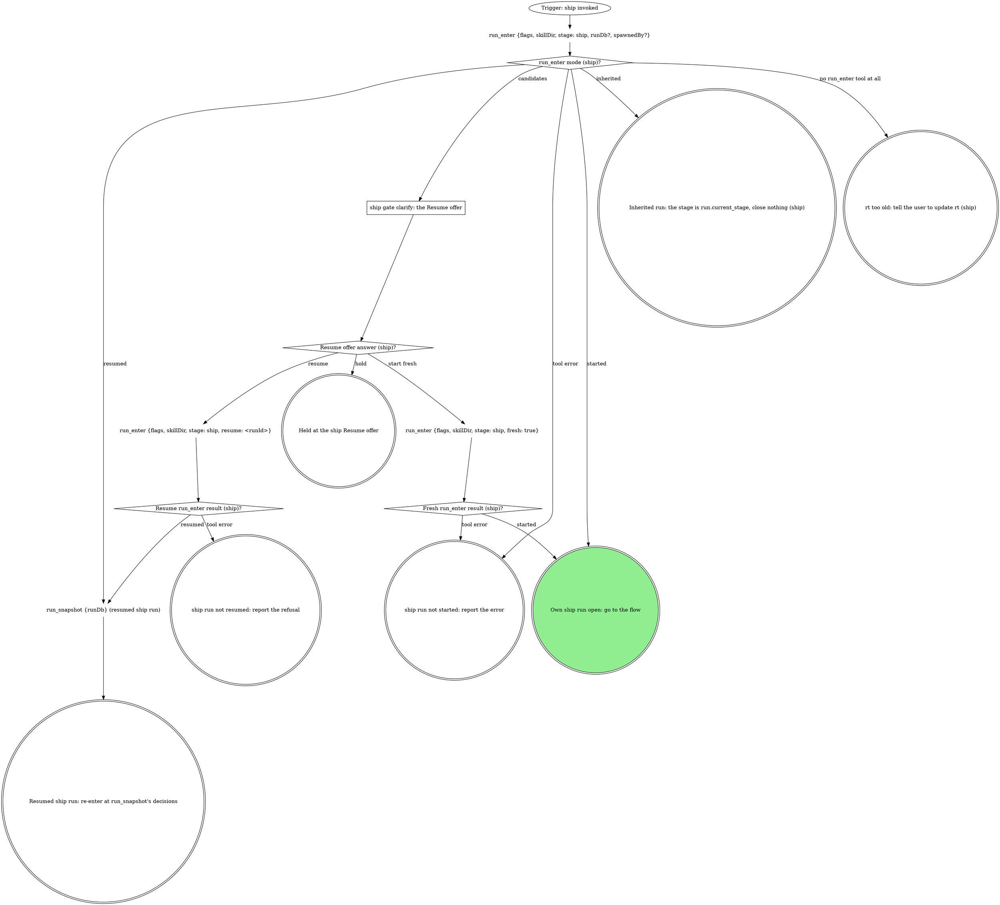

# ship

The standalone entry for shipping the current branch. Same flow as the
pipeline's ship stage, reached directly: target from the checkout. Two
graphs: the run graph opens or inherits the run, the flow graph ships and
closes it. The domain rules below run their own steps in their own order;
the flow graph is where every mechanical move in them lands.

## Run



An own run is a fresh or resumed one: it records identity and closes at the
end. An inherited run records no identity, closes nothing, and hands
control back to the verb that invoked this one.

The flags for this verb, rendered by the compiler:

{{run-start.flags:ship}}

`run_enter` takes `flags` = the `ship` flag string above, verbatim (the
value, never its key), `skillDir` = `${CLAUDE_SKILL_DIR}` as an absolute
path, `stage: ship`, `runDb` only when a caller handed one, and `spawnedBy`
only when a board or another surface launched this pane. It opens the stage
itself. Pass the returned `runDb` to every `run_*` call; nothing is
exported. A handed `runDb` that comes back `handedRunDb: "not-running"`
counts as not handed. Every gate below writes its `gate` field and its
decision with `stage: "ship"` in an own run, `stage: run.current_stage` in
an inherited one.

### ship gate clarify: the Resume offer

`run_enter` returned `candidates`; never read the run dbs by hand. Gate
`clarify`: one sentence naming each candidate's `spawnedBy`, `startedAt`
and `currentStage`, then one **Resume** option per candidate (`Resume
(Recommended)` when `ownSession` is true; a run another live pane owns is
not yours) / **Start fresh**, and **Hold** in `next`. Resume passes that
candidate's `runId`.

### Resumed ship run: re-enter at run_snapshot's decisions

Before the flow passes the ship gate again, call `branch_stack {tree:
<root>}`, then `run_field_get {key: shipTarget}`. An unset key
(`run_field_get` errors) or the value `-` is no recorded consent: the gate
opens. A readable fresh target equal to the recorded one continues with it,
the earlier Proceed standing and its answers read from the ship gate
decision `run_snapshot` shows. A fresh target that differs, or a store
unreadable now, reopens the ship gate with a sentence naming the recorded
target and the fresh one; Proceed records the fresh target with
`run_field_set` and continues.

{{include:run-identity}}

## Flow

`<root>` is the worktree root, the absolute path
`git rev-parse --show-toplevel` prints. `<default>` is the repo's default
branch, `git symbolic-ref --short refs/remotes/origin/HEAD` minus
`origin/`, never guessed.

```dot
digraph ship {
    rankdir=TB;

    "Trigger: a ship run is open (own or inherited)" [shape=ellipse];
    "git branch --show-current (ship)" [shape=plaintext];
    "On the default branch (ship)?" [shape=diamond];
    "Own run (default branch)?" [shape=diamond];
    "run_close {workType: ship, stage: ship, outcome: failed, reason: the default branch}" [shape=plaintext];
    "STOP: never ship the default branch" [shape=octagon style=filled fillcolor=red fontcolor=white];
    "STOP: never ship the default branch (inherited)" [shape=octagon style=filled fillcolor=red fontcolor=white];
    "Own run (ship identity)?" [shape=diamond];
    "run_field_set {key: branch, value: <branch>, stage: ship}" [shape=plaintext];
    "Run the domain steps before the gate (none when unbound)" [shape=box];
    "git status --porcelain; git log --oneline @{upstream}.. or -5" [shape=plaintext];
    "branch_stack {tree: <root>} (ship)" [shape=plaintext];
    "Stack store readable (ship)?" [shape=diamond];
    "Stack member (ship)?" [shape=diamond];
    "ship gate ship" [shape=box];
    "ship answer (ship)?" [shape=diamond];
    "run_field_set {key: shipTarget, value: <resolved target>, stage: ship}" [shape=plaintext];
    "run_field_set {key: shipTarget, value: -, stage: ship} (iterate)" [shape=plaintext];
    "run_field_set {key: shipTarget, value: -, stage: ship} (hold)" [shape=plaintext];
    "run_budget {key: ship:ship-gate-rounds, limit: 2, stage}" [shape=plaintext];
    "ship-gate-rounds past its limit (ship)?" [shape=diamond];
    "run_budget {key: ship:ship-gate-reopenings, limit: 2, stage}" [shape=plaintext];
    "ship-gate-reopenings past its limit (ship)?" [shape=diamond];
    "Rebase in progress (ship gate budget spent)?" [shape=diamond];
    "git_rebase {tree: <root>, abort: true} (ship gate budget spent)" [shape=plaintext];
    "dirty answer (ship)?" [shape=diamond];
    "Commit named files (ship)" [shape=box];
    "Stash them; nothing in this verb pops it" [shape=box];
    "Run the domain's fast checks (none when unbound)" [shape=box];
    "Checks pass (ship)?" [shape=diamond];
    "run_budget {key: ship:fix-rounds, limit: 3, stage}" [shape=plaintext];
    "fix-rounds past its limit (ship)?" [shape=diamond];
    "Fix test-first, commit, rerun (ship)" [shape=box];
    "Domain rebases, and no rebase finished this pass (ship)?" [shape=diamond];
    "git_rebase {tree: <root>, onto: origin/<resolved target>}" [shape=plaintext];
    "Rebase status (ship)?" [shape=diamond];
    "run_budget {key: ship:conflict-rounds, limit: 3, stage}" [shape=plaintext];
    "conflict-rounds past its limit (ship)?" [shape=diamond];
    "Resolve the files, then git rebase --continue on Bash (ship)" [shape=box];
    "Continue result (ship)?" [shape=diamond];
    "Rebase in progress (ship abort)?" [shape=diamond];
    "git_rebase {tree: <root>, abort: true}" [shape=plaintext];
    "git_rebase {tree: <root>, abort: true} (after a failed continue)" [shape=plaintext];

    "Push needs force-with-lease (ship)?" [shape=diamond];
    "git_push {tree: <root>, setUpstream: true}" [shape=plaintext];
    "git_push {tree: <root>, forceWithLease: true}" [shape=plaintext];
    "git_push result (ship)?" [shape=diamond];
    "STOP: push only with git_push (ship)" [shape=octagon style=filled fillcolor=red fontcolor=white];
    "ship off-script gate: git_push refused" [shape=box];
    "ship off-script answer (git_push)?" [shape=diamond];
    "run_budget {key: ship:push-off-script, limit: 2, stage}" [shape=plaintext];
    "push-off-script past its limit (ship)?" [shape=diamond];
    "Confirm the human's push landed (ship)" [shape=box];
    "Push landed (ship)?" [shape=diamond];
    "run_budget {key: ship:landing-checks, limit: 2, stage}" [shape=plaintext];
    "landing-checks past its limit (ship)?" [shape=diamond];

    "git remote get-url origin (ship)" [shape=plaintext];
    "Forge host (ship, open the MR)?" [shape=diamond];
    "run_budget {key: ship:forge-clarify-rounds, limit: 2, stage}" [shape=plaintext];
    "forge-clarify-rounds past its limit (ship)?" [shape=diamond];
    "ship gate clarify: which forge?" [shape=box];
    "Forge clarify answer (ship)?" [shape=diamond];
    "mr_create {repoName: <root>, sourceBranch, targetBranch: <resolved target>, title, description, draft, squash?, labels?, ifExists: return}" [shape=plaintext];
    "mr_create result (ship)?" [shape=diamond];
    "run_budget {key: ship:mr-create-recalls, limit: 1, stage}" [shape=plaintext];
    "mr-create-recalls past its limit (ship)?" [shape=diamond];
    "mr_update {mrUrl, squash: true}" [shape=plaintext];
    "STOP: GitLab reads go through the read tools or gitlab_get, writes through the mr_* tools (ship)" [shape=octagon style=filled fillcolor=red fontcolor=white];
    "gh pr create --fill --base <resolved target>, --draft unless the gate said ready" [shape=plaintext];
    "gh pr create result (ship)?" [shape=diamond];
    "Own run (MR identity)?" [shape=diamond];
    "run_field_set {key: mr, value: <url>, stage: ship}" [shape=plaintext];

    "run_field_get {key: evidence} (ship)" [shape=plaintext];
    "Capture the AFTER for the next case the domain names (ship)" [shape=box];
    "AFTER captured, or none left to capture (ship)?" [shape=diamond];
    "run_budget {key: ship:after-attempts:<case id>, limit: 3, stage}" [shape=plaintext];
    "after-attempts past its limit (ship)?" [shape=diamond];
    "Every named case tried (ship)?" [shape=diamond];
    "A v1 or v2 record with an image, or an AFTER was captured (ship)?" [shape=diamond];
    "Merge into the record (evidence-record)" [shape=box];
    "Annotate or waive each image the record does not yet cover (evidence-record)" [shape=box];
    "Annotate or waive outcome (ship)?" [shape=diamond];
    "run_field_set {key: evidence, value: <the merged evidence@2 JSON>, stage: <the run's stage>}" [shape=plaintext];
    "evidence write result (ship)?" [shape=diamond];
    "run_budget {key: ship:validator-refusals, limit: 2, stage}" [shape=plaintext];
    "validator-refusals past its limit (ship)?" [shape=diamond];
    "run_budget {key: ship:record-fixes, limit: 1, stage}" [shape=plaintext];
    "record-fixes past its limit (ship)?" [shape=diamond];
    "Files to attach (ship)?" [shape=diamond];
    "mr_upload {mrUrl, path, runId} per uploadable file; keep each markdown" [shape=plaintext];
    "mr_upload result (ship)?" [shape=diamond];
    "run_budget {key: ship:upload-path-fixes:<basename>, limit: 1, stage}" [shape=plaintext];
    "upload-path-fixes past its limit (ship)?" [shape=diamond];
    "mr_upload {mrUrl, path: <the corrected absolute path>, runId}" [shape=plaintext];
    "STOP: upload only with mr_upload (ship)" [shape=octagon style=filled fillcolor=red fontcolor=white];
    "ship off-script gate: mr_upload refused" [shape=box];
    "ship off-script answer (mr_upload)?" [shape=diamond];
    "run_budget {key: ship:upload-off-script, limit: 2, stage}" [shape=plaintext];
    "upload-off-script past its limit (ship)?" [shape=diamond];
    "run_budget {key: ship:upload-timeouts:<basename>, limit: 1, stage}" [shape=plaintext];
    "upload-timeouts past its limit (ship)?" [shape=diamond];
    "mr_upload {mrUrl, path: <the timed-out file>, runId}" [shape=plaintext];
    "Domain owns the title or description (ship)?" [shape=diamond];
    "Forge host (ship, read back the description)?" [shape=diamond];
    "mr_view {mrUrl}" [shape=plaintext];
    "gh pr view <mr> --json title,body" [shape=plaintext];
    "Write the title and description (ship)" [shape=box];
    "Forge host (ship, write the description)?" [shape=diamond];
    "mr_update {mrUrl, title, description}" [shape=plaintext];
    "gh pr edit <mr> --title <title> --body <description>" [shape=plaintext];

    "Domain runs CI after the MR (ship)?" [shape=diamond];
    "Run watch-ci inheriting this run" [shape=box];
    "watch-ci handed back what (ship)?" [shape=diamond];
    "Forge host (ship, draft check)?" [shape=diamond];
    "mr_view {repoName, iid} (ship draft check)" [shape=plaintext];
    "gh pr view <mr> --json isDraft (ship draft check)" [shape=plaintext];
    "MR still a draft (ship)?" [shape=diamond];
    "ship gate mark-ready" [shape=box];
    "mark-ready answer (ship)?" [shape=diamond];
    "run_budget {key: ship:mark-ready-rounds, limit: 2, stage}" [shape=plaintext];
    "mark-ready-rounds past its limit (ship)?" [shape=diamond];
    "Forge host (ship, mark-ready)?" [shape=diamond];
    "mr_ready {repoName: <root>, iid}" [shape=plaintext];
    "gh pr ready <number>" [shape=plaintext];

    "Which exit is this (ship)?" [shape=diamond];
    "run_close {workType: ship, stage: ship, outcome: done}" [shape=plaintext];
    "run_close {workType: ship, stage: ship, outcome: abandoned}" [shape=plaintext];
    "run_close {workType: ship, stage: ship, outcome: failed, reason}" [shape=plaintext];
    "run_hold {stage, reason, decidedBy}" [shape=plaintext];
    "Hand the answer back to the caller (ship)" [shape=doublecircle];
    "Held in watch-ci: the turn ends naming it (ship)" [shape=doublecircle];
    "Held in ship: the run stays open" [shape=doublecircle];
    "ship run abandoned" [shape=doublecircle];
    "ship failed" [shape=doublecircle];
    "Shipped" [shape=doublecircle style=filled fillcolor=lightgreen];

    "Trigger: a ship run is open (own or inherited)" -> "git branch --show-current (ship)";
    "git branch --show-current (ship)" -> "On the default branch (ship)?";
    "On the default branch (ship)?" -> "Own run (default branch)?" [label="yes"];
    "On the default branch (ship)?" -> "Own run (ship identity)?" [label="no"];
    "Own run (default branch)?" -> "run_close {workType: ship, stage: ship, outcome: failed, reason: the default branch}" [label="yes: close it first"];
    "Own run (default branch)?" -> "STOP: never ship the default branch (inherited)" [label="no: inherited"];
    "STOP: never ship the default branch (inherited)" -> "Hand the answer back to the caller (ship)";
    "run_close {workType: ship, stage: ship, outcome: failed, reason: the default branch}" -> "STOP: never ship the default branch";
    "Own run (ship identity)?" -> "run_field_set {key: branch, value: <branch>, stage: ship}" [label="yes"];
    "Own run (ship identity)?" -> "Run the domain steps before the gate (none when unbound)" [label="no: inherited"];
    "run_field_set {key: branch, value: <branch>, stage: ship}" -> "Run the domain steps before the gate (none when unbound)";
    "Run the domain steps before the gate (none when unbound)" -> "git status --porcelain; git log --oneline @{upstream}.. or -5";
    "git status --porcelain; git log --oneline @{upstream}.. or -5" -> "branch_stack {tree: <root>} (ship)";
    "branch_stack {tree: <root>} (ship)" -> "Stack store readable (ship)?";
    "Stack store readable (ship)?" -> "Stack member (ship)?" [label="yes"];
    "Stack store readable (ship)?" -> "ship gate ship" [label="no: stackStore unavailable, or a tool error: the target is the default branch, the stack could not be read"];
    "Stack member (ship)?" -> "ship gate ship" [label="yes: the target is the stack parent"];
    "Stack member (ship)?" -> "ship gate ship" [label="no: the target is the default branch"];
    "ship gate ship" -> "ship answer (ship)?";
    "ship answer (ship)?" -> "run_field_set {key: shipTarget, value: <resolved target>, stage: ship}" [label="proceed: record the consented target"];
    "run_field_set {key: shipTarget, value: <resolved target>, stage: ship}" -> "dirty answer (ship)?";
    "ship answer (ship)?" -> "run_field_set {key: shipTarget, value: -, stage: ship} (iterate)" [label="iterate: clear the recorded consent first"];
    "run_field_set {key: shipTarget, value: -, stage: ship} (iterate)" -> "run_budget {key: ship:ship-gate-rounds, limit: 2, stage}";
    "run_budget {key: ship:ship-gate-rounds, limit: 2, stage}" -> "ship-gate-rounds past its limit (ship)?";
    "ship-gate-rounds past its limit (ship)?" -> "Run the domain steps before the gate (none when unbound)" [label="no: redo with their note"];
    "ship-gate-rounds past its limit (ship)?" -> "Rebase in progress (ship gate budget spent)?" [label="yes: a failure, their last note quoted"];
    "Rebase in progress (ship gate budget spent)?" -> "git_rebase {tree: <root>, abort: true} (ship gate budget spent)" [label="yes"];
    "Rebase in progress (ship gate budget spent)?" -> "Which exit is this (ship)?" [label="no: a failure, what was quoted is the reason"];
    "git_rebase {tree: <root>, abort: true} (ship gate budget spent)" -> "Which exit is this (ship)?" [label="a failure, what was quoted is the reason"];
    "ship answer (ship)?" -> "run_field_set {key: shipTarget, value: -, stage: ship} (hold)" [label="hold: clear the recorded consent first"];
    "run_field_set {key: shipTarget, value: -, stage: ship} (hold)" -> "Which exit is this (ship)?";
    "ship answer (ship)?" -> "Rebase in progress (ship abort)?" [label="dirty = abort: nothing is pushed"];
    "Rebase in progress (ship abort)?" -> "git_rebase {tree: <root>, abort: true}" [label="yes"];
    "Rebase in progress (ship abort)?" -> "Which exit is this (ship)?" [label="no"];
    "git_rebase {tree: <root>, abort: true}" -> "Which exit is this (ship)?";
    "dirty answer (ship)?" -> "Commit named files (ship)" [label="commit"];
    "dirty answer (ship)?" -> "Stash them; nothing in this verb pops it" [label="stash"];
    "dirty answer (ship)?" -> "Run the domain's fast checks (none when unbound)" [label="clean tree"];
    "Commit named files (ship)" -> "Run the domain's fast checks (none when unbound)";
    "Stash them; nothing in this verb pops it" -> "Run the domain's fast checks (none when unbound)";
    "Run the domain's fast checks (none when unbound)" -> "Checks pass (ship)?";
    "Checks pass (ship)?" -> "Domain rebases, and no rebase finished this pass (ship)?" [label="yes"];
    "Checks pass (ship)?" -> "run_budget {key: ship:fix-rounds, limit: 3, stage}" [label="no"];
    "run_budget {key: ship:fix-rounds, limit: 3, stage}" -> "fix-rounds past its limit (ship)?";
    "fix-rounds past its limit (ship)?" -> "Fix test-first, commit, rerun (ship)" [label="no"];
    "fix-rounds past its limit (ship)?" -> "run_budget {key: ship:ship-gate-reopenings, limit: 2, stage}" [label="yes: reopen, failing output quoted"];
    "Fix test-first, commit, rerun (ship)" -> "Run the domain's fast checks (none when unbound)";
    "Domain rebases, and no rebase finished this pass (ship)?" -> "git_rebase {tree: <root>, onto: origin/<resolved target>}" [label="yes"];
    "Domain rebases, and no rebase finished this pass (ship)?" -> "Push needs force-with-lease (ship)?" [label="no"];
    "git_rebase {tree: <root>, onto: origin/<resolved target>}" -> "Rebase status (ship)?";
    "Rebase status (ship)?" -> "Run the domain's fast checks (none when unbound)" [label="clean"];
    "Rebase status (ship)?" -> "run_budget {key: ship:conflict-rounds, limit: 3, stage}" [label="conflict"];
    "Rebase status (ship)?" -> "Which exit is this (ship)?" [label="any other error: a failure, quoted as the reason"];
    "run_budget {key: ship:conflict-rounds, limit: 3, stage}" -> "conflict-rounds past its limit (ship)?";
    "conflict-rounds past its limit (ship)?" -> "Resolve the files, then git rebase --continue on Bash (ship)" [label="no"];
    "conflict-rounds past its limit (ship)?" -> "run_budget {key: ship:ship-gate-reopenings, limit: 2, stage}" [label="yes: reopen, conflicted files quoted"];
    "run_budget {key: ship:ship-gate-reopenings, limit: 2, stage}" -> "ship-gate-reopenings past its limit (ship)?";
    "ship-gate-reopenings past its limit (ship)?" -> "ship gate ship" [label="no: reopen with what was quoted"];
    "ship-gate-reopenings past its limit (ship)?" -> "Rebase in progress (ship gate budget spent)?" [label="yes: a failure, the failing output or conflicted files quoted"];
    "Resolve the files, then git rebase --continue on Bash (ship)" -> "Continue result (ship)?";
    "Continue result (ship)?" -> "run_budget {key: ship:conflict-rounds, limit: 3, stage}" [label="another commit conflicted"];
    "Continue result (ship)?" -> "Run the domain's fast checks (none when unbound)" [label="rebase finished"];
    "Continue result (ship)?" -> "git_rebase {tree: <root>, abort: true} (after a failed continue)" [label="any other error: a failure, quoted"];
    "git_rebase {tree: <root>, abort: true} (after a failed continue)" -> "Which exit is this (ship)?";

    "Push needs force-with-lease (ship)?" -> "git_push {tree: <root>, setUpstream: true}" [label="no"];
    "Push needs force-with-lease (ship)?" -> "git_push {tree: <root>, forceWithLease: true}" [label="yes: the rebase rewrote pushed commits"];
    "git_push {tree: <root>, setUpstream: true}" -> "git_push result (ship)?";
    "git_push {tree: <root>, forceWithLease: true}" -> "git_push result (ship)?";
    "git_push result (ship)?" -> "git remote get-url origin (ship)" [label="ok: keep sha, mr and priorPipelineId"];
    "git_push result (ship)?" -> "STOP: push only with git_push (ship)" [label="any other error"];
    "STOP: push only with git_push (ship)" -> "ship off-script gate: git_push refused";
    "ship off-script gate: git_push refused" -> "ship off-script answer (git_push)?";
    "ship off-script answer (git_push)?" -> "Confirm the human's push landed (ship)" [label="take: the human pushed"];
    "ship off-script answer (git_push)?" -> "Which exit is this (ship)?" [label="hand back: a failure, the refusal is the reason"];
    "ship off-script answer (git_push)?" -> "Which exit is this (ship)?" [label="hold"];
    "ship off-script answer (git_push)?" -> "run_budget {key: ship:push-off-script, limit: 2, stage}" [label="iterate: the human fixed the cause, retry the push"];
    "run_budget {key: ship:push-off-script, limit: 2, stage}" -> "push-off-script past its limit (ship)?";
    "push-off-script past its limit (ship)?" -> "Push needs force-with-lease (ship)?" [label="no: retry the push"];
    "push-off-script past its limit (ship)?" -> "Which exit is this (ship)?" [label="yes: a failure, the push refusal quoted"];
    "Confirm the human's push landed (ship)" -> "Push landed (ship)?";
    "Push landed (ship)?" -> "git remote get-url origin (ship)" [label="yes: the remote branch carries HEAD"];
    "Push landed (ship)?" -> "run_budget {key: ship:landing-checks, limit: 2, stage}" [label="no"];
    "run_budget {key: ship:landing-checks, limit: 2, stage}" -> "landing-checks past its limit (ship)?";
    "landing-checks past its limit (ship)?" -> "ship off-script gate: git_push refused" [label="no: reopen with what the comparison showed"];
    "landing-checks past its limit (ship)?" -> "Which exit is this (ship)?" [label="yes: a failure, the comparison quoted"];

    "git remote get-url origin (ship)" -> "Forge host (ship, open the MR)?";
    "Forge host (ship, open the MR)?" -> "mr_create {repoName: <root>, sourceBranch, targetBranch: <resolved target>, title, description, draft, squash?, labels?, ifExists: return}" [label="GitLab"];
    "Forge host (ship, open the MR)?" -> "gh pr create --fill --base <resolved target>, --draft unless the gate said ready" [label="GitHub"];
    "Forge host (ship, open the MR)?" -> "run_budget {key: ship:forge-clarify-rounds, limit: 2, stage}" [label="anything else"];
    "run_budget {key: ship:forge-clarify-rounds, limit: 2, stage}" -> "forge-clarify-rounds past its limit (ship)?";
    "forge-clarify-rounds past its limit (ship)?" -> "ship gate clarify: which forge?" [label="no: ask which forge"];
    "forge-clarify-rounds past its limit (ship)?" -> "Which exit is this (ship)?" [label="yes: a failure, the origin URL and their answer quoted"];
    "ship gate clarify: which forge?" -> "Forge clarify answer (ship)?";
    "Forge clarify answer (ship)?" -> "Forge host (ship, open the MR)?" [label="answered: GitLab or GitHub, the host from here on"];
    "Forge clarify answer (ship)?" -> "Which exit is this (ship)?" [label="hold"];
    "Forge clarify answer (ship)?" -> "Which exit is this (ship)?" [label="hand back: a failure, no forge this verb knows"];
    "mr_create {repoName: <root>, sourceBranch, targetBranch: <resolved target>, title, description, draft, squash?, labels?, ifExists: return}" -> "mr_create result (ship)?";
    "mr_create result (ship)?" -> "Own run (MR identity)?" [label="created, squash applied or not asked: keep its url"];
    "mr_create result (ship)?" -> "Own run (MR identity)?" [label="existing: keep its url, write nothing to it"];
    "mr_create result (ship)?" -> "mr_update {mrUrl, squash: true}" [label="squashApplied: false"];
    "mr_create result (ship)?" -> "run_budget {key: ship:mr-create-recalls, limit: 1, stage}" [label="url null: the MR exists, its url was not read back"];
    "mr_create result (ship)?" -> "Which exit is this (ship)?" [label="error: a failure, quoted as the reason"];
    "mr_create result (ship)?" -> "STOP: GitLab reads go through the read tools or gitlab_get, writes through the mr_* tools (ship)" [label="tempted to use the GitLab CLI"];
    "STOP: GitLab reads go through the read tools or gitlab_get, writes through the mr_* tools (ship)" -> "mr_create {repoName: <root>, sourceBranch, targetBranch: <resolved target>, title, description, draft, squash?, labels?, ifExists: return}";
    "run_budget {key: ship:mr-create-recalls, limit: 1, stage}" -> "mr-create-recalls past its limit (ship)?";
    "mr-create-recalls past its limit (ship)?" -> "mr_create {repoName: <root>, sourceBranch, targetBranch: <resolved target>, title, description, draft, squash?, labels?, ifExists: return}" [label="no: call again, it returns the MR it made"];
    "mr-create-recalls past its limit (ship)?" -> "Which exit is this (ship)?" [label="yes: a failure, the url never came back"];
    "mr_update {mrUrl, squash: true}" -> "Own run (MR identity)?";
    "gh pr create --fill --base <resolved target>, --draft unless the gate said ready" -> "gh pr create result (ship)?";
    "gh pr create result (ship)?" -> "Own run (MR identity)?" [label="url printed"];
    "gh pr create result (ship)?" -> "Own run (MR identity)?" [label="already exists: keep the url it prints"];
    "gh pr create result (ship)?" -> "Which exit is this (ship)?" [label="any other error: a failure, quoted as the reason"];
    "Own run (MR identity)?" -> "run_field_set {key: mr, value: <url>, stage: ship}" [label="yes"];
    "Own run (MR identity)?" -> "run_field_get {key: evidence} (ship)" [label="no: inherited"];
    "run_field_set {key: mr, value: <url>, stage: ship}" -> "run_field_get {key: evidence} (ship)";
    "run_field_get {key: evidence} (ship)" -> "Capture the AFTER for the next case the domain names (ship)";
    "Capture the AFTER for the next case the domain names (ship)" -> "AFTER captured, or none left to capture (ship)?";
    "AFTER captured, or none left to capture (ship)?" -> "Every named case tried (ship)?" [label="captured"];
    "AFTER captured, or none left to capture (ship)?" -> "A v1 or v2 record with an image, or an AFTER was captured (ship)?" [label="none named: there is no AFTER"];
    "AFTER captured, or none left to capture (ship)?" -> "run_budget {key: ship:after-attempts:<case id>, limit: 3, stage}" [label="the capture failed"];
    "run_budget {key: ship:after-attempts:<case id>, limit: 3, stage}" -> "after-attempts past its limit (ship)?";
    "after-attempts past its limit (ship)?" -> "Capture the AFTER for the next case the domain names (ship)" [label="no: another attempt, same case"];
    "after-attempts past its limit (ship)?" -> "Every named case tried (ship)?" [label="yes: go on without it; the description names the gap"];
    "Every named case tried (ship)?" -> "Capture the AFTER for the next case the domain names (ship)" [label="no"];
    "Every named case tried (ship)?" -> "A v1 or v2 record with an image, or an AFTER was captured (ship)?" [label="yes"];
    "A v1 or v2 record with an image, or an AFTER was captured (ship)?" -> "Merge into the record (evidence-record)" [label="yes"];
    "A v1 or v2 record with an image, or an AFTER was captured (ship)?" -> "Files to attach (ship)?" [label="no"];
    "Merge into the record (evidence-record)" -> "Annotate or waive each image the record does not yet cover (evidence-record)";
    "Annotate or waive each image the record does not yet cover (evidence-record)" -> "Annotate or waive outcome (ship)?";
    "Annotate or waive outcome (ship)?" -> "run_field_set {key: evidence, value: <the merged evidence@2 JSON>, stage: <the run's stage>}" [label="ready"];
    "Annotate or waive outcome (ship)?" -> "Which exit is this (ship)?" [label="hold: held at evidence-waiver"];
    "Annotate or waive outcome (ship)?" -> "Which exit is this (ship)?" [label="a failure: waiver openings spent, the images named"];
    "run_field_set {key: evidence, value: <the merged evidence@2 JSON>, stage: <the run's stage>}" -> "evidence write result (ship)?";
    "evidence write result (ship)?" -> "Files to attach (ship)?" [label="ok"];
    "evidence write result (ship)?" -> "run_budget {key: ship:validator-refusals, limit: 2, stage}" [label="refused: the validator names an image"];
    "evidence write result (ship)?" -> "Which exit is this (ship)?" [label="any other error: a failure, quoted as the reason"];
    "run_budget {key: ship:validator-refusals, limit: 2, stage}" -> "validator-refusals past its limit (ship)?";
    "validator-refusals past its limit (ship)?" -> "Annotate or waive each image the record does not yet cover (evidence-record)" [label="no"];
    "validator-refusals past its limit (ship)?" -> "Which exit is this (ship)?" [label="yes: a failure, the evidence refusal quoted"];
    "Files to attach (ship)?" -> "mr_upload {mrUrl, path, runId} per uploadable file; keep each markdown" [label="yes, GitLab: every uploadable path in the record (a repeat upload is harmless)"];
    "Files to attach (ship)?" -> "Domain owns the title or description (ship)?" [label="no, or GitHub: link the paths"];
    "mr_upload {mrUrl, path, runId} per uploadable file; keep each markdown" -> "mr_upload result (ship)?";
    "mr_upload result (ship)?" -> "Domain owns the title or description (ship)?" [label="ok: every file uploaded"];
    "mr_upload result (ship)?" -> "mr_upload {mrUrl, path, runId} per uploadable file; keep each markdown" [label="ok: files still to upload"];
    "mr_upload result (ship)?" -> "run_budget {key: ship:upload-path-fixes:<basename>, limit: 1, stage}" [label="path must be absolute, or file not found"];
    "mr_upload result (ship)?" -> "STOP: upload only with mr_upload (ship)" [label="any other refusal: outside the roots, bytes, size"];
    "mr_upload result (ship)?" -> "STOP: upload only with mr_upload (ship)" [label="tempted to copy the file into an allowed root, or upload another way"];
    "mr_upload result (ship)?" -> "run_budget {key: ship:record-fixes, limit: 1, stage}" [label="refused: not in the record, or a raw capture"];
    "run_budget {key: ship:record-fixes, limit: 1, stage}" -> "record-fixes past its limit (ship)?";
    "record-fixes past its limit (ship)?" -> "Annotate or waive each image the record does not yet cover (evidence-record)" [label="no: the named file"];
    "record-fixes past its limit (ship)?" -> "STOP: upload only with mr_upload (ship)" [label="yes"];
    "run_budget {key: ship:upload-path-fixes:<basename>, limit: 1, stage}" -> "upload-path-fixes past its limit (ship)?";
    "upload-path-fixes past its limit (ship)?" -> "mr_upload {mrUrl, path: <the corrected absolute path>, runId}" [label="no: this file's one fix"];
    "upload-path-fixes past its limit (ship)?" -> "STOP: upload only with mr_upload (ship)" [label="yes"];
    "mr_upload {mrUrl, path: <the corrected absolute path>, runId}" -> "mr_upload result (ship)?";
    "mr_upload result (ship)?" -> "run_budget {key: ship:upload-timeouts:<basename>, limit: 1, stage}" [label="timed out"];
    "run_budget {key: ship:upload-timeouts:<basename>, limit: 1, stage}" -> "upload-timeouts past its limit (ship)?";
    "upload-timeouts past its limit (ship)?" -> "mr_upload {mrUrl, path: <the timed-out file>, runId}" [label="no: retry once, a timed-out upload is safe to repeat"];
    "upload-timeouts past its limit (ship)?" -> "STOP: upload only with mr_upload (ship)" [label="yes: timed out twice"];
    "mr_upload {mrUrl, path: <the timed-out file>, runId}" -> "mr_upload result (ship)?";
    "STOP: upload only with mr_upload (ship)" -> "ship off-script gate: mr_upload refused";
    "ship off-script gate: mr_upload refused" -> "ship off-script answer (mr_upload)?";
    "ship off-script answer (mr_upload)?" -> "Domain owns the title or description (ship)?" [label="take: link the refused files' local paths"];
    "ship off-script answer (mr_upload)?" -> "Which exit is this (ship)?" [label="hand back: a failure, the upload refusal is the reason"];
    "ship off-script answer (mr_upload)?" -> "Which exit is this (ship)?" [label="hold: nothing linked"];
    "ship off-script answer (mr_upload)?" -> "run_budget {key: ship:upload-off-script, limit: 2, stage}" [label="iterate: the human fixed the cause, retry the upload"];
    "run_budget {key: ship:upload-off-script, limit: 2, stage}" -> "upload-off-script past its limit (ship)?";
    "upload-off-script past its limit (ship)?" -> "mr_upload {mrUrl, path, runId} per uploadable file; keep each markdown" [label="no: retry the refused files"];
    "upload-off-script past its limit (ship)?" -> "Which exit is this (ship)?" [label="yes: a failure, the upload refusal quoted"];
    "Domain owns the title or description (ship)?" -> "Forge host (ship, read back the description)?" [label="yes, or an evidence section to write"];
    "Domain owns the title or description (ship)?" -> "Domain runs CI after the MR (ship)?" [label="no, or an existing MR the domain leaves alone: nothing to write"];
    "Forge host (ship, read back the description)?" -> "mr_view {mrUrl}" [label="GitLab"];
    "Forge host (ship, read back the description)?" -> "gh pr view <mr> --json title,body" [label="GitHub"];
    "mr_view {mrUrl}" -> "Write the title and description (ship)";
    "gh pr view <mr> --json title,body" -> "Write the title and description (ship)";
    "Write the title and description (ship)" -> "Forge host (ship, write the description)?";
    "Forge host (ship, write the description)?" -> "mr_update {mrUrl, title, description}" [label="GitLab"];
    "Forge host (ship, write the description)?" -> "gh pr edit <mr> --title <title> --body <description>" [label="GitHub"];
    "mr_update {mrUrl, title, description}" -> "Domain runs CI after the MR (ship)?";
    "gh pr edit <mr> --title <title> --body <description>" -> "Domain runs CI after the MR (ship)?";

    "Domain runs CI after the MR (ship)?" -> "Run watch-ci inheriting this run" [label="yes"];
    "Domain runs CI after the MR (ship)?" -> "Which exit is this (ship)?" [label="no: done, print the URL"];
    "Run watch-ci inheriting this run" -> "watch-ci handed back what (ship)?";
    "watch-ci handed back what (ship)?" -> "Forge host (ship, draft check)?" [label="verdict: green"];
    "watch-ci handed back what (ship)?" -> "Which exit is this (ship)?" [label="verdict: red after its ci gate: done"];
    "watch-ci handed back what (ship)?" -> "Which exit is this (ship)?" [label="off-script answer or failure"];
    "watch-ci handed back what (ship)?" -> "Which exit is this (ship)?" [label="stood down: another attendant holds the lease, holder named"];
    "watch-ci handed back what (ship)?" -> "Held in watch-ci: the turn ends naming it (ship)" [label="held: watch-ci recorded the hold"];
    "Forge host (ship, draft check)?" -> "mr_view {repoName, iid} (ship draft check)" [label="GitLab"];
    "Forge host (ship, draft check)?" -> "gh pr view <mr> --json isDraft (ship draft check)" [label="GitHub"];
    "mr_view {repoName, iid} (ship draft check)" -> "MR still a draft (ship)?";
    "gh pr view <mr> --json isDraft (ship draft check)" -> "MR still a draft (ship)?";
    "MR still a draft (ship)?" -> "ship gate mark-ready" [label="yes"];
    "MR still a draft (ship)?" -> "Which exit is this (ship)?" [label="no: done"];
    "ship gate mark-ready" -> "mark-ready answer (ship)?";
    "mark-ready answer (ship)?" -> "Forge host (ship, mark-ready)?" [label="mark ready now"];
    "mark-ready answer (ship)?" -> "Which exit is this (ship)?" [label="keep it draft: done"];
    "mark-ready answer (ship)?" -> "Which exit is this (ship)?" [label="go back (inherited run only)"];
    "mark-ready answer (ship)?" -> "Which exit is this (ship)?" [label="hold"];
    "mark-ready answer (ship)?" -> "run_budget {key: ship:mark-ready-rounds, limit: 2, stage}" [label="iterate"];
    "run_budget {key: ship:mark-ready-rounds, limit: 2, stage}" -> "mark-ready-rounds past its limit (ship)?";
    "mark-ready-rounds past its limit (ship)?" -> "ship gate mark-ready" [label="no: a new gate with their note"];
    "mark-ready-rounds past its limit (ship)?" -> "Which exit is this (ship)?" [label="yes: done, the MR stays a draft, their last note quoted"];
    "Forge host (ship, mark-ready)?" -> "mr_ready {repoName: <root>, iid}" [label="GitLab"];
    "Forge host (ship, mark-ready)?" -> "gh pr ready <number>" [label="GitHub"];
    "mr_ready {repoName: <root>, iid}" -> "Which exit is this (ship)?";
    "gh pr ready <number>" -> "Which exit is this (ship)?";

    "Which exit is this (ship)?" -> "run_close {workType: ship, stage: ship, outcome: done}" [label="own run: done, or stood down"];
    "Which exit is this (ship)?" -> "run_close {workType: ship, stage: ship, outcome: abandoned}" [label="own run: abort"];
    "Which exit is this (ship)?" -> "run_close {workType: ship, stage: ship, outcome: failed, reason}" [label="own run: a failure or an off-script hand back"];
    "Which exit is this (ship)?" -> "Hand the answer back to the caller (ship)" [label="inherited run: any exit but hold"];
    "Which exit is this (ship)?" -> "run_hold {stage, reason, decidedBy}" [label="hold"];
    "run_close {workType: ship, stage: ship, outcome: done}" -> "Shipped";
    "run_close {workType: ship, stage: ship, outcome: abandoned}" -> "ship run abandoned";
    "run_close {workType: ship, stage: ship, outcome: failed, reason}" -> "ship failed";
    "run_hold {stage, reason, decidedBy}" -> "Held in ship: the run stays open";
}
```

### Run the domain steps before the gate (none when unbound)

The domain's gathering steps: sanity of the diff against the ticket, the
branch and ticket checks, an existing-MR lookup, any mandatory pre-ship
review. Each one that raises a question adds it to the `ship` gate rather
than asking on its own. Unbound, there are none. A GitLab fact these
steps need that no read tool returns is read as in "Reading a GitLab fact
no read tool returns".

### Reading a GitLab fact no read tool returns

At any step of this verb, a GitLab fact the read tools do not return is
read with `gitlab_get {repoName, path}`: `repoName` = the checkout or
tree this verb already targets, `path` relative to the API root with `:id`
for this project, for example `projects/:id/merge_requests/<iid>/approvals`.
The read is part of the step that needs it, not an off-script move, so it
opens no gate. A GitLab error is quoted as GitLab wrote it. Its refusal of
a credential path is final.

### ship gate ship

Before anything is pushed. One sentence above the form: the branch, the
commits about to go, whether the tree is dirty, and the resolved target
(the stack parent, the default branch, or "the stack could not be read, so
the default branch"), so Proceed is consent to that target. When a resumed
run reopens the gate because the target moved, the sentence names the
recorded target and the fresh one. When the gate
reopens with a rebase in progress (the conflict rounds are spent), the
context says so, and Abort aborts that rebase first.

| Question | Options (recommended first) | Shown when |
|---|---|---|
| `dirty` (write-in) | **Commit the changes (Recommended)** / **Stash them** / **Abort** | the tree is dirty |
| `open_as` (write-in) | **Push and open as draft (Recommended)** / **Push and open ready** | always |
| the domain's own | as the domain rules word them (a ticket mismatch, an MR already open) | the domain declares them |
| `next` | **Proceed** / **Iterate here** / **Hold** | always |

Scope `ship`. Selection: `{"dirty":"commit|stash|abort|null","open_as":"draft|ready","domain":{<answers>},"next":"proceed|iterate|hold","note":"<their words or null>"}`.
Abort and Hold push nothing. Iterate and Hold clear the recorded target
with `run_field_set {key: shipTarget, value: -, stage: ship}` before they leave the gate, so a
resume after either one re-asks the gate. Proceed records the target it consented to
with `run_field_set {key: shipTarget, value: <resolved target>, stage: ship}`; `stage` is
`"ship"` in an own run and `run.current_stage` in an inherited one, on both
clears as well as on Proceed;
when the stack store was unreadable the value is `<default branch> (stack
store unreadable)`, so a later reader can tell consent to the fallback from
a real read. The rebase and `mr_create` use the plain branch name.

Each Iterate counts one `ship-gate-rounds` round and redoes the steps
before the gate with the note; past two, the verb fails with the note
quoted instead, aborting a rebase in progress first. A reopening after the
fix or conflict rounds are spent is not an Iterate and does not count.

Each time the fix or conflict rounds run out, one `ship-gate-reopenings`
round reopens this gate with the failing output or conflicted files
quoted; past two, the verb fails with them quoted, aborting a rebase in
progress first. The fix and conflict rounds carry over a reopen: the
reopened gate is the human's turn to fix it, so a Proceed whose checks
still fail reaches this counter again without new fix rounds.

### Commit named files (ship)

Stage the files by name, never everything; the subject follows the
domain's commit rules, the branch's own style when unbound.

### Stash them; nothing in this verb pops it

A tagged stash (`git stash push -u -m "<unique tag>"`); the git stash stack
is shared with every worktree, so never pop by position. Say in the final
report that the stash exists.

### Run the domain's fast checks (none when unbound)

Only the checks the domain names, on the changed files. Revert generated
drift the checks leave behind before continuing. A full suite the domain
rules out stays out: CI runs it. A finished rebase, clean or resolved,
sends the checks round again because the tree changed under them; the "no
rebase finished this pass" guard keeps that second round from rebasing
again. So a force-with-lease push always follows checks that ran on the
rewritten tree; no extra check node is needed before it.

### Fix test-first, commit, rerun (ship)

Each fix gets its failing test first, then the fix, then a commit. Each
failing check run counts one `fix-rounds` round; past three, the ship gate
reopens.

### Resolve the files, then git rebase --continue on Bash (ship)

Resolve each conflicted file `git_rebase` returned, then continue the
rebase on Bash (no tool continues one). A later commit that conflicts
counts another `conflict-rounds` round. A finished rebase goes back to the
fast checks, like a clean one.

### ship gate clarify: which forge?

The origin host is neither GitLab nor GitHub; the branch is already
pushed. Ask which forge it is, quoting the `git remote get-url origin`
line as the context. Options: **GitLab** /
**GitHub** / **Hand back**, and `next`: **Proceed** / **Hold**. Each time
the host reads as neither counts one `forge-clarify-rounds` round; past
two, the verb fails with the origin URL and the answer quoted. The named
forge stands for the host from here on: this diamond and every later forge
diamond read the answer, never the origin URL again, so the counter trips
only when the answer names no forge this verb knows.

### ship off-script gate: git_push refused

Scope `off-script:<stage>:<n>` (`n` counts from 1 within the stage
attempt), `context` quoting the refusal.

| Question | Options |
|---|---|
| `action` | **Take the proposed move** (the value spells the move in full: here, only the human pushing) / **Hand back** |
| `next` | **Proceed** (Recommended) / **Iterate here** / **Hold** |

Selection: `{"move":"<the move>","why":"<the refusal>","action":"take|handback","next":"proceed|iterate|hold","note":"<their words or null>"}`.

Read `next` first: Hold ends the turn with nothing pushed by this verb;
Iterate means the human fixed the cause (a tree registration, the daemon)
and ignores `action`; only Proceed applies `action`. Retrying `git_push`
is Iterate, never Take, whatever the answer calls it; if the retry is
refused again, the Iterate note goes into the next gate's context. Each
Iterate counts one `push-off-script` round and retries the push; past two,
the verb fails with the refusal quoted instead.

### Confirm the human's push landed (ship)

The human pushed outside this verb. Compare `git rev-parse HEAD` with the
remote branch and say what it shows in the final report; never push from
here. The push landed when the remote branch carries HEAD, which becomes
the watched sha with no prior pipeline id; otherwise the off-script gate
reopens with the comparison as its context. Each miss counts one
`landing-checks` round; past two, the verb fails with the comparison
quoted.

### ship off-script gate: mr_upload refused

The upload guard refused a file past its one fix; a second timeout on
the same file reaches this gate too (Iterate retries it once the human
has checked the daemon), as does a second refusal that the file is not
in the record or is a raw capture. Scope `off-script:<stage>:<n>`,
sharing `n` with the push's off-script gate,
`context` quoting the refusal and the path; the `action`/`next` questions
and selection are the push gate's, and Iterate counts `upload-off-script`.
Take writes the description with the
refused files' local paths linked instead of uploads, while files already
uploaded keep their upload markdown; Iterate means the human moved the
file, widened `rt.mcp.uploadRoots` or recaptured. Copying a file under an
allowed root is only ever the human's move: the roots are the boundary on
what leaves the machine.

### Capture the AFTER for the next case the domain names (ship)

For each case in the record, the same view as its BEFORE, on the sha
just pushed; a v1 record's BEFORE counts as the case `case`, so an AFTER
of that view belongs to it. Any other capture the domain names is a new
case with its own `id` and `label`. Each failed capture counts one
`after-attempts:<case id>` round; past three, that case goes on without its
AFTER and the description says what was tried. Unbound, there is no
AFTER. The record is this run's: an own run's `runDb`, or the inherited
one. With no BEFORE in it, each AFTER comes in as a new case. Every
capture goes into the record through the evidence record's merge and
annotate steps, and is written before anything uploads; a capture is
never uploaded on its own.

### Write the title and description (ship)

Title from the ticket or the first commit subject; the body links the
ticket and carries the evidence section the evidence record below
describes, built from the record just written. The update replaces the
whole body, so start from the one just read back: the record's evidence
section replaces any evidence block an earlier stage wrote, and everything
else already there (a teammate's edits) is kept; change only what this
verb owns. The domain's title, template and voice rules win over this paragraph.

### Run watch-ci inheriting this run

Invoke the `watch-ci` verb with this run's `runDb`, so it inherits the run
and fires no gate beyond `ci` and its off-script gates. Hand it `mr` (the
URL `mr_create` or `gh pr create` gave), `sha` (`git_push`'s, or the HEAD a
confirmed human push carries), and `git_push`'s `priorPipelineId` only when
the push moved the branch: the branch had no upstream,
`git log @{upstream}..` listed commits before the gate, this verb committed
since, or the push forced. Otherwise that pipeline is the sha's own, and
the watch would wait for one that never comes. With no prior id,
`ci_watch` matches on the sha, or on a merged-results pipeline's merge
commit parents.

A stand-down handed back means another attendant (the doctor or another
watch-ci session) holds the MR's lease: an own run closes `done`, since the
MR exists, the report names the `holder`, and nothing releases that lease;
an inherited run hands the stand-down back. A hold is already recorded by
watch-ci: end the turn naming it, with no second `run_hold`.

### ship gate mark-ready

Green, and the MR still a draft. One sentence above the form: CI is green;
the attachments are there (or are not).

| Question | Options (recommended first) | Shown when |
|---|---|---|
| `ready` (write-in) | **Mark ready now (Recommended)** (when CI is green and the evidence is attached) / **Keep it draft** | always |
| `next` | **Proceed** / **Iterate here** / **Go back** / **Hold** | always; **Go back** only in an inherited run |
| `to` | one option per earlier stage, split `to-1`, `to-2`, ... over 4; with exactly one candidate it labels **Go back to `<stage>`** in `next` instead | Go back answered and `run_snapshot` shows more than one earlier stage row |

Scope `mark-ready`. Selection: `{"ready":true|false,"next":"proceed|iterate|redirect|hold","to":"<stage or null>","note":"<their words or null>"}`.
Each Iterate counts one `mark-ready-rounds` round and opens a new gate
with the note; past two, the verb ends as done with the MR left a draft
and the note quoted in the final report.

## What the graph cannot show

- Force only on the "yes" edge of "Push needs force-with-lease (ship)?":
  a rebase finished in this pass and the branch's upstream already held the
  commits it rewrote. Never force otherwise.
- `targetBranch` is the target `branch_stack` resolved before the gate:
  the stack parent when the branch is a stack member, else the default
  branch read from git, never guessed. When `branch_stack` reports
  `stackStore: "unavailable"` or errors, the target is the default branch
  and the gate's context says the stack could not be read. A GitHub PR
  takes the same target as `--base`. The domain rebase goes onto
  `origin/<that target>`, so a stack member never replays its parent's
  unmerged commits; the gate names the target, the unreadable-store
  fallback included, before any rebase runs. A resumed run
  re-checks the target as "Resumed ship run: re-enter at run_snapshot's
  decisions" says.
- Keep the `url` `mr_create` returns as `mrUrl` for every later write, and
  print it. `mr_create` takes `draft: false` only when the gate said ready;
  write its title from the branch's commits. `existing: true` is an MR
  already open on the branch: it is left as found (nothing this call passed
  was applied), and when its `targetBranch` differs from the resolved
  target, the final report names both. After `url: null`, the re-call
  returns the MR the first call made.
- A hold at any gate records `run_hold`: `stage` as the gates write it,
  the gate as `reason`, `decidedBy` as the answer recorded it. The run stays
  open and the turn ends naming the run and the gate.

## Budgets in this verb

Every loop counts through `run_budget`, so a budget survives compaction and
resume: each call adds one as the loop is entered, and the diamond after it
reads `spent > limit`. Keys start `ship:`; `after-attempts` ends in the case
id and the upload keys in the file's basename. `stage` is `ship` in an own
run and `run.current_stage` in an inherited one.

## Domain rules

If a rule below asks for a move this graph marks STOP, take the off-script
edge instead. A rule that keeps a capture out of the record, or keeps a
base with no waiver, yields to the evidence record.

{{slot:domain}}

When nothing is inlined above, the graph alone is the flow: no steps before
the gate, no fast checks, no rebase, no AFTER, no CI watch.

## Evidence record

{{include:evidence-record}}

## Gate protocol

{{include:gate-protocol}}

## Wrap-up form contract

{{include:wrap-up-form}}
