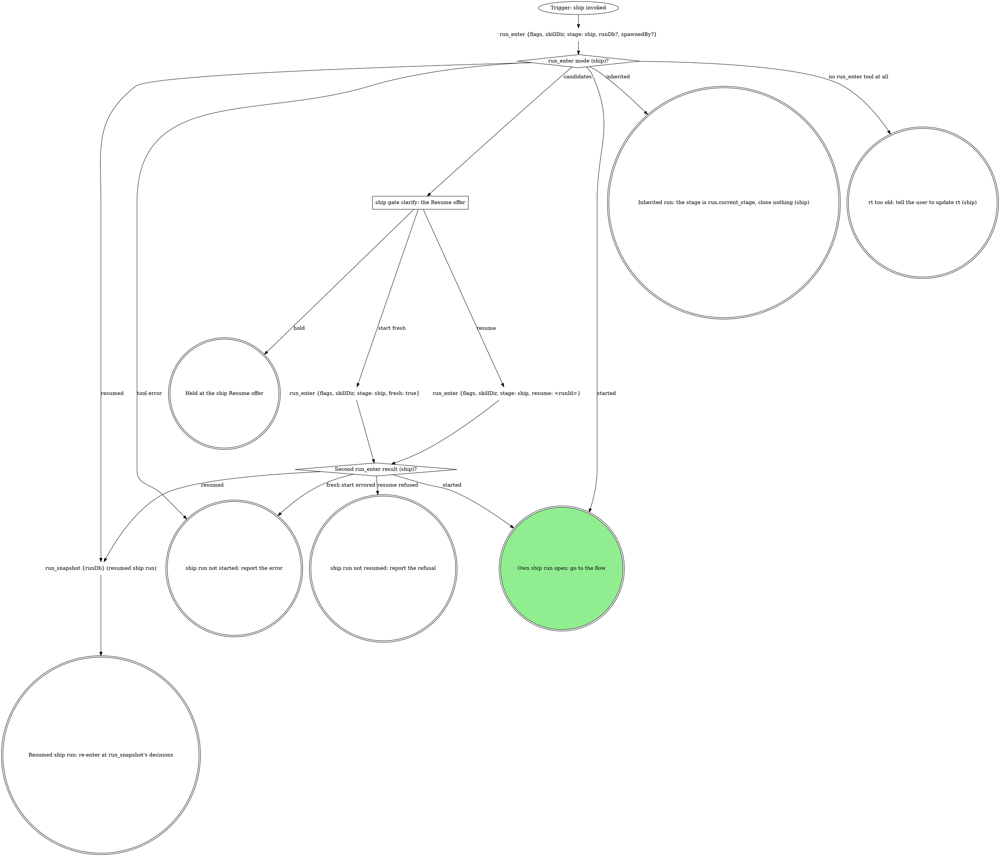

# ship

The pipeline's ship stage, reached directly: the target comes from the
checkout. The run graph opens or inherits the run; the flow graph ships
and closes it, and is where every mechanical move of the domain rules
lands.

## Run



An own run is a fresh or resumed one: it records identity and closes at the
end. An inherited run records no identity, closes nothing, and hands
back to the verb that invoked it.

The flags, rendered by the compiler:

{{run-start.flags:ship}}

`run_enter` takes `flags` = the `ship` flag string above, verbatim (the
value, never its key), `skillDir` = `${CLAUDE_SKILL_DIR}` as an absolute
path, `stage: ship`, `runDb` only when a caller handed one, and `spawnedBy`
only when a board or another surface launched this pane. It opens the stage
itself. Pass the returned `runDb` to every `run_*` call; nothing is
exported. A handed `runDb` that comes back `handedRunDb: "not-running"`
counts as not handed. Every gate write and `stage` argument is `"ship"` in
an own run and `run.current_stage` in an inherited one.

### ship gate clarify: the Resume offer

`run_enter` returned `candidates`; never read the run dbs by hand. Gate
`clarify`: one sentence naming each candidate's `spawnedBy`, `startedAt`
and `currentStage`, then one **Resume** option per candidate (`Resume
(Recommended)` when `ownSession` is true; a run another live pane owns is
not yours) / **Start fresh**, and **Hold** in `next`. Resume passes that
candidate's `runId`.

### Resumed ship run: re-enter at run_snapshot's decisions

Before passing the ship gate again, call `branch_stack {tree: <root>}`,
then `run_field_get {key: shipTarget}`. An unset key (an error) or `-` is
no consent: the gate opens. A fresh target equal to the recorded one
continues on the earlier Proceed, its answers read from the ship gate
decision in `run_snapshot`. A fresh target that differs, or a store
unreadable now, reopens the gate naming both; Proceed records the fresh
one.

{{include:run-identity}}

## Flow

`<root>` is the worktree root, the absolute path
`git rev-parse --show-toplevel` prints. `<default>` is the repo's default
branch, `git symbolic-ref --short refs/remotes/origin/HEAD` minus
`origin/`, never guessed.

```dot
digraph ship {
    rankdir=TB;

    "Trigger: a ship run is open (own or inherited)" [shape=ellipse];
    "git branch --show-current (ship)" [shape=plaintext];
    "On the default branch (ship)?" [shape=diamond];
    "Own run (default branch)?" [shape=diamond];
    "run_close {workType: ship, stage: ship, outcome: failed, reason: the default branch}" [shape=plaintext];
    "STOP: never ship the default branch" [shape=octagon style=filled fillcolor=red fontcolor=white];
    "STOP: never ship the default branch (inherited)" [shape=octagon style=filled fillcolor=red fontcolor=white];
    "Own run (ship identity)?" [shape=diamond];
    "run_field_set {key: branch, value: <branch>, stage: ship}" [shape=plaintext];
    "Run the domain steps before the gate (none when unbound)" [shape=box];
    "git status --porcelain; git log --oneline @{upstream}.. or -5" [shape=plaintext];
    "branch_stack {tree: <root>} (ship)" [shape=plaintext];
    "Stack parent read (ship)?" [shape=diamond];
    "ship gate ship" [shape=box];
    "run_field_set {key: shipTarget, value: <resolved target>, stage}" [shape=plaintext];
    "run_field_set {key: shipTarget, value: -, stage} (iterate)" [shape=plaintext];
    "run_field_set {key: shipTarget, value: -, stage} (hold)" [shape=plaintext];
    "run_budget {key: ship:ship-gate-rounds, limit: 1, stage}" [shape=plaintext];
    "ship-gate-rounds spent (ship)?" [shape=diamond];
    "run_budget {key: ship:ship-gate-reopenings, limit: 1, stage}" [shape=plaintext];
    "ship-gate-reopenings spent (ship)?" [shape=diamond];
    "Rebase in progress (ship exit)?" [shape=diamond];
    "git_rebase {tree: <root>, abort: true}" [shape=plaintext];
    "dirty answer (ship)?" [shape=diamond];
    "Commit named files (ship)" [shape=box];
    "Stash them (ship)" [shape=box];
    "Run the domain's fast checks (none when unbound)" [shape=box];
    "Checks pass (ship)?" [shape=diamond];
    "run_budget {key: ship:fix-rounds, limit: 3, stage}" [shape=plaintext];
    "fix-rounds spent (ship)?" [shape=diamond];
    "Fix test-first, commit, rerun (ship)" [shape=box];
    "Domain rebases, and no rebase finished this pass (ship)?" [shape=diamond];
    "git_rebase {tree: <root>, onto: origin/<resolved target>}" [shape=plaintext];
    "Rebase status (ship)?" [shape=diamond];
    "run_budget {key: ship:conflict-rounds, limit: 3, stage}" [shape=plaintext];
    "conflict-rounds spent (ship)?" [shape=diamond];
    "Resolve the files, then git rebase --continue on Bash (ship)" [shape=box];
    "Continue result (ship)?" [shape=diamond];

    "Push needs force-with-lease (ship)?" [shape=diamond];
    "git_push {tree: <root>, setUpstream: true}" [shape=plaintext];
    "git_push {tree: <root>, forceWithLease: true}" [shape=plaintext];
    "git_push result (ship)?" [shape=diamond];
    "STOP: push only with git_push (ship)" [shape=octagon style=filled fillcolor=red fontcolor=white];
    "ship off-script gate: git_push refused" [shape=box];
    "Confirm the human's push landed (ship)" [shape=box];
    "Push landed (ship)?" [shape=diamond];
    "run_budget {key: ship:landing-checks, limit: 1, stage}" [shape=plaintext];
    "landing-checks spent (ship)?" [shape=diamond];

    "git remote get-url origin (ship)" [shape=plaintext];
    "Forge host (ship, create)?" [shape=diamond];
    "run_budget {key: ship:forge-clarify-rounds, limit: 1, stage}" [shape=plaintext];
    "forge-clarify-rounds spent (ship)?" [shape=diamond];
    "ship gate clarify: which forge?" [shape=box];
    "mr_create {repoName: <root>, sourceBranch, targetBranch: <resolved target>, title, description, draft, squash?, labels?, ifExists: return}" [shape=plaintext];
    "mr_create result (ship)?" [shape=diamond];
    "run_budget {key: ship:mr-create-recalls, limit: 1, stage}" [shape=plaintext];
    "mr-create-recalls spent (ship)?" [shape=diamond];
    "mr_update {mrUrl, squash: true}" [shape=plaintext];
    "STOP: GitLab moves go through gitlab_get, the read tools and mr_* (ship)" [shape=octagon style=filled fillcolor=red fontcolor=white];
    "gh pr create --fill --base <resolved target> [--draft]" [shape=plaintext];
    "gh pr create result (ship)?" [shape=diamond];
    "Own run (MR identity)?" [shape=diamond];
    "run_field_set {key: mr, value: <url>, stage: ship}" [shape=plaintext];

    "run_field_get {key: evidence} (ship)" [shape=plaintext];
    "Capture the AFTER for the next case the domain names (ship)" [shape=box];
    "AFTER result (ship)?" [shape=diamond];
    "run_budget {key: ship:after-attempts:<case id>, limit: 2, stage}" [shape=plaintext];
    "after-attempts spent (ship)?" [shape=diamond];
    "Every named case tried (ship)?" [shape=diamond];
    "AFTER captured this pass (ship)?" [shape=diamond];
    "Record the evidence (evidence-record)" [shape=box];
    "Record outcome (ship)?" [shape=diamond];
    "Run has an evidence record (ship)?" [shape=diamond];
    "Attach the evidence (evidence-record)" [shape=box];
    "Attach outcome (ship)?" [shape=diamond];
    "Domain owns the title or description (ship)?" [shape=diamond];
    "Forge host (ship, read back)?" [shape=diamond];
    "mr_view {mrUrl}" [shape=plaintext];
    "gh pr view <mr> --json title,body" [shape=plaintext];
    "Write the title and description (ship)" [shape=box];
    "Forge host (ship, write back)?" [shape=diamond];
    "mr_update {mrUrl, title, description}" [shape=plaintext];
    "gh pr edit <mr> --title <title> --body <description>" [shape=plaintext];

    "Domain runs CI after the MR (ship)?" [shape=diamond];
    "Run watch-ci inheriting this run" [shape=box];
    "watch-ci result (ship)?" [shape=diamond];
    "Forge host (ship, draft check)?" [shape=diamond];
    "mr_view {repoName, iid} (draft check)" [shape=plaintext];
    "gh pr view <mr> --json isDraft (draft check)" [shape=plaintext];
    "MR still a draft (ship)?" [shape=diamond];
    "ship gate mark-ready" [shape=box];
    "run_budget {key: ship:mark-ready-rounds, limit: 1, stage}" [shape=plaintext];
    "mark-ready-rounds spent (ship)?" [shape=diamond];
    "Forge host (ship, mark-ready)?" [shape=diamond];
    "mr_ready {repoName: <root>, iid}" [shape=plaintext];
    "gh pr ready <number>" [shape=plaintext];

    "Which exit (ship)?" [shape=diamond];
    "run_close {workType: ship, stage: ship, outcome: done}" [shape=plaintext];
    "run_close {workType: ship, stage: ship, outcome: abandoned}" [shape=plaintext];
    "run_close {workType: ship, stage: ship, outcome: failed, reason}" [shape=plaintext];
    "run_hold {stage, reason, decidedBy}" [shape=plaintext];
    "Hand back to the caller (ship)" [shape=doublecircle];
    "Held in watch-ci: the turn ends naming it (ship)" [shape=doublecircle];
    "Held in ship: the run stays open" [shape=doublecircle];
    "ship run abandoned" [shape=doublecircle];
    "ship failed" [shape=doublecircle];
    "Shipped" [shape=doublecircle style=filled fillcolor=lightgreen];

    "Trigger: a ship run is open (own or inherited)" -> "git branch --show-current (ship)";
    "git branch --show-current (ship)" -> "On the default branch (ship)?";
    "On the default branch (ship)?" -> "Own run (default branch)?" [label="yes"];
    "On the default branch (ship)?" -> "Own run (ship identity)?" [label="no"];
    "Own run (default branch)?" -> "run_close {workType: ship, stage: ship, outcome: failed, reason: the default branch}" [label="yes"];
    "Own run (default branch)?" -> "STOP: never ship the default branch (inherited)" [label="no: inherited"];
    "STOP: never ship the default branch (inherited)" -> "Hand back to the caller (ship)";
    "run_close {workType: ship, stage: ship, outcome: failed, reason: the default branch}" -> "STOP: never ship the default branch";
    "Own run (ship identity)?" -> "run_field_set {key: branch, value: <branch>, stage: ship}" [label="yes"];
    "Own run (ship identity)?" -> "Run the domain steps before the gate (none when unbound)" [label="no: inherited"];
    "run_field_set {key: branch, value: <branch>, stage: ship}" -> "Run the domain steps before the gate (none when unbound)";
    "Run the domain steps before the gate (none when unbound)" -> "git status --porcelain; git log --oneline @{upstream}.. or -5";
    "git status --porcelain; git log --oneline @{upstream}.. or -5" -> "branch_stack {tree: <root>} (ship)";
    "branch_stack {tree: <root>} (ship)" -> "Stack parent read (ship)?";
    "Stack parent read (ship)?" -> "ship gate ship" [label="yes: the stack parent"];
    "Stack parent read (ship)?" -> "ship gate ship" [label="no: the default branch"];
    "ship gate ship" -> "run_field_set {key: shipTarget, value: <resolved target>, stage}" [label="proceed"];
    "ship gate ship" -> "run_field_set {key: shipTarget, value: -, stage} (iterate)" [label="iterate"];
    "ship gate ship" -> "run_field_set {key: shipTarget, value: -, stage} (hold)" [label="hold"];
    "ship gate ship" -> "Rebase in progress (ship exit)?" [label="dirty = abort"];
    "run_field_set {key: shipTarget, value: <resolved target>, stage}" -> "dirty answer (ship)?";
    "run_field_set {key: shipTarget, value: -, stage} (iterate)" -> "run_budget {key: ship:ship-gate-rounds, limit: 1, stage}";
    "run_budget {key: ship:ship-gate-rounds, limit: 1, stage}" -> "ship-gate-rounds spent (ship)?";
    "ship-gate-rounds spent (ship)?" -> "Run the domain steps before the gate (none when unbound)" [label="no: redo with their note"];
    "ship-gate-rounds spent (ship)?" -> "Rebase in progress (ship exit)?" [label="yes: a failure"];
    "run_field_set {key: shipTarget, value: -, stage} (hold)" -> "Which exit (ship)?";
    "Rebase in progress (ship exit)?" -> "git_rebase {tree: <root>, abort: true}" [label="yes"];
    "Rebase in progress (ship exit)?" -> "Which exit (ship)?" [label="no"];
    "git_rebase {tree: <root>, abort: true}" -> "Which exit (ship)?";
    "dirty answer (ship)?" -> "Commit named files (ship)" [label="commit"];
    "dirty answer (ship)?" -> "Stash them (ship)" [label="stash"];
    "dirty answer (ship)?" -> "Run the domain's fast checks (none when unbound)" [label="clean tree"];
    "Commit named files (ship)" -> "Run the domain's fast checks (none when unbound)";
    "Stash them (ship)" -> "Run the domain's fast checks (none when unbound)";
    "Run the domain's fast checks (none when unbound)" -> "Checks pass (ship)?";
    "Checks pass (ship)?" -> "Domain rebases, and no rebase finished this pass (ship)?" [label="yes"];
    "Checks pass (ship)?" -> "run_budget {key: ship:fix-rounds, limit: 3, stage}" [label="no"];
    "run_budget {key: ship:fix-rounds, limit: 3, stage}" -> "fix-rounds spent (ship)?";
    "fix-rounds spent (ship)?" -> "Fix test-first, commit, rerun (ship)" [label="no"];
    "fix-rounds spent (ship)?" -> "run_budget {key: ship:ship-gate-reopenings, limit: 1, stage}" [label="yes"];
    "Fix test-first, commit, rerun (ship)" -> "Run the domain's fast checks (none when unbound)";
    "Domain rebases, and no rebase finished this pass (ship)?" -> "git_rebase {tree: <root>, onto: origin/<resolved target>}" [label="yes"];
    "Domain rebases, and no rebase finished this pass (ship)?" -> "Push needs force-with-lease (ship)?" [label="no"];
    "git_rebase {tree: <root>, onto: origin/<resolved target>}" -> "Rebase status (ship)?";
    "Rebase status (ship)?" -> "Run the domain's fast checks (none when unbound)" [label="clean"];
    "Rebase status (ship)?" -> "run_budget {key: ship:conflict-rounds, limit: 3, stage}" [label="conflict"];
    "Rebase status (ship)?" -> "Which exit (ship)?" [label="error: a failure"];
    "run_budget {key: ship:conflict-rounds, limit: 3, stage}" -> "conflict-rounds spent (ship)?";
    "conflict-rounds spent (ship)?" -> "Resolve the files, then git rebase --continue on Bash (ship)" [label="no"];
    "conflict-rounds spent (ship)?" -> "run_budget {key: ship:ship-gate-reopenings, limit: 1, stage}" [label="yes"];
    "run_budget {key: ship:ship-gate-reopenings, limit: 1, stage}" -> "ship-gate-reopenings spent (ship)?";
    "ship-gate-reopenings spent (ship)?" -> "ship gate ship" [label="no: reopen"];
    "ship-gate-reopenings spent (ship)?" -> "Rebase in progress (ship exit)?" [label="yes: a failure"];
    "Resolve the files, then git rebase --continue on Bash (ship)" -> "Continue result (ship)?";
    "Continue result (ship)?" -> "run_budget {key: ship:conflict-rounds, limit: 3, stage}" [label="another commit conflicted"];
    "Continue result (ship)?" -> "Run the domain's fast checks (none when unbound)" [label="rebase finished"];
    "Continue result (ship)?" -> "git_rebase {tree: <root>, abort: true}" [label="error: a failure"];

    "Push needs force-with-lease (ship)?" -> "git_push {tree: <root>, setUpstream: true}" [label="no"];
    "Push needs force-with-lease (ship)?" -> "git_push {tree: <root>, forceWithLease: true}" [label="yes"];
    "git_push {tree: <root>, setUpstream: true}" -> "git_push result (ship)?";
    "git_push {tree: <root>, forceWithLease: true}" -> "git_push result (ship)?";
    "git_push result (ship)?" -> "git remote get-url origin (ship)" [label="ok: keep sha, mr, priorPipelineId"];
    "git_push result (ship)?" -> "STOP: push only with git_push (ship)" [label="refused or errored"];
    "STOP: push only with git_push (ship)" -> "ship off-script gate: git_push refused";
    "ship off-script gate: git_push refused" -> "Confirm the human's push landed (ship)" [label="take: the human pushed"];
    "ship off-script gate: git_push refused" -> "Push needs force-with-lease (ship)?" [label="iterate: push again"];
    "ship off-script gate: git_push refused" -> "Which exit (ship)?" [label="hand back or hold"];
    "Confirm the human's push landed (ship)" -> "Push landed (ship)?";
    "Push landed (ship)?" -> "git remote get-url origin (ship)" [label="yes"];
    "Push landed (ship)?" -> "run_budget {key: ship:landing-checks, limit: 1, stage}" [label="no"];
    "run_budget {key: ship:landing-checks, limit: 1, stage}" -> "landing-checks spent (ship)?";
    "landing-checks spent (ship)?" -> "ship off-script gate: git_push refused" [label="no: reopen with the comparison"];
    "landing-checks spent (ship)?" -> "Which exit (ship)?" [label="yes: a failure"];

    "git remote get-url origin (ship)" -> "Forge host (ship, create)?";
    "Forge host (ship, create)?" -> "mr_create {repoName: <root>, sourceBranch, targetBranch: <resolved target>, title, description, draft, squash?, labels?, ifExists: return}" [label="GitLab"];
    "Forge host (ship, create)?" -> "gh pr create --fill --base <resolved target> [--draft]" [label="GitHub"];
    "Forge host (ship, create)?" -> "run_budget {key: ship:forge-clarify-rounds, limit: 1, stage}" [label="anything else"];
    "run_budget {key: ship:forge-clarify-rounds, limit: 1, stage}" -> "forge-clarify-rounds spent (ship)?";
    "forge-clarify-rounds spent (ship)?" -> "ship gate clarify: which forge?" [label="no"];
    "forge-clarify-rounds spent (ship)?" -> "Which exit (ship)?" [label="yes: a failure"];
    "ship gate clarify: which forge?" -> "Forge host (ship, create)?" [label="answered: that forge"];
    "ship gate clarify: which forge?" -> "Which exit (ship)?" [label="hold or hand back"];
    "mr_create {repoName: <root>, sourceBranch, targetBranch: <resolved target>, title, description, draft, squash?, labels?, ifExists: return}" -> "mr_create result (ship)?";
    "mr_create result (ship)?" -> "Own run (MR identity)?" [label="created or existing: keep its url"];
    "mr_create result (ship)?" -> "mr_update {mrUrl, squash: true}" [label="squashApplied: false"];
    "mr_create result (ship)?" -> "run_budget {key: ship:mr-create-recalls, limit: 1, stage}" [label="url: null"];
    "mr_create result (ship)?" -> "Which exit (ship)?" [label="error: a failure"];
    "mr_create result (ship)?" -> "STOP: GitLab moves go through gitlab_get, the read tools and mr_* (ship)" [label="tempted to use the GitLab CLI"];
    "STOP: GitLab moves go through gitlab_get, the read tools and mr_* (ship)" -> "mr_create {repoName: <root>, sourceBranch, targetBranch: <resolved target>, title, description, draft, squash?, labels?, ifExists: return}";
    "run_budget {key: ship:mr-create-recalls, limit: 1, stage}" -> "mr-create-recalls spent (ship)?";
    "mr-create-recalls spent (ship)?" -> "mr_create {repoName: <root>, sourceBranch, targetBranch: <resolved target>, title, description, draft, squash?, labels?, ifExists: return}" [label="no: call again"];
    "mr-create-recalls spent (ship)?" -> "Which exit (ship)?" [label="yes: a failure"];
    "mr_update {mrUrl, squash: true}" -> "Own run (MR identity)?";
    "gh pr create --fill --base <resolved target> [--draft]" -> "gh pr create result (ship)?";
    "gh pr create result (ship)?" -> "Own run (MR identity)?" [label="url printed or existing: keep it"];
    "gh pr create result (ship)?" -> "Which exit (ship)?" [label="error: a failure"];
    "Own run (MR identity)?" -> "run_field_set {key: mr, value: <url>, stage: ship}" [label="yes"];
    "Own run (MR identity)?" -> "run_field_get {key: evidence} (ship)" [label="no: inherited"];
    "run_field_set {key: mr, value: <url>, stage: ship}" -> "run_field_get {key: evidence} (ship)";

    "run_field_get {key: evidence} (ship)" -> "Capture the AFTER for the next case the domain names (ship)";
    "Capture the AFTER for the next case the domain names (ship)" -> "AFTER result (ship)?";
    "AFTER result (ship)?" -> "Every named case tried (ship)?" [label="captured"];
    "AFTER result (ship)?" -> "AFTER captured this pass (ship)?" [label="none named"];
    "AFTER result (ship)?" -> "run_budget {key: ship:after-attempts:<case id>, limit: 2, stage}" [label="the capture failed"];
    "run_budget {key: ship:after-attempts:<case id>, limit: 2, stage}" -> "after-attempts spent (ship)?";
    "after-attempts spent (ship)?" -> "Capture the AFTER for the next case the domain names (ship)" [label="no"];
    "after-attempts spent (ship)?" -> "Every named case tried (ship)?" [label="yes: go on without it"];
    "Every named case tried (ship)?" -> "Capture the AFTER for the next case the domain names (ship)" [label="no"];
    "Every named case tried (ship)?" -> "AFTER captured this pass (ship)?" [label="yes"];
    "AFTER captured this pass (ship)?" -> "Record the evidence (evidence-record)" [label="yes"];
    "AFTER captured this pass (ship)?" -> "Run has an evidence record (ship)?" [label="no"];
    "Record the evidence (evidence-record)" -> "Record outcome (ship)?";
    "Record outcome (ship)?" -> "Attach the evidence (evidence-record)" [label="Recorded"];
    "Record outcome (ship)?" -> "Which exit (ship)?" [label="Record held at evidence-waiver: hold"];
    "Record outcome (ship)?" -> "Which exit (ship)?" [label="Record failed: a failure naming the images or quoting the error"];
    "Run has an evidence record (ship)?" -> "Attach the evidence (evidence-record)" [label="yes"];
    "Run has an evidence record (ship)?" -> "Domain owns the title or description (ship)?" [label="no: the field is unset"];
    "Attach the evidence (evidence-record)" -> "Attach outcome (ship)?";
    "Attach outcome (ship)?" -> "Domain owns the title or description (ship)?" [label="Attached (never Taken: Take links)"];
    "Attach outcome (ship)?" -> "Which exit (ship)?" [label="Attach held: hold"];
    "Attach outcome (ship)?" -> "Which exit (ship)?" [label="Attach failed: a failure quoting the reason"];
    "Domain owns the title or description (ship)?" -> "Forge host (ship, read back)?" [label="yes"];
    "Domain owns the title or description (ship)?" -> "Domain runs CI after the MR (ship)?" [label="no"];
    "Forge host (ship, read back)?" -> "mr_view {mrUrl}" [label="GitLab"];
    "Forge host (ship, read back)?" -> "gh pr view <mr> --json title,body" [label="GitHub"];
    "mr_view {mrUrl}" -> "Write the title and description (ship)";
    "gh pr view <mr> --json title,body" -> "Write the title and description (ship)";
    "Write the title and description (ship)" -> "Forge host (ship, write back)?";
    "Forge host (ship, write back)?" -> "mr_update {mrUrl, title, description}" [label="GitLab"];
    "Forge host (ship, write back)?" -> "gh pr edit <mr> --title <title> --body <description>" [label="GitHub"];
    "mr_update {mrUrl, title, description}" -> "Domain runs CI after the MR (ship)?";
    "gh pr edit <mr> --title <title> --body <description>" -> "Domain runs CI after the MR (ship)?";

    "Domain runs CI after the MR (ship)?" -> "Run watch-ci inheriting this run" [label="yes"];
    "Domain runs CI after the MR (ship)?" -> "Which exit (ship)?" [label="no: done"];
    "Run watch-ci inheriting this run" -> "watch-ci result (ship)?";
    "watch-ci result (ship)?" -> "Forge host (ship, draft check)?" [label="green"];
    "watch-ci result (ship)?" -> "Which exit (ship)?" [label="red (done), off-script, failure or stand-down"];
    "watch-ci result (ship)?" -> "Held in watch-ci: the turn ends naming it (ship)" [label="held"];
    "Forge host (ship, draft check)?" -> "mr_view {repoName, iid} (draft check)" [label="GitLab"];
    "Forge host (ship, draft check)?" -> "gh pr view <mr> --json isDraft (draft check)" [label="GitHub"];
    "mr_view {repoName, iid} (draft check)" -> "MR still a draft (ship)?";
    "gh pr view <mr> --json isDraft (draft check)" -> "MR still a draft (ship)?";
    "MR still a draft (ship)?" -> "ship gate mark-ready" [label="yes"];
    "MR still a draft (ship)?" -> "Which exit (ship)?" [label="no: done"];
    "ship gate mark-ready" -> "Forge host (ship, mark-ready)?" [label="mark ready now"];
    "ship gate mark-ready" -> "Which exit (ship)?" [label="keep it draft (done), go back, or hold"];
    "ship gate mark-ready" -> "run_budget {key: ship:mark-ready-rounds, limit: 1, stage}" [label="iterate"];
    "run_budget {key: ship:mark-ready-rounds, limit: 1, stage}" -> "mark-ready-rounds spent (ship)?";
    "mark-ready-rounds spent (ship)?" -> "ship gate mark-ready" [label="no: a new gate"];
    "mark-ready-rounds spent (ship)?" -> "Which exit (ship)?" [label="yes: done, a draft"];
    "Forge host (ship, mark-ready)?" -> "mr_ready {repoName: <root>, iid}" [label="GitLab"];
    "Forge host (ship, mark-ready)?" -> "gh pr ready <number>" [label="GitHub"];
    "mr_ready {repoName: <root>, iid}" -> "Which exit (ship)?";
    "gh pr ready <number>" -> "Which exit (ship)?";

    "Which exit (ship)?" -> "run_close {workType: ship, stage: ship, outcome: done}" [label="own run: done, or stood down"];
    "Which exit (ship)?" -> "run_close {workType: ship, stage: ship, outcome: abandoned}" [label="own run: abort"];
    "Which exit (ship)?" -> "run_close {workType: ship, stage: ship, outcome: failed, reason}" [label="own run: a failure or a hand back"];
    "Which exit (ship)?" -> "Hand back to the caller (ship)" [label="inherited: any exit but hold"];
    "Which exit (ship)?" -> "run_hold {stage, reason, decidedBy}" [label="hold"];
    "run_close {workType: ship, stage: ship, outcome: done}" -> "Shipped";
    "run_close {workType: ship, stage: ship, outcome: abandoned}" -> "ship run abandoned";
    "run_close {workType: ship, stage: ship, outcome: failed, reason}" -> "ship failed";
    "run_hold {stage, reason, decidedBy}" -> "Held in ship: the run stays open";
}
```

### Run the domain steps before the gate (none when unbound)

The domain's gathering steps: the diff against the ticket, the branch and
ticket checks, an existing-MR lookup, any mandatory pre-ship review. Each
question they raise goes on the `ship` gate.

### Reading a GitLab fact no read tool returns

At any step, read it with `gitlab_get {repoName: <root>, path}`, `path`
relative to the API root with `:id` for this project
(`projects/:id/merge_requests/<iid>/approvals`). The read is part of the
step and opens no gate. Quote a GitLab error as written; its refusal of a
credential path is final.

### ship gate ship

One sentence above the form: the branch, the commits about to go, whether
the tree is dirty, and the resolved target (the stack parent, the default
branch, or "the stack could not be read, so the default branch"), so
Proceed is consent to that target. A reopening with a rebase in progress
says so, and Abort aborts that rebase first.

| Question | Options (recommended first) | Shown when |
|---|---|---|
| `dirty` (write-in) | **Commit the changes (Recommended)** / **Stash them** / **Abort** | the tree is dirty |
| `open_as` (write-in) | **Push and open as draft (Recommended)** / **Push and open ready** | always |
| the domain's own | as the domain rules word them (a ticket mismatch, an MR already open) | the domain declares them |
| `next` | **Proceed** / **Iterate here** / **Hold** | always |

Scope `ship`. Selection: `{"dirty":"commit|stash|abort|null","open_as":"draft|ready","domain":{<answers>},"next":"proceed|iterate|hold","note":"<their words or null>"}`.
Iterate and Hold clear `shipTarget` first, so
a resume re-asks. With the stack store unreadable, Proceed records
`<default branch> (stack store unreadable)`, telling consent to the
fallback from a real read; the rebase and `mr_create` use the plain name.

Running out of fix or conflict rounds reopens this gate (not an
Iterate), quoting the failing output or conflicted files; a second time
fails the verb. Fix and conflict rounds carry over a reopen (the human's
turn to fix), so a Proceed whose checks still fail reopens again with no
new fix rounds.

### Commit named files (ship)

Stage the files by name, never everything; the subject follows the
domain's commit rules, else the branch's own style.

### Stash them (ship)

A tagged stash (`git stash push -u -m "<unique tag>"`), which nothing in
this verb pops; the stash stack is shared by every worktree, so never pop
by position. The final report names the stash.

### Run the domain's fast checks (none when unbound)

Only the checks the domain names, on the changed files; revert generated
drift they leave. A full suite the domain rules out stays out. A finished
rebase, clean or resolved, sends the checks round again; the "no rebase
finished this pass" guard stops that round rebasing again, so a
force-with-lease push always follows checks on the rewritten tree.

### Fix test-first, commit, rerun (ship)

Each fix gets its failing test first, then the fix, then a commit.

### Resolve the files, then git rebase --continue on Bash (ship)

Resolve each conflicted file `git_rebase` returned, then continue on Bash
(no tool continues a rebase).

### ship gate clarify: which forge?

The branch is already pushed. Context: the `git remote get-url origin`
line. Options: **GitLab** /
**GitHub** / **Hand back**, and `next`: **Proceed** / **Hold**. The named
forge is the host from here on: every later forge diamond reads it, never
the origin URL.

### ship off-script gate: git_push refused

The gate protocol's Off-script gate, scope `off-script:<stage>:<n>`,
`context` quoting the refusal. Take: only the human pushing. Read `next`
first: Hold ends the turn with nothing pushed by this verb; Iterate means
the human fixed the cause (a tree registration, the daemon) and ignores
`action`; only Proceed applies `action`. Retrying `git_push` is Iterate,
never Take. Iterate counts nothing: each retry needs a new answer at this
gate; a refused retry reopens this gate with the Iterate note in its context.

### Confirm the human's push landed (ship)

Compare `git rev-parse HEAD` with the remote branch and report it; never
push from here. It landed when the remote carries HEAD, which becomes the
watched sha with no prior pipeline id.

### Capture the AFTER for the next case the domain names (ship)

For each case in the record, the same view as its BEFORE, on the sha just
pushed; a v1 record's BEFORE is the case `case`. Any other capture the
domain names is a new case with its own `id` and `label`, as is each AFTER
when the record has no BEFORE. A case whose third capture fails goes on
without its AFTER, and the description says what was tried. The record is
this run's (own or inherited `runDb`). Unbound, there is no AFTER.

### Record the evidence (evidence-record)

`images` are the AFTERs just captured (`slot: after`, a new case's
`label`), `tree` is `<root>`. Recorded goes straight to the attach: this
verb writes no `evidence` of its own.

### Attach the evidence (evidence-record)

The ship gate's Proceed is the attach consent. This is the last attach, so
Take sends `linkRefused: true`; the off-script gate shares the push gate's
`n`.

### Write the title and description (ship)

Title from the ticket or the first commit subject; the body links the
ticket. The update replaces the whole body, so start from the one read
back and keep everything else: a teammate's edits, and the evidence
section `Attach the evidence` wrote, byte for byte, never a second
evidence block. The domain's title, template and voice rules win over this
paragraph.

### Run watch-ci inheriting this run

Invoke the `watch-ci` verb with this run's `runDb`, so it inherits the run
and fires no gate beyond `ci` and its off-script gates. Hand it `mr` (its
URL), `sha` (`git_push`'s, or the HEAD a confirmed human push carries),
and `git_push`'s `priorPipelineId` only when the push moved the branch:
`git log @{upstream}..` listed commits before the push (before the gate,
or committed by this verb since), or the push forced. Otherwise that
pipeline is the sha's own and the watch would wait for one that never
comes.

A stand-down means another attendant (the doctor or another watch-ci
session) holds the MR's lease: an own run closes `done`, since the MR
exists, the report names the `holder`, and nothing releases that lease; an
inherited run hands the stand-down back. A hold is already recorded by
watch-ci: end the turn naming it, with no second `run_hold`.

### ship gate mark-ready

One sentence above the form: CI is green; the attachments are there (or
are not).

| Question | Options (recommended first) | Shown when |
|---|---|---|
| `ready` (write-in) | **Mark ready now (Recommended)** (CI green, evidence attached) / **Keep it draft** | always |
| `next` | **Proceed** / **Iterate here** / **Go back** / **Hold** | always; **Go back** only in an inherited run |
| `to` | one option per earlier stage; with one candidate, **Go back to `<stage>`** in `next` instead | Go back, with more than one earlier stage in `run_snapshot` |

Scope `mark-ready`. Selection: `{"ready":true|false,"next":"proceed|iterate|redirect|hold","to":"<stage or null>","note":"<their words or null>"}`.
The first Iterate opens a new gate with the note; the second ends the
verb done, the MR a draft, the note quoted in the report.

## What the graph cannot show

- **Force** only on the "yes" edge of "Push needs force-with-lease
  (ship)?": a rebase finished this pass and the upstream already held the
  commits it rewrote.
- **`targetBranch`** is the target `branch_stack` resolved before the
  gate (on `stackStore: "unavailable"` or an error, the default branch),
  never guessed. A GitHub PR takes it as `--base`. The domain rebase goes
  onto `origin/<target>`, so a stack member never replays its parent's
  unmerged commits.
- **The MR.** Keep `mr_create`'s `url` as `mrUrl` for every later write,
  and print it. `draft: false`, or no `--draft`, only when the gate said
  ready; the title comes from the branch's commits. `existing: true` is an
  MR already open on the branch, left as found (nothing this call passed
  applied); a `targetBranch` other than the resolved one is named in the
  report. After `url: null`, the re-call's `existing: true` MR is the first
  call's: the report says squash is unset when it was asked and no result
  said it applied.
- **Hold** at any gate records `run_hold`: the gate-write stage, the gate
  as `reason`, `decidedBy` as the answer recorded it. The turn ends naming
  the run and the gate.

## Budgets in this verb

Each `run_budget` counts one as its loop is entered, so budgets survive
compaction and resume within the stage attempt. The `spent` diamond after
it reads `spent` against `limit` (`spent > limit`); ignore `exhausted` and
`remaining` (`exhausted` is `spent >= limit` and would stop one round
early). A failure quotes what it last saw (the error, the note, the
comparison, the origin URL and answer, the refusal) as its reason.

## Domain rules

If a rule below asks for a move this graph marks STOP, take the off-script
edge instead. A rule that keeps a capture out of the record, or keeps a
base with no waiver, yields to the evidence record.

{{slot:domain}}

When nothing is inlined above, the graph alone is the flow: no steps before
the gate, no fast checks, no rebase, no AFTER, no CI watch.

## Evidence record

{{include:evidence-record}}

## Gate protocol

{{include:gate-protocol}}

## Wrap-up form contract

{{include:wrap-up-form}}
