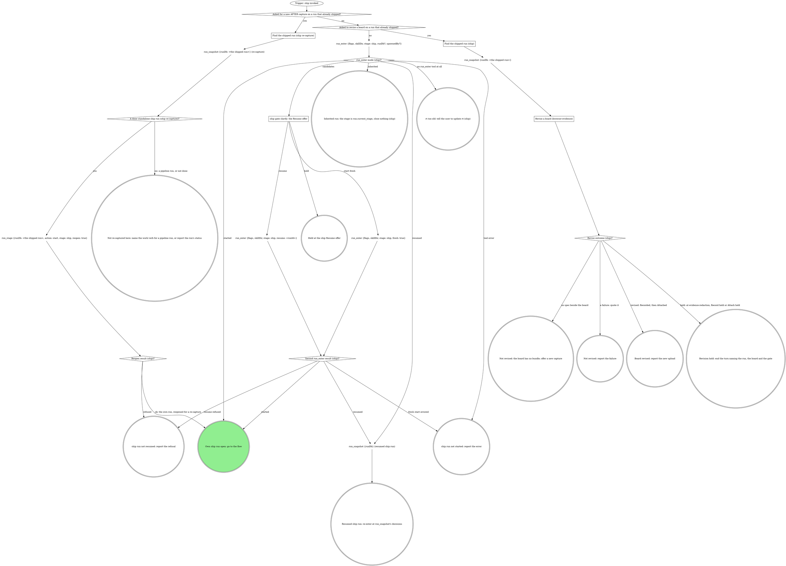

# ship

The pipeline's ship stage, reached directly: the target comes from the
checkout. The run graph opens or inherits the run; the flow graph ships
and closes it, and is where every mechanical move of the domain rules
lands.

## Run



An own run is a fresh, resumed or reopened one: it records identity and
closes at the end. An inherited run records no identity, closes nothing, and hands
back to the verb that invoked it.

The flags, rendered by the compiler:

{{run-start.flags:ship}}

`run_enter` takes `flags` = the `ship` flag string above, verbatim (the
value, never its key), `skillDir` = `${CLAUDE_SKILL_DIR}` as an absolute
path, `stage: ship`, `runDb` only when a caller handed one, and `spawnedBy`
only when a board or another surface launched this pane. It opens the stage
itself. Pass the returned `runDb` to every `run_*` call; nothing is
exported. A handed `runDb` that comes back `handedRunDb: "not-running"`
counts as not handed. Every gate write and `stage` argument is `"ship"` in
an own run and `run.current_stage` in an inherited one.

### ship gate clarify: the Resume offer

`run_enter` returned `candidates`; never read the run dbs by hand. Gate
`clarify`: one sentence naming each candidate's `spawnedBy`, `startedAt`
and `currentStage`, then one **Resume** option per candidate (`Resume
(Recommended)` when `ownSession` is true; a run another live pane owns is
not yours) / **Start fresh**, and **Hold** in `next`. Resume passes that
candidate's `runId`.

### Asked for a new AFTER capture on a run that already shipped?

Yes when the operator wants the AFTER captured again (a stale state, a
fixed view) or the evidence re-attached on a run whose MR is open. A change
to an existing board with no new capture (a label, a redaction) is a
revision, below.

### Find the shipped run (ship re-capture)

As in Find the shipped run (ship).

### A done standalone ship run (ship re-capture)?

Yes when `run_snapshot`'s run is `done`, its work type is `ship` and its
`mr` field is set. A pipeline run's ship stage reopens through the work
verb, so the no exit names it; a run that is not done is reported with its
status.

### Find the shipped run (ship)

The operator asks to change a board on a run that already shipped
(reword a label, widen a redaction). A `runDb` a caller handed is the
shipped run. Otherwise it is the run the operator names: `run_list
{repo}`, the row with that run id, or the newest row whose `branch`
matches when they name only the branch. Its `runDb` is
`<runs root>/<the row's repo>/<its id>/state.db`, the runs root
`~/.mattstack/runs` unless `RT_RUNS_ROOT` sets it.

### Revise a board (browser-evidence)

Take `evidence` and `mr` from the shipped run's `run_snapshot` fields,
find the case's board in the record (the image's `annotated` path in `value`), and run
browser-evidence's Revise a board steps 1 to 7, with `stage: ship` on
every write and `mrUrl` = `mr`. Step 6 is `Record the evidence
(evidence-record)` and step 7 is `Attach the evidence (evidence-record)`;
the operator's ask is the attach consent. The first `evidence_attach`
carries no `linkRefused`; this is the last attach, so only a Take at its
upload off-script gate resends with `linkRefused: true`.

`Revise outcome (ship)?`: revised is Recorded, then Attached. Held is a
Hold at Gate evidence-redaction (step 5, nothing recorded), Record held
or Attach held; the run is already closed, so no `run_hold`. A board with
no spec beside it is the no-spec exit. A compose error, a re-render that
still reads wrong after its two tries, a refused confirm, a recapture that
is not drawn, Record failed or Attach failed is a failure, quoted.

This path starts no run and closes none: no `run_enter`, no `run_stage`,
no `run_close`. A shipped run stays `done`.

### Resumed ship run: re-enter at run_snapshot's decisions

Before passing the ship gate again, call `branch_stack {tree: <root>}`,
then `run_field_get {key: shipTarget}`. An unset key (an error) or `-` is
no consent: the gate opens. A fresh target equal to the recorded one
continues on the earlier Proceed, its answers read from the ship gate
decision in `run_snapshot`. A fresh target that differs, or a store
unreadable now, reopens the gate naming both; Proceed records the fresh
one.

{{include:run-identity}}

## Flow

`<root>` is the worktree root, the absolute path
`git rev-parse --show-toplevel` prints. `<default>` is the repo's default
branch, `git symbolic-ref --short refs/remotes/origin/HEAD` minus
`origin/`, never guessed.

```dot
digraph ship {
    rankdir=TB;

    run_open [label="Trigger: a ship run is open (own or inherited)" shape=ellipse];
    reopened_recapture [label="Reopened for a re-capture (ship)?" shape=diamond];
    git_status_recapture [label="git status --porcelain; git log --oneline @{upstream}.. (ship re-capture)" shape=plaintext];
    nothing_to_push [label="Nothing to push (ship re-capture)?" shape=diamond];
    git_branch_current [label="git branch --show-current (ship)" shape=plaintext];
    on_default_branch [label="On the default branch (ship)?" shape=diamond];
    own_run_default_branch [label="Own run (default branch)?" shape=diamond];
    run_close_default_branch [label="run_close {workType: ship, stage: ship, outcome: failed, reason: the default branch}" shape=plaintext];
    stop_ship_default_branch [label="STOP: never ship the default branch" shape=octagon style=filled fillcolor=red fontcolor=white];
    stop_ship_default_inherited [label="STOP: never ship the default branch (inherited)" shape=octagon style=filled fillcolor=red fontcolor=white];
    own_run_identity [label="Own run (ship identity)?" shape=diamond];
    run_field_set_branch [label="run_field_set {key: branch, value: <branch>, stage: ship}" shape=plaintext];
    domain_steps_before_gate [label="Run the domain steps before the gate (none when unbound)" shape=box];
    git_status_log [label="git status --porcelain; git log --oneline @{upstream}.. or -5" shape=plaintext];
    branch_stack [label="branch_stack {tree: <root>} (ship)" shape=plaintext];
    stack_parent_read [label="Stack parent read (ship)?" shape=diamond];
    gate_ship [label="ship gate ship" shape=box];
    run_field_set_target [label="run_field_set {key: shipTarget, value: <resolved target>, stage}" shape=plaintext];
    run_field_set_target_iterate [label="run_field_set {key: shipTarget, value: -, stage} (iterate)" shape=plaintext];
    run_field_set_target_hold [label="run_field_set {key: shipTarget, value: -, stage} (hold)" shape=plaintext];
    run_budget_gate_rounds [label="run_budget {key: ship:ship-gate-rounds, limit: 2, stage}" shape=plaintext];
    gate_rounds_spent [label="ship-gate-rounds spent (ship)?" shape=diamond];
    run_budget_gate_reopenings [label="run_budget {key: ship:ship-gate-reopenings, limit: 2, stage}" shape=plaintext];
    gate_reopenings_spent [label="ship-gate-reopenings spent (ship)?" shape=diamond];
    rebase_in_progress [label="Rebase in progress (ship exit)?" shape=diamond];
    git_rebase_abort [label="git_rebase {tree: <root>, abort: true}" shape=plaintext];
    dirty_answer [label="dirty answer (ship)?" shape=diamond];
    commit_named_files [label="Commit named files (ship)" shape=box];
    stash_them [label="Stash them (ship)" shape=box];
    domain_fast_checks [label="Run the domain's fast checks (none when unbound)" shape=box];
    checks_pass [label="Checks pass (ship)?" shape=diamond];
    run_budget_fix_rounds [label="run_budget {key: ship:fix-rounds, limit: 4, stage}" shape=plaintext];
    fix_rounds_spent [label="fix-rounds spent (ship)?" shape=diamond];
    fix_test_first [label="Fix test-first, commit, rerun (ship)" shape=box];
    domain_rebases_unfinished [label="Domain rebases, and no rebase finished this pass (ship)?" shape=diamond];
    git_rebase_onto [label="git_rebase {tree: <root>, onto: origin/<resolved target>}" shape=plaintext];
    rebase_status [label="Rebase status (ship)?" shape=diamond];
    run_budget_conflict_rounds [label="run_budget {key: ship:conflict-rounds, limit: 4, stage}" shape=plaintext];
    conflict_rounds_spent [label="conflict-rounds spent (ship)?" shape=diamond];
    resolve_conflict_files [label="Resolve the files, then git rebase --continue on Bash (ship)" shape=box];
    continue_result [label="Continue result (ship)?" shape=diamond];

    needs_force_lease [label="Push needs force-with-lease (ship)?" shape=diamond];
    git_push_upstream [label="git_push {tree: <root>, setUpstream: true}" shape=plaintext];
    git_push_lease [label="git_push {tree: <root>, forceWithLease: true}" shape=plaintext];
    push_result [label="git_push result (ship)?" shape=diamond];
    stop_shell_push [label="STOP: push only with git_push (ship)" shape=octagon style=filled fillcolor=red fontcolor=white];
    gate_push_refused [label="ship off-script gate: git_push refused" shape=box];
    confirm_human_push [label="Confirm the human's push landed (ship)" shape=box];
    push_landed [label="Push landed (ship)?" shape=diamond];
    run_budget_landing_checks [label="run_budget {key: ship:landing-checks, limit: 2, stage}" shape=plaintext];
    landing_checks_spent [label="landing-checks spent (ship)?" shape=diamond];

    git_remote_origin [label="git remote get-url origin (ship)" shape=plaintext];
    create_forge_host [label="Forge host (ship, create)?" shape=diamond];
    run_budget_forge_clarify [label="run_budget {key: ship:forge-clarify-rounds, limit: 2, stage}" shape=plaintext];
    forge_clarify_spent [label="forge-clarify-rounds spent (ship)?" shape=diamond];
    gate_which_forge [label="ship gate clarify: which forge?" shape=box];
    mr_create [label="mr_create {repoName: <root>, sourceBranch, targetBranch: <resolved target>, title, description, draft, squash?, labels?, ifExists: return}" shape=plaintext];
    mr_create_result [label="mr_create result (ship)?" shape=diamond];
    run_budget_mr_recalls [label="run_budget {key: ship:mr-create-recalls, limit: 2, stage}" shape=plaintext];
    mr_recalls_spent [label="mr-create-recalls spent (ship)?" shape=diamond];
    mr_update_squash [label="mr_update {mrUrl, squash: true}" shape=plaintext];
    stop_gitlab_shortcut [label="STOP: GitLab moves go through gitlab_get, the read tools and mr_* (ship)" shape=octagon style=filled fillcolor=red fontcolor=white];
    gh_pr_create [label="gh pr create --fill --base <resolved target> [--draft]" shape=plaintext];
    gh_create_result [label="gh pr create result (ship)?" shape=diamond];
    own_run_mr [label="Own run (MR identity)?" shape=diamond];
    run_field_set_mr [label="run_field_set {key: mr, value: <url>, stage: ship}" shape=plaintext];

    run_field_get_evidence [label="run_field_get {key: evidence} (ship)" shape=plaintext];
    browser_case [label="Browser screenshot for this case (ship)?" shape=diamond];
    capture_after_browser [label="Capture the AFTER with the browser (ship, browser-evidence)" shape=box];
    capture_after_case [label="Capture the AFTER for the next case the domain names (ship)" shape=box];
    after_result [label="AFTER result (ship)?" shape=diamond];
    run_budget_after_attempts [label="run_budget {key: ship:after-attempts:<case id>, limit: 3, stage}" shape=plaintext];
    after_attempts_spent [label="after-attempts spent (ship)?" shape=diamond];
    every_case_tried [label="Every named case tried (ship)?" shape=diamond];
    after_captured [label="AFTER captured this pass (ship)?" shape=diamond];
    record_evidence [label="Record the evidence (evidence-record)" shape=box];
    record_outcome [label="Record outcome (ship)?" shape=diamond];
    run_has_evidence [label="Run has an evidence record (ship)?" shape=diamond];
    attach_evidence [label="Attach the evidence (evidence-record)" shape=box];
    attach_outcome [label="Attach outcome (ship)?" shape=diamond];
    domain_owns_title [label="Domain owns the title or description (ship)?" shape=diamond];
    read_forge_host [label="Forge host (ship, read back)?" shape=diamond];
    mr_view_url [label="mr_view {mrUrl}" shape=plaintext];
    gh_pr_view_body [label="gh pr view <mr> --json title,body" shape=plaintext];
    write_title_description [label="Write the title and description (ship)" shape=box];
    write_forge_host [label="Forge host (ship, write back)?" shape=diamond];
    mr_update_description [label="mr_update {mrUrl, title, description}" shape=plaintext];
    gh_pr_edit [label="gh pr edit <mr> --title <title> --body <description>" shape=plaintext];

    domain_runs_ci [label="Domain runs CI after the MR (ship)?" shape=diamond];
    run_watch_ci [label="Run watch-ci inheriting this run" shape=box];
    watch_ci_result [label="watch-ci result (ship)?" shape=diamond];
    draft_forge_host [label="Forge host (ship, draft check)?" shape=diamond];
    mr_view_draft [label="mr_view {repoName, iid} (draft check)" shape=plaintext];
    gh_pr_view_draft [label="gh pr view <mr> --json isDraft (draft check)" shape=plaintext];
    mr_still_draft [label="MR still a draft (ship)?" shape=diamond];
    gate_mark_ready [label="ship gate mark-ready" shape=box];
    run_budget_mark_ready [label="run_budget {key: ship:mark-ready-rounds, limit: 2, stage}" shape=plaintext];
    mark_ready_spent [label="mark-ready-rounds spent (ship)?" shape=diamond];
    mark_ready_forge_host [label="Forge host (ship, mark-ready)?" shape=diamond];
    mr_ready [label="mr_ready {repoName: <root>, iid}" shape=plaintext];
    gh_pr_ready [label="gh pr ready <number>" shape=plaintext];

    which_exit [label="Which exit (ship)?" shape=diamond];
    run_close_done [label="run_close {workType: ship, stage: ship, outcome: done}" shape=plaintext];
    run_close_abandoned [label="run_close {workType: ship, stage: ship, outcome: abandoned}" shape=plaintext];
    run_close_failed [label="run_close {workType: ship, stage: ship, outcome: failed, reason}" shape=plaintext];
    run_hold [label="run_hold {stage, reason, decidedBy}" shape=plaintext];
    hand_back_caller [label="Hand back to the caller (ship)" shape=doublecircle];
    held_in_watch_ci [label="Held in watch-ci: the turn ends naming it (ship)" shape=doublecircle];
    held_run_open [label="Held in ship: the run stays open" shape=doublecircle];
    abandoned [label="ship run abandoned" shape=doublecircle];
    failed [label="ship failed" shape=doublecircle];
    shipped [label="Shipped" shape=doublecircle style=filled fillcolor=lightgreen];

    run_open -> reopened_recapture;
    reopened_recapture -> git_branch_current [label="no"];
    reopened_recapture -> git_status_recapture [label="yes"];
    git_status_recapture -> nothing_to_push;
    nothing_to_push -> run_field_get_evidence [label="yes: no push, no mr_create"];
    nothing_to_push -> git_branch_current [label="no: ship the new commits first"];
    git_branch_current -> on_default_branch;
    on_default_branch -> own_run_default_branch [label="yes"];
    on_default_branch -> own_run_identity [label="no"];
    own_run_default_branch -> run_close_default_branch [label="yes"];
    own_run_default_branch -> stop_ship_default_inherited [label="no: inherited"];
    stop_ship_default_inherited -> hand_back_caller;
    run_close_default_branch -> stop_ship_default_branch;
    own_run_identity -> run_field_set_branch [label="yes"];
    own_run_identity -> domain_steps_before_gate [label="no: inherited"];
    run_field_set_branch -> domain_steps_before_gate;
    domain_steps_before_gate -> git_status_log;
    git_status_log -> branch_stack;
    branch_stack -> stack_parent_read;
    stack_parent_read -> gate_ship [label="yes: the stack parent"];
    stack_parent_read -> gate_ship [label="no: the default branch"];
    gate_ship -> run_field_set_target [label="proceed"];
    gate_ship -> run_field_set_target_iterate [label="iterate"];
    gate_ship -> run_field_set_target_hold [label="hold"];
    gate_ship -> rebase_in_progress [label="dirty = abort"];
    run_field_set_target -> dirty_answer;
    run_field_set_target_iterate -> run_budget_gate_rounds;
    run_budget_gate_rounds -> gate_rounds_spent;
    gate_rounds_spent -> domain_steps_before_gate [label="no: redo with their note"];
    gate_rounds_spent -> rebase_in_progress [label="yes: a failure"];
    run_field_set_target_hold -> which_exit;
    rebase_in_progress -> git_rebase_abort [label="yes"];
    rebase_in_progress -> which_exit [label="no"];
    git_rebase_abort -> which_exit;
    dirty_answer -> commit_named_files [label="commit"];
    dirty_answer -> stash_them [label="stash"];
    dirty_answer -> domain_fast_checks [label="clean tree"];
    commit_named_files -> domain_fast_checks;
    stash_them -> domain_fast_checks;
    domain_fast_checks -> checks_pass;
    checks_pass -> domain_rebases_unfinished [label="yes"];
    checks_pass -> run_budget_fix_rounds [label="no"];
    run_budget_fix_rounds -> fix_rounds_spent;
    fix_rounds_spent -> fix_test_first [label="no"];
    fix_rounds_spent -> run_budget_gate_reopenings [label="yes"];
    fix_test_first -> domain_fast_checks;
    domain_rebases_unfinished -> git_rebase_onto [label="yes"];
    domain_rebases_unfinished -> needs_force_lease [label="no"];
    git_rebase_onto -> rebase_status;
    rebase_status -> domain_fast_checks [label="clean"];
    rebase_status -> run_budget_conflict_rounds [label="conflict"];
    rebase_status -> which_exit [label="error: a failure"];
    run_budget_conflict_rounds -> conflict_rounds_spent;
    conflict_rounds_spent -> resolve_conflict_files [label="no"];
    conflict_rounds_spent -> run_budget_gate_reopenings [label="yes"];
    run_budget_gate_reopenings -> gate_reopenings_spent;
    gate_reopenings_spent -> gate_ship [label="no: reopen"];
    gate_reopenings_spent -> rebase_in_progress [label="yes: a failure"];
    resolve_conflict_files -> continue_result;
    continue_result -> run_budget_conflict_rounds [label="another commit conflicted"];
    continue_result -> domain_fast_checks [label="rebase finished"];
    continue_result -> git_rebase_abort [label="error: a failure"];

    needs_force_lease -> git_push_upstream [label="no"];
    needs_force_lease -> git_push_lease [label="yes"];
    git_push_upstream -> push_result;
    git_push_lease -> push_result;
    push_result -> git_remote_origin [label="ok: keep sha, mr, priorPipelineId"];
    push_result -> stop_shell_push [label="refused or errored"];
    stop_shell_push -> gate_push_refused;
    gate_push_refused -> confirm_human_push [label="take: the human pushed"];
    gate_push_refused -> needs_force_lease [label="iterate: push again"];
    gate_push_refused -> which_exit [label="hand back or hold"];
    confirm_human_push -> push_landed;
    push_landed -> git_remote_origin [label="yes"];
    push_landed -> run_budget_landing_checks [label="no"];
    run_budget_landing_checks -> landing_checks_spent;
    landing_checks_spent -> gate_push_refused [label="no: reopen with the comparison"];
    landing_checks_spent -> which_exit [label="yes: a failure"];

    git_remote_origin -> create_forge_host;
    create_forge_host -> mr_create [label="GitLab"];
    create_forge_host -> gh_pr_create [label="GitHub"];
    create_forge_host -> run_budget_forge_clarify [label="anything else"];
    run_budget_forge_clarify -> forge_clarify_spent;
    forge_clarify_spent -> gate_which_forge [label="no"];
    forge_clarify_spent -> which_exit [label="yes: a failure"];
    gate_which_forge -> create_forge_host [label="answered: that forge"];
    gate_which_forge -> which_exit [label="hold or hand back"];
    mr_create -> mr_create_result;
    mr_create_result -> own_run_mr [label="created or existing: keep its url"];
    mr_create_result -> mr_update_squash [label="squashApplied: false"];
    mr_create_result -> run_budget_mr_recalls [label="url: null"];
    mr_create_result -> which_exit [label="error: a failure"];
    mr_create_result -> stop_gitlab_shortcut [label="tempted to use the GitLab CLI"];
    stop_gitlab_shortcut -> mr_create;
    run_budget_mr_recalls -> mr_recalls_spent;
    mr_recalls_spent -> mr_create [label="no: call again"];
    mr_recalls_spent -> which_exit [label="yes: a failure"];
    mr_update_squash -> own_run_mr;
    gh_pr_create -> gh_create_result;
    gh_create_result -> own_run_mr [label="url printed or existing: keep it"];
    gh_create_result -> which_exit [label="error: a failure"];
    own_run_mr -> run_field_set_mr [label="yes"];
    own_run_mr -> run_field_get_evidence [label="no: inherited"];
    run_field_set_mr -> run_field_get_evidence;

    run_field_get_evidence -> browser_case;
    browser_case -> capture_after_browser [label="yes"];
    browser_case -> capture_after_case [label="no: the domain's own method, or no case named"];
    capture_after_browser -> after_result;
    capture_after_case -> after_result;
    after_result -> every_case_tried [label="captured, or Board ready"];
    after_result -> after_captured [label="none named"];
    after_result -> every_case_tried [label="skipped: unbound, not a browser case"];
    after_result -> run_budget_after_attempts [label="the capture failed, or Not drawn: a failed brief or spent re-renders"];
    after_result -> every_case_tried [label="Not drawn for a reason no retry fixes: go on without it"];
    after_result -> which_exit [label="Held at evidence-redaction: hold"];
    run_budget_after_attempts -> after_attempts_spent;
    after_attempts_spent -> browser_case [label="no: another attempt, same case"];
    after_attempts_spent -> every_case_tried [label="yes: go on without it"];
    every_case_tried -> browser_case [label="no"];
    every_case_tried -> after_captured [label="yes"];
    after_captured -> record_evidence [label="yes"];
    after_captured -> run_has_evidence [label="no"];
    record_evidence -> record_outcome;
    record_outcome -> attach_evidence [label="Recorded"];
    record_outcome -> which_exit [label="Record held at evidence-waiver or evidence-redaction: hold"];
    record_outcome -> which_exit [label="Record failed: a failure naming the images or quoting the error"];
    run_has_evidence -> attach_evidence [label="yes"];
    run_has_evidence -> domain_owns_title [label="no: the field is unset"];
    attach_evidence -> attach_outcome;
    attach_outcome -> domain_owns_title [label="Attached (never Taken: Take links)"];
    attach_outcome -> which_exit [label="Attach held: hold"];
    attach_outcome -> which_exit [label="Attach failed: a failure quoting the reason"];
    domain_owns_title -> read_forge_host [label="yes"];
    domain_owns_title -> domain_runs_ci [label="no"];
    read_forge_host -> mr_view_url [label="GitLab"];
    read_forge_host -> gh_pr_view_body [label="GitHub"];
    mr_view_url -> write_title_description;
    gh_pr_view_body -> write_title_description;
    write_title_description -> write_forge_host;
    write_forge_host -> mr_update_description [label="GitLab"];
    write_forge_host -> gh_pr_edit [label="GitHub"];
    mr_update_description -> domain_runs_ci;
    gh_pr_edit -> domain_runs_ci;

    domain_runs_ci -> run_watch_ci [label="yes"];
    domain_runs_ci -> which_exit [label="no, or a re-capture: done"];
    run_watch_ci -> watch_ci_result;
    watch_ci_result -> draft_forge_host [label="green"];
    watch_ci_result -> which_exit [label="red (done), off-script, failure or stand-down"];
    watch_ci_result -> held_in_watch_ci [label="held"];
    draft_forge_host -> mr_view_draft [label="GitLab"];
    draft_forge_host -> gh_pr_view_draft [label="GitHub"];
    mr_view_draft -> mr_still_draft;
    gh_pr_view_draft -> mr_still_draft;
    mr_still_draft -> gate_mark_ready [label="yes"];
    mr_still_draft -> which_exit [label="no: done"];
    gate_mark_ready -> mark_ready_forge_host [label="mark ready now"];
    gate_mark_ready -> which_exit [label="keep it draft (done), go back, or hold"];
    gate_mark_ready -> run_budget_mark_ready [label="iterate"];
    run_budget_mark_ready -> mark_ready_spent;
    mark_ready_spent -> gate_mark_ready [label="no: a new gate"];
    mark_ready_spent -> which_exit [label="yes: done, a draft"];
    mark_ready_forge_host -> mr_ready [label="GitLab"];
    mark_ready_forge_host -> gh_pr_ready [label="GitHub"];
    mr_ready -> which_exit;
    gh_pr_ready -> which_exit;

    which_exit -> run_close_done [label="own run: done, stood down, or a re-capture's failure"];
    which_exit -> run_close_abandoned [label="own run: abort"];
    which_exit -> run_close_failed [label="own run: a failure or a hand back, not on a re-capture"];
    which_exit -> hand_back_caller [label="inherited: any exit but hold"];
    which_exit -> run_hold [label="hold"];
    run_close_done -> shipped;
    run_close_abandoned -> abandoned;
    run_close_failed -> failed;
    run_hold -> held_run_open;
}
```

### Reopened for a re-capture (ship)?

Yes when the run graph reopened the shipped run for the operator's new
AFTER. Nothing to push is a clean tree and an empty `git log
@{upstream}..`: the MR already carries HEAD, so the flow goes straight to
the AFTER with no gate, no `git_push` and no `mr_create`. The operator's
ask is the attach consent and covers the title and description write
after it, `mrUrl` is the run's `mr`, and the capture's `page:` is on HEAD.
The run is running again, so a hold is `run_hold` and the end is
`run_close`. A re-capture's failure still closes `done`, its reason in the
report: the MR shipped, and only a done run reopens for the next try.
Anything to push takes the usual route.

### Run the domain steps before the gate (none when unbound)

The domain's gathering steps: the diff against the ticket, the branch and
ticket checks, an existing-MR lookup, any mandatory pre-ship review. Each
question they raise goes on the `ship` gate.

### Reading a GitLab fact no read tool returns

At any step, read it with `gitlab_get {repoName: <root>, path}`, `path`
relative to the API root with `:id` for this project
(`projects/:id/merge_requests/<iid>/approvals`). The read is part of the
step and opens no gate. Quote a GitLab error as written; its refusal of a
credential path is final.

### ship gate ship

One sentence above the form: the branch, the commits about to go, whether
the tree is dirty, and the resolved target (the stack parent, the default
branch, or "the stack could not be read, so the default branch"), so
Proceed is consent to that target. A reopening with a rebase in progress
says so, and Abort aborts that rebase first.

| Question | Options (recommended first) | Shown when |
|---|---|---|
| `dirty` (write-in) | **Commit the changes (Recommended)** / **Stash them** / **Abort** | the tree is dirty |
| `open_as` (write-in) | **Push and open as draft (Recommended)** / **Push and open ready** | always |
| the domain's own | as the domain rules word them (a ticket mismatch, an MR already open) | the domain declares them |
| `next` | **Proceed** / **Iterate here** / **Hold** | always |

Scope `ship`. Selection: `{"dirty":"commit|stash|abort|null","open_as":"draft|ready","domain":{<answers>},"next":"proceed|iterate|hold","note":"<their words or null>"}`.
Iterate and Hold clear `shipTarget` first, so
a resume re-asks. With the stack store unreadable, Proceed records
`<default branch> (stack store unreadable)`, telling consent to the
fallback from a real read; the rebase and `mr_create` use the plain name.

Running out of fix or conflict rounds reopens this gate (not an
Iterate), quoting the failing output or conflicted files; a second time
fails the verb. Fix and conflict rounds carry over a reopen (the human's
turn to fix), so a Proceed whose checks still fail reopens again with no
new fix rounds.

### Commit named files (ship)

Stage the files by name, never everything; the subject follows the
domain's commit rules, else the branch's own style.

### Stash them (ship)

A tagged stash (`git stash push -u -m "<unique tag>"`), which nothing in
this verb pops; the stash stack is shared by every worktree, so never pop
by position. The final report names the stash.

### Run the domain's fast checks (none when unbound)

Only the checks the domain names, on the changed files; revert generated
drift they leave. A full suite the domain rules out stays out. A finished
rebase, clean or resolved, sends the checks round again; the "no rebase
finished this pass" guard stops that round rebasing again, so a
force-with-lease push always follows checks on the rewritten tree.

### Fix test-first, commit, rerun (ship)

Each fix gets its failing test first, then the fix, then a commit.

### Resolve the files, then git rebase --continue on Bash (ship)

Resolve each conflicted file `git_rebase` returned, then continue on Bash
(no tool continues a rebase).

### ship gate clarify: which forge?

The branch is already pushed. Context: the `git remote get-url origin`
line. Options: **GitLab** /
**GitHub** / **Hand back**, and `next`: **Proceed** / **Hold**. The named
forge is the host from here on: every later forge diamond reads it, never
the origin URL.

### ship off-script gate: git_push refused

The gate protocol's Off-script gate, scope `off-script:<stage>:<n>`,
`context` quoting the refusal. Take: only the human pushing. Read `next`
first: Hold ends the turn with nothing pushed by this verb; Iterate means
the human fixed the cause (a tree registration, the daemon) and ignores
`action`; only Proceed applies `action`. Retrying `git_push` is Iterate,
never Take. Iterate counts nothing: each retry needs a new answer at this
gate; a refused retry reopens this gate with the Iterate note in its context.

### Confirm the human's push landed (ship)

Compare `git rev-parse HEAD` with the remote branch and report it; never
push from here. It landed when the remote carries HEAD, which becomes the
watched sha with no prior pipeline id.

### Capture the AFTER with the browser (ship, browser-evidence)

`Browser screenshot for this case (ship)?` is yes when the domain has a
`## Browser target` section (in its rules, or in the file they point at
for it) and either its What proves a change names a view for this case's
kind of change, or it has no What proves a change block and the plan's
evidence for the case is a screenshot of a web page. A bound domain with
no browser target always answers no. Unbound, it is yes when the case's
BEFORE in the record is a browser board (a `<stem>.spec.json` beside it)
or the plan's evidence for the case is a screenshot of a web page.

A case already in the record keeps its `id`; a new case gets its `id` and
`label` first, since the brief's stem needs the id. Write the case's after
brief (browser-evidence's `Write one brief per board`), stem
`<run id>-<case id>-after[-<theme>]`:

- The case's BEFORE has a bundle (a `<stem>.spec.json` beside its board):
  a pair, `state: BEFORE → AFTER`, with `before:` that spec's absolute
  path. The pair board covers the BEFORE image too, unless the BEFORE's
  board is an import board (Record the evidence).
- Otherwise (a different screen, a ticket link or text, a new case): its
  own `AFTER` board, with no `before:`.

`page:` comes from Reach the view, on the sha just pushed; `show` and
`point at` from What proves a change, the wording from Captions and
`hide` from Personal data. Unbound, every block takes its default. Then
walk browser-evidence's `Draw the boards` (Browser evidence below).

Its terminals answer `AFTER result (ship)?`. Board ready is captured; the
board is recorded with the rest in `Record the evidence (evidence-record)`.
Held at evidence-redaction is the verb's hold. Not drawn splits by its
reason: the developer left it uncaptured, the doctor stayed red, no
compose on PATH, sign-in asks spent, no driver to spawn, redaction rounds
or openings spent, or confirm refused twice goes on without the AFTER,
and the description names the gap. A failed brief or spent re-renders is
a failed capture, counted against `ship:after-attempts:<case id>`.

A yes case follows browser-evidence alone: the domain's own capture
steps (its AFTER capture, any preview, any draw or annotate step) apply
only to its other evidence kinds.

### Capture the AFTER for the next case the domain names (ship)

For each case in the record, the same view as its BEFORE, on the sha just
pushed; a v1 record's BEFORE is the case `case`. Any other capture the
domain names is a new case with its own `id` and `label`, as is each AFTER
when the record has no BEFORE. A case whose third capture fails goes on
without its AFTER, and the description says what was tried. The record is
this run's (own or inherited `runDb`). Unbound, a case that is not a
browser case (above) has no AFTER: it is skipped, so a later browser case
still runs.

### Record the evidence (evidence-record)

`images` are the AFTERs just captured (`slot: after`, a new case's
`label`), `tree` is `<root>`. A browser board's images carry it as
`annotated` (`~/.fast-browser/screenshots/<stem>.png`) with the brief's
claim as `caption`, as browser-evidence's Record the board says; a pair
board also covers the case's BEFORE, named by its `value` path, unless that
BEFORE's board is an import board (its `<stem>.c1.capture.json` in the
record's folder says `"source": "import"`): the BEFORE keeps that board and
stays out of this call, so the pair covers the AFTER alone. Recorded
goes straight to the attach: this verb writes no `evidence` of its own.

### Attach the evidence (evidence-record)

The ship gate's Proceed is the attach consent (on a re-capture, the
operator's ask). This is the last attach, so a Take at the upload
off-script gate (never the first call) sends
`linkRefused: true`; the off-script gate shares the push gate's
`n`.

### Write the title and description (ship)

Title from the ticket or the first commit subject; the body links the
ticket. The update replaces the whole body, so start from the one read
back and keep everything else: a teammate's edits, and the evidence
section `Attach the evidence` wrote, byte for byte, never a second
evidence block. The domain's title, template and voice rules win over this
paragraph.

### Run watch-ci inheriting this run

Invoke the `watch-ci` verb with this run's `runDb`, so it inherits the run
and fires no gate beyond `ci` and its off-script gates. Hand it `mr` (its
URL), `sha` (`git_push`'s, or the HEAD a confirmed human push carries),
and `git_push`'s `priorPipelineId` only when the push moved the branch:
`git log @{upstream}..` listed commits before the push (before the gate,
or committed by this verb since), or the push forced. Otherwise that
pipeline is the sha's own and the watch would wait for one that never
comes. A push that moved nothing relies on the sha's own pipeline matching
by sha; on a fast-forward merge train that pipeline is unprovable, and
watch-ci's waiting budget ends the watch.

A stand-down means another attendant (the doctor or another watch-ci
session) holds the MR's lease: an own run closes `done`, since the MR
exists, the report names the `holder`, and nothing releases that lease; an
inherited run hands the stand-down back. A hold is already recorded by
watch-ci: end the turn naming it, with no second `run_hold`.

### ship gate mark-ready

One sentence above the form: CI is green; the attachments are there (or
are not).

| Question | Options (recommended first) | Shown when |
|---|---|---|
| `ready` (write-in) | **Mark ready now (Recommended)** (CI green, evidence attached) / **Keep it draft** | always |
| `next` | **Proceed** / **Iterate here** / **Go back** / **Hold** | always; **Go back** only in an inherited run |
| `to` | one option per earlier stage; with one candidate, **Go back to `<stage>`** in `next` instead | Go back, with more than one earlier stage in `run_snapshot` |

Scope `mark-ready`. Selection: `{"ready":true|false,"next":"proceed|iterate|redirect|hold","to":"<stage or null>","note":"<their words or null>"}`.
The first Iterate opens a new gate with the note; the second ends the
verb done, the MR a draft, the note quoted in the report.

## What the graph cannot show

- **Force** only on the "yes" edge of "Push needs force-with-lease
  (ship)?": a rebase finished this pass and the upstream already held the
  commits it rewrote.
- **`targetBranch`** is the target `branch_stack` resolved before the
  gate (on `stackStore: "unavailable"` or an error, the default branch),
  never guessed. A GitHub PR takes it as `--base`. The domain rebase goes
  onto `origin/<target>`, so a stack member never replays its parent's
  unmerged commits.
- **The MR.** Keep `mr_create`'s `url` as `mrUrl` for every later write,
  and print it. `draft: false`, or no `--draft`, only when the gate said
  ready; the title comes from the branch's commits. `existing: true` is an
  MR already open on the branch, left as found (nothing this call passed
  applied); a `targetBranch` other than the resolved one is named in the
  report. After `url: null`, the re-call's `existing: true` MR is the first
  call's: the report says squash is unset when it was asked and no result
  said it applied.
- **Hold** at any gate records `run_hold`: the gate-write stage, the gate
  as `reason`, `decidedBy` as the answer recorded it. The turn ends naming
  the run and the gate.
- **A board revision asked at a gate** (a note at the ship gate, say) runs
  browser-evidence's Revise a board steps 1 to 5; the record and the
  attach (its steps 6 and 7) follow this graph's own `Record the evidence
  (evidence-record)` and `Attach the evidence (evidence-record)` boxes. On
  a run that already shipped, the run graph's revise entry runs every
  step.

## Budgets in this verb

Each `run_budget` counts one as its loop is entered, so budgets survive
compaction and resume within the stage attempt. The `spent` diamond after
it is yes when that call returns `exhausted: true` (`spent >= limit`: the count that
reaches `limit` takes yes). A
failure quotes what it last saw (the error, the note, the
comparison, the origin URL and answer, the refusal) as its reason.

## Domain rules

If a rule below asks for a move this graph marks STOP, take the off-script
edge instead. A rule that keeps a capture out of the record, or keeps a
base with no waiver, yields to the evidence record. A browser target the
domain points at supplies facts, never steps: on a browser case,
browser-evidence below does the capture, the board, the gates and the
bundle.

{{slot:domain}}

When nothing is inlined above, the graph alone is the flow: no steps before
the gate, no fast checks, no rebase, no AFTER beyond a browser case's, no
CI watch.

## Browser evidence

{{include:browser-evidence}}

## Evidence record

{{include:evidence-record}}

## Gate protocol

{{include:gate-protocol}}

## Wrap-up form contract

{{include:wrap-up-form}}
