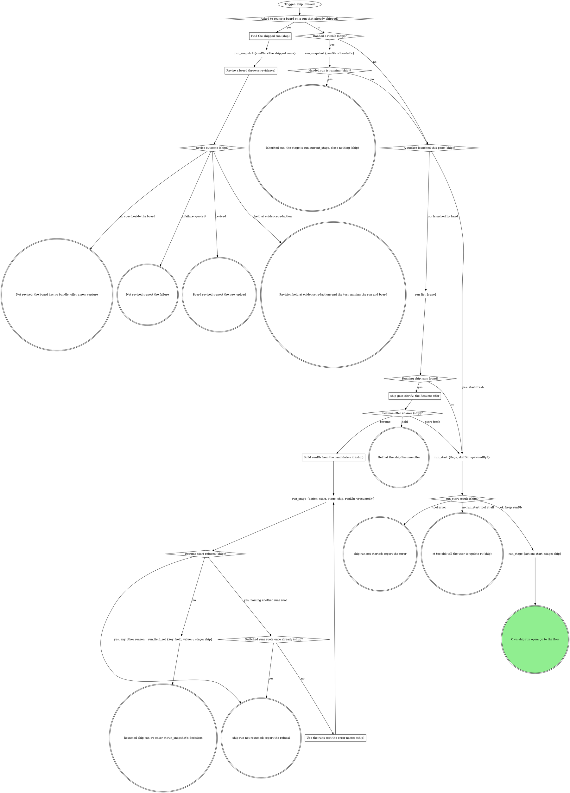

# ship

The standalone entry for shipping the current branch. Same flow as the
pipeline's ship stage, reached directly: target from the checkout. Two
graphs: the run graph opens or inherits the run, the flow graph ships and
closes it. The domain rules below run their own steps in their own order;
the flow graph is where every mechanical move in them lands.

## Run



An own run is a fresh or resumed one: it records identity and closes at the
end. An inherited run records no identity, closes nothing, and hands
control back to the verb that invoked this one.

The flags for this verb, rendered by the compiler:

{{run-start.flags:ship}}

`run_start` takes `flags` = the `ship` flag string from the block above,
verbatim (the value, never its key), `skillDir` = this skill's own
directory, `${CLAUDE_SKILL_DIR}`, as an absolute path, and `spawnedBy` only
when a board or another surface launched this pane. Keep the returned
`runDb` and pass it to every `run_*` call in this verb; nothing is exported.
Every gate below writes its `gate` field and its decision with
`stage: "ship"` in an own run, `stage: run.current_stage` in an inherited
one.

### ship gate clarify: the Resume offer

`run_list` filtered to `status` = `running` and `work_type` = `ship`; never
read the run dbs by hand. Gate `clarify`: one sentence naming each
candidate's `spawned_by`, `started_at` and `current_stage`, then one
**Resume** option per candidate (labelled `Resume (Recommended)` for a run this session started
earlier; a run another live pane owns is not yours) / **Start fresh**, and
**Hold** in `next`.

### Build runDb from the candidate's id (ship)

`runDb` = `<absolute home>/.mattstack/runs/<repo>/<the candidate row's id>/state.db`.
The run tools refuse `~` and relative paths. The `run_stage` start is a new
attempt that re-records this session. The flow then re-enters at the
decisions `run_snapshot` shows, as "Resumed ship run: re-enter at
run_snapshot's decisions" says.

### Use the runs root the error names (ship)

Rebuild `runDb` under the runs root the refusal names; everything after the
root stays the same.

### Find the shipped run (ship)

The operator asks to change a board on a run that already shipped (reword
a label, widen a redaction). A `runDb` already in hand (handed in, or
`RT_RUN_DB`) is the shipped run. Otherwise the run is the one the operator
names: by run id, `runDb` built as in "Build runDb from the candidate's id
(ship)"; when they name only the branch, `run_list {repo}` and the row
whose branch matches.

### Revise a board (browser-evidence)

Read `evidence` and `mr` with `run_field_get`, find the case's
board in the record (the image's `annotated` path; the spec is
`<stem>.spec.json` beside it, and that folder is the evidence folder), and
run browser-evidence's Revise a board steps 1 to 8: `mrUrl` is `mr`, and
`runId` is the path segment before `/state.db`. A gated board passes the
redaction gate (step 3) before anything uploads; a Hold there is
`Revise outcome (ship)?`'s held exit, with nothing uploaded. A board with
no spec beside it is its no-spec exit. A compose error, a re-render that
still reads wrong after its two tries, a refused confirm, a recapture that
is not drawn, or an `mr_upload` refusal past its one fix is its failure
exit, quoted.

This path starts no run and closes none: no `run_start`, no `run_stage`,
no `run_status`. A shipped run stays `done`; `run_field_set` (step 6,
`stage: "ship"`) writes to it as it is.

### Resumed ship run: re-enter at run_snapshot's decisions

Before the flow passes the ship gate again, call `branch_stack {tree:
<root>}`, then `run_field_get {key: shipTarget}`. An unset key
(`run_field_get` errors) or the value `-` is no recorded consent: the gate
opens. A readable fresh target equal to the recorded one continues with it,
the earlier Proceed standing and its answers read from the ship gate
decision `run_snapshot` shows. A fresh target that differs, or a store
unreadable now, reopens the ship gate with a sentence naming the recorded
target and the fresh one; Proceed records the fresh target with
`run_field_set` and continues.

{{include:run-identity}}

## Flow

`<root>` is the worktree root, the absolute path
`git rev-parse --show-toplevel` prints. `<default>` is the repo's default
branch, `git symbolic-ref --short refs/remotes/origin/HEAD` minus
`origin/`, never guessed.

```dot
digraph ship {
    rankdir=TB;

    "Trigger: a ship run is open (own or inherited)" [shape=ellipse];
    "git branch --show-current (ship)" [shape=plaintext];
    "On the default branch (ship)?" [shape=diamond];
    "Own run (default branch)?" [shape=diamond];
    "run_stage {action: fail, stage: ship, reason: the default branch}" [shape=plaintext];
    "run_status {status: failed} (default branch)" [shape=plaintext];
    "STOP: never ship the default branch" [shape=octagon style=filled fillcolor=red fontcolor=white];
    "STOP: never ship the default branch (inherited)" [shape=octagon style=filled fillcolor=red fontcolor=white];
    "Own run (ship identity)?" [shape=diamond];
    "run_field_set {key: branch, value: <branch>, stage: ship}" [shape=plaintext];
    "Run the domain steps before the gate (none when unbound)" [shape=box];
    "git status --porcelain; git log --oneline @{upstream}.. or -5" [shape=plaintext];
    "branch_stack {tree: <root>} (ship)" [shape=plaintext];
    "Stack store readable (ship)?" [shape=diamond];
    "Stack member (ship)?" [shape=diamond];
    "ship gate ship" [shape=box];
    "ship answer (ship)?" [shape=diamond];
    "run_field_set {key: shipTarget, value: <resolved target>, stage: ship}" [shape=plaintext];
    "run_field_set {key: shipTarget, value: -, stage: ship} (iterate)" [shape=plaintext];
    "run_field_set {key: shipTarget, value: -, stage: ship} (hold)" [shape=plaintext];
    "Ship gate rounds = 2 (ship)?" [shape=diamond];
    "Ship gate reopenings = 2 (ship)?" [shape=diamond];
    "Rebase in progress (ship gate budget spent)?" [shape=diamond];
    "git_rebase {tree: <root>, abort: true} (ship gate budget spent)" [shape=plaintext];
    "dirty answer (ship)?" [shape=diamond];
    "Commit named files (ship)" [shape=box];
    "Stash them; nothing in this verb pops it" [shape=box];
    "Run the domain's fast checks (none when unbound)" [shape=box];
    "Checks pass (ship)?" [shape=diamond];
    "Fix rounds = 3 (ship)?" [shape=diamond];
    "Fix test-first, commit, rerun (ship)" [shape=box];
    "Domain rebases, and no rebase finished this pass (ship)?" [shape=diamond];
    "git_rebase {tree: <root>, onto: origin/<resolved target>}" [shape=plaintext];
    "Rebase status (ship)?" [shape=diamond];
    "Conflict rounds = 3 (ship)?" [shape=diamond];
    "Resolve the files, then git rebase --continue on Bash (ship)" [shape=box];
    "Continue result (ship)?" [shape=diamond];
    "Rebase in progress (ship abort)?" [shape=diamond];
    "git_rebase {tree: <root>, abort: true}" [shape=plaintext];
    "git_rebase {tree: <root>, abort: true} (after a failed continue)" [shape=plaintext];

    "git remote get-url origin (ship)" [shape=plaintext];
    "Forge host (ship, before git_push)?" [shape=diamond];
    "ship gate clarify: which forge?" [shape=box];
    "Forge clarify answer (ship)?" [shape=diamond];
    "Forge clarify rounds = 2 (ship)?" [shape=diamond];
    "mr_for_branch {repoName: <root>, branches: [<branch>]} (before git_push)" [shape=plaintext];
    "Open MR on the branch (before git_push)?" [shape=diamond];
    "Push moves the MR's head (ship)?" [shape=diamond];
    "mr_pipeline {repoName, iid} (the prior pipeline id, ship)" [shape=plaintext];
    "Push needs force-with-lease (ship)?" [shape=diamond];
    "git_push {tree: <root>, setUpstream: true}" [shape=plaintext];
    "git_push {tree: <root>, forceWithLease: true}" [shape=plaintext];
    "git_push result (ship)?" [shape=diamond];
    "Retried with the printed root (ship)?" [shape=diamond];
    "git_push {tree: <the root the error prints>, setUpstream: true}" [shape=plaintext];
    "STOP: push only with git_push (ship)" [shape=octagon style=filled fillcolor=red fontcolor=white];
    "ship off-script gate: git_push refused" [shape=box];
    "ship off-script answer (git_push)?" [shape=diamond];
    "Confirm the human's push landed (ship)" [shape=box];
    "Push landed (ship)?" [shape=diamond];
    "Push off-script rounds = 2 (ship)?" [shape=diamond];
    "Landing checks = 2 (ship)?" [shape=diamond];

    "Forge host (ship, open the MR)?" [shape=diamond];
    "mr_for_branch {repoName: <root>, branches: [<branch>]} (after git_push)" [shape=plaintext];
    "Open MR on the branch (after git_push)?" [shape=diamond];
    "Created once already (ship)?" [shape=diamond];
    "mr_create {repoName: <root>, sourceBranch, targetBranch: <resolved target>, title, description, draft, squash?, labels?}" [shape=plaintext];
    "mr_create result (ship)?" [shape=diamond];
    "mr_update {mrUrl, squash: true}" [shape=plaintext];
    "STOP: GitLab reads go through the read tools or gitlab_get, writes through the mr_* tools (ship)" [shape=octagon style=filled fillcolor=red fontcolor=white];
    "gh pr create --fill --base <resolved target>, --draft unless the gate said ready" [shape=plaintext];
    "gh pr create result (ship)?" [shape=diamond];
    "Own run (MR identity)?" [shape=diamond];
    "run_field_set {key: mr, value: <url>, stage: ship}" [shape=plaintext];

    "run_field_get {key: evidence} (ship)" [shape=plaintext];
    "Browser screenshot for this case (ship)?" [shape=diamond];
    "Capture the AFTER with the browser (ship, browser-evidence)" [shape=box];
    "Capture the AFTER for the next case the domain names (ship)" [shape=box];
    "AFTER captured, or none left to capture (ship)?" [shape=diamond];
    "AFTER attempts for this case = 3 (ship)?" [shape=diamond];
    "Every named case tried (ship)?" [shape=diamond];
    "A v1 or v2 record with an image, or an AFTER was captured (ship)?" [shape=diamond];
    "Merge into the record (evidence-record)" [shape=box];
    "Annotate or waive each image the record does not yet cover (evidence-record)" [shape=box];
    "Annotate or waive outcome (ship)?" [shape=diamond];
    "run_field_set {key: evidence, value: <the merged evidence@2 JSON>, stage: <the run's stage>}" [shape=plaintext];
    "evidence write result (ship)?" [shape=diamond];
    "Validator refusals = 2 (ship)?" [shape=diamond];
    "Record fixed once already (ship)?" [shape=diamond];
    "Files to attach (ship)?" [shape=diamond];
    "mr_upload {mrUrl, path, runId} per uploadable file; keep each markdown" [shape=plaintext];
    "mr_upload result (ship)?" [shape=diamond];
    "Upload retried with a corrected path (ship)?" [shape=diamond];
    "Redaction record repaired for this file already (ship)?" [shape=diamond];
    "Repair the board's redaction record (browser-evidence)" [shape=box];
    "Repair outcome (ship)?" [shape=diamond];
    "mr_upload {mrUrl, path: <the corrected absolute path>, runId}" [shape=plaintext];
    "STOP: upload only with mr_upload (ship)" [shape=octagon style=filled fillcolor=red fontcolor=white];
    "ship off-script gate: mr_upload refused" [shape=box];
    "ship off-script answer (mr_upload)?" [shape=diamond];
    "Upload off-script rounds = 2 (ship)?" [shape=diamond];
    "Timed-out upload retried once (ship)?" [shape=diamond];
    "mr_upload {mrUrl, path: <the timed-out file>, runId}" [shape=plaintext];
    "Domain owns the title or description (ship)?" [shape=diamond];
    "Forge host (ship, read back the description)?" [shape=diamond];
    "mr_view {mrUrl}" [shape=plaintext];
    "gh pr view <mr> --json title,body" [shape=plaintext];
    "Write the title and description (ship)" [shape=box];
    "Forge host (ship, write the description)?" [shape=diamond];
    "mr_update {mrUrl, title, description}" [shape=plaintext];
    "gh pr edit <mr> --title <title> --body <description>" [shape=plaintext];

    "Domain runs CI after the MR (ship)?" [shape=diamond];
    "Run watch-ci inheriting this run" [shape=box];
    "watch-ci handed back what (ship)?" [shape=diamond];
    "Forge host (ship, draft check)?" [shape=diamond];
    "mr_view {repoName, iid} (ship draft check)" [shape=plaintext];
    "gh pr view <mr> --json isDraft (ship draft check)" [shape=plaintext];
    "MR still a draft (ship)?" [shape=diamond];
    "ship gate mark-ready" [shape=box];
    "mark-ready answer (ship)?" [shape=diamond];
    "Mark-ready rounds = 2 (ship)?" [shape=diamond];
    "Forge host (ship, mark-ready)?" [shape=diamond];
    "mr_ready {repoName: <root>, iid}" [shape=plaintext];
    "gh pr ready <number>" [shape=plaintext];

    "Which exit is this (ship)?" [shape=diamond];
    "run_stage {action: done, stage: ship}" [shape=plaintext];
    "run_status {status: done}" [shape=plaintext];
    "run_stage {action: done, stage: ship} (abort)" [shape=plaintext];
    "run_status {status: abandoned}" [shape=plaintext];
    "run_stage {action: fail, stage: ship, reason}" [shape=plaintext];
    "run_status {status: failed}" [shape=plaintext];
    "Hand the answer back to the caller (ship)" [shape=doublecircle];
    "Held in ship: the run stays open" [shape=doublecircle];
    "ship run abandoned" [shape=doublecircle];
    "ship failed" [shape=doublecircle];
    "Shipped" [shape=doublecircle style=filled fillcolor=lightgreen];

    "Trigger: a ship run is open (own or inherited)" -> "git branch --show-current (ship)";
    "git branch --show-current (ship)" -> "On the default branch (ship)?";
    "On the default branch (ship)?" -> "Own run (default branch)?" [label="yes"];
    "On the default branch (ship)?" -> "Own run (ship identity)?" [label="no"];
    "Own run (default branch)?" -> "run_stage {action: fail, stage: ship, reason: the default branch}" [label="yes: close it first"];
    "Own run (default branch)?" -> "STOP: never ship the default branch (inherited)" [label="no: inherited"];
    "STOP: never ship the default branch (inherited)" -> "Hand the answer back to the caller (ship)";
    "run_stage {action: fail, stage: ship, reason: the default branch}" -> "run_status {status: failed} (default branch)";
    "run_status {status: failed} (default branch)" -> "STOP: never ship the default branch";
    "Own run (ship identity)?" -> "run_field_set {key: branch, value: <branch>, stage: ship}" [label="yes"];
    "Own run (ship identity)?" -> "Run the domain steps before the gate (none when unbound)" [label="no: inherited"];
    "run_field_set {key: branch, value: <branch>, stage: ship}" -> "Run the domain steps before the gate (none when unbound)";
    "Run the domain steps before the gate (none when unbound)" -> "git status --porcelain; git log --oneline @{upstream}.. or -5";
    "git status --porcelain; git log --oneline @{upstream}.. or -5" -> "branch_stack {tree: <root>} (ship)";
    "branch_stack {tree: <root>} (ship)" -> "Stack store readable (ship)?";
    "Stack store readable (ship)?" -> "Stack member (ship)?" [label="yes"];
    "Stack store readable (ship)?" -> "ship gate ship" [label="no: stackStore unavailable, or a tool error: the target is the default branch, the stack could not be read"];
    "Stack member (ship)?" -> "ship gate ship" [label="yes: the target is the stack parent"];
    "Stack member (ship)?" -> "ship gate ship" [label="no: the target is the default branch"];
    "ship gate ship" -> "ship answer (ship)?";
    "ship answer (ship)?" -> "run_field_set {key: shipTarget, value: <resolved target>, stage: ship}" [label="proceed: record the consented target"];
    "run_field_set {key: shipTarget, value: <resolved target>, stage: ship}" -> "dirty answer (ship)?";
    "ship answer (ship)?" -> "run_field_set {key: shipTarget, value: -, stage: ship} (iterate)" [label="iterate: clear the recorded consent first"];
    "run_field_set {key: shipTarget, value: -, stage: ship} (iterate)" -> "Ship gate rounds = 2 (ship)?";
    "Ship gate rounds = 2 (ship)?" -> "Run the domain steps before the gate (none when unbound)" [label="no: redo with their note"];
    "Ship gate rounds = 2 (ship)?" -> "Rebase in progress (ship gate budget spent)?" [label="yes: a failure, their last note quoted"];
    "Rebase in progress (ship gate budget spent)?" -> "git_rebase {tree: <root>, abort: true} (ship gate budget spent)" [label="yes"];
    "Rebase in progress (ship gate budget spent)?" -> "Which exit is this (ship)?" [label="no: a failure, what was quoted is the reason"];
    "git_rebase {tree: <root>, abort: true} (ship gate budget spent)" -> "Which exit is this (ship)?" [label="a failure, what was quoted is the reason"];
    "ship answer (ship)?" -> "run_field_set {key: shipTarget, value: -, stage: ship} (hold)" [label="hold: clear the recorded consent first"];
    "run_field_set {key: shipTarget, value: -, stage: ship} (hold)" -> "Which exit is this (ship)?";
    "ship answer (ship)?" -> "Rebase in progress (ship abort)?" [label="dirty = abort: nothing is pushed"];
    "Rebase in progress (ship abort)?" -> "git_rebase {tree: <root>, abort: true}" [label="yes"];
    "Rebase in progress (ship abort)?" -> "Which exit is this (ship)?" [label="no"];
    "git_rebase {tree: <root>, abort: true}" -> "Which exit is this (ship)?";
    "dirty answer (ship)?" -> "Commit named files (ship)" [label="commit"];
    "dirty answer (ship)?" -> "Stash them; nothing in this verb pops it" [label="stash"];
    "dirty answer (ship)?" -> "Run the domain's fast checks (none when unbound)" [label="clean tree"];
    "Commit named files (ship)" -> "Run the domain's fast checks (none when unbound)";
    "Stash them; nothing in this verb pops it" -> "Run the domain's fast checks (none when unbound)";
    "Run the domain's fast checks (none when unbound)" -> "Checks pass (ship)?";
    "Checks pass (ship)?" -> "Domain rebases, and no rebase finished this pass (ship)?" [label="yes"];
    "Checks pass (ship)?" -> "Fix rounds = 3 (ship)?" [label="no"];
    "Fix rounds = 3 (ship)?" -> "Fix test-first, commit, rerun (ship)" [label="no"];
    "Fix rounds = 3 (ship)?" -> "Ship gate reopenings = 2 (ship)?" [label="yes: reopen, failing output quoted"];
    "Fix test-first, commit, rerun (ship)" -> "Run the domain's fast checks (none when unbound)";
    "Domain rebases, and no rebase finished this pass (ship)?" -> "git_rebase {tree: <root>, onto: origin/<resolved target>}" [label="yes"];
    "Domain rebases, and no rebase finished this pass (ship)?" -> "git remote get-url origin (ship)" [label="no"];
    "git_rebase {tree: <root>, onto: origin/<resolved target>}" -> "Rebase status (ship)?";
    "Rebase status (ship)?" -> "Run the domain's fast checks (none when unbound)" [label="clean"];
    "Rebase status (ship)?" -> "Conflict rounds = 3 (ship)?" [label="conflict"];
    "Rebase status (ship)?" -> "Which exit is this (ship)?" [label="any other error: a failure, quoted as the reason"];
    "Conflict rounds = 3 (ship)?" -> "Resolve the files, then git rebase --continue on Bash (ship)" [label="no"];
    "Conflict rounds = 3 (ship)?" -> "Ship gate reopenings = 2 (ship)?" [label="yes: reopen, conflicted files quoted"];
    "Ship gate reopenings = 2 (ship)?" -> "ship gate ship" [label="no: reopen with what was quoted"];
    "Ship gate reopenings = 2 (ship)?" -> "Rebase in progress (ship gate budget spent)?" [label="yes: a failure, the failing output or conflicted files quoted"];
    "Resolve the files, then git rebase --continue on Bash (ship)" -> "Continue result (ship)?";
    "Continue result (ship)?" -> "Conflict rounds = 3 (ship)?" [label="another commit conflicted"];
    "Continue result (ship)?" -> "Run the domain's fast checks (none when unbound)" [label="rebase finished"];
    "Continue result (ship)?" -> "git_rebase {tree: <root>, abort: true} (after a failed continue)" [label="any other error: a failure, quoted"];
    "git_rebase {tree: <root>, abort: true} (after a failed continue)" -> "Which exit is this (ship)?";

    "git remote get-url origin (ship)" -> "Forge host (ship, before git_push)?";
    "Forge host (ship, before git_push)?" -> "mr_for_branch {repoName: <root>, branches: [<branch>]} (before git_push)" [label="GitLab"];
    "Forge host (ship, before git_push)?" -> "Push needs force-with-lease (ship)?" [label="GitHub"];
    "Forge host (ship, before git_push)?" -> "Forge clarify rounds = 2 (ship)?" [label="anything else"];
    "Forge clarify rounds = 2 (ship)?" -> "ship gate clarify: which forge?" [label="no: ask which forge"];
    "Forge clarify rounds = 2 (ship)?" -> "Which exit is this (ship)?" [label="yes: a failure, the origin URL and their answer quoted"];
    "ship gate clarify: which forge?" -> "Forge clarify answer (ship)?";
    "Forge clarify answer (ship)?" -> "Forge host (ship, before git_push)?" [label="answered: GitLab or GitHub, the host from here on"];
    "Forge clarify answer (ship)?" -> "Which exit is this (ship)?" [label="hold"];
    "Forge clarify answer (ship)?" -> "Which exit is this (ship)?" [label="hand back: a failure, no forge this verb knows"];
    "mr_for_branch {repoName: <root>, branches: [<branch>]} (before git_push)" -> "Open MR on the branch (before git_push)?";
    "Open MR on the branch (before git_push)?" -> "Push moves the MR's head (ship)?" [label="yes"];
    "Push moves the MR's head (ship)?" -> "mr_pipeline {repoName, iid} (the prior pipeline id, ship)" [label="yes: HEAD differs"];
    "Push moves the MR's head (ship)?" -> "Push needs force-with-lease (ship)?" [label="no: already pushed"];
    "Open MR on the branch (before git_push)?" -> "Push needs force-with-lease (ship)?" [label="no"];
    "mr_pipeline {repoName, iid} (the prior pipeline id, ship)" -> "Push needs force-with-lease (ship)?";
    "Push needs force-with-lease (ship)?" -> "git_push {tree: <root>, setUpstream: true}" [label="no"];
    "Push needs force-with-lease (ship)?" -> "git_push {tree: <root>, forceWithLease: true}" [label="yes: the rebase rewrote pushed commits"];
    "git_push {tree: <root>, setUpstream: true}" -> "git_push result (ship)?";
    "git_push {tree: <root>, forceWithLease: true}" -> "git_push result (ship)?";
    "git_push {tree: <the root the error prints>, setUpstream: true}" -> "git_push result (ship)?";
    "git_push result (ship)?" -> "Forge host (ship, open the MR)?" [label="ok"];
    "git_push result (ship)?" -> "Retried with the printed root (ship)?" [label="tree must be the absolute path of the root"];
    "git_push result (ship)?" -> "STOP: push only with git_push (ship)" [label="any other error"];
    "Retried with the printed root (ship)?" -> "git_push {tree: <the root the error prints>, setUpstream: true}" [label="no"];
    "Retried with the printed root (ship)?" -> "STOP: push only with git_push (ship)" [label="yes"];
    "STOP: push only with git_push (ship)" -> "ship off-script gate: git_push refused";
    "ship off-script gate: git_push refused" -> "ship off-script answer (git_push)?";
    "ship off-script answer (git_push)?" -> "Confirm the human's push landed (ship)" [label="take: the human pushed"];
    "ship off-script answer (git_push)?" -> "Which exit is this (ship)?" [label="hand back: a failure, the refusal is the reason"];
    "ship off-script answer (git_push)?" -> "Which exit is this (ship)?" [label="hold"];
    "ship off-script answer (git_push)?" -> "Push off-script rounds = 2 (ship)?" [label="iterate: the human fixed the cause, retry the push"];
    "Push off-script rounds = 2 (ship)?" -> "Push needs force-with-lease (ship)?" [label="no: retry the push"];
    "Push off-script rounds = 2 (ship)?" -> "Which exit is this (ship)?" [label="yes: a failure, the push refusal quoted"];
    "Confirm the human's push landed (ship)" -> "Push landed (ship)?";
    "Push landed (ship)?" -> "Forge host (ship, open the MR)?" [label="yes: the remote branch carries HEAD"];
    "Push landed (ship)?" -> "Landing checks = 2 (ship)?" [label="no"];
    "Landing checks = 2 (ship)?" -> "ship off-script gate: git_push refused" [label="no: reopen with what the comparison showed"];
    "Landing checks = 2 (ship)?" -> "Which exit is this (ship)?" [label="yes: a failure, the comparison quoted"];

    "Forge host (ship, open the MR)?" -> "mr_for_branch {repoName: <root>, branches: [<branch>]} (after git_push)" [label="GitLab"];
    "Forge host (ship, open the MR)?" -> "gh pr create --fill --base <resolved target>, --draft unless the gate said ready" [label="GitHub"];
    "mr_for_branch {repoName: <root>, branches: [<branch>]} (after git_push)" -> "Open MR on the branch (after git_push)?";
    "Open MR on the branch (after git_push)?" -> "Own run (MR identity)?" [label="yes: keep its url"];
    "Open MR on the branch (after git_push)?" -> "Created once already (ship)?" [label="no"];
    "Created once already (ship)?" -> "mr_create {repoName: <root>, sourceBranch, targetBranch: <resolved target>, title, description, draft, squash?, labels?}" [label="no"];
    "Created once already (ship)?" -> "Which exit is this (ship)?" [label="yes: a failure, the mr_create error is the reason"];
    "mr_create {repoName: <root>, sourceBranch, targetBranch: <resolved target>, title, description, draft, squash?, labels?}" -> "mr_create result (ship)?";
    "mr_create result (ship)?" -> "Own run (MR identity)?" [label="url, squash applied or not asked"];
    "mr_create result (ship)?" -> "mr_update {mrUrl, squash: true}" [label="squashApplied: false"];
    "mr_create result (ship)?" -> "mr_for_branch {repoName: <root>, branches: [<branch>]} (after git_push)" [label="error, or url null: read it back, never create twice"];
    "mr_create result (ship)?" -> "STOP: GitLab reads go through the read tools or gitlab_get, writes through the mr_* tools (ship)" [label="tempted to use the GitLab CLI"];
    "STOP: GitLab reads go through the read tools or gitlab_get, writes through the mr_* tools (ship)" -> "mr_for_branch {repoName: <root>, branches: [<branch>]} (after git_push)";
    "mr_update {mrUrl, squash: true}" -> "Own run (MR identity)?";
    "gh pr create --fill --base <resolved target>, --draft unless the gate said ready" -> "gh pr create result (ship)?";
    "gh pr create result (ship)?" -> "Own run (MR identity)?" [label="url printed"];
    "gh pr create result (ship)?" -> "Own run (MR identity)?" [label="already exists: keep the url it prints"];
    "gh pr create result (ship)?" -> "Which exit is this (ship)?" [label="any other error: a failure, quoted as the reason"];
    "Own run (MR identity)?" -> "run_field_set {key: mr, value: <url>, stage: ship}" [label="yes"];
    "Own run (MR identity)?" -> "run_field_get {key: evidence} (ship)" [label="no: inherited"];
    "run_field_set {key: mr, value: <url>, stage: ship}" -> "run_field_get {key: evidence} (ship)";
    "run_field_get {key: evidence} (ship)" -> "Browser screenshot for this case (ship)?";
    "Browser screenshot for this case (ship)?" -> "Capture the AFTER with the browser (ship, browser-evidence)" [label="yes"];
    "Browser screenshot for this case (ship)?" -> "Capture the AFTER for the next case the domain names (ship)" [label="no: the domain's own method, or no case named"];
    "Capture the AFTER with the browser (ship, browser-evidence)" -> "AFTER captured, or none left to capture (ship)?";
    "Capture the AFTER for the next case the domain names (ship)" -> "AFTER captured, or none left to capture (ship)?";
    "AFTER captured, or none left to capture (ship)?" -> "Every named case tried (ship)?" [label="captured, or Board recorded"];
    "AFTER captured, or none left to capture (ship)?" -> "A v1 or v2 record with an image, or an AFTER was captured (ship)?" [label="none named: there is no AFTER"];
    "AFTER captured, or none left to capture (ship)?" -> "Every named case tried (ship)?" [label="skipped: unbound, this case is not a browser case and has no AFTER"];
    "AFTER captured, or none left to capture (ship)?" -> "AFTER attempts for this case = 3 (ship)?" [label="the capture failed, or Not drawn: a failed brief or spent re-renders"];
    "AFTER captured, or none left to capture (ship)?" -> "Every named case tried (ship)?" [label="not drawn: the developer left it uncaptured, the doctor stayed red, no compose on PATH, sign-in asks spent, no driver to spawn, redaction rounds spent, or confirm refused twice: go on without it; the description names the gap"];
    "AFTER captured, or none left to capture (ship)?" -> "Which exit is this (ship)?" [label="hold: held at evidence-redaction"];
    "AFTER attempts for this case = 3 (ship)?" -> "Browser screenshot for this case (ship)?" [label="no: another attempt, same case"];
    "AFTER attempts for this case = 3 (ship)?" -> "Every named case tried (ship)?" [label="yes: go on without it; the description names the gap"];
    "Every named case tried (ship)?" -> "Browser screenshot for this case (ship)?" [label="no"];
    "Every named case tried (ship)?" -> "A v1 or v2 record with an image, or an AFTER was captured (ship)?" [label="yes"];
    "A v1 or v2 record with an image, or an AFTER was captured (ship)?" -> "Merge into the record (evidence-record)" [label="yes"];
    "A v1 or v2 record with an image, or an AFTER was captured (ship)?" -> "Files to attach (ship)?" [label="no"];
    "Merge into the record (evidence-record)" -> "Annotate or waive each image the record does not yet cover (evidence-record)";
    "Annotate or waive each image the record does not yet cover (evidence-record)" -> "Annotate or waive outcome (ship)?";
    "Annotate or waive outcome (ship)?" -> "run_field_set {key: evidence, value: <the merged evidence@2 JSON>, stage: <the run's stage>}" [label="ready"];
    "Annotate or waive outcome (ship)?" -> "Which exit is this (ship)?" [label="hold: held at evidence-waiver"];
    "Annotate or waive outcome (ship)?" -> "Which exit is this (ship)?" [label="hold: held at evidence-redaction"];
    "Annotate or waive outcome (ship)?" -> "Which exit is this (ship)?" [label="a failure: waiver openings spent, the images named"];
    "run_field_set {key: evidence, value: <the merged evidence@2 JSON>, stage: <the run's stage>}" -> "evidence write result (ship)?";
    "evidence write result (ship)?" -> "Files to attach (ship)?" [label="ok"];
    "evidence write result (ship)?" -> "Validator refusals = 2 (ship)?" [label="refused: the validator names an image"];
    "evidence write result (ship)?" -> "Which exit is this (ship)?" [label="any other error: a failure, quoted as the reason"];
    "Validator refusals = 2 (ship)?" -> "Annotate or waive each image the record does not yet cover (evidence-record)" [label="no"];
    "Validator refusals = 2 (ship)?" -> "Which exit is this (ship)?" [label="a failure: the evidence refusal quoted"];
    "Files to attach (ship)?" -> "mr_upload {mrUrl, path, runId} per uploadable file; keep each markdown" [label="yes, GitLab: every uploadable path in the record (a repeat upload is harmless)"];
    "Files to attach (ship)?" -> "Domain owns the title or description (ship)?" [label="no, or GitHub: link the paths"];
    "mr_upload {mrUrl, path, runId} per uploadable file; keep each markdown" -> "mr_upload result (ship)?";
    "mr_upload result (ship)?" -> "Domain owns the title or description (ship)?" [label="ok: every file uploaded"];
    "mr_upload result (ship)?" -> "mr_upload {mrUrl, path, runId} per uploadable file; keep each markdown" [label="ok: files still to upload"];
    "mr_upload result (ship)?" -> "Upload retried with a corrected path (ship)?" [label="path must be absolute, or file not found"];
    "mr_upload result (ship)?" -> "STOP: upload only with mr_upload (ship)" [label="any other refusal: outside the roots, bytes, size"];
    "mr_upload result (ship)?" -> "STOP: upload only with mr_upload (ship)" [label="tempted to copy the file into an allowed root, or upload another way"];
    "mr_upload result (ship)?" -> "Record fixed once already (ship)?" [label="refused: not in the record, or a raw capture"];
    "Record fixed once already (ship)?" -> "Annotate or waive each image the record does not yet cover (evidence-record)" [label="no: the named file"];
    "mr_upload result (ship)?" -> "Redaction record repaired for this file already (ship)?" [label="refused: a redaction record (unconfirmed, missing, stale, a crop, malformed)"];
    "Redaction record repaired for this file already (ship)?" -> "Repair the board's redaction record (browser-evidence)" [label="no"];
    "Redaction record repaired for this file already (ship)?" -> "STOP: upload only with mr_upload (ship)" [label="yes: refused again after a repair"];
    "Repair the board's redaction record (browser-evidence)" -> "Repair outcome (ship)?";
    "Repair outcome (ship)?" -> "mr_upload {mrUrl, path, runId} per uploadable file; keep each markdown" [label="repaired: retry that file"];
    "Repair outcome (ship)?" -> "Which exit is this (ship)?" [label="hold: held at evidence-redaction"];
    "Repair outcome (ship)?" -> "STOP: upload only with mr_upload (ship)" [label="not repaired: no spec beside the board, a compose error, or a refused confirm"];
    "Record fixed once already (ship)?" -> "STOP: upload only with mr_upload (ship)" [label="yes"];
    "Upload retried with a corrected path (ship)?" -> "mr_upload {mrUrl, path: <the corrected absolute path>, runId}" [label="no: this file's one fix"];
    "Upload retried with a corrected path (ship)?" -> "STOP: upload only with mr_upload (ship)" [label="yes"];
    "mr_upload {mrUrl, path: <the corrected absolute path>, runId}" -> "mr_upload result (ship)?";
    "mr_upload result (ship)?" -> "Timed-out upload retried once (ship)?" [label="timed out"];
    "Timed-out upload retried once (ship)?" -> "mr_upload {mrUrl, path: <the timed-out file>, runId}" [label="no: retry once, a timed-out upload is safe to repeat"];
    "Timed-out upload retried once (ship)?" -> "STOP: upload only with mr_upload (ship)" [label="yes: timed out twice"];
    "mr_upload {mrUrl, path: <the timed-out file>, runId}" -> "mr_upload result (ship)?";
    "STOP: upload only with mr_upload (ship)" -> "ship off-script gate: mr_upload refused";
    "ship off-script gate: mr_upload refused" -> "ship off-script answer (mr_upload)?";
    "ship off-script answer (mr_upload)?" -> "Domain owns the title or description (ship)?" [label="take: link the refused files' local paths"];
    "ship off-script answer (mr_upload)?" -> "Which exit is this (ship)?" [label="hand back: a failure, the upload refusal is the reason"];
    "ship off-script answer (mr_upload)?" -> "Which exit is this (ship)?" [label="hold: nothing linked"];
    "ship off-script answer (mr_upload)?" -> "Upload off-script rounds = 2 (ship)?" [label="iterate: the human fixed the cause, retry the upload"];
    "Upload off-script rounds = 2 (ship)?" -> "mr_upload {mrUrl, path, runId} per uploadable file; keep each markdown" [label="no: retry the refused files"];
    "Upload off-script rounds = 2 (ship)?" -> "Which exit is this (ship)?" [label="yes: a failure, the upload refusal quoted"];
    "Domain owns the title or description (ship)?" -> "Forge host (ship, read back the description)?" [label="yes, or an evidence section to write"];
    "Domain owns the title or description (ship)?" -> "Domain runs CI after the MR (ship)?" [label="no: the create call wrote them"];
    "Forge host (ship, read back the description)?" -> "mr_view {mrUrl}" [label="GitLab"];
    "Forge host (ship, read back the description)?" -> "gh pr view <mr> --json title,body" [label="GitHub"];
    "mr_view {mrUrl}" -> "Write the title and description (ship)";
    "gh pr view <mr> --json title,body" -> "Write the title and description (ship)";
    "Write the title and description (ship)" -> "Forge host (ship, write the description)?";
    "Forge host (ship, write the description)?" -> "mr_update {mrUrl, title, description}" [label="GitLab"];
    "Forge host (ship, write the description)?" -> "gh pr edit <mr> --title <title> --body <description>" [label="GitHub"];
    "mr_update {mrUrl, title, description}" -> "Domain runs CI after the MR (ship)?";
    "gh pr edit <mr> --title <title> --body <description>" -> "Domain runs CI after the MR (ship)?";

    "Domain runs CI after the MR (ship)?" -> "Run watch-ci inheriting this run" [label="yes"];
    "Domain runs CI after the MR (ship)?" -> "Which exit is this (ship)?" [label="no: done, print the URL"];
    "Run watch-ci inheriting this run" -> "watch-ci handed back what (ship)?";
    "watch-ci handed back what (ship)?" -> "Forge host (ship, draft check)?" [label="verdict: green"];
    "watch-ci handed back what (ship)?" -> "Which exit is this (ship)?" [label="verdict: red after its ci gate: done"];
    "watch-ci handed back what (ship)?" -> "Which exit is this (ship)?" [label="off-script answer or failure"];
    "watch-ci handed back what (ship)?" -> "Which exit is this (ship)?" [label="stood down: the doctor holds the lease"];
    "watch-ci handed back what (ship)?" -> "Which exit is this (ship)?" [label="held"];
    "Forge host (ship, draft check)?" -> "mr_view {repoName, iid} (ship draft check)" [label="GitLab"];
    "Forge host (ship, draft check)?" -> "gh pr view <mr> --json isDraft (ship draft check)" [label="GitHub"];
    "mr_view {repoName, iid} (ship draft check)" -> "MR still a draft (ship)?";
    "gh pr view <mr> --json isDraft (ship draft check)" -> "MR still a draft (ship)?";
    "MR still a draft (ship)?" -> "ship gate mark-ready" [label="yes"];
    "MR still a draft (ship)?" -> "Which exit is this (ship)?" [label="no: done"];
    "ship gate mark-ready" -> "mark-ready answer (ship)?";
    "mark-ready answer (ship)?" -> "Forge host (ship, mark-ready)?" [label="mark ready now"];
    "mark-ready answer (ship)?" -> "Which exit is this (ship)?" [label="keep it draft: done"];
    "mark-ready answer (ship)?" -> "Which exit is this (ship)?" [label="go back (inherited run only)"];
    "mark-ready answer (ship)?" -> "Which exit is this (ship)?" [label="hold"];
    "mark-ready answer (ship)?" -> "Mark-ready rounds = 2 (ship)?" [label="iterate: a new gate with their note"];
    "Mark-ready rounds = 2 (ship)?" -> "ship gate mark-ready" [label="no: a new gate with their note"];
    "Mark-ready rounds = 2 (ship)?" -> "Which exit is this (ship)?" [label="yes: done, the MR stays a draft, their last note quoted"];
    "Forge host (ship, mark-ready)?" -> "mr_ready {repoName: <root>, iid}" [label="GitLab"];
    "Forge host (ship, mark-ready)?" -> "gh pr ready <number>" [label="GitHub"];
    "mr_ready {repoName: <root>, iid}" -> "Which exit is this (ship)?";
    "gh pr ready <number>" -> "Which exit is this (ship)?";

    "Which exit is this (ship)?" -> "run_stage {action: done, stage: ship}" [label="own run: done, or stood down"];
    "Which exit is this (ship)?" -> "run_stage {action: done, stage: ship} (abort)" [label="own run: abort"];
    "Which exit is this (ship)?" -> "run_stage {action: fail, stage: ship, reason}" [label="own run: a failure or an off-script hand back"];
    "Which exit is this (ship)?" -> "Hand the answer back to the caller (ship)" [label="inherited run: any exit but hold"];
    "Which exit is this (ship)?" -> "Held in ship: the run stays open" [label="hold"];
    "run_stage {action: done, stage: ship}" -> "run_status {status: done}";
    "run_status {status: done}" -> "Shipped";
    "run_stage {action: done, stage: ship} (abort)" -> "run_status {status: abandoned}";
    "run_status {status: abandoned}" -> "ship run abandoned";
    "run_stage {action: fail, stage: ship, reason}" -> "run_status {status: failed}";
    "run_status {status: failed}" -> "ship failed";
}
```

### Run the domain steps before the gate (none when unbound)

The domain's gathering steps: sanity of the diff against the ticket, the
branch and ticket checks, an existing-MR lookup, any mandatory pre-ship
review. Each one that raises a question adds it to the `ship` gate rather
than asking on its own. Unbound, there are none. A GitLab fact these
steps need that no read tool returns is read as in "Reading a GitLab fact
no read tool returns".

### Reading a GitLab fact no read tool returns

At any step of this verb, a GitLab fact the read tools do not return is
read with `gitlab_get {repoName, path}`: `repoName` = the checkout or
tree this verb already targets, `path` relative to the API root with `:id`
for this project, for example `projects/:id/merge_requests/<iid>/approvals`.
The read is part of the step that needs it, not an off-script move, so it
opens no gate. A GitLab error is quoted as GitLab wrote it. Its refusal of
a credential path is final.

### ship gate ship

Before anything is pushed. One sentence above the form: the branch, the
commits about to go, whether the tree is dirty, and the resolved target
(the stack parent, the default branch, or "the stack could not be read, so
the default branch"), so Proceed is consent to that target. When a resumed
run reopens the gate because the target moved, the sentence names the
recorded target and the fresh one. When the gate
reopens with a rebase in progress (the conflict rounds are spent), the
context says so, and Abort aborts that rebase first.

| Question | Options (recommended first) | Shown when |
|---|---|---|
| `dirty` (write-in) | **Commit the changes (Recommended)** / **Stash them** / **Abort** | the tree is dirty |
| `open_as` (write-in) | **Push and open as draft (Recommended)** / **Push and open ready** | always |
| the domain's own | as the domain rules word them (a ticket mismatch, an MR already open) | the domain declares them |
| `next` | **Proceed** / **Iterate here** / **Hold** | always |

Scope `ship`. Selection: `{"dirty":"commit|stash|abort|null","open_as":"draft|ready","domain":{<answers>},"next":"proceed|iterate|hold","note":"<their words or null>"}`.
Abort and Hold push nothing. Iterate and Hold clear the recorded target
with `run_field_set {key: shipTarget, value: -, stage: ship}` before they leave the gate, so a
resume after either one re-asks the gate. Proceed records the target it consented to
with `run_field_set {key: shipTarget, value: <resolved target>, stage: ship}`; `stage` is
`"ship"` in an own run and `run.current_stage` in an inherited one, on both
clears as well as on Proceed;
when the stack store was unreadable the value is `<default branch> (stack
store unreadable)`, so a later reader can tell consent to the fallback from
a real read. The rebase and `mr_create` use the plain branch name.
`Ship gate rounds = 2 (ship)?` counts Iterate answers at this gate within
this pass through the verb, this one included: the first Iterate redoes
the steps before the gate with the note, and the second fails the verb
with the note quoted instead of redoing them. When a rebase is in
progress, the failure aborts it first. A reopening after the fix or
conflict rounds are spent is not an Iterate and does not count.

`Ship gate reopenings = 2 (ship)?` counts the times the fix or conflict
rounds run out and reopen this gate within this pass through the verb,
this one included: the first reopens the gate with the failing output or
conflicted files quoted, and the second fails the verb with them quoted,
aborting a rebase in progress first. The fix and conflict rounds carry
over a reopen: the reopened gate is the human's turn to fix it, so a
Proceed whose checks still fail reaches this counter again without new
fix rounds.

### Commit named files (ship)

Stage the files by name, never everything; the subject follows the
domain's commit rules, the branch's own style when unbound.

### Stash them; nothing in this verb pops it

A tagged stash (`git stash push -u -m "<unique tag>"`); the git stash stack
is shared with every worktree, so never pop by position. Say in the final
report that the stash exists.

### Run the domain's fast checks (none when unbound)

Only the checks the domain names, on the changed files. Revert generated
drift the checks leave behind before continuing. A full suite the domain
rules out stays out: CI runs it. A finished rebase, clean or resolved,
sends the checks round again because the tree changed under them; the "no
rebase finished this pass" guard keeps that second round from rebasing
again. So a force-with-lease push always follows checks that ran on the
rewritten tree; no extra check node is needed before it.

### Fix test-first, commit, rerun (ship)

Each fix gets its failing test first, then the fix, then a commit. The
counter is fix rounds within this pass through the verb.

### Resolve the files, then git rebase --continue on Bash (ship)

Resolve each conflicted file `git_rebase` returned, then continue the
rebase on Bash (no tool continues one). A later commit that conflicts
counts as another round. A finished rebase goes back to the fast checks,
like a clean one.

### ship gate clarify: which forge?

The origin host is neither GitLab nor GitHub. Ask which forge it is, quoting
the `git remote get-url origin` line as the context. Options: **GitLab** /
**GitHub** / **Hand back**, and `next`: **Proceed** / **Hold**.
`Forge clarify rounds = 2 (ship)?` counts the times the host reads as
neither within this pass through the verb, this one included: the first
asks, and the second fails the verb with the origin URL and the answer
quoted. The named forge stands for the host from here on: this diamond
and every later forge diamond read the answer, never the origin URL
again, so the counter trips only when the answer names no forge this
verb knows.

### ship off-script gate: git_push refused

Scope `off-script:<stage>:<n>` (`n` counts from 1 within the stage
attempt), `context` quoting the refusal.

| Question | Options |
|---|---|
| `action` | **Take the proposed move** (the value spells the move in full: here, only the human pushing) / **Hand back** |
| `next` | **Proceed** (Recommended) / **Iterate here** / **Hold** |

Selection: `{"move":"<the move>","why":"<the refusal>","action":"take|handback","next":"proceed|iterate|hold","note":"<their words or null>"}`.

Read `next` first: Hold ends the turn with nothing pushed by this verb;
Iterate means the human fixed the cause (a tree registration, the daemon)
and ignores `action`; only Proceed applies `action`. Retrying `git_push`
is Iterate, never Take, whatever the answer calls it; if the retry is
refused again, the Iterate note goes into the next gate's context.
`Push off-script rounds = 2 (ship)?` counts Iterate answers within this
pass through the verb, this one included: the first Iterate retries the
push, and the second fails the verb with the refusal quoted instead of
retrying.

### Confirm the human's push landed (ship)

The human pushed outside this verb. Compare `git rev-parse HEAD` with the
remote branch and say what it shows in the final report; never push from
here. The push landed when the remote branch carries HEAD; otherwise the
off-script gate reopens with the comparison as its context.
`Landing checks = 2 (ship)?` counts those misses within this pass; after
the second, the verb fails with the comparison quoted.

### ship off-script gate: mr_upload refused

The upload guard refused a file past its one fix; a second timeout on
the same file reaches this gate too (Iterate retries it once the human
has checked the daemon), as does a second refusal that the file is not
in the record or is a raw capture, a redaction-record refusal after one
repair, or a repair that could not run. Scope `off-script:<stage>:<n>`,
sharing `n` with the push's off-script gate,
`context` quoting the refusal and the path; the `action`/`next` questions
and selection are the push gate's. Take writes the description with the
refused files' local paths linked instead of uploads, while files already
uploaded keep their upload markdown; Iterate means the human moved the
file, widened `rt.mcp.uploadRoots` or recaptured. Copying a file under an
allowed root is only ever the human's move: the roots are the boundary on
what leaves the machine.

### Capture the AFTER with the browser (ship, browser-evidence)

`Browser screenshot for this case (ship)?` is yes when the domain has a
`## Browser target` section (in its rules, or in the file they point at
for it) and either its What proves a change names a view for this case's
kind of change, or it has no What proves a change block and the plan's
evidence for the case is a screenshot of a web page. A bound domain with
no browser target always answers no. Unbound, it is yes when the case's
BEFORE in the record is a browser board (a `<stem>.spec.json` beside it)
or the plan's evidence for the case is a screenshot of a web page.

A case already in the record keeps its `id`; a new case gets its `id` and
`label` first (see the evidence record below): the brief's stem needs the
id.

Write the case's after brief, stem `<run id>-<case id>-after[-<theme>]`,
the theme only for an image in a `{light, dark}` slot:

- The case's before has a bundle (a `<stem>.spec.json` beside its board in
  the evidence folder): the brief is a pair, `state: BEFORE → AFTER`, with
  `before:` that spec's absolute path. The pair board then covers the
  before image too (evidence-record, Merge into the record).
- Before and after are different screens: the after is its own `AFTER`
  board, with no `before:`.
- The before is a ticket link or text, or the case is new: there is no
  bundle, so the after is its own `AFTER` board.

`page:` comes from Reach the view, on the sha just pushed; `show` and
`point at` from What proves a change, the wording from Captions and `hide`
from Personal data. Unbound, every block takes its default. Then walk
browser-evidence's `Draw the boards` graph (Browser evidence below).

Its terminals answer `AFTER captured, or none left to capture (ship)?`:
`Board recorded` is captured, and `Held at evidence-redaction` is the
verb's hold. `Not drawn` splits by the reason browser-evidence returns.
The developer answered Leave it uncaptured, the doctor was still red after
two runs, `fast-browser compose --help` showed no compose, the sign-in asks
were spent, there was no driver to spawn (a missing `Agent` tool or driver
type), the redaction rounds were spent, or the confirm was refused twice:
no retry can fix those, so the case goes on without its AFTER and the
description names the gap. A failed
brief (the driver's other failures) or spent re-renders count as a failed
capture against `AFTER attempts for this case = 3 (ship)?`.

A yes case follows browser-evidence alone. The domain's own capture steps
(its AFTER capture text, any preview capture, any draw or annotate step)
apply only to its other evidence kinds. On a browser case, the domain's
browser target supplies facts, never steps.

### Capture the AFTER for the next case the domain names (ship)

For each case in the record, the same view as its BEFORE, on the sha
just pushed; a v1 record's BEFORE counts as the case `case`, so an AFTER
of that view belongs to it. Any other capture the domain names is a new
case with its own `id` and `label`. The counter is attempts per case
within this pass; after the third failure that case goes on without its
AFTER and the description says what was tried. Unbound, a case that is
not a browser case (above) has no AFTER: it is skipped, and the flow goes
on to `Every named case tried (ship)?`, so a later browser case still
runs. The record is this run's: an own run's `runDb`, or the inherited
one. With no BEFORE in it, each AFTER comes in as a new case. Every
capture goes into the record through the evidence record's merge and
annotate steps, and is written before anything uploads; a capture is
never uploaded on its own.

### Repair the board's redaction record (browser-evidence)

`mr_upload` refused a board's redaction record: missing, unconfirmed,
stale, a crop missing or changed, or malformed. The redaction gate was
skipped, or the board changed after it. The evidence folder is the board's
own folder. Walk browser-evidence's Revise a board steps 2 to 4 on
`<evidence folder>/<stem>.spec.json`: re-render it, read it, pass Gate
evidence-redaction and run `--confirm` after a yes, then copy the board,
its crops and its record beside it. Then retry that file's `mr_upload`.
`Redaction record repaired for this file already (ship)?` counts repairs
per file in this pass: a second redaction-record refusal for the same file
goes to the upload off-script gate. A Hold at the redaction gate is held
at evidence-redaction, with nothing uploaded. No spec beside the board, a
compose error, or a refused confirm is not repaired: the upload off-script
gate, the output quoted.
A "Widen it" answer, or a re-render that reads wrong, during a repair
re-renders through the driver and counts against browser-evidence's
`Redaction rounds for this board = 2?`; when those are spent, the file is
not repaired and goes to the upload off-script gate.

### Write the title and description (ship)

Title from the ticket or the first commit subject; the body links the
ticket and carries the evidence section the evidence record below
describes, built from the record just written. The update replaces the
whole body, so start from the one just read back: the record's evidence
section replaces any evidence block an earlier stage wrote, and everything
else already there (a teammate's edits) is kept; change only what this
verb owns. The domain's title, template and voice rules win over this paragraph.

### Run watch-ci inheriting this run

Invoke the `watch-ci` verb with this run's `runDb`, so it inherits the run
and fires no gate beyond `ci`. Hand it the forge, the MR, the pushed sha
(`git rev-parse HEAD` after the push) and, when one was kept, the prior
pipeline id. The prior id is read only when the push moves the branch (the
open MR's sha from `mr_for_branch` differs from `git rev-parse HEAD`), so
`ci_watch` can tell the new pipeline from the old one: watch-ci passes the
number `N` of that `gitlab:pipeline:N` as `priorPipelineId`. With no prior
id handed over, `ci_watch` matches on the sha, or on a merged-results
pipeline's merge commit parents. It hands back its verdict (after its `ci`
gate when red), an off-script answer, a failure, a stand-down, or a hold. A
stand-down means another attendant (the doctor or another watch-ci session)
holds the MR's lease: an own run closes `done`, since the MR exists, and the
report names the holder; an inherited run hands the stand-down back.

### ship gate mark-ready

Green, and the MR still a draft. One sentence above the form: CI is green;
the attachments are there (or are not).

| Question | Options (recommended first) | Shown when |
|---|---|---|
| `ready` (write-in) | **Mark ready now (Recommended)** (when CI is green and the evidence is attached) / **Keep it draft** | always |
| `next` | **Proceed** / **Iterate here** / **Go back** / **Hold** | always; **Go back** only in an inherited run |
| `to` | one option per earlier stage, split `to-1`, `to-2`, ... over 4; with exactly one candidate it labels **Go back to `<stage>`** in `next` instead | Go back answered and `run_snapshot` shows more than one earlier stage row |

Scope `mark-ready`. Selection: `{"ready":true|false,"next":"proceed|iterate|redirect|hold","to":"<stage or null>","note":"<their words or null>"}`.
`Mark-ready rounds = 2 (ship)?` counts Iterate answers at this gate within
this pass through the verb, this one included: the first opens a new gate
with the note, and the second ends the verb as done with the MR left a
draft and the note quoted in the final report.

## What the graph cannot show

- Force only on the "yes" edge of "Push needs force-with-lease (ship)?":
  a rebase finished in this pass and the branch's upstream already held the
  commits it rewrote. Never force otherwise.
- `targetBranch` is the target `branch_stack` resolved before the gate:
  the stack parent when the branch is a stack member, else the default
  branch read from git, never guessed. When `branch_stack` reports
  `stackStore: "unavailable"` or errors, the target is the default branch
  and the gate's context says the stack could not be read. A GitHub PR
  takes the same target as `--base`. The domain rebase goes onto
  `origin/<that target>`, so a stack member never replays its parent's
  unmerged commits; the gate names the target, the unreadable-store
  fallback included, before any rebase runs. A resumed run
  re-checks the target as "Resumed ship run: re-enter at run_snapshot's
  decisions" says.
- Keep the `url` `mr_create` returns as `mrUrl` for every later write, and
  print it. `mr_create` takes `draft: false` only when the gate said ready;
  write its title from the branch's commits.
- A hold at any gate leaves the run open: the turn ends naming the run and
  the gate, and nothing closes.
- A board revision asked at a gate (a note at the ship gate, say) runs
  browser-evidence's Revise a board steps 1 to 4, step 6 when the claim
  changed, and step 8. The upload and the description follow this graph's own
  `mr_upload` and description steps. On a run that already shipped, the
  run graph's revise entry runs every step.

## Domain rules

If a rule below asks for a move this graph marks STOP, take the off-script
edge instead. A rule that keeps a capture out of the record, or keeps a
base with no waiver, yields to the evidence record. A ship domain's AFTER
uses the browser target section of the evidence fill when it points at
it; on a browser case that section supplies facts, never steps, and
browser-evidence below does the capture, the board, the gates and the
bundle.

{{slot:domain}}

When nothing is inlined above, the graph alone is the flow: no steps before
the gate, no fast checks, no rebase, no AFTER beyond a browser case's, no
CI watch.

## Browser evidence

{{include:browser-evidence}}

## Evidence record

{{include:evidence-record}}

## Gate protocol

{{include:gate-protocol}}

## Wrap-up form contract

{{include:wrap-up-form}}
