# Flow

`<root>` is the worktree root, the absolute path
`git rev-parse --show-toplevel` prints. `<default>` is the repo's default
branch, `git symbolic-ref --short refs/remotes/origin/HEAD` minus
`origin/`, never guessed.

```mermaid
flowchart TB
%% name: ship
    run_open(["Trigger: a ship run is open (own or inherited)"])
    reopened_recapture{"Reopened for a re-capture (ship)?"}
    git_status_recapture[/"git status --porcelain; git log --oneline @{upstream}.. (ship re-capture)"/]
    nothing_to_push{"Nothing to push (ship re-capture)?"}
    git_branch_current[/"git branch --show-current (ship)"/]
    on_default_branch{"On the default branch (ship)?"}
    own_run_default_branch{"Own run (default branch)?"}
    run_close_default_branch[/"run_close {workType: ship, stage: ship, outcome: failed, reason: the default branch}"/]
    stop_ship_default_branch[STOP: never ship the default branch]:::stop
    stop_ship_default_inherited["STOP: never ship the default branch (inherited)"]:::stop
    own_run_identity{"Own run (ship identity)?"}
    run_field_set_branch[/"run_field_set {key: branch, value: <branch>, stage: ship}"/]
    domain_steps_before_gate
    git_status_log[/"git status --porcelain; git log --oneline @{upstream}.. or -5"/]
    branch_stack[/"branch_stack {tree: <root>} (ship)"/]
    stack_parent_read{"Stack parent read (ship)?"}
    gate_ship
    run_field_set_target[/"run_field_set {key: shipTarget, value: <resolved target>, stage}"/]
    run_field_set_target_iterate[/"run_field_set {key: shipTarget, value: -, stage} (iterate)"/]
    run_field_set_target_hold[/"run_field_set {key: shipTarget, value: -, stage} (hold)"/]
    run_budget_gate_rounds[/"run_budget {key: ship:ship-gate-rounds, limit: 2, stage}"/]
    gate_rounds_spent{"ship-gate-rounds spent (ship)?"}
    run_budget_gate_reopenings[/"run_budget {key: ship:ship-gate-reopenings, limit: 2, stage}"/]
    gate_reopenings_spent{"ship-gate-reopenings spent (ship)?"}
    rebase_in_progress{"Rebase in progress (ship exit)?"}
    git_rebase_abort[/"git_rebase {tree: <root>, abort: true}"/]
    dirty_answer{"dirty answer (ship)?"}
    commit_named_files
    stash_them
    domain_fast_checks
    checks_pass{"Checks pass (ship)?"}
    run_budget_fix_rounds[/"run_budget {key: ship:fix-rounds, limit: 4, stage}"/]
    fix_rounds_spent{"fix-rounds spent (ship)?"}
    fix_test_first
    domain_rebases_unfinished{"Domain rebases, and no rebase finished this pass (ship)?"}
    git_rebase_onto[/"git_rebase {tree: <root>, onto: origin/<resolved target>}"/]
    rebase_status{"Rebase status (ship)?"}
    run_budget_conflict_rounds[/"run_budget {key: ship:conflict-rounds, limit: 4, stage}"/]
    conflict_rounds_spent{"conflict-rounds spent (ship)?"}
    resolve_conflict_files
    continue_result{"Continue result (ship)?"}
    needs_force_lease{"Push needs force-with-lease (ship)?"}
    git_push_upstream[/"git_push {tree: <root>, setUpstream: true}"/]
    git_push_lease[/"git_push {tree: <root>, forceWithLease: true}"/]
    push_result{"git_push result (ship)?"}
    stop_shell_push["STOP: push only with git_push (ship)"]:::stop
    gate_which_forge
    gate_push_refused
    confirm_human_push
    push_landed{"Push landed (ship)?"}
    run_budget_landing_checks[/"run_budget {key: ship:landing-checks, limit: 2, stage}"/]
    landing_checks_spent{"landing-checks spent (ship)?"}
    git_remote_origin[/"git remote get-url origin (ship)"/]
    create_forge_host{"Forge host (ship, create)?"}
    run_budget_forge_clarify[/"run_budget {key: ship:forge-clarify-rounds, limit: 2, stage}"/]
    forge_clarify_spent{"forge-clarify-rounds spent (ship)?"}
    mr_create[/"mr_create {repoName: <root>, sourceBranch, targetBranch: <resolved target>, title, description, draft, squash?, labels?, ifExists: return}"/]
    mr_create_result{"mr_create result (ship)?"}
    run_budget_mr_recalls[/"run_budget {key: ship:mr-create-recalls, limit: 2, stage}"/]
    mr_recalls_spent{"mr-create-recalls spent (ship)?"}
    mr_update_squash[/"mr_update {mrUrl, squash: true}"/]
    stop_gitlab_shortcut["STOP: GitLab moves go through gitlab_get, the read tools and mr_* (ship)"]:::stop
    gh_pr_create[/"gh pr create --fill --base <resolved target> [--draft]"/]
    gh_create_result{"gh pr create result (ship)?"}
    own_run_mr{"Own run (MR identity)?"}
    run_field_set_mr[/"run_field_set {key: mr, value: <url>, stage: ship}"/]
    run_field_get_evidence[/"run_field_get {key: evidence} (ship)"/]
    browser_case{"Browser screenshot for this case (ship)?"}
    capture_after_browser
    capture_after_case
    after_result{"AFTER result (ship)?"}
    run_budget_after_attempts[/"run_budget {key: ship:after-attempts:<case id>, limit: 3, stage}"/]
    after_attempts_spent{"after-attempts spent (ship)?"}
    every_case_tried{"Every named case tried (ship)?"}
    after_captured{"AFTER captured this pass (ship)?"}
    record_evidence
    record_outcome{"Record outcome (ship)?"}
    run_has_evidence{"Run has an evidence record (ship)?"}
    attach_evidence
    attach_outcome{"Attach outcome (ship)?"}
    domain_owns_title{"Domain owns the title or description (ship)?"}
    read_forge_host{"Forge host (ship, read back)?"}
    mr_view_url[/"mr_view {mrUrl}"/]
    gh_pr_view_body[/gh pr view <mr> --json title,body/]
    write_title_description
    write_forge_host{"Forge host (ship, write back)?"}
    mr_update_description[/"mr_update {mrUrl, title, description}"/]
    gh_pr_edit[/gh pr edit <mr> --title <title> --body <description>/]
    domain_runs_ci{"Domain runs CI after the MR (ship)?"}
    run_watch_ci
    watch_ci_result{"watch-ci result (ship)?"}
    draft_forge_host{"Forge host (ship, draft check)?"}
    mr_view_draft[/"mr_view {repoName, iid} (draft check)"/]
    gh_pr_view_draft[/"gh pr view <mr> --json isDraft (draft check)"/]
    mr_still_draft{"MR still a draft (ship)?"}
    gate_mark_ready
    run_budget_mark_ready[/"run_budget {key: ship:mark-ready-rounds, limit: 2, stage}"/]
    mark_ready_spent{"mark-ready-rounds spent (ship)?"}
    mark_ready_forge_host{"Forge host (ship, mark-ready)?"}
    mr_ready[/"mr_ready {repoName: <root>, iid}"/]
    gh_pr_ready[/gh pr ready <number>/]
    which_exit{"Which exit (ship)?"}
    run_close_done[/"run_close {workType: ship, stage: ship, outcome: done}"/]
    run_close_abandoned[/"run_close {workType: ship, stage: ship, outcome: abandoned}"/]
    run_close_failed[/"run_close {workType: ship, stage: ship, outcome: failed, reason}"/]
    run_hold[/"run_hold {stage, reason, decidedBy}"/]
    hand_back_caller((("Hand back to the caller (ship)")))
    held_in_watch_ci((("Held in watch-ci: the turn ends naming it (ship)")))
    held_run_open(((Held in ship: the run stays open)))
    abandoned(((ship run abandoned)))
    failed(((ship failed)))
    shipped(((Shipped))):::done
    run_open --> reopened_recapture
    reopened_recapture -->|no| git_branch_current
    reopened_recapture -->|yes| git_status_recapture
    git_status_recapture --> nothing_to_push
    nothing_to_push -->|yes: no push, no mr_create| run_field_get_evidence
    nothing_to_push -->|no: ship the new commits first| git_branch_current
    git_branch_current --> on_default_branch
    on_default_branch -->|yes| own_run_default_branch
    on_default_branch -->|no| own_run_identity
    own_run_default_branch -->|yes| run_close_default_branch
    own_run_default_branch -->|no: inherited| stop_ship_default_inherited
    stop_ship_default_inherited --> hand_back_caller
    run_close_default_branch --> stop_ship_default_branch
    own_run_identity -->|yes| run_field_set_branch
    own_run_identity -->|no: inherited| domain_steps_before_gate
    run_field_set_branch --> domain_steps_before_gate
    domain_steps_before_gate --> git_status_log
    git_status_log --> branch_stack
    branch_stack --> stack_parent_read
    stack_parent_read -->|yes: the stack parent| gate_ship
    stack_parent_read -->|no: the default branch| gate_ship
    gate_ship -->|proceed| run_field_set_target
    gate_ship -->|iterate| run_field_set_target_iterate
    gate_ship -->|hold| run_field_set_target_hold
    gate_ship -->|dirty = abort| rebase_in_progress
    run_field_set_target --> dirty_answer
    run_field_set_target_iterate --> run_budget_gate_rounds
    run_budget_gate_rounds --> gate_rounds_spent
    gate_rounds_spent -->|no: redo with their note| domain_steps_before_gate
    gate_rounds_spent -->|yes: a failure| rebase_in_progress
    run_field_set_target_hold --> which_exit
    rebase_in_progress -->|yes| git_rebase_abort
    rebase_in_progress -->|no| which_exit
    git_rebase_abort --> which_exit
    dirty_answer -->|commit| commit_named_files
    dirty_answer -->|stash| stash_them
    dirty_answer -->|clean tree| domain_fast_checks
    commit_named_files --> domain_fast_checks
    stash_them --> domain_fast_checks
    domain_fast_checks --> checks_pass
    checks_pass -->|yes| domain_rebases_unfinished
    checks_pass -->|no| run_budget_fix_rounds
    run_budget_fix_rounds --> fix_rounds_spent
    fix_rounds_spent -->|no| fix_test_first
    fix_rounds_spent -->|yes| run_budget_gate_reopenings
    fix_test_first --> domain_fast_checks
    domain_rebases_unfinished -->|yes| git_rebase_onto
    domain_rebases_unfinished -->|no| needs_force_lease
    git_rebase_onto --> rebase_status
    rebase_status -->|clean| domain_fast_checks
    rebase_status -->|conflict| run_budget_conflict_rounds
    rebase_status -->|error: a failure| which_exit
    run_budget_conflict_rounds --> conflict_rounds_spent
    conflict_rounds_spent -->|no| resolve_conflict_files
    conflict_rounds_spent -->|yes| run_budget_gate_reopenings
    run_budget_gate_reopenings --> gate_reopenings_spent
    gate_reopenings_spent -->|no: reopen| gate_ship
    gate_reopenings_spent -->|yes: a failure| rebase_in_progress
    resolve_conflict_files --> continue_result
    continue_result -->|another commit conflicted| run_budget_conflict_rounds
    continue_result -->|rebase finished| domain_fast_checks
    continue_result -->|error: a failure| git_rebase_abort
    needs_force_lease -->|no| git_push_upstream
    needs_force_lease -->|yes| git_push_lease
    git_push_upstream --> push_result
    git_push_lease --> push_result
    push_result -->|ok: keep sha, mr, priorPipelineId| git_remote_origin
    push_result -->|refused or errored| stop_shell_push
    stop_shell_push --> gate_push_refused
    gate_push_refused -->|take: the human pushed| confirm_human_push
    gate_push_refused -->|iterate: push again| needs_force_lease
    gate_push_refused -->|hand back or hold| which_exit
    confirm_human_push --> push_landed
    push_landed -->|yes| git_remote_origin
    push_landed -->|no| run_budget_landing_checks
    run_budget_landing_checks --> landing_checks_spent
    landing_checks_spent -->|no: reopen with the comparison| gate_push_refused
    landing_checks_spent -->|yes: a failure| which_exit
    git_remote_origin --> create_forge_host
    create_forge_host -->|GitLab| mr_create
    create_forge_host -->|GitHub| gh_pr_create
    create_forge_host -->|anything else| run_budget_forge_clarify
    run_budget_forge_clarify --> forge_clarify_spent
    forge_clarify_spent -->|no| gate_which_forge
    forge_clarify_spent -->|yes: a failure| which_exit
    gate_which_forge -->|answered: that forge| create_forge_host
    gate_which_forge -->|hold or hand back| which_exit
    mr_create --> mr_create_result
    mr_create_result -->|created or existing: keep its url| own_run_mr
    mr_create_result -->|squashApplied: false| mr_update_squash
    mr_create_result -->|url: null| run_budget_mr_recalls
    mr_create_result -->|error: a failure| which_exit
    mr_create_result -->|tempted to use the GitLab CLI| stop_gitlab_shortcut
    stop_gitlab_shortcut --> mr_create
    run_budget_mr_recalls --> mr_recalls_spent
    mr_recalls_spent -->|no: call again| mr_create
    mr_recalls_spent -->|yes: a failure| which_exit
    mr_update_squash --> own_run_mr
    gh_pr_create --> gh_create_result
    gh_create_result -->|url printed or existing: keep it| own_run_mr
    gh_create_result -->|error: a failure| which_exit
    own_run_mr -->|yes| run_field_set_mr
    own_run_mr -->|no: inherited| run_field_get_evidence
    run_field_set_mr --> run_field_get_evidence
    run_field_get_evidence --> browser_case
    browser_case -->|yes| capture_after_browser
    browser_case -->|no: the domain's own method, or no case named| capture_after_case
    capture_after_browser --> after_result
    capture_after_case --> after_result
    after_result -->|captured, or Board ready| every_case_tried
    after_result -->|none named| after_captured
    after_result -->|skipped: unbound, not a browser case| every_case_tried
    after_result -->|the capture failed, or Not drawn: a failed brief or spent re-renders| run_budget_after_attempts
    after_result -->|Not drawn for a reason no retry fixes: go on without it| every_case_tried
    after_result -->|Held at evidence-redaction: hold| which_exit
    run_budget_after_attempts --> after_attempts_spent
    after_attempts_spent -->|no: another attempt, same case| browser_case
    after_attempts_spent -->|yes: go on without it| every_case_tried
    every_case_tried -->|no| browser_case
    every_case_tried -->|yes| after_captured
    after_captured -->|yes| record_evidence
    after_captured -->|no| run_has_evidence
    record_evidence --> record_outcome
    record_outcome -->|Recorded| attach_evidence
    record_outcome -->|Record held at evidence-waiver or evidence-redaction: hold| which_exit
    record_outcome -->|Record failed: a failure naming the images or quoting the error| which_exit
    run_has_evidence -->|yes| attach_evidence
    run_has_evidence -->|no: the field is unset| domain_owns_title
    attach_evidence --> attach_outcome
    attach_outcome -->|"Attached (never Taken: Take links)"| domain_owns_title
    attach_outcome -->|Attach held: hold| which_exit
    attach_outcome -->|Attach failed: a failure quoting the reason| which_exit
    domain_owns_title -->|yes| read_forge_host
    domain_owns_title -->|no| domain_runs_ci
    read_forge_host -->|GitLab| mr_view_url
    read_forge_host -->|GitHub| gh_pr_view_body
    mr_view_url --> write_title_description
    gh_pr_view_body --> write_title_description
    write_title_description --> write_forge_host
    write_forge_host -->|GitLab| mr_update_description
    write_forge_host -->|GitHub| gh_pr_edit
    mr_update_description --> domain_runs_ci
    gh_pr_edit --> domain_runs_ci
    domain_runs_ci -->|yes| run_watch_ci
    domain_runs_ci -->|no, or a re-capture: done| which_exit
    run_watch_ci --> watch_ci_result
    watch_ci_result -->|green| draft_forge_host
    watch_ci_result -->|"red (done), off-script, failure or stand-down"| which_exit
    watch_ci_result -->|held| held_in_watch_ci
    draft_forge_host -->|GitLab| mr_view_draft
    draft_forge_host -->|GitHub| gh_pr_view_draft
    mr_view_draft --> mr_still_draft
    gh_pr_view_draft --> mr_still_draft
    mr_still_draft -->|yes| gate_mark_ready
    mr_still_draft -->|no: done| which_exit
    gate_mark_ready -->|mark ready now| mark_ready_forge_host
    gate_mark_ready -->|"keep it draft (done), go back, or hold"| which_exit
    gate_mark_ready -->|iterate| run_budget_mark_ready
    run_budget_mark_ready --> mark_ready_spent
    mark_ready_spent -->|no: a new gate| gate_mark_ready
    mark_ready_spent -->|yes: done, a draft| which_exit
    mark_ready_forge_host -->|GitLab| mr_ready
    mark_ready_forge_host -->|GitHub| gh_pr_ready
    mr_ready --> which_exit
    gh_pr_ready --> which_exit
    which_exit -->|own run: done, stood down, or a re-capture's failure| run_close_done
    which_exit -->|own run: abort| run_close_abandoned
    which_exit -->|own run: a failure or a hand back, not on a re-capture| run_close_failed
    which_exit -->|inherited: any exit but hold| hand_back_caller
    which_exit -->|hold| run_hold
    run_close_done --> shipped
    run_close_abandoned --> abandoned
    run_close_failed --> failed
    run_hold --> held_run_open
```

