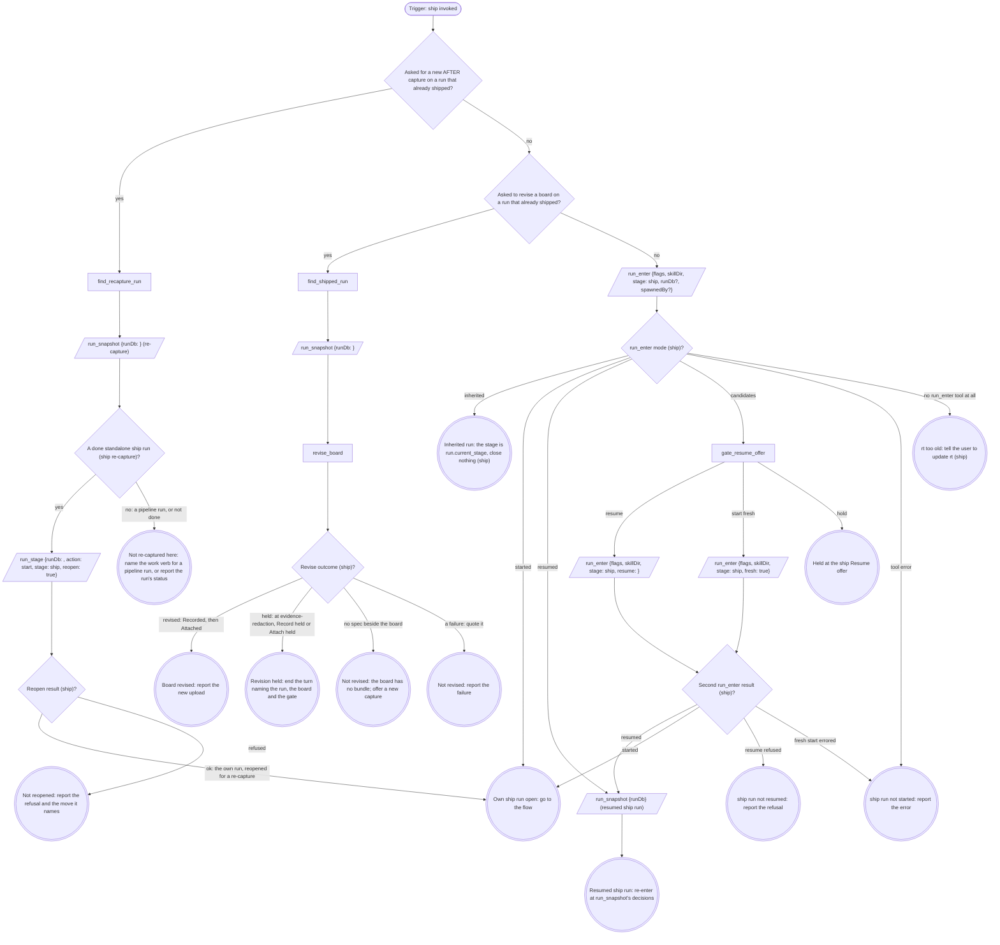

# Run

An own run is a fresh, resumed or reopened one: it records identity and
closes at the end. An inherited run records no identity, closes nothing, and hands
back to the verb that invoked it.

The flags, rendered by the compiler:

{{run-start.flags:ship}}

`run_enter` takes `flags` = the `ship` flag string above, verbatim (the
value, never its key), `skillDir` = the absolute `folder` your
`skills_resolve` map returned, `stage: ship`, `runDb` only when a caller handed one, and `spawnedBy`
only when a board or another surface launched this pane. It opens the stage
itself. Pass the returned `runDb` to every `run_*` call; nothing is
exported. A handed `runDb` that comes back `handedRunDb: "not-running"`
counts as not handed. Every gate write and `stage` argument is `"ship"` in
an own run and `run.current_stage` in an inherited one.
