# stage: evidence

{{stage.fields}}

Run state: the orchestrator opens and closes this stage, so never write
`run_stage` `start` or `done` here. `evidence_record` writes `evidence`;
never write it with `run_field_set`. A `<slug> spent?` diamond is yes when
the `run_budget` before it returns `spent` over `limit`. `detailPath` on a
failure is whatever was captured so far.

Capture the BEFORE now, before implementation changes the surface.

```dot
digraph evidence {
    "Evidence stage entered" [shape=ellipse];
    "run_field_get {key: evidence-plan}" [shape=plaintext];
    "run_field_get {key: worktree}" [shape=plaintext];
    "evidence-plan starts with none?" [shape=diamond];
    "evidence_record {runDb, stage: evidence, plan: \"none\"}" [shape=plaintext];
    "Run the domain steps before the gate (none when unbound)" [shape=box];
    "Domain needs dev servers or another rt read?" [shape=diamond];
    "dev_endpoints {tree: <worktree>, roles: <the domain's roles>}" [shape=plaintext];
    "STOP: ports come only from dev_endpoints" [shape=octagon style=filled fillcolor=red fontcolor=white];
    "Any role waiting or unclaimed?" [shape=diamond];
    "rt_verb {args: [<verb>, ...]}" [shape=plaintext];
    "STOP: rt reads go only through rt_verb" [shape=octagon style=filled fillcolor=red fontcolor=white];
    "Intake questions declared, or source not local?" [shape=diamond];
    "Gate evidence (table below)" [shape=box];
    "evidence answer?" [shape=diamond];
    "Ticket already shows the broken state?" [shape=diamond];
    "Record the ticket's location as the BEFORE" [shape=box];
    "Capture the BEFORE for the next case" [shape=box];
    "Captured?" [shape=diamond];
    "run_budget {runDb, key: evidence:capture-attempts:<case>, limit: 2, stage: evidence}" [shape=plaintext];
    "capture-attempts spent?" [shape=diamond];
    "Every planned case captured or located?" [shape=diamond];
    "Pick the next source or view" [shape=box];
    "Same source the gate recorded?" [shape=diamond];
    "STOP: a new data source is an off-script move" [shape=octagon style=filled fillcolor=red fontcolor=white];
    "Off-script gate: a new data source" [shape=box];
    "off-script answer?" [shape=diamond];
    "run_budget {runDb, key: evidence:source-off-script, limit: 1, stage: evidence}" [shape=plaintext];
    "source-off-script spent?" [shape=diamond];
    "Domain attaches evidence to an MR here?" [shape=diamond];
    "run_field_get {key: branch}" [shape=plaintext];
    "git -C <worktree> remote get-url origin" [shape=plaintext];
    "Forge host?" [shape=diamond];
    "mr_for_branch {repoName: <worktree>, branches: [<branch>]}" [shape=plaintext];
    "gh pr view <branch> --json number,url,state" [shape=plaintext];
    "Open MR or PR on the branch?" [shape=diamond];
    "Gate evidence-attach (table below)" [shape=box];
    "attach answer?" [shape=diamond];
    "Record the evidence (evidence-record)" [shape=box];
    "Record outcome?" [shape=diamond];
    "Attach now answered?" [shape=diamond];
    "Attach the evidence (evidence-record)" [shape=box];
    "Attach outcome?" [shape=diamond];
    "run_stage {action: fail, stage: evidence, reason, detailPath}" [shape=plaintext];
    "run_hold {runDb, stage: evidence, reason, decidedBy}" [shape=plaintext];
    "Held: end the turn naming run and stage" [shape=doublecircle];
    "Stage failed" [shape=doublecircle];
    "Evidence done: return to the orchestrator" [shape=doublecircle style=filled fillcolor=lightgreen];

    "Evidence stage entered" -> "run_field_get {key: evidence-plan}" -> "run_field_get {key: worktree}" -> "evidence-plan starts with none?";
    "evidence-plan starts with none?" -> "evidence_record {runDb, stage: evidence, plan: \"none\"}" [label="yes"];
    "evidence-plan starts with none?" -> "Run the domain steps before the gate (none when unbound)" [label="no"];
    "evidence_record {runDb, stage: evidence, plan: \"none\"}" -> "Evidence done: return to the orchestrator" [label="written"];
    "evidence_record {runDb, stage: evidence, plan: \"none\"}" -> "run_stage {action: fail, stage: evidence, reason, detailPath}" [label="errored"];
    "Run the domain steps before the gate (none when unbound)" -> "Domain needs dev servers or another rt read?";
    "Domain needs dev servers or another rt read?" -> "dev_endpoints {tree: <worktree>, roles: <the domain's roles>}" [label="dev servers"];
    "Domain needs dev servers or another rt read?" -> "rt_verb {args: [<verb>, ...]}" [label="another rt read"];
    "Domain needs dev servers or another rt read?" -> "STOP: ports come only from dev_endpoints" [label="tempted to look up or probe ports on Bash"];
    "Domain needs dev servers or another rt read?" -> "STOP: rt reads go only through rt_verb" [label="tempted to run rt on Bash"];
    "Domain needs dev servers or another rt read?" -> "Intake questions declared, or source not local?" [label="no"];
    "STOP: ports come only from dev_endpoints" -> "dev_endpoints {tree: <worktree>, roles: <the domain's roles>}";
    "STOP: rt reads go only through rt_verb" -> "rt_verb {args: [<verb>, ...]}";
    "dev_endpoints {tree: <worktree>, roles: <the domain's roles>}" -> "Any role waiting or unclaimed?";
    "Any role waiting or unclaimed?" -> "Gate evidence (table below)" [label="yes: name it in the gate's sentence"];
    "Any role waiting or unclaimed?" -> "rt_verb {args: [<verb>, ...]}" [label="no, and another rt read"];
    "Any role waiting or unclaimed?" -> "Intake questions declared, or source not local?" [label="no"];
    "rt_verb {args: [<verb>, ...]}" -> "Intake questions declared, or source not local?";
    "Intake questions declared, or source not local?" -> "Gate evidence (table below)" [label="yes"];
    "Intake questions declared, or source not local?" -> "Ticket already shows the broken state?" [label="no"];
    "Gate evidence (table below)" -> "evidence answer?";
    "evidence answer?" -> "Ticket already shows the broken state?" [label="proceed: intake and source recorded"];
    "evidence answer?" -> "Gate evidence (table below)" [label="iterate: re-ask with their note"];
    "evidence answer?" -> "dev_endpoints {tree: <worktree>, roles: <the domain's roles>}" [label="iterate, a role was waiting or unclaimed: re-check"];
    "evidence answer?" -> "run_stage {action: fail, stage: evidence, reason, detailPath}" [label="hand back"];
    "Ticket already shows the broken state?" -> "Record the ticket's location as the BEFORE" [label="yes"];
    "Ticket already shows the broken state?" -> "Capture the BEFORE for the next case" [label="no"];
    "Record the ticket's location as the BEFORE" -> "Every planned case captured or located?";
    "Every planned case captured or located?" -> "Ticket already shows the broken state?" [label="no"];
    "Every planned case captured or located?" -> "Domain attaches evidence to an MR here?" [label="yes"];
    "Capture the BEFORE for the next case" -> "Captured?";
    "Captured?" -> "Every planned case captured or located?" [label="yes"];
    "Captured?" -> "run_budget {runDb, key: evidence:capture-attempts:<case>, limit: 2, stage: evidence}" [label="no"];
    "run_budget {runDb, key: evidence:capture-attempts:<case>, limit: 2, stage: evidence}" -> "capture-attempts spent?";
    "capture-attempts spent?" -> "Pick the next source or view" [label="no"];
    "capture-attempts spent?" -> "Gate evidence (table below)" [label="yes: reopen with what was tried"];
    "Pick the next source or view" -> "Same source the gate recorded?";
    "Same source the gate recorded?" -> "Capture the BEFORE for the next case" [label="yes"];
    "Same source the gate recorded?" -> "STOP: a new data source is an off-script move" [label="no"];
    "STOP: a new data source is an off-script move" -> "Off-script gate: a new data source" -> "off-script answer?";
    "off-script answer?" -> "Capture the BEFORE for the next case" [label="proceed + take: the proposed source"];
    "off-script answer?" -> "run_stage {action: fail, stage: evidence, reason, detailPath}" [label="proceed + hand back"];
    "off-script answer?" -> "run_budget {runDb, key: evidence:source-off-script, limit: 1, stage: evidence}" [label="iterate: the human fixed the recorded source"];
    "run_budget {runDb, key: evidence:source-off-script, limit: 1, stage: evidence}" -> "source-off-script spent?";
    "source-off-script spent?" -> "Capture the BEFORE for the next case" [label="no: the recorded source"];
    "source-off-script spent?" -> "run_stage {action: fail, stage: evidence, reason, detailPath}" [label="yes: hand back"];
    "Domain attaches evidence to an MR here?" -> "run_field_get {key: branch}" [label="yes"];
    "Domain attaches evidence to an MR here?" -> "Record the evidence (evidence-record)" [label="no: ship attaches"];
    "run_field_get {key: branch}" -> "git -C <worktree> remote get-url origin" -> "Forge host?";
    "Forge host?" -> "mr_for_branch {repoName: <worktree>, branches: [<branch>]}" [label="GitLab"];
    "Forge host?" -> "gh pr view <branch> --json number,url,state" [label="GitHub"];
    "Forge host?" -> "Record the evidence (evidence-record)" [label="another host: ship attaches"];
    {"mr_for_branch {repoName: <worktree>, branches: [<branch>]}" "gh pr view <branch> --json number,url,state"} -> "Open MR or PR on the branch?";
    "Open MR or PR on the branch?" -> "Gate evidence-attach (table below)" [label="yes (a PR's state is OPEN): keep its url"];
    "Open MR or PR on the branch?" -> "Record the evidence (evidence-record)" [label="no, or a PR not OPEN: ship attaches later"];
    "Gate evidence-attach (table below)" -> "attach answer?";
    "attach answer?" -> "Record the evidence (evidence-record)" [label="attach now, or hand back the markdown"];
    "attach answer?" -> "Gate evidence-attach (table below)" [label="iterate: re-ask with their note"];
    {"evidence answer?" "off-script answer?" "attach answer?"} -> "run_hold {runDb, stage: evidence, reason, decidedBy}" [label="hold"];
    "Record the evidence (evidence-record)" -> "Record outcome?";
    "Record outcome?" -> "Attach now answered?" [label="Recorded"];
    "Attach now answered?" -> "Attach the evidence (evidence-record)" [label="yes"];
    "Attach now answered?" -> "Evidence done: return to the orchestrator" [label="no"];
    "Attach the evidence (evidence-record)" -> "Attach outcome?";
    "Attach outcome?" -> "Evidence done: return to the orchestrator" [label="Attached, or Taken: ship's attach sends the refused files"];
    {"Record outcome?" "Attach outcome?"} -> "run_hold {runDb, stage: evidence, reason, decidedBy}" [label="Held"];
    {"Record outcome?" "Attach outcome?"} -> "run_stage {action: fail, stage: evidence, reason, detailPath}" [label="Failed: the reason quoted"];
    "run_hold {runDb, stage: evidence, reason, decidedBy}" -> "Held: end the turn naming run and stage";
    "run_stage {action: fail, stage: evidence, reason, detailPath}" -> "Stage failed";
}
```

### Run the domain steps before the gate (none when unbound)

The domain's gathering steps: the running app's dev servers, its data
source, and any fact the gate's sentence or the `source` question needs.
Their result decides whether `source` fires. A role `dev_endpoints` lists
in `waiting` (claimed, never answered) or reports unclaimed goes in the
evidence gate's sentence, so the gate opens with no intake question.

### Reading a GitLab fact no read tool returns

At any step, a GitLab fact no read tool returns is read with
`gitlab_get {repoName, path}`: `repoName` = the tree this stage targets,
`path` relative to the API root with `:id` for this project (for example
`projects/:id/merge_requests/<iid>/notes`). It is part of the step, not
an off-script move. Quote a GitLab error as written; its refusal of a
credential path is final.

### Record the ticket's location as the BEFORE

When the ticket already embeds the broken state (a screenshot, a failing
output), that is the before: keep where it sits for the record's `url`
instead of recapturing. That case has no BEFORE image; ship records it
with its AFTER.

### Capture the BEFORE for the next case

The plan names the cases; give each an `id` and a `label` now. Follow the
domain's capture method for the plan's evidence type. Never reconstruct a
before by reverting code on a running dev server: it produces stale,
false befores. Unbound, capture what a generic toolchain can (the failing
test output, a CLI transcript, a screenshot the user provides). Leave
each capture where it was written. A text capture goes to a file in the
session temp root; that path is the record's `transcript`.

### Pick the next source or view

A failed capture (a blank page, a missing record, a wrong route) gets one
different attempt per round: another view, another record, the same
source.

### Off-script gate: a new data source

Scope `off-script:evidence:<n>`, `n` counting this stage pass's
off-script gates from 1, the upload gate inside `Attach the evidence`
included. `context` names the recorded source and the proposed one. Read
`next` first: Hold ends the turn with no capture made; Iterate (which
ignores `action`) retries the recorded source after the human's fix; only
Take uses the proposed source.

### Record the evidence (evidence-record)

Run `Record the evidence` below for every BEFORE: each image by the
`path` the capture wrote, with `case`, `slot: before` and `label`; the
text capture as `transcript`; the ticket location as `url`; `tree` the
worktree. The attach gate's `annotations` answers feed its
annotate-or-waive pass. **Hand back the markdown** ends here, nothing
attached.

### Attach the evidence (evidence-record)

Run `Attach the evidence` below with `mrUrl` = the url the lookup kept.
Taken is not a failure: ship's attach sends the refused files later.

## Gate `evidence` (before any capture)

One sentence above the form: what the plan asks for and what is unknown,
naming any dev-server role left waiting or unclaimed.

| Question | Options (recommended first) | Shown when |
|---|---|---|
| the domain's intake | as the domain words them; an open-ended one is free text in the form | the domain declares them |
| `source` (write-in) | **Proceed with `<source>` (Recommended)** / **Switch to local** | the data source is not local |
| `next` | **Proceed** / **Iterate here** / **Hold**, plus **Hand back** once three captures have failed | always |

Selection: `{"intake":{<answers>},"source":"<as confirmed>","next":"proceed|iterate|hold|handback","note":"<their words or null>"}`.

## Gate `evidence-attach` (the domain attaches here and the lookup found an open MR or PR)

One sentence above the form: what was captured and where it sits.

| Question | Options (recommended first) | Shown when |
|---|---|---|
| `annotations` | the proposed marks per image, multi-select, all pre-selected; an image left with nothing selected goes to the waiver question (evidence record below); split `annotations-1`, ... over 4 | always |
| `attach` (write-in) | **Hand back the markdown (Recommended)** (ship attaches) / **Attach to the MR now** | always |
| `next` | **Proceed** / **Iterate here** / **Hold** | always |

Selection: `{"annotations":[...],"attach":"now|handback"}`.

| Thought | Reality |
|---|---|
| "I have no concrete case ids to offer, so I'll explain the gap after the form" | An open-ended intake question needs no invented options: it is free text inside the form. Prose after the form is what the gate forbids. |

## Domain rules

The domain rules below supply the capture method, the intake questions
and the attach heading. Where a domain step names a move the graph marks
STOP (an rt command or a port probe on Bash, a different data source),
the STOP node wins.

{{slot:domain}}

When nothing is inlined above, the graph and the Capture section are the
whole flow. Ship adds the AFTERs to the same record.

## Evidence record

{{include:evidence-record}}

## Gate protocol

{{include:gate-protocol}}

## Wrap-up form contract

{{include:wrap-up-form}}
