# stage: evidence

{{stage.fields}}

Run state: the orchestrator opens and closes this stage, so never write
`run_stage` `start` or `done` here. Read consumes with `run_field_get`.
`evidence_record` writes `evidence`; never write it with `run_field_set`.
A hold is `run_hold`; a failure is `run_stage {action: fail, stage:
"evidence", reason, detailPath}` with `detailPath` = whatever was captured
so far.

Capture the BEFORE now, before implementation changes the surface.

```dot
digraph evidence {
    rankdir=TB;

    "Evidence stage entered" [shape=ellipse];
    "run_field_get {key: evidence-plan}; run_field_get {key: worktree}" [shape=plaintext];
    "evidence-plan starts with none?" [shape=diamond];
    "evidence_record {runDb, stage: evidence, plan: \"none\"}" [shape=plaintext];
    "Run the domain steps before the gate (none when unbound)" [shape=box];
    "Domain needs dev servers or another rt read?" [shape=diamond];
    "dev_endpoints {tree: <worktree>, roles: <the domain's roles>}" [shape=plaintext];
    "STOP: dev-server ports come from dev_endpoints, never a lookup on Bash" [shape=octagon style=filled fillcolor=red fontcolor=white];
    "Any role waiting or unclaimed?" [shape=diamond];
    "rt_verb {args: [<verb>, ...]}" [shape=plaintext];
    "STOP: rt reads go through rt_verb, never rt on Bash" [shape=octagon style=filled fillcolor=red fontcolor=white];
    "Intake questions declared, or source not local?" [shape=diamond];
    "Gate evidence (table below)" [shape=box];
    "evidence answer?" [shape=diamond];
    "Ticket already shows the broken state?" [shape=diamond];
    "Record the ticket's location as the BEFORE" [shape=box];
    "Capture the BEFORE for the next case" [shape=box];
    "Captured?" [shape=diamond];
    "run_budget {runDb, key: evidence:capture-attempts:<case>, limit: 2, stage: evidence}" [shape=plaintext];
    "capture-attempts past its limit?" [shape=diamond];
    "Every planned case captured or located?" [shape=diamond];
    "Pick the next source or view" [shape=box];
    "Same source the gate recorded?" [shape=diamond];
    "STOP: a new data source is an off-script move" [shape=octagon style=filled fillcolor=red fontcolor=white];
    "Off-script gate (gate-protocol, scope off-script:evidence:<n>)" [shape=box];
    "off-script answer?" [shape=diamond];
    "run_budget {runDb, key: evidence:source-off-script, limit: 1, stage: evidence}" [shape=plaintext];
    "source-off-script past its limit?" [shape=diamond];
    "Domain attaches evidence to an MR here?" [shape=diamond];
    "run_field_get {key: branch}" [shape=plaintext];
    "git -C <worktree> remote get-url origin" [shape=plaintext];
    "Forge host?" [shape=diamond];
    "mr_for_branch {repoName: <worktree>, branches: [<branch>]}" [shape=plaintext];
    "Open MR on the branch?" [shape=diamond];
    "gh pr view <branch> --json number,url" [shape=plaintext];
    "Open PR on the branch?" [shape=diamond];
    "Gate evidence-attach (table below)" [shape=box];
    "attach answer?" [shape=diamond];
    "Record the evidence (evidence-record)" [shape=box];
    "Record outcome?" [shape=diamond];
    "Attach now answered?" [shape=diamond];
    "Attach the evidence (evidence-record)" [shape=box];
    "Attach outcome?" [shape=diamond];
    "run_stage {action: fail, stage: evidence, reason, detailPath}" [shape=plaintext];
    "run_hold {runDb, stage: evidence, reason, decidedBy}" [shape=plaintext];
    "Held: end the turn naming run and stage" [shape=doublecircle];
    "Stage failed" [shape=doublecircle];
    "Evidence done: return to the orchestrator" [shape=doublecircle style=filled fillcolor=lightgreen];

    "Evidence stage entered" -> "run_field_get {key: evidence-plan}; run_field_get {key: worktree}";
    "run_field_get {key: evidence-plan}; run_field_get {key: worktree}" -> "evidence-plan starts with none?";
    "evidence-plan starts with none?" -> "evidence_record {runDb, stage: evidence, plan: \"none\"}" [label="yes"];
    "evidence-plan starts with none?" -> "Run the domain steps before the gate (none when unbound)" [label="no"];
    "evidence_record {runDb, stage: evidence, plan: \"none\"}" -> "Evidence done: return to the orchestrator";
    "Run the domain steps before the gate (none when unbound)" -> "Domain needs dev servers or another rt read?";
    "Domain needs dev servers or another rt read?" -> "dev_endpoints {tree: <worktree>, roles: <the domain's roles>}" [label="dev servers"];
    "Domain needs dev servers or another rt read?" -> "rt_verb {args: [<verb>, ...]}" [label="another rt read"];
    "Domain needs dev servers or another rt read?" -> "STOP: dev-server ports come from dev_endpoints, never a lookup on Bash" [label="tempted to look up or probe ports on Bash"];
    "Domain needs dev servers or another rt read?" -> "STOP: rt reads go through rt_verb, never rt on Bash" [label="tempted to run it on Bash"];
    "Domain needs dev servers or another rt read?" -> "Intake questions declared, or source not local?" [label="no"];
    "STOP: dev-server ports come from dev_endpoints, never a lookup on Bash" -> "dev_endpoints {tree: <worktree>, roles: <the domain's roles>}";
    "STOP: rt reads go through rt_verb, never rt on Bash" -> "rt_verb {args: [<verb>, ...]}";
    "dev_endpoints {tree: <worktree>, roles: <the domain's roles>}" -> "Any role waiting or unclaimed?";
    "Any role waiting or unclaimed?" -> "Gate evidence (table below)" [label="yes: name it in the gate's sentence"];
    "Any role waiting or unclaimed?" -> "rt_verb {args: [<verb>, ...]}" [label="no, and another rt read"];
    "Any role waiting or unclaimed?" -> "Intake questions declared, or source not local?" [label="no"];
    "rt_verb {args: [<verb>, ...]}" -> "Intake questions declared, or source not local?";
    "Intake questions declared, or source not local?" -> "Gate evidence (table below)" [label="yes"];
    "Intake questions declared, or source not local?" -> "Ticket already shows the broken state?" [label="no"];
    "Gate evidence (table below)" -> "evidence answer?";
    "evidence answer?" -> "Ticket already shows the broken state?" [label="proceed: intake and source recorded"];
    "evidence answer?" -> "Gate evidence (table below)" [label="iterate: re-ask with their note"];
    "evidence answer?" -> "run_hold {runDb, stage: evidence, reason, decidedBy}" [label="hold"];
    "evidence answer?" -> "run_stage {action: fail, stage: evidence, reason, detailPath}" [label="hand back: detailPath holds what was captured"];
    "Ticket already shows the broken state?" -> "Record the ticket's location as the BEFORE" [label="yes"];
    "Ticket already shows the broken state?" -> "Capture the BEFORE for the next case" [label="no"];
    "Record the ticket's location as the BEFORE" -> "Every planned case captured or located?";
    "Every planned case captured or located?" -> "Ticket already shows the broken state?" [label="no"];
    "Every planned case captured or located?" -> "Domain attaches evidence to an MR here?" [label="yes"];
    "Capture the BEFORE for the next case" -> "Captured?";
    "Captured?" -> "Every planned case captured or located?" [label="yes"];
    "Captured?" -> "run_budget {runDb, key: evidence:capture-attempts:<case>, limit: 2, stage: evidence}" [label="no"];
    "run_budget {runDb, key: evidence:capture-attempts:<case>, limit: 2, stage: evidence}" -> "capture-attempts past its limit?";
    "capture-attempts past its limit?" -> "Pick the next source or view" [label="no"];
    "capture-attempts past its limit?" -> "Gate evidence (table below)" [label="yes: reopen with what was tried"];
    "Pick the next source or view" -> "Same source the gate recorded?";
    "Same source the gate recorded?" -> "Capture the BEFORE for the next case" [label="yes"];
    "Same source the gate recorded?" -> "STOP: a new data source is an off-script move" [label="no"];
    "STOP: a new data source is an off-script move" -> "Off-script gate (gate-protocol, scope off-script:evidence:<n>)";
    "Off-script gate (gate-protocol, scope off-script:evidence:<n>)" -> "off-script answer?";
    "off-script answer?" -> "Capture the BEFORE for the next case" [label="proceed + take: the proposed source"];
    "off-script answer?" -> "run_stage {action: fail, stage: evidence, reason, detailPath}" [label="proceed + hand back"];
    "off-script answer?" -> "run_budget {runDb, key: evidence:source-off-script, limit: 1, stage: evidence}" [label="iterate: the human fixed the evidence gate's source, retry it"];
    "off-script answer?" -> "run_hold {runDb, stage: evidence, reason, decidedBy}" [label="hold: no capture made"];
    "run_budget {runDb, key: evidence:source-off-script, limit: 1, stage: evidence}" -> "source-off-script past its limit?";
    "source-off-script past its limit?" -> "Capture the BEFORE for the next case" [label="no: the evidence gate's source"];
    "source-off-script past its limit?" -> "run_stage {action: fail, stage: evidence, reason, detailPath}" [label="yes: hand back"];
    "Domain attaches evidence to an MR here?" -> "run_field_get {key: branch}" [label="yes"];
    "Domain attaches evidence to an MR here?" -> "Record the evidence (evidence-record)" [label="no: ship attaches"];
    "run_field_get {key: branch}" -> "git -C <worktree> remote get-url origin";
    "git -C <worktree> remote get-url origin" -> "Forge host?";
    "Forge host?" -> "mr_for_branch {repoName: <worktree>, branches: [<branch>]}" [label="GitLab"];
    "Forge host?" -> "gh pr view <branch> --json number,url" [label="GitHub"];
    "Forge host?" -> "Record the evidence (evidence-record)" [label="another host: ship attaches"];
    "mr_for_branch {repoName: <worktree>, branches: [<branch>]}" -> "Open MR on the branch?";
    "Open MR on the branch?" -> "Gate evidence-attach (table below)" [label="yes: keep its url"];
    "Open MR on the branch?" -> "Record the evidence (evidence-record)" [label="no: ship attaches later"];
    "gh pr view <branch> --json number,url" -> "Open PR on the branch?";
    "Open PR on the branch?" -> "Gate evidence-attach (table below)" [label="yes: keep its url"];
    "Open PR on the branch?" -> "Record the evidence (evidence-record)" [label="no: ship attaches later"];
    "Gate evidence-attach (table below)" -> "attach answer?";
    "attach answer?" -> "Record the evidence (evidence-record)" [label="attach now"];
    "attach answer?" -> "Record the evidence (evidence-record)" [label="hand back the markdown"];
    "attach answer?" -> "Gate evidence-attach (table below)" [label="iterate: re-ask with their note"];
    "attach answer?" -> "run_hold {runDb, stage: evidence, reason, decidedBy}" [label="hold"];
    "Record the evidence (evidence-record)" -> "Record outcome?";
    "Record outcome?" -> "Attach now answered?" [label="Recorded"];
    "Record outcome?" -> "run_hold {runDb, stage: evidence, reason, decidedBy}" [label="Held at evidence-waiver"];
    "Record outcome?" -> "run_stage {action: fail, stage: evidence, reason, detailPath}" [label="Failed: the images named or the error quoted"];
    "Attach now answered?" -> "Attach the evidence (evidence-record)" [label="yes"];
    "Attach now answered?" -> "Evidence done: return to the orchestrator" [label="no"];
    "Attach the evidence (evidence-record)" -> "Attach outcome?";
    "Attach outcome?" -> "Evidence done: return to the orchestrator" [label="Attached"];
    "Attach outcome?" -> "Evidence done: return to the orchestrator" [label="Taken: ship's attach sends the refused files"];
    "Attach outcome?" -> "run_hold {runDb, stage: evidence, reason, decidedBy}" [label="Held"];
    "Attach outcome?" -> "run_stage {action: fail, stage: evidence, reason, detailPath}" [label="Failed: the reason quoted"];
    "run_hold {runDb, stage: evidence, reason, decidedBy}" -> "Held: end the turn naming run and stage";
    "run_stage {action: fail, stage: evidence, reason, detailPath}" -> "Stage failed";
}
```

### Run the domain steps before the gate (none when unbound)

The domain's gathering steps: the running app's dev servers and its data
source, and any other fact the gate's own sentence or the `source`
question needs. Their result decides whether `source` fires below.
Dev-server ports come from one `dev_endpoints` call naming the domain's
roles, never a lookup or probe on Bash. A role the result lists in
`waiting` (claimed, never answered) or reports unclaimed goes in the
evidence gate's sentence, so the gate opens even with no intake question.
Any other rt read goes through `rt_verb`. A GitLab fact these steps need
that no read tool returns is read as in "Reading a GitLab fact no read
tool returns".

### Reading a GitLab fact no read tool returns

At any step of this stage, a GitLab fact the read tools do not return is
read with `gitlab_get {repoName, path}`: `repoName` = the checkout or
tree this stage already targets, `path` relative to the API root with `:id`
for this project, for example `projects/:id/merge_requests/<iid>/notes`.
The read is part of the step that needs it, not an off-script move, so it
opens no gate. A GitLab error is quoted as GitLab wrote it. Its refusal of
a credential path is final.

### Record the ticket's location as the BEFORE

When the ticket already embeds the broken state (a screenshot, a failing
output), that is the before: record where it sits instead of
recapturing. That case has no BEFORE image. Keep the location for the
record's `url`; ship records the case with its AFTER.

### Capture the BEFORE for the next case

The plan names the cases; give each an `id` and a `label` now (see the evidence
record below). `capture-attempts` counts failed captures per case.

Follow the domain's capture method for the plan's evidence type. Never
reconstruct a before by reverting code on a running dev server: it
produces stale, false befores. Unbound, capture what a generic toolchain
can (the failing test output, a CLI transcript, or a screenshot the user
provides). Leave each capture where it was written: `Record the evidence`
files it into the run. A text capture (test output, a CLI transcript) is
written to a file in the session temp root; its absolute path is the
record's run-level `transcript`, never uploaded and never waived.

### Pick the next source or view

A capture that failed (a blank page, a missing record, a wrong route)
gets one different attempt per round: another view, another record, the
same source. `run_budget` scopes the count to this stage attempt.

### Off-script gate (gate-protocol, scope off-script:evidence:<n>)

The capture needs a data source the evidence gate did not record. Scope
`off-script:evidence:<n>`, where `n` counts every off-script gate this
stage pass opened, starting at 1: this one and the upload gate inside
`Attach the evidence` share it. `context` names the recorded source and
the proposed one.

### Record the evidence (evidence-record)

Run `Record the evidence` below for every BEFORE this stage holds: each
image by the `path` the capture wrote, with `case`, `slot: before` and
`label`; the text capture as `transcript`; the ticket location as `url`.
`tree` is the worktree. Answers at the attach gate's `annotations`
question feed its annotate-or-waive pass. **Hand back the markdown** ends
here: recorded, nothing attached.

### Attach the evidence (evidence-record)

Run `Attach the evidence` below with `mrUrl` = the MR or PR url the
lookup kept. Taken is not a failure: the stage is done and ship's attach
sends the refused files later.

## What the graph cannot show

- **Off-script answers at the data-source gate.** Read `next` first: Hold
  ends the turn with no capture made, and Iterate means the human fixed
  the evidence gate's source. Iterate ignores `action`; only Proceed
  applies `action`. Retrying the evidence gate's source is Iterate; the
  proposed new source is only Take.

## Gate `evidence` (before any capture)

One sentence above the form: what the plan asks for and what is unknown,
naming any dev-server role left waiting or unclaimed.

| Question | Options (recommended first) | Shown when |
|---|---|---|
| the domain's intake | as the domain words them; an open-ended one is free text in the form | the domain declares them |
| `source` (write-in) | **Proceed with `<source>` (Recommended)** / **Switch to local** | the data source is not local |
| `next` | **Proceed** / **Iterate here** / **Hold**, plus **Hand back** once three captures have failed | always |

Selection: `{"intake":{<answers>},"source":"<as confirmed>","next":"proceed|iterate|hold|handback","note":"<their words or null>"}`.
Hand back fails the stage with `detailPath` = what was captured so far.

## Gate `evidence-attach` (the domain attaches here and the lookup found an open MR or PR)

One sentence above the form: what was captured and where it sits.

| Question | Options (recommended first) | Shown when |
|---|---|---|
| `annotations` | the proposed marks per image, multi-select, all pre-selected; an image left with nothing selected goes to the waiver question (evidence record below); split `annotations-1`, ... over 4 | always |
| `attach` (write-in) | **Hand back the markdown (Recommended)** (ship attaches) / **Attach to the MR now** | always |
| `next` | **Proceed** / **Iterate here** / **Hold** | always |

Selection: `{"annotations":[...],"attach":"now|handback"}`.

| Thought | Reality |
|---|---|
| "I have no concrete case ids to offer, so I'll explain the gap after the form" | An open-ended intake question needs no invented options: it is free text inside the form. Prose after the form is what the gate forbids. |

## Domain rules

The domain rules below supply the capture method, the intake questions
and the attach heading. Where a domain step names a move the graph above
marks STOP (an rt command or a port probe on Bash, a different data
source), the STOP node wins.

{{slot:domain}}

When nothing is inlined above, the graph and the Capture section are the
whole flow.

Finish through Record the evidence; ship adds the AFTERs to the same record.

## Evidence record

{{include:evidence-record}}

## Gate protocol

{{include:gate-protocol}}

## Wrap-up form contract

{{include:wrap-up-form}}
