# stage: evidence

{{stage.fields}}

Run state: the orchestrator opens and closes this stage, so never write
`run_stage` `start` or `done` here. `evidence_record` writes `evidence`;
never write it with `run_field_set`. A `<slug> spent?` diamond reads its
`run_budget` as the evidence record below says. `detailPath` on a failure
is whatever was captured so far.

Capture the BEFORE now, before implementation changes the surface.

```dot
digraph evidence {
    evidence_entered [label="Evidence stage entered" shape=ellipse];
    run_field_get_plan [label="run_field_get {key: evidence-plan}" shape=plaintext];
    run_field_get_worktree [label="run_field_get {key: worktree}" shape=plaintext];
    plan_is_none [label="evidence-plan starts with none?" shape=diamond];
    evidence_record_none [label="evidence_record {runDb, stage: evidence, plan: \"none\"}" shape=plaintext];
    domain_steps_before_gate [label="Run the domain steps before the gate (none when unbound)" shape=box];
    needs_dev_servers [label="Domain needs dev servers or another rt read?" shape=diamond];
    dev_endpoints [label="dev_endpoints {tree: <worktree>, roles: <the domain's roles>}" shape=plaintext];
    stop_guessed_ports [label="STOP: ports come only from dev_endpoints" shape=octagon style=filled fillcolor=red fontcolor=white];
    role_waiting [label="Any role waiting or unclaimed?" shape=diamond];
    rt_verb [label="rt_verb {args: [<verb>, ...]}" shape=plaintext];
    stop_shell_rt_read [label="STOP: rt reads go through rt_verb, never rt on Bash" shape=octagon style=filled fillcolor=red fontcolor=white];
    intake_needed [label="Intake questions declared, or source not local?" shape=diamond];
    gate_evidence [label="Gate evidence (table below)" shape=box];
    evidence_answer [label="evidence answer?" shape=diamond];
    ticket_shows_before [label="Ticket already shows the broken state?" shape=diamond];
    save_ticket_image [label="Save the ticket image as the BEFORE" shape=box];
    ticket_image_saved [label="Ticket image saved?" shape=diamond];
    record_ticket_before [label="Record the ticket's location as the BEFORE" shape=box];
    browser_case [label="Browser screenshot for this case?" shape=diamond];
    capture_browser [label="Capture with the browser (browser-evidence)" shape=box];
    capture_before_case [label="Capture the BEFORE for the next case" shape=box];
    captured [label="Captured?" shape=diamond];
    run_budget_capture_attempts [label="run_budget {runDb, key: evidence:capture-attempts:<case>, limit: 2, stage: evidence}" shape=plaintext];
    capture_attempts_spent [label="capture-attempts spent?" shape=diamond];
    every_case_captured [label="Every planned case captured or located?" shape=diamond];
    pick_next_source [label="Pick the next source or view" shape=box];
    same_source [label="Same source the gate recorded?" shape=diamond];
    stop_new_source [label="STOP: a new data source is an off-script move" shape=octagon style=filled fillcolor=red fontcolor=white];
    gate_new_source [label="Off-script gate: a new data source" shape=box];
    off_script_answer [label="off-script answer?" shape=diamond];
    run_budget_source_off_script [label="run_budget {runDb, key: evidence:source-off-script, limit: 1, stage: evidence}" shape=plaintext];
    source_off_script_spent [label="source-off-script spent?" shape=diamond];
    run_budget_gate_iterates [label="run_budget {runDb, key: evidence:gate-iterates, limit: 2, stage: evidence}" shape=plaintext];
    gate_iterates_spent [label="gate-iterates spent?" shape=diamond];
    domain_attaches_mr [label="Domain attaches evidence to an MR here?" shape=diamond];
    run_field_get_branch [label="run_field_get {key: branch}" shape=plaintext];
    git_remote_origin [label="git -C <worktree> remote get-url origin" shape=plaintext];
    forge_host [label="Forge host?" shape=diamond];
    mr_for_branch [label="mr_for_branch {repoName: <worktree>, branches: [<branch>]}" shape=plaintext];
    gh_pr_view_branch [label="gh pr view <branch> --json number,url,state" shape=plaintext];
    open_mr_on_branch [label="Open MR or PR on the branch?" shape=diamond];
    gate_evidence_attach [label="Gate evidence-attach (table below)" shape=box];
    attach_answer [label="attach answer?" shape=diamond];
    record_evidence [label="Record the evidence (evidence-record)" shape=box];
    record_outcome [label="Record outcome?" shape=diamond];
    attach_answered [label="Attach now answered?" shape=diamond];
    attach_evidence [label="Attach the evidence (evidence-record)" shape=box];
    attach_outcome [label="Attach outcome?" shape=diamond];
    run_stage_fail [label="run_stage {action: fail, stage: evidence, reason, detailPath}" shape=plaintext];
    run_hold [label="run_hold {runDb, stage: evidence, reason, decidedBy}" shape=plaintext];
    held_end_turn [label="Held: end the turn naming run and stage" shape=doublecircle];
    stage_failed [label="Stage failed" shape=doublecircle];
    evidence_done [label="Evidence done: return to the orchestrator" shape=doublecircle style=filled fillcolor=lightgreen];

    evidence_entered -> run_field_get_plan -> run_field_get_worktree -> plan_is_none;
    plan_is_none -> evidence_record_none [label="yes"];
    plan_is_none -> domain_steps_before_gate [label="no"];
    evidence_record_none -> evidence_done [label="written"];
    evidence_record_none -> run_stage_fail [label="errored"];
    domain_steps_before_gate -> needs_dev_servers;
    needs_dev_servers -> dev_endpoints [label="dev servers"];
    needs_dev_servers -> rt_verb [label="another rt read"];
    needs_dev_servers -> stop_guessed_ports [label="tempted to look up or probe ports on Bash"];
    needs_dev_servers -> stop_shell_rt_read [label="tempted to run rt on Bash"];
    needs_dev_servers -> intake_needed [label="no"];
    stop_guessed_ports -> dev_endpoints;
    stop_shell_rt_read -> rt_verb;
    dev_endpoints -> role_waiting;
    role_waiting -> gate_evidence [label="yes: name it in the gate's sentence"];
    role_waiting -> rt_verb [label="no, and another rt read"];
    role_waiting -> intake_needed [label="no"];
    rt_verb -> intake_needed;
    intake_needed -> gate_evidence [label="yes"];
    intake_needed -> ticket_shows_before [label="no"];
    gate_evidence -> evidence_answer;
    evidence_answer -> ticket_shows_before [label="proceed: intake and source recorded"];
    evidence_answer -> gate_evidence [label="iterate: re-ask with their note"];
    evidence_answer -> run_budget_gate_iterates [label="iterate, a role was waiting or unclaimed"];
    run_budget_gate_iterates -> gate_iterates_spent;
    gate_iterates_spent -> dev_endpoints [label="no: re-check"];
    gate_iterates_spent -> run_stage_fail [label="yes: hand back, the roles named"];
    evidence_answer -> run_stage_fail [label="hand back"];
    evidence_answer -> every_case_captured [label="go on without this BEFORE: reopened from an unfixable Not drawn"];
    ticket_shows_before -> save_ticket_image [label="yes: an image"];
    ticket_shows_before -> record_ticket_before [label="yes: a link or text, no image"];
    ticket_shows_before -> browser_case [label="no"];
    save_ticket_image -> ticket_image_saved;
    ticket_image_saved -> every_case_captured [label="yes"];
    ticket_image_saved -> record_ticket_before [label="no: no tool can fetch it, keep the link"];
    record_ticket_before -> every_case_captured;
    every_case_captured -> ticket_shows_before [label="no"];
    every_case_captured -> domain_attaches_mr [label="yes"];
    browser_case -> capture_browser [label="yes"];
    browser_case -> capture_before_case [label="no: the domain's own method"];
    capture_browser -> captured;
    capture_before_case -> captured;
    captured -> every_case_captured [label="yes, or Board ready: keep its board and claim for the record"];
    captured -> run_budget_capture_attempts [label="no, or Not drawn: a failed brief or spent re-renders"];
    captured -> gate_evidence [label="Not drawn, a reason no retry can fix: reopen with what was tried"];
    captured -> run_hold [label="Held at evidence-redaction"];
    run_budget_capture_attempts -> capture_attempts_spent;
    capture_attempts_spent -> pick_next_source [label="no"];
    capture_attempts_spent -> gate_evidence [label="yes: reopen with what was tried"];
    pick_next_source -> same_source;
    same_source -> browser_case [label="yes"];
    same_source -> stop_new_source [label="no"];
    stop_new_source -> gate_new_source -> off_script_answer;
    off_script_answer -> browser_case [label="proceed + take: the proposed source"];
    off_script_answer -> run_stage_fail [label="proceed + hand back"];
    off_script_answer -> run_budget_source_off_script [label="iterate: the human fixed the recorded source"];
    run_budget_source_off_script -> source_off_script_spent;
    source_off_script_spent -> browser_case [label="no: the recorded source"];
    source_off_script_spent -> run_stage_fail [label="yes: hand back"];
    domain_attaches_mr -> run_field_get_branch [label="yes"];
    domain_attaches_mr -> record_evidence [label="no: ship attaches"];
    run_field_get_branch -> git_remote_origin -> forge_host;
    forge_host -> mr_for_branch [label="GitLab"];
    forge_host -> gh_pr_view_branch [label="GitHub"];
    forge_host -> record_evidence [label="another host: ship attaches"];
    {mr_for_branch gh_pr_view_branch} -> open_mr_on_branch;
    open_mr_on_branch -> gate_evidence_attach [label="yes (a PR's state is OPEN): keep its url"];
    open_mr_on_branch -> record_evidence [label="no, or a PR not OPEN: ship attaches later"];
    gate_evidence_attach -> attach_answer;
    attach_answer -> record_evidence [label="attach now, or hand back the markdown"];
    attach_answer -> gate_evidence_attach [label="iterate: revise each drawn board the note names, re-ask with their note"];
    {evidence_answer off_script_answer attach_answer} -> run_hold [label="hold"];
    record_evidence -> record_outcome;
    record_outcome -> attach_answered [label="Recorded"];
    attach_answered -> attach_evidence [label="yes"];
    attach_answered -> evidence_done [label="no"];
    attach_evidence -> attach_outcome;
    attach_outcome -> evidence_done [label="Attached, or Taken: ship's attach sends the refused files"];
    {record_outcome attach_outcome} -> run_hold [label="Record held, or Attach held"];
    {record_outcome attach_outcome} -> run_stage_fail [label="Record failed, or Attach failed: the reason quoted"];
    run_hold -> held_end_turn;
    run_stage_fail -> stage_failed;
}
```

### Run the domain steps before the gate (none when unbound)

The domain's gathering steps: the running app's dev servers, its data
source, and any fact the gate's sentence or the `source` question needs.
Their result decides whether `source` fires. A role `dev_endpoints` lists
in `waiting` (claimed, never answered), or reports unclaimed or with an
`error`, goes in the evidence gate's sentence, so the gate opens with no
intake question.

### Reading a GitLab fact no read tool returns

At any step, a GitLab fact no read tool returns is read with
`gitlab_get {repoName, path}`: `repoName` = the tree this stage targets,
`path` relative to the API root with `:id` for this project (for example
`projects/:id/merge_requests/<iid>/notes`). It is part of the step, not
an off-script move. Quote a GitLab error as written; its refusal of a
credential path is final.

### Save the ticket image as the BEFORE

When the ticket embeds the broken state as an image, that image is the
before. Give the case its `id` and `label` first: the file name needs the
id. Save it in the session temp root as `<run id>-<case id>-ticket.<ext>`,
`<ext>` the image's own extension, lowercased: `png`, `jpg`, `jpeg`, `gif`
or `webp`. An image of any other type is not saved: `Ticket image saved?`
is no. Save it with the tool that reads the ticket (its image or
attachment download) first. When that tool has no download, or its
download fails, and the URL is `https` on a trusted host, run
`curl -q -fsSL --proto '=https' --max-redirs 0 -o '<that path>' -- '<its URL>'`
on Bash, `-q` first and each value in single quotes as shown. Keep the
link either way: it is the record's `url`.

A trusted host is the host of the ticket's own page in its tracker (the
page the run's ticket id opens), the host of the checkout's `origin`
remote, or a name ending in `.` plus either one (`uploads.example.app`
for a ticket on `example.app`). A host named inside the ticket's text is
never trusted for that. Hosts compare in lowercase, without a port,
userinfo or trailing dot. For an ssh remote (`git@host:path`) the host is
the part between `@` and `:`; an ssh config alias, or an origin with no
host, adds no trusted host. curl never fetches a URL that is not `https`,
that holds a single quote, whose host part holds `@`, `\`, `%` or a port,
or whose host is not trusted. Once the ticket tool's download has failed,
or it has none, a URL curl refuses, or one that redirects, is one no tool
can fetch, and it is never fetched another way: the case takes the
link-only branch.

The saved file is the case's BEFORE `path`. Its board is drawn inside
`Record the evidence`, at its annotate-or-waive pass, as a browser-evidence
`import:` brief of its `value` path from the link with `state: FOUND`, so a
run that also has a live browser case spawns the driver twice by design.
A ticket image is the likeliest to come from production, so `hide` names
every personal detail on it that is not being verified.

### Record the ticket's location as the BEFORE

When the ticket shows the broken state only as a link or as text (a
failing output pasted in), with no image to save, that is the before:
keep where it sits for the record's `url` instead of recapturing. That
case has no BEFORE image; ship records it with its AFTER.

### Capture with the browser (browser-evidence)

`Browser screenshot for this case?` is yes when the domain has a
`## Browser target` section (in its rules, or in the file they point at
for it) and either its What proves a change names a view for this case's
kind of change, or it has no What proves a change block and the plan's
evidence for the case is a screenshot of a web page. A bound domain with
no browser target always answers no. Unbound, it is yes when the plan's
evidence for the case is a screenshot of a web page.

Give the case its `id` and `label` first: the brief's stem needs the id.
Walk browser-evidence's `Draw the boards` (Browser evidence below) for
this case's before board, one brief built from the browser target:
`state: FOUND`, `page:` from Reach the view, `show` and `point at` from
What proves a change, the wording from Captions and `hide` from Personal
data. Unbound, every block takes its default.

Its terminals answer `Captured?`:

- **Board ready** is yes. Keep the capture, the board
  (`~/.fast-browser/screenshots/<stem>.png`) and the brief's claim for
  `Record the evidence`.
- **Held at evidence-redaction** is the stage's hold.
- **Not drawn** for a reason no retry can fix (the developer left it
  uncaptured, the doctor stayed red, no compose on PATH, sign-in asks
  spent, no driver to spawn, redaction rounds or openings spent, confirm
  refused twice) reopens the evidence gate with what was tried, which then
  offers **Hand back** and **Go on without this BEFORE** in place of
  **Proceed**, since the same pass would end Not drawn again.
- **Not drawn** for a failed brief or spent re-renders takes the no edge,
  counted against `capture-attempts`.

A yes case follows browser-evidence alone. The domain's own capture steps
(its Capture the BEFORE text, any preview capture, any draw or annotate
step) apply only to its other evidence kinds: on a browser case, the
domain's browser target supplies facts, never steps.

### Capture the BEFORE for the next case

The plan names the cases; give each an `id` and a `label` now. Follow the
domain's capture method for the plan's evidence type. Never reconstruct a
before by reverting code on a running dev server: it produces stale,
false befores. Unbound, capture what a generic toolchain can (the failing
test output, a CLI transcript, a screenshot the user provides). Leave
each capture where it was written. A text capture goes to a file in the
session temp root; that path is the record's `transcript`.

### Pick the next source or view

A failed capture (a blank page, a missing record, a wrong route) gets one
different attempt per round: another view, another record, the same
source.

### Off-script gate: a new data source

Scope `off-script:evidence:<n>`, `n` counting this stage pass's
off-script gates from 1, the upload gate inside `Attach the evidence`
included. `context` names the recorded source and the proposed one. Read
`next` first: Hold ends the turn with no capture made; Iterate (which
ignores `action`) retries the recorded source after the human's fix; only
Take uses the proposed source.

### Record the evidence (evidence-record)

Run `Record the evidence` below for every BEFORE: each image by the
`path` the capture wrote, with `case`, `slot: before` and `label`; the
text capture as `transcript`; the ticket location or a saved image's link
as `url`; `tree` the worktree. A browser case's board that is ready rides
on the first call: `path` its capture (`<stem>.c1.png`), `annotated` the
board, `caption` the brief's claim (browser-evidence, Record the board).
The attach gate's `annotations` answers feed the annotate-or-waive pass
for every other image. **Hand back the markdown** ends here, nothing
attached.

### Attach the evidence (evidence-record)

Run `Attach the evidence` below with `mrUrl` = the url the lookup kept.
Taken is not a failure: ship's attach sends the refused files later.

## Gate `evidence` (before any capture)

One sentence above the form: what the plan asks for and what is unknown,
naming any dev-server role left waiting or unclaimed. Iterate on such a
role re-runs `dev_endpoints` twice at most (`gate-iterates`); the third
fails the stage, naming the roles.

| Question | Options (recommended first) | Shown when |
|---|---|---|
| the domain's intake | as the domain words them; an open-ended one is free text in the form | the domain declares them |
| `source` (write-in) | **Proceed with `<source>` (Recommended)** / **Switch to local** | the data source is not local |
| `next` | **Proceed** / **Iterate here** / **Hold**, plus **Hand back** once three captures have failed; when the gate reopens from an unfixable Not drawn, **Hand back** / **Go on without this BEFORE** / **Iterate here** / **Hold** (no **Proceed**) | always |

Selection: `{"intake":{<answers>},"source":"<as confirmed>","next":"proceed|iterate|hold|handback|goon","note":"<their words or null>"}`.

Go on without this BEFORE goes to `Every planned case captured or
located?` with no BEFORE image for the case, as a ticket-link case has
none: ship captures its AFTER, and the description names the gap.

## Gate `evidence-attach` (the domain attaches here and the lookup found an open MR or PR)

One sentence above the form: what was captured and where it sits.

| Question | Options (recommended first) | Shown when |
|---|---|---|
| `annotations` | the proposed labels per board, each written `<TAG> \| <title> \| <description>` (browser-evidence, Labels), multi-select, all pre-selected; an image left with nothing selected goes to the waiver question (evidence record below); split `annotations-1`, ... over 4 | always |
| `attach` (write-in) | **Hand back the markdown (Recommended)** (ship attaches) / **Attach to the MR now** | always |
| `next` | **Proceed** / **Iterate here** / **Hold** | always |

Selection: `{"annotations":[...],"attach":"now|handback"}`.

For a board not yet drawn (a ticket image, a non-browser image), the kept
labels are its brief's `point at`. A browser case's board is already
drawn: kept labels that differ from its `point at` are a revision, as
under Iterate here, and an image left with nothing selected keeps its
board unless the note asks to waive it.

**Iterate here** with a drawn board the note names is a revision. The
board is not recorded yet and still sits in `~/.fast-browser/screenshots/`,
so walk browser-evidence's Revise a board steps 3 to 5 on it, then re-ask
this gate; `Record the evidence` records the revised board. A Hold at its
redaction gate (step 5) is the stage's hold (`run_hold`); a refused
confirm re-asks this gate with the output quoted.

| Thought | Reality |
|---|---|
| "I have no concrete case ids to offer, so I'll explain the gap after the form" | An open-ended intake question needs no invented options: it is free text inside the form. Prose after the form is what the gate forbids. |

## Domain rules

The domain rules below supply the capture method, the intake questions
and the attach heading. Where a domain step names a move the graph marks
STOP (an rt command or a port probe on Bash, a different data source),
the STOP node wins.

A domain that takes browser screenshots adds a `## Browser target`
section with four blocks (Reach the view, What proves a change, Captions,
Personal data) and no procedure: browser-evidence below does the capture,
the board, the gates and the bundle. Its other evidence kinds stay its own
method. On a browser case the domain's capture steps (preview, draw,
annotate) do not run; its browser target supplies facts, never steps.

{{slot:domain}}

When nothing is inlined above, the graph and the Capture section are the
whole flow. Ship adds the AFTERs to the same record.

## Browser evidence

{{include:browser-evidence}}

## Evidence record

{{include:evidence-record}}

## Gate protocol

{{include:gate-protocol}}

## Wrap-up form contract

{{include:wrap-up-form}}
