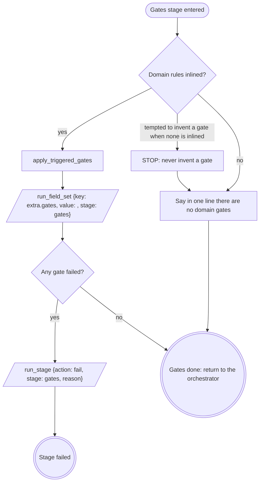

# stage: gates

{{stage.fields}}

The orchestrator owns this stage's rows: read consumes with
`run_field_get`, write fields with `run_field_set {stage: "gates"}`, and end
a failure with `run_stage {action: fail, stage: "gates", reason}` naming
which gate failed and what it found.

