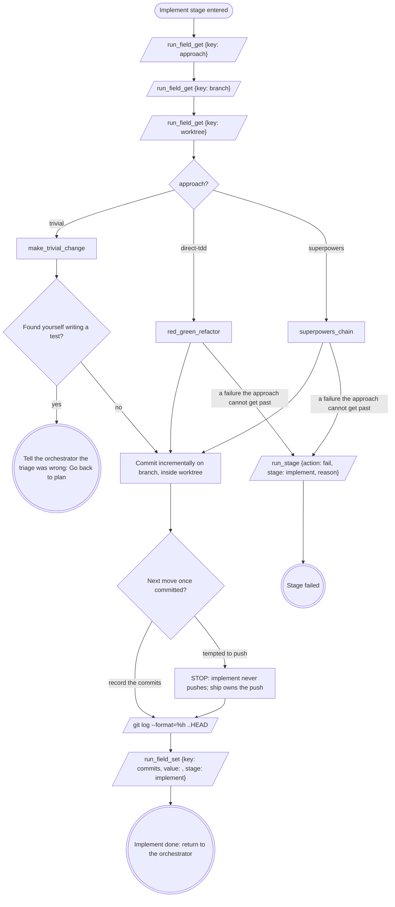

# stage: implement

{{stage.fields}}

The orchestrator owns this stage's rows: read consumes with
`run_field_get`, write produces with `run_field_set {stage: "implement"}`,
and end a failure with `run_stage {action: fail, stage: "implement",
reason}`.

