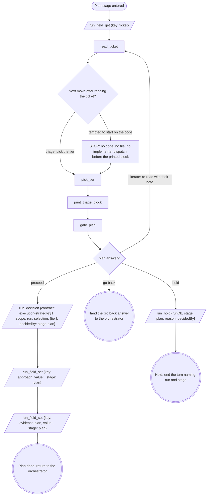

# stage: plan

{{stage.fields}}

The orchestrator owns this stage's rows: read consumes with
`run_field_get`, write produces with `run_field_set {stage: "plan"}`, and
end a failure with `run_stage {action: fail, stage: "plan", reason}`.

