# stage: provision

{{stage.fields}}

The orchestrator owns this stage's rows: read consumes with
`run_field_get`, write produces with `run_field_set {stage: "provision"}`,
and end a failure with `run_stage {action: fail, stage: "provision",
reason}`.

```dot
digraph provision {
    rankdir=TB;

    provision_entered [label="Provision stage entered" shape=ellipse];
    run_field_get_mode [label="run_field_get {key: mode}" shape=plaintext];
    mode_is_worker [label="mode is worker?" shape=diamond];
    git_status_pwd [label="git status in $PWD" shape=plaintext];
    clean_run [label="Clean run?" shape=diamond];
    domain_rules_inlined [label="Domain rules inlined?" shape=diamond];
    follow_domain_flow [label="Follow the domain's provision flow" shape=box];
    domain_flow_result [label="Domain flow result?" shape=diamond];
    worktree_provision_precheck [label="worktree_provision {repoName, ticket | branch, ticketTitle?, precheck: true}" shape=plaintext];
    precheck_result [label="Precheck result?" shape=diamond];
    worktree_provision_codes [label="worktree_provision {repoName, ticket | branch, ticketTitle?, codes: true, runDb, stage: provision, budget: {key: provision-refusals, limit: 2}}" shape=plaintext];
    provision_result [label="worktree_provision result?" shape=diamond];
    whoami [label="whoami {}" shape=plaintext];
    gate_provision [label="Gate provision (table below)" shape=box];
    provision_answer [label="provision answer?" shape=diamond];
    picked_tree_held [label="Picked tree read held?" shape=diamond];
    worktree_provision_reuse [label="worktree_provision {repoName, branch: <the picked branch>, reuse: true, runDb, stage: provision}" shape=plaintext];
    worktree_provision_take_over [label="worktree_provision {repoName, branch: <the picked branch>, reuse: true, takeOver: true, runDb, stage: provision}" shape=plaintext];
    reuse_result [label="Reuse result?" shape=diamond];
    run_budget_fresh_tree [label="run_budget {key: fresh-tree, limit: 2, stage: provision}" shape=plaintext];
    fresh_tree_budget_spent [label="Fresh trees this attempt = 2?" shape=diamond];
    git_branch_list [label="git -C <repo> branch --list <slug>-*" shape=plaintext];
    enter_worktree [label="EnterWorktree {path}" shape=plaintext];
    recorded_on_run [label="Recorded on the run?" shape=diamond];
    git_rev_parse [label="git -C <repo> rev-parse --git-dir" shape=plaintext];
    git_status_porcelain [label="git -C <repo> status --porcelain" shape=plaintext];
    checkout_clean [label="Checkout clean?" shape=diamond];
    git_switch_create [label="git -C <repo> switch -c <branch> <default>" shape=plaintext];
    stop_hand_rolled_worktree [label="STOP: never hand-roll a worktree; worktree_provision or the plain branch fallback" shape=octagon style=filled fillcolor=red fontcolor=white];
    run_field_set_branch [label="run_field_set {key: branch, value: <branch>, stage: provision}" shape=plaintext];
    run_field_set_worktree [label="run_field_set {key: worktree, value: <absolute path>, stage: provision}" shape=plaintext];
    stage_made_ticket [label="This stage found or created the ticket?" shape=diamond];
    run_field_set_ticket [label="run_field_set {key: ticket, value: <id>, stage: provision}" shape=plaintext];
    run_stage_fail [label="run_stage {action: fail, stage: provision, reason}" shape=plaintext];
    run_hold [label="run_hold {runDb, stage: provision, reason, decidedBy}" shape=plaintext];
    held_end_turn [label="Held: end the turn naming run and stage" shape=doublecircle];
    stage_failed [label="Stage failed" shape=doublecircle];
    provision_done [label="Provision done: return to the orchestrator" shape=doublecircle style=filled fillcolor=lightgreen];

    provision_entered -> run_field_get_mode;
    run_field_get_mode -> mode_is_worker;
    mode_is_worker -> git_status_pwd [label="worker"];
    mode_is_worker -> domain_rules_inlined [label="interactive, or the key is not set"];
    git_status_pwd -> clean_run;
    clean_run -> run_field_set_branch [label="yes: $PWD and its branch"];
    clean_run -> run_stage_fail [label="no"];
    domain_rules_inlined -> follow_domain_flow [label="yes"];
    domain_rules_inlined -> worktree_provision_precheck [label="no"];
    follow_domain_flow -> domain_flow_result;
    domain_flow_result -> worktree_provision_precheck [label="it provisions a tree"];
    domain_flow_result -> gate_provision [label="it raises a question"];
    domain_flow_result -> run_field_set_branch [label="already provisioned: this tree and its branch"];
    worktree_provision_precheck -> precheck_result;
    precheck_result -> whoami [label="trees to resume"];
    whoami -> gate_provision;
    precheck_result -> worktree_provision_codes [label="nothing in the way"];
    precheck_result -> worktree_provision_codes [label="refused daemon-outdated"];
    precheck_result -> git_rev_parse [label="refused daemon-unreachable or repo-unknown"];
    precheck_result -> run_stage_fail [label="refused otherwise"];
    worktree_provision_codes -> provision_result;
    provision_result -> enter_worktree [label="provisioned: the result's path"];
    provision_result -> whoami [label="refused branch-attached"];
    provision_result -> git_rev_parse [label="refused daemon-unreachable or repo-unknown"];
    provision_result -> worktree_provision_codes [label="refused busy, budget not exhausted"];
    provision_result -> run_stage_fail [label="any other refusal, or busy with the budget exhausted"];
    provision_result -> stop_hand_rolled_worktree [label="tempted to hand-roll one"];
    stop_hand_rolled_worktree -> run_stage_fail;
    git_rev_parse -> git_status_porcelain;
    git_status_porcelain -> checkout_clean;
    checkout_clean -> git_switch_create [label="yes"];
    checkout_clean -> run_stage_fail [label="no: quote the dirty paths as the reason"];
    git_switch_create -> run_field_set_branch [label="worktree = the checkout"];
    gate_provision -> provision_answer;
    provision_answer -> picked_tree_held [label="resume in <tree or branch>"];
    picked_tree_held -> worktree_provision_reuse [label="no"];
    picked_tree_held -> worktree_provision_take_over [label="yes: the human picked it anyway"];
    provision_answer -> run_budget_fresh_tree [label="fresh tree"];
    provision_answer -> follow_domain_flow [label="ticket: create one"];
    provision_answer -> follow_domain_flow [label="ticket: recheck the id"];
    provision_answer -> follow_domain_flow [label="slug: their typed text"];
    provision_answer -> follow_domain_flow [label="a domain answer"];
    provision_answer -> follow_domain_flow [label="iterate: redo with their note"];
    provision_answer -> run_hold [label="hold"];
    run_hold -> held_end_turn;
    worktree_provision_reuse -> reuse_result;
    worktree_provision_take_over -> reuse_result;
    reuse_result -> enter_worktree [label="reused or provisioned: the result's path"];
    reuse_result -> run_stage_fail [label="refused: quote it"];
    run_budget_fresh_tree -> fresh_tree_budget_spent;
    fresh_tree_budget_spent -> worktree_provision_codes [label="no, ticket mode: provision fresh, no precheck"];
    fresh_tree_budget_spent -> git_branch_list [label="no, branch mode"];
    git_branch_list -> worktree_provision_codes [label="branch = <slug>-<n>"];
    fresh_tree_budget_spent -> run_stage_fail [label="yes: exhausted"];
    enter_worktree -> recorded_on_run;
    recorded_on_run -> stage_made_ticket [label="yes: recorded true"];
    recorded_on_run -> run_field_set_branch [label="no: recordError"];
    run_field_set_branch -> run_field_set_worktree;
    run_field_set_worktree -> stage_made_ticket;
    stage_made_ticket -> run_field_set_ticket [label="yes"];
    stage_made_ticket -> provision_done [label="no, or it came in known"];
    run_field_set_ticket -> provision_done;
    run_stage_fail -> stage_failed;
}
```

### Follow the domain's provision flow

The domain's own acquisition: finding or creating the ticket, choosing the
branch name, provisioning its way. Each question it raises goes to the
`provision` gate, never asked on its own. A pane already on the ticket's
branch in a worktree is confirmed, not provisioned again.

### Precheck result?

**Trees to resume** are, each tree once and in this order:

1. the `attached` tree, only when exactly one is listed (two or more make
   `reuse` refuse `branch-duplicated`, so offer none of them);
2. the surviving local branch (`localBranch: true` with no `attached`
   tree), offered as resume on `base`;
3. every `sameTicket` tree, but only when no domain rules are inlined (a
   domain flow asks its own slug question for those).

All of them go in the gate's one `resume_in` question, the first 3 in that
order plus **Fresh tree**; provisioning adds no other gate or question.
A claimed tree whose `owner` is set is held by someone else unless that
owner is `herd:<id>`, where `<id>` is `herd.id` from `whoami` (this pane's
own herd). A tree the EnterWorktree hook claimed has owner `claude`, which
names no session, so it reads as held. A held tree's option reads **Resume
in `<tree>` (held by `<owner>` since `<claimedAt>`)** and is never the
recommended one; when every offered tree is held, **Fresh tree** is
recommended.
Two or more `attached` trees with nothing else to offer still go to the
gate, offering **Fresh tree** alone. **Nothing in the way** means no
`attached` tree and no other offer. A refused precheck routes on its
`code`; `daemon-outdated` never retries the precheck.

### worktree_provision result?

Route on the refusal's `code`, never its prose. `branch-attached` offers
its `tree` on the gate. `budget.exhausted` decides a `busy` retry; a
`budget.error` reads as exhausted. The budget counts every refusal this
attempt, so `busy` is retried only if no other refusal came first. A
failed stage quotes `error`.

### Fresh trees this attempt = 2?

Read `run_budget`'s `exhausted`; an error reads as exhausted. Branch mode
takes the lowest `n` from 2 that the branch list lacks.

### Picked tree read held?

Yes when the option the human picked read **(held by ...)** on the gate.
Picking it is the human's consent to take the tree over, so that call
passes `takeOver: true`; without it the tool refuses `tree-held`.

### Reuse result?

A refusal fails the stage quoting `error`, `tree-held` included (another
owner claimed the tree after the gate); the human can pick Fresh tree on a
retry.

### Recorded on the run?

`recorded: true` means the tool wrote `branch` and `worktree`: write
neither. `recordError` keeps the tree: quote it in one line and write both
by hand.

## What the graph cannot show

- `worktree_provision` takes `repoName` (the repo's checkout path) and
  `ticket`, plus `ticketTitle` whenever a title is known: without it the
  branch gets no slug. With no ticket, pass `branch` = a short kebab slug
  of the task description instead. A cold create can take minutes; say
  that it is provisioning.
- The plain branch fallback derives the branch from the ticket id and a
  kebab slug of its title (or of the task description). Never commit to
  the default branch.
- `worktree` is always an absolute path: the checkout itself when no
  separate worktree is used.
- `ticket` is not a declared produce: a ticketless run is a finished run.
  Write it only when this stage is what found or created it.

## Gate `provision`

Walk gate-protocol's Runs integration with kind `provision`, `runDb` and
`stage: "provision"`; the gate tools record the answers. One sentence
above the form: what was found (the tree, the missing ticket, the title).

| Question | Options (recommended first) | Shown when |
|---|---|---|
| `resume_in` (write-in) | **Resume in `<tree>` (Recommended)**, one per tree to resume, at most 3; a tree another session holds reads **(held by `<owner>` since `<claimedAt>`)** instead / **Fresh tree** | the precheck lists trees to resume, or provision refused `branch-attached` |
| `ticket` (write-in) | **Create one (Recommended)** / **I will recheck the id** | a ticket was not found |
| `slug` | the slug as their text (a typed slug arrives as the note, or as `text`) | the title is too generic for a slug |
| the domain's own | as the domain words them | the domain declares them |
| `next` | **Proceed** / **Iterate here** / **Hold** | always |

The picked branch for a resume is that tree's `branch`, `base` for a
surviving local branch, or after a `branch-attached` refusal the branch
the provision passed.

## Domain rules

The domain rules below supply the provision flow, the ticket lookup and
extra gate questions. Where a domain step names a move the graph above
marks STOP (hand-rolling a worktree), the STOP node wins.

{{slot:domain}}

When nothing is inlined above, the graph alone is the flow.

## Gate protocol

{{include:gate-protocol}}

## Wrap-up form contract

{{include:wrap-up-form}}
