# stage: provision

{{stage.fields}}

The orchestrator owns this stage's rows: read consumes with
`run_field_get`, write produces with `run_field_set {stage: "provision"}`,
and end a failure with `run_stage {action: fail, stage: "provision",
reason}`.

```dot
digraph provision {
    rankdir=TB;

    "Provision stage entered" [shape=ellipse];
    "run_field_get {key: mode}" [shape=plaintext];
    "mode is worker?" [shape=diamond];
    "git status in $PWD" [shape=plaintext];
    "Clean run?" [shape=diamond];
    "Domain rules inlined?" [shape=diamond];
    "Follow the domain's provision flow" [shape=box];
    "Domain flow result?" [shape=diamond];
    "worktree_provision {repoName, ticket | branch, ticketTitle?, precheck: true}" [shape=plaintext];
    "Precheck result?" [shape=diamond];
    "worktree_provision {repoName, ticket | branch, ticketTitle?, codes: true, runDb, stage: provision, budget: {key: provision-refusals, limit: 2}}" [shape=plaintext];
    "worktree_provision result?" [shape=diamond];
    "Gate provision (table below)" [shape=box];
    "provision answer?" [shape=diamond];
    "worktree_provision {repoName, branch: <the picked branch>, reuse: true, runDb, stage: provision}" [shape=plaintext];
    "Reuse result?" [shape=diamond];
    "run_budget {key: fresh-tree, limit: 2, stage: provision}" [shape=plaintext];
    "Fresh trees this attempt = 2?" [shape=diamond];
    "EnterWorktree {path}" [shape=plaintext];
    "Recorded on the run?" [shape=diamond];
    "git -C <repo> rev-parse --git-dir" [shape=plaintext];
    "git -C <repo> status --porcelain" [shape=plaintext];
    "Checkout clean?" [shape=diamond];
    "git -C <repo> switch -c <branch> <default>" [shape=plaintext];
    "STOP: never hand-roll a worktree; worktree_provision or the plain branch fallback" [shape=octagon style=filled fillcolor=red fontcolor=white];
    "run_field_set {key: branch, value: <branch>, stage: provision}" [shape=plaintext];
    "run_field_set {key: worktree, value: <absolute path>, stage: provision}" [shape=plaintext];
    "This stage found or created the ticket?" [shape=diamond];
    "run_field_set {key: ticket, value: <id>, stage: provision}" [shape=plaintext];
    "run_stage {action: fail, stage: provision, reason}" [shape=plaintext];
    "run_hold {runDb, stage: provision, reason, decidedBy}" [shape=plaintext];
    "Held: end the turn naming run and stage" [shape=doublecircle];
    "Stage failed" [shape=doublecircle];
    "Provision done: return to the orchestrator" [shape=doublecircle style=filled fillcolor=lightgreen];

    "Provision stage entered" -> "run_field_get {key: mode}";
    "run_field_get {key: mode}" -> "mode is worker?";
    "mode is worker?" -> "git status in $PWD" [label="worker"];
    "mode is worker?" -> "Domain rules inlined?" [label="interactive, or the key is not set"];
    "git status in $PWD" -> "Clean run?";
    "Clean run?" -> "run_field_set {key: branch, value: <branch>, stage: provision}" [label="yes: $PWD and its branch"];
    "Clean run?" -> "run_stage {action: fail, stage: provision, reason}" [label="no"];
    "Domain rules inlined?" -> "Follow the domain's provision flow" [label="yes"];
    "Domain rules inlined?" -> "worktree_provision {repoName, ticket | branch, ticketTitle?, precheck: true}" [label="no"];
    "Follow the domain's provision flow" -> "Domain flow result?";
    "Domain flow result?" -> "worktree_provision {repoName, ticket | branch, ticketTitle?, precheck: true}" [label="it provisions a tree"];
    "Domain flow result?" -> "Gate provision (table below)" [label="it raises a question"];
    "Domain flow result?" -> "run_field_set {key: branch, value: <branch>, stage: provision}" [label="already provisioned: this tree and its branch"];
    "worktree_provision {repoName, ticket | branch, ticketTitle?, precheck: true}" -> "Precheck result?";
    "Precheck result?" -> "Gate provision (table below)" [label="trees to resume"];
    "Precheck result?" -> "worktree_provision {repoName, ticket | branch, ticketTitle?, codes: true, runDb, stage: provision, budget: {key: provision-refusals, limit: 2}}" [label="nothing in the way"];
    "Precheck result?" -> "worktree_provision {repoName, ticket | branch, ticketTitle?, codes: true, runDb, stage: provision, budget: {key: provision-refusals, limit: 2}}" [label="refused daemon-outdated"];
    "Precheck result?" -> "git -C <repo> rev-parse --git-dir" [label="refused daemon-unreachable or repo-unknown"];
    "Precheck result?" -> "run_stage {action: fail, stage: provision, reason}" [label="refused otherwise"];
    "worktree_provision {repoName, ticket | branch, ticketTitle?, codes: true, runDb, stage: provision, budget: {key: provision-refusals, limit: 2}}" -> "worktree_provision result?";
    "worktree_provision result?" -> "EnterWorktree {path}" [label="provisioned: the result's path"];
    "worktree_provision result?" -> "Gate provision (table below)" [label="refused branch-attached"];
    "worktree_provision result?" -> "git -C <repo> rev-parse --git-dir" [label="refused daemon-unreachable or repo-unknown"];
    "worktree_provision result?" -> "worktree_provision {repoName, ticket | branch, ticketTitle?, codes: true, runDb, stage: provision, budget: {key: provision-refusals, limit: 2}}" [label="refused busy, budget not exhausted"];
    "worktree_provision result?" -> "run_stage {action: fail, stage: provision, reason}" [label="any other refusal, or busy with the budget exhausted"];
    "worktree_provision result?" -> "STOP: never hand-roll a worktree; worktree_provision or the plain branch fallback" [label="tempted to hand-roll one"];
    "STOP: never hand-roll a worktree; worktree_provision or the plain branch fallback" -> "run_stage {action: fail, stage: provision, reason}";
    "git -C <repo> rev-parse --git-dir" -> "git -C <repo> status --porcelain";
    "git -C <repo> status --porcelain" -> "Checkout clean?";
    "Checkout clean?" -> "git -C <repo> switch -c <branch> <default>" [label="yes"];
    "Checkout clean?" -> "run_stage {action: fail, stage: provision, reason}" [label="no: quote the dirty paths as the reason"];
    "git -C <repo> switch -c <branch> <default>" -> "run_field_set {key: branch, value: <branch>, stage: provision}" [label="worktree = the checkout"];
    "Gate provision (table below)" -> "provision answer?";
    "provision answer?" -> "worktree_provision {repoName, branch: <the picked branch>, reuse: true, runDb, stage: provision}" [label="resume in <tree or branch>"];
    "provision answer?" -> "run_budget {key: fresh-tree, limit: 2, stage: provision}" [label="fresh tree"];
    "provision answer?" -> "Follow the domain's provision flow" [label="ticket: create one"];
    "provision answer?" -> "Follow the domain's provision flow" [label="ticket: recheck the id"];
    "provision answer?" -> "Follow the domain's provision flow" [label="slug: their typed text"];
    "provision answer?" -> "Follow the domain's provision flow" [label="a domain answer"];
    "provision answer?" -> "Follow the domain's provision flow" [label="iterate: redo with their note"];
    "provision answer?" -> "run_hold {runDb, stage: provision, reason, decidedBy}" [label="hold"];
    "run_hold {runDb, stage: provision, reason, decidedBy}" -> "Held: end the turn naming run and stage";
    "worktree_provision {repoName, branch: <the picked branch>, reuse: true, runDb, stage: provision}" -> "Reuse result?";
    "Reuse result?" -> "EnterWorktree {path}" [label="reused or provisioned: the result's path"];
    "Reuse result?" -> "run_stage {action: fail, stage: provision, reason}" [label="refused: quote it"];
    "run_budget {key: fresh-tree, limit: 2, stage: provision}" -> "Fresh trees this attempt = 2?";
    "Fresh trees this attempt = 2?" -> "worktree_provision {repoName, ticket | branch, ticketTitle?, codes: true, runDb, stage: provision, budget: {key: provision-refusals, limit: 2}}" [label="no: provision fresh, no precheck"];
    "Fresh trees this attempt = 2?" -> "run_stage {action: fail, stage: provision, reason}" [label="yes: exhausted"];
    "EnterWorktree {path}" -> "Recorded on the run?";
    "Recorded on the run?" -> "This stage found or created the ticket?" [label="yes: recorded true"];
    "Recorded on the run?" -> "run_field_set {key: branch, value: <branch>, stage: provision}" [label="no: recordError"];
    "run_field_set {key: branch, value: <branch>, stage: provision}" -> "run_field_set {key: worktree, value: <absolute path>, stage: provision}";
    "run_field_set {key: worktree, value: <absolute path>, stage: provision}" -> "This stage found or created the ticket?";
    "This stage found or created the ticket?" -> "run_field_set {key: ticket, value: <id>, stage: provision}" [label="yes"];
    "This stage found or created the ticket?" -> "Provision done: return to the orchestrator" [label="no, or it came in known"];
    "run_field_set {key: ticket, value: <id>, stage: provision}" -> "Provision done: return to the orchestrator";
    "run_stage {action: fail, stage: provision, reason}" -> "Stage failed";
}
```

### Follow the domain's provision flow

The domain's own acquisition: finding or creating the ticket, choosing the
branch name, provisioning its way. Each question it raises goes to the
`provision` gate rather than being asked on its own; when the pane is
already sitting on the ticket's branch in a worktree, the domain confirms
that instead of calling `worktree_provision` again and the graph records
that tree and branch directly.

### Precheck result?

The precheck creates nothing. It runs before every provision except the
one a Fresh tree answer asked for. **Trees to resume** are, each tree once:

- every `attached` tree (on the exact branch);
- the surviving local branch (`localBranch: true` with no `attached`
  tree), offered as resume on `base`;
- only when no domain rules are inlined, every `sameTicket` tree (a domain
  flow asks its own slug question for those).

All of them go in the gate's one `resume_in` question, at most 3 plus
**Fresh tree**; provisioning adds no other gate or question. **Nothing in
the way** means none of those. A refused precheck routes on its `code`:
`daemon-outdated` (an older daemon) provisions without the precheck, as
before, and never retries it.

### worktree_provision result?

Route on the refusal's `code`, never its prose. `branch-attached` (branch
mode only: ticket mode quietly cuts `<branch>-2`) offers its `tree` on the
gate. `busy` retries while `budget.exhausted` is false; a `budget.error`
reads as exhausted. Any other code fails the stage quoting `error`.

### Fresh trees this attempt = 2?

Read `run_budget`'s `exhausted`; an error reads as exhausted. The count
survives compaction, and a new stage attempt starts at zero. Not
exhausted: provision with no precheck. Ticket mode passes the ticket as
usual (the daemon cuts `<branch>-2`). Branch mode passes `branch:
<slug>-<n>`, the lowest `n` from 2 that no listed tree or local branch
uses.

### Reuse result?

`reuse` hands back the claimed or unmanaged tree on the picked branch, or
checks a surviving branch out again in a new tree, and records `branch`
and `worktree`. It refuses the main checkout, a `disposable` tree, two
trees on one branch, and an older daemon (`daemon-outdated`): the stage
fails quoting `error`, and the human can pick Fresh tree on a retry.

### Recorded on the run?

`recorded: true` means the tool wrote `branch` and `worktree`: write
neither. `recordError` keeps the tree: quote it in one line and write both
by hand.

## What the graph cannot show

- `worktree_provision` takes `repoName` (the repo's checkout path) and
  `ticket`, plus `ticketTitle` whenever a title is known: without it the
  branch gets no slug. With no ticket, pass `branch` = a short kebab slug
  of the task description instead. A cold create can take minutes; say
  that it is provisioning.
- The plain branch fallback derives the branch from the ticket id and a
  kebab slug of its title (or of the task description). It refuses a dirty
  checkout and passes the repo's default branch as the start point. Never
  commit to the default branch.
- `worktree` is always an absolute path: the checkout itself when no
  separate worktree is used.
- `ticket` is not a declared produce: a ticketless run is a finished run.
  Write it only when this stage is what found or created it.

## Gate `provision`

Walk gate-protocol's Runs integration with kind `provision`, `runDb` and
`stage: "provision"`; the gate tools record the answers. One sentence
above the form: what was found (the tree, the missing ticket, the title).

| Question | Options (recommended first) | Shown when |
|---|---|---|
| `resume_in` (write-in) | **Resume in `<tree>` (Recommended)**, one per tree to resume, at most 3 / **Fresh tree** | the precheck lists trees to resume, or provision refused `branch-attached` |
| `ticket` (write-in) | **Create one (Recommended)** / **I will recheck the id** | a ticket was not found |
| `slug` | the slug as their text (a typed slug arrives as the note, or as `text`) | the title is too generic for a slug |
| the domain's own | as the domain words them | the domain declares them |
| `next` | **Proceed** / **Iterate here** / **Hold** | always |

The picked branch for a resume is that tree's `branch`, `base` for a
surviving local branch, or after a `branch-attached` refusal the branch
the provision passed.

## Domain rules

The domain rules below supply the provision flow, the ticket lookup and
extra gate questions. Where a domain step names a move the graph above
marks STOP (hand-rolling a worktree), the STOP node wins.

{{slot:domain}}

When nothing is inlined above, the graph alone is the flow.

## Gate protocol

{{include:gate-protocol}}

## Wrap-up form contract

{{include:wrap-up-form}}
