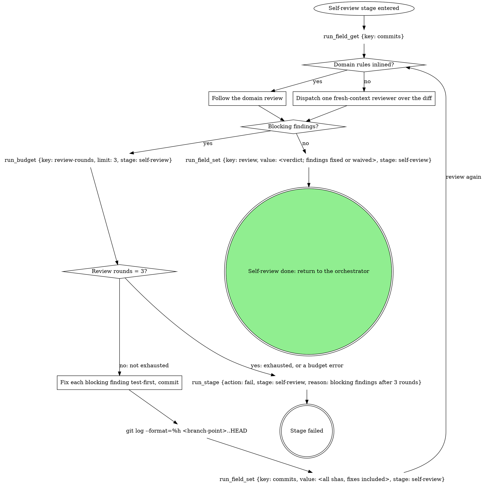

# stage: self-review

{{stage.fields}}

The orchestrator owns this stage's rows: read consumes with
`run_field_get`, write produces with `run_field_set {stage:
"self-review"}`, and end a failure with `run_stage {action: fail, stage:
"self-review", reason}`.

### Dispatch one fresh-context reviewer over the diff

The unbound review: one subagent reads `git diff <branch-point>..HEAD`
against the ticket or task description for correctness, tests present and
honest, and scope drift.

### Review rounds = 3?

Read `exhausted` from the `run_budget` call just made, which charges this
review: never count rounds from context. The count lives on the run per
stage attempt, so a compacted or resumed stage keeps it, and a new attempt
starts at zero.

### Fix each blocking finding test-first, commit

Each fix gets its failing test first, then the fix, then a commit. Ship
presents and pushes what `commits` names, so the field is rewritten with
every sha on the branch, fixes included, before the next review round.

### Follow the domain review

The domain's own review pass, as it words it.

## Domain rules

{{slot:domain}}
