# stage: ship

{{stage.fields}}

Run state: the orchestrator opens and closes this stage, so never write
`run_stage` `start` or `done` here. Write `mr` the moment it exists and
`pushed` once the push lands; fail with `run_stage {action: fail}` naming
what failed. Every `stage` argument is `"ship"`. `<root>` is the absolute worktree root
`git rev-parse --show-toplevel` prints.

```dot
digraph ship {
    rankdir=TB;

    ship_entered [label="Ship stage entered" shape=ellipse];
    run_field_get_mr [label="run_field_get {key: mr}" shape=plaintext];
    domain_steps_before_gate [label="Run the domain steps before the gate (none when unbound)" shape=box];
    git_status_log [label="git status --porcelain; git log --oneline @{upstream}.. or -5" shape=plaintext];
    branch_stack [label="branch_stack {tree: <root>}" shape=plaintext];
    stack_parent_read [label="Stack parent read?" shape=diamond];
    run_field_get_target [label="run_field_get {key: shipTarget}" shape=plaintext];
    target_matches_fresh [label="shipTarget matches the fresh target?" shape=diamond];
    gate_ship [label="Gate ship (table below)" shape=box];
    run_field_set_target [label="run_field_set {key: shipTarget, value: <resolved target>, stage}" shape=plaintext];
    run_field_set_target_iterate [label="run_field_set {key: shipTarget, value: -, stage} (iterate)" shape=plaintext];
    run_field_set_target_hold [label="run_field_set {key: shipTarget, value: -, stage} (hold)" shape=plaintext];
    run_budget_gate_rounds [label="run_budget {key: ship:ship-gate-rounds, limit: 1, stage}" shape=plaintext];
    gate_rounds_spent [label="ship-gate-rounds spent?" shape=diamond];
    run_budget_gate_reopenings [label="run_budget {key: ship:ship-gate-reopenings, limit: 1, stage}" shape=plaintext];
    gate_reopenings_spent [label="ship-gate-reopenings spent?" shape=diamond];
    rebase_in_progress [label="Rebase in progress?" shape=diamond];
    git_rebase_abort [label="git_rebase {tree: <root>, abort: true}" shape=plaintext];
    which_exit [label="Which exit?" shape=diamond];
    dirty_answer [label="dirty answer?" shape=diamond];
    commit_named_files [label="Commit named files, ticket-prefixed subject" shape=box];
    stash_them [label="Stash them" shape=box];
    domain_fast_checks [label="Run the domain's fast checks (none when unbound)" shape=box];
    checks_pass [label="Checks pass?" shape=diamond];
    run_budget_fix_rounds [label="run_budget {key: ship:fix-rounds, limit: 3, stage}" shape=plaintext];
    fix_rounds_spent [label="fix-rounds spent?" shape=diamond];
    fix_test_first [label="Fix test-first, commit, rerun" shape=box];
    domain_rebases_unfinished [label="Domain rebases, and no rebase finished this pass?" shape=diamond];
    git_rebase_onto [label="git_rebase {tree: <root>, onto: origin/<resolved target>}" shape=plaintext];
    rebase_status [label="Rebase status?" shape=diamond];
    run_budget_conflict_rounds [label="run_budget {key: ship:conflict-rounds, limit: 3, stage}" shape=plaintext];
    conflict_rounds_spent [label="conflict-rounds spent?" shape=diamond];
    resolve_conflict_files [label="Resolve the files, then git rebase --continue on Bash" shape=box];
    continue_result [label="Continue result?" shape=diamond];

    needs_force_lease [label="Push needs force-with-lease?" shape=diamond];
    git_push_upstream [label="git_push {tree: <root>, setUpstream: true, leaseMrUrl?: <mr>}" shape=plaintext];
    git_push_lease [label="git_push {tree: <root>, forceWithLease: true, leaseMrUrl?: <mr>}" shape=plaintext];
    git_push_result [label="git_push result?" shape=diamond];
    run_field_set_pushed [label="run_field_set {key: pushed, value: <{\"sha\", \"priorPipelineId\"} JSON>, stage}" shape=plaintext];
    stop_shell_push [label="STOP: push only with git_push" shape=octagon style=filled fillcolor=red fontcolor=white];
    stop_lease_holder_owns [label="STOP: the lease holder owns every commit, push and retry" shape=octagon style=filled fillcolor=red fontcolor=white];
    stand_down [label="Stand down: report the holder and stop" shape=doublecircle];
    gate_push_refused [label="Off-script gate: git_push refused" shape=box];
    make_recorded_move [label="Make the recorded move once" shape=box];
    push_landed [label="Push landed?" shape=diamond];
    run_budget_landing_checks [label="run_budget {key: ship:landing-checks, limit: 1, stage}" shape=plaintext];
    landing_checks_spent [label="landing-checks spent?" shape=diamond];
    run_field_set_pushed_head [label="run_field_set {key: pushed, value: <{\"sha\": HEAD, \"priorPipelineId\": null} JSON>, stage}" shape=plaintext];

    git_remote_origin [label="git remote get-url origin" shape=plaintext];
    forge_host [label="Forge host?" shape=diamond];
    run_budget_forge_clarify [label="run_budget {key: ship:forge-clarify-rounds, limit: 1, stage}" shape=plaintext];
    forge_clarify_rounds [label="forge-clarify-rounds spent?" shape=diamond];
    gate_which_forge [label="Gate clarify: which forge?" shape=box];
    mr_create [label="mr_create {repoName: <root>, sourceBranch, targetBranch: <resolved target>, title, description, draft, squash?, labels?, ifExists: return}" shape=plaintext];
    mr_create_result [label="mr_create result?" shape=diamond];
    run_budget_mr_recalls [label="run_budget {key: ship:mr-create-recalls, limit: 1, stage}" shape=plaintext];
    mr_create_recalls [label="mr-create-recalls spent?" shape=diamond];
    mr_update_squash [label="mr_update {mrUrl, squash: true}" shape=plaintext];
    stop_gitlab_shortcut [label="STOP: GitLab goes through gitlab_get, the read tools and mr_*" shape=octagon style=filled fillcolor=red fontcolor=white];
    gh_pr_create [label="gh pr create --base <resolved target> [--draft]" shape=plaintext];
    gh_create_result [label="gh pr create result?" shape=diamond];
    run_field_set_mr [label="run_field_set {key: mr, value: <url>, stage}" shape=plaintext];

    run_field_get_evidence [label="run_field_get {key: evidence}" shape=plaintext];
    capture_after_case [label="Capture the AFTER for the next case the domain names" shape=box];
    after_result [label="AFTER result?" shape=diamond];
    run_budget_after_attempts [label="run_budget {key: ship:after-attempts:<case id>, limit: 2, stage}" shape=plaintext];
    after_attempts_spent [label="after-attempts spent?" shape=diamond];
    every_case_tried [label="Every named case tried?" shape=diamond];
    after_captured [label="AFTER captured this pass?" shape=diamond];
    record_evidence [label="Record the evidence (evidence-record)" shape=box];
    record_outcome [label="Record outcome?" shape=diamond];
    run_has_evidence [label="Run has an evidence record?" shape=diamond];
    attach_evidence [label="Attach the evidence (evidence-record)" shape=box];
    attach_outcome [label="Attach outcome?" shape=diamond];
    read_forge_host [label="Forge host (read back)?" shape=diamond];
    mr_view_url [label="mr_view {mrUrl}" shape=plaintext];
    gh_pr_view_body [label="gh pr view <mr> --json title,body" shape=plaintext];
    write_title_description [label="Write the title and description" shape=box];
    write_forge_host [label="Forge host (write back)?" shape=diamond];
    mr_update_description [label="mr_update {mrUrl, title, description}" shape=plaintext];
    gh_pr_edit [label="gh pr edit <mr> --title <title> --body <description>" shape=plaintext];

    run_stage_fail [label="run_stage {action: fail, stage, reason}" shape=plaintext];
    run_hold [label="run_hold {stage, reason, decidedBy}" shape=plaintext];
    held_end_turn [label="Held: end the turn naming run and stage" shape=doublecircle];
    hand_back_go_back [label="Hand the Go back answer to the orchestrator" shape=doublecircle];
    stage_failed [label="Stage failed" shape=doublecircle];
    ship_done [label="Ship done: return to the orchestrator" shape=doublecircle style=filled fillcolor=lightgreen];

    ship_entered -> run_field_get_mr;
    run_field_get_mr -> domain_steps_before_gate;
    domain_steps_before_gate -> git_status_log;
    git_status_log -> branch_stack;
    branch_stack -> stack_parent_read;
    stack_parent_read -> run_field_get_target [label="yes: the stack parent"];
    stack_parent_read -> run_field_get_target [label="no: the default branch (an unreadable store or error says so)"];
    run_field_get_target -> target_matches_fresh;
    target_matches_fresh -> dirty_answer [label="yes: the earlier Proceed stands"];
    target_matches_fresh -> gate_ship [label="no"];
    gate_ship -> run_field_set_target [label="proceed"];
    gate_ship -> run_field_set_target_iterate [label="iterate"];
    gate_ship -> run_field_set_target_hold [label="hold"];
    gate_ship -> rebase_in_progress [label="go back, or dirty = abort"];
    run_field_set_target -> dirty_answer;
    run_field_set_target_iterate -> run_budget_gate_rounds;
    run_budget_gate_rounds -> gate_rounds_spent;
    gate_rounds_spent -> domain_steps_before_gate [label="no: redo with their note"];
    gate_rounds_spent -> rebase_in_progress [label="yes: a failure"];
    run_field_set_target_hold -> run_hold;
    rebase_in_progress -> git_rebase_abort [label="yes"];
    rebase_in_progress -> which_exit [label="no"];
    git_rebase_abort -> which_exit;
    which_exit -> hand_back_go_back [label="go back"];
    which_exit -> run_stage_fail [label="a failure, abort or hand back"];
    dirty_answer -> commit_named_files [label="commit"];
    dirty_answer -> stash_them [label="stash"];
    dirty_answer -> domain_fast_checks [label="clean tree"];
    commit_named_files -> domain_fast_checks;
    stash_them -> domain_fast_checks;
    domain_fast_checks -> checks_pass;
    checks_pass -> domain_rebases_unfinished [label="yes"];
    checks_pass -> run_budget_fix_rounds [label="no"];
    run_budget_fix_rounds -> fix_rounds_spent;
    fix_rounds_spent -> fix_test_first [label="no"];
    fix_rounds_spent -> run_budget_gate_reopenings [label="yes: reopen"];
    fix_test_first -> domain_fast_checks;
    domain_rebases_unfinished -> git_rebase_onto [label="yes"];
    domain_rebases_unfinished -> needs_force_lease [label="no"];
    git_rebase_onto -> rebase_status;
    rebase_status -> domain_fast_checks [label="clean"];
    rebase_status -> run_budget_conflict_rounds [label="conflict"];
    rebase_status -> which_exit [label="error: a failure"];
    run_budget_conflict_rounds -> conflict_rounds_spent;
    conflict_rounds_spent -> resolve_conflict_files [label="no"];
    conflict_rounds_spent -> run_budget_gate_reopenings [label="yes: reopen"];
    run_budget_gate_reopenings -> gate_reopenings_spent;
    gate_reopenings_spent -> gate_ship [label="no: reopen with what was quoted"];
    gate_reopenings_spent -> rebase_in_progress [label="yes: a failure"];
    resolve_conflict_files -> continue_result;
    continue_result -> run_budget_conflict_rounds [label="another commit conflicted"];
    continue_result -> domain_fast_checks [label="rebase finished"];
    continue_result -> git_rebase_abort [label="error: a failure"];

    needs_force_lease -> git_push_upstream [label="no"];
    needs_force_lease -> git_push_lease [label="yes"];
    git_push_upstream -> git_push_result;
    git_push_lease -> git_push_result;
    git_push_result -> run_field_set_pushed [label="ok"];
    git_push_result -> stop_lease_holder_owns [label="refused: lease_held, holder named"];
    git_push_result -> stop_shell_push [label="any other error or refusal"];
    stop_lease_holder_owns -> stand_down;
    run_field_set_pushed -> git_remote_origin;
    stop_shell_push -> gate_push_refused;
    gate_push_refused -> make_recorded_move [label="take"];
    gate_push_refused -> needs_force_lease [label="iterate: push again"];
    gate_push_refused -> which_exit [label="hand back"];
    gate_push_refused -> run_hold [label="hold"];
    make_recorded_move -> push_landed;
    push_landed -> run_field_set_pushed_head [label="yes"];
    push_landed -> run_budget_landing_checks [label="no"];
    run_budget_landing_checks -> landing_checks_spent;
    landing_checks_spent -> gate_push_refused [label="no: reopen with the comparison"];
    landing_checks_spent -> which_exit [label="yes: a failure"];
    run_field_set_pushed_head -> git_remote_origin;

    git_remote_origin -> forge_host;
    forge_host -> mr_create [label="GitLab"];
    forge_host -> gh_pr_create [label="GitHub"];
    forge_host -> run_budget_forge_clarify [label="anything else"];
    run_budget_forge_clarify -> forge_clarify_rounds;
    forge_clarify_rounds -> gate_which_forge [label="no"];
    forge_clarify_rounds -> which_exit [label="yes: a failure"];
    gate_which_forge -> forge_host [label="GitLab or GitHub"];
    gate_which_forge -> run_hold [label="hold"];
    gate_which_forge -> which_exit [label="hand back"];
    mr_create -> mr_create_result;
    mr_create_result -> run_field_set_mr [label="created"];
    mr_create_result -> run_field_set_mr [label="existing: keep its url; no squash or labels"];
    mr_create_result -> mr_update_squash [label="squashApplied: false"];
    mr_create_result -> run_budget_mr_recalls [label="url: null"];
    mr_create_result -> which_exit [label="error: a failure"];
    mr_create_result -> stop_gitlab_shortcut [label="tempted to use the GitLab CLI"];
    stop_gitlab_shortcut -> mr_create;
    run_budget_mr_recalls -> mr_create_recalls;
    mr_create_recalls -> mr_create [label="no: call again"];
    mr_create_recalls -> which_exit [label="yes: a failure"];
    mr_update_squash -> run_field_set_mr;
    gh_pr_create -> gh_create_result;
    gh_create_result -> run_field_set_mr [label="url printed, or already exists"];
    gh_create_result -> which_exit [label="error: a failure"];
    run_field_set_mr -> run_field_get_evidence;

    run_field_get_evidence -> capture_after_case;
    capture_after_case -> after_result;
    after_result -> every_case_tried [label="captured"];
    after_result -> after_captured [label="none named"];
    after_result -> run_budget_after_attempts [label="the capture failed"];
    run_budget_after_attempts -> after_attempts_spent;
    after_attempts_spent -> capture_after_case [label="no: same case again"];
    after_attempts_spent -> every_case_tried [label="yes: go on without it"];
    every_case_tried -> capture_after_case [label="no"];
    every_case_tried -> after_captured [label="yes"];
    after_captured -> record_evidence [label="yes"];
    after_captured -> run_has_evidence [label="no"];
    record_evidence -> record_outcome;
    record_outcome -> attach_evidence [label="Recorded"];
    record_outcome -> run_hold [label="Record held at evidence-waiver"];
    record_outcome -> which_exit [label="Record failed: a failure naming the images or quoting the error"];
    run_has_evidence -> attach_evidence [label="yes"];
    run_has_evidence -> read_forge_host [label="no: the field is unset"];
    attach_evidence -> attach_outcome;
    attach_outcome -> read_forge_host [label="Attached (never Taken: Take links)"];
    attach_outcome -> run_hold [label="Attach held"];
    attach_outcome -> which_exit [label="Attach failed: a failure quoting the reason"];
    read_forge_host -> mr_view_url [label="GitLab"];
    read_forge_host -> gh_pr_view_body [label="GitHub"];
    mr_view_url -> write_title_description;
    gh_pr_view_body -> write_title_description;
    write_title_description -> write_forge_host;
    write_forge_host -> mr_update_description [label="GitLab"];
    write_forge_host -> gh_pr_edit [label="GitHub"];
    mr_update_description -> ship_done;
    gh_pr_edit -> ship_done;
    run_stage_fail -> stage_failed;
    run_hold -> held_end_turn;
}
```

### Run the domain steps before the gate (none when unbound)

The domain's gathering steps (the diff against the ticket, the branch and
ticket checks, an existing-MR lookup, a mandatory pre-ship review); their
questions go on the `ship` gate.

### Reading a GitLab fact no read tool returns

Read it with `gitlab_get {repoName: <root>, path}` (`path` from the API
root, `:id` for this project) as part of the step: no gate. Quote a GitLab
error as written; a refused credential path is final.

### shipTarget matches the fresh target?

Yes when a readable fresh target equals `shipTarget`: the earlier Proceed
stands, with the answers from the ship gate decision `run_snapshot` shows
(a tree dirty now with no recorded commit or stash answer is asked at
"dirty answer?"). Unset (`run_field_get` errors), `-`, a different target
or an unreadable store opens the gate, naming both targets.

### Gate ship (table below)

One sentence above the form: the branch, the commits about to go, whether
the tree is dirty, and the resolved target (the stack parent, the default
branch, or "the stack could not be read, so the default branch"), so
Proceed is consent to that target. A reopening with a rebase in progress
says so.

| Question | Options (recommended first) | Shown when |
|---|---|---|
| `dirty` (write-in) | **Commit the changes (Recommended)** / **Stash them** / **Abort** | the tree is dirty |
| `open_as` (write-in) | **Push and open as draft (Recommended)** / **Push and open ready** | always |
| the domain's own | as the domain rules word them (a ticket mismatch, an MR already open) | the domain declares them |
| `next` | **Proceed** / **Iterate here** / **Go back** / **Hold** | always |
| `to` | one option per earlier stage, split `to-1`, ... over 4 | Go back answered and more than one earlier stage row |

Selection: `{"dirty":"commit|stash|abort|null","open_as":"draft|ready","domain":{<answers>},"next":"proceed|iterate|redirect|hold","to":"<stage or null>","note":"<their words or null>"}`.
Abort's reason is `aborted at the ship gate`. With the store unreadable,
Proceed records `<default branch> (stack store unreadable)`; the rebase
and `mr_create` use the plain name.
Iterate and Hold clear it to `-` first, so a resume re-asks; the work
orchestrator clears it on a redirect reaching ship and on a failure gate
Retry of ship. Spent fix or conflict rounds reopen this gate (not an
Iterate), quoting the failing output or conflicted files; they carry over
a reopen, so a Proceed whose checks still fail reopens with no new fix
rounds.

### Stash them

Nothing in this stage pops the stash.

### Run the domain's fast checks (none when unbound)

Only the checks the domain names, on the changed files; revert generated
drift they leave. A full suite the domain rules out stays out. A finished
rebase reruns them, then the push follows: a pass never rebases twice.

### Fix test-first, commit, rerun

Each fix gets its failing test first, then the fix, then a commit.

### Resolve the files, then git rebase --continue on Bash

Resolve each conflicted file `git_rebase` returned, then continue on Bash
(no tool continues a rebase).

### Push needs force-with-lease?

Yes only when a rebase finished this pass and the upstream already held
the commits it rewrote; never force otherwise. Never push a branch whose
tests you have not seen pass this session.

### Off-script gate: git_push refused

The gate protocol's Off-script gate (scope `off-script:ship:<n>`, `n`
shared with the evidence include's upload gate, `context` quoting the
refusal): `action` Take (the push outside `git_push` the gate recorded) or
Hand back (a failure, the refusal its reason); `next` Proceed, Iterate
here (the human fixed the cause) or Hold (no move). Read `next` first:
only Proceed applies `action`; retrying `git_push` is Iterate, never Take.
Iterate counts nothing: each retry needs a new answer at this gate.

### Make the recorded move once

Compare `git rev-parse HEAD` with the remote branch; never push from here.
It landed when the remote branch carries HEAD, which `pushed` records with
no prior id. A miss reopens the push gate, quoting the comparison.

### Gate clarify: which forge?

Context: the `git remote get-url origin` line. Options: **GitLab** /
**GitHub** / **Hand back**; `next`: **Proceed** / **Hold**. Later forge
diamonds read the named forge, never the URL.

### Capture the AFTER for the next case the domain names

Per case in the record, the same view as its BEFORE on the pushed sha (a
v1 record's BEFORE is the case `case`); any other capture the domain names
is a new case with its own `id` and `label`. A case with no AFTER after
three tries goes on, the description saying what was tried. A capture is
never uploaded outside the record.

### Record the evidence (evidence-record)

`images` are the AFTERs just captured (`slot: after`, a new case's
`label`), `tree` is `<root>`. Recorded goes straight to the attach: this
stage writes no `evidence` of its own.

### Attach the evidence (evidence-record)

The ship gate's Proceed is the attach consent. This is the last attach, so
Take sends `linkRefused: true`.

### Write the title and description

Title from the ticket or the first commit subject; the body links the
ticket. The update replaces the whole body, so start from the read-back
and keep everything else: a teammate's edits, and the evidence section
`Attach the evidence` wrote, byte for byte, never a second evidence block.
This stage always writes them, an existing MR's included; the domain's
title, template and voice rules decide what they say, never whether the
write happens.

## What the graph cannot show

- **`pushed`** hands the watch-ci stage `git_push`'s `sha`, and its
  `priorPipelineId` only when the push moved the branch (commits listed
  before the gate, a commit by this stage since, or a forced push); else
  `null`, or the watch waits for a pipeline that never comes. A push that
  moved nothing relies on the sha's own pipeline matching by sha; on a
  fast-forward merge train that pipeline is unprovable, and the watch's
  waiting budget ends the watch.
- **The lease.** The pushes' `<mr>` is the `mr` field read at entry: when it is set
  (a repair push after a red CI), both pushes pass `leaseMrUrl: <mr>`.
  `refused: "lease_held"` means another attendant holds the MR's CI lease:
  report the `holder` and stop, releasing nothing; that lease is someone
  else's.
- **Hold** records `run_hold`: `reason` their words or the gate,
  `decidedBy` as the answer recorded it.
- **`targetBranch`** is what `branch_stack` resolved; a default branch is
  read from git, never guessed. A GitHub PR takes it as `--base`, with `--draft` unless the gate
  said ready. The rebase
  goes onto `origin/<target>`, so a stack member never replays its
  parent's unmerged commits.
- **The MR.** `mr_create`'s `url` is `mrUrl` from here on. `existing:
  true` is an MR already open, nothing passed applied (as the re-call
  after `url: null` returns the first call's MR). The return names both
  targets when its `targetBranch` differs from the resolved one, and says
  squash is unset when asked and never applied.

## Budgets in this stage

Each `run_budget` counts one as its loop is entered and lasts the stage
attempt, through compaction and resume. Its `spent?` diamond reads `spent` against `limit`
(`spent > limit`); ignore `exhausted` and `remaining` (`exhausted` is
`spent >= limit` and would stop one round early). A failure quotes what it last saw (the error, the note, the
failing output or conflicted files, the origin URL and answer, the images
named, the refusal) as its reason.

## Domain rules

The domain rules run their own steps in their own order, every mechanical
move landing on this graph. If a rule below asks for a move this graph
marks STOP, take the off-script edge instead. A rule that keeps a capture
out of the record, or keeps a base with no waiver, yields to the evidence
record.

{{slot:domain}}

When nothing is inlined above, the graph alone is the flow: no domain
steps or checks, no rebase, no AFTER.

## Evidence record

{{include:evidence-record}}

## Gate protocol

{{include:gate-protocol}}

## Wrap-up form contract

{{include:wrap-up-form}}
