# stage: watch-ci

{{stage.fields}}

Run state: the orchestrator opens and closes this stage, so never write
`run_stage` `start` or `done` here. Read the consumes and `pushed` with
`run_field_get`; every `stage` argument is `"watch-ci"`. Write `ci` once a
verdict exists; a failure's `detailPath` is the triage report.

`<mr>` is `mr`'s https URL. Every CI tool, `mr_view` and `mr_ready` take
`mrUrl: <mr>`, the form the graph shows. When this worktree is a checkout
of the MR's project, `ci_watch`, `ci_triage`, `pipeline_jobs`,
`mr_job_trace`, `mr_retry`, `mr_view` and `mr_ready` also take
`repoName` = its absolute path and the iid in `mr` in its place as the
same call. `mr_retry` keeps `leaseMrUrl: <mr>` either way. `<N>` is the
number in `ci_watch`'s `pipeline.id` (`gitlab:pipeline:N`).

```mermaid
flowchart TB
%% name: watch_ci
    watch_ci_entered([Watch-ci stage entered])
    run_field_get_mr[/"run_field_get {key: mr}"/]
    run_field_get_branch[/"run_field_get {key: branch}"/]
    mr_set{mr set?}
    run_field_get_pushed[/"run_field_get {key: pushed}"/]
    git_rev_parse_head[/"git rev-parse HEAD (the pushed sha)"/]
    pushed_sha_is_head{pushed set, and its sha is HEAD?}
    ci_watch[/"ci_watch {mrUrl: <mr>, sha, priorPipelineId?, attend: true}"/]
    ci_watch_state{ci_watch state?}
    run_budget_waiting_results[/"run_budget {key: watch-ci:waiting-results:<sha12>, limit: 5, stage}"/]
    waiting_results_spent{waiting-results spent?}
    end_turn_background_watch
    ci_watch_notification([Trigger: the ci_watch task notification])
    stop_gitlab_ci_shortcut[STOP: GitLab CI goes through ci_watch, the read tools, gitlab_get and mr_retry]:::stop
    stop_lease_holder_owns[STOP: the lease holder owns every commit, push and retry]:::stop
    stand_down(((Stand down: report the holder and stop)))
    gate_lease_unavailable
    run_budget_watch_errors[/"run_budget {key: watch-ci:ci-watch-errors:<sha12>, limit: 2, stage}"/]
    watch_errors_spent{ci-watch-errors spent?}
    fix_watch_error
    gate_watch_refused
    run_budget_watch_off_script[/"run_budget {key: watch-ci:ci-watch-off-script, limit: 2, stage}"/]
    watch_off_script_spent{ci-watch-off-script spent?}
    ci_lease_claim_github[/"ci_lease_claim {mrUrl: <mr>, branch} (GitHub)"/]
    github_claim_result{"Claim result (GitHub)?"}
    stop_hand_rolled_claim[STOP: claim the lease only with ci_lease_claim]:::stop
    run_budget_claim_errors[/"run_budget {key: watch-ci:github-claim-errors, limit: 2, stage}"/]
    claim_errors_spent{github-claim-errors spent?}
    fix_claim_error
    gate_claim_refused
    run_budget_claim_off_script[/"run_budget {key: watch-ci:github-claim-off-script, limit: 2, stage}"/]
    claim_off_script_spent{github-claim-off-script spent?}
    gh_pr_checks[/gh pr checks <mr>/]
    checks_exit_code{gh pr checks exit?}
    run_budget_polls[/"run_budget {key: watch-ci:github-polls:<sha12>, limit: 46, stage}"/]
    polls_spent{github-polls spent?}
    ci_lease_heartbeat[/"ci_lease_heartbeat {mrUrl: <mr>}"/]
    heartbeat_result{Heartbeat result?}
    sleep_between_polls[/sleep 60 as a background Bash task/]
    gh_pr_view_head_sha[/gh pr view <mr> --json headRefOid/]
    checks_match_sha{Checks are for the pushed sha?}
    run_budget_sha_waits[/"run_budget {key: watch-ci:github-sha-waits:<sha12>, limit: 6, stage}"/]
    sha_waits_spent{github-sha-waits spent?}
    checks_passed_or_failed{Checks passed or failed?}
    ci_triage[/"ci_triage {mrUrl: <mr>, pipelineId: <N>, config?}"/]
    ci_triage_result{ci_triage result?}
    stop_gitlab_triage_shortcut[STOP: GitLab triage goes through ci_triage]:::stop
    unclear_jobs_present{UNCLEAR jobs in the report?}
    mr_job_trace[/"mr_job_trace {mrUrl: <mr>, jobId, tailLines?, headLines?, grep?} per UNCLEAR job"/]
    classify_triage_report
    classify_failed_jobs
    classify_failing_checks
    only_infra_failures{Only INFRA blocking failures, none INHERITED?}
    run_budget_infra_retries[/"run_budget {key: watch-ci:infra-retries:<sha12>, limit: 2, stage}"/]
    infra_retries_spent{infra-retries spent?}
    retry_forge_host{Retry on which forge?}
    mr_retry[/"mr_retry {mrUrl: <mr>, jobId, leaseMrUrl: <mr>} per INFRA job"/]
    mr_retry_result{mr_retry result?}
    gate_retry_refused
    run_budget_retry_off_script[/"run_budget {key: watch-ci:retry-off-script, limit: 2, stage}"/]
    retry_off_script_spent{retry-off-script spent?}
    ci_lease_claim_retry[/"ci_lease_claim {mrUrl: <mr>, branch} (GitHub retry)"/]
    reclaim_result{"Re-claim result (GitHub retry)?"}
    gate_reclaim_refused
    gh_run_rerun[/gh run rerun <run-id> --failed/]
    gate_ci
    run_budget_ci_gate[/"run_budget {key: watch-ci:ci-gate-iterations, limit: 3, stage}"/]
    ci_gate_spent{ci-gate-iterations spent?}
    mr_known_for_retry{"MR known (before the retry)?"}
    run_budget_gate_retries[/"run_budget {key: watch-ci:infra-retries:<sha12>, limit: 2, stage} (ci gate retry)"/]
    gate_retries_spent{"infra-retries spent (ci gate retry)?"}
    run_field_set_ci_red[/"run_field_set {key: ci, value: red: <triage>, stage}"/]
    run_status_abandoned[/"run_status {status: abandoned}"/]
    draft_forge_host{"Forge host (draft check)?"}
    mr_view[/"mr_view {mrUrl: <mr>}"/]
    gh_pr_view_draft[/gh pr view <mr> --json isDraft/]
    mr_still_draft{MR still a draft?}
    gate_mark_ready
    run_budget_mark_ready[/"run_budget {key: watch-ci:mark-ready-iterations, limit: 2, stage}"/]
    mark_ready_spent{mark-ready-iterations spent?}
    mark_ready_forge_host{"Forge host (mark-ready)?"}
    mr_ready[/"mr_ready {mrUrl: <mr>}"/]
    gh_pr_ready[/gh pr ready <number>/]
    run_field_set_ci_green[/"run_field_set {key: ci, value: green, stage}"/]
    mr_known_at_exit{"MR known (exit)?"}
    ci_lease_release[/"ci_lease_release {mrUrl: <mr>}"/]
    which_exit{Which exit is this?}
    run_stage_fail[/"run_stage {action: fail, stage, reason, detailPath?}"/]
    run_hold[/"run_hold {stage, reason, decidedBy}"/]
    stage_failed(((Stage failed)))
    hand_back_redirect(((Hand Fix and re-push to the orchestrator: Redirect to implement)))
    hand_back_go_back(((Hand the Go back answer to the orchestrator)))
    held_end_turn(((Held: end the turn naming run and stage)))
    run_abandoned(((Run abandoned)))
    watch_ci_done(((Watch-ci done: return to the orchestrator))):::done
    watch_ci_entered --> run_field_get_mr
    run_field_get_mr --> run_field_get_branch
    run_field_get_branch --> mr_set
    mr_set -->|yes| run_field_get_pushed
    mr_set -->|no: ship first| gate_ci
    run_field_get_pushed --> git_rev_parse_head
    git_rev_parse_head --> pushed_sha_is_head
    pushed_sha_is_head -->|yes: its sha and non-null priorPipelineId| ci_watch
    pushed_sha_is_head -->|no or unreadable: HEAD, no prior id| ci_watch
    ci_watch --> ci_watch_state
    ci_watch_state -->|running| ci_watch
    ci_watch_state -->|waiting| run_budget_waiting_results
    run_budget_waiting_results --> waiting_results_spent
    waiting_results_spent -->|no| ci_watch
    waiting_results_spent -->|yes: quote its next| gate_ci
    ci_watch_state -->|backgrounded| end_turn_background_watch
    end_turn_background_watch -.-> ci_watch_notification
    ci_watch_notification --> ci_watch_state
    ci_watch_state -->|success or success_with_warnings| draft_forge_host
    ci_watch_state -->|failed| ci_triage
    ci_watch_state -->|timeout, no_pipeline, canceled, skipped, manual, superseded or aborted| gate_ci
    ci_watch_state -->|stood_down, holder named| stop_lease_holder_owns
    ci_watch_state -->|lease_unavailable| gate_lease_unavailable
    ci_watch_state -->|unsupported_forge: GitHub| ci_lease_claim_github
    ci_watch_state -->|tool error| run_budget_watch_errors
    ci_watch_state -->|tempted to watch with a script or the GitLab CLI| stop_gitlab_ci_shortcut
    stop_gitlab_ci_shortcut --> ci_watch
    stop_lease_holder_owns --> stand_down
    gate_lease_unavailable -->|take: human attends| run_field_set_ci_red
    gate_lease_unavailable -->|iterate: watch again| ci_watch
    gate_lease_unavailable -->|hold or hand back| mr_known_at_exit
    run_budget_watch_errors --> watch_errors_spent
    watch_errors_spent -->|no| fix_watch_error
    watch_errors_spent -->|yes| gate_watch_refused
    fix_watch_error --> ci_watch
    gate_watch_refused -->|take: green for the pushed sha| draft_forge_host
    gate_watch_refused -->|take: red, or another sha| gate_ci
    gate_watch_refused -->|iterate| run_budget_watch_off_script
    gate_watch_refused -->|hold or hand back| mr_known_at_exit
    run_budget_watch_off_script --> watch_off_script_spent
    watch_off_script_spent -->|no: watch again| ci_watch
    watch_off_script_spent -->|yes: fail| mr_known_at_exit
    ci_lease_claim_github --> github_claim_result
    github_claim_result -->|claimed: true| gh_pr_checks
    github_claim_result -->|claimed: false, holder named| stop_lease_holder_owns
    github_claim_result -->|tool error| run_budget_claim_errors
    github_claim_result -->|tempted to write the lease by hand| stop_hand_rolled_claim
    stop_hand_rolled_claim --> ci_lease_claim_github
    run_budget_claim_errors --> claim_errors_spent
    claim_errors_spent -->|no| fix_claim_error
    claim_errors_spent -->|yes| gate_claim_refused
    fix_claim_error --> ci_lease_claim_github
    gate_claim_refused -->|take: human attends| run_field_set_ci_red
    gate_claim_refused -->|iterate| run_budget_claim_off_script
    gate_claim_refused -->|hold or hand back| mr_known_at_exit
    run_budget_claim_off_script --> claim_off_script_spent
    claim_off_script_spent -->|no: claim again| ci_lease_claim_github
    claim_off_script_spent -->|yes: fail| mr_known_at_exit
    gh_pr_checks --> checks_exit_code
    checks_exit_code -->|0, or non-8 exit with checks reported| gh_pr_view_head_sha
    checks_exit_code -->|8, or no checks reported: pending| run_budget_polls
    run_budget_polls --> polls_spent
    polls_spent -->|no| ci_lease_heartbeat
    polls_spent -->|yes: timeout| gate_ci
    ci_lease_heartbeat --> heartbeat_result
    heartbeat_result -->|ok: true| sleep_between_polls
    heartbeat_result -->|lost| stop_lease_holder_owns
    heartbeat_result -->|none: claim it again| ci_lease_claim_github
    heartbeat_result -->|tool error| gate_ci
    sleep_between_polls --> gh_pr_checks
    gh_pr_view_head_sha --> checks_match_sha
    checks_match_sha -->|yes| checks_passed_or_failed
    checks_match_sha -->|no| run_budget_sha_waits
    run_budget_sha_waits --> sha_waits_spent
    sha_waits_spent -->|no: wait| sleep_between_polls
    sha_waits_spent -->|yes: no checks for the sha| gate_ci
    checks_passed_or_failed -->|passed| draft_forge_host
    checks_passed_or_failed -->|failed| classify_failing_checks
    classify_failing_checks --> only_infra_failures
    ci_triage --> ci_triage_result
    ci_triage_result -->|triaged| unclear_jobs_present
    ci_triage_result -->|tool error: quote it| classify_failed_jobs
    ci_triage_result -->|tempted to run the vendored triage script| stop_gitlab_triage_shortcut
    stop_gitlab_triage_shortcut --> ci_triage
    unclear_jobs_present -->|yes| mr_job_trace
    unclear_jobs_present -->|no| classify_triage_report
    mr_job_trace --> classify_triage_report
    classify_triage_report --> only_infra_failures
    classify_failed_jobs --> only_infra_failures
    only_infra_failures -->|yes| run_budget_infra_retries
    only_infra_failures -->|no: REAL, UNCLEAR or INHERITED| gate_ci
    run_budget_infra_retries --> infra_retries_spent
    infra_retries_spent -->|no: retry once| retry_forge_host
    infra_retries_spent -->|yes: retried already| gate_ci
    retry_forge_host -->|GitLab| mr_retry
    retry_forge_host -->|GitHub| ci_lease_claim_retry
    mr_retry --> mr_retry_result
    mr_retry_result -->|retried: watch again| ci_watch
    mr_retry_result -->|refused: lease_held, holder named| stop_lease_holder_owns
    mr_retry_result -->|tool error| gate_retry_refused
    gate_retry_refused -->|take: human retried| ci_watch
    gate_retry_refused -->|iterate| run_budget_retry_off_script
    gate_retry_refused -->|hold or hand back| mr_known_at_exit
    run_budget_retry_off_script --> retry_off_script_spent
    retry_off_script_spent -->|no: retry again| retry_forge_host
    retry_off_script_spent -->|yes: fail| mr_known_at_exit
    ci_lease_claim_retry --> reclaim_result
    reclaim_result -->|claimed: true| gh_run_rerun
    reclaim_result -->|claimed: false, holder named| stop_lease_holder_owns
    reclaim_result -->|tool error| gate_reclaim_refused
    gate_reclaim_refused -->|take: human reran| gh_pr_checks
    gate_reclaim_refused -->|iterate| run_budget_retry_off_script
    gate_reclaim_refused -->|hold or hand back| mr_known_at_exit
    gh_run_rerun --> gh_pr_checks
    gate_ci -->|fix and re-push: no ci, lease kept| hand_back_redirect
    gate_ci -->|retry the job| mr_known_for_retry
    gate_ci -->|hand back| run_field_set_ci_red
    gate_ci -->|abandon, go back or hold| mr_known_at_exit
    gate_ci -->|iterate| run_budget_ci_gate
    run_budget_ci_gate --> ci_gate_spent
    ci_gate_spent -->|no: re-triage with their note| gate_ci
    ci_gate_spent -->|yes: hand back| run_field_set_ci_red
    mr_known_for_retry -->|yes| run_budget_gate_retries
    mr_known_for_retry -->|no: nothing to retry| run_budget_ci_gate
    run_budget_gate_retries --> gate_retries_spent
    gate_retries_spent -->|no| retry_forge_host
    gate_retries_spent -->|yes: reopen| run_budget_ci_gate
    run_status_abandoned --> run_abandoned
    draft_forge_host -->|GitLab| mr_view
    draft_forge_host -->|GitHub| gh_pr_view_draft
    draft_forge_host -->|anything else| run_field_set_ci_green
    mr_view --> mr_still_draft
    gh_pr_view_draft --> mr_still_draft
    mr_still_draft -->|yes| gate_mark_ready
    mr_still_draft -->|no| run_field_set_ci_green
    gate_mark_ready -->|mark ready now| mark_ready_forge_host
    gate_mark_ready -->|keep it draft| run_field_set_ci_green
    gate_mark_ready -->|go back or hold| mr_known_at_exit
    gate_mark_ready -->|iterate| run_budget_mark_ready
    run_budget_mark_ready --> mark_ready_spent
    mark_ready_spent -->|no: reopen with their note| gate_mark_ready
    mark_ready_spent -->|yes: keep it draft| run_field_set_ci_green
    mark_ready_forge_host -->|GitLab| mr_ready
    mark_ready_forge_host -->|GitHub| gh_pr_ready
    mr_ready --> run_field_set_ci_green
    gh_pr_ready --> run_field_set_ci_green
    run_field_set_ci_green --> mr_known_at_exit
    run_field_set_ci_red --> mr_known_at_exit
    mr_known_at_exit -->|yes| ci_lease_release
    mr_known_at_exit -->|no| which_exit
    ci_lease_release --> which_exit
    which_exit -->|ci written| watch_ci_done
    which_exit -->|hold| run_hold
    which_exit -->|go back| hand_back_go_back
    which_exit -->|abandon| run_status_abandoned
    which_exit -->|a failure or off-script hand back| run_stage_fail
    run_hold --> held_end_turn
    run_stage_fail --> stage_failed
```

