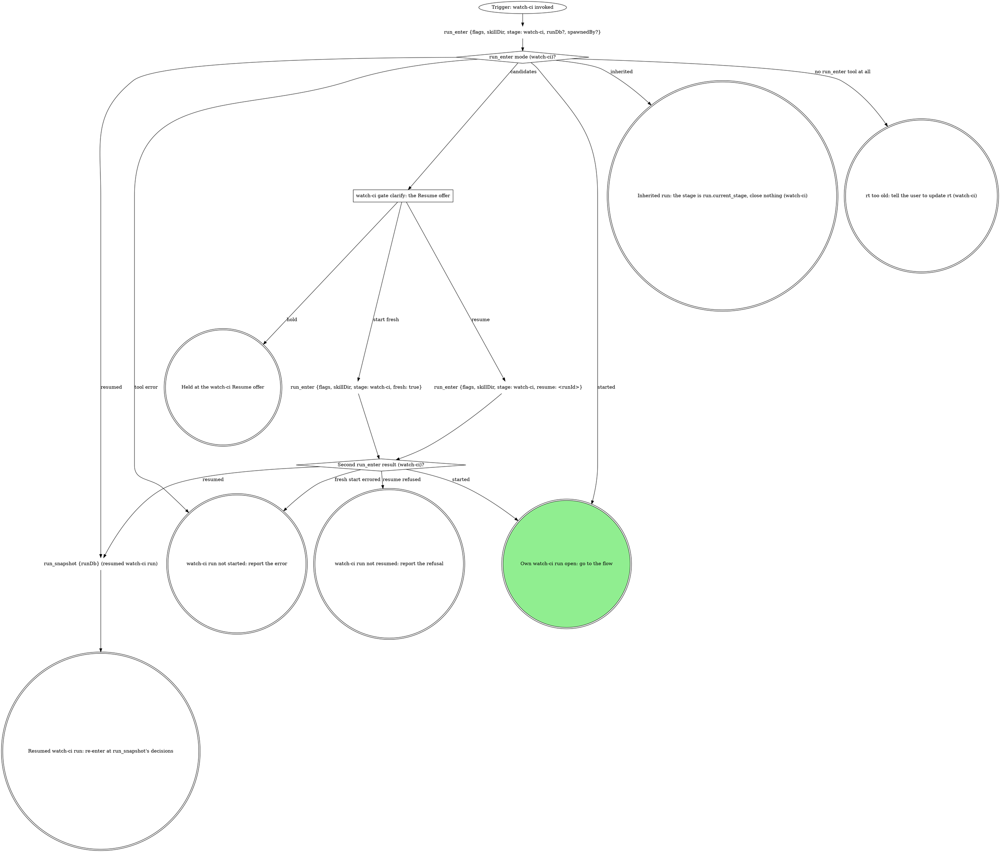

# watch-ci

Standalone CI watching: the target comes from the conversation and the
checkout, the verdict goes to the user. The run graph opens or inherits the
run; the flow graph watches, triages and closes it.

## Run



An own run is a fresh or resumed one: it records identity, fires every gate
below and closes at the end. An inherited run fires no gate beyond `ci` and
the off-script gates, records no identity, and hands back. Its caller hands
`mr` (the MR's or PR's URL), `sha` and optionally `priorPipelineId` (a
number), and gets back one of: green, red after the `ci` gate, an
off-script answer, a failure, a stand-down naming the `holder`, or a hold.

The flags, rendered by the compiler:

{{run-start.flags:watch-ci}}

`run_enter` takes `flags` = the `watch-ci` flag string above, verbatim (the
value, never its key), `skillDir` = `${CLAUDE_SKILL_DIR}` as an absolute
path, `stage: watch-ci`, `runDb` only when a caller handed one, and
`spawnedBy` only when a board or another surface launched this pane. It
opens the stage itself. Pass the returned `runDb` to every `run_*` call;
nothing is exported. A handed `runDb` that comes back `handedRunDb:
"not-running"` counts as not handed. Every gate write and `stage` argument
is `"watch-ci"` in an own run and `run.current_stage` in an inherited one.

### watch-ci gate clarify: the Resume offer

`run_enter` returned `candidates`; never read the run dbs by hand. Gate
`clarify`: one sentence naming each candidate's `spawnedBy`, `startedAt`
and `currentStage`, then one **Resume** option per candidate (`Resume
(Recommended)` when `ownSession` is true; a run another live pane owns is
not yours) / **Start fresh**, and **Hold** in `next`. Resume passes that
candidate's `runId`.

{{include:run-identity}}

## Flow

`<root>` is the worktree root (`git rev-parse --show-toplevel`), `<mr>` the
MR's or PR's https URL. Every CI tool takes `mrUrl: <mr>`; `mr_view` and
`mr_ready` take `repoName` = `<root>` and `iid`. `<N>` is the number in
`ci_watch`'s `pipeline.id` (`gitlab:pipeline:N`).

```dot
digraph watch_ci {
    rankdir=TB;

    run_open [label="Trigger: a watch-ci run is open (own or inherited)" shape=ellipse];
    git_branch_current [label="git branch --show-current, unless the user named a branch" shape=plaintext];
    git_remote_origin [label="git remote get-url origin (watch-ci target)" shape=plaintext];
    target_forge_host [label="Forge host (watch-ci target)?" shape=diamond];
    mr_for_branch [label="mr_for_branch {repoName: <root>, branches: [<branch>]}" shape=plaintext];
    gh_pr_list [label="gh pr list --head <branch> --json number,url" shape=plaintext];
    gate_which_forge [label="watch-ci gate clarify: which forge?" shape=box];
    own_run_identity [label="Own run (watch-ci identity)?" shape=diamond];
    run_field_set_branch_mr [label="run_field_set {key: branch, then mr when found, stage: watch-ci}" shape=plaintext];
    mr_found_for_lease [label="MR found (watch-ci lease)?" shape=diamond];
    watched_sha_known [label="Watched sha known (watch-ci)?" shape=diamond];
    git_ls_remote_sha [label="git ls-remote origin refs/heads/<branch> (the watched sha)" shape=plaintext];

    ci_watch [label="ci_watch {mrUrl: <mr>, sha, priorPipelineId?, attend: true}" shape=plaintext];
    ci_watch_state [label="ci_watch state (watch-ci)?" shape=diamond];
    run_budget_waiting_results [label="run_budget {key: watch-ci:waiting-results:<sha12>, limit: 5, stage}" shape=plaintext];
    waiting_results_spent [label="waiting-results spent (watch-ci)?" shape=diamond];
    end_turn_background_watch [label="End the turn: ci_watch runs in the background (watch-ci)" shape=box];
    ci_watch_notification [label="Trigger: the ci_watch task notification (watch-ci)" shape=ellipse];
    stop_gitlab_ci_shortcut [label="STOP: GitLab CI goes through ci_watch, the read tools, gitlab_get and mr_retry (watch-ci)" shape=octagon style=filled fillcolor=red fontcolor=white];
    stop_lease_holder_owns [label="STOP: the lease holder owns every commit, push and retry (watch-ci)" shape=octagon style=filled fillcolor=red fontcolor=white];
    stand_down [label="Stand down: report the holder, or hand it back (watch-ci)" shape=doublecircle];
    gate_lease_unavailable [label="watch-ci off-script gate: lease_unavailable" shape=box];
    run_budget_watch_errors [label="run_budget {key: watch-ci:ci-watch-errors:<sha12>, limit: 2, stage}" shape=plaintext];
    watch_errors_spent [label="ci-watch-errors spent (watch-ci)?" shape=diamond];
    fix_watch_error [label="Fix what the ci_watch error names" shape=box];
    gate_watch_refused [label="watch-ci off-script gate: ci_watch refused" shape=box];
    run_budget_watch_off_script [label="run_budget {key: watch-ci:ci-watch-off-script, limit: 2, stage}" shape=plaintext];
    watch_off_script_spent [label="ci-watch-off-script spent (watch-ci)?" shape=diamond];

    ci_lease_claim_github [label="ci_lease_claim {mrUrl: <mr>, branch} (GitHub)" shape=plaintext];
    github_claim_result [label="ci_lease_claim result (GitHub)?" shape=diamond];
    stop_hand_rolled_claim [label="STOP: claim the lease only with ci_lease_claim (watch-ci)" shape=octagon style=filled fillcolor=red fontcolor=white];
    run_budget_claim_errors [label="run_budget {key: watch-ci:github-claim-errors, limit: 2, stage}" shape=plaintext];
    claim_errors_spent [label="github-claim-errors spent (watch-ci)?" shape=diamond];
    fix_claim_error [label="Fix what the claim error names (GitHub)" shape=box];
    gate_claim_refused [label="watch-ci off-script gate: ci_lease_claim refused (GitHub)" shape=box];
    run_budget_claim_off_script [label="run_budget {key: watch-ci:github-claim-off-script, limit: 2, stage}" shape=plaintext];
    claim_off_script_spent [label="github-claim-off-script spent (watch-ci)?" shape=diamond];
    gh_pr_checks [label="gh pr checks <mr> (poll)" shape=plaintext];
    checks_exit_code [label="gh pr checks exit (GitHub poll)?" shape=diamond];
    run_budget_polls [label="run_budget {key: watch-ci:github-polls:<sha12>, limit: 46, stage}" shape=plaintext];
    polls_spent [label="github-polls spent (watch-ci)?" shape=diamond];
    ci_lease_heartbeat [label="ci_lease_heartbeat {mrUrl} (GitHub poll)" shape=plaintext];
    heartbeat_result [label="Heartbeat result (GitHub poll)?" shape=diamond];
    sleep_between_polls [label="sleep 60 as a background Bash task (GitHub poll)" shape=plaintext];
    gh_pr_view_head_sha [label="gh pr view <mr> --json headRefOid (sha guard)" shape=plaintext];
    checks_match_sha [label="Checks are for the watched sha (GitHub poll)?" shape=diamond];
    run_budget_sha_waits [label="run_budget {key: watch-ci:github-sha-waits:<sha12>, limit: 6, stage}" shape=plaintext];
    sha_waits_spent [label="github-sha-waits spent (watch-ci)?" shape=diamond];
    checks_passed_or_failed [label="Checks passed or failed (GitHub poll)?" shape=diamond];
    classify_failing_checks [label="Classify each failing check REAL or INFRA (GitHub)" shape=box];

    ci_triage [label="ci_triage {mrUrl: <mr>, pipelineId: <N>, config?}" shape=plaintext];
    ci_triage_result [label="ci_triage result (watch-ci)?" shape=diamond];
    stop_gitlab_triage_shortcut [label="STOP: GitLab triage goes through ci_triage (watch-ci)" shape=octagon style=filled fillcolor=red fontcolor=white];
    unclear_jobs_present [label="UNCLEAR jobs in the report (watch-ci)?" shape=diamond];
    mr_job_trace [label="mr_job_trace {mrUrl: <mr>, jobId, tailLines?, headLines?, grep?} per UNCLEAR job" shape=plaintext];
    classify_triage_report [label="Classify the triage report (watch-ci)" shape=box];
    classify_failed_jobs [label="Classify each failure REAL or INFRA from failedJobs (watch-ci)" shape=box];
    only_infra_failures [label="Only INFRA blocking failures, none INHERITED (watch-ci)?" shape=diamond];
    run_budget_infra_retries [label="run_budget {key: watch-ci:infra-retries:<sha12>, limit: 2, stage}" shape=plaintext];
    infra_retries_spent [label="infra-retries spent (watch-ci)?" shape=diamond];

    retry_forge_host [label="Retry on which forge (watch-ci)?" shape=diamond];
    mr_retry [label="mr_retry {mrUrl: <mr>, jobId, leaseMrUrl: <mr>} per INFRA job" shape=plaintext];
    mr_retry_result [label="mr_retry result (watch-ci)?" shape=diamond];
    gate_retry_refused [label="watch-ci off-script gate: mr_retry refused" shape=box];
    run_budget_retry_off_script [label="run_budget {key: watch-ci:retry-off-script, limit: 2, stage}" shape=plaintext];
    retry_off_script_spent [label="retry-off-script spent (watch-ci)?" shape=diamond];
    ci_lease_claim_retry [label="ci_lease_claim {mrUrl: <mr>, branch} (GitHub retry)" shape=plaintext];
    reclaim_result [label="Re-claim result (GitHub retry)?" shape=diamond];
    gate_reclaim_refused [label="watch-ci off-script gate: GitHub retry claim refused" shape=box];
    gh_run_rerun [label="gh run rerun <run-id> --failed" shape=plaintext];

    own_run_green [label="Own run (watch-ci green)?" shape=diamond];
    draft_forge_host [label="Forge host (watch-ci draft check)?" shape=diamond];
    mr_view_draft [label="mr_view {repoName, iid} (draft check)" shape=plaintext];
    gh_pr_view_draft [label="gh pr view <mr> --json isDraft (draft check)" shape=plaintext];
    mr_still_draft [label="MR still a draft (watch-ci)?" shape=diamond];
    gate_mark_ready [label="watch-ci gate mark-ready" shape=box];
    run_budget_mark_ready [label="run_budget {key: watch-ci:mark-ready-iterations, limit: 2, stage}" shape=plaintext];
    mark_ready_spent [label="mark-ready-iterations spent (watch-ci)?" shape=diamond];
    mark_ready_forge_host [label="Forge host (watch-ci mark-ready)?" shape=diamond];
    mr_ready [label="mr_ready {repoName, iid}" shape=plaintext];
    gh_pr_ready [label="gh pr ready <number>" shape=plaintext];

    gate_ci [label="watch-ci gate ci" shape=box];
    run_budget_ci_gate [label="run_budget {key: watch-ci:ci-gate-iterations, limit: 3}" shape=plaintext];
    ci_gate_spent [label="ci-gate-iterations spent (watch-ci)?" shape=diamond];
    run_budget_fix_rounds [label="run_budget {key: watch-ci:fix-rounds, limit: 4}" shape=plaintext];
    fix_rounds_spent [label="fix-rounds spent (watch-ci)?" shape=diamond];
    fix_real_failure [label="Fix the REAL failure, commit" shape=box];
    mr_found_for_push [label="MR found (before git_push)?" shape=diamond];
    git_push_leased [label="git_push {tree: <root>, leaseMrUrl: <mr>}" shape=plaintext];
    git_push_plain [label="git_push {tree: <root>}" shape=plaintext];
    git_push_result [label="git_push result (watch-ci)?" shape=diamond];
    stop_shell_push [label="STOP: push only with git_push (watch-ci)" shape=octagon style=filled fillcolor=red fontcolor=white];
    gate_push_refused [label="watch-ci off-script gate: git_push refused" shape=box];
    confirm_human_push [label="Confirm the human's push landed (watch-ci)" shape=box];
    push_landed [label="Push landed (watch-ci)?" shape=diamond];
    own_run_new_attempt [label="Own run (watch-ci new attempt)?" shape=diamond];
    run_resolve_iterate [label="run_resolve {runDb, stage: watch-ci, next: iterate, attempt: <n>, note, decidedBy} (a new attempt)" shape=plaintext];
    new_attempt_result [label="run_resolve result (watch-ci new attempt)?" shape=diamond];
    mr_found_for_retry [label="MR found (before the retry)?" shape=diamond];
    run_budget_gate_retries [label="run_budget {key: watch-ci:infra-retries:<sha12>, limit: 2, stage} (ci gate retry)" shape=plaintext];
    gate_retries_spent [label="infra-retries spent (ci gate retry, watch-ci)?" shape=diamond];

    mr_known_at_exit [label="MR known (watch-ci exit)?" shape=diamond];
    ci_lease_release [label="ci_lease_release {mrUrl: <mr>}" shape=plaintext];
    which_exit [label="Which exit is this (watch-ci)?" shape=diamond];
    run_close_done [label="run_close {workType: watch-ci, stage: watch-ci, outcome: done}" shape=plaintext];
    run_close_abandoned [label="run_close {workType: watch-ci, stage: watch-ci, outcome: abandoned}" shape=plaintext];
    run_close_failed [label="run_close {workType: watch-ci, stage: watch-ci, outcome: failed, reason}" shape=plaintext];
    run_hold [label="run_hold {stage, reason, decidedBy}" shape=plaintext];
    hand_back_verdict [label="Hand the verdict back to the caller (watch-ci)" shape=doublecircle];
    hand_back_off_script [label="Hand the off-script answer back to the caller (watch-ci)" shape=doublecircle];
    hand_back_failure [label="Hand the failure back to the caller (watch-ci)" shape=doublecircle];
    hand_back_go_back [label="Hand the Go back answer back (watch-ci)" shape=doublecircle];
    held_run_open [label="Held in watch-ci: the run stays open" shape=doublecircle];
    abandoned [label="watch-ci run abandoned" shape=doublecircle];
    failed [label="watch-ci failed" shape=doublecircle];
    done [label="watch-ci done" shape=doublecircle style=filled fillcolor=lightgreen];

    run_open -> git_branch_current;
    git_branch_current -> git_remote_origin;
    git_remote_origin -> target_forge_host;
    target_forge_host -> mr_for_branch [label="GitLab, no MR known"];
    target_forge_host -> gh_pr_list [label="GitHub, no PR known"];
    target_forge_host -> own_run_identity [label="MR named, handed, or recorded (a resumed run's `mr`)"];
    target_forge_host -> gate_which_forge [label="anything else, nothing handed"];
    gate_which_forge -> target_forge_host [label="answered: the named forge"];
    mr_for_branch -> own_run_identity [label="a result, null included"];
    mr_for_branch -> gate_ci [label="error: never read as no MR"];
    gh_pr_list -> own_run_identity;
    own_run_identity -> run_field_set_branch_mr [label="yes"];
    own_run_identity -> mr_found_for_lease [label="no: inherited"];
    run_field_set_branch_mr -> mr_found_for_lease;
    mr_found_for_lease -> watched_sha_known [label="yes"];
    mr_found_for_lease -> gate_ci [label="no: ship first"];
    watched_sha_known -> ci_watch [label="yes"];
    watched_sha_known -> git_ls_remote_sha [label="no"];
    git_ls_remote_sha -> ci_watch;

    ci_watch -> ci_watch_state;
    ci_watch_state -> ci_watch [label="running"];
    ci_watch_state -> run_budget_waiting_results [label="waiting"];
    run_budget_waiting_results -> waiting_results_spent;
    waiting_results_spent -> ci_watch [label="no"];
    waiting_results_spent -> gate_ci [label="yes: quote its next"];
    ci_watch_state -> end_turn_background_watch [label="backgrounded"];
    end_turn_background_watch -> ci_watch_notification [style=dashed];
    ci_watch_notification -> ci_watch_state;
    ci_watch_state -> own_run_green [label="success or success_with_warnings"];
    ci_watch_state -> ci_triage [label="failed"];
    ci_watch_state -> gate_ci [label="timeout, no_pipeline, canceled, skipped, manual, superseded or aborted"];
    ci_watch_state -> stop_lease_holder_owns [label="stood_down, holder named"];
    ci_watch_state -> gate_lease_unavailable [label="lease_unavailable"];
    ci_watch_state -> ci_lease_claim_github [label="unsupported_forge: a GitHub PR"];
    ci_watch_state -> run_budget_watch_errors [label="tool error"];
    ci_watch_state -> stop_gitlab_ci_shortcut [label="tempted to watch with a script or the GitLab CLI"];
    stop_gitlab_ci_shortcut -> ci_watch;
    stop_lease_holder_owns -> stand_down;

    gate_lease_unavailable -> mr_known_at_exit [label="take, hold or hand back"];
    gate_lease_unavailable -> ci_watch [label="iterate: watch again"];

    run_budget_watch_errors -> watch_errors_spent;
    watch_errors_spent -> fix_watch_error [label="no"];
    watch_errors_spent -> gate_watch_refused [label="yes"];
    fix_watch_error -> ci_watch;
    gate_watch_refused -> own_run_green [label="take: green for the watched sha"];
    gate_watch_refused -> gate_ci [label="take: red, or not for the watched sha"];
    gate_watch_refused -> run_budget_watch_off_script [label="iterate"];
    gate_watch_refused -> mr_known_at_exit [label="hold or hand back"];
    run_budget_watch_off_script -> watch_off_script_spent;
    watch_off_script_spent -> ci_watch [label="no: watch again"];
    watch_off_script_spent -> mr_known_at_exit [label="yes: fail"];

    ci_lease_claim_github -> github_claim_result;
    github_claim_result -> gh_pr_checks [label="claimed: true"];
    github_claim_result -> stop_lease_holder_owns [label="claimed: false, holder named"];
    github_claim_result -> run_budget_claim_errors [label="tool error"];
    github_claim_result -> stop_hand_rolled_claim [label="tempted to write the lease by hand or with a script"];
    stop_hand_rolled_claim -> ci_lease_claim_github;
    run_budget_claim_errors -> claim_errors_spent;
    claim_errors_spent -> fix_claim_error [label="no"];
    claim_errors_spent -> gate_claim_refused [label="yes"];
    fix_claim_error -> ci_lease_claim_github;
    gate_claim_refused -> mr_known_at_exit [label="take, hold or hand back"];
    gate_claim_refused -> run_budget_claim_off_script [label="iterate"];
    run_budget_claim_off_script -> claim_off_script_spent;
    claim_off_script_spent -> ci_lease_claim_github [label="no: claim again"];
    claim_off_script_spent -> mr_known_at_exit [label="yes: fail"];

    gh_pr_checks -> checks_exit_code;
    checks_exit_code -> gh_pr_view_head_sha [label="0, or non-8 exit with checks reported"];
    checks_exit_code -> run_budget_polls [label="8, or no checks reported: pending"];
    run_budget_polls -> polls_spent;
    polls_spent -> ci_lease_heartbeat [label="no"];
    polls_spent -> gate_ci [label="yes: timeout"];
    ci_lease_heartbeat -> heartbeat_result;
    heartbeat_result -> sleep_between_polls [label="ok: true"];
    heartbeat_result -> stop_lease_holder_owns [label="lost"];
    heartbeat_result -> ci_lease_claim_github [label="none: claim it again"];
    heartbeat_result -> gate_ci [label="tool error"];
    sleep_between_polls -> gh_pr_checks;
    gh_pr_view_head_sha -> checks_match_sha;
    checks_match_sha -> checks_passed_or_failed [label="yes"];
    checks_match_sha -> run_budget_sha_waits [label="no"];
    run_budget_sha_waits -> sha_waits_spent;
    sha_waits_spent -> sleep_between_polls [label="no: wait for the watched sha"];
    sha_waits_spent -> gate_ci [label="yes: no checks for the watched sha"];
    checks_passed_or_failed -> own_run_green [label="passed"];
    checks_passed_or_failed -> classify_failing_checks [label="failed"];
    classify_failing_checks -> only_infra_failures;

    ci_triage -> ci_triage_result;
    ci_triage_result -> unclear_jobs_present [label="triaged"];
    ci_triage_result -> classify_failed_jobs [label="tool error: quote it"];
    ci_triage_result -> stop_gitlab_triage_shortcut [label="tempted to run the vendored triage script"];
    stop_gitlab_triage_shortcut -> ci_triage;
    unclear_jobs_present -> mr_job_trace [label="yes"];
    unclear_jobs_present -> classify_triage_report [label="no"];
    mr_job_trace -> classify_triage_report;
    classify_triage_report -> only_infra_failures;
    classify_failed_jobs -> only_infra_failures;
    only_infra_failures -> run_budget_infra_retries [label="yes"];
    only_infra_failures -> gate_ci [label="no: a REAL, UNCLEAR or INHERITED failure"];
    run_budget_infra_retries -> infra_retries_spent;
    infra_retries_spent -> retry_forge_host [label="no: retry once"];
    infra_retries_spent -> gate_ci [label="yes: retried already"];

    retry_forge_host -> mr_retry [label="GitLab"];
    retry_forge_host -> ci_lease_claim_retry [label="GitHub"];
    mr_retry -> mr_retry_result;
    mr_retry_result -> ci_watch [label="retried: watch again"];
    mr_retry_result -> stop_lease_holder_owns [label="refused: lease_held, holder named"];
    mr_retry_result -> gate_retry_refused [label="tool error"];
    gate_retry_refused -> ci_watch [label="take: human retried"];
    gate_retry_refused -> run_budget_retry_off_script [label="iterate"];
    gate_retry_refused -> mr_known_at_exit [label="hold or hand back"];
    run_budget_retry_off_script -> retry_off_script_spent;
    retry_off_script_spent -> retry_forge_host [label="no: retry again"];
    retry_off_script_spent -> mr_known_at_exit [label="yes: fail"];
    ci_lease_claim_retry -> reclaim_result;
    reclaim_result -> gh_run_rerun [label="claimed: true"];
    reclaim_result -> stop_lease_holder_owns [label="claimed: false, holder named"];
    reclaim_result -> gate_reclaim_refused [label="tool error"];
    gate_reclaim_refused -> gh_pr_checks [label="take: human reran"];
    gate_reclaim_refused -> run_budget_retry_off_script [label="iterate"];
    gate_reclaim_refused -> mr_known_at_exit [label="hold or hand back"];
    gh_run_rerun -> gh_pr_checks;

    own_run_green -> draft_forge_host [label="yes"];
    own_run_green -> mr_known_at_exit [label="no: inherited"];
    draft_forge_host -> mr_view_draft [label="GitLab"];
    draft_forge_host -> gh_pr_view_draft [label="GitHub"];
    mr_view_draft -> mr_still_draft;
    gh_pr_view_draft -> mr_still_draft;
    mr_still_draft -> gate_mark_ready [label="yes"];
    mr_still_draft -> mr_known_at_exit [label="no"];
    gate_mark_ready -> mark_ready_forge_host [label="mark ready now"];
    gate_mark_ready -> mr_known_at_exit [label="keep it draft, go back or hold"];
    gate_mark_ready -> run_budget_mark_ready [label="iterate"];
    run_budget_mark_ready -> mark_ready_spent;
    mark_ready_spent -> gate_mark_ready [label="no: reopen with their note"];
    mark_ready_spent -> mr_known_at_exit [label="yes: keep it draft"];
    mark_ready_forge_host -> mr_ready [label="GitLab"];
    mark_ready_forge_host -> gh_pr_ready [label="GitHub"];
    mr_ready -> mr_known_at_exit;
    gh_pr_ready -> mr_known_at_exit;

    gate_ci -> run_budget_fix_rounds [label="fix and re-push"];
    gate_ci -> mr_found_for_retry [label="retry the job"];
    gate_ci -> mr_known_at_exit [label="hand back, abandon or hold"];
    gate_ci -> run_budget_ci_gate [label="iterate"];
    run_budget_ci_gate -> ci_gate_spent;
    ci_gate_spent -> gate_ci [label="no: re-triage with their note"];
    ci_gate_spent -> mr_known_at_exit [label="yes: hand back"];
    run_budget_fix_rounds -> fix_rounds_spent;
    fix_rounds_spent -> fix_real_failure [label="no"];
    fix_rounds_spent -> run_budget_ci_gate [label="yes: reopen, Hand back recommended"];
    fix_real_failure -> mr_found_for_push;
    mr_found_for_push -> git_push_leased [label="yes"];
    mr_found_for_push -> git_push_plain [label="no: no lease"];
    git_push_leased -> git_push_result;
    git_push_plain -> git_push_result;
    git_push_result -> own_run_new_attempt [label="ok: watch its sha"];
    git_push_result -> stop_lease_holder_owns [label="refused: lease_held, holder named"];
    git_push_result -> stop_shell_push [label="any other error or refusal"];
    stop_shell_push -> gate_push_refused;
    gate_push_refused -> confirm_human_push [label="take: the human pushed"];
    gate_push_refused -> mr_found_for_push [label="iterate: push again"];
    gate_push_refused -> mr_known_at_exit [label="hand back or hold"];
    confirm_human_push -> push_landed;
    push_landed -> own_run_new_attempt [label="yes: the remote carries HEAD"];
    push_landed -> gate_push_refused [label="no: reopen with the comparison"];
    own_run_new_attempt -> run_resolve_iterate [label="yes"];
    own_run_new_attempt -> mr_found_for_lease [label="no: inherited"];
    run_resolve_iterate -> new_attempt_result;
    new_attempt_result -> mr_found_for_lease [label="applied: iterate, repeated or not"];
    new_attempt_result -> mr_known_at_exit [label="refused: fail, quoting it"];

    mr_found_for_retry -> run_budget_gate_retries [label="yes"];
    mr_found_for_retry -> run_budget_ci_gate [label="no: nothing to retry"];
    run_budget_gate_retries -> gate_retries_spent;
    gate_retries_spent -> retry_forge_host [label="no"];
    gate_retries_spent -> run_budget_ci_gate [label="yes: reopen"];

    mr_known_at_exit -> ci_lease_release [label="yes"];
    mr_known_at_exit -> which_exit [label="no"];
    ci_lease_release -> which_exit;
    which_exit -> run_close_done [label="own run: green, a ci Hand back, or an attending Take"];
    which_exit -> run_close_abandoned [label="own run: abandon"];
    which_exit -> run_close_failed [label="own run: a failure or an off-script hand back"];
    which_exit -> hand_back_verdict [label="inherited: green, or red after a ci Hand back"];
    which_exit -> hand_back_off_script [label="inherited: an off-script take or hand back"];
    which_exit -> hand_back_failure [label="inherited: a failure"];
    which_exit -> hand_back_go_back [label="own run: go back"];
    which_exit -> run_hold [label="hold"];
    run_close_done -> done;
    run_close_abandoned -> abandoned;
    run_close_failed -> failed;
    run_hold -> held_run_open;
}
```

### watch-ci gate clarify: which forge?

The origin host is neither GitLab nor GitHub: ask which forge, quoting the
origin URL.

### End the turn: ci_watch runs in the background (watch-ci)

Claude Code backgrounds a `ci_watch` still running after 120 s and
re-invokes this pane with a `<task-notification>` whose `<result>` is the
next `ci_watch state`. End the turn in one line: `watching CI in the
background (task <id>)`. The stop hook lets the turn end while the task is
pending, and a message meanwhile reaches you at once; a foreground wait
(`sleep`, a polling script, a second `ci_watch`) delays both.

### The off-script gates (watch-ci)

Each gate below is the gate protocol's Off-script gate (scope
`off-script:<stage>:<n>`, `context` quoting the refusal), with `action`
**Take** (the move its section names) / **Hand back**, and `next`
**Proceed** (Recommended) / **Iterate here** (the human fixed it) /
**Hold**. A spent Iterate budget fails, quoting the refusals.

The `lease_unavailable` and `git_push` gates have no budget: `ci_watch`
re-claims itself, a `git_push` retry needs a new answer, a refusal reopens
the gate. An attending Take closes an own run `done`, the report saying so;
an inherited run hands the answer back.

### watch-ci off-script gate: lease_unavailable

`ci_watch` could not claim or keep the lease after its own re-claims
(`error` says why). No one else holds it: not a stand-down.
Take: the human attends the MR.

### Fix what the ci_watch error names

Correct what the error names (`mrUrl` the MR's https URL, `sha` 7 to 40 hex
characters, `priorPipelineId` the `N` of `gitlab:pipeline:N`) and call
again, once. An error naming no input (the repo is not registered with rt)
gets one unchanged call.

### watch-ci off-script gate: ci_watch refused

`context` quotes both errors. Take: the human reads the pipeline and
reports green or red for the watched sha.

### Fix what the claim error names (GitHub)

Correct what the error names (`mrUrl` the PR's `.../pull/<n>` URL, `branch`
its source branch) and claim again, once; an error naming no input (no
session id) gets one unchanged claim.

### watch-ci off-script gate: ci_lease_claim refused (GitHub)

`context` quotes both errors. Take: the human attends the PR.

### Classify the triage report (watch-ci)

`ci_triage` sorts failed jobs into REAL, INFRA or UNCLEAR by their logs and
marks each blocking one `yours`, INHERITED (also failing on the target
branch) or UNKNOWN (no base to compare); the `blocking` list decides the
verdict. Read each UNCLEAR job with `mr_job_trace`: the tail, then `grep`
for the failure text or `headLines` when it sits far above the end; a
teardown-only tail (cleanup, artifact upload, runner exit) says nothing
about the cause. Read a `crossProject` entry as the failedJobs section says.
Then each blocking failure is REAL (the change broke it: a test, type or
lint failure in touched code), INFRA (unrelated: a runner, network or
dependency outage, a known flake) or, still UNCLEAR after the read, the
gate's.

No failure is classified before its log is read; an unreadable trace is
UNCLEAR, never INFRA. Domain rules judge the report and may move a job
between REAL and INFRA. INHERITED goes to the gate named as INHERITED,
never retried or fixed here; UNKNOWN still gets its one INFRA retry. This
box only classifies: INFRA job ids go to `mr_retry`; never run a retry
command a report prints.

### Classify each failure REAL or INFRA from failedJobs (watch-ci)

`ci_triage` errored: quote it and classify `ci_watch`'s `failedJobs` as the
triage-report section says, ownership unknown. Read a job with no
`traceTail` (past the first five blocking), or a tail too short or
teardown-only, with `mr_job_trace` here.

`failedJobs` already lists same-project downstream jobs, so an empty list on
a `failed` pipeline likely means a cross-project downstream pipeline: read
`projects/:id/pipelines/<pipelineId>/bridges` with `gitlab_get` for it, its
jobs, then the failed job's `projects/<downstream project id>/jobs/<jobId>/trace`
(`mr_job_trace` reads only this project). `gitlab_get` returns at most
256 KiB; a log whose end is out of reach is unreadable.
Other pipelines on the branch come from `pipeline_list`, a pipeline's jobs
from `pipeline_jobs`.

### Reading a GitLab fact no read tool returns

Read it with `gitlab_get {repoName, path}`: `repoName` the tree this verb
targets, `path` relative to the API root with `:id` for this project
(`projects/:id/jobs/<jobId>`), as part of the step, not off-script. Quote a
GitLab error as written; its refusal of a credential path is final.

### Classify each failing check REAL or INFRA (GitHub)

Read the failing checks' logs from the links `gh pr checks <mr>` prints and
classify as the triage-report section says, ownership unknown.

### watch-ci off-script gate: mr_retry refused

`mr_retry` errored. `context` quotes the error and job ids. Take: the
human retried the job.

### watch-ci off-script gate: GitHub retry claim refused

The re-claim before `gh run rerun` errored. Take: the human reran the job.

### watch-ci gate mark-ready

One sentence above the form: CI is green for the MR's head.

| Question | Options (recommended first) | Shown when |
|---|---|---|
| `ready` (write-in) | **Mark ready now (Recommended)** / **Keep it draft** | always |
| `next` | **Proceed** / **Iterate here** / **Go back** / **Hold** | always |
| `to` | one option per earlier stage; with one candidate, **Go back to `<stage>`** in `next` instead | Go back, with more than one earlier stage in `run_snapshot` |

Scope `mark-ready`. Selection: `{"ready":true|false,"next":"proceed|iterate|redirect|hold","to":"<stage or null>","note":"<their words or null>"}`.

### watch-ci gate ci

Quote any error, or a spent `waiting`'s `next`. On
`no_pipeline`, `pushed: false` means the MR head is `remoteSha`: say ship first; `pushed: true` means no
pipeline ran for it. Scope `ci:<stage>:<attempt>`. One sentence above the
form: the verdict and a one-line triage per blocking failure.

| Question | Options (recommended first) | Shown when |
|---|---|---|
| `action` (write-in) | **Fix and re-push (Recommended)** (a REAL failure in the change; after the third fix round the suffix moves to **Hand back**) / **Retry the job** (a flake not yet retried) / **Hand back** / **Abandon the run** (own run only) | always |
| `next` | **Proceed** / **Iterate here** / **Hold** | always |

Selection: `{"next":"fix|retry|handback|abandon|iterate|hold","note":"<their words or null>"}`.
An `action` write-in adds `"action": {"writeIn": "<their words>"}`, and
`next` records `iterate`, or the Hold that won. Hand back leaves the MR red
for the human.

### Fix the REAL failure, commit

Fix what the triage names REAL, test-first where a test can catch it, and
commit the named files.

### watch-ci off-script gate: git_push refused

Take: the value spells the move in full, such as the human pushing.
Iterate: registration fixed, push again. Selection:
`{"move":"<the move>","why":"<the refusal>","action":"take|handback","next":"proceed|iterate|hold","note":"<their words or null>"}`.

### Confirm the human's push landed (watch-ci)

Compare `git rev-parse HEAD` with the remote branch and say what it shows;
never push from here. It landed when the remote carries HEAD.

## What the graph cannot show

- **The watched sha and prior id.** The caller's `sha` and
  `priorPipelineId`, or this run's `git_push` result's; after a confirmed
  human push, its HEAD and no prior id; with no push, the remote branch's
  sha (`git ls-remote`): unpushed commits have no pipeline. `<sha12>` is its
  first 12 characters. Pass the prior id on the first `ci_watch` for a sha,
  then any a result carries; never the watched pipeline's own
  `pipeline.id`. A non-null `mr` in the `git_push` result is the MR to
  watch.
- **The watch window.** `ci_watch {attend: true}` owns `timeout`
  (`ci.watch.budgetMinutes`, reopened itself) and `no_pipeline` (10 minutes
  with no pipeline, or one proved not this commit's): pass no budget
  arguments. An unprovable `waiting` (a merge train with no prior id, an
  unread commit) gets neither: `waiting-results` counts it.
- **The sha guard.** `ci_watch` counts only a pipeline for `sha` and
  returns `superseded` when the head moves past it. On GitHub, `headRefOid`
  must equal the watched sha, "no checks reported" is pending, and
  `gh run rerun` takes the run id in the failed check's link.
- **The new attempt.** A fix push in an own run starts the next attempt of
  `watch-ci` with `run_resolve` (`next: iterate`, `to` left out), never
  `run_stage` start: `attempt` is the attempt now running (`run_enter`'s
  `at.attempt`, or the last `run_resolve`'s `next.attempt`), which the `ci`
  gate's scope carries (an off-script gate's `<n>` counts its rounds, not
  attempts); `decidedBy` is the answer that sent you to push (the `ci` gate's
  **Fix and re-push**, or the `git_push` off-script gate's Take), and
  `note` is `fix pushed: <sha12>`. The next `ci` gate's scope carries the
  new attempt. An inherited run writes nothing: the caller's stage is not
  this verb's to restart.
- **Holding.** `run_hold` takes the gate-write stage, the gate as `reason`,
  and `decidedBy` as the answer recorded it.

## The attendant lease

One actor attends an MR's CI at a time: this verb, the watch-ci stage, or
the board's doctor. On GitLab only `ci_watch {attend: true}` claims: it
heartbeats every poll, re-claims a vanished lease twice per commit, and a
keepalive holds the lease between calls, a waiting gate included, until
`ci_lease_release`, another owner, or 60 minutes with no attending CI call.
Another owner's fresh lease (the doctor's included) returns `stood_down`.
Never pass `underBoardLease`. `git_push` and `mr_retry` with `leaseMrUrl:
<mr>` take a lapsed lease back or refuse with `lease_held`, so a long fix
needs no heartbeat. On GitHub the graph claims and heartbeats. Every exit
that knows the MR calls `ci_lease_release` (harmless on another owner's
lease); the stand-down never does: that lease is someone else's.

| Thought | Reality |
|---|---|
| "The doctor's on it, but I can fix or retry faster" | A repair is the lease holder's. Stand down and stop. |
| "This fix is long, so I'll heartbeat or claim by hand" | On GitLab the keepalive and the guard cover it; only `ci_watch` claims. |
| "A ci_watch error, so a script or the GitLab CLI" | Fix the input once, then the off-script gate. |

## Budgets in this verb

Each `run_budget` counts one as its loop is entered. The `spent` diamond
after it is yes when that call returns `exhausted: true`
(`spent >= limit`: the count that
reaches `limit` takes yes). A key ending `<sha12>` counts per
watched commit; one with no `stage` counts run-wide, since a fix push
starts a new attempt mid-loop.

## Domain rules

If a rule below asks for a move this graph marks STOP, take the off-script edge instead.

The domain supplies triage (how to read a red, REAL or INFRA, which jobs
block, noise, ownership), judged at `Classify the triage report
(watch-ci)`; it never retries, watches, claims, releases or pushes. This
skill runs no vendored script: a rule that runs `<scripts>/ci-triage.sh`
is the move `STOP: GitLab triage goes through ci_triage (watch-ci)`
redirects, so call `ci_triage` with `pipelineId: <N>` (never the ref's
newest pipeline) and its `--config` file's keys as `config`, its only
source (the file sits under `parts/domain/`); `<forge> jobs` goes to
`pipeline_jobs`; `ci-attendant.sh` or `ci-watch.sh` goes to `ci_watch`.

{{slot:domain}}

When nothing is inlined above, the graph's other flows apply.

## Forge

If a rule below asks for a move this graph marks STOP, take the off-script edge instead.

`<scripts>/ci-triage.sh` and `<forge> jobs` name a fill's old script
calls. Nothing is vendored for them: the redirects above send each to its
tool.

{{slot:forge}}

With neither slot inlined, the graph's unbound flows apply.

## Gate protocol

{{include:gate-protocol}}

## Wrap-up form contract

{{include:wrap-up-form}}
