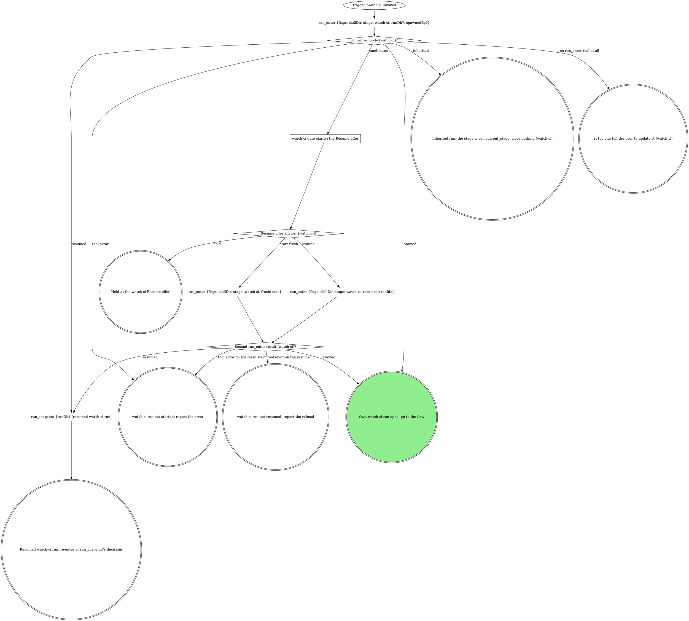

# watch-ci

The standalone entry for CI watching: same watch-and-triage flow as the
pipeline's watch-ci stage, reached directly instead of through a unit of
work. The target comes from the conversation and the checkout, and the
verdict goes to the user. Two graphs: the run graph opens or inherits the
run, the flow graph watches, triages and closes it.

## Run



An own run is a fresh or resumed one: it records identity, fires every gate
below and closes at the end. An inherited run fires no gate beyond `ci`,
records nothing about identity, and hands control back with the verdict.
Its caller hands `mr` (the MR's or PR's URL), `sha` and, optionally,
`priorPipelineId` (a number); it gets back one of: the verdict green, red
after the `ci` gate, an off-script answer, a failure, a stand-down naming
the `holder`, or a hold.

The flags for this verb, rendered by the compiler:

{{run-start.flags:watch-ci}}

`run_enter` takes `flags` = the `watch-ci` flag string from the block above,
verbatim (the value, never its key), `skillDir` = this skill's own
directory, `${CLAUDE_SKILL_DIR}`, as an absolute path, `stage: watch-ci`,
`runDb` only when a caller handed one, and `spawnedBy` only when a board or
another surface launched this pane. It starts, resumes or inherits the run
and opens the stage itself. Keep the returned `runDb` and pass it to every
`run_*` call in this verb; nothing is exported. A handed `runDb` whose run
is not running comes back with `handedRunDb: "not-running"` and is treated
as not handed. Every gate below writes its `gate` field and its decision
with `stage: "watch-ci"` in an own run, `stage: run.current_stage` in an
inherited one.

### watch-ci gate clarify: the Resume offer

`run_enter` returned `candidates`: running watch-ci runs in this repo. Never
read the run dbs by hand. Gate `clarify`: one sentence naming each
candidate's `spawnedBy`, `startedAt` and `currentStage`, then one
**Resume** option per candidate (labelled `Resume (Recommended)` when
`ownSession` is true; a run another live pane owns is not yours) / **Start
fresh**, and **Hold** in `next`. Resume passes that candidate's `runId`.

{{include:run-identity}}

## Flow

`<root>` is the worktree root, the absolute path `git rev-parse
--show-toplevel` prints, and `<mr>` is the MR's or PR's https URL. Every CI
tool (`ci_watch`, `ci_triage`, `mr_job_trace`, `mr_retry`, the `ci_lease_*`
tools) takes `mrUrl: <mr>`; `mr_view` and `mr_ready` target the MR with
`repoName` = `<root>` and `iid`. `<N>` is the number in `ci_watch`'s
`pipeline.id` (`gitlab:pipeline:N`). `config` on `ci_triage` comes only
from a domain rule (see Domain rules).

```dot
digraph watch_ci {
    rankdir=TB;

    "Trigger: a watch-ci run is open (own or inherited)" [shape=ellipse];
    "git branch --show-current, unless the user named a branch" [shape=plaintext];
    "git remote get-url origin (watch-ci target)" [shape=plaintext];
    "Forge host (watch-ci target)?" [shape=diamond];
    "mr_for_branch {repoName: <root>, branches: [<branch>]}" [shape=plaintext];
    "gh pr list --head <branch> --json number,url" [shape=plaintext];
    "watch-ci gate clarify: which forge?" [shape=box];
    "Own run (watch-ci identity)?" [shape=diamond];
    "run_field_set {key: branch, then mr when found, stage: watch-ci}" [shape=plaintext];
    "MR found (watch-ci lease)?" [shape=diamond];
    "Watched sha known (watch-ci)?" [shape=diamond];
    "git ls-remote origin refs/heads/<branch> (the watched sha)" [shape=plaintext];

    "ci_watch {mrUrl: <mr>, sha, priorPipelineId?, attend: true}" [shape=plaintext];
    "ci_watch state (watch-ci)?" [shape=diamond];
    "End the turn: ci_watch runs in the background (task <id>, watch-ci)" [shape=box];
    "Trigger: the ci_watch task notification re-invoked this verb (watch-ci)" [shape=ellipse];
    "STOP: GitLab CI watches go through ci_watch, reads through the read tools or gitlab_get, retries through mr_retry" [shape=octagon style=filled fillcolor=red fontcolor=white];
    "STOP: while another attendant holds the lease, every commit, push and retry is theirs" [shape=octagon style=filled fillcolor=red fontcolor=white];
    "Stand down: report it and stop" [shape=doublecircle];
    "watch-ci off-script gate: ci_watch could not hold the lease" [shape=box];
    "watch-ci off-script answer (lease_unavailable)?" [shape=diamond];
    "run_budget {key: watch-ci:lease-rounds:<sha12>, limit: 2, stage}" [shape=plaintext];
    "lease-rounds past its limit (watch-ci)?" [shape=diamond];
    "run_budget {key: watch-ci:ci-watch-errors:<sha12>, limit: 1, stage}" [shape=plaintext];
    "ci-watch-errors past its limit (watch-ci)?" [shape=diamond];
    "Fix what the ci_watch error names" [shape=box];
    "watch-ci off-script gate: ci_watch refused" [shape=box];
    "watch-ci off-script answer (ci_watch)?" [shape=diamond];
    "Verdict the human reported (watch-ci)?" [shape=diamond];
    "run_budget {key: watch-ci:ci-watch-off-script, limit: 2, stage}" [shape=plaintext];
    "ci-watch-off-script past its limit (watch-ci)?" [shape=diamond];

    "ci_lease_claim {mrUrl: <mr>, branch} (GitHub)" [shape=plaintext];
    "ci_lease_claim result (GitHub)?" [shape=diamond];
    "STOP: claim the lease only with ci_lease_claim (watch-ci)" [shape=octagon style=filled fillcolor=red fontcolor=white];
    "run_budget {key: watch-ci:github-claim-errors, limit: 1, stage}" [shape=plaintext];
    "github-claim-errors past its limit (watch-ci)?" [shape=diamond];
    "Fix what the claim error names (GitHub)" [shape=box];
    "watch-ci off-script gate: ci_lease_claim refused (GitHub)" [shape=box];
    "watch-ci off-script answer (ci_lease_claim, GitHub)?" [shape=diamond];
    "run_budget {key: watch-ci:github-claim-off-script, limit: 2, stage}" [shape=plaintext];
    "github-claim-off-script past its limit (watch-ci)?" [shape=diamond];
    "gh pr checks <mr> (poll)" [shape=plaintext];
    "gh pr checks exit (GitHub poll)?" [shape=diamond];
    "run_budget {key: watch-ci:github-polls:<sha12>, limit: 45, stage}" [shape=plaintext];
    "github-polls past its limit (watch-ci)?" [shape=diamond];
    "ci_lease_heartbeat {mrUrl} (GitHub poll)" [shape=plaintext];
    "Heartbeat result (GitHub poll)?" [shape=diamond];
    "sleep 60 as a background Bash task (GitHub poll)" [shape=plaintext];
    "gh pr view <mr> --json headRefOid (sha guard, GitHub poll)" [shape=plaintext];
    "Checks are for the watched sha (GitHub poll)?" [shape=diamond];
    "run_budget {key: watch-ci:github-sha-waits:<sha12>, limit: 5, stage}" [shape=plaintext];
    "github-sha-waits past its limit (watch-ci)?" [shape=diamond];
    "sleep 60 as a background Bash task (sha wait, GitHub poll)" [shape=plaintext];
    "Checks passed or failed (GitHub poll)?" [shape=diamond];
    "Classify each failing check REAL or INFRA (GitHub)" [shape=box];

    "ci_triage {mrUrl: <mr>, pipelineId: <N>, config?}" [shape=plaintext];
    "ci_triage result (watch-ci)?" [shape=diamond];
    "UNCLEAR jobs in the report (watch-ci)?" [shape=diamond];
    "mr_job_trace {mrUrl: <mr>, jobId, tailLines?, headLines?, grep?} per UNCLEAR job" [shape=plaintext];
    "Classify the triage report (watch-ci)" [shape=box];
    "Classify each failure REAL or INFRA from failedJobs (watch-ci)" [shape=box];
    "Only INFRA blocking failures, none INHERITED (watch-ci)?" [shape=diamond];
    "run_budget {key: watch-ci:infra-retries:<sha12>, limit: 1, stage}" [shape=plaintext];
    "infra-retries past its limit (watch-ci)?" [shape=diamond];

    "Retry on which forge (watch-ci)?" [shape=diamond];
    "mr_retry {mrUrl: <mr>, jobId, leaseMrUrl: <mr>} per INFRA job" [shape=plaintext];
    "mr_retry result (watch-ci)?" [shape=diamond];
    "watch-ci off-script gate: mr_retry refused" [shape=box];
    "watch-ci off-script answer (mr_retry)?" [shape=diamond];
    "run_budget {key: watch-ci:retry-off-script, limit: 2, stage}" [shape=plaintext];
    "retry-off-script past its limit (watch-ci)?" [shape=diamond];
    "ci_lease_claim {mrUrl: <mr>, branch} (before the GitHub retry)" [shape=plaintext];
    "Re-claim result (before the GitHub retry)?" [shape=diamond];
    "gh run rerun <run-id> --failed" [shape=plaintext];

    "Own run (watch-ci green)?" [shape=diamond];
    "MR found (watch-ci green)?" [shape=diamond];
    "Forge host (watch-ci draft check)?" [shape=diamond];
    "mr_view {repoName, iid} (draft check)" [shape=plaintext];
    "gh pr view <mr> --json isDraft (draft check)" [shape=plaintext];
    "MR still a draft (watch-ci)?" [shape=diamond];
    "watch-ci gate mark-ready" [shape=box];
    "mark-ready answer (watch-ci)?" [shape=diamond];
    "run_budget {key: watch-ci:mark-ready-iterations, limit: 2, stage}" [shape=plaintext];
    "mark-ready-iterations past its limit (watch-ci)?" [shape=diamond];
    "Forge host (watch-ci mark-ready)?" [shape=diamond];
    "mr_ready {repoName, iid}" [shape=plaintext];
    "gh pr ready <number>" [shape=plaintext];

    "watch-ci gate ci" [shape=box];
    "ci answer (watch-ci)?" [shape=diamond];
    "run_budget {key: watch-ci:ci-gate-iterations, limit: 3}" [shape=plaintext];
    "ci-gate-iterations past its limit (watch-ci)?" [shape=diamond];
    "run_budget {key: watch-ci:fix-rounds, limit: 3}" [shape=plaintext];
    "fix-rounds past its limit (watch-ci)?" [shape=diamond];
    "Fix the REAL failure, commit" [shape=box];
    "MR found (before git_push)?" [shape=diamond];
    "git_push {tree: <root>, leaseMrUrl: <mr>}" [shape=plaintext];
    "git_push {tree: <root>}" [shape=plaintext];
    "git_push result (watch-ci)?" [shape=diamond];
    "STOP: push only with git_push (watch-ci)" [shape=octagon style=filled fillcolor=red fontcolor=white];
    "watch-ci off-script gate: git_push refused" [shape=box];
    "watch-ci off-script answer (git_push)?" [shape=diamond];
    "run_budget {key: watch-ci:push-off-script, limit: 2, stage}" [shape=plaintext];
    "push-off-script past its limit (watch-ci)?" [shape=diamond];
    "Confirm the human's push landed (watch-ci)" [shape=box];
    "Push landed (watch-ci)?" [shape=diamond];
    "Own run (watch-ci new attempt)?" [shape=diamond];
    "run_stage {action: start, stage: watch-ci} (a new attempt)" [shape=plaintext];
    "MR found (before the retry)?" [shape=diamond];
    "run_budget {key: watch-ci:infra-retries:<sha12>, limit: 1, stage} (ci gate retry)" [shape=plaintext];
    "infra-retries past its limit (ci gate retry, watch-ci)?" [shape=diamond];

    "MR known (watch-ci exit)?" [shape=diamond];
    "ci_lease_release {mrUrl: <mr>}" [shape=plaintext];
    "Which exit is this (watch-ci)?" [shape=diamond];
    "run_close {workType: watch-ci, stage: watch-ci, outcome: done}" [shape=plaintext];
    "run_close {workType: watch-ci, stage: watch-ci, outcome: abandoned}" [shape=plaintext];
    "run_close {workType: watch-ci, stage: watch-ci, outcome: failed, reason}" [shape=plaintext];
    "run_hold {stage, reason, decidedBy}" [shape=plaintext];
    "Hand the verdict back to the caller (watch-ci)" [shape=doublecircle];
    "Hand the off-script answer back to the caller (watch-ci)" [shape=doublecircle];
    "Hand the failure back to the caller (watch-ci)" [shape=doublecircle];
    "Hand the Go back answer back (watch-ci)" [shape=doublecircle];
    "Held in watch-ci: the run stays open" [shape=doublecircle];
    "watch-ci run abandoned" [shape=doublecircle];
    "watch-ci failed" [shape=doublecircle];
    "watch-ci done" [shape=doublecircle style=filled fillcolor=lightgreen];

    "Trigger: a watch-ci run is open (own or inherited)" -> "git branch --show-current, unless the user named a branch";
    "git branch --show-current, unless the user named a branch" -> "git remote get-url origin (watch-ci target)";
    "git remote get-url origin (watch-ci target)" -> "Forge host (watch-ci target)?";
    "Forge host (watch-ci target)?" -> "mr_for_branch {repoName: <root>, branches: [<branch>]}" [label="GitLab, MR not named"];
    "Forge host (watch-ci target)?" -> "gh pr list --head <branch> --json number,url" [label="GitHub, PR not named"];
    "Forge host (watch-ci target)?" -> "Own run (watch-ci identity)?" [label="GitLab or GitHub, the user named the MR"];
    "Forge host (watch-ci target)?" -> "Own run (watch-ci identity)?" [label="inherited: the MR the caller handed"];
    "Forge host (watch-ci target)?" -> "watch-ci gate clarify: which forge?" [label="anything else, nothing handed"];
    "watch-ci gate clarify: which forge?" -> "Forge host (watch-ci target)?" [label="answered: the named forge"];
    "mr_for_branch {repoName: <root>, branches: [<branch>]}" -> "Own run (watch-ci identity)?" [label="a result, a null entry included"];
    "mr_for_branch {repoName: <root>, branches: [<branch>]}" -> "watch-ci gate ci" [label="an error: the gate quotes its text (never read as no MR)"];
    "gh pr list --head <branch> --json number,url" -> "Own run (watch-ci identity)?";
    "Own run (watch-ci identity)?" -> "run_field_set {key: branch, then mr when found, stage: watch-ci}" [label="yes"];
    "Own run (watch-ci identity)?" -> "MR found (watch-ci lease)?" [label="no: inherited"];
    "run_field_set {key: branch, then mr when found, stage: watch-ci}" -> "MR found (watch-ci lease)?";
    "MR found (watch-ci lease)?" -> "Watched sha known (watch-ci)?" [label="yes"];
    "MR found (watch-ci lease)?" -> "watch-ci gate ci" [label="no: no MR to watch, ship first"];
    "Watched sha known (watch-ci)?" -> "ci_watch {mrUrl: <mr>, sha, priorPipelineId?, attend: true}" [label="yes: handed by the caller, or this run's push"];
    "Watched sha known (watch-ci)?" -> "git ls-remote origin refs/heads/<branch> (the watched sha)" [label="no: nothing pushed in this run"];
    "git ls-remote origin refs/heads/<branch> (the watched sha)" -> "ci_watch {mrUrl: <mr>, sha, priorPipelineId?, attend: true}";

    "ci_watch {mrUrl: <mr>, sha, priorPipelineId?, attend: true}" -> "ci_watch state (watch-ci)?";
    "ci_watch state (watch-ci)?" -> "ci_watch {mrUrl: <mr>, sha, priorPipelineId?, attend: true}" [label="running or waiting: call again"];
    "ci_watch state (watch-ci)?" -> "End the turn: ci_watch runs in the background (task <id>, watch-ci)" [label="backgrounded: moved to the background as task <id>"];
    "End the turn: ci_watch runs in the background (task <id>, watch-ci)" -> "Trigger: the ci_watch task notification re-invoked this verb (watch-ci)" [style=dashed];
    "Trigger: the ci_watch task notification re-invoked this verb (watch-ci)" -> "ci_watch state (watch-ci)?";
    "ci_watch state (watch-ci)?" -> "Own run (watch-ci green)?" [label="success or success_with_warnings"];
    "ci_watch state (watch-ci)?" -> "ci_triage {mrUrl: <mr>, pipelineId: <N>, config?}" [label="failed"];
    "ci_watch state (watch-ci)?" -> "watch-ci gate ci" [label="timeout, no_pipeline, canceled, skipped, manual, superseded or aborted"];
    "ci_watch state (watch-ci)?" -> "STOP: while another attendant holds the lease, every commit, push and retry is theirs" [label="stood_down, holder named"];
    "ci_watch state (watch-ci)?" -> "watch-ci off-script gate: ci_watch could not hold the lease" [label="lease_unavailable"];
    "ci_watch state (watch-ci)?" -> "ci_lease_claim {mrUrl: <mr>, branch} (GitHub)" [label="unsupported_forge: a GitHub PR"];
    "ci_watch state (watch-ci)?" -> "run_budget {key: watch-ci:ci-watch-errors:<sha12>, limit: 1, stage}" [label="tool error"];
    "ci_watch state (watch-ci)?" -> "STOP: GitLab CI watches go through ci_watch, reads through the read tools or gitlab_get, retries through mr_retry" [label="tempted to watch with a script or the GitLab CLI"];
    "STOP: GitLab CI watches go through ci_watch, reads through the read tools or gitlab_get, retries through mr_retry" -> "ci_watch {mrUrl: <mr>, sha, priorPipelineId?, attend: true}";
    "STOP: while another attendant holds the lease, every commit, push and retry is theirs" -> "Stand down: report it and stop";

    "watch-ci off-script gate: ci_watch could not hold the lease" -> "watch-ci off-script answer (lease_unavailable)?";
    "watch-ci off-script answer (lease_unavailable)?" -> "MR known (watch-ci exit)?" [label="take: the human attends the MR / hold / hand back"];
    "watch-ci off-script answer (lease_unavailable)?" -> "run_budget {key: watch-ci:lease-rounds:<sha12>, limit: 2, stage}" [label="iterate: the human fixed it"];
    "run_budget {key: watch-ci:lease-rounds:<sha12>, limit: 2, stage}" -> "lease-rounds past its limit (watch-ci)?";
    "lease-rounds past its limit (watch-ci)?" -> "ci_watch {mrUrl: <mr>, sha, priorPipelineId?, attend: true}" [label="no: watch again"];
    "lease-rounds past its limit (watch-ci)?" -> "MR known (watch-ci exit)?" [label="yes: a failure, the refusals are the reason"];

    "run_budget {key: watch-ci:ci-watch-errors:<sha12>, limit: 1, stage}" -> "ci-watch-errors past its limit (watch-ci)?";
    "ci-watch-errors past its limit (watch-ci)?" -> "Fix what the ci_watch error names" [label="no"];
    "ci-watch-errors past its limit (watch-ci)?" -> "watch-ci off-script gate: ci_watch refused" [label="yes"];
    "Fix what the ci_watch error names" -> "ci_watch {mrUrl: <mr>, sha, priorPipelineId?, attend: true}";
    "watch-ci off-script gate: ci_watch refused" -> "watch-ci off-script answer (ci_watch)?";
    "watch-ci off-script answer (ci_watch)?" -> "Verdict the human reported (watch-ci)?" [label="take: the human read the pipeline"];
    "watch-ci off-script answer (ci_watch)?" -> "run_budget {key: watch-ci:ci-watch-off-script, limit: 2, stage}" [label="iterate: the human fixed it"];
    "watch-ci off-script answer (ci_watch)?" -> "MR known (watch-ci exit)?" [label="hold / hand back"];
    "Verdict the human reported (watch-ci)?" -> "Own run (watch-ci green)?" [label="green for the watched sha"];
    "Verdict the human reported (watch-ci)?" -> "watch-ci gate ci" [label="red, or not for the watched sha"];
    "run_budget {key: watch-ci:ci-watch-off-script, limit: 2, stage}" -> "ci-watch-off-script past its limit (watch-ci)?";
    "ci-watch-off-script past its limit (watch-ci)?" -> "ci_watch {mrUrl: <mr>, sha, priorPipelineId?, attend: true}" [label="no: watch again"];
    "ci-watch-off-script past its limit (watch-ci)?" -> "MR known (watch-ci exit)?" [label="yes: a failure, the refusals are the reason"];

    "ci_lease_claim {mrUrl: <mr>, branch} (GitHub)" -> "ci_lease_claim result (GitHub)?";
    "ci_lease_claim result (GitHub)?" -> "gh pr checks <mr> (poll)" [label="claimed: true, the PR is yours"];
    "ci_lease_claim result (GitHub)?" -> "STOP: while another attendant holds the lease, every commit, push and retry is theirs" [label="claimed: false, holder named"];
    "ci_lease_claim result (GitHub)?" -> "run_budget {key: watch-ci:github-claim-errors, limit: 1, stage}" [label="tool error"];
    "ci_lease_claim result (GitHub)?" -> "STOP: claim the lease only with ci_lease_claim (watch-ci)" [label="tempted to write the lease by hand or with a script"];
    "STOP: claim the lease only with ci_lease_claim (watch-ci)" -> "ci_lease_claim {mrUrl: <mr>, branch} (GitHub)";
    "run_budget {key: watch-ci:github-claim-errors, limit: 1, stage}" -> "github-claim-errors past its limit (watch-ci)?";
    "github-claim-errors past its limit (watch-ci)?" -> "Fix what the claim error names (GitHub)" [label="no"];
    "github-claim-errors past its limit (watch-ci)?" -> "watch-ci off-script gate: ci_lease_claim refused (GitHub)" [label="yes"];
    "Fix what the claim error names (GitHub)" -> "ci_lease_claim {mrUrl: <mr>, branch} (GitHub)";
    "watch-ci off-script gate: ci_lease_claim refused (GitHub)" -> "watch-ci off-script answer (ci_lease_claim, GitHub)?";
    "watch-ci off-script answer (ci_lease_claim, GitHub)?" -> "MR known (watch-ci exit)?" [label="take: the human attends the PR / hold / hand back"];
    "watch-ci off-script answer (ci_lease_claim, GitHub)?" -> "run_budget {key: watch-ci:github-claim-off-script, limit: 2, stage}" [label="iterate: the human fixed it"];
    "run_budget {key: watch-ci:github-claim-off-script, limit: 2, stage}" -> "github-claim-off-script past its limit (watch-ci)?";
    "github-claim-off-script past its limit (watch-ci)?" -> "ci_lease_claim {mrUrl: <mr>, branch} (GitHub)" [label="no: claim again"];
    "github-claim-off-script past its limit (watch-ci)?" -> "MR known (watch-ci exit)?" [label="yes: a failure, the refusals are the reason"];

    "gh pr checks <mr> (poll)" -> "gh pr checks exit (GitHub poll)?";
    "gh pr checks exit (GitHub poll)?" -> "gh pr view <mr> --json headRefOid (sha guard, GitHub poll)" [label="0, or any other exit with checks reported: passed or failed"];
    "gh pr checks exit (GitHub poll)?" -> "run_budget {key: watch-ci:github-polls:<sha12>, limit: 45, stage}" [label="8, or no checks reported: pending"];
    "run_budget {key: watch-ci:github-polls:<sha12>, limit: 45, stage}" -> "github-polls past its limit (watch-ci)?";
    "github-polls past its limit (watch-ci)?" -> "ci_lease_heartbeat {mrUrl} (GitHub poll)" [label="no"];
    "github-polls past its limit (watch-ci)?" -> "watch-ci gate ci" [label="yes: timeout"];
    "ci_lease_heartbeat {mrUrl} (GitHub poll)" -> "Heartbeat result (GitHub poll)?";
    "Heartbeat result (GitHub poll)?" -> "sleep 60 as a background Bash task (GitHub poll)" [label="ok: true"];
    "Heartbeat result (GitHub poll)?" -> "STOP: while another attendant holds the lease, every commit, push and retry is theirs" [label="lost"];
    "Heartbeat result (GitHub poll)?" -> "ci_lease_claim {mrUrl: <mr>, branch} (GitHub)" [label="none: claim it again"];
    "Heartbeat result (GitHub poll)?" -> "watch-ci gate ci" [label="tool error"];
    "sleep 60 as a background Bash task (GitHub poll)" -> "gh pr checks <mr> (poll)";
    "gh pr view <mr> --json headRefOid (sha guard, GitHub poll)" -> "Checks are for the watched sha (GitHub poll)?";
    "Checks are for the watched sha (GitHub poll)?" -> "Checks passed or failed (GitHub poll)?" [label="yes"];
    "Checks are for the watched sha (GitHub poll)?" -> "run_budget {key: watch-ci:github-sha-waits:<sha12>, limit: 5, stage}" [label="no"];
    "run_budget {key: watch-ci:github-sha-waits:<sha12>, limit: 5, stage}" -> "github-sha-waits past its limit (watch-ci)?";
    "github-sha-waits past its limit (watch-ci)?" -> "sleep 60 as a background Bash task (sha wait, GitHub poll)" [label="no"];
    "github-sha-waits past its limit (watch-ci)?" -> "watch-ci gate ci" [label="yes: no checks for the watched sha"];
    "sleep 60 as a background Bash task (sha wait, GitHub poll)" -> "gh pr checks <mr> (poll)";
    "Checks passed or failed (GitHub poll)?" -> "Own run (watch-ci green)?" [label="passed"];
    "Checks passed or failed (GitHub poll)?" -> "Classify each failing check REAL or INFRA (GitHub)" [label="failed"];
    "Classify each failing check REAL or INFRA (GitHub)" -> "Only INFRA blocking failures, none INHERITED (watch-ci)?";

    "ci_triage {mrUrl: <mr>, pipelineId: <N>, config?}" -> "ci_triage result (watch-ci)?";
    "ci_triage result (watch-ci)?" -> "UNCLEAR jobs in the report (watch-ci)?" [label="triaged"];
    "ci_triage result (watch-ci)?" -> "Classify each failure REAL or INFRA from failedJobs (watch-ci)" [label="tool error: quote it"];
    "UNCLEAR jobs in the report (watch-ci)?" -> "mr_job_trace {mrUrl: <mr>, jobId, tailLines?, headLines?, grep?} per UNCLEAR job" [label="yes"];
    "UNCLEAR jobs in the report (watch-ci)?" -> "Classify the triage report (watch-ci)" [label="no"];
    "mr_job_trace {mrUrl: <mr>, jobId, tailLines?, headLines?, grep?} per UNCLEAR job" -> "Classify the triage report (watch-ci)";
    "Classify the triage report (watch-ci)" -> "Only INFRA blocking failures, none INHERITED (watch-ci)?";
    "Classify each failure REAL or INFRA from failedJobs (watch-ci)" -> "Only INFRA blocking failures, none INHERITED (watch-ci)?";
    "Only INFRA blocking failures, none INHERITED (watch-ci)?" -> "run_budget {key: watch-ci:infra-retries:<sha12>, limit: 1, stage}" [label="yes"];
    "Only INFRA blocking failures, none INHERITED (watch-ci)?" -> "watch-ci gate ci" [label="no: a REAL, UNCLEAR or INHERITED failure"];
    "run_budget {key: watch-ci:infra-retries:<sha12>, limit: 1, stage}" -> "infra-retries past its limit (watch-ci)?";
    "infra-retries past its limit (watch-ci)?" -> "Retry on which forge (watch-ci)?" [label="no: retry once"];
    "infra-retries past its limit (watch-ci)?" -> "watch-ci gate ci" [label="yes: retried already"];

    "Retry on which forge (watch-ci)?" -> "mr_retry {mrUrl: <mr>, jobId, leaseMrUrl: <mr>} per INFRA job" [label="GitLab"];
    "Retry on which forge (watch-ci)?" -> "ci_lease_claim {mrUrl: <mr>, branch} (before the GitHub retry)" [label="GitHub"];
    "mr_retry {mrUrl: <mr>, jobId, leaseMrUrl: <mr>} per INFRA job" -> "mr_retry result (watch-ci)?";
    "mr_retry result (watch-ci)?" -> "ci_watch {mrUrl: <mr>, sha, priorPipelineId?, attend: true}" [label="retried: watch again"];
    "mr_retry result (watch-ci)?" -> "STOP: while another attendant holds the lease, every commit, push and retry is theirs" [label="refused: lease_held, holder named"];
    "mr_retry result (watch-ci)?" -> "watch-ci off-script gate: mr_retry refused" [label="tool error"];
    "watch-ci off-script gate: mr_retry refused" -> "watch-ci off-script answer (mr_retry)?";
    "watch-ci off-script answer (mr_retry)?" -> "ci_watch {mrUrl: <mr>, sha, priorPipelineId?, attend: true}" [label="take: the human retried the job"];
    "watch-ci off-script answer (mr_retry)?" -> "run_budget {key: watch-ci:retry-off-script, limit: 2, stage}" [label="iterate: the human fixed it"];
    "watch-ci off-script answer (mr_retry)?" -> "MR known (watch-ci exit)?" [label="hold / hand back"];
    "run_budget {key: watch-ci:retry-off-script, limit: 2, stage}" -> "retry-off-script past its limit (watch-ci)?";
    "retry-off-script past its limit (watch-ci)?" -> "mr_retry {mrUrl: <mr>, jobId, leaseMrUrl: <mr>} per INFRA job" [label="no: retry again"];
    "retry-off-script past its limit (watch-ci)?" -> "MR known (watch-ci exit)?" [label="yes: a failure, the refusals are the reason"];
    "ci_lease_claim {mrUrl: <mr>, branch} (before the GitHub retry)" -> "Re-claim result (before the GitHub retry)?";
    "Re-claim result (before the GitHub retry)?" -> "gh run rerun <run-id> --failed" [label="claimed: true"];
    "Re-claim result (before the GitHub retry)?" -> "STOP: while another attendant holds the lease, every commit, push and retry is theirs" [label="claimed: false, holder named"];
    "Re-claim result (before the GitHub retry)?" -> "watch-ci gate ci" [label="tool error: the gate quotes it"];
    "gh run rerun <run-id> --failed" -> "gh pr checks <mr> (poll)";

    "Own run (watch-ci green)?" -> "MR found (watch-ci green)?" [label="yes"];
    "Own run (watch-ci green)?" -> "MR known (watch-ci exit)?" [label="no: the verdict goes back to the caller"];
    "MR found (watch-ci green)?" -> "Forge host (watch-ci draft check)?" [label="yes"];
    "MR found (watch-ci green)?" -> "MR known (watch-ci exit)?" [label="no: nothing to mark ready"];
    "Forge host (watch-ci draft check)?" -> "mr_view {repoName, iid} (draft check)" [label="GitLab"];
    "Forge host (watch-ci draft check)?" -> "gh pr view <mr> --json isDraft (draft check)" [label="GitHub"];
    "mr_view {repoName, iid} (draft check)" -> "MR still a draft (watch-ci)?";
    "gh pr view <mr> --json isDraft (draft check)" -> "MR still a draft (watch-ci)?";
    "MR still a draft (watch-ci)?" -> "watch-ci gate mark-ready" [label="yes"];
    "MR still a draft (watch-ci)?" -> "MR known (watch-ci exit)?" [label="no"];
    "watch-ci gate mark-ready" -> "mark-ready answer (watch-ci)?";
    "mark-ready answer (watch-ci)?" -> "Forge host (watch-ci mark-ready)?" [label="mark ready now"];
    "mark-ready answer (watch-ci)?" -> "MR known (watch-ci exit)?" [label="keep it draft / go back / hold"];
    "mark-ready answer (watch-ci)?" -> "run_budget {key: watch-ci:mark-ready-iterations, limit: 2, stage}" [label="iterate"];
    "run_budget {key: watch-ci:mark-ready-iterations, limit: 2, stage}" -> "mark-ready-iterations past its limit (watch-ci)?";
    "mark-ready-iterations past its limit (watch-ci)?" -> "watch-ci gate mark-ready" [label="no: a new gate with their note"];
    "mark-ready-iterations past its limit (watch-ci)?" -> "MR known (watch-ci exit)?" [label="yes: keep it draft"];
    "Forge host (watch-ci mark-ready)?" -> "mr_ready {repoName, iid}" [label="GitLab"];
    "Forge host (watch-ci mark-ready)?" -> "gh pr ready <number>" [label="GitHub"];
    "mr_ready {repoName, iid}" -> "MR known (watch-ci exit)?";
    "gh pr ready <number>" -> "MR known (watch-ci exit)?";

    "watch-ci gate ci" -> "ci answer (watch-ci)?";
    "ci answer (watch-ci)?" -> "run_budget {key: watch-ci:fix-rounds, limit: 3}" [label="fix and re-push"];
    "ci answer (watch-ci)?" -> "MR found (before the retry)?" [label="retry the job"];
    "ci answer (watch-ci)?" -> "MR known (watch-ci exit)?" [label="hand back / abandon (own run only) / hold"];
    "ci answer (watch-ci)?" -> "run_budget {key: watch-ci:ci-gate-iterations, limit: 3}" [label="iterate"];
    "run_budget {key: watch-ci:ci-gate-iterations, limit: 3}" -> "ci-gate-iterations past its limit (watch-ci)?";
    "ci-gate-iterations past its limit (watch-ci)?" -> "watch-ci gate ci" [label="no: re-triage with their note, a new gate"];
    "ci-gate-iterations past its limit (watch-ci)?" -> "MR known (watch-ci exit)?" [label="yes: hand back"];
    "run_budget {key: watch-ci:fix-rounds, limit: 3}" -> "fix-rounds past its limit (watch-ci)?";
    "fix-rounds past its limit (watch-ci)?" -> "Fix the REAL failure, commit" [label="no"];
    "fix-rounds past its limit (watch-ci)?" -> "run_budget {key: watch-ci:ci-gate-iterations, limit: 3}" [label="yes: reopen with Hand back recommended"];
    "Fix the REAL failure, commit" -> "MR found (before git_push)?";
    "MR found (before git_push)?" -> "git_push {tree: <root>, leaseMrUrl: <mr>}" [label="yes: an MR or PR"];
    "MR found (before git_push)?" -> "git_push {tree: <root>}" [label="no MR: no lease"];
    "git_push {tree: <root>, leaseMrUrl: <mr>}" -> "git_push result (watch-ci)?";
    "git_push {tree: <root>}" -> "git_push result (watch-ci)?";
    "git_push result (watch-ci)?" -> "Own run (watch-ci new attempt)?" [label="ok: keep sha, mr and priorPipelineId"];
    "git_push result (watch-ci)?" -> "STOP: while another attendant holds the lease, every commit, push and retry is theirs" [label="refused: lease_held, holder named"];
    "git_push result (watch-ci)?" -> "STOP: push only with git_push (watch-ci)" [label="any other error or refusal"];
    "STOP: push only with git_push (watch-ci)" -> "watch-ci off-script gate: git_push refused";
    "watch-ci off-script gate: git_push refused" -> "watch-ci off-script answer (git_push)?";
    "watch-ci off-script answer (git_push)?" -> "Confirm the human's push landed (watch-ci)" [label="take: the human pushed"];
    "watch-ci off-script answer (git_push)?" -> "run_budget {key: watch-ci:push-off-script, limit: 2, stage}" [label="iterate: registration fixed, retry"];
    "watch-ci off-script answer (git_push)?" -> "MR known (watch-ci exit)?" [label="hand back / hold"];
    "run_budget {key: watch-ci:push-off-script, limit: 2, stage}" -> "push-off-script past its limit (watch-ci)?";
    "push-off-script past its limit (watch-ci)?" -> "MR found (before git_push)?" [label="no: push again"];
    "push-off-script past its limit (watch-ci)?" -> "MR known (watch-ci exit)?" [label="yes: a failure, the refusals are the reason"];
    "Confirm the human's push landed (watch-ci)" -> "Push landed (watch-ci)?";
    "Push landed (watch-ci)?" -> "Own run (watch-ci new attempt)?" [label="yes: the remote branch carries HEAD"];
    "Push landed (watch-ci)?" -> "run_budget {key: watch-ci:push-off-script, limit: 2, stage}" [label="no: say what the comparison showed"];
    "Own run (watch-ci new attempt)?" -> "run_stage {action: start, stage: watch-ci} (a new attempt)" [label="yes"];
    "Own run (watch-ci new attempt)?" -> "MR found (watch-ci lease)?" [label="no: inherited, watch the pushed sha"];
    "run_stage {action: start, stage: watch-ci} (a new attempt)" -> "MR found (watch-ci lease)?";

    "MR found (before the retry)?" -> "run_budget {key: watch-ci:infra-retries:<sha12>, limit: 1, stage} (ci gate retry)" [label="yes"];
    "MR found (before the retry)?" -> "run_budget {key: watch-ci:ci-gate-iterations, limit: 3}" [label="no: nothing to retry"];
    "run_budget {key: watch-ci:infra-retries:<sha12>, limit: 1, stage} (ci gate retry)" -> "infra-retries past its limit (ci gate retry, watch-ci)?";
    "infra-retries past its limit (ci gate retry, watch-ci)?" -> "Retry on which forge (watch-ci)?" [label="no"];
    "infra-retries past its limit (ci gate retry, watch-ci)?" -> "run_budget {key: watch-ci:ci-gate-iterations, limit: 3}" [label="yes: reopen, the retry is spent"];

    "MR known (watch-ci exit)?" -> "ci_lease_release {mrUrl: <mr>}" [label="yes"];
    "MR known (watch-ci exit)?" -> "Which exit is this (watch-ci)?" [label="no"];
    "ci_lease_release {mrUrl: <mr>}" -> "Which exit is this (watch-ci)?";
    "Which exit is this (watch-ci)?" -> "run_close {workType: watch-ci, stage: watch-ci, outcome: done}" [label="own run: green, ready or kept draft, a ci Hand back, or a lease gate take"];
    "Which exit is this (watch-ci)?" -> "run_close {workType: watch-ci, stage: watch-ci, outcome: abandoned}" [label="own run: abandon"];
    "Which exit is this (watch-ci)?" -> "run_close {workType: watch-ci, stage: watch-ci, outcome: failed, reason}" [label="own run: a failure or an off-script hand back"];
    "Which exit is this (watch-ci)?" -> "Hand the verdict back to the caller (watch-ci)" [label="inherited run: green, or red after a ci Hand back"];
    "Which exit is this (watch-ci)?" -> "Hand the off-script answer back to the caller (watch-ci)" [label="inherited run: an off-script take or hand back"];
    "Which exit is this (watch-ci)?" -> "Hand the failure back to the caller (watch-ci)" [label="inherited run: a failure"];
    "Which exit is this (watch-ci)?" -> "Hand the Go back answer back (watch-ci)" [label="own run: go back"];
    "Which exit is this (watch-ci)?" -> "run_hold {stage, reason, decidedBy}" [label="hold"];
    "run_close {workType: watch-ci, stage: watch-ci, outcome: done}" -> "watch-ci done";
    "run_close {workType: watch-ci, stage: watch-ci, outcome: abandoned}" -> "watch-ci run abandoned";
    "run_close {workType: watch-ci, stage: watch-ci, outcome: failed, reason}" -> "watch-ci failed";
    "run_hold {stage, reason, decidedBy}" -> "Held in watch-ci: the run stays open";
}
```

### watch-ci gate clarify: which forge?

The origin host is neither GitLab nor GitHub. Ask which forge it is, quoting
the `git remote get-url origin` line as the context.

### End the turn: ci_watch runs in the background (task <id>, watch-ci)

Claude Code moves a `ci_watch` still running after 120 s to the background
and re-invokes this pane with its result as a `<task-notification>`. End
the turn in one line: `watching CI in the background (task <id>)`. The
notification's `<result>` is the next `ci_watch state`. The pipeline gate
stop hook lets a turn end while a background task is pending, and a chat or
user message that arrives meanwhile reaches you at once. A foreground wait
(a `sleep`, a polling script, a second `ci_watch`) is the thing this node
replaces: it delays the result and every message by the length of the wait.

### watch-ci off-script gate: ci_watch could not hold the lease

`ci_watch` returned `lease_unavailable`: it could not claim or keep this
session's lease, and its `error` says why. No one else holds the MR (that
is `stood_down`), so this is not a stand-down. Scope
`off-script:<stage>:<n>` (`n` counts from 1 within the stage attempt),
`context` quoting `error`.

| Question | Options |
|---|---|
| `action` | **Take** (the human attends this MR themselves) / **Iterate** (the human fixed it: watch again) / **Hand back** |
| `next` | **Proceed** (Recommended) / **Hold** |

Take closes an own run `done` with the report saying the human has the MR,
and an inherited run hands the answer back. Iterate counts one
`lease-rounds` round for this commit; past two, the run fails with the
refusals as the reason.

### Fix what the ci_watch error names

`ci_watch` refused its input. Correct what the error names (`mrUrl` the
MR's https URL, `sha` 7 to 40 hex characters, `priorPipelineId` the number
`N` of a `gitlab:pipeline:N` id) and call again, once. An error is never a
reason to watch with a script or the GitLab CLI. An error that names none
of these inputs (the repo is not registered with rt, for example) has
nothing to correct: call again unchanged, once, and the off-script gate
follows. `ci-watch-errors` counts each error for this commit.

### watch-ci off-script gate: ci_watch refused

Scope `off-script:<stage>:<n>`, `context` quoting both errors.

| Question | Options |
|---|---|
| `action` | **Take** (the human reads the pipeline and reports green or red for the watched sha) / **Iterate** (the human fixed it, for example registered the repo with rt: watch again) / **Hand back** |
| `next` | **Proceed** (Recommended) / **Hold** |

Iterate counts one `ci-watch-off-script` round before watching again.

### Fix what the claim error names (GitHub)

`ci_lease_claim` refused its input. Correct what the error names (`mrUrl`
must be the PR's https URL, `.../pull/<n>`; `branch` the PR's source
branch) and claim again, once. An error that names none of these inputs
(no session id, for example) has nothing to correct: claim again
unchanged, once, and the off-script gate follows.

### watch-ci off-script gate: ci_lease_claim refused (GitHub)

Scope `off-script:<stage>:<n>`, `context` quoting both errors.

| Question | Options |
|---|---|
| `action` | **Take** (the human attends this PR themselves) / **Iterate** (the human fixed it: claim again) / **Hand back** |
| `next` | **Proceed** (Recommended) / **Hold** |

Take closes an own run `done` with the report saying the human has the PR,
and an inherited run hands the answer back. Iterate counts one
`github-claim-off-script` round before claiming again.

### Classify the triage report (watch-ci)

`ci_triage` sorts each failed job into REAL, INFRA or UNCLEAR by its log and
marks each blocking one `yours`, INHERITED (also failing on the target
branch) or UNKNOWN (no base pipelines to compare). The `blocking` list
decides the verdict; `nonBlocking` jobs never do. Each UNCLEAR job's log is
read with `mr_job_trace` before this step: the tail first, then `grep` for
the failure text, or `headLines` when the failure sits far above the end. A
tail of only teardown lines (cleanup, artifact upload, runner exit) says
nothing about the cause, so read more before classifying. A `crossProject`
entry is read as in `Classify each failure REAL or INFRA from failedJobs
(watch-ci)`.

Then classify each blocking failure:

- REAL: the change broke it (a test, type or lint failure in touched code).
- INFRA: unrelated to the change (a runner, network or dependency outage, a
  known flake).
- Still unclear after the read: it stays UNCLEAR and goes to the gate.

Never classify a failure INFRA without its log read; an unreadable trace is
UNCLEAR, never INFRA. The domain rules below judge the report: which jobs
block, which patterns are noise, whose failure it is. They may move a job
between REAL and INFRA; they never retry, watch, claim or push. An
INHERITED failure is neither retried nor fixed here: it goes to the gate,
named as inherited. UNKNOWN ownership still gets its one INFRA retry. The
box classifies and nothing else: INFRA job ids go to `mr_retry`, and a
retry command any report prints is not run.

### Classify each failure REAL or INFRA from failedJobs (watch-ci)

`ci_triage` returned an error: quote it, then classify `ci_watch`'s
`failedJobs` as `Classify the triage report (watch-ci)` says, ownership
unknown. Read each job's `traceTail`; a job with none (past the first five
blocking), or a tail too short or teardown-only, is read with
`mr_job_trace` as part of this step.

When `ci_watch` reports `failed` and `failedJobs` is empty, the red is
likely in a cross-project downstream pipeline (same-project downstream jobs
are already in `failedJobs`): read `gitlab_get` on
`projects/:id/pipelines/<pipelineId>/bridges` for the bridge job's id and
its downstream pipeline, then the downstream pipeline's jobs with
`gitlab_get`, before classifying. The downstream job's log is read with
`gitlab_get` on `projects/<downstream project id>/jobs/<jobId>/trace`,
since `mr_job_trace` reads only this project's jobs. `gitlab_get` returns
at most the first 256 KiB of a trace, so a long downstream log's end may be
out of reach: classify such a failure as still unclear (it goes to the
gate), never INFRA. Never classify a failed pipeline with no job read as
INFRA.

A pipeline fact `ci_watch` and `mr_pipeline` do not return (an earlier
pipeline on the branch, a pipeline with no MR) is read with
`pipeline_list`; the jobs of a pipeline with `pipeline_jobs`; anything else
as in "Reading a GitLab fact no read tool returns".

### Reading a GitLab fact no read tool returns

At any step of this verb, a GitLab fact the read tools do not return is
read with `gitlab_get {repoName, path}`: `repoName` = the checkout or
tree this verb already targets, `path` relative to the API root with `:id`
for this project, for example `projects/:id/jobs/<jobId>`. The read is part
of the step that needs it, not an off-script move, so it opens no gate. A
GitLab error is quoted as GitLab wrote it. Its refusal of a credential path
is final.

### Classify each failing check REAL or INFRA (GitHub)

Read the failing checks' logs from the links `gh pr checks <mr>` prints,
then classify as `Classify the triage report (watch-ci)` says: REAL goes to
the gate, INFRA gets one retry. Ownership is unknown on GitHub.

### watch-ci off-script gate: mr_retry refused

`mr_retry` returned an error (a `lease_held` refusal is the stand-down, not
this gate). Scope `off-script:<stage>:<n>`, `context` quoting the error and
the job ids.

| Question | Options |
|---|---|
| `action` | **Take** (the human retried the job: watch again) / **Iterate** (the human fixed it: retry again) / **Hand back** |
| `next` | **Proceed** (Recommended) / **Hold** |

Iterate counts one `retry-off-script` round before retrying again.

### watch-ci gate mark-ready

Own run only, green, the MR still a draft. One sentence above the form: CI
is green for the MR's head.

| Question | Options (recommended first) | Shown when |
|---|---|---|
| `ready` (write-in) | **Mark ready now (Recommended)** / **Keep it draft** | always |
| `next` | **Proceed** / **Iterate here** / **Go back** / **Hold** | always |
| `to` | one option per earlier stage, split `to-1`, `to-2`, ... over 4; with exactly one candidate it labels **Go back to `<stage>`** in `next` instead | Go back answered and `run_snapshot` shows more than one earlier stage row |

Scope `mark-ready`. Selection: `{"ready":true|false,"next":"proceed|iterate|redirect|hold","to":"<stage or null>","note":"<their words or null>"}`.
An iterate counts one `mark-ready-iterations` round; past two, the MR stays
draft.

### watch-ci gate ci

Reached on red (a REAL, UNCLEAR or INHERITED failure, or an INFRA retry
already spent), `timeout` (still running past the watch budget),
`no_pipeline`, a `canceled`, `skipped`, `manual`, `superseded` or `aborted`
pipeline, no MR, a GitHub poll or sha-wait budget past its limit, and an
`mr_for_branch` error or a GitHub heartbeat or re-claim error, quoted in
the sentence above the form. `no_pipeline` means ten minutes passed with no
pipeline for the watched sha: when its `pushed` is false the MR head is its
`remoteSha`, not the watched sha, so the sentence says to ship first; when
`pushed` is true, it says no pipeline ran for that sha. Scope
`ci:<stage>:<attempt>`. One sentence above the form: the verdict and a
one-line triage per blocking failure.

| Question | Options (recommended first) | Shown when |
|---|---|---|
| `action` (write-in) | **Fix and re-push (Recommended)** (a REAL failure in the change; after the third fix round the suffix moves to **Hand back**) / **Retry the job** (a flake not yet retried) / **Hand back** / **Abandon the run** (own run only) | always |
| `next` | **Proceed** / **Iterate here** / **Hold** | always |

Selection: `{"next":"fix|retry|handback|abandon|iterate|hold","note":"<their words or null>"}`.
An `action` write-in adds `"action": {"writeIn": "<their words>"}`, and
`next` records `iterate`, or the Hold that won.
An iterate counts one `ci-gate-iterations` round; past three, the run hands
back. Hand back leaves the MR red for the human: an own run closes `done`,
an inherited one hands the verdict back.

### Fix the REAL failure, commit

Fix what the triage names as REAL, test-first where a test can catch it,
and commit the named files. `fix-rounds` counts each fix in this run. The
lease needs nothing during the fix: the keepalive holds it, and the push
carries the guard.

### watch-ci off-script gate: git_push refused

Scope `off-script:<stage>:<n>` (`n` counts from 1 within the stage
attempt), `context` quoting the refusal.

| Question | Options |
|---|---|
| `action` | **Take the proposed move** (the value spells the move in full, such as the human pushing) / **Iterate** (registration fixed: push again) / **Hand back** |
| `next` | **Proceed** (Recommended) / **Hold** |

Selection: `{"move":"<the move>","why":"<the refusal>","action":"take|iterate|handback","next":"proceed|hold","note":"<their words or null>"}`.
Iterate, and a human push that did not land, each count one
`push-off-script` round.

### Confirm the human's push landed (watch-ci)

The human pushed outside this verb. Compare `git rev-parse HEAD` with the
remote branch and say what it shows; never push from here. The push landed
when the remote branch carries HEAD; that HEAD is the watched sha, with no
prior pipeline id. Otherwise the off-script gate reopens with the
comparison as its context.

## What the graph cannot show

- **The watched sha.** The caller hands it (ship passes its `git_push`
  result's `sha`), or this run's `git_push` returns it, or after a human
  push it is the HEAD `Confirm the human's push landed (watch-ci)`
  compared. A run that pushed nothing watches the remote branch's sha (`git
  ls-remote origin refs/heads/<branch>`): unpushed commits have no
  pipeline. `<sha12>` in a budget key is its first 12 characters.
- **The prior pipeline id.** The caller's `priorPipelineId`, or this run's
  `git_push` result's `priorPipelineId` (the fix commit moved the branch,
  so that pipeline is the old one). A human push has none. Pass it on the
  first `ci_watch` call for a sha; the tool keeps it per MR, and a
  `priorPipelineId` a result carries is passed on the next call. The
  watched pipeline's own `pipeline.id` is never a prior id. When this run
  had no MR, a non-null `mr` in the `git_push` result is the MR to watch.
- **The tool owns the watch budget.** `ci_watch {attend: true}` measures
  the pipeline's age against the `ci.watch.budgetMinutes` setting, keeps
  the window across calls, reopens it after a retry, and returns `timeout`
  once spent; with no pipeline for the sha after 10 minutes it returns
  `no_pipeline`. Pass no budget arguments and count no `running` or
  `waiting` results: the `call again` loop ends when the tool says so.
- **The sha guard.** On GitLab it is inside `ci_watch`: only a pipeline for
  `sha` counts, a head that moved past it returns `superseded`, and green or
  red is never read off an older pipeline. On GitHub, `headRefOid` from `gh
  pr view` must equal the watched sha, and "no checks reported" is pending,
  not red.
- **Retry on GitHub.** The run id for `gh run rerun` comes from the failed
  check's link in `gh pr checks <mr>`.
- **Closing the run.** `run_close` closes an own run only (it refuses an
  inherited one); `run_hold` takes the stage as every gate write does, the
  gate's name as `reason`, and `decidedBy` as the gate's answer recorded it.

## The attendant lease

Exactly one actor attends an MR's CI at a time: this verb, the pipeline's
watch-ci stage, or the board's doctor. On GitLab, `ci_watch {attend: true}`
is the only claimer: it claims this session's lease, heartbeats it every
poll, re-claims a vanished lease up to twice per commit, and a keepalive
holds it between calls until `ci_lease_release`, another owner, or 60
minutes with no attending CI call on the MR. Another owner's fresh lease
(the doctor's included) returns `stood_down` with `holder`. This verb never
passes `underBoardLease`.

The repairs carry their own guard: `git_push` and `mr_retry` with
`leaseMrUrl: <mr>` take a lapsed lease back and refuse with `refused:
"lease_held"` and `holder` while another owner holds it, so a long fix
needs no heartbeat. On GitHub, `ci_watch` returns `unsupported_forge`
before claiming: this verb claims with `ci_lease_claim`, heartbeats once
per poll and re-claims before `gh run rerun`; the push guard works the
same.

While a gate waits, the keepalive keeps the lease held, so the doctor
cannot take the MR over while the human decides. Every exit that knows the
MR releases it with `ci_lease_release`, which refuses another owner's lease
harmlessly; the stand-down never calls it, because that lease is someone
else's. A crashed session needs no cleanup.

| Thought | Reality |
|---|---|
| "The doctor's on it, but I can fix it faster" | Two actors pushing to one branch race each other's work. Stand down and stop. |
| "I'll just retry the flaky job while the doctor works" | A retry is a repair action. The lease holder does it, not you. |
| "I attended it at the start, so the push is mine" | The push carries `leaseMrUrl`; a `lease_held` refusal means stand down. |
| "This fix is long, so I'll heartbeat or claim by hand" | The keepalive and the push guard cover it. On GitLab, `ci_watch` is the only claimer. |
| "ci_watch returned lease_unavailable, so I'll claim it myself or run the attendant script" | The off-script gate. The script is retired. |
| "ci_watch errored, so I'll poll with the GitLab CLI or a watch script" | Fix the input once, then the off-script gate. The STOP on `ci_watch state (watch-ci)?` names it. |
| "The pipeline says success, that's green" | Only for the watched sha. `ci_watch` checks it; on GitHub, check `headRefOid`. |

## Budgets in this verb

Every loop counts through `run_budget`, so a budget survives compaction and
resume. Each call increments by one as the loop is entered, and the diamond
after it reads `spent > limit`. `stage` is `watch-ci` in an own run and
`run.current_stage` in an inherited one; a run-wide key passes no `stage`,
because a fix push starts a new attempt mid-loop.

| Key | Limit | Scope | Counts |
|---|---|---|---|
| `watch-ci:ci-watch-errors:<sha12>` | 1 | stage, per commit | each `ci_watch` tool error |
| `watch-ci:ci-watch-off-script` | 2 | stage | each Iterate at the `ci_watch refused` gate |
| `watch-ci:lease-rounds:<sha12>` | 2 | stage, per commit | each Iterate at the lease gate |
| `watch-ci:infra-retries:<sha12>` | 1 | stage, per commit | each INFRA retry decision, automatic or from the `ci` gate |
| `watch-ci:retry-off-script` | 2 | stage | each Iterate at the `mr_retry refused` gate |
| `watch-ci:ci-gate-iterations` | 3 | run-wide | each `ci` gate reopening |
| `watch-ci:fix-rounds` | 3 | run-wide | each Fix and re-push |
| `watch-ci:push-off-script` | 2 | stage | each Iterate, or human push that did not land, at the `git_push refused` gate |
| `watch-ci:mark-ready-iterations` | 2 | stage | each mark-ready Iterate |
| `watch-ci:github-claim-errors` | 1 | stage | each GitHub `ci_lease_claim` tool error |
| `watch-ci:github-claim-off-script` | 2 | stage | each Iterate at the GitHub claim gate |
| `watch-ci:github-polls:<sha12>` | 45 | stage, per commit | each pending `gh pr checks` poll |
| `watch-ci:github-sha-waits:<sha12>` | 5 | stage, per commit | each poll whose checks are for another sha |

## Domain rules

If a rule below asks for a move this graph marks STOP, take the off-script edge instead.

The domain supplies triage: how to read a red, REAL or INFRA, ownership,
noise. It never watches, claims, releases or pushes; the graph does.

The slot contract stays `watch-ci-domain@1`, and its judgment applies at
`Classify the triage report (watch-ci)`. This skill runs neither vendored
script, so a rule written for the script engine is redirected: a rule that
runs `<scripts>/ci-triage.sh` goes to `ci_triage`, with `pipelineId: <N>`
(never the ref's newest pipeline) and the keys of its `--config` file as
`config` (that file sits in the fill's own directory, vendored under
`parts/domain/`, never in this skill's `scripts/`); a rule that runs
`<forge> jobs` goes to `pipeline_jobs`; a rule that names `ci-attendant.sh`
or `ci-watch.sh` goes to `ci_watch`.

{{slot:domain}}

When nothing is inlined above, the graph's other flows apply.

## Forge

If a rule below asks for a move this graph marks STOP, take the off-script edge instead.

`<scripts>` is `${CLAUDE_SKILL_DIR}/scripts/` and `<forge>` is
`${CLAUDE_SKILL_DIR}/parts/forge/scripts/ci-forge.sh`, vendored for the
fills that name them; this skill calls neither.

{{slot:forge}}

Both slots are optional; when neither is inlined above, the graph's
unbound flows apply.

## Gate protocol

{{include:gate-protocol}}

## Wrap-up form contract

{{include:wrap-up-form}}
