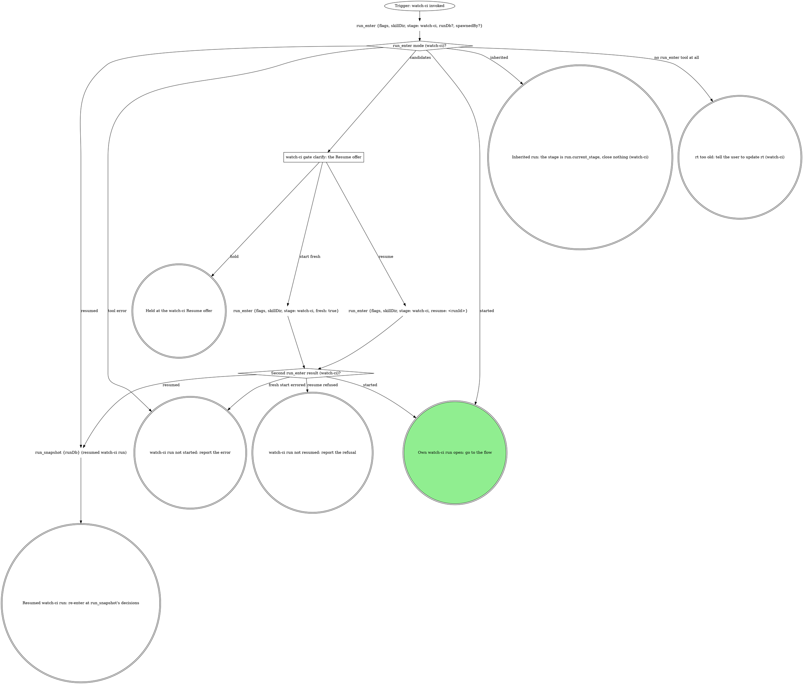

# watch-ci

The standalone entry for CI watching: the target comes from the
conversation and the checkout, and the verdict goes to the user. The run
graph opens or inherits the run; the flow graph watches, triages and closes
it.

## Run



An own run is a fresh or resumed one: it records identity, fires every gate
below and closes at the end. An inherited run fires no gate beyond `ci` and
the off-script gates, records no identity, and hands back. Its caller hands
`mr` (the MR's or PR's URL), `sha` and optionally `priorPipelineId` (a
number), and gets back one of: green, red after the `ci` gate, an
off-script answer, a failure, a stand-down naming the `holder`, or a hold.

The flags, rendered by the compiler:

{{run-start.flags:watch-ci}}

`run_enter` takes `flags` = the `watch-ci` flag string above, verbatim (the
value, never its key), `skillDir` = `${CLAUDE_SKILL_DIR}` as an absolute
path, `stage: watch-ci`, `runDb` only when a caller handed one, and
`spawnedBy` only when a board or another surface launched this pane. It
opens the stage itself. Pass the returned `runDb` to every `run_*` call;
nothing is exported. A handed `runDb` that comes back `handedRunDb:
"not-running"` counts as not handed. Every gate write and `stage` argument
is `"watch-ci"` in an own run and `run.current_stage` in an inherited one.

### watch-ci gate clarify: the Resume offer

`run_enter` returned `candidates`; never read the run dbs by hand. Gate
`clarify`: one sentence naming each candidate's `spawnedBy`, `startedAt`
and `currentStage`, then one **Resume** option per candidate (`Resume
(Recommended)` when `ownSession` is true; a run another live pane owns is
not yours) / **Start fresh**, and **Hold** in `next`. Resume passes that
candidate's `runId`.

{{include:run-identity}}

## Flow

`<root>` is the worktree root (`git rev-parse --show-toplevel`), `<mr>` the
MR's or PR's https URL. Every CI tool takes `mrUrl: <mr>`; `mr_view` and
`mr_ready` take `repoName` = `<root>` and `iid`. `<N>` is the number in
`ci_watch`'s `pipeline.id` (`gitlab:pipeline:N`).

```dot
digraph watch_ci {
    rankdir=TB;

    "Trigger: a watch-ci run is open (own or inherited)" [shape=ellipse];
    "git branch --show-current, unless the user named a branch" [shape=plaintext];
    "git remote get-url origin (watch-ci target)" [shape=plaintext];
    "Forge host (watch-ci target)?" [shape=diamond];
    "mr_for_branch {repoName: <root>, branches: [<branch>]}" [shape=plaintext];
    "gh pr list --head <branch> --json number,url" [shape=plaintext];
    "watch-ci gate clarify: which forge?" [shape=box];
    "Own run (watch-ci identity)?" [shape=diamond];
    "run_field_set {key: branch, then mr when found, stage: watch-ci}" [shape=plaintext];
    "MR found (watch-ci lease)?" [shape=diamond];
    "Watched sha known (watch-ci)?" [shape=diamond];
    "git ls-remote origin refs/heads/<branch> (the watched sha)" [shape=plaintext];

    "ci_watch {mrUrl: <mr>, sha, priorPipelineId?, attend: true}" [shape=plaintext];
    "ci_watch state (watch-ci)?" [shape=diamond];
    "End the turn: ci_watch runs in the background (watch-ci)" [shape=box];
    "Trigger: the ci_watch task notification (watch-ci)" [shape=ellipse];
    "STOP: GitLab CI watches go through ci_watch, reads through the read tools or gitlab_get, retries through mr_retry" [shape=octagon style=filled fillcolor=red fontcolor=white];
    "STOP: the lease holder owns every commit, push and retry (watch-ci)" [shape=octagon style=filled fillcolor=red fontcolor=white];
    "Stand down: report the holder, or hand it back (watch-ci)" [shape=doublecircle];
    "watch-ci off-script gate: lease_unavailable" [shape=box];
    "run_budget {key: watch-ci:ci-watch-errors:<sha12>, limit: 1, stage}" [shape=plaintext];
    "ci-watch-errors spent (watch-ci)?" [shape=diamond];
    "Fix what the ci_watch error names" [shape=box];
    "watch-ci off-script gate: ci_watch refused" [shape=box];
    "run_budget {key: watch-ci:ci-watch-off-script, limit: 1, stage}" [shape=plaintext];
    "ci-watch-off-script spent (watch-ci)?" [shape=diamond];

    "ci_lease_claim {mrUrl: <mr>, branch} (GitHub)" [shape=plaintext];
    "ci_lease_claim result (GitHub)?" [shape=diamond];
    "STOP: claim the lease only with ci_lease_claim (watch-ci)" [shape=octagon style=filled fillcolor=red fontcolor=white];
    "run_budget {key: watch-ci:github-claim-errors, limit: 1, stage}" [shape=plaintext];
    "github-claim-errors spent (watch-ci)?" [shape=diamond];
    "Fix what the claim error names (GitHub)" [shape=box];
    "watch-ci off-script gate: ci_lease_claim refused (GitHub)" [shape=box];
    "run_budget {key: watch-ci:github-claim-off-script, limit: 1, stage}" [shape=plaintext];
    "github-claim-off-script spent (watch-ci)?" [shape=diamond];
    "gh pr checks <mr> (poll)" [shape=plaintext];
    "gh pr checks exit (GitHub poll)?" [shape=diamond];
    "run_budget {key: watch-ci:github-polls:<sha12>, limit: 45, stage}" [shape=plaintext];
    "github-polls spent (watch-ci)?" [shape=diamond];
    "ci_lease_heartbeat {mrUrl} (GitHub poll)" [shape=plaintext];
    "Heartbeat result (GitHub poll)?" [shape=diamond];
    "sleep 60 as a background Bash task (GitHub poll)" [shape=plaintext];
    "gh pr view <mr> --json headRefOid (sha guard)" [shape=plaintext];
    "Checks are for the watched sha (GitHub poll)?" [shape=diamond];
    "run_budget {key: watch-ci:github-sha-waits:<sha12>, limit: 5, stage}" [shape=plaintext];
    "github-sha-waits spent (watch-ci)?" [shape=diamond];
    "Checks passed or failed (GitHub poll)?" [shape=diamond];
    "Classify each failing check REAL or INFRA (GitHub)" [shape=box];

    "ci_triage {mrUrl: <mr>, pipelineId: <N>, config?}" [shape=plaintext];
    "ci_triage result (watch-ci)?" [shape=diamond];
    "STOP: GitLab triage goes through ci_triage (watch-ci)" [shape=octagon style=filled fillcolor=red fontcolor=white];
    "UNCLEAR jobs in the report (watch-ci)?" [shape=diamond];
    "mr_job_trace {mrUrl: <mr>, jobId, tailLines?, headLines?, grep?} per UNCLEAR job" [shape=plaintext];
    "Classify the triage report (watch-ci)" [shape=box];
    "Classify each failure REAL or INFRA from failedJobs (watch-ci)" [shape=box];
    "Only INFRA blocking failures, none INHERITED (watch-ci)?" [shape=diamond];
    "run_budget {key: watch-ci:infra-retries:<sha12>, limit: 1, stage}" [shape=plaintext];
    "infra-retries spent (watch-ci)?" [shape=diamond];

    "Retry on which forge (watch-ci)?" [shape=diamond];
    "mr_retry {mrUrl: <mr>, jobId, leaseMrUrl: <mr>} per INFRA job" [shape=plaintext];
    "mr_retry result (watch-ci)?" [shape=diamond];
    "watch-ci off-script gate: mr_retry refused" [shape=box];
    "run_budget {key: watch-ci:retry-off-script, limit: 1, stage}" [shape=plaintext];
    "retry-off-script spent (watch-ci)?" [shape=diamond];
    "ci_lease_claim {mrUrl: <mr>, branch} (GitHub retry)" [shape=plaintext];
    "Re-claim result (GitHub retry)?" [shape=diamond];
    "watch-ci off-script gate: GitHub retry claim refused" [shape=box];
    "gh run rerun <run-id> --failed" [shape=plaintext];

    "Own run (watch-ci green)?" [shape=diamond];
    "Forge host (watch-ci draft check)?" [shape=diamond];
    "mr_view {repoName, iid} (draft check)" [shape=plaintext];
    "gh pr view <mr> --json isDraft (draft check)" [shape=plaintext];
    "MR still a draft (watch-ci)?" [shape=diamond];
    "watch-ci gate mark-ready" [shape=box];
    "run_budget {key: watch-ci:mark-ready-iterations, limit: 1, stage}" [shape=plaintext];
    "mark-ready-iterations spent (watch-ci)?" [shape=diamond];
    "Forge host (watch-ci mark-ready)?" [shape=diamond];
    "mr_ready {repoName, iid}" [shape=plaintext];
    "gh pr ready <number>" [shape=plaintext];

    "watch-ci gate ci" [shape=box];
    "run_budget {key: watch-ci:ci-gate-iterations, limit: 2}" [shape=plaintext];
    "ci-gate-iterations spent (watch-ci)?" [shape=diamond];
    "run_budget {key: watch-ci:fix-rounds, limit: 3}" [shape=plaintext];
    "fix-rounds spent (watch-ci)?" [shape=diamond];
    "Fix the REAL failure, commit" [shape=box];
    "MR found (before git_push)?" [shape=diamond];
    "git_push {tree: <root>, leaseMrUrl: <mr>}" [shape=plaintext];
    "git_push {tree: <root>}" [shape=plaintext];
    "git_push result (watch-ci)?" [shape=diamond];
    "STOP: push only with git_push (watch-ci)" [shape=octagon style=filled fillcolor=red fontcolor=white];
    "watch-ci off-script gate: git_push refused" [shape=box];
    "Confirm the human's push landed (watch-ci)" [shape=box];
    "Push landed (watch-ci)?" [shape=diamond];
    "Own run (watch-ci new attempt)?" [shape=diamond];
    "run_stage {action: start, stage: watch-ci} (a new attempt)" [shape=plaintext];
    "MR found (before the retry)?" [shape=diamond];
    "run_budget {key: watch-ci:infra-retries:<sha12>, limit: 1, stage} (ci gate retry)" [shape=plaintext];
    "infra-retries spent (ci gate retry, watch-ci)?" [shape=diamond];

    "MR known (watch-ci exit)?" [shape=diamond];
    "ci_lease_release {mrUrl: <mr>}" [shape=plaintext];
    "Which exit is this (watch-ci)?" [shape=diamond];
    "run_close {workType: watch-ci, stage: watch-ci, outcome: done}" [shape=plaintext];
    "run_close {workType: watch-ci, stage: watch-ci, outcome: abandoned}" [shape=plaintext];
    "run_close {workType: watch-ci, stage: watch-ci, outcome: failed, reason}" [shape=plaintext];
    "run_hold {stage, reason, decidedBy}" [shape=plaintext];
    "Hand the verdict back to the caller (watch-ci)" [shape=doublecircle];
    "Hand the off-script answer back to the caller (watch-ci)" [shape=doublecircle];
    "Hand the failure back to the caller (watch-ci)" [shape=doublecircle];
    "Hand the Go back answer back (watch-ci)" [shape=doublecircle];
    "Held in watch-ci: the run stays open" [shape=doublecircle];
    "watch-ci run abandoned" [shape=doublecircle];
    "watch-ci failed" [shape=doublecircle];
    "watch-ci done" [shape=doublecircle style=filled fillcolor=lightgreen];

    "Trigger: a watch-ci run is open (own or inherited)" -> "git branch --show-current, unless the user named a branch";
    "git branch --show-current, unless the user named a branch" -> "git remote get-url origin (watch-ci target)";
    "git remote get-url origin (watch-ci target)" -> "Forge host (watch-ci target)?";
    "Forge host (watch-ci target)?" -> "mr_for_branch {repoName: <root>, branches: [<branch>]}" [label="GitLab, no MR known"];
    "Forge host (watch-ci target)?" -> "gh pr list --head <branch> --json number,url" [label="GitHub, no PR known"];
    "Forge host (watch-ci target)?" -> "Own run (watch-ci identity)?" [label="MR named, handed, or recorded (a resumed run's `mr`)"];
    "Forge host (watch-ci target)?" -> "watch-ci gate clarify: which forge?" [label="anything else, nothing handed"];
    "watch-ci gate clarify: which forge?" -> "Forge host (watch-ci target)?" [label="answered: the named forge"];
    "mr_for_branch {repoName: <root>, branches: [<branch>]}" -> "Own run (watch-ci identity)?" [label="a result, null included"];
    "mr_for_branch {repoName: <root>, branches: [<branch>]}" -> "watch-ci gate ci" [label="error: never read as no MR"];
    "gh pr list --head <branch> --json number,url" -> "Own run (watch-ci identity)?";
    "Own run (watch-ci identity)?" -> "run_field_set {key: branch, then mr when found, stage: watch-ci}" [label="yes"];
    "Own run (watch-ci identity)?" -> "MR found (watch-ci lease)?" [label="no: inherited"];
    "run_field_set {key: branch, then mr when found, stage: watch-ci}" -> "MR found (watch-ci lease)?";
    "MR found (watch-ci lease)?" -> "Watched sha known (watch-ci)?" [label="yes"];
    "MR found (watch-ci lease)?" -> "watch-ci gate ci" [label="no: ship first"];
    "Watched sha known (watch-ci)?" -> "ci_watch {mrUrl: <mr>, sha, priorPipelineId?, attend: true}" [label="yes"];
    "Watched sha known (watch-ci)?" -> "git ls-remote origin refs/heads/<branch> (the watched sha)" [label="no"];
    "git ls-remote origin refs/heads/<branch> (the watched sha)" -> "ci_watch {mrUrl: <mr>, sha, priorPipelineId?, attend: true}";

    "ci_watch {mrUrl: <mr>, sha, priorPipelineId?, attend: true}" -> "ci_watch state (watch-ci)?";
    "ci_watch state (watch-ci)?" -> "ci_watch {mrUrl: <mr>, sha, priorPipelineId?, attend: true}" [label="running or waiting"];
    "ci_watch state (watch-ci)?" -> "End the turn: ci_watch runs in the background (watch-ci)" [label="backgrounded"];
    "End the turn: ci_watch runs in the background (watch-ci)" -> "Trigger: the ci_watch task notification (watch-ci)" [style=dashed];
    "Trigger: the ci_watch task notification (watch-ci)" -> "ci_watch state (watch-ci)?";
    "ci_watch state (watch-ci)?" -> "Own run (watch-ci green)?" [label="success or success_with_warnings"];
    "ci_watch state (watch-ci)?" -> "ci_triage {mrUrl: <mr>, pipelineId: <N>, config?}" [label="failed"];
    "ci_watch state (watch-ci)?" -> "watch-ci gate ci" [label="timeout, no_pipeline, canceled, skipped, manual, superseded or aborted"];
    "ci_watch state (watch-ci)?" -> "STOP: the lease holder owns every commit, push and retry (watch-ci)" [label="stood_down, holder named"];
    "ci_watch state (watch-ci)?" -> "watch-ci off-script gate: lease_unavailable" [label="lease_unavailable"];
    "ci_watch state (watch-ci)?" -> "ci_lease_claim {mrUrl: <mr>, branch} (GitHub)" [label="unsupported_forge: a GitHub PR"];
    "ci_watch state (watch-ci)?" -> "run_budget {key: watch-ci:ci-watch-errors:<sha12>, limit: 1, stage}" [label="tool error"];
    "ci_watch state (watch-ci)?" -> "STOP: GitLab CI watches go through ci_watch, reads through the read tools or gitlab_get, retries through mr_retry" [label="tempted to watch with a script or the GitLab CLI"];
    "STOP: GitLab CI watches go through ci_watch, reads through the read tools or gitlab_get, retries through mr_retry" -> "ci_watch {mrUrl: <mr>, sha, priorPipelineId?, attend: true}";
    "STOP: the lease holder owns every commit, push and retry (watch-ci)" -> "Stand down: report the holder, or hand it back (watch-ci)";

    "watch-ci off-script gate: lease_unavailable" -> "MR known (watch-ci exit)?" [label="take, hold or hand back"];
    "watch-ci off-script gate: lease_unavailable" -> "ci_watch {mrUrl: <mr>, sha, priorPipelineId?, attend: true}" [label="iterate: watch again"];

    "run_budget {key: watch-ci:ci-watch-errors:<sha12>, limit: 1, stage}" -> "ci-watch-errors spent (watch-ci)?";
    "ci-watch-errors spent (watch-ci)?" -> "Fix what the ci_watch error names" [label="no"];
    "ci-watch-errors spent (watch-ci)?" -> "watch-ci off-script gate: ci_watch refused" [label="yes"];
    "Fix what the ci_watch error names" -> "ci_watch {mrUrl: <mr>, sha, priorPipelineId?, attend: true}";
    "watch-ci off-script gate: ci_watch refused" -> "Own run (watch-ci green)?" [label="take: green for the watched sha"];
    "watch-ci off-script gate: ci_watch refused" -> "watch-ci gate ci" [label="take: red, or not for the watched sha"];
    "watch-ci off-script gate: ci_watch refused" -> "run_budget {key: watch-ci:ci-watch-off-script, limit: 1, stage}" [label="iterate"];
    "watch-ci off-script gate: ci_watch refused" -> "MR known (watch-ci exit)?" [label="hold or hand back"];
    "run_budget {key: watch-ci:ci-watch-off-script, limit: 1, stage}" -> "ci-watch-off-script spent (watch-ci)?";
    "ci-watch-off-script spent (watch-ci)?" -> "ci_watch {mrUrl: <mr>, sha, priorPipelineId?, attend: true}" [label="no: watch again"];
    "ci-watch-off-script spent (watch-ci)?" -> "MR known (watch-ci exit)?" [label="yes: fail"];

    "ci_lease_claim {mrUrl: <mr>, branch} (GitHub)" -> "ci_lease_claim result (GitHub)?";
    "ci_lease_claim result (GitHub)?" -> "gh pr checks <mr> (poll)" [label="claimed: true"];
    "ci_lease_claim result (GitHub)?" -> "STOP: the lease holder owns every commit, push and retry (watch-ci)" [label="claimed: false, holder named"];
    "ci_lease_claim result (GitHub)?" -> "run_budget {key: watch-ci:github-claim-errors, limit: 1, stage}" [label="tool error"];
    "ci_lease_claim result (GitHub)?" -> "STOP: claim the lease only with ci_lease_claim (watch-ci)" [label="tempted to write the lease by hand or with a script"];
    "STOP: claim the lease only with ci_lease_claim (watch-ci)" -> "ci_lease_claim {mrUrl: <mr>, branch} (GitHub)";
    "run_budget {key: watch-ci:github-claim-errors, limit: 1, stage}" -> "github-claim-errors spent (watch-ci)?";
    "github-claim-errors spent (watch-ci)?" -> "Fix what the claim error names (GitHub)" [label="no"];
    "github-claim-errors spent (watch-ci)?" -> "watch-ci off-script gate: ci_lease_claim refused (GitHub)" [label="yes"];
    "Fix what the claim error names (GitHub)" -> "ci_lease_claim {mrUrl: <mr>, branch} (GitHub)";
    "watch-ci off-script gate: ci_lease_claim refused (GitHub)" -> "MR known (watch-ci exit)?" [label="take, hold or hand back"];
    "watch-ci off-script gate: ci_lease_claim refused (GitHub)" -> "run_budget {key: watch-ci:github-claim-off-script, limit: 1, stage}" [label="iterate"];
    "run_budget {key: watch-ci:github-claim-off-script, limit: 1, stage}" -> "github-claim-off-script spent (watch-ci)?";
    "github-claim-off-script spent (watch-ci)?" -> "ci_lease_claim {mrUrl: <mr>, branch} (GitHub)" [label="no: claim again"];
    "github-claim-off-script spent (watch-ci)?" -> "MR known (watch-ci exit)?" [label="yes: fail"];

    "gh pr checks <mr> (poll)" -> "gh pr checks exit (GitHub poll)?";
    "gh pr checks exit (GitHub poll)?" -> "gh pr view <mr> --json headRefOid (sha guard)" [label="0, or any other exit with checks reported"];
    "gh pr checks exit (GitHub poll)?" -> "run_budget {key: watch-ci:github-polls:<sha12>, limit: 45, stage}" [label="8, or no checks reported: pending"];
    "run_budget {key: watch-ci:github-polls:<sha12>, limit: 45, stage}" -> "github-polls spent (watch-ci)?";
    "github-polls spent (watch-ci)?" -> "ci_lease_heartbeat {mrUrl} (GitHub poll)" [label="no"];
    "github-polls spent (watch-ci)?" -> "watch-ci gate ci" [label="yes: timeout"];
    "ci_lease_heartbeat {mrUrl} (GitHub poll)" -> "Heartbeat result (GitHub poll)?";
    "Heartbeat result (GitHub poll)?" -> "sleep 60 as a background Bash task (GitHub poll)" [label="ok: true"];
    "Heartbeat result (GitHub poll)?" -> "STOP: the lease holder owns every commit, push and retry (watch-ci)" [label="lost"];
    "Heartbeat result (GitHub poll)?" -> "ci_lease_claim {mrUrl: <mr>, branch} (GitHub)" [label="none: claim it again"];
    "Heartbeat result (GitHub poll)?" -> "watch-ci gate ci" [label="tool error"];
    "sleep 60 as a background Bash task (GitHub poll)" -> "gh pr checks <mr> (poll)";
    "gh pr view <mr> --json headRefOid (sha guard)" -> "Checks are for the watched sha (GitHub poll)?";
    "Checks are for the watched sha (GitHub poll)?" -> "Checks passed or failed (GitHub poll)?" [label="yes"];
    "Checks are for the watched sha (GitHub poll)?" -> "run_budget {key: watch-ci:github-sha-waits:<sha12>, limit: 5, stage}" [label="no"];
    "run_budget {key: watch-ci:github-sha-waits:<sha12>, limit: 5, stage}" -> "github-sha-waits spent (watch-ci)?";
    "github-sha-waits spent (watch-ci)?" -> "sleep 60 as a background Bash task (GitHub poll)" [label="no: wait for the watched sha"];
    "github-sha-waits spent (watch-ci)?" -> "watch-ci gate ci" [label="yes: no checks for the watched sha"];
    "Checks passed or failed (GitHub poll)?" -> "Own run (watch-ci green)?" [label="passed"];
    "Checks passed or failed (GitHub poll)?" -> "Classify each failing check REAL or INFRA (GitHub)" [label="failed"];
    "Classify each failing check REAL or INFRA (GitHub)" -> "Only INFRA blocking failures, none INHERITED (watch-ci)?";

    "ci_triage {mrUrl: <mr>, pipelineId: <N>, config?}" -> "ci_triage result (watch-ci)?";
    "ci_triage result (watch-ci)?" -> "UNCLEAR jobs in the report (watch-ci)?" [label="triaged"];
    "ci_triage result (watch-ci)?" -> "Classify each failure REAL or INFRA from failedJobs (watch-ci)" [label="tool error: quote it"];
    "ci_triage result (watch-ci)?" -> "STOP: GitLab triage goes through ci_triage (watch-ci)" [label="tempted to run the vendored triage script"];
    "STOP: GitLab triage goes through ci_triage (watch-ci)" -> "ci_triage {mrUrl: <mr>, pipelineId: <N>, config?}";
    "UNCLEAR jobs in the report (watch-ci)?" -> "mr_job_trace {mrUrl: <mr>, jobId, tailLines?, headLines?, grep?} per UNCLEAR job" [label="yes"];
    "UNCLEAR jobs in the report (watch-ci)?" -> "Classify the triage report (watch-ci)" [label="no"];
    "mr_job_trace {mrUrl: <mr>, jobId, tailLines?, headLines?, grep?} per UNCLEAR job" -> "Classify the triage report (watch-ci)";
    "Classify the triage report (watch-ci)" -> "Only INFRA blocking failures, none INHERITED (watch-ci)?";
    "Classify each failure REAL or INFRA from failedJobs (watch-ci)" -> "Only INFRA blocking failures, none INHERITED (watch-ci)?";
    "Only INFRA blocking failures, none INHERITED (watch-ci)?" -> "run_budget {key: watch-ci:infra-retries:<sha12>, limit: 1, stage}" [label="yes"];
    "Only INFRA blocking failures, none INHERITED (watch-ci)?" -> "watch-ci gate ci" [label="no: a REAL, UNCLEAR or INHERITED failure"];
    "run_budget {key: watch-ci:infra-retries:<sha12>, limit: 1, stage}" -> "infra-retries spent (watch-ci)?";
    "infra-retries spent (watch-ci)?" -> "Retry on which forge (watch-ci)?" [label="no: retry once"];
    "infra-retries spent (watch-ci)?" -> "watch-ci gate ci" [label="yes: retried already"];

    "Retry on which forge (watch-ci)?" -> "mr_retry {mrUrl: <mr>, jobId, leaseMrUrl: <mr>} per INFRA job" [label="GitLab"];
    "Retry on which forge (watch-ci)?" -> "ci_lease_claim {mrUrl: <mr>, branch} (GitHub retry)" [label="GitHub"];
    "mr_retry {mrUrl: <mr>, jobId, leaseMrUrl: <mr>} per INFRA job" -> "mr_retry result (watch-ci)?";
    "mr_retry result (watch-ci)?" -> "ci_watch {mrUrl: <mr>, sha, priorPipelineId?, attend: true}" [label="retried: watch again"];
    "mr_retry result (watch-ci)?" -> "STOP: the lease holder owns every commit, push and retry (watch-ci)" [label="refused: lease_held, holder named"];
    "mr_retry result (watch-ci)?" -> "watch-ci off-script gate: mr_retry refused" [label="tool error"];
    "watch-ci off-script gate: mr_retry refused" -> "ci_watch {mrUrl: <mr>, sha, priorPipelineId?, attend: true}" [label="take: human retried"];
    "watch-ci off-script gate: mr_retry refused" -> "run_budget {key: watch-ci:retry-off-script, limit: 1, stage}" [label="iterate"];
    "watch-ci off-script gate: mr_retry refused" -> "MR known (watch-ci exit)?" [label="hold or hand back"];
    "run_budget {key: watch-ci:retry-off-script, limit: 1, stage}" -> "retry-off-script spent (watch-ci)?";
    "retry-off-script spent (watch-ci)?" -> "Retry on which forge (watch-ci)?" [label="no: retry again"];
    "retry-off-script spent (watch-ci)?" -> "MR known (watch-ci exit)?" [label="yes: fail"];
    "ci_lease_claim {mrUrl: <mr>, branch} (GitHub retry)" -> "Re-claim result (GitHub retry)?";
    "Re-claim result (GitHub retry)?" -> "gh run rerun <run-id> --failed" [label="claimed: true"];
    "Re-claim result (GitHub retry)?" -> "STOP: the lease holder owns every commit, push and retry (watch-ci)" [label="claimed: false, holder named"];
    "Re-claim result (GitHub retry)?" -> "watch-ci off-script gate: GitHub retry claim refused" [label="tool error"];
    "watch-ci off-script gate: GitHub retry claim refused" -> "gh pr checks <mr> (poll)" [label="take: human reran"];
    "watch-ci off-script gate: GitHub retry claim refused" -> "run_budget {key: watch-ci:retry-off-script, limit: 1, stage}" [label="iterate"];
    "watch-ci off-script gate: GitHub retry claim refused" -> "MR known (watch-ci exit)?" [label="hold or hand back"];
    "gh run rerun <run-id> --failed" -> "gh pr checks <mr> (poll)";

    "Own run (watch-ci green)?" -> "Forge host (watch-ci draft check)?" [label="yes"];
    "Own run (watch-ci green)?" -> "MR known (watch-ci exit)?" [label="no: inherited"];
    "Forge host (watch-ci draft check)?" -> "mr_view {repoName, iid} (draft check)" [label="GitLab"];
    "Forge host (watch-ci draft check)?" -> "gh pr view <mr> --json isDraft (draft check)" [label="GitHub"];
    "mr_view {repoName, iid} (draft check)" -> "MR still a draft (watch-ci)?";
    "gh pr view <mr> --json isDraft (draft check)" -> "MR still a draft (watch-ci)?";
    "MR still a draft (watch-ci)?" -> "watch-ci gate mark-ready" [label="yes"];
    "MR still a draft (watch-ci)?" -> "MR known (watch-ci exit)?" [label="no"];
    "watch-ci gate mark-ready" -> "Forge host (watch-ci mark-ready)?" [label="mark ready now"];
    "watch-ci gate mark-ready" -> "MR known (watch-ci exit)?" [label="keep it draft, go back or hold"];
    "watch-ci gate mark-ready" -> "run_budget {key: watch-ci:mark-ready-iterations, limit: 1, stage}" [label="iterate"];
    "run_budget {key: watch-ci:mark-ready-iterations, limit: 1, stage}" -> "mark-ready-iterations spent (watch-ci)?";
    "mark-ready-iterations spent (watch-ci)?" -> "watch-ci gate mark-ready" [label="no: reopen with their note"];
    "mark-ready-iterations spent (watch-ci)?" -> "MR known (watch-ci exit)?" [label="yes: keep it draft"];
    "Forge host (watch-ci mark-ready)?" -> "mr_ready {repoName, iid}" [label="GitLab"];
    "Forge host (watch-ci mark-ready)?" -> "gh pr ready <number>" [label="GitHub"];
    "mr_ready {repoName, iid}" -> "MR known (watch-ci exit)?";
    "gh pr ready <number>" -> "MR known (watch-ci exit)?";

    "watch-ci gate ci" -> "run_budget {key: watch-ci:fix-rounds, limit: 3}" [label="fix and re-push"];
    "watch-ci gate ci" -> "MR found (before the retry)?" [label="retry the job"];
    "watch-ci gate ci" -> "MR known (watch-ci exit)?" [label="hand back, abandon or hold"];
    "watch-ci gate ci" -> "run_budget {key: watch-ci:ci-gate-iterations, limit: 2}" [label="iterate"];
    "run_budget {key: watch-ci:ci-gate-iterations, limit: 2}" -> "ci-gate-iterations spent (watch-ci)?";
    "ci-gate-iterations spent (watch-ci)?" -> "watch-ci gate ci" [label="no: re-triage with their note"];
    "ci-gate-iterations spent (watch-ci)?" -> "MR known (watch-ci exit)?" [label="yes: hand back"];
    "run_budget {key: watch-ci:fix-rounds, limit: 3}" -> "fix-rounds spent (watch-ci)?";
    "fix-rounds spent (watch-ci)?" -> "Fix the REAL failure, commit" [label="no"];
    "fix-rounds spent (watch-ci)?" -> "run_budget {key: watch-ci:ci-gate-iterations, limit: 2}" [label="yes: reopen, Hand back recommended"];
    "Fix the REAL failure, commit" -> "MR found (before git_push)?";
    "MR found (before git_push)?" -> "git_push {tree: <root>, leaseMrUrl: <mr>}" [label="yes"];
    "MR found (before git_push)?" -> "git_push {tree: <root>}" [label="no: no lease"];
    "git_push {tree: <root>, leaseMrUrl: <mr>}" -> "git_push result (watch-ci)?";
    "git_push {tree: <root>}" -> "git_push result (watch-ci)?";
    "git_push result (watch-ci)?" -> "Own run (watch-ci new attempt)?" [label="ok: watch its sha"];
    "git_push result (watch-ci)?" -> "STOP: the lease holder owns every commit, push and retry (watch-ci)" [label="refused: lease_held, holder named"];
    "git_push result (watch-ci)?" -> "STOP: push only with git_push (watch-ci)" [label="any other error or refusal"];
    "STOP: push only with git_push (watch-ci)" -> "watch-ci off-script gate: git_push refused";
    "watch-ci off-script gate: git_push refused" -> "Confirm the human's push landed (watch-ci)" [label="take: the human pushed"];
    "watch-ci off-script gate: git_push refused" -> "MR found (before git_push)?" [label="iterate: push again"];
    "watch-ci off-script gate: git_push refused" -> "MR known (watch-ci exit)?" [label="hand back or hold"];
    "Confirm the human's push landed (watch-ci)" -> "Push landed (watch-ci)?";
    "Push landed (watch-ci)?" -> "Own run (watch-ci new attempt)?" [label="yes: the remote carries HEAD"];
    "Push landed (watch-ci)?" -> "watch-ci off-script gate: git_push refused" [label="no: reopen with the comparison"];
    "Own run (watch-ci new attempt)?" -> "run_stage {action: start, stage: watch-ci} (a new attempt)" [label="yes"];
    "Own run (watch-ci new attempt)?" -> "MR found (watch-ci lease)?" [label="no: inherited"];
    "run_stage {action: start, stage: watch-ci} (a new attempt)" -> "MR found (watch-ci lease)?";

    "MR found (before the retry)?" -> "run_budget {key: watch-ci:infra-retries:<sha12>, limit: 1, stage} (ci gate retry)" [label="yes"];
    "MR found (before the retry)?" -> "run_budget {key: watch-ci:ci-gate-iterations, limit: 2}" [label="no: nothing to retry"];
    "run_budget {key: watch-ci:infra-retries:<sha12>, limit: 1, stage} (ci gate retry)" -> "infra-retries spent (ci gate retry, watch-ci)?";
    "infra-retries spent (ci gate retry, watch-ci)?" -> "Retry on which forge (watch-ci)?" [label="no"];
    "infra-retries spent (ci gate retry, watch-ci)?" -> "run_budget {key: watch-ci:ci-gate-iterations, limit: 2}" [label="yes: reopen"];

    "MR known (watch-ci exit)?" -> "ci_lease_release {mrUrl: <mr>}" [label="yes"];
    "MR known (watch-ci exit)?" -> "Which exit is this (watch-ci)?" [label="no"];
    "ci_lease_release {mrUrl: <mr>}" -> "Which exit is this (watch-ci)?";
    "Which exit is this (watch-ci)?" -> "run_close {workType: watch-ci, stage: watch-ci, outcome: done}" [label="own run: green, a ci Hand back, or an attending Take"];
    "Which exit is this (watch-ci)?" -> "run_close {workType: watch-ci, stage: watch-ci, outcome: abandoned}" [label="own run: abandon"];
    "Which exit is this (watch-ci)?" -> "run_close {workType: watch-ci, stage: watch-ci, outcome: failed, reason}" [label="own run: a failure or an off-script hand back"];
    "Which exit is this (watch-ci)?" -> "Hand the verdict back to the caller (watch-ci)" [label="inherited: green, or red after a ci Hand back"];
    "Which exit is this (watch-ci)?" -> "Hand the off-script answer back to the caller (watch-ci)" [label="inherited: an off-script take or hand back"];
    "Which exit is this (watch-ci)?" -> "Hand the failure back to the caller (watch-ci)" [label="inherited: a failure"];
    "Which exit is this (watch-ci)?" -> "Hand the Go back answer back (watch-ci)" [label="own run: go back"];
    "Which exit is this (watch-ci)?" -> "run_hold {stage, reason, decidedBy}" [label="hold"];
    "run_close {workType: watch-ci, stage: watch-ci, outcome: done}" -> "watch-ci done";
    "run_close {workType: watch-ci, stage: watch-ci, outcome: abandoned}" -> "watch-ci run abandoned";
    "run_close {workType: watch-ci, stage: watch-ci, outcome: failed, reason}" -> "watch-ci failed";
    "run_hold {stage, reason, decidedBy}" -> "Held in watch-ci: the run stays open";
}
```

### watch-ci gate clarify: which forge?

The origin host is neither GitLab nor GitHub. Ask which forge it is, quoting
the origin URL.

### End the turn: ci_watch runs in the background (watch-ci)

Claude Code backgrounds a `ci_watch` still running after 120 s and
re-invokes this pane with a `<task-notification>` whose `<result>` is the
next `ci_watch state`. End the turn in one line: `watching CI in the
background (task <id>)`. The stop hook lets the turn end while the task is
pending, and a message that arrives meanwhile reaches you at once; a
foreground wait (a `sleep`, a polling script, a second `ci_watch`) delays
both.

### The off-script gates (watch-ci)

Each gate below is the gate protocol's Off-script gate (scope
`off-script:<stage>:<n>`, `context` quoting the refusal), with `action`
**Take** (the move its section names) / **Hand back**, and `next`
**Proceed** (Recommended) / **Iterate here** (the human fixed it) /
**Hold**. A spent Iterate budget fails the same way, the refusals as the
reason.

The `lease_unavailable` and `git_push` gates have no budget: their tool
bounds the retry, and a refusal reopens the gate. An attending Take
closes an own run `done`, the report saying so; an inherited run hands the
answer back.

### watch-ci off-script gate: lease_unavailable

`ci_watch` could not claim or keep the lease after its own re-claims
(`error` says why). No one else holds it, so this is not a stand-down.
Take: the human attends the MR.

### Fix what the ci_watch error names

Correct what the error names (`mrUrl` the MR's https URL, `sha` 7 to 40 hex
characters, `priorPipelineId` the `N` of `gitlab:pipeline:N`) and call
again, once. An error naming no input (the repo is not registered with rt)
gets one unchanged call.

### watch-ci off-script gate: ci_watch refused

`context` quotes both errors. Take: the human reads the pipeline and
reports green or red for the watched sha.

### Fix what the claim error names (GitHub)

Correct what the error names (`mrUrl` the PR's `.../pull/<n>` URL, `branch`
its source branch) and claim again, once; an error naming no input (no
session id) gets one unchanged claim.

### watch-ci off-script gate: ci_lease_claim refused (GitHub)

`context` quotes both errors. Take: the human attends the PR.

### Classify the triage report (watch-ci)

`ci_triage` sorts failed jobs into REAL, INFRA or UNCLEAR by their logs and
marks each blocking one `yours`, INHERITED (also failing on the target
branch) or UNKNOWN (no base to compare); the `blocking` list decides the
verdict. Read each UNCLEAR job with `mr_job_trace`: the tail, then `grep`
for the failure text or `headLines` when it sits far above the end; a
teardown-only tail (cleanup, artifact upload, runner exit) says nothing
about the cause. Read a `crossProject` entry as the failedJobs section says.
Then each blocking failure is REAL (the change broke it: a test, type or
lint failure in touched code), INFRA (unrelated: a runner, network or
dependency outage, a known flake) or, still UNCLEAR after the read, the
gate's.

No failure is classified before its log is read; an unreadable trace is
UNCLEAR, never INFRA. The domain rules judge the report and may move a job
between REAL and INFRA. INHERITED goes to the gate, named as inherited,
never retried or fixed here; UNKNOWN still gets its one INFRA retry. This
box only classifies: INFRA job ids go to `mr_retry`, and no retry command a
report prints is run.

### Classify each failure REAL or INFRA from failedJobs (watch-ci)

`ci_triage` errored: quote it and classify `ci_watch`'s `failedJobs` as the
triage-report section says, ownership unknown. Read a job with no
`traceTail` (past the first five blocking), or a tail too short or
teardown-only, with `mr_job_trace` within this step.

`failedJobs` already lists same-project downstream jobs, so an empty list on
a `failed` pipeline likely means a cross-project downstream pipeline: read
`projects/:id/pipelines/<pipelineId>/bridges` with `gitlab_get` for it, its
jobs, then the failed job's `projects/<downstream project id>/jobs/<jobId>/trace`
(`mr_job_trace` reads only this project). `gitlab_get` returns at most
256 KiB, so a log whose end is out of reach stays UNCLEAR, never INFRA.
Other pipelines on the branch come from `pipeline_list`, a pipeline's jobs
from `pipeline_jobs`.

### Reading a GitLab fact no read tool returns

At any step, read such a fact with `gitlab_get {repoName, path}`:
`repoName` the tree this verb targets, `path` relative to the API root with
`:id` for this project (`projects/:id/jobs/<jobId>`). The read is part of
the step, not an off-script move. Quote a GitLab error as written; its
refusal of a credential path is final.

### Classify each failing check REAL or INFRA (GitHub)

Read the failing checks' logs from the links `gh pr checks <mr>` prints and
classify as the triage-report section says, ownership unknown.

### watch-ci off-script gate: mr_retry refused

`mr_retry` errored. `context` quotes the error and job ids. Take: the
human retried the job.

### watch-ci off-script gate: GitHub retry claim refused

The re-claim before `gh run rerun` errored. Take: the human reran the job.

### watch-ci gate mark-ready

One sentence above the form: CI is green for the MR's head.

| Question | Options (recommended first) | Shown when |
|---|---|---|
| `ready` (write-in) | **Mark ready now (Recommended)** / **Keep it draft** | always |
| `next` | **Proceed** / **Iterate here** / **Go back** / **Hold** | always |
| `to` | one option per earlier stage; with one candidate, **Go back to `<stage>`** in `next` instead | Go back, with more than one earlier stage in `run_snapshot` |

Scope `mark-ready`. Selection: `{"ready":true|false,"next":"proceed|iterate|redirect|hold","to":"<stage or null>","note":"<their words or null>"}`.

### watch-ci gate ci

Quote any error that led here. On
`no_pipeline` (ten minutes with no pipeline for the sha), `pushed: false`
means the MR head is `remoteSha`: say ship first; `pushed: true` means no
pipeline ran for it. Scope `ci:<stage>:<attempt>`. One sentence above the
form: the verdict and a one-line triage per blocking failure.

| Question | Options (recommended first) | Shown when |
|---|---|---|
| `action` (write-in) | **Fix and re-push (Recommended)** (a REAL failure in the change; after the third fix round the suffix moves to **Hand back**) / **Retry the job** (a flake not yet retried) / **Hand back** / **Abandon the run** (own run only) | always |
| `next` | **Proceed** / **Iterate here** / **Hold** | always |

Selection: `{"next":"fix|retry|handback|abandon|iterate|hold","note":"<their words or null>"}`.
An `action` write-in adds `"action": {"writeIn": "<their words>"}`, and
`next` records `iterate`, or the Hold that won. Hand back leaves the MR red
for the human.

### Fix the REAL failure, commit

Fix what the triage names REAL, test-first where a test can catch it, and
commit the named files.

### watch-ci off-script gate: git_push refused

Take: the value spells the move in full, such as the human pushing.
Iterate: registration fixed, push again. Selection:
`{"move":"<the move>","why":"<the refusal>","action":"take|handback","next":"proceed|iterate|hold","note":"<their words or null>"}`.

### Confirm the human's push landed (watch-ci)

Compare `git rev-parse HEAD` with the remote branch and say what it shows;
never push from here. It landed when the remote carries HEAD.

## What the graph cannot show

- **The watched sha and prior id.** The caller's `sha` and
  `priorPipelineId`, or this run's `git_push` result's; after a confirmed
  human push, its HEAD and no prior id; with no push, the remote branch's
  sha (`git ls-remote`): unpushed commits have no pipeline. `<sha12>` is its
  first 12 characters. Pass the prior id on the first `ci_watch` for a sha,
  then any a result carries; never the watched pipeline's own
  `pipeline.id`. A non-null `mr` in the `git_push` result is the MR to
  watch.
- **The tool owns the watch window.** `ci_watch {attend: true}` measures
  the pipeline against `ci.watch.budgetMinutes`, reopens the window itself,
  and returns `timeout`, or `no_pipeline` after 10 minutes without one:
  pass no budget arguments, count nothing.
- **The sha guard.** `ci_watch` counts only a pipeline for `sha` and
  returns `superseded` when the head moves past it. On GitHub, `headRefOid`
  must equal the watched sha, "no checks reported" is pending, not red, and
  `gh run rerun` takes the run id in the failed check's link.
- **Holding.** `run_hold` takes the gate-write stage, the gate as `reason`,
  and `decidedBy` as the answer recorded it.

## The attendant lease

One actor attends an MR's CI at a time: this verb, the watch-ci stage, or
the board's doctor. On GitLab only `ci_watch {attend: true}` claims: it
heartbeats every poll, re-claims a vanished lease twice per commit, and a
keepalive holds the lease between calls, a waiting gate included, until
`ci_lease_release`, another owner, or 60 minutes with no attending CI call.
Another owner's fresh lease (the doctor's included) returns `stood_down`.
Never pass `underBoardLease`. `git_push` and `mr_retry` with `leaseMrUrl:
<mr>` take a lapsed lease back or refuse with `lease_held`, so a long fix
needs no heartbeat. On GitHub the graph claims and heartbeats. Every exit
that knows the MR calls `ci_lease_release` (harmless on another owner's
lease); the stand-down never does, because that lease is someone else's.

| Thought | Reality |
|---|---|
| "The doctor's on it, but I can fix or retry faster" | A repair is the lease holder's. Stand down and stop. |
| "This fix is long, so I'll heartbeat or claim by hand" | On GitLab the keepalive and the guard cover it, and only `ci_watch` claims. |
| "A ci_watch error, so a script or the GitLab CLI" | Fix the input once, then the off-script gate. |

## Budgets in this verb

Each `run_budget` counts one as its loop is entered. The `spent` diamond
after it reads `spent` against `limit` (`spent > limit`); ignore
`exhausted` and `remaining` (`exhausted` is `spent >= limit` and would stop
one round early). A key ending `<sha12>` counts per watched commit; one
with no `stage` counts run-wide, since a fix push starts a new attempt
mid-loop.

## Domain rules

If a rule below asks for a move this graph marks STOP, take the off-script edge instead.

The domain supplies triage (how to read a red, REAL or INFRA, which jobs
block, noise, ownership), judged at `Classify the triage report
(watch-ci)`; it never retries, watches, claims, releases or pushes. This
skill runs no vendored script: a rule that runs `<scripts>/ci-triage.sh`
is the move `STOP: GitLab triage goes through ci_triage (watch-ci)`
redirects, so call `ci_triage` with `pipelineId: <N>` (never the ref's
newest pipeline) and its `--config` file's keys as `config`, its only
source (the file sits under `parts/domain/`); `<forge> jobs` goes to
`pipeline_jobs`; `ci-attendant.sh` or `ci-watch.sh` goes to `ci_watch`.

{{slot:domain}}

When nothing is inlined above, the graph's other flows apply.

## Forge

If a rule below asks for a move this graph marks STOP, take the off-script edge instead.

`<scripts>` is `${CLAUDE_SKILL_DIR}/scripts/` and `<forge>` is
`${CLAUDE_SKILL_DIR}/parts/forge/scripts/ci-forge.sh`, vendored for the
fills that name them; this skill calls neither.

{{slot:forge}}

Both slots are optional; when neither is inlined above, the graph's
unbound flows apply.

## Gate protocol

{{include:gate-protocol}}

## Wrap-up form contract

{{include:wrap-up-form}}
