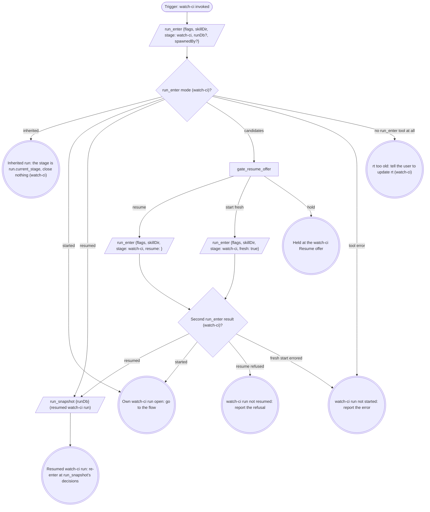

# Run

An own run is a fresh or resumed one: it records identity, fires every gate
below and closes at the end. An inherited run fires no gate beyond `ci` and
the off-script gates, records no identity, and hands back. Its caller hands
`mr` (the MR's or PR's URL), `sha` and optionally `priorPipelineId` (a
number), and gets back one of: green, red after the `ci` gate, an
off-script answer, a failure, a stand-down naming the `holder`, or a hold.

The flags, rendered by the compiler:

{{run-start.flags:watch-ci}}

`run_enter` takes `flags` = the `watch-ci` flag string above, verbatim (the
value, never its key), `skillDir` = `${CLAUDE_SKILL_DIR}` as an absolute
path, `stage: watch-ci`, `runDb` only when a caller handed one, and
`spawnedBy` only when a board or another surface launched this pane. It
opens the stage itself. Pass the returned `runDb` to every `run_*` call;
nothing is exported. A handed `runDb` that comes back `handedRunDb:
"not-running"` counts as not handed. Every gate write and `stage` argument
is `"watch-ci"` in an own run and `run.current_stage` in an inherited one.
