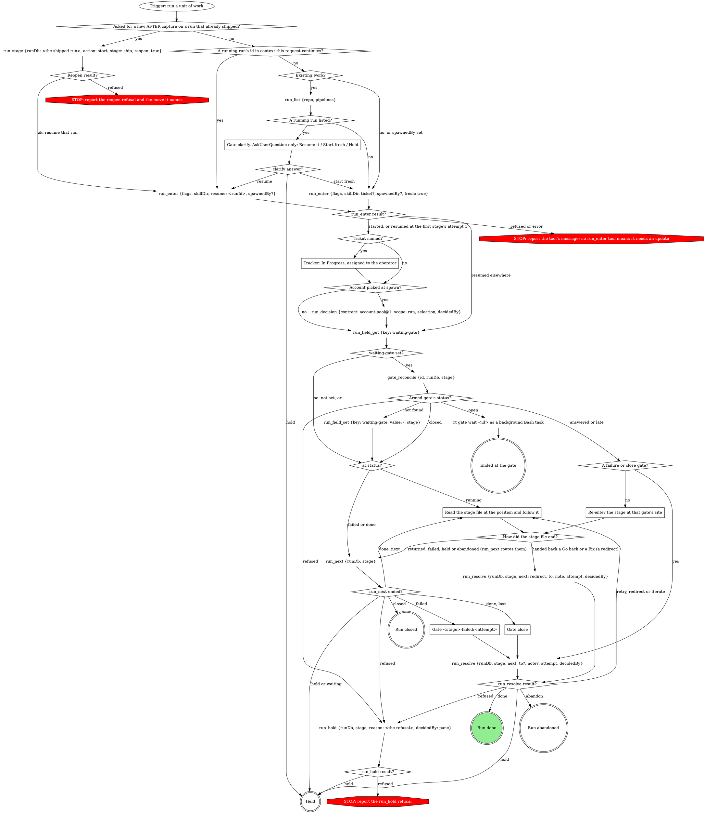
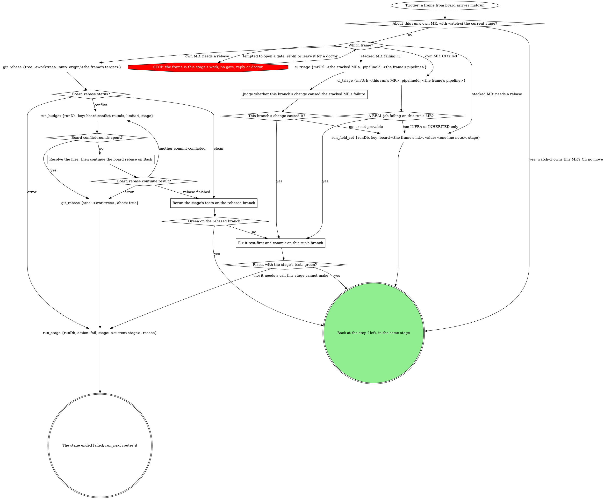

# work -- the pipeline orchestrator

You run one unit of work through the stages below. The graph is the run:
treat a move it does not show as a question for a gate, never a judgment
call. Reads are part of the step that needs them, not moves. Every call
after `run_enter` passes the `runDb` it returned.

## Stages

The run engine walks them in this order.

{{pipeline.table}}

`run_enter`'s `flags` is the `work` value below, verbatim; `skillDir` is
`${CLAUDE_SKILL_DIR}`, absolute:

{{run-start.flags:work}}

### Asked for a new AFTER capture on a run that already shipped?

Yes when the operator wants the AFTER captured again, or the evidence
re-attached, on a pipeline run that is done with its `mr` set. That run is
the one they name: `run_list {repo, pipelines}`, the row with that run id
(or the newest row whose `branch` matches); its `runDb` is
`<runs root>/<the row's repo>/<its id>/state.db`, the runs root
`~/.mattstack/runs` unless `RT_RUNS_ROOT` sets it. The reopen sets it
running at a new ship attempt; resume it, and the ship stage takes its
re-capture route, the operator's ask its attach consent. After ship,
`run_next` walks the later stages again and the close gate asks again. A
run that is still running refuses the reopen: resume it instead.

### Gate clarify, AskUserQuestion only: Resume it / Start fresh / Hold

No run exists yet: no `gate_*` or `run_*` call. Offer the newest
`run_list` row. `run_list`'s `pipelines` is {{run-list.pipelines}}; only those runs are offered to resume.
Never `run_enter`'s candidates, which ignore that filter. Starting fresh
leaves that run untouched.

### Tracker: In Progress, assigned to the operator

For Linear: `save_issue` with state In Progress and assignee `me`. Never
fabricate a ticket.

### Read the stage file at the position and follow it

The position is the last result's `at` or `next`; read its absolute `file`
from the top and follow it to its end.

### Re-enter the stage at that gate's site

Read the stage file, go to the site of that gate's scope, and continue at
gate-protocol's `A write-in to act on (actOnWriteIn)?` with the recorded
answers, never re-asking; then walk every node after that gate.

### Gate <stage>-failed:<attempt>

Scope from `run_next`, `stage` the failed stage. Above the form: the
stage, `reason` and `detailPath`.

### Gate close

`stage` is the last stage. Above the form: the MR link, its state and the
`ci` verdict.

## A board frame mid-run

The board rings this session instead of launching a doctor while the run
is live. The frame arrives as a `<cross-session-message
from-name="board">` naming an MR: this run's own MR (`CI failed on
!<iid>`, `!<iid> needs a rebase onto <target>`) or one stacked on this
branch (`!<iid> (stacked on your branch) ...`). Walk this map, then carry
on from the step you left.

### About this run's own MR, with watch-ci the current stage?

Yes only for an own-MR frame (CI failed, or needs a rebase) while
watch-ci is the stage at the position: its `ci_watch` and lease already
own that MR's CI, so the frame changes nothing and you go back to waiting
on it. A stacked-MR frame is never answered here, watch-ci included.

### STOP: the frame is this stage's work; no gate, reply or doctor

The frame is not a question and not a chat message. Never open a gate
for it, `run_stage fail` to hand it on, redirect the run, reply with
`chat_dm`, `rt chat` or SendMessage, or wait for a doctor: the board
launched none because this run owns the MR. Take the frame's own edge.

### Fix it test-first and commit on this run's branch

Read the failed jobs the triage names (`mr_job_trace` for one it marks
UNCLEAR), then a failing test, the fix and a commit in the run's
worktree, as part of the current stage: it is the stage's work, not a
separate loop. Never push: ship pushes the commits with the rest (the
current stage's own record, such as implement's `commits`, picks them
up). Never touch the stacked MR's
branch: its fix, if yours, lands on this branch.

### git_rebase {tree: <worktree>, onto: origin/<the frame's target>}

Commit the stage's in-flight edit first: the rebase needs a clean tree.

### Resolve the files, then continue the board rebase on Bash

Resolve each conflicted file `git_rebase` returned, then continue on Bash
(no tool continues a rebase).

### Rerun the stage's tests on the rebased branch

The tests the current stage has already run this session, on the
rebased branch. The rebase rewrote commits the MR already holds, so
ship's next push takes force-with-lease. Never push here.

### Judge whether this branch's change caused the stacked MR's failure

Compare the triage's blocking jobs and their logs with this branch's
diff against its target. Yes needs a job failing in code this branch
changed; a failure in the stacked MR's own change, or INFRA, is no.

### run_field_set {runDb, key: board-<the frame's iid>, value: <one-line note>, stage}

One line naming the MR and what you found: `!4127 red on pipeline
88120431: INFRA runner timeout, no code change`, `!4131 red on
pipeline 88120577: its own lint job, not this branch`, or for a rebase
frame `!4131 needs a rebase: a doctor rebases it after this run`. Never
rebase, push to or retry the stacked MR: it is someone else's branch.

## What the graph cannot show

- **Entry.** A running run's id goes to `resume`, never `runDb`: only
  resume writes a missing manifest. `spawnedBy` starts fresh, never clarify.
- **Resumed.** The attempt is adopted, so an armed `waiting-gate` on any
  row is reconciled first, and a late (`alreadyReconciled`) answer is still
  acted on. On a failed or done row `run_next` writes nothing and returns
  that gate's inputs. Decided questions stay decided. A `gate_reconcile`
  error reading `no gate <id>` is `not found`; any other error is
  `refused`.
- **One owner for stage rows.** The run tools write them; a stage writes
  its fields and its own `run_stage fail`. Never write stage rows, produce
  clears, `shipTarget` or `pipeline-stages` here.
- **Hand-back.** A stage ending at a Go back hands `{to, note,
  decidedBy}`, and a Fix hands `{to: implement, note, decidedBy}` the same
  way; `attempt` is its running attempt.
- **`repeated: true`**: already applied; follow the result.
- **decidedBy** is the gate tool's returned `decidedBy`, or, for a
  hand-back, the handed `decidedBy` (`pane` when it was typed in the
  pane). The gate tools record each gate's answers; this file records none.
- **A finished run stays finished.** Only Close's Done or Abandon ends it;
  a green `ci` does not. Never carry a finished run's `runDb` into new work;
  a new AFTER on a shipped run is not new work, so it reopens that run.
- **This file's gates** walk gate-protocol's Runs integration with `runDb`
  and `stage`, "Under a run: fail the stage at the gate?" answered no.
- **Account back-fill**: `selection` is the spawn-time pick as an object,
  `decidedBy` the spawning surface.
- **A board frame while a gate waits.** Walk the board frame map, then end
  the turn again the way the gate's site ended it; the gate stays armed.

## Gate questions

Each question is its own; never fold one list into another.

| Gate | Question | Options (recommended first) |
|---|---|---|
| `clarify` | `resume` (write-in) | **Resume it (Recommended)** / **Start fresh** / **Hold** |
| `<stage>-failed:<attempt>` | `action` | **Retry the stage (Recommended)** (when the reason names something fixable) / **Abandon the run** |
| | `next` | **Proceed** / **Iterate here** / **Go back** / **Hold** |
| | `to` | on Go back, with more than one `earlier` stage: one per stage, split `to-1`, `to-2`, ... over 4 |
| `close` | `next` | **Done** (when `ci` is green and the MR ready) / **Iterate here** / **Go back** / **Hold** |
| | `to` | on Go back, with more than one stage: one per `stages` entry, split over 4 |

With one candidate stage, label the option **Go back to `<stage>`** and
skip `to`.

The answer maps to `run_resolve`'s `next`, with their words as `note`.
Read `next` first: Proceed applies `action`, Retry as `retry`, Abandon as
`abandon`. Iterate here is `iterate` (`to` = `implement` at close), Go
back is `redirect` with `to` from `to-*`, Hold is `hold`, Done is `done`.
`attempt` is the failure scope's `<n>`, or at close the last stage's.

## Sub-agent tiering

{{slot:tiering}}

## Gate protocol

{{include:gate-protocol}}

## Wrap-up form contract

{{include:wrap-up-form}}
