# work -- the pipeline orchestrator

You run one unit of work through the stages below. The graph is the run:
treat a move it does not show as a question for a gate, never a judgment
call. Reads are part of the step that needs them, not moves. Every call
after `run_enter` passes the `runDb` it returned.

## Stages

The run engine walks them in this order.

{{pipeline.table}}

`run_enter`'s `flags` is the `work` value below, verbatim; `skillDir` is
`${CLAUDE_SKILL_DIR}`, absolute:

{{run-start.flags:work}}

```dot
digraph work {
    "Trigger: run a unit of work" [shape=ellipse];
    "A run id in context?" [shape=diamond];
    "Existing work?" [shape=diamond];
    "run_list {repo, pipelines}" [shape=plaintext];
    "A running run listed?" [shape=diamond];
    "Gate clarify, AskUserQuestion only: Resume it / Start fresh / Hold" [shape=box];
    "clarify answer?" [shape=diamond];
    "run_enter {flags, skillDir, resume: <runId>, spawnedBy?}" [shape=plaintext];
    "run_enter {flags, skillDir, ticket?, spawnedBy?, fresh: true}" [shape=plaintext];
    "run_enter result?" [shape=diamond];
    "STOP: report the tool's message; no run_enter tool means rt needs an update" [shape=octagon style=filled fillcolor=red fontcolor=white];
    "Ticket named?" [shape=diamond];
    "Tracker: In Progress, assigned to the operator" [shape=box];
    "Account picked at spawn?" [shape=diamond];
    "run_decision {contract: account-pool@1, scope: run, selection, decidedBy}" [shape=plaintext];
    "at.status?" [shape=diamond];
    "run_field_get {key: waiting-gate}" [shape=plaintext];
    "waiting-gate set?" [shape=diamond];
    "gate_reconcile {id, runDb, stage}" [shape=plaintext];
    "Armed gate's status?" [shape=diamond];
    "rt gate wait <id> as a background task" [shape=plaintext];
    "Re-enter the stage at that gate's site" [shape=box];
    "Read the stage file at the position and follow it" [shape=box];
    "How did the stage file end?" [shape=diamond];
    "run_next {runDb, stage}" [shape=plaintext];
    "run_next ended?" [shape=diamond];
    "Gate <stage>-failed:<attempt>" [shape=box];
    "Gate close" [shape=box];
    "run_resolve {runDb, stage, next, to?, note?, attempt, decidedBy}" [shape=plaintext];
    "run_resolve {runDb, stage, next: redirect, to, note, attempt, decidedBy}" [shape=plaintext];
    "run_resolve result?" [shape=diamond];
    "run_hold {runDb, stage, reason: <the refusal>, decidedBy: pane}" [shape=plaintext];
    "Held: end the turn naming the stage" [shape=doublecircle];
    "Ended at the gate" [shape=doublecircle];
    "Run closed" [shape=doublecircle];
    "Run abandoned" [shape=doublecircle];
    "Run done" [shape=doublecircle style=filled fillcolor=lightgreen];

    "Trigger: run a unit of work" -> "A run id in context?";
    "A run id in context?" -> "run_enter {flags, skillDir, resume: <runId>, spawnedBy?}" [label="yes"];
    "A run id in context?" -> "Existing work?" [label="no"];
    "Existing work?" -> "run_list {repo, pipelines}" [label="yes"];
    "Existing work?" -> "run_enter {flags, skillDir, ticket?, spawnedBy?, fresh: true}" [label="no, or spawnedBy set"];
    "run_list {repo, pipelines}" -> "A running run listed?";
    "A running run listed?" -> "Gate clarify, AskUserQuestion only: Resume it / Start fresh / Hold" [label="yes"];
    "A running run listed?" -> "run_enter {flags, skillDir, ticket?, spawnedBy?, fresh: true}" [label="no"];
    "Gate clarify, AskUserQuestion only: Resume it / Start fresh / Hold" -> "clarify answer?";
    "clarify answer?" -> "run_enter {flags, skillDir, resume: <runId>, spawnedBy?}" [label="resume"];
    "clarify answer?" -> "run_enter {flags, skillDir, ticket?, spawnedBy?, fresh: true}" [label="start fresh"];
    "clarify answer?" -> "Held: end the turn naming the stage" [label="hold"];
    "run_enter {flags, skillDir, resume: <runId>, spawnedBy?}" -> "run_enter result?";
    "run_enter {flags, skillDir, ticket?, spawnedBy?, fresh: true}" -> "run_enter result?";
    "run_enter result?" -> "Ticket named?" [label="started"];
    "run_enter result?" -> "at.status?" [label="resumed"];
    "run_enter result?" -> "STOP: report the tool's message; no run_enter tool means rt needs an update" [label="refused or error"];
    "Ticket named?" -> "Tracker: In Progress, assigned to the operator" [label="yes"];
    "Ticket named?" -> "Account picked at spawn?" [label="no"];
    "Tracker: In Progress, assigned to the operator" -> "Account picked at spawn?";
    "Account picked at spawn?" -> "run_decision {contract: account-pool@1, scope: run, selection, decidedBy}" [label="yes"];
    "Account picked at spawn?" -> "Read the stage file at the position and follow it" [label="no"];
    "run_decision {contract: account-pool@1, scope: run, selection, decidedBy}" -> "Read the stage file at the position and follow it";
    "at.status?" -> "run_field_get {key: waiting-gate}" [label="running"];
    "at.status?" -> "run_next {runDb, stage}" [label="failed or done"];
    "run_field_get {key: waiting-gate}" -> "waiting-gate set?";
    "waiting-gate set?" -> "gate_reconcile {id, runDb, stage}" [label="yes"];
    "waiting-gate set?" -> "Read the stage file at the position and follow it" [label="no"];
    "gate_reconcile {id, runDb, stage}" -> "Armed gate's status?";
    "Armed gate's status?" -> "Re-enter the stage at that gate's site" [label="answered"];
    "Armed gate's status?" -> "rt gate wait <id> as a background task" [label="open"];
    "Armed gate's status?" -> "Read the stage file at the position and follow it" [label="otherwise"];
    "rt gate wait <id> as a background task" -> "Ended at the gate";
    "Re-enter the stage at that gate's site" -> "How did the stage file end?";
    "Read the stage file at the position and follow it" -> "How did the stage file end?";
    "How did the stage file end?" -> "run_next {runDb, stage}" [label="returned"];
    "How did the stage file end?" -> "run_resolve {runDb, stage, next: redirect, to, note, attempt, decidedBy}" [label="handed back a Go back"];
    "run_next {runDb, stage}" -> "run_next ended?";
    "run_next ended?" -> "Read the stage file at the position and follow it" [label="done, next"];
    "run_next ended?" -> "Gate close" [label="done, last"];
    "run_next ended?" -> "Gate <stage>-failed:<attempt>" [label="failed"];
    "run_next ended?" -> "Held: end the turn naming the stage" [label="held or waiting"];
    "run_next ended?" -> "Run closed" [label="closed"];
    "run_next ended?" -> "run_hold {runDb, stage, reason: <the refusal>, decidedBy: pane}" [label="refused"];
    "Gate <stage>-failed:<attempt>" -> "run_resolve {runDb, stage, next, to?, note?, attempt, decidedBy}" [label="answered"];
    "Gate <stage>-failed:<attempt>" -> "Ended at the gate" [label="otherwise"];
    "Gate close" -> "run_resolve {runDb, stage, next, to?, note?, attempt, decidedBy}" [label="answered"];
    "Gate close" -> "Ended at the gate" [label="otherwise"];
    "run_resolve {runDb, stage, next, to?, note?, attempt, decidedBy}" -> "run_resolve result?";
    "run_resolve {runDb, stage, next: redirect, to, note, attempt, decidedBy}" -> "run_resolve result?";
    "run_resolve result?" -> "Read the stage file at the position and follow it" [label="retry, redirect or iterate"];
    "run_resolve result?" -> "Held: end the turn naming the stage" [label="hold"];
    "run_resolve result?" -> "Run abandoned" [label="abandon"];
    "run_resolve result?" -> "Run done" [label="done"];
    "run_resolve result?" -> "run_hold {runDb, stage, reason: <the refusal>, decidedBy: pane}" [label="refused"];
    "run_hold {runDb, stage, reason: <the refusal>, decidedBy: pane}" -> "Held: end the turn naming the stage";
}
```

### Gate clarify, AskUserQuestion only: Resume it / Start fresh / Hold

No run exists yet: no `gate_*` or `run_*` call. Offer the newest
`run_list` row, whose `pipelines` is {{run-list.pipelines}}. Starting fresh
leaves that run untouched.

### Tracker: In Progress, assigned to the operator

For Linear: `save_issue` with state In Progress and assignee `me`. Never
fabricate a ticket.

### Read the stage file at the position and follow it

The position is the last result's `at` or `next`; read its absolute `file`
from the top and follow it to its end.

### Re-enter the stage at that gate's site

Read the stage file and go straight to the site whose gate carries that
scope. `gate_reconcile` recorded the gate's answers, so continue at
gate-protocol's `Act on the gate answer at the site` with them, never
re-asking, and walk every node the stage draws after its gate.

### Gate <stage>-failed:<attempt>

Scope from `run_next`, `stage` the failed stage. Above the form: the
stage, `reason` and `detailPath`.

### Gate close

`stage` is the last stage. Above the form: the MR link, its state and the
`ci` verdict.

## What the graph cannot show

- **Entry.** A run id in context (after compaction, or a herd brief's run)
  goes to `resume`, never `runDb`: only resume adopts the running attempt
  and writes a missing manifest. `spawnedBy` starts fresh, so an unattended
  pane never asks clarify.
- **Resumed.** The attempt is adopted, so its armed `waiting-gate` still
  counts and must be reconciled. On a failed or done row `run_next` writes
  nothing and returns that gate's inputs.
- **One owner for stage rows.** The run tools write them; a stage writes
  only its fields and its own `run_stage fail`. Never write a stage start,
  done or redirect, produce clears, `shipTarget` or `pipeline-stages`.
- **Hand-back.** A stage ending at a Go back hands `{to, note,
  decidedBy}`; `attempt` is its running attempt.
- **Refusals.** A refused `run_next` or `run_resolve` is never worked
  around or re-asked: `run_hold` with the refusal verbatim.
- **`repeated: true`**: already applied; follow the result.
- **decidedBy** is the gate tool's returned `decidedBy`, or `pane` for a
  hand-back. The gate tools record each gate's answers map; this file
  records nothing for its gates.
- **A finished run stays finished.** Only Close's Done or Abandon ends it;
  a green `ci` does not. Never carry a finished run's `runDb` into new work.
- **This file's gates** walk gate-protocol's Runs integration with `runDb`
  and `stage`, "Under a run: fail the stage at the gate?" answered no.
- **Account back-fill**: `selection` is the spawn-time pick as an object,
  `decidedBy` the spawning surface.

## Gate questions

Each question is its own; never fold one list into another.

| Gate | Question | Options (recommended first) | Shown when |
|---|---|---|---|
| `clarify` | `resume` (write-in) | **Resume it (Recommended)** / **Start fresh** / **Hold** | a running run was found |
| `<stage>-failed:<attempt>` | `action` | **Retry the stage (Recommended)** (when the reason names something fixable) / **Abandon the run** | always |
| | `next` | **Proceed** / **Iterate here** / **Go back** / **Hold** | always |
| | `to` | one per `earlier` stage, split `to-1`, `to-2`, ... over 4 | more than one `earlier` |
| `close` | `next` | **Done** (when `ci` is green and the MR ready) / **Iterate here** / **Go back** / **Hold** | always |
| | `to` | one per `stages` entry, split over 4 | more than one stage |

With one candidate stage, label the option **Go back to `<stage>`** and
skip `to`.

The answer maps to `run_resolve`'s `next`, with their words as `note`.
Read `next` first: Proceed applies `action`, Retry as `retry`, Abandon as
`abandon`. Iterate here is `iterate` (`to` = `implement` at close), Go
back is `redirect` with `to` from `to-*`, Hold is `hold`, Done is `done`.
`attempt` is the failure scope's `<n>`, or at close the last stage's.

## Sub-agent tiering

{{slot:tiering}}

## Gate protocol

{{include:gate-protocol}}

## Wrap-up form contract

{{include:wrap-up-form}}
