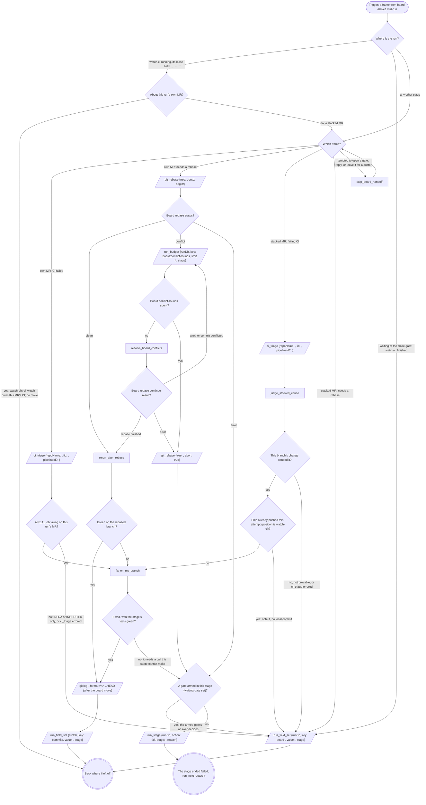

# A board frame mid-run

The board rings this session instead of launching a doctor while the run
is live. The frame arrives as a `<cross-session-message
from-name="board">` naming an MR by `!<iid>`: this run's own MR (`CI
failed on !<iid>`, `!<iid> needs a rebase onto <target>`) or one stacked
on this branch (`!<iid> (stacked on your branch) ...`). Walk this map,
then carry on from where you left off.

