# Stages

The run engine walks them in this order.

{{pipeline.table}}

`run_enter`'s `flags` is the `work` value below, verbatim; `skillDir` is
`${CLAUDE_SKILL_DIR}`, absolute:

{{run-start.flags:work}}

```mermaid
flowchart TB
%% name: work
    work_triggered([Trigger: run a unit of work])
    recapture_asked{Asked for a new AFTER capture on a run that already shipped?}
    run_stage_reopen[/"run_stage {runDb: <the shipped run>, action: start, stage: ship, reopen: true}"/]
    reopen_result{Reopen result?}
    stop_reopen_refused[STOP: report the reopen refusal and the move it names]:::stop
    run_id_in_context{A running run's id in context this request continues?}
    existing_work{Existing work?}
    run_list[/"run_list {repo, pipelines}"/]
    running_run_listed{A running run listed?}
    gate_resume_or_fresh
    clarify_answer{clarify answer?}
    run_enter_resume[/"run_enter {flags, skillDir, resume: <runId>, spawnedBy?}"/]
    run_enter_fresh[/"run_enter {flags, skillDir, ticket?, spawnedBy?, fresh: true}"/]
    run_enter_result{run_enter result?}
    stop_run_enter_missing[STOP: report the tool's message; no run_enter tool means rt needs an update]:::stop
    ticket_named{Ticket named?}
    tracker_in_progress
    account_picked{Account picked at spawn?}
    run_decision_account[/"run_decision {contract: account-pool@1, scope: run, selection, decidedBy}"/]
    run_field_get_waiting_gate[/"run_field_get {key: waiting-gate}"/]
    waiting_gate_set{waiting-gate set?}
    gate_reconcile[/"gate_reconcile {id, runDb, stage}"/]
    run_field_set_waiting_gate[/"run_field_set {key: waiting-gate, value: -, stage}"/]
    armed_gate_status{Armed gate's status?}
    failure_or_close_gate{A failure or close gate?}
    rt_gate_wait[/rt gate wait <id> as a background Bash task/]
    follow_stage_file
    reenter_at_gate
    at_status{at.status?}
    stage_file_ended{How did the stage file end?}
    run_next[/"run_next {runDb, stage}"/]
    run_next_ended{run_next ended?}
    gate_stage_failed
    gate_close
    run_resolve_next[/"run_resolve {runDb, stage, next, to?, note?, attempt, decidedBy}"/]
    run_resolve_redirect[/"run_resolve {runDb, stage, next: redirect, to, note, attempt, decidedBy}"/]
    run_resolve_result{run_resolve result?}
    run_hold_refusal[/"run_hold {runDb, stage, reason: <the refusal>, decidedBy: pane}"/]
    run_hold_result{run_hold result?}
    stop_run_hold_refused[STOP: report the run_hold refusal]:::stop
    held(((Held)))
    ended_at_gate(((Ended at the gate)))
    run_closed(((Run closed)))
    run_abandoned(((Run abandoned)))
    run_done(((Run done))):::done
    work_triggered --> recapture_asked
    recapture_asked -->|yes| run_stage_reopen
    recapture_asked -->|no| run_id_in_context
    run_stage_reopen --> reopen_result
    reopen_result -->|ok: resume that run| run_enter_resume
    reopen_result -->|refused| stop_reopen_refused
    run_id_in_context -->|yes| run_enter_resume
    run_id_in_context -->|no| existing_work
    existing_work -->|yes| run_list
    existing_work -->|no, or spawnedBy set| run_enter_fresh
    run_list --> running_run_listed
    running_run_listed -->|yes| gate_resume_or_fresh
    running_run_listed -->|no| run_enter_fresh
    gate_resume_or_fresh --> clarify_answer
    clarify_answer -->|resume| run_enter_resume
    clarify_answer -->|start fresh| run_enter_fresh
    clarify_answer -->|hold| held
    run_enter_resume --> run_enter_result
    run_enter_fresh --> run_enter_result
    run_enter_result -->|started, or resumed at the first stage's attempt 1| ticket_named
    run_enter_result -->|resumed elsewhere| run_field_get_waiting_gate
    run_enter_result -->|refused or error| stop_run_enter_missing
    ticket_named -->|yes| tracker_in_progress
    ticket_named -->|no| account_picked
    tracker_in_progress --> account_picked
    account_picked -->|yes| run_decision_account
    account_picked -->|no| run_field_get_waiting_gate
    run_decision_account --> run_field_get_waiting_gate
    follow_stage_file --> stage_file_ended
    run_field_get_waiting_gate --> waiting_gate_set
    waiting_gate_set -->|yes| gate_reconcile
    waiting_gate_set -->|no: not set, or -| at_status
    gate_reconcile --> armed_gate_status
    armed_gate_status -->|answered or late| failure_or_close_gate
    armed_gate_status -->|open| rt_gate_wait
    armed_gate_status -->|closed| at_status
    armed_gate_status -->|not found| run_field_set_waiting_gate
    run_field_set_waiting_gate --> at_status
    armed_gate_status -->|refused| run_hold_refusal
    failure_or_close_gate -->|yes| run_resolve_next
    failure_or_close_gate -->|no| reenter_at_gate
    rt_gate_wait --> ended_at_gate
    reenter_at_gate --> stage_file_ended
    at_status -->|running| follow_stage_file
    at_status -->|failed or done| run_next
    stage_file_ended -->|"returned, failed, held or abandoned (run_next routes them)"| run_next
    stage_file_ended -->|"handed back a Go back or a Fix (a redirect)"| run_resolve_redirect
    run_next --> run_next_ended
    run_next_ended -->|done, next| follow_stage_file
    run_next_ended -->|done, last| gate_close
    run_next_ended -->|failed| gate_stage_failed
    run_next_ended -->|held or waiting| held
    run_next_ended -->|closed| run_closed
    run_next_ended -->|refused| run_hold_refusal
    gate_stage_failed --> run_resolve_next
    gate_close --> run_resolve_next
    run_resolve_next --> run_resolve_result
    run_resolve_redirect --> run_resolve_result
    run_resolve_result -->|retry, redirect or iterate| follow_stage_file
    run_resolve_result -->|hold| held
    run_resolve_result -->|abandon| run_abandoned
    run_resolve_result -->|done| run_done
    run_resolve_result -->|refused| run_hold_refusal
    run_hold_refusal --> run_hold_result
    run_hold_result -->|held| held
    run_hold_result -->|refused| stop_run_hold_refused
```

