# Self-review (your own branch)

Review the change you just made, between tasks or right before shipping:
point the review flow below at the current branch, then act on the draft it
returns. Follow the graph's edges; a move it does not show is a question
for a gate, never a judgment call.

## Run

Outside a pipeline this verb is its own run, so the console shows it and
the Stop hook covers its pane. `run_enter` starts, resumes or inherits the
run, or returns the running candidates; never list, read or build run dbs
by hand. It takes `flags` (the block below, verbatim), `skillDir` (this
skill's directory) and `stage: self-review`, plus `runDb` only when a
caller handed you one, `resume` only when a caller handed you a
self-review run id, and `spawnedBy` only when a board or another surface
launched this pane.

{{run-start.flags:self-review}}

Pass the returned `runDb` to every `run_*` and gate call. Your stage is
`self-review`, except on an inherited run (`mode: inherited`): there it is
the result's `at.stage`, written `<run.current_stage>` in the graph, and
the caller closes the run. A handed `runDb` whose run is not running is
not inherited: `run_enter` goes on as if none was handed
(`handedRunDb: "not-running"`).

Every gate runs through gate-protocol with `runDb` and `stage`: the gate
tools write the gate fields and record the answers map keyed by question
id, the whole of this verb's gate record.

Each loop counter is one `run_budget {runDb, key, limit, stage}` call on
the counted event, and its `<key> spent?` diamond reads `exhausted`:

| Key | Limit | Charged when |
|---|---|---|
| `fix:<finding id>:<round>` | 3 | a fix attempt fails; `<round>` is 1, then 2 after the finding's reopened gate |
| `reopen:<finding id>` | 2 | the finding's fix budget is spent: the first charge opens the reopened gate, the second leaves the finding open |

<HARD-GATE>
Do not form the code-quality judgment yourself, not even a careful first
pass for a fresh review to back up later: whoever wrote the code
re-derives the assumptions behind a bug and nods at them. The
fresh-context reviewer is the PRIMARY reviewer, and this skill dispatches
it through the review flow below rather than suggesting a review
elsewhere. Objective checks (tests, type checks, linters) are expected;
authorship does not bias a compiler. Reading the diff and deciding it is
"solid" is the reviewer's job.

A request to skip the dispatch ("don't burn tokens on subagents", a late
hour, a partner who wants a gut check) does not waive this gate. It is one
dispatch; skipping it moves the cost downstream to production. Diligence
inside the biased context is still the biased context, and a plausible
issue found inline says nothing about what a fresh read would catch.
</HARD-GATE>

{{include:run-identity}}

## The self-review graph

```dot
digraph self_review {
    rankdir=TB;

    trigger_self_review [label="Trigger: self-review the current branch" shape=ellipse];
    run_enter [label="run_enter {flags, skillDir, stage: self-review, runDb?, resume?, spawnedBy?}" shape=plaintext];
    run_enter_mode [label="self-review run_enter mode?" shape=diamond];
    gate_resume_choice [label="Gate self-review clarify: Resume / Start fresh / Hold" shape=box];
    resume_answer [label="Self-review resume answer?" shape=diamond];
    run_enter_resume [label="run_enter {flags, skillDir, stage: self-review, resume: <picked runId>}" shape=plaintext];
    run_enter_fresh [label="run_enter {flags, skillDir, stage: self-review, fresh: true, spawnedBy?}" shape=plaintext];
    refused_carried_resume [label="The refused self-review run_enter carried resume?" shape=diamond];
    stop_no_run_without_enter [label="STOP: no self-review run without run_enter; report why to the user" shape=octagon style=filled fillcolor=red fontcolor=white];
    run_snapshot [label="run_snapshot {runDb: <resumed self-review>}" shape=plaintext];

    find_merge_base [label="Find the self-review merge-base" shape=box];
    own_run_record [label="Own self-review run: record the branch?" shape=diamond];
    record_branch [label="Record the self-review branch and any ticket" shape=box];
    requirements_known [label="Requirements known: a ticket or the task text?" shape=diamond];
    gate_requirements_source [label="Gate self-review clarify: which requirements source?" shape=box];
    requirements_answer [label="Requirements source answer?" shape=diamond];
    print_depth_block [label="Print the self-review depth block" shape=box];
    run_depth_checks [label="Run the checks the self-review depth names" shape=box];
    repro_browser [label="Self-review repro takes a browser screenshot?" shape=diamond];
    capture_repro [label="Capture the self-review repro with the browser (browser-evidence)" shape=box];
    who_judges [label="Who forms the self-review judgment?" shape=diamond];
    stop_no_inline_judging [label="STOP: never judge your own diff inline; dispatch the fresh reviewer" shape=octagon style=filled fillcolor=red fontcolor=white];
    dispatch_reviewer [label="Dispatch the fresh reviewer on your own diff" shape=box];
    open_off_script_gate [label="Open the self-review off-script gate: a fill asks for a move this graph forbids" shape=box];
    off_script_answer [label="Self-review off-script answer?" shape=diamond];
    make_recorded_move [label="Make the recorded self-review move once" shape=box];
    assemble_draft [label="Assemble the self-review draft" shape=box];
    gate_fix_and_next [label="Gate self-review: fix and next, after the draft" shape=box];
    gate_again_failing_output [label="Gate self-review again: quote the failing output" shape=box];
    next_answer [label="Self-review next answer?" shape=diamond];
    fix_answer [label="Self-review fix answer?" shape=diamond];
    next_finding [label="Next selected finding to fix?" shape=diamond];
    finding_testable [label="Is the finding testable?" shape=diamond];
    write_failing_test [label="Write a failing test for the finding" shape=box];
    test_fails_now [label="Does the new test fail on the current code?" shape=diamond];
    record_not_reproduced [label="Record the finding as not reproduced; no fix" shape=box];
    fix_finding [label="Fix the finding and run the tests" shape=box];
    tests_green [label="Tests green after the fix?" shape=diamond];
    run_budget_fix [label="run_budget {runDb, key: fix:<finding id>:<round>, limit: 3, stage}" shape=plaintext];
    fix_spent [label="fix:<finding id>:<round> spent?" shape=diamond];
    run_budget_reopen [label="run_budget {runDb, key: reopen:<finding id>, limit: 2, stage}" shape=plaintext];
    reopen_spent [label="reopen:<finding id> spent?" shape=diamond];
    stuck_answer [label="Self-review stuck finding answer?" shape=diamond];
    record_left_open [label="Record the finding as left open" shape=box];
    hand_back_minor [label="Hand back with the Minor findings listed" shape=box];
    own_run_close [label="Own self-review run: close it?" shape=diamond];
    own_run_close_abandoned [label="Own self-review run: close it as abandoned?" shape=diamond];
    run_close [label="run_close {runDb, workType: self-review, stage: self-review, outcome}" shape=plaintext];
    closed_as [label="Self-review closed as?" shape=diamond];
    run_stage_fail [label="run_stage {action: fail, stage: <run.current_stage>, reason: <their words>} for self-review" shape=plaintext];
    run_hold [label="run_hold {runDb, stage, reason, decidedBy} for self-review" shape=plaintext];
    held_end_turn [label="Self-review held: end the turn" shape=doublecircle];
    abandoned [label="Self-review abandoned" shape=doublecircle];
    done_calling_flow [label="Self-review done: the calling flow continues" shape=doublecircle style=filled fillcolor=lightgreen];

    trigger_self_review -> run_enter;
    run_enter -> run_enter_mode;
    run_enter_resume -> run_enter_mode;
    run_enter_fresh -> run_enter_mode;
    run_enter_mode -> find_merge_base [label="started, or inherited: stage is at.stage"];
    run_enter_mode -> run_snapshot [label="resumed"];
    run_enter_mode -> gate_resume_choice [label="candidates"];
    run_enter_mode -> refused_carried_resume [label="refused, or the tool is missing"];
    refused_carried_resume -> run_enter_fresh [label="yes: say the resume was refused, start fresh"];
    refused_carried_resume -> stop_no_run_without_enter [label="no: another refusal, or no run_enter tool"];
    gate_resume_choice -> resume_answer;
    resume_answer -> run_enter_resume [label="resume"];
    resume_answer -> run_enter_fresh [label="start fresh"];
    resume_answer -> held_end_turn [label="hold: no run yet, record nothing"];
    run_snapshot -> find_merge_base [label="re-enter, reuse every recorded answer"];

    find_merge_base -> own_run_record;
    own_run_record -> record_branch [label="yes"];
    own_run_record -> requirements_known [label="no: inherited"];
    record_branch -> requirements_known;
    requirements_known -> print_depth_block [label="yes"];
    requirements_known -> gate_requirements_source [label="no"];
    gate_requirements_source -> requirements_answer;
    requirements_answer -> print_depth_block [label="a source picked"];
    requirements_answer -> run_hold [label="hold"];
    print_depth_block -> run_depth_checks;
    run_depth_checks -> repro_browser;
    repro_browser -> capture_repro [label="yes"];
    repro_browser -> who_judges [label="no: read or verify depth, or the domain's own method"];
    capture_repro -> who_judges [label="Board ready or Not drawn"];
    who_judges -> dispatch_reviewer [label="a fresh reviewer, always"];
    who_judges -> stop_no_inline_judging [label="tempted to give your own read"];
    stop_no_inline_judging -> dispatch_reviewer;
    who_judges -> open_off_script_gate [label="a bound fill asks for another move"];
    open_off_script_gate -> off_script_answer;
    off_script_answer -> make_recorded_move [label="take"];
    off_script_answer -> who_judges [label="iterate here: decide again with their note"];
    off_script_answer -> run_hold [label="hold"];
    off_script_answer -> own_run_close_abandoned [label="hand back"];
    make_recorded_move -> assemble_draft;
    dispatch_reviewer -> assemble_draft;
    assemble_draft -> gate_fix_and_next;
    gate_fix_and_next -> next_answer;
    next_answer -> fix_answer [label="proceed"];
    next_answer -> print_depth_block [label="iterate here: redo from the depth block with their note"];
    next_answer -> run_hold [label="hold"];
    next_answer -> own_run_close_abandoned [label="abandon"];
    fix_answer -> next_finding [label="blocking or all"];
    fix_answer -> hand_back_minor [label="none: ship as is"];
    next_finding -> finding_testable [label="yes"];
    next_finding -> own_run_close [label="none left"];
    finding_testable -> write_failing_test [label="yes: it has behavior"];
    finding_testable -> fix_finding [label="no: naming, docs, structure"];
    write_failing_test -> test_fails_now;
    test_fails_now -> fix_finding [label="yes: reproduced"];
    test_fails_now -> record_not_reproduced [label="no: it passes before any fix"];
    record_not_reproduced -> next_finding;
    fix_finding -> tests_green;
    tests_green -> next_finding [label="yes"];
    tests_green -> run_budget_fix [label="no: charge the failed attempt"];
    run_budget_fix -> fix_spent;
    fix_spent -> fix_finding [label="no"];
    fix_spent -> run_budget_reopen [label="yes: charge the stuck point"];
    run_budget_reopen -> reopen_spent;
    reopen_spent -> gate_again_failing_output [label="no: first time stuck"];
    reopen_spent -> record_left_open [label="yes: stuck after its reopened gate"];
    gate_again_failing_output -> stuck_answer;
    stuck_answer -> fix_finding [label="retry:<finding id>: round 2"];
    stuck_answer -> record_left_open [label="leave:<finding id>"];
    stuck_answer -> run_hold [label="hold"];
    stuck_answer -> own_run_close_abandoned [label="abandon"];
    record_left_open -> next_finding;
    hand_back_minor -> own_run_close;
    own_run_close -> run_close [label="yes: own run, outcome done"];
    own_run_close -> done_calling_flow [label="no: inherited"];
    own_run_close_abandoned -> run_close [label="yes: own run, outcome abandoned with their words"];
    own_run_close_abandoned -> run_stage_fail [label="no: inherited, the caller decides"];
    run_close -> closed_as;
    closed_as -> done_calling_flow [label="done"];
    closed_as -> abandoned [label="abandoned"];
    run_stage_fail -> abandoned;
    run_hold -> held_end_turn;
}
```

### Gate self-review clarify: Resume / Start fresh / Hold

No run is yours yet, so this gate is the in-pane structured-question tool.
One sentence naming each `run_enter` candidate's `spawnedBy`, `startedAt`
and `currentStage`, then one **Resume** option per candidate this pane may
take (one this session started, `ownSession: true`, recommended; or one no
live pane owns), a candidate another live pane owns named unavailable,
then **Start fresh** and **Hold**. A surface-launched pane never reaches
this gate: given `spawnedBy`, `run_enter` starts fresh. Hold records
nothing and ends the turn.

### The refused self-review run_enter carried resume?

A refused resume means the run is gone or no longer running: say so in one
line, then start fresh with the first call's `spawnedBy`. Any other
refusal ends the self-review: quote it to the user verbatim and whole,
never a paraphrase or a guessed cause. Only when there is no `run_enter`
tool, say rt predates the run tools; update rt.

### Find the self-review merge-base

`git merge-base origin/HEAD HEAD`, or the default branch by name when
`origin/HEAD` is unset. The diff runs from that base through the working
tree, uncommitted changes included.

### Record the self-review branch and any ticket

`run_field_set {key: branch, value: <branch>, stage: self-review}`, and
`key: ticket` only when the branch names one.

### Gate self-review clarify: which requirements source?

Never review against nothing. Say in one sentence what is missing, then
run gate-protocol's Runs integration with `gate_ask {questions, kind:
clarify, context, runDb, stage}` and two questions: `source` (the task as
stated, a linked doc, or their text) and `next`: **Proceed** (recommended)
/ **Hold**. The answers map is `{source, next}`. `next: hold` is the hold
whatever `source` says, its reason the developer's words.

### Print the self-review depth block

The review flow's Commit to a review depth: the block, plus the triage
lines when Criteria is bound, printed before any check runs. You are in
the worktree, so `verify` and `repro` need no provisioning.

### Run the checks the self-review depth names

The review flow's Set up for the depth, in this worktree. Each command and
its result travel to the reviewer as setup observations.

### Self-review repro takes a browser screenshot?

Yes at `repro` depth when EVIDENCE CHECK is `screenshot` and the Criteria
point at a browser target (a `## Browser target` section, in the criteria
or in the file they point at for it) whose What proves a change names a
view for this change, or that has no What proves a change block. Bound
criteria with no browser target answer no: the repro keeps the domain's
own method. With nothing bound, yes when the repro's evidence is a
screenshot of a web page. `read` and `verify` depth answer no.

### Capture the self-review repro with the browser (browser-evidence)

The review flow's A browser screenshot at repro, in this worktree:
browser-evidence's `Draw the boards` (Browser evidence below), one brief
per view built from the browser target, `<mr iid>` the branch's MR iid
when one is in hand, else this run's id (`run_enter`'s `runId`). The board
stays in `~/.fast-browser/screenshots/` and is cited by path, never
recorded or uploaded. A board ready, or Not drawn with its reason, goes
into the setup observations and on to the judgment step.

### Dispatch the fresh reviewer on your own diff

The review flow's Dispatch the review, on the merge-base diff as it stands
now, with the requirements and a label (the branch or task name). One
dispatch, never skipped, however small the change.

### Open the self-review off-script gate: a fill asks for a move this graph forbids

A rule under Criteria or Reviewer asks for a move the graph marks STOP (an
inline verdict in place of the dispatch, say). Open gate-protocol's
`## Off-script gate` at site `self-review` (scope
`off-script:self-review:<n>`), `context` quoting the rule, under the run.
Route: `action: handback` is hand back whatever `next` says; otherwise
`next: iterate` is iterate here, `hold` is hold, `proceed` is take.

### Make the recorded self-review move once

Exactly the recorded move, once; its result stands in for the fresh
reviewer's draft.

### Assemble the self-review draft

Per the review flow's Assemble the draft. Present it; the draft is the
sentence and the gate that follows is the close.

### Gate self-review: fix and next, after the draft

Run gate-protocol's Runs integration with `gate_ask {questions, kind:
self-review, context, runDb, stage}`, `context` quoting the draft's
Issues, and two questions, each its own:

- `fix` (write-in): **Fix the blocking findings now** (`blocking`: Critical
  and Important; recommended when any exists) / **Fix the minors too**
  (`all`) / **Ship as is** (`none`)
- `next`: **Proceed** (`proceed`, recommended) / **Iterate here**
  (`iterate`) / **Hold** (`hold`) / **Abandon** (`abandon`)

The answers map is `{fix, next}` at scope `self-review`. On a resume, a
recorded `self-review` decision whose `fix` is `blocking`, `all` or `none`
is reused with `next` as proceed, asking nothing. A `fix` write-in
(`{"writeIn": ...}`) resumes at gate-protocol's Act on a write-in: do what
it asks, then open a NEW self-review gate.

### Gate self-review again: quote the failing output

A new gate on its own scope, so the fix gate's decision stays: run
gate-protocol's Runs integration with `gate_ask {questions, kind:
self-review-retry:<finding id>, context, runDb, stage}`. The kind is the
scope, so the answers map `{finding, next}` records there. `context`
quotes the failing test output and names the finding. Questions, each its
own:

- `finding` (write-in): **Try this finding again** (`retry:<finding id>`)
  / **Leave it open and move on** (`leave:<finding id>`)
- `next`: **Proceed** (`proceed`, recommended) / **Hold** (`hold`) /
  **Abandon** (`abandon`)

`next: hold` or `abandon` wins whatever `finding` says, a write-in riding
as its note; otherwise `finding` decides, and a write-in goes through Act
on a write-in. `retry:<finding id>` starts round 2: later failures charge
`fix:<finding id>:2`. On a resume, a `retry:<finding id>` decision at this
scope means round 2.

### Next selected finding to fix?

One at a time, in draft order: the next finding the fix answer selected
that is not yet fixed, not reproduced or left open.

### Is the finding testable?

Behavior (a wrong value, a crash, a missing case) is testable. Naming,
docs and structure are not: fix them directly, and the suite plus a
re-read of the finding is their check.

### Write a failing test for the finding

The test states the finding's claim against the current code, before any
fix.

### Record the finding as not reproduced; no fix

The claim did not hold on this code. Make no fix; list the finding as not
reproduced, with the test that showed it, in what you hand back.

### Fix the finding and run the tests

Before the first attempt on a finding, save a patch of every file its
attempts will touch, in a new directory inside this session's scratchpad
(outside the repo), so they can be undone. Make the smallest fix, then run
the finding's test and the depth's checks.

Charge `fix:<finding id>:<round>` once, right after a failed attempt. Back
in this loop after a compaction or resume with no fresh failure in hand,
read the stored count with `increment: 0` and go on from it. Never charge
a failure twice or restart a count by hand.

### Record the finding as left open

No more attempts this run; keep its last failing output for the final
message and any hand-back. Undo only this finding's attempts, from its
saved patch; never restore a file from HEAD or the index, since the diff
under review includes uncommitted work. Mark its failing test skipped,
the finding id in its name or reason (or remove it), so the suite is green
before the next finding.

### Hand back with the Minor findings listed

Ship as is: hand back to the calling flow with the Minor findings listed
for the record, plus every finding left open or not reproduced; an
unfixed Critical or Important counts as left open.

## What the graph cannot show

- Where the domain defines ship-time gates, this self-review complements
  them and never checks their box.
- A hold is the one `run_hold` call: your stage, the developer's words as
  `reason` (a write-in riding on the hold included), the answer's by as
  `decidedBy`. Then the turn ends.
- `run_close` takes `outcome: done` once the selected fixes are verified,
  and then the calling flow continues (ship, or the next task); or
  `outcome: abandoned` with `reason: <their words>` on an abandon or a
  hand back.
- Before the close, the final message lists every selected finding as
  fixed, not reproduced (with its test), or left open.

## The review flow

The boxes from **Print the self-review depth block** through **Assemble the
self-review draft** follow this flow.

{{include:review-core-body}}

If a rule below asks for a move this graph marks STOP, take the off-script edge instead.

## Criteria

{{slot:criteria}}

{{include:review-core-body-after}}

{{include:review-dispatch-body}}

If a rule below asks for a move this graph marks STOP, take the off-script edge instead.

## Reviewer

{{slot:reviewer}}

{{include:review-dispatch-body-after}}

{{include:review-core-body-tail}}

## Browser evidence

{{include:browser-evidence}}

## Gate protocol

{{include:gate-protocol}}

## Wrap-up form contract

{{include:wrap-up-form}}

## Red flags

| Thought | Reality |
|---|---|
| "For a change this small I'll just give my own read" | Small, own-authored changes are peak author bias, not an exemption. Dispatch the fresh reviewer. |
| "I'll do a first-pass read myself and a fresh review can back it up" | The fresh reviewer IS the review, not a backup for one already formed. Don't pre-empt it with an inline verdict. |
| "I'll suggest the developer get a review elsewhere" | This skill owns the dispatch; don't outsource it back to whoever is waiting. |
| "Re-reading my own lines is low-value, I'll just eyeball and ship" | Right that re-reading is low-value -- which is why a fresh context, not this eyeball, does the reading. |
| "I know what this does, I just wrote it" | That is the bias stated as a qualification. Dispatch the reviewer. |
