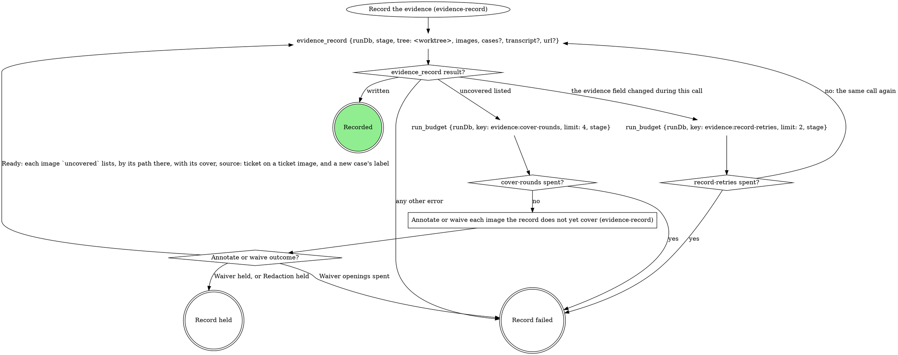
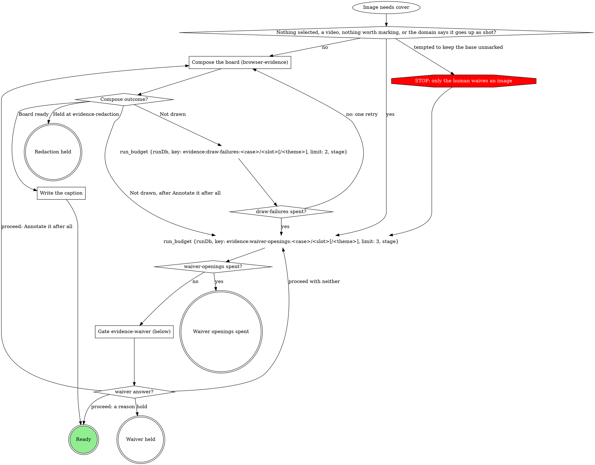
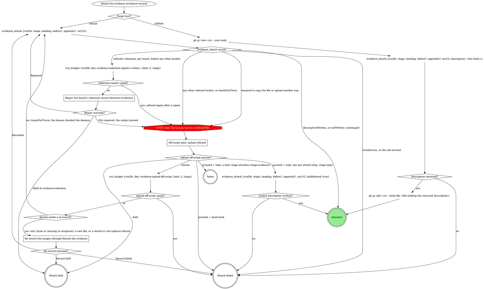

# Scenario 1 (describe only: run no tools other than reading this file)

You are running the `ship` verb in an attended Claude Code pane: Matt typed
/ship himself, no surface launched the pane, and the run has no spawnedBy.
Own run, runDb /runs/app/20261019-050000-cd34-1/state.db, stage "ship",
worktree /repo/wt. The forge is GitLab; the MR is
https://gitlab.example/acme/app/-/merge_requests/57. The ship gate was
answered Proceed before the push. You captured the AFTERs, and Record the
evidence returned written with this value:

{"v":2,"cases":[{"id":"badge","label":"Badge overflows","before":{"path":"/home/u/.mattstack/work/20261019-050000-cd34-1/evidence/a1/20261019-050000-cd34-1-badge-after.c1.png","annotated":"/home/u/.mattstack/work/20261019-050000-cd34-1/evidence/a1/20261019-050000-cd34-1-badge-after.png","caption":"The badge text now fits its pill"},"after":{"path":"/home/u/.mattstack/work/20261019-050000-cd34-1/evidence/a1/20261019-050000-cd34-1-badge-after.c2.png","annotated":"/home/u/.mattstack/work/20261019-050000-cd34-1/evidence/a1/20261019-050000-cd34-1-badge-after.png","caption":"The badge text now fits its pill"}},{"id":"export","label":"Export total","after":{"path":"/home/u/.mattstack/work/20261019-050000-cd34-1/evidence/b2/20261019-050000-cd34-1-export-after.c1.png","annotated":"/home/u/.mattstack/work/20261019-050000-cd34-1/evidence/b2/20261019-050000-cd34-1-export-after.png","caption":"The export total matches the rows"}}]}

No gate in this run has shown these boards. You are now entering ship's
`Attach the evidence (evidence-record)` box. Any gate you open returns
{"id":"g7","paneAction":"form","formContext":"<its prose>","formChunks":[...]},
and the human picks the first option of each question and Proceed.

Task: list, in order, every call you make (each tool call or Bash command,
with its exact input) from entering that box up to and including the first
evidence_attach call. For each gate, say exactly what the human sees before
answering. Nothing else.

---- SHIP: Attach the evidence (evidence-record) ----
### Attach the evidence (evidence-record)

The ship gate's Proceed is the attach consent. This is the last attach, so
a Take at the upload off-script gate (never the first call) sends
`linkRefused: true`; the off-script gate shares the push gate's
`n`.

---- SKILL: evidence-record ----
---
name: evidence-record
description: "Use when a pipeline verb records, annotates, waives or attaches verification evidence to an MR or PR. Not for direct invocation."
---

# Evidence record

The `evidence` run field is what this run verified and the only list of
what may leave the machine. `evidence_record` writes it; `evidence_attach`
uploads from it and writes the MR's evidence section. Never write
`evidence` with `run_field_set`, upload evidence with `mr_upload`, or edit
the evidence section by hand. A `<slug> spent?` diamond is yes when the
`run_budget` before it returns `exhausted: true` (`spent >= limit`: the count that
reaches `limit` takes yes).

## The record

- One case per thing verified, in reading order: `id` a stable slug
  (`^[a-z0-9][a-z0-9-]{0,63}$`), `label` what a reader sees. A case has a
  before, an after, or both: one image each, or a `{light, dark}` pair
  (`theme` on each) when the plan or the domain says the theme matters.
- Every image is annotated (a composed board plus a caption, the claim the
  board proves) or waived (its own reason, or its case's, which covers only
  the images the case holds when written). One board may be the
  `annotated` of several images: a pair board covers its case's before and
  after.
- `transcript` (a text file, never uploaded or waived) and `url` (where
  the ticket shows the broken state) are run-level; a run with no image
  is recorded the same way.
- Captures stay where they were written. `evidence_record` copies each,
  with its board's whole bundle, into `~/.mattstack/work/<run id>/evidence/`:
  brief, compose and name files by the paths in its returned `value`,
  never the source.
- A file in the run folder is never rewritten: a recapture lands in a
  content folder beside it.

## Record the evidence

The first call names each capture by the `path` it was written to, with
`case` and `slot` (and `theme`), and `source: "ticket"` on a saved ticket
image. Every later call names the same images by the paths in the last
returned `value`, each with:

- its cover: `annotated` (the board's path) plus `caption`, or `waiver`
  (a case waiver rides in `cases`);
- `source: "ticket"` again on every image whose entry in that `value`
  carries `"source": "ticket"`.

The call that first writes a new case carries its `label`, on the image or
in `cases`, so every call until the record is written carries each new
case's `label`. `tree` is the run's worktree root. Record held is the
verb's hold path; Record failed fails the verb, naming the images or
quoting the error.

## Annotate or waive each image the record does not yet cover

For each image `evidence_record` lists in `uncovered` (`{case, slot,
theme?, path, why}`); images that need the gate in one pass share one
opening. Waiver held and Redaction held are the verb's hold path; Waiver
openings spent fails the verb, naming the images.

### Compose the board (browser-evidence)

Every board comes from browser-evidence's `Draw the boards`: an image
taken by another method (a script capture, a screenshot the user
provides) is an `import:` brief of its `value` path. A gate that asked
which marks to draw (`evidence-attach`, a domain form) decides the brief's
`point at` lines; else browser-evidence's Labels rule proposes them. The
board is `<stem>.png` in `~/.fast-browser/screenshots/`, never a
`-annotated` copy, and it goes on the image as `annotated`. An image the
domain says goes up as shot takes the yes edge to the waiver question,
with the domain's reason as the recommended reason. A ticket image never
does: it is likely a production screenshot with personal data on it, so
it always gets an `import:` board that hides what Personal data names.

`Not drawn` is a draw failure, whatever its reason; `Held at
evidence-redaction` is Redaction held.

### Write the caption

The brief's `claim` is the `caption` of every image the board shows; no
other caption is written.

### Gate evidence-waiver (below)

Scope `evidence-waiver:<stage>:<n>`, `<n>` counting this stage pass's
waiver gates from 1. One sentence above the form: which images need a
waiver and why; a ticket image is named as one. A reason rides on the
image as `waiver`, or on the case in `cases`; free text is the reason, word
for word. A ticket image (`source: "ticket"`) can never be waived (the
record refuses it), so its question offers no reason.

| Question | Options (recommended first) | Shown when |
|---|---|---|
| `waiver-<case>-<slot>[-<theme>]` | **`<your proposed reason>` (Recommended)** / **Annotate it after all**, with free text for a reason in the human's words | per image; the second opening for an image drops **Annotate it after all** |
| `waiver-<case>-<slot>[-<theme>]` for a ticket image | **Annotate it after all (Recommended)** only, no free text, on every opening | per ticket image |
| `waiver-<case>` | the same options, one reason for the whole case | instead of the per-image questions when every image in the case needs one and none is a ticket image |
| `next` | **Proceed** / **Hold** | always |

Selection: `{"waivers":{"<case>/<slot>[/<theme>]":"<reason>|annotate","<case>":"<reason>|annotate"},"next":"proceed|hold","note":"<their words or null>"}`.

## Attach the evidence

Entered only after the verb's attach gate proceeds. The domain supplies `heading`, `before` and
`appendix`; unbound, `heading` is the repo MR template's evidence
heading, else `## Evidence`, always the full line with its `##`. On
GitHub nothing uploads; `<n>` is the PR number in `mrUrl`. Attach held is
the verb's hold path; Attach failed fails it, quoting the reason (a failed
`gh pr edit` too); Taken writes nothing, and a later attach sends the
refused files.

### Off-script gate: upload refused

Scope `off-script:<stage>:<n>`, `n` shared with the verb's other
off-script gates; `context` quotes each refusal and its path. Only the
human moves or copies a file.

### Repair the board's redaction record (browser-evidence)

A `redaction` refusal names a board whose redaction record is missing,
unconfirmed, stale or malformed, or whose crop changed: its redaction gate
was skipped, or the board changed after it. Walk browser-evidence's Revise
a board steps 1 to 6 on that board with no wording change (step 3's
`revisions` entry: `asked` is the refusal quoted, `changed` is
"re-rendered and re-confirmed"): they re-render
it, pass Gate evidence-redaction, confirm after a yes and record the new
bundle. Recorded is Repaired; a Hold at the gate, or Record held, is
Held at evidence-redaction, with nothing uploaded; no spec beside the
board, a compose error, a refused confirm, spent redaction rounds, or
Record failed is Not repaired. When the result also refuses files in
other buckets, repair the redaction boards first and attach again; the
other buckets reach the off-script gate on that next result. An `import` refusal (an imported original is in the record as
uploadable) goes to the off-script gate with every other bucket.

### Re-record the images through Record the evidence

Run `Record the evidence` with the new file at its new path, or the last recorded images
by their `value` paths with covers.

## Domain precedence

A domain rule that keeps a base capture with no waiver, uploads outside
`evidence_attach`, writes the record outside `evidence_record`, or draws,
annotates or places marks itself is overridden by this page:
browser-evidence composes every board.

---- SKILL: gate-protocol ----
---
name: gate-protocol
description: "Use when a gated pane or wrapper publishes a human decision point and carries it to an answer. Not for direct invocation; a gated verb includes this part."
disable-model-invocation: true
---

# Gate protocol

The daemon's gate registry is the single arbiter; under a run the gate
tools record the decision.

If a site's questions or a rule in the including verb ask for a move this
graph marks STOP, open the Off-script gate (below) instead.

```dot
digraph gate_protocol {
    trigger_site_reaches [label="Trigger: a site reaches its gate" shape=ellipse];
    trigger_site_opened [label="Trigger: a site opened its gate with gate_open" shape=ellipse];
    build_questions [label="Build the gate's questions and context" shape=box];
    gate_ask [label="gate_ask {questions, kind: <scope>, context?, subject?, runDb?, stage?}" shape=plaintext];
    gate_ask_result [label="gate_ask result?" shape=diamond];
    ask_under_run [label="Under a run (gate_ask fix)?" shape=diamond];
    run_budget_fix [label="run_budget {key: gate-fix:<scope>, limit: 2, stage}" shape=plaintext];
    fixed_ask_once [label="Fixed this gate_ask call once already?" shape=diamond];
    fix_refusal [label="Fix what the gate_ask refusal names" shape=box];
    daemon_down_unattended [label="Daemon down: is the gated pane unattended?" shape=diamond];
    fail_stage_at_gate [label="Under a run: fail the stage at the gate?" shape=diamond];
    run_stage_fail [label="run_stage {action: fail, stage, reason: <the gate_ask refusal, verbatim>}" shape=plaintext];
    present_form_no_registry [label="Present the gate form with no registry" shape=box];
    no_registry_under_run [label="Under a run (no-registry answer)?" shape=diamond];
    gate_record [label="gate_record {runDb, stage, scope, shape: answers, answers, decidedBy: pane}" shape=plaintext];
    pane_action [label="paneAction?" shape=diamond];
    present_pane_form [label="Present the in-pane gate form" shape=box];
    form_result [label="Gate form result?" shape=diamond];
    map_answer [label="Map the gate answer to exact option values" shape=box];
    gate_answer [label="gate_answer {id, answers, runDb?, stage?}" shape=plaintext];
    gate_answer_result [label="gate_answer result?" shape=diamond];
    remap_under_run [label="Under a run (answer remap)?" shape=diamond];
    run_budget_remap [label="run_budget {key: gate-remap:<scope>, limit: 2, stage}" shape=plaintext];
    resubmitted_once [label="Resubmitted this gate_answer once already?" shape=diamond];
    say_surface [label="Say which surface won" shape=box];
    hold_under_run [label="Holding an open gate: under a run?" shape=diamond];
    run_field_set [label="run_field_set {key: waiting-gate, value: <id>, stage}" shape=plaintext];
    rt_gate_wait [label="rt gate wait <id> as a background Bash task" shape=plaintext];
    end_turn_holding [label="End the turn: holding at gate <id>" shape=box];
    trigger_wait_finished [label="Trigger: the gate wait finished" shape=ellipse];
    trigger_human_words [label="Trigger: the human answers in words" shape=ellipse];
    trigger_doorbell [label="Trigger: a doorbell push arrives" shape=ellipse];
    gate_reconcile [label="gate_reconcile {id, runDb?, stage?}" shape=plaintext];
    reconcile_status [label="gate_reconcile status?" shape=diamond];
    write_in_to_act [label="A write-in to act on (actOnWriteIn)?" shape=diamond];
    act_write_in [label="Act on a write-in" shape=box];
    stop_no_invented_answer [label="STOP: never invent an answer or re-ask a closed gate" shape=octagon style=filled fillcolor=red fontcolor=white];
    stage_failed [label="Gate stage failed" shape=doublecircle];
    verb_ends [label="Verb ends quoting the refusal" shape=doublecircle];
    held_no_run [label="No run: held at the open gate" shape=doublecircle];
    late_signal [label="Late gate signal discarded" shape=doublecircle];
    path_ended [label="Path ended per the verb's policy" shape=doublecircle];
    write_in_new_gate [label="Write-in acted on: a new gate opens" shape=doublecircle];
    act_on_answer [label="Act on the gate answer at the site" shape=doublecircle style=filled fillcolor=lightgreen];

    trigger_site_reaches -> build_questions -> gate_ask -> gate_ask_result;
    gate_ask_result -> pane_action [label="ok"];
    gate_ask_result -> daemon_down_unattended [label="refused: daemon unreachable"];
    gate_ask_result -> ask_under_run [label="refused: other"];
    ask_under_run -> run_budget_fix [label="yes"];
    ask_under_run -> fixed_ask_once [label="no"];
    run_budget_fix -> fixed_ask_once;
    fixed_ask_once -> fix_refusal [label="no"];
    fixed_ask_once -> fail_stage_at_gate [label="yes"];
    fix_refusal -> gate_ask;
    daemon_down_unattended -> present_form_no_registry [label="no"];
    daemon_down_unattended -> fail_stage_at_gate [label="yes"];
    fail_stage_at_gate -> run_stage_fail [label="yes"];
    fail_stage_at_gate -> verb_ends [label="no"];
    run_stage_fail -> stage_failed;
    present_form_no_registry -> no_registry_under_run;
    no_registry_under_run -> gate_record [label="yes"];
    no_registry_under_run -> write_in_to_act [label="no"];
    gate_record -> write_in_to_act;
    trigger_site_opened -> pane_action;
    pane_action -> present_pane_form [label="form"];
    pane_action -> rt_gate_wait [label="wait"];
    present_pane_form -> form_result;
    form_result -> map_answer [label="answered"];
    form_result -> trigger_doorbell [label="dismissed" style=dashed];
    form_result -> hold_under_run [label="cancelled"];
    map_answer -> gate_answer -> gate_answer_result;
    gate_answer_result -> write_in_to_act [label="this answer won"];
    gate_answer_result -> say_surface [label="conflict: true"];
    gate_answer_result -> remap_under_run [label="refused: not an option"];
    gate_answer_result -> stop_no_invented_answer [label="refused: closed or not found"];
    remap_under_run -> run_budget_remap [label="yes"];
    remap_under_run -> resubmitted_once [label="no"];
    run_budget_remap -> resubmitted_once;
    resubmitted_once -> map_answer [label="no"];
    resubmitted_once -> hold_under_run [label="yes"];
    say_surface -> write_in_to_act;
    hold_under_run -> run_field_set [label="yes"];
    hold_under_run -> held_no_run [label="no"];
    run_field_set -> rt_gate_wait -> end_turn_holding;
    end_turn_holding -> trigger_wait_finished [style=dashed];
    trigger_wait_finished -> gate_reconcile -> reconcile_status;
    trigger_human_words -> gate_reconcile;
    trigger_doorbell -> gate_reconcile;
    reconcile_status -> late_signal [label="late: reconciled, stale, or acted on"];
    reconcile_status -> say_surface [label="answered"];
    reconcile_status -> stop_no_invented_answer [label="closed or not found"];
    reconcile_status -> map_answer [label="open, words"];
    reconcile_status -> end_turn_holding [label="open, no words"];
    reconcile_status -> daemon_down_unattended [label="refused: daemon unreachable"];
    stop_no_invented_answer -> path_ended;
    write_in_to_act -> act_write_in [label="yes"];
    write_in_to_act -> act_on_answer [label="no"];
    act_write_in -> write_in_new_gate;
}
```

### Build the gate's questions and context

Open before anything that depends on the answer. A question is `{"id",
"label", "multi", "options"}`, plus `"writeIn": true` where the site marks
`(write-in)`; `kind` is the gate's scope. Pass `subject` only for a subject
not your own.

- **Context** is a VERBATIM QUOTE of the material under decision (the
  brief's task, the plan section, the failing output), never a fresh
  summary, and never sent empty. Lay it out as Markdown that reads the same
  unrendered: a framing line, then label lines (`Important:`) with one `-`
  bullet per item. Never trim it; the daemon drops what overflows. A
  question's own `context` sets up that question alone; an option's
  `description` is its one-line why.
- **Options** are `{value, label}` objects when values are not
  human-readable; a recommended pick's `label` ends ` (Recommended)`, its
  `value` bare. In a site table headed `Options (recommended first)`, mark
  the option the table writes; a row with none, such as the stage-end
  `next`, marks none.
- **`next` values** are exactly `proceed`, `iterate`, `go-back`, `hold`,
  and `abandon` or `done` where offered; the tools read `proceed` and
  `iterate`.
- **Write-ins** go only on a decision question whose free text you can act
  on, never on `next` or a review-post, respond, doctor or pane-attention
  question.
- **At most 4 options per question**, or the whole gate goes to the wait.
  Navigation (Iterate here, Go back, Hold, Abandon) is its own `next`
  question; a longer list splits into `<id>-1`, `<id>-2`, ... read as one
  union.

### Trigger: a site opened its gate with gate_open

A site opening a structured gate calls `gate_open` itself and enters here.
Its result carries what `gate_ask`'s does (see gate_ask result?), and under
a run it has already written `gate` and, on `wait`, armed `waiting-gate`.

### gate_ask result?

**ok:** keep `id`, `paneAction`, `formContext` and `formChunks`;
`labelsTruncated` lists labels the tool shortened, so never shorten one
yourself. **`runErrors`:** the gate is open but a run write failed: quote it
in one line and carry on at `paneAction?`, never re-asking the gate or
writing that field yourself.

### Fix what the gate_ask refusal names

Fix exactly what it names (a blank context, several running runs, a bad
`runDb`) and ask again, once. Under a run each counter diamond reads
`run_budget`'s `exhausted` and a `run_budget` error counts as exhausted;
with no run, count in context. A second refusal fails the stage or ends the
verb, quoting it verbatim; never off-script, which opens through `gate_ask`
too.

### Present the gate form with no registry

Form-only, with no other gate call: the answer is the decision (no CAS),
`decidedBy` `pane`, and under a run `gate_record` records it.

### Present the in-pane gate form

The `paneAction: form` branch (older sites say the
`presentation: "form"` branch). Show `formContext`, when present, in the
pane before the first chunk, then ask `formChunks` in order, one
AskUserQuestion call per chunk, rendering each chunk as given; answer once,
after the last. Dismissed: another surface answered, and the doorbell is
your next input. Cancelled: the gate stays open; never re-present it
yourself.

### Map the gate answer to exact option values

`answers` is one object keyed by question id, values per Answers are option
values (below); a question with no options takes the human's text, and
words at a held gate map the same way. On a `writeIn` question, "Other"
text with nothing ticked is `{"writeIn": "<text>"}`, never the nearest
option; beside ticks on a multi it is `{"value": [<ticks>], "note":
"<text>"}`. A refused value is remapped once, counted as in Fix what the
gate_ask refusal names, then left open for another surface.

### Say which surface won

Say in one line which answer won and from where (`decidedBy`), drop the
pane's own answer or words, and go on with the result's `answers`.

### End the turn: holding at gate <id>

Never launch a second wait for this gate. End the turn in one line,
`holding at gate <id>`. Under a run a turn ends only with `waiting-gate`
set.

### gate_reconcile status?

It re-reads the gate (up to 2 seconds), records the answer under a run and
clears `waiting-gate`; never a timed `rt gate wait` or a hand record. Late
means `alreadyReconciled`, a `skipped` naming a stale gate, or, with no run,
a gate this pane already acted on. Otherwise `answered` is the decision, and
words in hand lose to it. `open` with words: map them and let
`gate_answer`'s CAS decide; with none, end the turn again (the wait and
marker stand). A daemon-unreachable refusal takes the daemon-down branch,
quoting it.

### A write-in to act on (actOnWriteIn)?

Read `actOnWriteIn` off the tool result: it is the deliberate-pick rule. A
write-in is acted on only when `next` is absent, Proceed or Iterate here;
any other `next` (Hold, Go back, Abandon) was picked on purpose, and the
site takes it with the write-in as its note. With no tool result, apply the
rule yourself.

### Act on a write-in

Handle the gate like Iterate here: skip the site's own branch (a Proceed
beside it is the form's preselection), do what the write-in asks, reading
the whole answer set, then open a NEW gate at the same site so the human
sees the result first. One too unclear to act on goes straight to that new
gate, which asks about it.

## Attendance

Attendance comes from the invocation context, never from asking: under a
run, `spawnedBy` set means unattended; with no run, the launch instruction
says (a pane a surface launched is unattended).

## Runs integration

A site that says "run gate-protocol's Runs integration with kind `<k>` and
these questions" enters at the trigger and walks every branch. Under a run
every gate tool call passes `runDb` and the site's `stage`: the tools
bracket the gate, arm `waiting-gate` on a wait, record the answers map
(`decidedBy` the CAS winner) and clear the marker. Without them the stop
hook bounces the turn. With no run, omit both; nothing here calls a `run_*`
tool.

- **Every site is on the tools.** No host brackets a gate with
  `run_field_set {key: gate}` or records its answer with a `run_decision`
  gate@1 line: the tools record the answers map (a write-in as `{"writeIn": "<their
  words>"}` in that question's slot), and `Selection:` lines only name its
  keys. The board's wrappers run under no run, so they pass neither.
- **Review shapes.** `gate_answer` and `gate_reconcile` record nothing on a
  review gate (`respond-plan`, `respond-post`, `review-post`, scope `post`)
  unless passed `record: true`; the site records with `gate_record`.

## Off-script gate

A host STOP opens it through the graph: scope `off-script:<site>:<n>` (`n`
from 1 within the site's attempt), `context` quoting the refusal or the
line asking for the move.

| Question | Options |
|---|---|
| `action` | **Take the proposed move** (its value spells the whole move) / **Hand back** |
| `next` | **Proceed** (Recommended) / **Iterate here** / **Hold** |

Take: make exactly that move once, then continue from the node it led to.
Hand back: under a run, `run_stage {action: fail}` with the why as reason;
with no run, end the verb quoting it.

## Structured context (gate-ctx@1)

A site that opens a structured gate builds its source per
`${CLAUDE_SKILL_DIR}/structured-context.txt` and opens it with `gate_open`.

## Answers are option values

An answer to a question with options is one of its option VALUES verbatim
(an array on a multi), never an index, label or paraphrase. Nuance rides
`{"value": ..., "note": "..."}`; an edited replacement for offered text
rides `text`, which the in-pane form never sends. The verb's act step
decides what either changes. A `writeIn: true` question may instead take
`{"writeIn": "<their words>"}` alone.

## Closed gates, Hold / Iterate

`closed` ends that path per the verb's policy. The verb handles Hold and
Iterate in the pane once the answer is recorded; a re-ask opens a NEW gate.

## Doorbell

Verify-only: it never carries the answer, only "re-read the registry",
which is `gate_reconcile`.

## Red flags

| Thought | Reality |
|---|---|
| "The doorbell says what they picked" | Call `gate_reconcile`. |

---- gate-protocol/structured-context.txt ----
# Structured context (gate-ctx@1)

A context string may carry a JSON object instead of prose, for surfaces
that render it as cards. It is structured when it parses as an object
whose `"gate-ctx"` key names a known shape; anything else takes the prose
path. The key is both the discriminant and the version:

| Shape | Carried by | Required | Optional |
|---|---|---|---|
| `plan@1` | gate `context` | `reviewer`, `threads.total` | `round`, `threads.blocking` (absent reads 0), `adjudication` (display string) |
| `post@1` | gate `context` | `reviewer`, `replies` (count) | `round`, `fixes` (`[{"sha": ...}]`) |
| `thread@1` | a thread question's `context` | `author`, `severity`, `claim.summary`, `verdict.call`, `reply.kind`, `reply.text` unless `reply.kind` is `none` | `claim.points` (strings), `verdict.note` |
| `reply@1` | a respond-post thread question's `context` | `thread`, `file`, `verb`, `text` | `sha` |
| `replies@1` | a replies question's `context` (the retired respond-post shape; renderers still read gates opened with it) | `replies[]`, each `thread`, `file`, `verb`, `text` | `sha` per entry |
| `review@1` | a review-post gate's `context` | `readiness`, `summary`, `findings` (counts by severity) | `reviewer`, `round`, `re_review` (absent reads false), `prior` (`{addressed, still_open}`, both required) |
| `findings@1` | each `findings-*` question's `context` | `findings[]`, each `id`, `severity`, `title`, `body` | `file`, `fix`, `evidence`, `disposition`, `kind` per entry |
| `carryover@1` | a review-post gate's `thread-<n>` question's `context`, one question per earlier thread, each its own question and never a chunk of one. The question is `multi` with exactly two options, `post:<thread>` and `resolve:<thread>`; an option label ending ` (recommended)` is a default. An answer is the picked values, or `{value: [...], text}` when the human edited the reply, and `text` replaces `reply` | `thread`, `round`, `call` (`fixed`, `not-fixed`, `pushback-accepted` or `pushback-rejected`), `original`, `reply` | `file` (the thread's anchor), `authorReply`, `note` |
| `skipped@1` | a review-post gate's `skipped-<n>` questions' `context`, chunked at four after the findings questions. Each question is `multi` with one option per entry, its value `restore:<id>`, joined one to one like `findings@1`. Nothing is recommended: a skipped finding comes back only when the human ticks it. Answers read back as one union across the chunks | `skipped[]`, each `id`, `round`, `severity`, `title`, `changed` (boolean: the code it pointed at moved since that round) | `file` per entry (the finding's `path:line` anchor) |

- Enums: `severity` is `blocking | non-blocking | question | none`;
  `verdict.call` is `valid | valid-low-value | pushback |
  needs-clarification | no-ask`; `reply.kind` is `verbatim` (the exact
  text that will post), `direction` (intent only), or `none` (nothing
  posts); `verb` is `reply | fix`, and `sha` rides only a `fix`.
  `readiness` is `yes | no | with-fixes`, hyphenated; a `skipped@1`
  entry's `severity` is `critical | important | minor`, as is a
  `findings@1` entry's, and a `findings@1` entry's
  `disposition` is `new` on a re-review, or absent (`still-open` and
  `addressed-check` are read, never written);
  a severity with no findings may omit its count, and absent reads 0.
- A `thread@1` question's `label` is the thread's `file:line`, and its
  ordinal is its position among the gate's `thread-*` questions. The
  planned fix is not in the context: it is the `fix` option's
  `description`. A `reply@1` question is `multi`, with exactly two
  options, `post:<thread>` and `resolve:<thread>`, picked independently;
  its `label` is the thread's `file:line`. A `replies@1` entry joins its
  checkbox option by `thread` == option value.
- A `findings@1` entry joins its option ONE TO ONE: `id` == the option's
  `value`, every option with exactly one entry and every entry with one
  option; a mismatch either way sends the whole gate to the generic
  view. The options keep the degraded recipe older renderers parse:
  label `[Tier] title`, description `anchor · fix · kind:<word>`. `file`
  is a real `path:line` anchor, never the label of an unanchored
  finding. `kind` is the description's `kind:<word>` word, lowercase
  and hyphenated, and absent when the finding has none. A `review@1`
  gate is structured only when EVERY `findings-*` question carries a
  `findings@1` context; otherwise it opens as prose.
- Unknown keys are ignored, and a new field never bumps the version; a
  changed meaning or type does. A missing or wrong-typed required field
  fails the WHOLE context, which then shows as raw JSON through the prose
  path: validate before opening, and omit an optional key rather than
  writing `null`.
- Size: pre-flight the whole open against the shared 8192-byte budget,
  measuring the serialized strings. Over it, drop `claim.points` from the
  longest thread first, then `verdict.note` the same way; never trim
  `reply.text`, the reply is the thing being approved.
  In a `findings@1` open, drop `evidence` from the entry where it is
  largest first, then `fix` the same way, whole fields only; never
  `title`, `file`, or `body`. Still over: prose
  contexts for the whole gate, never a half-structured one.
- The in-pane form never shows the JSON: flatten each context to prose
  for the form's question text.
