# Scenario 6 (describe only: run no tools other than reading this file)

You are the evidence stage of a pipeline run in a pane a herd shepherd
spawned (spawnedBy "herd:h1"). Run id 20261019-100000-dd44-1, runDb
/runs/app/20261019-100000-dd44-1/state.db, stage "evidence". Case "grid"
is a browser case: the driver returned its board
/home/u/.fast-browser/screenshots/20261019-100000-dd44-1-grid-before.png (claim "The order grid lists every
customer"), the board reads right, and
/home/u/.fast-browser/screenshots/20261019-100000-dd44-1-grid-before.redactions.json lists 14 crops,
/home/u/.fast-browser/screenshots/20261019-100000-dd44-1-grid-before.redact-1.png to ...redact-14.png.
It is the only board. Every gate you open returns paneAction "wait", and the
human confirms each redaction question with Proceed.

Task: list, in order, every gate you open for this board's redaction check
(the tool and, for each, its boards by "board" or "crop N"), and what you do
if a gate cannot carry them all. Nothing else.


---- SKILL: browser-evidence ----
---
name: browser-evidence
description: "Use when a pipeline verb takes browser screenshot evidence or turns an image into a composed evidence board: the pack's browser target, the brief, delegating to the Fast Browser driver, the redaction gate, recording a board, or revising one later. Not for direct invocation."
---

# Browser evidence

Fast Browser captures pages and composes boards; this page owns that
evidence inside a run, and the pack's browser target says how to reach its
app. A board is one cropped, labelled image: this verb writes the words, the
driver measures and draws. Each board is a bundle (board, spec, captures,
and for a gated board its redaction record and crops) under one stem in
`~/.fast-browser/screenshots/`, and `evidence_record` copies the whole
bundle into the run's evidence folder, so any later session re-renders it
without a browser. A `<slug> spent?` diamond is yes when the `run_budget`
before it returns `exhausted: true` (`spent >= limit`: the count that
reaches `limit` takes yes).

A case enters this page only when the domain's fill picks a browser
screenshot for it, or when evidence-record composes a board over any other
image. Evidence that is not a browser screenshot (script output, backend
data) is captured by the domain's own method.

## The browser target

The four blocks come from the `## Browser target` section in this verb's
domain rules, or from the file those rules point at for it. A missing block
takes its default:

| Block | Feeds | Default when the block is missing |
|---|---|---|
| Reach the view | Get ready, the brief's `page:` | the URL the plan or intake gives; the developer signs in |
| What proves a change | `show`, `point at`, intake | the plan's words for the case |
| Captions | the claim and every label's wording | plain words |
| Personal data | `hide` | every personal detail on screen that is not being verified |

The pack's block wins over this page only on facts about its app, never on a
STOP below.

## Draw the boards

```dot
digraph browser_evidence {
    boards_to_draw [label="Boards to draw" shape=ellipse];
    get_ready_ran [label="Get ready already ran this stage pass?" shape=diamond];
    get_ready [label="Get ready" shape=box];
    fast_browser_doctor [label="fast-browser doctor" shape=plaintext];
    doctor_green [label="Doctor green?" shape=diamond];
    run_budget_doctor [label="run_budget {runDb, key: evidence:doctor-reds, limit: 2, stage}" shape=plaintext];
    doctor_reds_spent [label="doctor-reds spent?" shape=diamond];
    fix_doctor [label="Fix what the doctor reports" shape=box];
    fast_browser_compose_help [label="fast-browser compose --help" shape=plaintext];
    compose_usage [label="Compose usage shown?" shape=diamond];
    write_briefs [label="Write one brief per board" shape=box];
    agent_driver [label="Agent {subagent_type: fast-browser:browser-driver, model: sonnet, effort: medium, prompt: <the briefs>}" shape=plaintext];
    driver_result [label="Driver result?" shape=diamond];
    stop_draw_yourself [label="STOP: the driver captures and composes; never drive the browser, draw or place marks yourself" shape=octagon style=filled fillcolor=red fontcolor=white];
    run_budget_sign_in [label="run_budget {runDb, key: evidence:sign-in-asks, limit: 3, stage}" shape=plaintext];
    sign_in_asks_spent [label="sign-in-asks spent?" shape=diamond];
    stop_credential [label="STOP: never type or ask for a credential; only a saved login" shape=octagon style=filled fillcolor=red fontcolor=white];
    ask_sign_in [label="Ask the developer to sign in" shape=box];
    sign_in_answer [label="Sign-in answer?" shape=diamond];
    read_board [label="Read the board yourself" shape=box];
    reads_right [label="Reads right?" shape=diamond];
    run_budget_rerender [label="run_budget {runDb, key: evidence:rerenders:<stem>, limit: 3, stage}" shape=plaintext];
    rerenders_spent [label="rerenders spent?" shape=diamond];
    crops_listed [label="Crops listed?" shape=diamond];
    stop_self_confirm [label="STOP: confirming is the human's answer, never the agent's" shape=octagon style=filled fillcolor=red fontcolor=white];
    run_budget_redaction_gate [label="run_budget {runDb, key: evidence:redaction-openings:<stem>, limit: 4, stage}" shape=plaintext];
    redaction_openings_spent [label="redaction-openings spent?" shape=diamond];
    gate_evidence_redaction [label="Gate evidence-redaction (below)" shape=box];
    redaction_answer [label="Redaction answer?" shape=diamond];
    fast_browser_confirm [label="fast-browser compose --confirm ~/.fast-browser/screenshots/<stem>.spec.json" shape=plaintext];
    confirm_result [label="Confirm result?" shape=diamond];
    run_budget_confirm [label="run_budget {runDb, key: evidence:confirm-refusals:<stem>, limit: 2, stage}" shape=plaintext];
    confirm_refusals_spent [label="confirm-refusals spent?" shape=diamond];
    run_budget_redaction [label="run_budget {runDb, key: evidence:redaction-rounds:<stem>, limit: 3, stage}" shape=plaintext];
    redaction_rounds_spent [label="redaction-rounds spent?" shape=diamond];
    board_ready [label="Board ready" shape=doublecircle style=filled fillcolor=lightgreen];
    not_drawn [label="Not drawn" shape=doublecircle];
    held_redaction [label="Held at evidence-redaction" shape=doublecircle];

    boards_to_draw -> get_ready_ran;
    get_ready_ran -> get_ready [label="no"];
    get_ready_ran -> write_briefs [label="yes: the doctor was green and compose showed its usage"];
    get_ready_ran -> not_drawn [label="yes: it ended red or without compose; every board of this hand-off, that output quoted"];
    get_ready -> fast_browser_doctor -> doctor_green;
    doctor_green -> fast_browser_compose_help [label="yes"];
    doctor_green -> run_budget_doctor [label="no"];
    run_budget_doctor -> doctor_reds_spent;
    doctor_reds_spent -> fix_doctor [label="no"];
    doctor_reds_spent -> not_drawn [label="yes: every board this pass, the output quoted"];
    fix_doctor -> fast_browser_doctor;
    fast_browser_compose_help -> compose_usage;
    compose_usage -> write_briefs [label="yes"];
    compose_usage -> not_drawn [label="no: an older fast-browser first on PATH; every board this pass, the output quoted"];
    write_briefs -> agent_driver -> driver_result;
    driver_result -> read_board [label="a board"];
    driver_result -> run_budget_sign_in [label="failed: needs-login"];
    driver_result -> not_drawn [label="failed for another reason, or no driver to spawn"];
    driver_result -> stop_draw_yourself [label="tempted to capture, mark up or compose it yourself"];
    driver_result -> stop_credential [label="tempted to sign in by hand"];
    stop_draw_yourself -> agent_driver;
    stop_credential -> run_budget_sign_in;
    run_budget_sign_in -> sign_in_asks_spent;
    sign_in_asks_spent -> ask_sign_in [label="no"];
    sign_in_asks_spent -> not_drawn [label="yes: the reason quoted"];
    ask_sign_in -> sign_in_answer;
    sign_in_answer -> agent_driver [label="Logged in, retry"];
    sign_in_answer -> not_drawn [label="Leave it uncaptured"];
    read_board -> reads_right;
    reads_right -> crops_listed [label="yes"];
    reads_right -> run_budget_rerender [label="no"];
    run_budget_rerender -> rerenders_spent;
    rerenders_spent -> agent_driver [label="no: the brief and what reads wrong"];
    rerenders_spent -> not_drawn [label="yes"];
    crops_listed -> run_budget_redaction_gate [label="yes: <stem>.redactions.json lists a crop"];
    crops_listed -> board_ready [label="no: no record, or a record with no crop"];
    crops_listed -> stop_self_confirm [label="tempted to run --confirm without a yes"];
    stop_self_confirm -> run_budget_redaction_gate;
    run_budget_redaction_gate -> redaction_openings_spent;
    redaction_openings_spent -> gate_evidence_redaction [label="no"];
    redaction_openings_spent -> not_drawn [label="yes: redaction openings spent"];
    gate_evidence_redaction -> redaction_answer;
    redaction_answer -> fast_browser_confirm [label="proceed: confirm"];
    redaction_answer -> run_budget_redaction [label="proceed: widen it"];
    redaction_answer -> held_redaction [label="hold"];
    fast_browser_confirm -> confirm_result;
    confirm_result -> board_ready [label="ok"];
    confirm_result -> run_budget_confirm [label="refused"];
    run_budget_confirm -> confirm_refusals_spent;
    confirm_refusals_spent -> run_budget_redaction [label="no: re-render with the refusal quoted"];
    confirm_refusals_spent -> not_drawn [label="yes: confirm refused twice, the output quoted"];
    run_budget_redaction -> redaction_rounds_spent;
    redaction_rounds_spent -> agent_driver [label="no: the brief, and their words or the refusal"];
    redaction_rounds_spent -> not_drawn [label="yes: redaction rounds spent"];
}
```



Each hand-off from the verb is one pass and one spawn for the boards it
hands over (a verb that walks cases one at a time spawns once per case);
each returned board then walks the rest of the graph on its own. Get ready
runs once per stage pass, before the first spawn.

`Board ready` returns the board to the box that called this flow, which
records it (Record the board, below). `Not drawn` returns with the reason;
it is never a board drawn by hand. No retry can fix these reasons: the
developer left it uncaptured, the doctor stayed red, no compose on PATH,
the sign-in asks were spent, no driver to spawn, redaction rounds or
openings spent, or confirm refused twice. A failed brief (the driver's
other failures) or spent re-renders may draw on a retry. `Held at
evidence-redaction` is the verb's hold path.

## Get ready

Once per stage pass, before the first spawn:

- Start what Reach the view says must run (its servers), for this worktree
  only.
- Build each case's URL from Reach the view.
- Never reconstruct a before by reverting code on a running server.
- Run `fast-browser doctor` on Bash.

### Fix what the doctor reports

Follow the fix the doctor prints, then run it again: at most two runs in
all. Still red, every board this pass is not drawn, with the doctor's
output quoted.

`fast-browser compose --help` that does not print compose's usage (an
older `fast-browser` earlier on PATH says "expected a command") leaves
every board this pass not drawn, with that output quoted and the advice
to update Fast Browser.

## Write one brief per board

One entry per board, in plain words, with exactly these fields:

```
case: <evidence case id>
stem: <run id>-<case id>-<before|after>[-<theme>]
claim: one sentence, what this board proves (the board's title and every image's caption)
show: the region, named in words ("the job row's header")
point at: one line per label: <TAG> | <title> | <description>
hide: what Personal data names, plus every other personal detail on screen that is not being verified; never "nothing"
state: FOUND | AFTER | BEFORE → AFTER | FLOW
page: the URL, the sign-in Reach the view names, and the steps to the state (a live page), or
import: <absolute path of a saved image> from <its link> (a ticket before, or any image that is not a browser capture)
before: <the before board's folder>/<its stem>.spec.json (BEFORE → AFTER only)
```

- `stem`: the theme (`light` or `dark`) only for an image in a
  `{light, dark}` slot, so the two themes never share a stem.
- `state`: a before alone is `FOUND`; an after alone is `AFTER`; a pair
  built from the case's before bundle is `BEFORE → AFTER`; several screens
  are `FLOW` (a `steps` board).
- `point at`: the labels the operator kept at an annotations question, or
  the ones you propose from What proves a change when no such question ran.
  On a `FLOW` board, one line per step.
- `import:` an image already in the record names its `value` path. A
  ticket that embeds the before as an image: save the image and brief it
  as `import:` with the ticket link; its board is the case's before.
- `before:` names the before board's spec where the record holds it: the
  folder of that image's `annotated` path in the record's `value`.

## Labels

The pipeline's rule, stricter than the composing skill: every label carries
a tag and a description, and the description asserts the outcome in one
line. On `single` and `pair` boards a label is a mark (every mark except
`redact`); on a `steps` board a label is a step, and a mark inside a step
may carry no text. The brief says what each label carries; the driver's
composing skill decides where it goes.

- **After**: what was added that was not there before, or which bug is
  fixed that did not work before, and whether verification is complete.
  Tags `NEW`, `CHANGED`, `REMOVED`, `OK`; `PENDING` when verification is
  not complete, and the description names what is left. Examples:
  - `NEW | Retries | Added: the badge counts every retry, which it did not before. Verified.`
  - `OK | Totals row | Fixed: the export total now matches the rows; it was off by one before. Verified.`
  - `PENDING | Dark theme | Added in light theme; dark theme not verified yet.`
- **Before**: what is broken or missing, and that it was reproduced. Tags
  `ISSUE` for a bug, `PENDING` for something not built yet. Examples:
  - `ISSUE | Retries | Bug reproduced: the badge reads 0 after a retry.`
  - `PENDING | Export button | Not there before the change: no export on this page.`

A label never just repeats the board's title. The Captions block's wording
applies to the claim and to every label.

## Delegate to the driver

The `Agent` node: one call per hand-off from the verb, for the boards it
hands over, with `description: "Capture and compose evidence boards"` and
as `prompt` this text followed by the briefs:

> Follow the fast-browser:composing-evidence skill to turn each brief below into one board. For a brief with page:, open it and sign in only with a saved login for that origin (fast-browser:fast-browsing); if signing in needs a person, stop that brief and return it failed with reason needs-login; never type or ask for a credential. Follow the page's steps to the state, then capture. Name files by the brief's stem in ~/.fast-browser/screenshots/: captures <stem>.c1, <stem>.c2, and so on, numbering only the captures you take for this brief and starting at <stem>.c1 (captures copied in for before: keep their own names, so a pair's after capture is <stem>.c1), the spec <stem>.spec.json, the board <stem>.png. Use the brief's claim as the board's title, word for word. Give every label the tag and description its point at line gives, word for word, wherever the composing skill puts them for this layout. For a brief with import:, import that file as <stem>.c1 with its link as the origin. For a brief with before:, copy every capture that spec names, with its PNG, from the before's folder into ~/.fast-browser/screenshots/ unchanged and use them as the BEFORE panel; never recapture the before. Hide what hide: names. Read every board you render. Never run fast-browser compose --confirm. Close every tab you opened. Return one JSON line per brief: {"case", "board", "spec", "captures", "crops", "warnings"}, where crops is the list of redaction crop paths compose printed, or [] when it printed none, or {"case", "failed": true, "reason"}.

A re-render is the same call with that board's brief and what read wrong,
or the human's words from the redaction gate. When the `Agent` tool or that
agent type is missing, every board is not drawn, never drawn by hand.

## Ask the developer to sign in

A clarify question through gate-protocol, scope `clarify:browser-login:<n>`.
The question says the saved login could not sign in, and offers exactly two
options, each with one sentence and no free text and no Hold:

- **Logged in, retry**: the developer has signed in for this origin;
  spawn the driver again for these briefs.
- **Leave it uncaptured**: the board is not drawn.

At most two asks per stage pass (`sign-in-asks`, counted at each
needs-login before the ask).

## Read the board yourself

Read each returned PNG with the image-reading tool. It reads right when:

- the crop shows what `show` names;
- each label sits on what its `point at` line names and shows its tag and
  description (on a `steps` board, each step shows its tag and outcome);
- nothing `hide` names, and no other personal detail, is readable;
- the title is the brief's `claim`, word for word.

A wrong view (a blank page, the change missing from the page) is a Reach
the view problem: apply that block's fixes, then re-render. At most two
re-renders per board (`rerenders:<stem>`).

`Crops listed?` reads the record compose wrote,
`~/.fast-browser/screenshots/<stem>.redactions.json`, never the driver's
`crops` list: yes when that record lists one or more crops, no when there
is no record or its `redactions` is empty. An empty record (compose may
warn that a redact mark lies outside the board) means that mark hides
nothing that shows: the board has no crop to confirm, and the record stays
in the bundle as is. The upload accepts an empty record whose board hash
matches.

## Gate evidence-redaction (below)

Scope `evidence-redaction:<stage>:<n>`, where `<n>` counts this gate's
openings in this stage pass from 1; `redaction-openings:<stem>` budgets
the openings per board. Open it with `gate_open` (gate-protocol,
Structured context): the source's `context` is a `boards@1` object, so the
human sees the whole board, not only its crops.

- `summary`: one sentence asking the human to look at each board and each
  of its crops, and check that no hidden letter or digit is readable.
- `boards`: for each board with crops, the board itself, then each crop
  `<stem>.redactions.json` lists. Every entry's `path` is absolute (the
  home directory written out, never `~`) and its `case` is the brief's
  case. The board's `slot` is its stem's `before` or `after`, its `theme`
  the stem's when it has one, and its `caption` the brief's claim; each
  crop's `slot` is `crop` and its `caption` names the crop and its board
  (`Crop 1 of the badge board`).
- At most 12 entries per opening: when the boards and their crops pass 12,
  open one board (and its crops) per opening, each counting toward that
  board's `redaction-openings:<stem>`.

| Question | Options (recommended first) | Shown when |
|---|---|---|
| `redaction-<case>` | **Confirmed: nothing hidden is readable (Recommended)** / **Widen it**, with free text naming the crop and what shows | per board with crops |
| `next` | **Proceed** / **Hold** | always |

Selection: `{"redactions":{"<case>":"confirm|<their words>"},"next":"proceed|hold","note":"<their words or null>"}`.

- Confirm runs `fast-browser compose --confirm` on Bash on the spec that
  rendered the board, `~/.fast-browser/screenshots/<stem>.spec.json`, and
  only a board that passed it is recorded.
- `Confirm result?`: a confirm that exits clean is ok. The first refusal
  for a board re-renders it through the driver with the refusal quoted,
  counted against `redaction-rounds:<stem>`; a second refusal for the
  same board is not drawn, with the output quoted.
- Widen re-renders, and the new render opens this gate again.
- Every render of a gated board that a verb records, during a run or in
  a revision, passes this gate first.

## Record the board

A board ready goes into the record through evidence-record's
`evidence_record` call, which copies its whole bundle from
`~/.fast-browser/screenshots/` into the run's evidence folder:

- `annotated` is the board, `~/.fast-browser/screenshots/<stem>.png`, on
  every image the board shows, and `caption` is the brief's `claim` on each
  of them. A pair board covers both the before and the after image of its
  case, unless the before's board is an import board (its
  `<stem>.c1.capture.json` says `"source": "import"`): that board stays the
  before's cover, so the pair covers the after alone and the before stays
  out of the call.
- Each image's `path` is its own capture: `<stem>.c1.png` for a single
  board, each panel's own capture for a pair, the last step's capture for a
  steps board, and for an import the image the brief imported (its `value`
  path when the record already holds it).
- An import's link goes on the record as run-level `url`.
- The domain's own preview, if any, is never a record path.

Draw on, brief and revise from the paths in the returned `value`, never
the screenshots folder, once a board is recorded.

## Revise a board

A change that needs a recapture (a new crop, new targets) goes back
through `Draw the boards` with the edited brief. Never a browser tool
yourself. Every other change needs no browser, and works in
`~/.fast-browser/screenshots/`; the run's evidence folder is never written
by hand:

1. Find the image in the record's `value`; its `annotated` path's folder
   holds the bundle. No `<stem>.spec.json` there: say so and offer a new
   capture.
2. Bring the recorded bundle back into the screenshots folder, then clear
   its redaction files there so no stale record rides into the new render,
   each as its own command (a glob that matches nothing stops a whole zsh
   command):
   `cp <bundle folder>/<stem>.* ~/.fast-browser/screenshots/`
   then, for a pair, each capture the spec's `panels` name, with its PNG,
   from the bundle folder, then
   `find ~/.fast-browser/screenshots -maxdepth 1 \( -name '<stem>.redact-*.png' -o -name '<stem>.redactions.json' \) -delete`
3. Edit `~/.fast-browser/screenshots/<stem>.spec.json`: the wording, tags,
   marks or redactions asked for, keeping the Labels rule, and append
   `{ "asked": "<their words>", "changed": "<what you changed>" }` to its
   top-level `revisions` list (create it if absent).
4. `fast-browser compose ~/.fast-browser/screenshots/<stem>.spec.json`, and
   read the board as in Read the board yourself.
5. Gated (`<stem>.redactions.json` lists a crop): Gate evidence-redaction,
   then `fast-browser compose --confirm` on that spec. A Hold there holds
   the revision with nothing recorded; a refused confirm ends the
   revision, the output quoted.
6. Record the board (above) for every image the board shows, the claim as
   `caption` (changed or not), through evidence-record's `Record the
   evidence`. The changed bundle lands in a content folder beside the old
   one and the record moves to it.
7. Attach the evidence (evidence-record): `evidence_attach` uploads the
   changed board and rewrites the evidence section.

A revision counts its own budgets and gates: every `evidence:*` key used
while walking it (re-renders, redaction openings and rounds, confirm
refusals, and on a recapture sign-in asks and doctor reds, and
evidence-record's `redaction-repairs:<stem>` in step 7) ends in `:r<k>`,
and its redaction gate's scope is `evidence-redaction:<stage>:r<k>:<n>`,
where `<k>` is the length of the spec's `revisions` list after step 3. A
run that already spent them drawing the board still gets a fresh
allowance, and no earlier gate answer reads as this one.

---- SKILL: gate-protocol ----
---
name: gate-protocol
description: "Use when a gated pane or wrapper publishes a human decision point and carries it to an answer. Not for direct invocation; a gated verb includes this part."
disable-model-invocation: true
---

# Gate protocol

The daemon's gate registry is the single arbiter; under a run the gate
tools record the decision.

If a site's questions or a rule in the including verb ask for a move this
graph marks STOP, open the Off-script gate (below) instead.

```dot
digraph gate_protocol {
    trigger_site_reaches [label="Trigger: a site reaches its gate" shape=ellipse];
    trigger_site_opened [label="Trigger: a site opened its gate with gate_open" shape=ellipse];
    build_questions [label="Build the gate's questions and context" shape=box];
    gate_ask [label="gate_ask {questions, kind: <scope>, context?, subject?, runDb?, stage?}" shape=plaintext];
    gate_ask_result [label="gate_ask result?" shape=diamond];
    ask_under_run [label="Under a run (gate_ask fix)?" shape=diamond];
    run_budget_fix [label="run_budget {key: gate-fix:<scope>, limit: 2, stage}" shape=plaintext];
    fixed_ask_once [label="Fixed this gate_ask call once already?" shape=diamond];
    fix_refusal [label="Fix what the gate_ask refusal names" shape=box];
    daemon_down_unattended [label="Daemon down: is the gated pane unattended?" shape=diamond];
    fail_stage_at_gate [label="Under a run: fail the stage at the gate?" shape=diamond];
    run_stage_fail [label="run_stage {action: fail, stage, reason: <the gate_ask refusal, verbatim>}" shape=plaintext];
    present_form_no_registry [label="Present the gate form with no registry" shape=box];
    no_registry_under_run [label="Under a run (no-registry answer)?" shape=diamond];
    gate_record [label="gate_record {runDb, stage, scope, shape: answers, answers, decidedBy: pane}" shape=plaintext];
    pane_action [label="paneAction?" shape=diamond];
    boards_to_open [label="A boards@1 context in an attended session, with a board not yet opened?" shape=diamond];
    open_board [label="open <board path>" shape=plaintext];
    present_pane_form [label="Present the in-pane gate form" shape=box];
    form_result [label="Gate form result?" shape=diamond];
    map_answer [label="Map the gate answer to exact option values" shape=box];
    gate_answer [label="gate_answer {id, answers, runDb?, stage?}" shape=plaintext];
    gate_answer_result [label="gate_answer result?" shape=diamond];
    remap_under_run [label="Under a run (answer remap)?" shape=diamond];
    run_budget_remap [label="run_budget {key: gate-remap:<scope>, limit: 2, stage}" shape=plaintext];
    resubmitted_once [label="Resubmitted this gate_answer once already?" shape=diamond];
    say_surface [label="Say which surface won" shape=box];
    hold_under_run [label="Holding an open gate: under a run?" shape=diamond];
    run_field_set [label="run_field_set {key: waiting-gate, value: <id>, stage}" shape=plaintext];
    rt_gate_wait [label="rt gate wait <id> as a background Bash task" shape=plaintext];
    end_turn_holding [label="End the turn: holding at gate <id>" shape=box];
    trigger_wait_finished [label="Trigger: the gate wait finished" shape=ellipse];
    trigger_human_words [label="Trigger: the human answers in words" shape=ellipse];
    trigger_doorbell [label="Trigger: a doorbell push arrives" shape=ellipse];
    gate_reconcile [label="gate_reconcile {id, runDb?, stage?}" shape=plaintext];
    reconcile_status [label="gate_reconcile status?" shape=diamond];
    write_in_to_act [label="A write-in to act on (actOnWriteIn)?" shape=diamond];
    act_write_in [label="Act on a write-in" shape=box];
    stop_no_invented_answer [label="STOP: never invent an answer or re-ask a closed gate" shape=octagon style=filled fillcolor=red fontcolor=white];
    stage_failed [label="Gate stage failed" shape=doublecircle];
    verb_ends [label="Verb ends quoting the refusal" shape=doublecircle];
    held_no_run [label="No run: held at the open gate" shape=doublecircle];
    late_signal [label="Late gate signal discarded" shape=doublecircle];
    path_ended [label="Path ended per the verb's policy" shape=doublecircle];
    write_in_new_gate [label="Write-in acted on: a new gate opens" shape=doublecircle];
    act_on_answer [label="Act on the gate answer at the site" shape=doublecircle style=filled fillcolor=lightgreen];

    trigger_site_reaches -> build_questions -> gate_ask -> gate_ask_result;
    gate_ask_result -> pane_action [label="ok"];
    gate_ask_result -> daemon_down_unattended [label="refused: daemon unreachable"];
    gate_ask_result -> ask_under_run [label="refused: other"];
    ask_under_run -> run_budget_fix [label="yes"];
    ask_under_run -> fixed_ask_once [label="no"];
    run_budget_fix -> fixed_ask_once;
    fixed_ask_once -> fix_refusal [label="no"];
    fixed_ask_once -> fail_stage_at_gate [label="yes"];
    fix_refusal -> gate_ask;
    daemon_down_unattended -> present_form_no_registry [label="no"];
    daemon_down_unattended -> fail_stage_at_gate [label="yes"];
    fail_stage_at_gate -> run_stage_fail [label="yes"];
    fail_stage_at_gate -> verb_ends [label="no"];
    run_stage_fail -> stage_failed;
    present_form_no_registry -> no_registry_under_run;
    no_registry_under_run -> gate_record [label="yes"];
    no_registry_under_run -> write_in_to_act [label="no"];
    gate_record -> write_in_to_act;
    trigger_site_opened -> pane_action;
    pane_action -> boards_to_open [label="form"];
    boards_to_open -> open_board [label="yes: the next board"];
    boards_to_open -> present_pane_form [label="no, or every board opened"];
    open_board -> boards_to_open;
    pane_action -> rt_gate_wait [label="wait"];
    present_pane_form -> form_result;
    form_result -> map_answer [label="answered"];
    form_result -> trigger_doorbell [label="dismissed" style=dashed];
    form_result -> hold_under_run [label="cancelled"];
    map_answer -> gate_answer -> gate_answer_result;
    gate_answer_result -> write_in_to_act [label="this answer won"];
    gate_answer_result -> say_surface [label="conflict: true"];
    gate_answer_result -> remap_under_run [label="refused: not an option"];
    gate_answer_result -> stop_no_invented_answer [label="refused: closed or not found"];
    remap_under_run -> run_budget_remap [label="yes"];
    remap_under_run -> resubmitted_once [label="no"];
    run_budget_remap -> resubmitted_once;
    resubmitted_once -> map_answer [label="no"];
    resubmitted_once -> hold_under_run [label="yes"];
    say_surface -> write_in_to_act;
    hold_under_run -> run_field_set [label="yes"];
    hold_under_run -> held_no_run [label="no"];
    run_field_set -> rt_gate_wait -> end_turn_holding;
    end_turn_holding -> trigger_wait_finished [style=dashed];
    trigger_wait_finished -> gate_reconcile -> reconcile_status;
    trigger_human_words -> gate_reconcile;
    trigger_doorbell -> gate_reconcile;
    reconcile_status -> late_signal [label="late: reconciled, stale, or acted on"];
    reconcile_status -> say_surface [label="answered"];
    reconcile_status -> stop_no_invented_answer [label="closed or not found"];
    reconcile_status -> map_answer [label="open, words"];
    reconcile_status -> end_turn_holding [label="open, no words"];
    reconcile_status -> daemon_down_unattended [label="refused: daemon unreachable"];
    stop_no_invented_answer -> path_ended;
    write_in_to_act -> act_write_in [label="yes"];
    write_in_to_act -> act_on_answer [label="no"];
    act_write_in -> write_in_new_gate;
}
```



### Build the gate's questions and context

Open before anything that depends on the answer. A question is `{"id",
"label", "multi", "options"}`, plus `"writeIn": true` where the site marks
`(write-in)`; `kind` is the gate's scope. Pass `subject` only for a subject
not your own.

- **Context** is a VERBATIM QUOTE of the material under decision (the
  brief's task, the plan section, the failing output), never a fresh
  summary, and never sent empty. Lay it out as Markdown that reads the same
  unrendered: a framing line, then label lines (`Important:`) with one `-`
  bullet per item. Never trim it; the daemon drops what overflows. A
  question's own `context` sets up that question alone; an option's
  `description` is its one-line why.
- **Options** are `{value, label}` objects when values are not
  human-readable; a recommended pick's `label` ends ` (Recommended)`, its
  `value` bare. In a site table headed `Options (recommended first)`, mark
  the option the table writes; a row with none, such as the stage-end
  `next`, marks none.
- **`next` values** are exactly `proceed`, `iterate`, `go-back`, `hold`,
  and `abandon` or `done` where offered; the tools read `proceed` and
  `iterate`.
- **Write-ins** go only on a decision question whose free text you can act
  on, never on `next` or a review-post, respond, doctor or pane-attention
  question.
- **At most 4 options per question**, or the whole gate goes to the wait.
  Navigation (Iterate here, Go back, Hold, Abandon) is its own `next`
  question; a longer list splits into `<id>-1`, `<id>-2`, ... read as one
  union.

### Trigger: a site opened its gate with gate_open

A site opening a structured gate calls `gate_open` itself and enters here.
Its result carries what `gate_ask`'s does (see gate_ask result?), and under
a run it has already written `gate` and, on `wait`, armed `waiting-gate`.

### gate_ask result?

**ok:** keep `id`, `paneAction`, `formContext` and `formChunks`;
`labelsTruncated` lists labels the tool shortened, so never shorten one
yourself. **`runErrors`:** the gate is open but a run write failed: quote it
in one line and carry on at `paneAction?`, never re-asking the gate or
writing that field yourself.

### Fix what the gate_ask refusal names

Fix exactly what it names (a blank context, several running runs, a bad
`runDb`) and ask again, once. Under a run each counter diamond reads
`run_budget`'s `exhausted` and a `run_budget` error counts as exhausted;
with no run, count in context. A second refusal fails the stage or ends the
verb, quoting it verbatim; never off-script, which opens through `gate_ask`
too.

### Present the gate form with no registry

Form-only, with no other gate call: the answer is the decision (no CAS),
`decidedBy` `pane`, and under a run `gate_record` records it.

### A boards@1 context in an attended session, with a board not yet opened?

A terminal form cannot show an image, so in an attended session (see
Attendance) a gate whose context is `boards@1` opens each board on Bash
before its form: `open '<path>'`, once per entry, the path as the entry
gives it. Unattended, the human answers in the console, which shows every
board as a thumbnail, so nothing opens on this machine's screen.

### Present the in-pane gate form

The `paneAction: form` branch (older sites say the
`presentation: "form"` branch). Show `formContext`, when present, in the
pane before the first chunk, then ask `formChunks` in order, one
AskUserQuestion call per chunk, rendering each chunk as given; answer once,
after the last. Dismissed: another surface answered, and the doorbell is
your next input. Cancelled: the gate stays open; never re-present it
yourself.

### Map the gate answer to exact option values

`answers` is one object keyed by question id, values per Answers are option
values (below); a question with no options takes the human's text, and
words at a held gate map the same way. On a `writeIn` question, "Other"
text with nothing ticked is `{"writeIn": "<text>"}`, never the nearest
option; beside ticks on a multi it is `{"value": [<ticks>], "note":
"<text>"}`. A refused value is remapped once, counted as in Fix what the
gate_ask refusal names, then left open for another surface.

### Say which surface won

Say in one line which answer won and from where (`decidedBy`), drop the
pane's own answer or words, and go on with the result's `answers`.

### End the turn: holding at gate <id>

Never launch a second wait for this gate. End the turn in one line,
`holding at gate <id>`. Under a run a turn ends only with `waiting-gate`
set.

### gate_reconcile status?

It re-reads the gate (up to 2 seconds), records the answer under a run and
clears `waiting-gate`; never a timed `rt gate wait` or a hand record. Late
means `alreadyReconciled`, a `skipped` naming a stale gate, or, with no run,
a gate this pane already acted on. Otherwise `answered` is the decision, and
words in hand lose to it. `open` with words: map them and let
`gate_answer`'s CAS decide; with none, end the turn again (the wait and
marker stand). A daemon-unreachable refusal takes the daemon-down branch,
quoting it.

### A write-in to act on (actOnWriteIn)?

Read `actOnWriteIn` off the tool result: it is the deliberate-pick rule. A
write-in is acted on only when `next` is absent, Proceed or Iterate here;
any other `next` (Hold, Go back, Abandon) was picked on purpose, and the
site takes it with the write-in as its note. With no tool result, apply the
rule yourself.

### Act on a write-in

Handle the gate like Iterate here: skip the site's own branch (a Proceed
beside it is the form's preselection), do what the write-in asks, reading
the whole answer set, then open a NEW gate at the same site so the human
sees the result first. One too unclear to act on goes straight to that new
gate, which asks about it.

## Attendance

Attendance comes from the invocation context, never from asking: under a
run, `spawnedBy` set means unattended; with no run, the launch instruction
says (a pane a surface launched is unattended).

## Runs integration

A site that says "run gate-protocol's Runs integration with kind `<k>` and
these questions" enters at the trigger and walks every branch. Under a run
every gate tool call passes `runDb` and the site's `stage`: the tools
bracket the gate, arm `waiting-gate` on a wait, record the answers map
(`decidedBy` the CAS winner) and clear the marker. Without them the stop
hook bounces the turn. With no run, omit both; nothing here calls a `run_*`
tool.

- **Every site is on the tools.** No host brackets a gate with
  `run_field_set {key: gate}` or records its answer with a `run_decision`
  gate@1 line: the tools record the answers map (a write-in as `{"writeIn": "<their
  words>"}` in that question's slot), and `Selection:` lines only name its
  keys. The board's wrappers run under no run, so they pass neither.
- **Review shapes.** `gate_answer` and `gate_reconcile` record nothing on a
  review gate (`respond-plan`, `respond-post`, `review-post`, scope `post`)
  unless passed `record: true`; the site records with `gate_record`.

## Off-script gate

A host STOP opens it through the graph: scope `off-script:<site>:<n>` (`n`
from 1 within the site's attempt), `context` quoting the refusal or the
line asking for the move.

| Question | Options |
|---|---|
| `action` | **Take the proposed move** (its value spells the whole move) / **Hand back** |
| `next` | **Proceed** (Recommended) / **Iterate here** / **Hold** |

Take: make exactly that move once, then continue from the node it led to.
Hand back: under a run, `run_stage {action: fail}` with the why as reason;
with no run, end the verb quoting it.

## Structured context (gate-ctx@1)

A site that opens a structured gate builds its source per
`${CLAUDE_SKILL_DIR}/structured-context.txt` and opens it with
`gate_open {kind: <scope>, source: {context: <the object>, questions}, runDb?, stage?}`:
the context is the object itself, never a string of it. A gate that asks the human about evidence boards (`evidence-attach`,
`evidence-boards`, `evidence-redaction`) carries them as a `boards@1`
context, so the console shows each board itself rather than its path.

## Answers are option values

An answer to a question with options is one of its option VALUES verbatim
(an array on a multi), never an index, label or paraphrase. Nuance rides
`{"value": ..., "note": "..."}`; an edited replacement for offered text
rides `text`, which the in-pane form never sends. The verb's act step
decides what either changes. A `writeIn: true` question may instead take
`{"writeIn": "<their words>"}` alone.

## Closed gates, Hold / Iterate

`closed` ends that path per the verb's policy. The verb handles Hold and
Iterate in the pane once the answer is recorded; a re-ask opens a NEW gate.

## Doorbell

Verify-only: it never carries the answer, only "re-read the registry",
which is `gate_reconcile`.

## Red flags

| Thought | Reality |
|---|---|
| "The doorbell says what they picked" | Call `gate_reconcile`. |

---- gate-protocol/structured-context.txt ----
# Structured context (gate-ctx@1)

A context string may carry a JSON object instead of prose, for surfaces
that render it as cards. It is structured when it parses as an object
whose `"gate-ctx"` key names a known shape; anything else takes the prose
path. The key is both the discriminant and the version:

| Shape | Carried by | Required | Optional |
|---|---|---|---|
| `plan@1` | gate `context` | `reviewer`, `threads.total` | `round`, `threads.blocking` (absent reads 0), `adjudication` (display string) |
| `post@1` | gate `context` | `reviewer`, `replies` (count) | `round`, `fixes` (`[{"sha": ...}]`) |
| `thread@1` | a thread question's `context` | `author`, `severity`, `claim.summary`, `verdict.call`, `reply.kind`, `reply.text` unless `reply.kind` is `none` | `claim.points` (strings), `verdict.note` |
| `reply@1` | a respond-post thread question's `context` | `thread`, `file`, `verb`, `text` | `sha` |
| `replies@1` | a replies question's `context` (the retired respond-post shape; renderers still read gates opened with it) | `replies[]`, each `thread`, `file`, `verb`, `text` | `sha` per entry |
| `review@1` | a review-post gate's `context` | `readiness`, `summary`, `findings` (counts by severity) | `reviewer`, `round`, `re_review` (absent reads false), `prior` (`{addressed, still_open}`, both required) |
| `findings@1` | each `findings-*` question's `context` | `findings[]`, each `id`, `severity`, `title`, `body` | `file`, `fix`, `evidence`, `disposition`, `kind` per entry |
| `carryover@1` | a review-post gate's `thread-<n>` question's `context`, one question per earlier thread, each its own question and never a chunk of one. The question is `multi` with exactly two options, `post:<thread>` and `resolve:<thread>`; an option label ending ` (recommended)` is a default. An answer is the picked values, or `{value: [...], text}` when the human edited the reply, and `text` replaces `reply` | `thread`, `round`, `call` (`fixed`, `not-fixed`, `pushback-accepted` or `pushback-rejected`), `original`, `reply` | `file` (the thread's anchor), `authorReply`, `note` |
| `skipped@1` | a review-post gate's `skipped-<n>` questions' `context`, chunked at four after the findings questions. Each question is `multi` with one option per entry, its value `restore:<id>`, joined one to one like `findings@1`. Nothing is recommended: a skipped finding comes back only when the human ticks it. Answers read back as one union across the chunks | `skipped[]`, each `id`, `round`, `severity`, `title`, `changed` (boolean: the code it pointed at moved since that round) | `file` per entry (the finding's `path:line` anchor) |
| `boards@1` | an evidence gate's `context` (`evidence-attach`, `evidence-boards`, `evidence-redaction`): every board the human must look at before it goes up | `boards[]`, each `case`, `slot` (`before`, `after`, or `crop` for a redaction crop), `path` (absolute, a `.png`, `.jpg`, `.jpeg`, `.gif` or `.webp` file, no `..`), `caption` (the board's claim) | `summary` (the sentence above the form), `theme` (`light` or `dark`) per entry |

- Enums: `severity` is `blocking | non-blocking | question | none`;
  `verdict.call` is `valid | valid-low-value | pushback |
  needs-clarification | no-ask`; `reply.kind` is `verbatim` (the exact
  text that will post), `direction` (intent only), or `none` (nothing
  posts); `verb` is `reply | fix`, and `sha` rides only a `fix`.
  `readiness` is `yes | no | with-fixes`, hyphenated; a `skipped@1`
  entry's `severity` is `critical | important | minor`, as is a
  `findings@1` entry's, and a `findings@1` entry's
  `disposition` is `new` on a re-review, or absent (`still-open` and
  `addressed-check` are read, never written);
  a severity with no findings may omit its count, and absent reads 0.
- A `thread@1` question's `label` is the thread's `file:line`, and its
  ordinal is its position among the gate's `thread-*` questions. The
  planned fix is not in the context: it is the `fix` option's
  `description`. A `reply@1` question is `multi`, with exactly two
  options, `post:<thread>` and `resolve:<thread>`, picked independently;
  its `label` is the thread's `file:line`. A `replies@1` entry joins its
  checkbox option by `thread` == option value.
- A `findings@1` entry joins its option ONE TO ONE: `id` == the option's
  `value`, every option with exactly one entry and every entry with one
  option; a mismatch either way sends the whole gate to the generic
  view. The options keep the degraded recipe older renderers parse:
  label `[Tier] title`, description `anchor · fix · kind:<word>`. `file`
  is a real `path:line` anchor, never the label of an unanchored
  finding. `kind` is the description's `kind:<word>` word, lowercase
  and hyphenated, and absent when the finding has none. A `review@1`
  gate is structured only when EVERY `findings-*` question carries a
  `findings@1` context; otherwise it opens as prose.
- Unknown keys are ignored, and a new field never bumps the version; a
  changed meaning or type does. A missing or wrong-typed required field
  fails the WHOLE context, which then shows as raw JSON through the prose
  path: validate before opening, and omit an optional key rather than
  writing `null`.
- Size: pre-flight the whole open against the shared 8192-byte budget,
  measuring the serialized strings. Over it, drop `claim.points` from the
  longest thread first, then `verdict.note` the same way; never trim
  `reply.text`, the reply is the thing being approved.
  In a `findings@1` open, drop `evidence` from the entry where it is
  largest first, then `fix` the same way, whole fields only; never
  `title`, `file`, or `body`. Still over: prose
  contexts for the whole gate, never a half-structured one.
- The in-pane form never shows the JSON: flatten each context to prose
  for the form's question text.
- A `boards@1` gate carries at most 12 boards and always opens
  structured: `gate_open` refuses one past 12, or one whose boards do not
  fit the budget, so a site with more opens one gate per 12, in order.
- A `boards@1` entry carries paths only, never image bytes. The console
  shows each board as a thumbnail and serves only a path an open gate's
  `boards@1` names, inside the screenshots folder or the evidence folders;
  the form's prose lists each board's path, and an attended form opens
  each one first.
