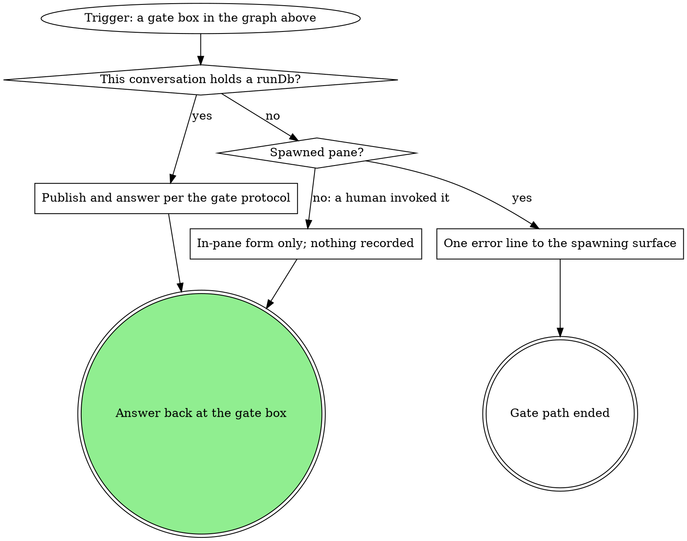

# Scenario (describe only: run no tools; answer from the skill text below)

You are running rebase-worktree inside a pipeline run: this conversation holds runDb /runs/app/r1/state.db, the run's current stage is "ship", and this pane is attended (not spawned, not herdr). branch_sync {tree: /repo/wt} returned {"kind":"synced","pushed":false,"oldHead":"aaa1111","newHead":"bbb2222"}. You report the move and reach **Gate push**. The human picks push: Push with force-with-lease now, next: Proceed, in the pane form.

List, in order, every MCP tool call you make from reaching Gate push up to (not including) the git_push it leads to: one per line, the tool name and its input as JSON-ish keys and values. Nothing else.

---- SKILL: rebase-worktree ----
---
name: rebase-worktree
disable-model-invocation: true
description: "Use when one worktree's feature branch has fallen behind the default branch -- 'rebase this worktree', a stale MR branch. Not for resolving conflicts on its own or moving uncommitted work."
allowed-tools:
  - Bash(git -C * status:*)
  - Bash(git -C * log:*)
type: pipeline-step
slots: {}
---

# rebase-worktree

Bring one worktree's branch current with the default branch through the
`branch_sync` tool. This never guesses: it refuses on a dirty tree, refuses
a stack member, and hands conflicts back to a human.

```dot
digraph rebase_worktree {
    rankdir=TB;

    bring_current [label="Trigger: one worktree's branch to bring current" shape=ellipse];
    git_status_branch [label="git -C <tree> status -sb" shape=plaintext];
    upstream_set [label="Upstream set?" shape=diamond];
    branch_sync [label="branch_sync {tree}" shape=plaintext];
    branch_sync_kind [label="branch_sync kind?" shape=diamond];
    stop_stash [label="STOP: never stash; gate the dirty tree" shape=octagon style=filled fillcolor=red fontcolor=white];
    gate_dirty_tree [label="Gate clarify: dirty tree" shape=box];
    tree_answer [label="tree answer?" shape=diamond];
    dirty_retries_spent [label="Dirty retries = 2?" shape=diamond];
    pulled_once [label="Pulled once already?" shape=diamond];
    git_pull [label="git_pull {tree}" shape=plaintext];
    git_pull_result [label="git_pull result?" shape=diamond];
    stop_hand_rebase [label="STOP: a refusal ends the run; never rebase by hand" shape=octagon style=filled fillcolor=red fontcolor=white];
    stop_resolve_conflict [label="STOP: never resolve a conflict; hand it back" shape=octagon style=filled fillcolor=red fontcolor=white];
    gate_conflict [label="Gate conflict:rebase-worktree:<attempt>" shape=box];
    conflict_answer [label="conflict answer?" shape=diamond];
    git_rebase_abort [label="git_rebase {tree, abort: true}" shape=plaintext];
    abort_succeeded [label="Abort succeeded?" shape=diamond];
    git_status_tree [label="git -C <tree> status" shape=plaintext];
    still_mid_rebase [label="Still mid-rebase?" shape=diamond];
    conflict_attempts_spent [label="Conflict attempts = 3?" shape=diamond];
    stop_touch_rebase [label="STOP: leave the rebase for the human" shape=octagon style=filled fillcolor=red fontcolor=white];
    git_log_head [label="git -C <tree> log -1 --oneline HEAD" shape=plaintext];
    head_unchanged [label="Head still the old head?" shape=diamond];
    git_log_old_head [label="git -C <tree> log -1 --oneline --no-decorate <oldHead>" shape=plaintext];
    git_log_new_head [label="git -C <tree> log -1 --oneline --no-decorate <newHead>" shape=plaintext];
    report_move [label="Report the move" shape=box];
    heads_equal [label="Old head = new head?" shape=diamond];
    sync_pushed [label="branch_sync pushed it?" shape=diamond];
    gate_push [label="Gate push" shape=box];
    push_answer [label="push answer?" shape=diamond];
    git_push_force_lease [label="git_push {tree, forceWithLease: true}" shape=plaintext];
    git_push_result [label="git_push result?" shape=diamond];
    stop_shell_push [label="STOP: push only with git_push" shape=octagon style=filled fillcolor=red fontcolor=white];
    gate_off_script [label="Off-script gate" shape=box];
    off_script_answer [label="off-script answer?" shape=diamond];
    make_recorded_move [label="Make the recorded move once" shape=box];
    recorded_move_succeeded [label="Recorded move succeeded?" shape=diamond];
    off_script_rounds_spent [label="Off-script rounds = 2?" shape=diamond];
    dirty_tree [label="Dirty tree: reported" shape=doublecircle];
    aborted_untouched [label="Aborted: nothing touched" shape=doublecircle];
    no_upstream [label="No upstream: reported" shape=doublecircle];
    refused [label="Refused: reported" shape=doublecircle];
    refused_stack_member [label="Refused: stack member, tool named" shape=doublecircle];
    stack_check_failed [label="Stack check could not run: reported" shape=doublecircle];
    left_mid_rebase [label="Left mid-rebase for the human" shape=doublecircle];
    aborted [label="Aborted" shape=doublecircle];
    abort_failed [label="Abort failed: error reported, tree left for the human" shape=doublecircle];
    aborted_by_human [label="Rebase aborted in the human's pane: reported" shape=doublecircle];
    rebased_unpushed [label="Rebased, left unpushed" shape=doublecircle];
    push_refused [label="Rebased, push refused: reported" shape=doublecircle];
    held_end_turn [label="Held: end the turn naming the gate" shape=doublecircle];
    done [label="Done: move reported" shape=doublecircle style=filled fillcolor=lightgreen];

    bring_current -> git_status_branch;
    git_status_branch -> upstream_set;
    upstream_set -> branch_sync [label="yes"];
    upstream_set -> no_upstream [label="no"];
    branch_sync -> branch_sync_kind;
    branch_sync_kind -> git_log_old_head [label="synced, up-to-date or push-refused"];
    branch_sync_kind -> gate_dirty_tree [label="dirty-tree"];
    branch_sync_kind -> gate_conflict [label="conflict"];
    branch_sync_kind -> refused_stack_member [label="stacked-refused"];
    branch_sync_kind -> stack_check_failed [label="stack-unverified"];
    branch_sync_kind -> pulled_once [label="error: refusal says run git_pull first"];
    branch_sync_kind -> refused [label="error: any other refusal or failure"];
    branch_sync_kind -> stop_stash [label="tempted to stash and proceed"];
    branch_sync_kind -> stop_hand_rebase [label="tempted to rebase by hand"];
    branch_sync_kind -> stop_resolve_conflict [label="tempted to resolve or continue it yourself"];
    stop_stash -> gate_dirty_tree;
    stop_hand_rebase -> refused;
    stop_resolve_conflict -> gate_conflict;
    gate_dirty_tree -> tree_answer;
    tree_answer -> dirty_retries_spent [label="I committed them, retry"];
    tree_answer -> aborted_untouched [label="abort"];
    tree_answer -> held_end_turn [label="hold"];
    dirty_retries_spent -> branch_sync [label="no"];
    dirty_retries_spent -> dirty_tree [label="yes"];
    pulled_once -> git_pull [label="no"];
    pulled_once -> refused [label="yes"];
    git_pull -> git_pull_result;
    git_pull_result -> branch_sync [label="fast-forwarded"];
    git_pull_result -> refused [label="error"];
    gate_conflict -> conflict_answer;
    conflict_answer -> left_mid_rebase [label="leave"];
    conflict_answer -> git_rebase_abort [label="abort"];
    conflict_answer -> held_end_turn [label="hold"];
    conflict_answer -> git_status_tree [label="iterate: the human worked in their pane"];
    git_rebase_abort -> abort_succeeded;
    abort_succeeded -> aborted [label="yes"];
    abort_succeeded -> abort_failed [label="no"];
    git_status_tree -> still_mid_rebase;
    still_mid_rebase -> conflict_attempts_spent [label="yes"];
    still_mid_rebase -> git_log_head [label="no"];
    conflict_attempts_spent -> gate_conflict [label="no: attempt n+1"];
    conflict_attempts_spent -> stop_touch_rebase [label="yes"];
    stop_touch_rebase -> left_mid_rebase;
    git_log_head -> head_unchanged;
    head_unchanged -> aborted_by_human [label="yes"];
    head_unchanged -> git_log_old_head [label="no: the rebase finished"];
    git_log_old_head -> git_log_new_head;
    git_log_new_head -> report_move;
    report_move -> heads_equal;
    heads_equal -> done [label="yes: already current, nothing pushed"];
    heads_equal -> sync_pushed [label="no"];
    sync_pushed -> done [label="yes: synced, pushed true"];
    sync_pushed -> gate_push [label="no: synced unpushed, push-refused, or the human finished the rebase"];
    gate_push -> push_answer;
    push_answer -> git_push_force_lease [label="push with force-with-lease"];
    push_answer -> rebased_unpushed [label="leave it unpushed"];
    push_answer -> report_move [label="iterate"];
    push_answer -> held_end_turn [label="hold"];
    git_push_force_lease -> git_push_result;
    git_push_result -> done [label="pushed"];
    git_push_result -> push_refused [label="safety refusal: lease, protected or default branch, detached HEAD, upstream mismatch"];
    git_push_result -> stop_shell_push [label="not registered with rt"];
    git_push_result -> push_refused [label="any other error"];
    stop_shell_push -> gate_off_script;
    gate_off_script -> off_script_answer;
    off_script_answer -> make_recorded_move [label="take"];
    off_script_answer -> off_script_rounds_spent [label="iterate: the human fixed it, retry"];
    off_script_answer -> push_refused [label="hand back"];
    off_script_answer -> held_end_turn [label="hold"];
    off_script_rounds_spent -> git_push_force_lease [label="no"];
    off_script_rounds_spent -> push_refused [label="yes"];
    make_recorded_move -> recorded_move_succeeded;
    recorded_move_succeeded -> done [label="yes"];
    recorded_move_succeeded -> push_refused [label="no"];
}
```

`<tree>` is the worktree's absolute path. Each graph box has a section below. Every gate box runs the gate steps graph under **Gates**.

### branch_sync kind?

`branch_sync` does the fetch, the stack check, the rebase and the push in
one call, and returns `{kind, branch, oldHead, newHead, pushed, refusal?,
paths?}`. `kind` decides, and nothing else does:

| kind | next |
|---|---|
| `synced` | The branch moved. `pushed: true`: origin has it, so no push gate. `pushed: false`: origin's ref lacks the new head, so **Gate push** follows. |
| `up-to-date` | Nothing moved or was pushed. **Report the move** says "already current; nothing pushed". |
| `push-refused` | The rebase landed locally; the push failed. **Report the move** quotes `refusal`; **Gate push** follows. |
| `dirty-tree` | Nothing ran. **Gate clarify: dirty tree** with the result's `paths`. |
| `conflict` | The rebase is paused in the worktree. **Gate conflict:rebase-worktree:<attempt>** with the bundle's `unresolvedFiles`. Keep the result's `newHead` for **Head still the old head?**. |
| `stacked-refused` | **Refused: stack member, tool named**: quote `refusal` and name the tool it names. The restack belongs to that tool. |
| `stack-unverified` | **Stack check could not run: reported**: quote `refusal`, which says why. |
| `error` | Read `refusal`. When it says "run git_pull first" (the branch is only behind origin), go to **Pulled once already?**: one `git_pull {tree}`, then one more `branch_sync`. That phrase is the one text match in this skill. Any other refusal or failure: **Refused: reported** with `refusal`. |

| Thought | Reality |
|---|---|
| "The stack refusal came back, but the MR targets the default branch, so I'll rebase by hand" | `stacked-refused` is the guard's verdict, not a hint. The run ends reported; the restack is the named tool's. |
| "The stack check could not run, so I'll check the MRs myself and rebase" | `stack-unverified` ends the run. An unverified branch is never rebased, by hand or by another tool. |
| "`synced`, so now the push gate" | With `pushed: true` the push already happened; a push form would be a false choice. Report it as pushed. |
| "`synced` means pushed" | Read `pushed`. With `pushed: false` the new head is local only, and the push gate decides. |

### Gate clarify: dirty tree

Scope `clarify`. One sentence listing the uncommitted paths (the result's
`paths`; when absent, quote `refusal`), then two questions, each its own question:

- `tree`: **I committed them, retry** / **Abort**
- `next`: **Proceed** / **Hold**

Selection `{"tree":"retry|abort"}`. Read `next` first: **Hold** ends the
turn with nothing moved. Never stash and
proceed: moving someone's uncommitted work is not this skill's call. The
table under **Gate push** binds this form too.

With no run: a human invocation presents the same form in-pane only. A
SPAWNED pane (the launch instruction said a surface spawned this pane --
the same signal `run-start --spawned-by` is taken from; a board wrapper
invocation counts as spawned per se) never presents a form here: nobody is
watching the pane and no gate row reaches any surface. End this path
instead with one error line the spawning surface can read (its own status
or report channel when it has one, stderr otherwise) and stop.

### Gate conflict:rebase-worktree:<attempt>

Scope `conflict:rebase-worktree:<attempt>`. One sentence listing the
conflicted files: the bundle's `unresolvedFiles`, or after an iterate the
unmerged (`both modified` and similar) entries of the
`git -C <tree> status` read.

`<attempt>` counts from 1. The questions, each its own question (never
fold one list into another: a question over 4 options sends the whole gate
to the wait queue):

- `conflict`: **Leave the rebase in progress for me** (recommended) /
  **Abort the rebase**
- `next`: **Proceed** (recommended) / **Iterate here** / **Hold**

Selection `{"conflict":"leave|abort","next":"proceed|iterate|hold","note":"<their words or null>"}`.
Read `next` first: **Hold** ends the turn with nothing aborted; **Iterate
here** re-reads the tree, ignoring `conflict`; only **Proceed** applies
the `conflict` choice (`leave` or `abort`). Never resolve the
conflict yourself, stage the files, or continue or skip the rebase.

With no run: a human invocation presents the same form in-pane only. A
SPAWNED pane (the launch instruction said a surface spawned this pane --
the same signal `run-start --spawned-by` is taken from; a board wrapper
invocation counts as spawned per se) never presents a form here: nobody is
watching the pane and no gate row reaches any surface. End this path
instead with one error line the spawning surface can read (its own status
or report channel when it has one, stderr otherwise) and stop.

### Report the move

One line: old head -> new head, each as the sha and subject from its
`git -C <tree> log -1 --oneline --no-decorate` read. `<oldHead>` is the
result's `oldHead`. `<newHead>` is the result's `newHead` on the
`branch_sync` path, and HEAD after an iterate where the human finished the
rebase. The line ends "already current; nothing pushed" when the heads
match, "pushed by branch_sync" when `pushed` is true, and otherwise "not
pushed", followed on `push-refused` by the quoted `refusal`.

### Gate push

Scope `push`. The sentence is the line from **Report the move**; nothing
else before the form. The questions, each its own question (never fold one list
into another: a question over 4 options sends the whole gate to the wait
queue):

- `push`: **Push with force-with-lease now** / **Leave it unpushed**
  (recommended when the branch has an open MR others may have pulled)
- `next`: **Proceed** / **Iterate here** / **Hold**

Selection `{"push":true|false,"next":"proceed|iterate|hold","note":"<their words or null>"}`.
Read `next` first: **Hold** ends the turn with nothing pushed; **Iterate
here** goes back to **Report the move** and ignores `push`; only
**Proceed** applies `push`.
Any `git_push` error other than "not registered with rt" is reported with
its text; the rebase stands unpushed.

With no run: a human invocation presents the same form in-pane only. A
SPAWNED pane (the launch instruction said a surface spawned this pane --
the same signal `run-start --spawned-by` is taken from; a board wrapper
invocation counts as spawned per se) never presents a form here: nobody is
watching the pane and no gate row reaches any surface. End this path
instead with one error line the spawning surface can read (its own status
or report channel when it has one, stderr otherwise) and stop.

**These thoughts mean you are skipping the gate -- STOP:**

| Thought | Reality |
|---------|---------|
| "Push with force-with-lease now is the natural next action, so I'll mark it Recommended" | Only **Leave it unpushed** carries a recommended label, and only conditionally (an open MR others may have pulled). Keep that qualifier on that option; never move it to the push option. |
| "Restating the finding and explaining each option makes the ask clearer" | A gate's form is one sentence of context, then the bare option labels the gate text names, nothing more -- no restated heading, no per-option description, no conditional aside on when Hold applies. |

### Off-script gate

Its origin is the `git_push` refusal "not registered with rt". Scope
`off-script:<run.current_stage>:<n>`, `n` counting from 1 per
rebase-worktree invocation; with no run, the site is `rebase-worktree`
(scope `off-script:rebase-worktree:<n>`). The
context sentence quotes the `git_push` refusal. The questions, each its
own question:

- `action`: **Take the proposed move** (the value spells the move in full)
  / **Hand back**
- `next`: **Proceed** (recommended) / **Iterate here** / **Hold**

Selection `{"move":"<the move>","why":"<the refusal>","action":"take|handback","next":"proceed|iterate|hold","note":"<their words or null>"}`.
Read `next` first: **Hold** ends the turn with no move made; **Iterate
here** means the human fixed the cause and wants the push retried, and it
ignores `action`; only **Proceed** applies `action` (take or hand back).
The proposed move is one plain-git force-with-lease push of the
branch; retrying the refused tool is **Iterate here**, never **Take**.

### Make the recorded move once

Exactly the move the selection recorded, once. Its result decides the next
node; a failure is reported, never a second off-script gate.

## What the graph cannot show

- Never push unasked.
- Aborting the rebase happens only on the **Abort the rebase** answer.
- "Upstream set?" is no when the `status -sb` branch line carries no `...origin/<branch>` tracking ref.

### Head still the old head?

The old head here is the conflict result's `newHead`: the branch ref when
the rebase paused, which differs from `oldHead` when rt sync first reset a
GitLab-rebased branch to origin. HEAD still equal to it means the human
aborted in their pane, never "already current".

## Gates

Every gate box runs this graph.

### Publish and answer per the gate protocol

Under the run, every gate tool call passes `runDb` and `stage: <run.current_stage>`, so the
tools bracket and record the gate: `gate_ask` writes the run's `gate`
field, and `gate_answer` or `gate_reconcile` records the answers map as the
scope's `gate@1` decision. Nothing here writes the `gate` field or the
gate's decision by hand: a second record moves the decision's time. The
recorded selection is that answers map, keyed by the question ids each gate
names, `next` included; each `Selection` line names those keys.

If a rule below asks for a move this graph marks STOP, take the off-script edge instead.

# Gate protocol

The daemon's gate registry is the single arbiter; under a run the gate
tools record the decision.

If a site's questions or a rule in the including verb ask for a move this
graph marks STOP, open the Off-script gate (below) instead.

```dot
digraph gate_protocol {
    trigger_site_reaches [label="Trigger: a site reaches its gate" shape=ellipse];
    trigger_site_opened [label="Trigger: a site opened its gate with gate_open" shape=ellipse];
    build_questions [label="Build the gate's questions and context" shape=box];
    gate_ask [label="gate_ask {questions, kind: <scope>, context?, subject?, runDb?, stage?}" shape=plaintext];
    gate_ask_result [label="gate_ask result?" shape=diamond];
    ask_under_run [label="Under a run (gate_ask fix)?" shape=diamond];
    run_budget_fix [label="run_budget {key: gate-fix:<scope>, limit: 2, stage}" shape=plaintext];
    fixed_ask_once [label="Fixed this gate_ask call once already?" shape=diamond];
    fix_refusal [label="Fix what the gate_ask refusal names" shape=box];
    daemon_down_unattended [label="Daemon down: is the gated pane unattended?" shape=diamond];
    fail_stage_at_gate [label="Under a run: fail the stage at the gate?" shape=diamond];
    run_stage_fail [label="run_stage {action: fail, stage, reason: <the gate_ask refusal, verbatim>}" shape=plaintext];
    present_form_no_registry [label="Present the gate form with no registry" shape=box];
    no_registry_under_run [label="Under a run (no-registry answer)?" shape=diamond];
    gate_record [label="gate_record {runDb, stage, scope, shape: answers, answers, decidedBy: pane}" shape=plaintext];
    pane_action [label="paneAction?" shape=diamond];
    present_pane_form [label="Present the in-pane gate form" shape=box];
    form_result [label="Gate form result?" shape=diamond];
    map_answer [label="Map the gate answer to exact option values" shape=box];
    gate_answer [label="gate_answer {id, answers, runDb?, stage?}" shape=plaintext];
    gate_answer_result [label="gate_answer result?" shape=diamond];
    remap_under_run [label="Under a run (answer remap)?" shape=diamond];
    run_budget_remap [label="run_budget {key: gate-remap:<scope>, limit: 2, stage}" shape=plaintext];
    resubmitted_once [label="Resubmitted this gate_answer once already?" shape=diamond];
    say_surface [label="Say which surface won" shape=box];
    hold_under_run [label="Holding an open gate: under a run?" shape=diamond];
    run_field_set [label="run_field_set {key: waiting-gate, value: <id>, stage}" shape=plaintext];
    rt_gate_wait [label="rt gate wait <id> as a background Bash task" shape=plaintext];
    end_turn_holding [label="End the turn: holding at gate <id>" shape=box];
    trigger_wait_finished [label="Trigger: the gate wait finished" shape=ellipse];
    trigger_human_words [label="Trigger: the human answers in words" shape=ellipse];
    trigger_doorbell [label="Trigger: a doorbell push arrives" shape=ellipse];
    gate_reconcile [label="gate_reconcile {id, runDb?, stage?}" shape=plaintext];
    reconcile_status [label="gate_reconcile status?" shape=diamond];
    write_in_to_act [label="A write-in to act on (actOnWriteIn)?" shape=diamond];
    act_write_in [label="Act on a write-in" shape=box];
    stop_no_invented_answer [label="STOP: never invent an answer or re-ask a closed gate" shape=octagon style=filled fillcolor=red fontcolor=white];
    stage_failed [label="Gate stage failed" shape=doublecircle];
    verb_ends [label="Verb ends quoting the refusal" shape=doublecircle];
    held_no_run [label="No run: held at the open gate" shape=doublecircle];
    late_signal [label="Late gate signal discarded" shape=doublecircle];
    path_ended [label="Path ended per the verb's policy" shape=doublecircle];
    write_in_new_gate [label="Write-in acted on: a new gate opens" shape=doublecircle];
    act_on_answer [label="Act on the gate answer at the site" shape=doublecircle style=filled fillcolor=lightgreen];

    trigger_site_reaches -> build_questions -> gate_ask -> gate_ask_result;
    gate_ask_result -> pane_action [label="ok"];
    gate_ask_result -> daemon_down_unattended [label="refused: daemon unreachable"];
    gate_ask_result -> ask_under_run [label="refused: other"];
    ask_under_run -> run_budget_fix [label="yes"];
    ask_under_run -> fixed_ask_once [label="no"];
    run_budget_fix -> fixed_ask_once;
    fixed_ask_once -> fix_refusal [label="no"];
    fixed_ask_once -> fail_stage_at_gate [label="yes"];
    fix_refusal -> gate_ask;
    daemon_down_unattended -> present_form_no_registry [label="no"];
    daemon_down_unattended -> fail_stage_at_gate [label="yes"];
    fail_stage_at_gate -> run_stage_fail [label="yes"];
    fail_stage_at_gate -> verb_ends [label="no"];
    run_stage_fail -> stage_failed;
    present_form_no_registry -> no_registry_under_run;
    no_registry_under_run -> gate_record [label="yes"];
    no_registry_under_run -> write_in_to_act [label="no"];
    gate_record -> write_in_to_act;
    trigger_site_opened -> pane_action;
    pane_action -> present_pane_form [label="form"];
    pane_action -> rt_gate_wait [label="wait"];
    present_pane_form -> form_result;
    form_result -> map_answer [label="answered"];
    form_result -> trigger_doorbell [label="dismissed" style=dashed];
    form_result -> hold_under_run [label="cancelled"];
    map_answer -> gate_answer -> gate_answer_result;
    gate_answer_result -> write_in_to_act [label="this answer won"];
    gate_answer_result -> say_surface [label="conflict: true"];
    gate_answer_result -> remap_under_run [label="refused: not an option"];
    gate_answer_result -> stop_no_invented_answer [label="refused: closed or not found"];
    remap_under_run -> run_budget_remap [label="yes"];
    remap_under_run -> resubmitted_once [label="no"];
    run_budget_remap -> resubmitted_once;
    resubmitted_once -> map_answer [label="no"];
    resubmitted_once -> hold_under_run [label="yes"];
    say_surface -> write_in_to_act;
    hold_under_run -> run_field_set [label="yes"];
    hold_under_run -> held_no_run [label="no"];
    run_field_set -> rt_gate_wait -> end_turn_holding;
    end_turn_holding -> trigger_wait_finished [style=dashed];
    trigger_wait_finished -> gate_reconcile -> reconcile_status;
    trigger_human_words -> gate_reconcile;
    trigger_doorbell -> gate_reconcile;
    reconcile_status -> late_signal [label="late: reconciled, stale, or acted on"];
    reconcile_status -> say_surface [label="answered"];
    reconcile_status -> stop_no_invented_answer [label="closed or not found"];
    reconcile_status -> map_answer [label="open, words"];
    reconcile_status -> end_turn_holding [label="open, no words"];
    reconcile_status -> daemon_down_unattended [label="refused: daemon unreachable"];
    stop_no_invented_answer -> path_ended;
    write_in_to_act -> act_write_in [label="yes"];
    write_in_to_act -> act_on_answer [label="no"];
    act_write_in -> write_in_new_gate;
}
```

### Build the gate's questions and context

Open before anything that depends on the answer. A question is `{"id",
"label", "multi", "options"}`, plus `"writeIn": true` where the site marks
`(write-in)`; `kind` is the gate's scope. Pass `subject` only for a subject
not your own.

- **Context** is a VERBATIM QUOTE of the material under decision (the
  brief's task, the plan section, the failing output), never a fresh
  summary, and never sent empty. Lay it out as Markdown that reads the same
  unrendered: a framing line, then label lines (`Important:`) with one `-`
  bullet per item. Never trim it; the daemon drops what overflows. A
  question's own `context` sets up that question alone; an option's
  `description` is its one-line why.
- **Options** are `{value, label}` objects when values are not
  human-readable; a recommended pick's `label` ends ` (Recommended)`, its
  `value` bare. In a site table headed `Options (recommended first)`, mark
  the option the table writes; a row with none, such as the stage-end
  `next`, marks none.
- **`next` values** are exactly `proceed`, `iterate`, `go-back`, `hold`,
  and `abandon` or `done` where offered; the tools read `proceed` and
  `iterate`.
- **Write-ins** go only on a decision question whose free text you can act
  on, never on `next` or a review-post, respond, doctor or pane-attention
  question.
- **At most 4 options per question**, or the whole gate goes to the wait.
  Navigation (Iterate here, Go back, Hold, Abandon) is its own `next`
  question; a longer list splits into `<id>-1`, `<id>-2`, ... read as one
  union.

### Trigger: a site opened its gate with gate_open

A site opening a structured gate calls `gate_open` itself and enters here.
Its result carries what `gate_ask`'s does (see gate_ask result?), and under
a run it has already written `gate` and, on `wait`, armed `waiting-gate`.

### gate_ask result?

**ok:** keep `id`, `paneAction`, `formContext` and `formChunks`;
`labelsTruncated` lists labels the tool shortened, so never shorten one
yourself. **`runErrors`:** the gate is open but a run write failed: quote it
in one line and carry on at `paneAction?`, never re-asking the gate or
writing that field yourself.

### Fix what the gate_ask refusal names

Fix exactly what it names (a blank context, several running runs, a bad
`runDb`) and ask again, once. Under a run each counter diamond reads
`run_budget`'s `exhausted` and a `run_budget` error counts as exhausted;
with no run, count in context. A second refusal fails the stage or ends the
verb, quoting it verbatim; never off-script, which opens through `gate_ask`
too.

### Present the gate form with no registry

Form-only, with no other gate call: the answer is the decision (no CAS),
`decidedBy` `pane`, and under a run `gate_record` records it.

### Present the in-pane gate form

The `paneAction: form` branch (older sites say the
`presentation: "form"` branch). Show `formContext`, when present, in the
pane before the first chunk, then ask `formChunks` in order, one
AskUserQuestion call per chunk, rendering each chunk as given; answer once,
after the last. Dismissed: another surface answered, and the doorbell is
your next input. Cancelled: the gate stays open; never re-present it
yourself.

### Map the gate answer to exact option values

`answers` is one object keyed by question id, values per Answers are option
values (below); a question with no options takes the human's text, and
words at a held gate map the same way. On a `writeIn` question, "Other"
text with nothing ticked is `{"writeIn": "<text>"}`, never the nearest
option; beside ticks on a multi it is `{"value": [<ticks>], "note":
"<text>"}`. A refused value is remapped once, counted as in Fix what the
gate_ask refusal names, then left open for another surface.

### Say which surface won

Say in one line which answer won and from where (`decidedBy`), drop the
pane's own answer or words, and go on with the result's `answers`.

### End the turn: holding at gate <id>

Never launch a second wait for this gate. End the turn in one line,
`holding at gate <id>`. Under a run a turn ends only with `waiting-gate`
set.

### gate_reconcile status?

It re-reads the gate (up to 2 seconds), records the answer under a run and
clears `waiting-gate`; never a timed `rt gate wait` or a hand record. Late
means `alreadyReconciled`, a `skipped` naming a stale gate, or, with no run,
a gate this pane already acted on. Otherwise `answered` is the decision, and
words in hand lose to it. `open` with words: map them and let
`gate_answer`'s CAS decide; with none, end the turn again (the wait and
marker stand). A daemon-unreachable refusal takes the daemon-down branch,
quoting it.

### A write-in to act on (actOnWriteIn)?

Read `actOnWriteIn` off the tool result: it is the deliberate-pick rule. A
write-in is acted on only when `next` is absent, Proceed or Iterate here;
any other `next` (Hold, Go back, Abandon) was picked on purpose, and the
site takes it with the write-in as its note. With no tool result, apply the
rule yourself.

### Act on a write-in

Handle the gate like Iterate here: skip the site's own branch (a Proceed
beside it is the form's preselection), do what the write-in asks, reading
the whole answer set, then open a NEW gate at the same site so the human
sees the result first. One too unclear to act on goes straight to that new
gate, which asks about it.

## Attendance

Attendance comes from the invocation context, never from asking: under a
run, `spawnedBy` set means unattended; with no run, the launch instruction
says (a pane a surface launched is unattended).

## Runs integration

A site that says "run gate-protocol's Runs integration with kind `<k>` and
these questions" enters at the trigger and walks every branch. Under a run
every gate tool call passes `runDb` and the site's `stage`: the tools
bracket the gate, arm `waiting-gate` on a wait, record the answers map
(`decidedBy` the CAS winner) and clear the marker. Without them the stop
hook bounces the turn. With no run, omit both; nothing here calls a `run_*`
tool.

- **Every site is on the tools.** No host brackets a gate with
  `run_field_set {key: gate}` or records its answer with a `run_decision`
  gate@1 line: the tools record the answers map (a write-in as `{"writeIn": "<their
  words>"}` in that question's slot), and `Selection:` lines only name its
  keys. The board's wrappers run under no run, so they pass neither.
- **Review shapes.** `gate_answer` and `gate_reconcile` record nothing on a
  review gate (`respond-plan`, `respond-post`, `review-post`, scope `post`)
  unless passed `record: true`; the site records with `gate_record`.

## Off-script gate

A host STOP opens it through the graph: scope `off-script:<site>:<n>` (`n`
from 1 within the site's attempt), `context` quoting the refusal or the
line asking for the move.

| Question | Options |
|---|---|
| `action` | **Take the proposed move** (its value spells the whole move) / **Hand back** |
| `next` | **Proceed** (Recommended) / **Iterate here** / **Hold** |

Take: make exactly that move once, then continue from the node it led to.
Hand back: under a run, `run_stage {action: fail}` with the why as reason;
with no run, end the verb quoting it.

## Structured context (gate-ctx@1)

A site that opens a structured gate builds its source per
`${CLAUDE_SKILL_DIR}/structured-context.txt` and opens it with `gate_open`.

## Answers are option values

An answer to a question with options is one of its option VALUES verbatim
(an array on a multi), never an index, label or paraphrase. Nuance rides
`{"value": ..., "note": "..."}`; an edited replacement for offered text
rides `text`, which the in-pane form never sends. The verb's act step
decides what either changes. A `writeIn: true` question may instead take
`{"writeIn": "<their words>"}` alone.

## Closed gates, Hold / Iterate

`closed` ends that path per the verb's policy. The verb handles Hold and
Iterate in the pane once the answer is recorded; a re-ask opens a NEW gate.

## Doorbell

Verify-only: it never carries the answer, only "re-read the registry",
which is `gate_reconcile`.

## Red flags

| Thought | Reality |
|---|---|
| "The doorbell says what they picked" | Call `gate_reconcile`. |

### One error line to the spawning surface

The guard text in the gate's own section (for the off-script gate, the
one under **Gate push**) says what the line is and where it goes; the gate
path ends there.

### In-pane form only; nothing recorded

A human invocation with no run gets the same form in the pane, and no
`run_*` call is made.

## Wrap-up form contract

# Wrap-up

The reply is one optional sentence of context, then a form, then stop. Wait
for the answers before doing more work.

The form is this runtime's structured-question tool (`AskUserQuestion` in
Claude Code). One question per open item, in three buckets; omit an empty
bucket:

| Bucket | The question is | Options |
|---|---|---|
| Important details | a confirmation or pick among facts that still matter | concrete values |
| Decisions | a choice only the user can make | the real alternatives, recommended first and labelled `(Recommended)` |
| Next steps | whether or in what order to do remaining work | do now / later / skip |

Single or multiple choice as the item needs. If the tool caps how many
questions fit in one call, fill the first call and wait; the rest go in the
next call after the answers return, never into the context sentence.

| Thought | Reality |
|---|---|
| "A summary with the options listed is just as clear" | A list is text the user has to type back. The form is the answer channel. |
| "They asked me to be quick, so a compact list" | The form is the quick version: one tap per item. |
| "The options are obvious, prose is faster" | Obvious to you. The form records which one they picked. |
| "Next steps can go in prose after the form" | Next steps are questions: do now / later / skip. |
| "I can hand them a default to save them answering" | Recommended options already do that in the form; a typed reply still costs more than a tap and leaves no record of the pick. |
| "The context sentence, then a line introducing the form" | Two sentences. The form needs no introduction; the sentence is the whole preamble. |

