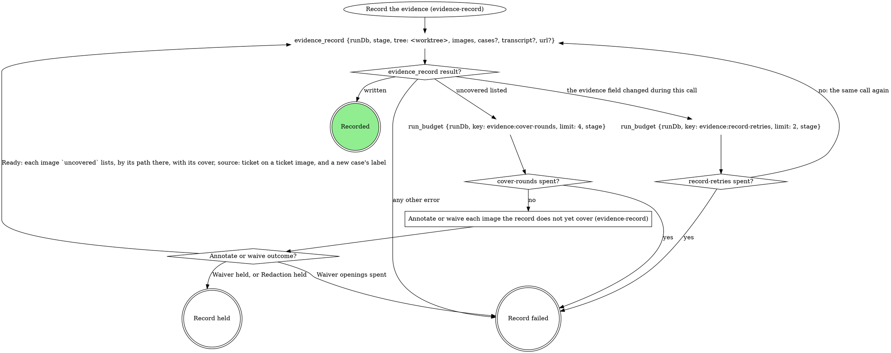
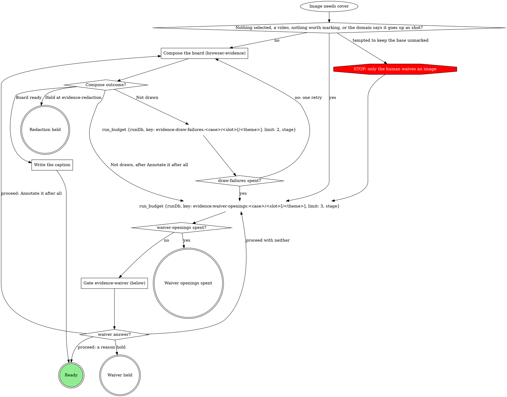
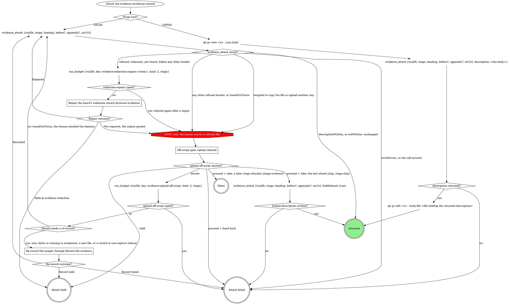

# Scenario (describe only: run no tools; answer from the skill text below)

You are running the ship stage of a pipeline run: runDb /runs/app/r1/state.db, stage "ship", worktree /repo/wt. The checks have just failed for the third time in this stage attempt. Following the graph, you called:

run_budget {runDb: /runs/app/r1/state.db, key: ship:fix-rounds, limit: 4, stage: ship}

It returned: {"key":"ship:fix-rounds","spent":3,"limit":4,"remaining":1,"exhausted":false}

Answer in exactly three numbered lines, nothing else:
1. The label of the out-edge you take from `fix-rounds spent?`, verbatim.
2. Counting every failed check run in this stage attempt (this one is the third), on which failed check run does the stage stop fixing and go to the ship-gate reopening? A number.
3. Later a push does not land and the landing check runs each time: on which landing-check failure (a number) does the stage fail instead of reopening the push gate?

---- SKILL: stage-ship ----
---
name: stage-ship
description: "Pipeline stage: publish the unit of work for review -- push, open the MR/PR, attach evidence. Reached only through the work orchestrator; not for direct invocation."
disable-model-invocation: true
type: pipeline-step
slots:
  domain: { contract: ship-domain@1, required: false }
metadata:
  stage: "ship"
  stage-consumes: "commits ticket"
  stage-produces: "mr"
---

# stage: ship

{{stage.fields}}

Run state: the orchestrator opens and closes this stage, so never write
`run_stage` `start` or `done` here. Write `mr` the moment it exists and
`pushed` once the push lands; fail with `run_stage {action: fail}` naming
what failed. Every `stage` argument is `"ship"`. `<root>` is the absolute worktree root
`git rev-parse --show-toplevel` prints.

```dot
digraph ship {
    rankdir=TB;

    ship_entered [label="Ship stage entered" shape=ellipse];
    run_field_get_mr [label="run_field_get {key: mr}" shape=plaintext];
    domain_steps_before_gate [label="Run the domain steps before the gate (none when unbound)" shape=box];
    git_status_log [label="git status --porcelain; git log --oneline @{upstream}.. or -5" shape=plaintext];
    branch_stack [label="branch_stack {tree: <root>}" shape=plaintext];
    stack_parent_read [label="Stack parent read?" shape=diamond];
    run_field_get_target [label="run_field_get {key: shipTarget}" shape=plaintext];
    target_matches_fresh [label="shipTarget matches the fresh target?" shape=diamond];
    gate_ship [label="Gate ship (table below)" shape=box];
    run_field_set_target [label="run_field_set {key: shipTarget, value: <resolved target>, stage}" shape=plaintext];
    run_field_set_target_iterate [label="run_field_set {key: shipTarget, value: -, stage} (iterate)" shape=plaintext];
    run_field_set_target_hold [label="run_field_set {key: shipTarget, value: -, stage} (hold)" shape=plaintext];
    run_budget_gate_rounds [label="run_budget {key: ship:ship-gate-rounds, limit: 2, stage}" shape=plaintext];
    gate_rounds_spent [label="ship-gate-rounds spent?" shape=diamond];
    run_budget_gate_reopenings [label="run_budget {key: ship:ship-gate-reopenings, limit: 2, stage}" shape=plaintext];
    gate_reopenings_spent [label="ship-gate-reopenings spent?" shape=diamond];
    rebase_in_progress [label="Rebase in progress?" shape=diamond];
    git_rebase_abort [label="git_rebase {tree: <root>, abort: true}" shape=plaintext];
    which_exit [label="Which exit?" shape=diamond];
    dirty_answer [label="dirty answer?" shape=diamond];
    commit_named_files [label="Commit named files, ticket-prefixed subject" shape=box];
    stash_them [label="Stash them" shape=box];
    domain_fast_checks [label="Run the domain's fast checks (none when unbound)" shape=box];
    checks_pass [label="Checks pass?" shape=diamond];
    run_budget_fix_rounds [label="run_budget {key: ship:fix-rounds, limit: 4, stage}" shape=plaintext];
    fix_rounds_spent [label="fix-rounds spent?" shape=diamond];
    fix_test_first [label="Fix test-first, commit, rerun" shape=box];
    domain_rebases_unfinished [label="Domain rebases, and no rebase finished this pass?" shape=diamond];
    git_rebase_onto [label="git_rebase {tree: <root>, onto: origin/<resolved target>}" shape=plaintext];
    rebase_status [label="Rebase status?" shape=diamond];
    run_budget_conflict_rounds [label="run_budget {key: ship:conflict-rounds, limit: 4, stage}" shape=plaintext];
    conflict_rounds_spent [label="conflict-rounds spent?" shape=diamond];
    resolve_conflict_files [label="Resolve the files, then git rebase --continue on Bash" shape=box];
    continue_result [label="Continue result?" shape=diamond];

    needs_force_lease [label="Push needs force-with-lease?" shape=diamond];
    git_push_upstream [label="git_push {tree: <root>, setUpstream: true, leaseMrUrl?: <mr>}" shape=plaintext];
    git_push_lease [label="git_push {tree: <root>, forceWithLease: true, leaseMrUrl?: <mr>}" shape=plaintext];
    git_push_result [label="git_push result?" shape=diamond];
    run_field_set_pushed [label="run_field_set {key: pushed, value: <{\"sha\", \"priorPipelineId\"} JSON>, stage}" shape=plaintext];
    stop_shell_push [label="STOP: push only with git_push" shape=octagon style=filled fillcolor=red fontcolor=white];
    stop_lease_holder_owns [label="STOP: the lease holder owns every commit, push and retry" shape=octagon style=filled fillcolor=red fontcolor=white];
    stand_down [label="Stand down: report the holder and stop" shape=doublecircle];
    gate_push_refused [label="Off-script gate: git_push refused" shape=box];
    make_recorded_move [label="Make the recorded move once" shape=box];
    push_landed [label="Push landed?" shape=diamond];
    run_budget_landing_checks [label="run_budget {key: ship:landing-checks, limit: 2, stage}" shape=plaintext];
    landing_checks_spent [label="landing-checks spent?" shape=diamond];
    run_field_set_pushed_head [label="run_field_set {key: pushed, value: <{\"sha\": HEAD, \"priorPipelineId\": null} JSON>, stage}" shape=plaintext];

    git_remote_origin [label="git remote get-url origin" shape=plaintext];
    forge_host [label="Forge host?" shape=diamond];
    run_budget_forge_clarify [label="run_budget {key: ship:forge-clarify-rounds, limit: 2, stage}" shape=plaintext];
    forge_clarify_rounds [label="forge-clarify-rounds spent?" shape=diamond];
    gate_which_forge [label="Gate clarify: which forge?" shape=box];
    mr_create [label="mr_create {repoName: <root>, sourceBranch, targetBranch: <resolved target>, title, description, draft, squash?, labels?, ifExists: return}" shape=plaintext];
    mr_create_result [label="mr_create result?" shape=diamond];
    run_budget_mr_recalls [label="run_budget {key: ship:mr-create-recalls, limit: 2, stage}" shape=plaintext];
    mr_create_recalls [label="mr-create-recalls spent?" shape=diamond];
    mr_update_squash [label="mr_update {mrUrl, squash: true}" shape=plaintext];
    stop_gitlab_shortcut [label="STOP: GitLab goes through gitlab_get, the read tools and mr_*" shape=octagon style=filled fillcolor=red fontcolor=white];
    gh_pr_create [label="gh pr create --base <resolved target> [--draft]" shape=plaintext];
    gh_create_result [label="gh pr create result?" shape=diamond];
    run_field_set_mr [label="run_field_set {key: mr, value: <url>, stage}" shape=plaintext];

    run_field_get_evidence [label="run_field_get {key: evidence}" shape=plaintext];
    browser_case [label="Browser screenshot for this case?" shape=diamond];
    capture_after_browser [label="Capture the AFTER with the browser (browser-evidence)" shape=box];
    capture_after_case [label="Capture the AFTER for the next case the domain names" shape=box];
    after_result [label="AFTER result?" shape=diamond];
    run_budget_after_attempts [label="run_budget {key: ship:after-attempts:<case id>, limit: 3, stage}" shape=plaintext];
    after_attempts_spent [label="after-attempts spent?" shape=diamond];
    every_case_tried [label="Every named case tried?" shape=diamond];
    after_captured [label="AFTER captured this pass?" shape=diamond];
    record_evidence [label="Record the evidence (evidence-record)" shape=box];
    record_outcome [label="Record outcome?" shape=diamond];
    run_has_evidence [label="Run has an evidence record?" shape=diamond];
    attach_evidence [label="Attach the evidence (evidence-record)" shape=box];
    attach_outcome [label="Attach outcome?" shape=diamond];
    read_forge_host [label="Forge host (read back)?" shape=diamond];
    mr_view_url [label="mr_view {mrUrl}" shape=plaintext];
    gh_pr_view_body [label="gh pr view <mr> --json title,body" shape=plaintext];
    write_title_description [label="Write the title and description" shape=box];
    write_forge_host [label="Forge host (write back)?" shape=diamond];
    mr_update_description [label="mr_update {mrUrl, title, description}" shape=plaintext];
    gh_pr_edit [label="gh pr edit <mr> --title <title> --body <description>" shape=plaintext];

    run_stage_fail [label="run_stage {action: fail, stage, reason}" shape=plaintext];
    run_hold [label="run_hold {stage, reason, decidedBy}" shape=plaintext];
    held_end_turn [label="Held: end the turn naming run and stage" shape=doublecircle];
    hand_back_go_back [label="Hand the Go back answer to the orchestrator" shape=doublecircle];
    stage_failed [label="Stage failed" shape=doublecircle];
    ship_done [label="Ship done: return to the orchestrator" shape=doublecircle style=filled fillcolor=lightgreen];

    ship_entered -> run_field_get_mr;
    run_field_get_mr -> domain_steps_before_gate;
    domain_steps_before_gate -> git_status_log;
    git_status_log -> branch_stack;
    branch_stack -> stack_parent_read;
    stack_parent_read -> run_field_get_target [label="yes: the stack parent"];
    stack_parent_read -> run_field_get_target [label="no: the default branch (an unreadable store or error says so)"];
    run_field_get_target -> target_matches_fresh;
    target_matches_fresh -> dirty_answer [label="yes: the earlier Proceed stands"];
    target_matches_fresh -> gate_ship [label="no"];
    gate_ship -> run_field_set_target [label="proceed"];
    gate_ship -> run_field_set_target_iterate [label="iterate"];
    gate_ship -> run_field_set_target_hold [label="hold"];
    gate_ship -> rebase_in_progress [label="go back, or dirty = abort"];
    run_field_set_target -> dirty_answer;
    run_field_set_target_iterate -> run_budget_gate_rounds;
    run_budget_gate_rounds -> gate_rounds_spent;
    gate_rounds_spent -> domain_steps_before_gate [label="no: redo with their note"];
    gate_rounds_spent -> rebase_in_progress [label="yes: a failure"];
    run_field_set_target_hold -> run_hold;
    rebase_in_progress -> git_rebase_abort [label="yes"];
    rebase_in_progress -> which_exit [label="no"];
    git_rebase_abort -> which_exit;
    which_exit -> hand_back_go_back [label="go back"];
    which_exit -> run_stage_fail [label="a failure, abort or hand back"];
    dirty_answer -> commit_named_files [label="commit"];
    dirty_answer -> stash_them [label="stash"];
    dirty_answer -> domain_fast_checks [label="clean tree"];
    commit_named_files -> domain_fast_checks;
    stash_them -> domain_fast_checks;
    domain_fast_checks -> checks_pass;
    checks_pass -> domain_rebases_unfinished [label="yes"];
    checks_pass -> run_budget_fix_rounds [label="no"];
    run_budget_fix_rounds -> fix_rounds_spent;
    fix_rounds_spent -> fix_test_first [label="no"];
    fix_rounds_spent -> run_budget_gate_reopenings [label="yes: reopen"];
    fix_test_first -> domain_fast_checks;
    domain_rebases_unfinished -> git_rebase_onto [label="yes"];
    domain_rebases_unfinished -> needs_force_lease [label="no"];
    git_rebase_onto -> rebase_status;
    rebase_status -> domain_fast_checks [label="clean"];
    rebase_status -> run_budget_conflict_rounds [label="conflict"];
    rebase_status -> which_exit [label="error: a failure"];
    run_budget_conflict_rounds -> conflict_rounds_spent;
    conflict_rounds_spent -> resolve_conflict_files [label="no"];
    conflict_rounds_spent -> run_budget_gate_reopenings [label="yes: reopen"];
    run_budget_gate_reopenings -> gate_reopenings_spent;
    gate_reopenings_spent -> gate_ship [label="no: reopen with what was quoted"];
    gate_reopenings_spent -> rebase_in_progress [label="yes: a failure"];
    resolve_conflict_files -> continue_result;
    continue_result -> run_budget_conflict_rounds [label="another commit conflicted"];
    continue_result -> domain_fast_checks [label="rebase finished"];
    continue_result -> git_rebase_abort [label="error: a failure"];

    needs_force_lease -> git_push_upstream [label="no"];
    needs_force_lease -> git_push_lease [label="yes"];
    git_push_upstream -> git_push_result;
    git_push_lease -> git_push_result;
    git_push_result -> run_field_set_pushed [label="ok"];
    git_push_result -> stop_lease_holder_owns [label="refused: lease_held, holder named"];
    git_push_result -> stop_shell_push [label="any other error or refusal"];
    stop_lease_holder_owns -> stand_down;
    run_field_set_pushed -> git_remote_origin;
    stop_shell_push -> gate_push_refused;
    gate_push_refused -> make_recorded_move [label="take"];
    gate_push_refused -> needs_force_lease [label="iterate: push again"];
    gate_push_refused -> which_exit [label="hand back"];
    gate_push_refused -> run_hold [label="hold"];
    make_recorded_move -> push_landed;
    push_landed -> run_field_set_pushed_head [label="yes"];
    push_landed -> run_budget_landing_checks [label="no"];
    run_budget_landing_checks -> landing_checks_spent;
    landing_checks_spent -> gate_push_refused [label="no: reopen with the comparison"];
    landing_checks_spent -> which_exit [label="yes: a failure"];
    run_field_set_pushed_head -> git_remote_origin;

    git_remote_origin -> forge_host;
    forge_host -> mr_create [label="GitLab"];
    forge_host -> gh_pr_create [label="GitHub"];
    forge_host -> run_budget_forge_clarify [label="anything else"];
    run_budget_forge_clarify -> forge_clarify_rounds;
    forge_clarify_rounds -> gate_which_forge [label="no"];
    forge_clarify_rounds -> which_exit [label="yes: a failure"];
    gate_which_forge -> forge_host [label="GitLab or GitHub"];
    gate_which_forge -> run_hold [label="hold"];
    gate_which_forge -> which_exit [label="hand back"];
    mr_create -> mr_create_result;
    mr_create_result -> run_field_set_mr [label="created"];
    mr_create_result -> run_field_set_mr [label="existing: keep its url; no squash or labels"];
    mr_create_result -> mr_update_squash [label="squashApplied: false"];
    mr_create_result -> run_budget_mr_recalls [label="url: null"];
    mr_create_result -> which_exit [label="error: a failure"];
    mr_create_result -> stop_gitlab_shortcut [label="tempted to use the GitLab CLI"];
    stop_gitlab_shortcut -> mr_create;
    run_budget_mr_recalls -> mr_create_recalls;
    mr_create_recalls -> mr_create [label="no: call again"];
    mr_create_recalls -> which_exit [label="yes: a failure"];
    mr_update_squash -> run_field_set_mr;
    gh_pr_create -> gh_create_result;
    gh_create_result -> run_field_set_mr [label="url printed, or already exists"];
    gh_create_result -> which_exit [label="error: a failure"];
    run_field_set_mr -> run_field_get_evidence;

    run_field_get_evidence -> browser_case;
    browser_case -> capture_after_browser [label="yes"];
    browser_case -> capture_after_case [label="no: the domain's own method, or no case named"];
    capture_after_browser -> after_result;
    capture_after_case -> after_result;
    after_result -> every_case_tried [label="captured, or Board ready"];
    after_result -> after_captured [label="none named"];
    after_result -> every_case_tried [label="skipped: unbound, not a browser case"];
    after_result -> run_budget_after_attempts [label="the capture failed, or Not drawn: a failed brief or spent re-renders"];
    after_result -> every_case_tried [label="Not drawn, a reason no retry fixes: go on without it"];
    after_result -> run_hold [label="Held at evidence-redaction"];
    run_budget_after_attempts -> after_attempts_spent;
    after_attempts_spent -> browser_case [label="no: same case again"];
    after_attempts_spent -> every_case_tried [label="yes: go on without it"];
    every_case_tried -> browser_case [label="no"];
    every_case_tried -> after_captured [label="yes"];
    after_captured -> record_evidence [label="yes"];
    after_captured -> run_has_evidence [label="no"];
    record_evidence -> record_outcome;
    record_outcome -> attach_evidence [label="Recorded"];
    record_outcome -> run_hold [label="Record held at evidence-waiver or evidence-redaction"];
    record_outcome -> which_exit [label="Record failed: a failure naming the images or quoting the error"];
    run_has_evidence -> attach_evidence [label="yes"];
    run_has_evidence -> read_forge_host [label="no: the field is unset"];
    attach_evidence -> attach_outcome;
    attach_outcome -> read_forge_host [label="Attached (never Taken: Take links)"];
    attach_outcome -> run_hold [label="Attach held"];
    attach_outcome -> which_exit [label="Attach failed: a failure quoting the reason"];
    read_forge_host -> mr_view_url [label="GitLab"];
    read_forge_host -> gh_pr_view_body [label="GitHub"];
    mr_view_url -> write_title_description;
    gh_pr_view_body -> write_title_description;
    write_title_description -> write_forge_host;
    write_forge_host -> mr_update_description [label="GitLab"];
    write_forge_host -> gh_pr_edit [label="GitHub"];
    mr_update_description -> ship_done;
    gh_pr_edit -> ship_done;
    run_stage_fail -> stage_failed;
    run_hold -> held_end_turn;
}
```



### Run the domain steps before the gate (none when unbound)

The domain's gathering steps (the diff against the ticket, the branch and
ticket checks, an existing-MR lookup, a mandatory pre-ship review); their
questions go on the `ship` gate.

### Reading a GitLab fact no read tool returns

Read it with `gitlab_get {repoName: <root>, path}` (`path` from the API
root, `:id` for this project) as part of the step: no gate. Quote a GitLab
error as written; a refused credential path is final.

### shipTarget matches the fresh target?

Yes when a readable fresh target equals `shipTarget`: the earlier Proceed
stands, with the answers from the ship gate decision `run_snapshot` shows
(a tree dirty now with no recorded commit or stash answer is asked at
"dirty answer?"). Unset (`run_field_get` errors), `-`, a different target
or an unreadable store opens the gate, naming both targets.

### Gate ship (table below)

One sentence above the form: the branch, the commits about to go, whether
the tree is dirty, and the resolved target (the stack parent, the default
branch, or "the stack could not be read, so the default branch"), so
Proceed is consent to that target. A reopening with a rebase in progress
says so.

| Question | Options (recommended first) | Shown when |
|---|---|---|
| `dirty` (write-in) | **Commit the changes (Recommended)** / **Stash them** / **Abort** | the tree is dirty |
| `open_as` (write-in) | **Push and open as draft (Recommended)** / **Push and open ready** | always |
| the domain's own | as the domain rules word them (a ticket mismatch, an MR already open) | the domain declares them |
| `next` | **Proceed** / **Iterate here** / **Go back** / **Hold** | always |
| `to` | one option per earlier stage, split `to-1`, ... over 4 | Go back answered and more than one earlier stage row |

Selection: `{"dirty":"commit|stash|abort|null","open_as":"draft|ready","domain":{<answers>},"next":"proceed|iterate|redirect|hold","to":"<stage or null>","note":"<their words or null>"}`.
Abort's reason is `aborted at the ship gate`. With the store unreadable,
Proceed records `<default branch> (stack store unreadable)`; the rebase
and `mr_create` use the plain name.
Iterate and Hold clear it to `-` first, so a resume re-asks; the work
orchestrator clears it on a redirect reaching ship and on a failure gate
Retry of ship. Spent fix or conflict rounds reopen this gate (not an
Iterate), quoting the failing output or conflicted files; they carry over
a reopen, so a Proceed whose checks still fail reopens with no new fix
rounds.

### Stash them

Nothing in this stage pops the stash.

### Run the domain's fast checks (none when unbound)

Only the checks the domain names, on the changed files; revert generated
drift they leave. A full suite the domain rules out stays out. A finished
rebase reruns them, then the push follows: a pass never rebases twice.

### Fix test-first, commit, rerun

Each fix gets its failing test first, then the fix, then a commit.

### Resolve the files, then git rebase --continue on Bash

Resolve each conflicted file `git_rebase` returned, then continue on Bash
(no tool continues a rebase).

### Push needs force-with-lease?

Yes only when a rebase finished this pass and the upstream already held
the commits it rewrote; never force otherwise. Never push a branch whose
tests you have not seen pass this session.

### Off-script gate: git_push refused

The gate protocol's Off-script gate (scope `off-script:ship:<n>`, `n`
shared with the evidence include's upload gate, `context` quoting the
refusal): `action` Take (the push outside `git_push` the gate recorded) or
Hand back (a failure, the refusal its reason); `next` Proceed, Iterate
here (the human fixed the cause) or Hold (no move). Read `next` first:
only Proceed applies `action`; retrying `git_push` is Iterate, never Take.
Iterate counts nothing: each retry needs a new answer at this gate.

### Make the recorded move once

Compare `git rev-parse HEAD` with the remote branch; never push from here.
It landed when the remote branch carries HEAD, which `pushed` records with
no prior id. A miss reopens the push gate, quoting the comparison.

### Gate clarify: which forge?

Context: the `git remote get-url origin` line. Options: **GitLab** /
**GitHub** / **Hand back**; `next`: **Proceed** / **Hold**. Later forge
diamonds read the named forge, never the URL.

### Capture the AFTER with the browser (browser-evidence)

`Browser screenshot for this case?` is yes when the domain has a
`## Browser target` section (in its rules, or in the file they point at
for it) and either its What proves a change names a view for this case's
kind of change, or it has no What proves a change block and the plan's
evidence for the case is a screenshot of a web page. A bound domain with
no browser target always answers no. Unbound, it is yes when the case's
BEFORE in the record is a browser board (a `<stem>.spec.json` beside it)
or the plan's evidence for the case is a screenshot of a web page.

A case already in the record keeps its `id`; a new case gets its `id` and
`label` first, since the stem needs the id. The after brief's stem is
`<run id>-<case id>-after[-<theme>]`, the theme only for an image in a
`{light, dark}` slot:

- The case's before has a bundle (a `<stem>.spec.json` beside its board in
  the evidence folder): the brief is a pair, `state: BEFORE → AFTER`, with
  `before:` that spec's absolute path.
- Otherwise (different screens, a ticket link or text as the before, or a
  new case) the after is its own `AFTER` board, with no `before:`.

`page:` comes from Reach the view, on the pushed sha; `show` and `point
at` from What proves a change, the wording from Captions and `hide` from
Personal data. Unbound, every block takes its default. Then walk
browser-evidence's `Draw the boards` (Browser evidence below).

Its terminals answer `AFTER result?`. Board ready is captured: the AFTER
goes into `Record the evidence` with its board. Held at evidence-redaction
is the stage's hold. Not drawn because the developer left it uncaptured,
the doctor stayed red, there was no compose on PATH, the sign-in asks were
spent, there was no driver to spawn, the redaction rounds or openings were
spent, or the confirm was refused twice: no retry fixes those, so the case
goes on without its AFTER and the description names the gap. A failed
brief or spent re-renders count as a failed capture against
`after-attempts`.

A yes case follows browser-evidence alone: the domain's own capture,
preview, draw or annotate steps apply only to its other evidence kinds.

### Capture the AFTER for the next case the domain names

Per case in the record, the same view as its BEFORE on the pushed sha (a
v1 record's BEFORE is the case `case`); any other capture the domain names
is a new case with its own `id` and `label`. A case with no AFTER after
three tries goes on, the description saying what was tried. Unbound, a
case that is not a browser case has no AFTER: it is skipped, so a later
browser case still runs. A capture is never uploaded outside the record.

### Record the evidence (evidence-record)

`images` are the AFTERs just captured (`slot: after`, a new case's
`label`), `tree` is `<root>`. A browser AFTER carries its board as
`annotated` and the brief's claim as `caption` (browser-evidence, Record
the board); a pair board covers the case's before image too, named by its
`value` path. Recorded goes straight to the attach: this stage writes no
`evidence` of its own.

### Attach the evidence (evidence-record)

The ship gate's Proceed is the attach consent. This is the last attach, so
a Take at the upload off-script gate (never the first call) sends
`linkRefused: true`.

### Write the title and description

Title from the ticket or the first commit subject; the body links the
ticket. The update replaces the whole body, so start from the read-back
and keep everything else: a teammate's edits, and the evidence section
`Attach the evidence` wrote, byte for byte, never a second evidence block.
This stage always writes them, an existing MR's included; the domain's
title, template and voice rules decide what they say, never whether the
write happens.

## What the graph cannot show

- **`pushed`** hands the watch-ci stage `git_push`'s `sha`, and its
  `priorPipelineId` only when the push moved the branch (commits listed
  before the gate, a commit by this stage since, or a forced push); else
  `null`, or the watch waits for a pipeline that never comes. A push that
  moved nothing relies on the sha's own pipeline matching by sha; on a
  fast-forward merge train that pipeline is unprovable, and the watch's
  waiting budget ends the watch.
- **The lease.** The pushes' `<mr>` is the `mr` field read at entry: when it is set
  (a repair push after a red CI), both pushes pass `leaseMrUrl: <mr>`.
  `refused: "lease_held"` means another attendant holds the MR's CI lease:
  report the `holder` and stop, releasing nothing; that lease is someone
  else's.
- **Hold** records `run_hold`: `reason` their words or the gate,
  `decidedBy` as the answer recorded it.
- **`targetBranch`** is what `branch_stack` resolved; a default branch is
  read from git, never guessed. A GitHub PR takes it as `--base`, with `--draft` unless the gate
  said ready. The rebase
  goes onto `origin/<target>`, so a stack member never replays its
  parent's unmerged commits.
- **The MR.** `mr_create`'s `url` is `mrUrl` from here on. `existing:
  true` is an MR already open, nothing passed applied (as the re-call
  after `url: null` returns the first call's MR). The return names both
  targets when its `targetBranch` differs from the resolved one, and says
  squash is unset when asked and never applied.
- **Revising a board.** A board revision asked at a gate (a note at the
  ship gate, say) runs browser-evidence's Revise a board steps 1 to 5.
  Steps 6 and 7 are this graph's own boxes: `Record the evidence
  (evidence-record)` records the revised board, its outcome read as in the
  graph, and `Attach the evidence (evidence-record)` uploads it when the
  flow reaches it, never a separate upload.

## Budgets in this stage

Each `run_budget` counts one as its loop is entered and lasts the stage
attempt, through compaction and resume. Its `spent?` diamond is yes when
that call returns `exhausted: true` (`spent >= limit`: the count that
reaches `limit` takes yes). A failure quotes what it last saw (the error, the note, the
failing output or conflicted files, the origin URL and answer, the images
named, the refusal) as its reason.

## Domain rules

The domain rules run their own steps in their own order, every mechanical
move landing on this graph. If a rule below asks for a move this graph
marks STOP, take the off-script edge instead. A rule that keeps a capture
out of the record, or keeps a base with no waiver, yields to the evidence
record. On a browser case the domain's browser target supplies facts,
never steps: browser-evidence below does the capture, the board, the gates
and the bundle.

{{slot:domain}}

When nothing is inlined above, the graph alone is the flow: no domain
steps or checks, no rebase, and no AFTER beyond a browser case's.

## Browser evidence


# Browser evidence

Fast Browser captures pages and composes boards; this page owns that
evidence inside a run, and the pack's browser target says how to reach its
app. A board is one cropped, labelled image: this verb writes the words, the
driver measures and draws. Each board is a bundle (board, spec, captures,
and for a gated board its redaction record and crops) under one stem in
`~/.fast-browser/screenshots/`, and `evidence_record` copies the whole
bundle into the run's evidence folder, so any later session re-renders it
without a browser. A `<slug> spent?` diamond is yes when the `run_budget`
before it returns `exhausted: true` (`spent >= limit`: the count that
reaches `limit` takes yes).

A case enters this page only when the domain's fill picks a browser
screenshot for it, or when evidence-record composes a board over any other
image. Evidence that is not a browser screenshot (script output, backend
data) is captured by the domain's own method.

## The browser target

The four blocks come from the `## Browser target` section in this verb's
domain rules, or from the file those rules point at for it. A missing block
takes its default:

| Block | Feeds | Default when the block is missing |
|---|---|---|
| Reach the view | Get ready, the brief's `page:` | the URL the plan or intake gives; the developer signs in |
| What proves a change | `show`, `point at`, intake | the plan's words for the case |
| Captions | the claim and every label's wording | plain words |
| Personal data | `hide` | every personal detail on screen that is not being verified |

The pack's block wins over this page only on facts about its app, never on a
STOP below.

## Draw the boards

```dot
digraph browser_evidence {
    boards_to_draw [label="Boards to draw" shape=ellipse];
    get_ready_ran [label="Get ready already ran this stage pass?" shape=diamond];
    get_ready [label="Get ready" shape=box];
    fast_browser_doctor [label="fast-browser doctor" shape=plaintext];
    doctor_green [label="Doctor green?" shape=diamond];
    run_budget_doctor [label="run_budget {runDb, key: evidence:doctor-reds, limit: 2, stage}" shape=plaintext];
    doctor_reds_spent [label="doctor-reds spent?" shape=diamond];
    fix_doctor [label="Fix what the doctor reports" shape=box];
    fast_browser_compose_help [label="fast-browser compose --help" shape=plaintext];
    compose_usage [label="Compose usage shown?" shape=diamond];
    write_briefs [label="Write one brief per board" shape=box];
    agent_driver [label="Agent {subagent_type: fast-browser:browser-driver, model: sonnet, effort: medium, prompt: <the briefs>}" shape=plaintext];
    driver_result [label="Driver result?" shape=diamond];
    stop_draw_yourself [label="STOP: the driver captures and composes; never drive the browser, draw or place marks yourself" shape=octagon style=filled fillcolor=red fontcolor=white];
    run_budget_sign_in [label="run_budget {runDb, key: evidence:sign-in-asks, limit: 3, stage}" shape=plaintext];
    sign_in_asks_spent [label="sign-in-asks spent?" shape=diamond];
    stop_credential [label="STOP: never type or ask for a credential; only a saved login" shape=octagon style=filled fillcolor=red fontcolor=white];
    ask_sign_in [label="Ask the developer to sign in" shape=box];
    sign_in_answer [label="Sign-in answer?" shape=diamond];
    read_board [label="Read the board yourself" shape=box];
    reads_right [label="Reads right?" shape=diamond];
    run_budget_rerender [label="run_budget {runDb, key: evidence:rerenders:<stem>, limit: 3, stage}" shape=plaintext];
    rerenders_spent [label="rerenders spent?" shape=diamond];
    crops_listed [label="Crops listed?" shape=diamond];
    stop_self_confirm [label="STOP: confirming is the human's answer, never the agent's" shape=octagon style=filled fillcolor=red fontcolor=white];
    run_budget_redaction_gate [label="run_budget {runDb, key: evidence:redaction-openings:<stem>, limit: 4, stage}" shape=plaintext];
    redaction_openings_spent [label="redaction-openings spent?" shape=diamond];
    gate_evidence_redaction [label="Gate evidence-redaction (below)" shape=box];
    redaction_answer [label="Redaction answer?" shape=diamond];
    fast_browser_confirm [label="fast-browser compose --confirm ~/.fast-browser/screenshots/<stem>.spec.json" shape=plaintext];
    confirm_result [label="Confirm result?" shape=diamond];
    run_budget_confirm [label="run_budget {runDb, key: evidence:confirm-refusals:<stem>, limit: 2, stage}" shape=plaintext];
    confirm_refusals_spent [label="confirm-refusals spent?" shape=diamond];
    run_budget_redaction [label="run_budget {runDb, key: evidence:redaction-rounds:<stem>, limit: 3, stage}" shape=plaintext];
    redaction_rounds_spent [label="redaction-rounds spent?" shape=diamond];
    board_ready [label="Board ready" shape=doublecircle style=filled fillcolor=lightgreen];
    not_drawn [label="Not drawn" shape=doublecircle];
    held_redaction [label="Held at evidence-redaction" shape=doublecircle];

    boards_to_draw -> get_ready_ran;
    get_ready_ran -> get_ready [label="no"];
    get_ready_ran -> write_briefs [label="yes: the doctor was green and compose showed its usage"];
    get_ready_ran -> not_drawn [label="yes: it ended red or without compose; every board of this hand-off, that output quoted"];
    get_ready -> fast_browser_doctor -> doctor_green;
    doctor_green -> fast_browser_compose_help [label="yes"];
    doctor_green -> run_budget_doctor [label="no"];
    run_budget_doctor -> doctor_reds_spent;
    doctor_reds_spent -> fix_doctor [label="no"];
    doctor_reds_spent -> not_drawn [label="yes: every board this pass, the output quoted"];
    fix_doctor -> fast_browser_doctor;
    fast_browser_compose_help -> compose_usage;
    compose_usage -> write_briefs [label="yes"];
    compose_usage -> not_drawn [label="no: an older fast-browser first on PATH; every board this pass, the output quoted"];
    write_briefs -> agent_driver -> driver_result;
    driver_result -> read_board [label="a board"];
    driver_result -> run_budget_sign_in [label="failed: needs-login"];
    driver_result -> not_drawn [label="failed for another reason, or no driver to spawn"];
    driver_result -> stop_draw_yourself [label="tempted to capture, mark up or compose it yourself"];
    driver_result -> stop_credential [label="tempted to sign in by hand"];
    stop_draw_yourself -> agent_driver;
    stop_credential -> run_budget_sign_in;
    run_budget_sign_in -> sign_in_asks_spent;
    sign_in_asks_spent -> ask_sign_in [label="no"];
    sign_in_asks_spent -> not_drawn [label="yes: the reason quoted"];
    ask_sign_in -> sign_in_answer;
    sign_in_answer -> agent_driver [label="Logged in, retry"];
    sign_in_answer -> not_drawn [label="Leave it uncaptured"];
    read_board -> reads_right;
    reads_right -> crops_listed [label="yes"];
    reads_right -> run_budget_rerender [label="no"];
    run_budget_rerender -> rerenders_spent;
    rerenders_spent -> agent_driver [label="no: the brief and what reads wrong"];
    rerenders_spent -> not_drawn [label="yes"];
    crops_listed -> run_budget_redaction_gate [label="yes: <stem>.redactions.json lists a crop"];
    crops_listed -> board_ready [label="no: no record, or a record with no crop"];
    crops_listed -> stop_self_confirm [label="tempted to run --confirm without a yes"];
    stop_self_confirm -> run_budget_redaction_gate;
    run_budget_redaction_gate -> redaction_openings_spent;
    redaction_openings_spent -> gate_evidence_redaction [label="no"];
    redaction_openings_spent -> not_drawn [label="yes: redaction openings spent"];
    gate_evidence_redaction -> redaction_answer;
    redaction_answer -> fast_browser_confirm [label="proceed: confirm"];
    redaction_answer -> run_budget_redaction [label="proceed: widen it"];
    redaction_answer -> held_redaction [label="hold"];
    fast_browser_confirm -> confirm_result;
    confirm_result -> board_ready [label="ok"];
    confirm_result -> run_budget_confirm [label="refused"];
    run_budget_confirm -> confirm_refusals_spent;
    confirm_refusals_spent -> run_budget_redaction [label="no: re-render with the refusal quoted"];
    confirm_refusals_spent -> not_drawn [label="yes: confirm refused twice, the output quoted"];
    run_budget_redaction -> redaction_rounds_spent;
    redaction_rounds_spent -> agent_driver [label="no: the brief, and their words or the refusal"];
    redaction_rounds_spent -> not_drawn [label="yes: redaction rounds spent"];
}
```



Each hand-off from the verb is one pass and one spawn for the boards it
hands over (a verb that walks cases one at a time spawns once per case);
each returned board then walks the rest of the graph on its own. Get ready
runs once per stage pass, before the first spawn.

`Board ready` returns the board to the box that called this flow, which
records it (Record the board, below). `Not drawn` returns with the reason;
it is never a board drawn by hand. No retry can fix these reasons: the
developer left it uncaptured, the doctor stayed red, no compose on PATH,
the sign-in asks were spent, no driver to spawn, redaction rounds or
openings spent, or confirm refused twice. A failed brief (the driver's
other failures) or spent re-renders may draw on a retry. `Held at
evidence-redaction` is the verb's hold path.

## Get ready

Once per stage pass, before the first spawn:

- Start what Reach the view says must run (its servers), for this worktree
  only.
- Build each case's URL from Reach the view.
- Never reconstruct a before by reverting code on a running server.
- Run `fast-browser doctor` on Bash.

### Fix what the doctor reports

Follow the fix the doctor prints, then run it again: at most two runs in
all. Still red, every board this pass is not drawn, with the doctor's
output quoted.

`fast-browser compose --help` that does not print compose's usage (an
older `fast-browser` earlier on PATH says "expected a command") leaves
every board this pass not drawn, with that output quoted and the advice
to update Fast Browser.

## Write one brief per board

One entry per board, in plain words, with exactly these fields:

```
case: <evidence case id>
stem: <run id>-<case id>-<before|after>[-<theme>]
claim: one sentence, what this board proves (the board's title and every image's caption)
show: the region, named in words ("the job row's header")
point at: one line per label: <TAG> | <title> | <description>
hide: what Personal data names, plus every other personal detail on screen that is not being verified; never "nothing"
state: FOUND | AFTER | BEFORE → AFTER | FLOW
page: the URL, the sign-in Reach the view names, and the steps to the state (a live page), or
import: <absolute path of a saved image> from <its link> (a ticket before, or any image that is not a browser capture)
before: <the before board's folder>/<its stem>.spec.json (BEFORE → AFTER only)
```

- `stem`: the theme (`light` or `dark`) only for an image in a
  `{light, dark}` slot, so the two themes never share a stem.
- `state`: a before alone is `FOUND`; an after alone is `AFTER`; a pair
  built from the case's before bundle is `BEFORE → AFTER`; several screens
  are `FLOW` (a `steps` board).
- `point at`: the labels the operator kept at an annotations question, or
  the ones you propose from What proves a change when no such question ran.
  On a `FLOW` board, one line per step.
- `import:` an image already in the record names its `value` path. A
  ticket that embeds the before as an image: save the image and brief it
  as `import:` with the ticket link; its board is the case's before.
- `before:` names the before board's spec where the record holds it: the
  folder of that image's `annotated` path in the record's `value`.

## Labels

The pipeline's rule, stricter than the composing skill: every label carries
a tag and a description, and the description asserts the outcome in one
line. On `single` and `pair` boards a label is a mark (every mark except
`redact`); on a `steps` board a label is a step, and a mark inside a step
may carry no text. The brief says what each label carries; the driver's
composing skill decides where it goes.

- **After**: what was added that was not there before, or which bug is
  fixed that did not work before, and whether verification is complete.
  Tags `NEW`, `CHANGED`, `REMOVED`, `OK`; `PENDING` when verification is
  not complete, and the description names what is left. Examples:
  - `NEW | Retries | Added: the badge counts every retry, which it did not before. Verified.`
  - `OK | Totals row | Fixed: the export total now matches the rows; it was off by one before. Verified.`
  - `PENDING | Dark theme | Added in light theme; dark theme not verified yet.`
- **Before**: what is broken or missing, and that it was reproduced. Tags
  `ISSUE` for a bug, `PENDING` for something not built yet. Examples:
  - `ISSUE | Retries | Bug reproduced: the badge reads 0 after a retry.`
  - `PENDING | Export button | Not there before the change: no export on this page.`

A label never just repeats the board's title. The Captions block's wording
applies to the claim and to every label.

## Delegate to the driver

The `Agent` node: one call per hand-off from the verb, for the boards it
hands over, with `description: "Capture and compose evidence boards"` and
as `prompt` this text followed by the briefs:

> Follow the fast-browser:composing-evidence skill to turn each brief below into one board. For a brief with page:, open it and sign in only with a saved login for that origin (fast-browser:fast-browsing); if signing in needs a person, stop that brief and return it failed with reason needs-login; never type or ask for a credential. Follow the page's steps to the state, then capture. Name files by the brief's stem in ~/.fast-browser/screenshots/: captures <stem>.c1, <stem>.c2, and so on, numbering only the captures you take for this brief and starting at <stem>.c1 (captures copied in for before: keep their own names, so a pair's after capture is <stem>.c1), the spec <stem>.spec.json, the board <stem>.png. Use the brief's claim as the board's title, word for word. Give every label the tag and description its point at line gives, word for word, wherever the composing skill puts them for this layout. For a brief with import:, import that file as <stem>.c1 with its link as the origin. For a brief with before:, copy every capture that spec names, with its PNG, from the before's folder into ~/.fast-browser/screenshots/ unchanged and use them as the BEFORE panel; never recapture the before. Hide what hide: names. Read every board you render. Never run fast-browser compose --confirm. Close every tab you opened. Return one JSON line per brief: {"case", "board", "spec", "captures", "crops", "warnings"}, where crops is the list of redaction crop paths compose printed, or [] when it printed none, or {"case", "failed": true, "reason"}.

A re-render is the same call with that board's brief and what read wrong,
or the human's words from the redaction gate. When the `Agent` tool or that
agent type is missing, every board is not drawn, never drawn by hand.

## Ask the developer to sign in

A clarify question through gate-protocol, scope `clarify:browser-login:<n>`.
The question says the saved login could not sign in, and offers exactly two
options, each with one sentence and no free text and no Hold:

- **Logged in, retry**: the developer has signed in for this origin;
  spawn the driver again for these briefs.
- **Leave it uncaptured**: the board is not drawn.

At most two asks per stage pass (`sign-in-asks`, counted at each
needs-login before the ask).

## Read the board yourself

Read each returned PNG with the image-reading tool. It reads right when:

- the crop shows what `show` names;
- each label sits on what its `point at` line names and shows its tag and
  description (on a `steps` board, each step shows its tag and outcome);
- nothing `hide` names, and no other personal detail, is readable;
- the title is the brief's `claim`, word for word.

A wrong view (a blank page, the change missing from the page) is a Reach
the view problem: apply that block's fixes, then re-render. At most two
re-renders per board (`rerenders:<stem>`).

`Crops listed?` reads the record compose wrote,
`~/.fast-browser/screenshots/<stem>.redactions.json`, never the driver's
`crops` list: yes when that record lists one or more crops, no when there
is no record or its `redactions` is empty. An empty record (compose may
warn that a redact mark lies outside the board) means that mark hides
nothing that shows: the board has no crop to confirm, and the record stays
in the bundle as is. The upload accepts an empty record whose board hash
matches.

## Gate evidence-redaction (below)

Scope `evidence-redaction:<stage>:<n>`, where `<n>` counts this gate's
openings in this stage pass from 1; `redaction-openings:<stem>` budgets
the openings per board. One sentence above the form names each board's
crop paths (absolute) and asks the human to open each crop and check that
no hidden letter or digit is readable.

| Question | Options (recommended first) | Shown when |
|---|---|---|
| `redaction-<case>` | **Confirmed: nothing hidden is readable (Recommended)** / **Widen it**, with free text naming the crop and what shows | per board with crops |
| `next` | **Proceed** / **Hold** | always |

Selection: `{"redactions":{"<case>":"confirm|<their words>"},"next":"proceed|hold","note":"<their words or null>"}`.

- Confirm runs `fast-browser compose --confirm` on Bash on the spec that
  rendered the board, `~/.fast-browser/screenshots/<stem>.spec.json`, and
  only a board that passed it is recorded.
- `Confirm result?`: a confirm that exits clean is ok. The first refusal
  for a board re-renders it through the driver with the refusal quoted,
  counted against `redaction-rounds:<stem>`; a second refusal for the
  same board is not drawn, with the output quoted.
- Widen re-renders, and the new render opens this gate again.
- Every render of a gated board that a verb records, during a run or in
  a revision, passes this gate first.

## Record the board

A board ready goes into the record through evidence-record's
`evidence_record` call, which copies its whole bundle from
`~/.fast-browser/screenshots/` into the run's evidence folder:

- `annotated` is the board, `~/.fast-browser/screenshots/<stem>.png`, on
  every image the board shows, and `caption` is the brief's `claim` on each
  of them. A pair board covers both the before and the after image of its
  case.
- Each image's `path` is its own capture: `<stem>.c1.png` for a single
  board, each panel's own capture for a pair, the last step's capture for a
  steps board, and for an import the image the brief imported (its `value`
  path when the record already holds it).
- An import's link goes on the record as run-level `url`.
- The domain's own preview, if any, is never a record path.

Draw on, brief and revise from the paths in the returned `value`, never
the screenshots folder, once a board is recorded.

## Revise a board

A change that needs a recapture (a new crop, new targets) goes back
through `Draw the boards` with the edited brief. Never a browser tool
yourself. Every other change needs no browser, and works in
`~/.fast-browser/screenshots/`; the run's evidence folder is never written
by hand:

1. Find the image in the record's `value`; its `annotated` path's folder
   holds the bundle. No `<stem>.spec.json` there: say so and offer a new
   capture.
2. Bring the recorded bundle back into the screenshots folder, then clear
   its redaction files there so no stale record rides into the new render,
   each as its own command (a glob that matches nothing stops a whole zsh
   command):
   `cp <bundle folder>/<stem>.* ~/.fast-browser/screenshots/`
   then, for a pair, each capture the spec's `panels` name, with its PNG,
   from the bundle folder, then
   `find ~/.fast-browser/screenshots -maxdepth 1 \( -name '<stem>.redact-*.png' -o -name '<stem>.redactions.json' \) -delete`
3. Edit `~/.fast-browser/screenshots/<stem>.spec.json`: the wording, tags,
   marks or redactions asked for, keeping the Labels rule, and append
   `{ "asked": "<their words>", "changed": "<what you changed>" }` to its
   top-level `revisions` list (create it if absent).
4. `fast-browser compose ~/.fast-browser/screenshots/<stem>.spec.json`, and
   read the board as in Read the board yourself.
5. Gated (`<stem>.redactions.json` lists a crop): Gate evidence-redaction,
   then `fast-browser compose --confirm` on that spec. A Hold there holds
   the revision with nothing recorded; a refused confirm ends the
   revision, the output quoted.
6. Record the board (above) for every image the board shows, the claim as
   `caption` (changed or not), through evidence-record's `Record the
   evidence`. The changed bundle lands in a content folder beside the old
   one and the record moves to it.
7. Attach the evidence (evidence-record): `evidence_attach` uploads the
   changed board and rewrites the evidence section.

A revision counts its own budgets and gates: every `evidence:*` key used
while walking it (re-renders, redaction openings and rounds, confirm
refusals, and on a recapture sign-in asks and doctor reds, and
evidence-record's `redaction-repairs:<stem>` in step 7) ends in `:r<k>`,
and its redaction gate's scope is `evidence-redaction:<stage>:r<k>:<n>`,
where `<k>` is the length of the spec's `revisions` list after step 3. A
run that already spent them drawing the board still gets a fresh
allowance, and no earlier gate answer reads as this one.


## Evidence record


# Evidence record

The `evidence` run field is what this run verified and the only list of
what may leave the machine. `evidence_record` writes it; `evidence_attach`
uploads from it and writes the MR's evidence section. Never write
`evidence` with `run_field_set`, upload evidence with `mr_upload`, or edit
the evidence section by hand. A `<slug> spent?` diamond is yes when the
`run_budget` before it returns `exhausted: true` (`spent >= limit`: the count that
reaches `limit` takes yes).

## The record

- One case per thing verified, in reading order: `id` a stable slug
  (`^[a-z0-9][a-z0-9-]{0,63}$`), `label` what a reader sees. A case has a
  before, an after, or both: one image each, or a `{light, dark}` pair
  (`theme` on each) when the plan or the domain says the theme matters.
- Every image is annotated (a composed board plus a caption, the claim the
  board proves) or waived (its own reason, or its case's, which covers only
  the images the case holds when written). One board may be the
  `annotated` of several images: a pair board covers its case's before and
  after.
- `transcript` (a text file, never uploaded or waived) and `url` (where
  the ticket shows the broken state) are run-level; a run with no image
  is recorded the same way.
- Captures stay where they were written. `evidence_record` copies each,
  with its board's whole bundle, into `~/.mattstack/work/<run id>/evidence/`:
  brief, compose and name files by the paths in its returned `value`,
  never the source.
- A file in the run folder is never rewritten: a recapture lands in a
  content folder beside it.

## Record the evidence



The first call names each capture by the `path` it was written to, with
`case` and `slot` (and `theme`), and `source: "ticket"` on a saved ticket
image. Every later call names the same images by the paths in the last
returned `value`, each with:

- its cover: `annotated` (the board's path) plus `caption`, or `waiver`
  (a case waiver rides in `cases`);
- `source: "ticket"` again on every image whose entry in that `value`
  carries `"source": "ticket"`.

The call that first writes a new case carries its `label`, on the image or
in `cases`, so every call until the record is written carries each new
case's `label`. `tree` is the run's worktree root. Record held is the
verb's hold path; Record failed fails the verb, naming the images or
quoting the error.

## Annotate or waive each image the record does not yet cover

For each image `evidence_record` lists in `uncovered` (`{case, slot,
theme?, path, why}`); images that need the gate in one pass share one
opening. Waiver held and Redaction held are the verb's hold path; Waiver
openings spent fails the verb, naming the images.



### Compose the board (browser-evidence)

Every board comes from browser-evidence's `Draw the boards`: an image
taken by another method (a script capture, a screenshot the user
provides) is an `import:` brief of its `value` path. A gate that asked
which marks to draw (`evidence-attach`, a domain form) decides the brief's
`point at` lines; else browser-evidence's Labels rule proposes them. The
board is `<stem>.png` in `~/.fast-browser/screenshots/`, never a
`-annotated` copy, and it goes on the image as `annotated`. An image the
domain says goes up as shot takes the yes edge to the waiver question,
with the domain's reason as the recommended reason. A ticket image never
does: it is likely a production screenshot with personal data on it, so
it always gets an `import:` board that hides what Personal data names.

`Not drawn` is a draw failure, whatever its reason; `Held at
evidence-redaction` is Redaction held.

### Write the caption

The brief's `claim` is the `caption` of every image the board shows; no
other caption is written.

### Gate evidence-waiver (below)

Scope `evidence-waiver:<stage>:<n>`, `<n>` counting this stage pass's
waiver gates from 1. One sentence above the form: which images need a
waiver and why; a ticket image is named as one. A reason rides on the
image as `waiver`, or on the case in `cases`; free text is the reason, word
for word. A ticket image (`source: "ticket"`) can never be waived (the
record refuses it), so its question offers no reason.

| Question | Options (recommended first) | Shown when |
|---|---|---|
| `waiver-<case>-<slot>[-<theme>]` | **`<your proposed reason>` (Recommended)** / **Annotate it after all**, with free text for a reason in the human's words | per image; the second opening for an image drops **Annotate it after all** |
| `waiver-<case>-<slot>[-<theme>]` for a ticket image | **Annotate it after all (Recommended)** only, no free text, on every opening | per ticket image |
| `waiver-<case>` | the same options, one reason for the whole case | instead of the per-image questions when every image in the case needs one and none is a ticket image |
| `next` | **Proceed** / **Hold** | always |

Selection: `{"waivers":{"<case>/<slot>[/<theme>]":"<reason>|annotate","<case>":"<reason>|annotate"},"next":"proceed|hold","note":"<their words or null>"}`.

## Attach the evidence

Entered only after the verb's attach gate proceeds. The domain supplies `heading`, `before` and
`appendix`; unbound, `heading` is the repo MR template's evidence
heading, else `## Evidence`, always the full line with its `##`. On
GitHub nothing uploads; `<n>` is the PR number in `mrUrl`. Attach held is
the verb's hold path; Attach failed fails it, quoting the reason (a failed
`gh pr edit` too); Taken writes nothing, and a later attach sends the
refused files.



### Off-script gate: upload refused

Scope `off-script:<stage>:<n>`, `n` shared with the verb's other
off-script gates; `context` quotes each refusal and its path. Only the
human moves or copies a file.

### Repair the board's redaction record (browser-evidence)

A `redaction` refusal names a board whose redaction record is missing,
unconfirmed, stale or malformed, or whose crop changed: its redaction gate
was skipped, or the board changed after it. Walk browser-evidence's Revise
a board steps 1 to 6 on that board with no wording change (step 3's
`revisions` entry: `asked` is the refusal quoted, `changed` is
"re-rendered and re-confirmed"): they re-render
it, pass Gate evidence-redaction, confirm after a yes and record the new
bundle. Recorded is Repaired; a Hold at the gate, or Record held, is
Held at evidence-redaction, with nothing uploaded; no spec beside the
board, a compose error, a refused confirm, spent redaction rounds, or
Record failed is Not repaired. When the result also refuses files in
other buckets, repair the redaction boards first and attach again; the
other buckets reach the off-script gate on that next result. An `import` refusal (an imported original is in the record as
uploadable) goes to the off-script gate with every other bucket.

### Re-record the images through Record the evidence

Run `Record the evidence` with the new file at its new path, or the last recorded images
by their `value` paths with covers.

## Domain precedence

A domain rule that keeps a base capture with no waiver, uploads outside
`evidence_attach`, writes the record outside `evidence_record`, or draws,
annotates or places marks itself is overridden by this page:
browser-evidence composes every board.


## Gate protocol


# Gate protocol

The daemon's gate registry is the single arbiter; under a run the gate
tools record the decision.

If a site's questions or a rule in the including verb ask for a move this
graph marks STOP, open the Off-script gate (below) instead.

```dot
digraph gate_protocol {
    trigger_site_reaches [label="Trigger: a site reaches its gate" shape=ellipse];
    trigger_site_opened [label="Trigger: a site opened its gate with gate_open" shape=ellipse];
    build_questions [label="Build the gate's questions and context" shape=box];
    gate_ask [label="gate_ask {questions, kind: <scope>, context?, subject?, runDb?, stage?}" shape=plaintext];
    gate_ask_result [label="gate_ask result?" shape=diamond];
    ask_under_run [label="Under a run (gate_ask fix)?" shape=diamond];
    run_budget_fix [label="run_budget {key: gate-fix:<scope>, limit: 2, stage}" shape=plaintext];
    fixed_ask_once [label="Fixed this gate_ask call once already?" shape=diamond];
    fix_refusal [label="Fix what the gate_ask refusal names" shape=box];
    daemon_down_unattended [label="Daemon down: is the gated pane unattended?" shape=diamond];
    fail_stage_at_gate [label="Under a run: fail the stage at the gate?" shape=diamond];
    run_stage_fail [label="run_stage {action: fail, stage, reason: <the gate_ask refusal, verbatim>}" shape=plaintext];
    present_form_no_registry [label="Present the gate form with no registry" shape=box];
    no_registry_under_run [label="Under a run (no-registry answer)?" shape=diamond];
    gate_record [label="gate_record {runDb, stage, scope, shape: answers, answers, decidedBy: pane}" shape=plaintext];
    pane_action [label="paneAction?" shape=diamond];
    present_pane_form [label="Present the in-pane gate form" shape=box];
    form_result [label="Gate form result?" shape=diamond];
    map_answer [label="Map the gate answer to exact option values" shape=box];
    gate_answer [label="gate_answer {id, answers, runDb?, stage?}" shape=plaintext];
    gate_answer_result [label="gate_answer result?" shape=diamond];
    remap_under_run [label="Under a run (answer remap)?" shape=diamond];
    run_budget_remap [label="run_budget {key: gate-remap:<scope>, limit: 2, stage}" shape=plaintext];
    resubmitted_once [label="Resubmitted this gate_answer once already?" shape=diamond];
    say_surface [label="Say which surface won" shape=box];
    hold_under_run [label="Holding an open gate: under a run?" shape=diamond];
    run_field_set [label="run_field_set {key: waiting-gate, value: <id>, stage}" shape=plaintext];
    rt_gate_wait [label="rt gate wait <id> as a background Bash task" shape=plaintext];
    end_turn_holding [label="End the turn: holding at gate <id>" shape=box];
    trigger_wait_finished [label="Trigger: the gate wait finished" shape=ellipse];
    trigger_human_words [label="Trigger: the human answers in words" shape=ellipse];
    trigger_doorbell [label="Trigger: a doorbell push arrives" shape=ellipse];
    gate_reconcile [label="gate_reconcile {id, runDb?, stage?}" shape=plaintext];
    reconcile_status [label="gate_reconcile status?" shape=diamond];
    write_in_to_act [label="A write-in to act on (actOnWriteIn)?" shape=diamond];
    act_write_in [label="Act on a write-in" shape=box];
    stop_no_invented_answer [label="STOP: never invent an answer or re-ask a closed gate" shape=octagon style=filled fillcolor=red fontcolor=white];
    stage_failed [label="Gate stage failed" shape=doublecircle];
    verb_ends [label="Verb ends quoting the refusal" shape=doublecircle];
    held_no_run [label="No run: held at the open gate" shape=doublecircle];
    late_signal [label="Late gate signal discarded" shape=doublecircle];
    path_ended [label="Path ended per the verb's policy" shape=doublecircle];
    write_in_new_gate [label="Write-in acted on: a new gate opens" shape=doublecircle];
    act_on_answer [label="Act on the gate answer at the site" shape=doublecircle style=filled fillcolor=lightgreen];

    trigger_site_reaches -> build_questions -> gate_ask -> gate_ask_result;
    gate_ask_result -> pane_action [label="ok"];
    gate_ask_result -> daemon_down_unattended [label="refused: daemon unreachable"];
    gate_ask_result -> ask_under_run [label="refused: other"];
    ask_under_run -> run_budget_fix [label="yes"];
    ask_under_run -> fixed_ask_once [label="no"];
    run_budget_fix -> fixed_ask_once;
    fixed_ask_once -> fix_refusal [label="no"];
    fixed_ask_once -> fail_stage_at_gate [label="yes"];
    fix_refusal -> gate_ask;
    daemon_down_unattended -> present_form_no_registry [label="no"];
    daemon_down_unattended -> fail_stage_at_gate [label="yes"];
    fail_stage_at_gate -> run_stage_fail [label="yes"];
    fail_stage_at_gate -> verb_ends [label="no"];
    run_stage_fail -> stage_failed;
    present_form_no_registry -> no_registry_under_run;
    no_registry_under_run -> gate_record [label="yes"];
    no_registry_under_run -> write_in_to_act [label="no"];
    gate_record -> write_in_to_act;
    trigger_site_opened -> pane_action;
    pane_action -> present_pane_form [label="form"];
    pane_action -> rt_gate_wait [label="wait"];
    present_pane_form -> form_result;
    form_result -> map_answer [label="answered"];
    form_result -> trigger_doorbell [label="dismissed" style=dashed];
    form_result -> hold_under_run [label="cancelled"];
    map_answer -> gate_answer -> gate_answer_result;
    gate_answer_result -> write_in_to_act [label="this answer won"];
    gate_answer_result -> say_surface [label="conflict: true"];
    gate_answer_result -> remap_under_run [label="refused: not an option"];
    gate_answer_result -> stop_no_invented_answer [label="refused: closed or not found"];
    remap_under_run -> run_budget_remap [label="yes"];
    remap_under_run -> resubmitted_once [label="no"];
    run_budget_remap -> resubmitted_once;
    resubmitted_once -> map_answer [label="no"];
    resubmitted_once -> hold_under_run [label="yes"];
    say_surface -> write_in_to_act;
    hold_under_run -> run_field_set [label="yes"];
    hold_under_run -> held_no_run [label="no"];
    run_field_set -> rt_gate_wait -> end_turn_holding;
    end_turn_holding -> trigger_wait_finished [style=dashed];
    trigger_wait_finished -> gate_reconcile -> reconcile_status;
    trigger_human_words -> gate_reconcile;
    trigger_doorbell -> gate_reconcile;
    reconcile_status -> late_signal [label="late: reconciled, stale, or acted on"];
    reconcile_status -> say_surface [label="answered"];
    reconcile_status -> stop_no_invented_answer [label="closed or not found"];
    reconcile_status -> map_answer [label="open, words"];
    reconcile_status -> end_turn_holding [label="open, no words"];
    reconcile_status -> daemon_down_unattended [label="refused: daemon unreachable"];
    stop_no_invented_answer -> path_ended;
    write_in_to_act -> act_write_in [label="yes"];
    write_in_to_act -> act_on_answer [label="no"];
    act_write_in -> write_in_new_gate;
}
```



### Build the gate's questions and context

Open before anything that depends on the answer. A question is `{"id",
"label", "multi", "options"}`, plus `"writeIn": true` where the site marks
`(write-in)`; `kind` is the gate's scope. Pass `subject` only for a subject
not your own.

- **Context** is a VERBATIM QUOTE of the material under decision (the
  brief's task, the plan section, the failing output), never a fresh
  summary, and never sent empty. Lay it out as Markdown that reads the same
  unrendered: a framing line, then label lines (`Important:`) with one `-`
  bullet per item. Never trim it; the daemon drops what overflows. A
  question's own `context` sets up that question alone; an option's
  `description` is its one-line why.
- **Options** are `{value, label}` objects when values are not
  human-readable; a recommended pick's `label` ends ` (Recommended)`, its
  `value` bare. In a site table headed `Options (recommended first)`, mark
  the option the table writes; a row with none, such as the stage-end
  `next`, marks none.
- **`next` values** are exactly `proceed`, `iterate`, `go-back`, `hold`,
  and `abandon` or `done` where offered; the tools read `proceed` and
  `iterate`.
- **Write-ins** go only on a decision question whose free text you can act
  on, never on `next` or a review-post, respond, doctor or pane-attention
  question.
- **At most 4 options per question**, or the whole gate goes to the wait.
  Navigation (Iterate here, Go back, Hold, Abandon) is its own `next`
  question; a longer list splits into `<id>-1`, `<id>-2`, ... read as one
  union.

### Trigger: a site opened its gate with gate_open

A site opening a structured gate calls `gate_open` itself and enters here.
Its result carries what `gate_ask`'s does (see gate_ask result?), and under
a run it has already written `gate` and, on `wait`, armed `waiting-gate`.

### gate_ask result?

**ok:** keep `id`, `paneAction`, `formContext` and `formChunks`;
`labelsTruncated` lists labels the tool shortened, so never shorten one
yourself. **`runErrors`:** the gate is open but a run write failed: quote it
in one line and carry on at `paneAction?`, never re-asking the gate or
writing that field yourself.

### Fix what the gate_ask refusal names

Fix exactly what it names (a blank context, several running runs, a bad
`runDb`) and ask again, once. Under a run each counter diamond reads
`run_budget`'s `exhausted` and a `run_budget` error counts as exhausted;
with no run, count in context. A second refusal fails the stage or ends the
verb, quoting it verbatim; never off-script, which opens through `gate_ask`
too.

### Present the gate form with no registry

Form-only, with no other gate call: the answer is the decision (no CAS),
`decidedBy` `pane`, and under a run `gate_record` records it.

### Present the in-pane gate form

The `paneAction: form` branch (older sites say the
`presentation: "form"` branch). Show `formContext`, when present, in the
pane before the first chunk, then ask `formChunks` in order, one
AskUserQuestion call per chunk, rendering each chunk as given; answer once,
after the last. Dismissed: another surface answered, and the doorbell is
your next input. Cancelled: the gate stays open; never re-present it
yourself.

### Map the gate answer to exact option values

`answers` is one object keyed by question id, values per Answers are option
values (below); a question with no options takes the human's text, and
words at a held gate map the same way. On a `writeIn` question, "Other"
text with nothing ticked is `{"writeIn": "<text>"}`, never the nearest
option; beside ticks on a multi it is `{"value": [<ticks>], "note":
"<text>"}`. A refused value is remapped once, counted as in Fix what the
gate_ask refusal names, then left open for another surface.

### Say which surface won

Say in one line which answer won and from where (`decidedBy`), drop the
pane's own answer or words, and go on with the result's `answers`.

### End the turn: holding at gate <id>

Never launch a second wait for this gate. End the turn in one line,
`holding at gate <id>`. Under a run a turn ends only with `waiting-gate`
set.

### gate_reconcile status?

It re-reads the gate (up to 2 seconds), records the answer under a run and
clears `waiting-gate`; never a timed `rt gate wait` or a hand record. Late
means `alreadyReconciled`, a `skipped` naming a stale gate, or, with no run,
a gate this pane already acted on. Otherwise `answered` is the decision, and
words in hand lose to it. `open` with words: map them and let
`gate_answer`'s CAS decide; with none, end the turn again (the wait and
marker stand). A daemon-unreachable refusal takes the daemon-down branch,
quoting it.

### A write-in to act on (actOnWriteIn)?

Read `actOnWriteIn` off the tool result: it is the deliberate-pick rule. A
write-in is acted on only when `next` is absent, Proceed or Iterate here;
any other `next` (Hold, Go back, Abandon) was picked on purpose, and the
site takes it with the write-in as its note. With no tool result, apply the
rule yourself.

### Act on a write-in

Handle the gate like Iterate here: skip the site's own branch (a Proceed
beside it is the form's preselection), do what the write-in asks, reading
the whole answer set, then open a NEW gate at the same site so the human
sees the result first. One too unclear to act on goes straight to that new
gate, which asks about it.

## Attendance

Attendance comes from the invocation context, never from asking: under a
run, `spawnedBy` set means unattended; with no run, the launch instruction
says (a pane a surface launched is unattended).

## Runs integration

A site that says "run gate-protocol's Runs integration with kind `<k>` and
these questions" enters at the trigger and walks every branch. Under a run
every gate tool call passes `runDb` and the site's `stage`: the tools
bracket the gate, arm `waiting-gate` on a wait, record the answers map
(`decidedBy` the CAS winner) and clear the marker. Without them the stop
hook bounces the turn. With no run, omit both; nothing here calls a `run_*`
tool.

- **Every site is on the tools.** No host brackets a gate with
  `run_field_set {key: gate}` or records its answer with a `run_decision`
  gate@1 line: the tools record the answers map (a write-in as `{"writeIn": "<their
  words>"}` in that question's slot), and `Selection:` lines only name its
  keys. The board's wrappers run under no run, so they pass neither.
- **Review shapes.** `gate_answer` and `gate_reconcile` record nothing on a
  review gate (`respond-plan`, `respond-post`, `review-post`, scope `post`)
  unless passed `record: true`; the site records with `gate_record`.

## Off-script gate

A host STOP opens it through the graph: scope `off-script:<site>:<n>` (`n`
from 1 within the site's attempt), `context` quoting the refusal or the
line asking for the move.

| Question | Options |
|---|---|
| `action` | **Take the proposed move** (its value spells the whole move) / **Hand back** |
| `next` | **Proceed** (Recommended) / **Iterate here** / **Hold** |

Take: make exactly that move once, then continue from the node it led to.
Hand back: under a run, `run_stage {action: fail}` with the why as reason;
with no run, end the verb quoting it.

## Structured context (gate-ctx@1)

A site that opens a structured gate builds its source per
`${CLAUDE_SKILL_DIR}/structured-context.txt` and opens it with `gate_open`.

## Answers are option values

An answer to a question with options is one of its option VALUES verbatim
(an array on a multi), never an index, label or paraphrase. Nuance rides
`{"value": ..., "note": "..."}`; an edited replacement for offered text
rides `text`, which the in-pane form never sends. The verb's act step
decides what either changes. A `writeIn: true` question may instead take
`{"writeIn": "<their words>"}` alone.

## Closed gates, Hold / Iterate

`closed` ends that path per the verb's policy. The verb handles Hold and
Iterate in the pane once the answer is recorded; a re-ask opens a NEW gate.

## Doorbell

Verify-only: it never carries the answer, only "re-read the registry",
which is `gate_reconcile`.

## Red flags

| Thought | Reality |
|---|---|
| "The doorbell says what they picked" | Call `gate_reconcile`. |


## Wrap-up form contract


# Wrap-up

The reply is one optional sentence of context, then a form, then stop. Wait
for the answers before doing more work.

The form is this runtime's structured-question tool (`AskUserQuestion` in
Claude Code). One question per open item, in three buckets; omit an empty
bucket:

| Bucket | The question is | Options |
|---|---|---|
| Important details | a confirmation or pick among facts that still matter | concrete values |
| Decisions | a choice only the user can make | the real alternatives, recommended first and labelled `(Recommended)` |
| Next steps | whether or in what order to do remaining work | do now / later / skip |

Single or multiple choice as the item needs. If the tool caps how many
questions fit in one call, fill the first call and wait; the rest go in the
next call after the answers return, never into the context sentence.

| Thought | Reality |
|---|---|
| "A summary with the options listed is just as clear" | A list is text the user has to type back. The form is the answer channel. |
| "They asked me to be quick, so a compact list" | The form is the quick version: one tap per item. |
| "The options are obvious, prose is faster" | Obvious to you. The form records which one they picked. |
| "Next steps can go in prose after the form" | Next steps are questions: do now / later / skip. |
| "I can hand them a default to save them answering" | Recommended options already do that in the form; a typed reply still costs more than a tap and leaves no record of the pick. |
| "The context sentence, then a line introducing the form" | Two sentences. The form needs no introduction; the sentence is the whole preamble. |

